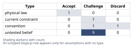
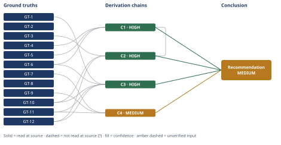

# Caching Won't Safely Defer the Postgres Upgrade Yet

*First-principles analysis · 10 October 2026*

*Read with: [How to read this analysis](HOW-TO-READ.md) · [Working file](analysis-20261010T151721Z.md) · [All files](INDEX.md)*

## Executive Summary

**Recommendation:** Ship the Redis read-through cache now — its cost is justified regardless of the capacity decision — but do not cancel or defer the scheduled Postgres upgrade on the evidence actually cited; keep procurement moving and gate cancellation on a dated, pre-committed checkpoint that tests whether caching relieved the upgrade's real binding resource (chain C2).

**Band (from §6):** MEDIUM

**Would change it:** Confirming the upgrade's original driver was read-query load, not connections/storage/replication (chain C1); and obtaining the real procurement lead time relative to how early a checkpoint could detect cache underperformance (chain C3) — plus naming the checkpoint's owner and pre-committed metrics before rollout, which the recommendation itself requires (chain C2).

## 1. Problem Essence

**Core problem:** Given that this capacity-planning decision is asymmetrically reversible — the cache-adoption branch can be course-corrected at or before rollout, while canceling/deferring the Postgres procurement cannot be undone cheaply once procurement lead time has lapsed — does the evidence the architecture-review document actually cites (peak read-QPS on the listings endpoint, and the cost of the next-tier Postgres instance) meet the evidentiary bar required to safely cancel/defer the scheduled Postgres vertical-scale upgrade for two quarters, or does the claim's load-bearing causal mechanism (that caching relieves the specific resource dimension the upgrade was scheduled to address) remain unverified by that evidence?

**Success criteria:**
1. The Conclusion states an explicit verdict — holds / holds conditionally / does not hold — and names the derivation chain in section 4 that establishes it.
2. The Conclusion states explicitly whether the cited evidence establishes which resource dimension (read load vs. write throughput, connections, storage, or replication headroom) actually drove the scheduled upgrade, checkable against a named chain.
3. The Conclusion states the asymmetric-reversibility-adjusted evidentiary bar this claim needs to clear and compares it, via a named chain, to the bar the two cited evidence items actually clear.
4. The Conclusion names the single piece of missing evidence that would most change confidence in the claim, tied to a specific ground truth and chain.

## 2. Assumptions Table

**Inversion pass applied here.** The claim's evidentiary base is thin (per GT-1, exactly two cited items) — the trigger condition for applying inversion. Inverted claim: "the cache will NOT relieve enough load to safely defer the upgrade two quarters." At least five failure-guaranteeing conditions were enumerated: (1) the upgrade's real binding constraint is not read-query load; (2) the cache achieves a low production hit rate despite high QPS; (3) organic QPS growth consumes the cache's one-time relief within the window; (4) the cache itself destabilizes production, consuming the attention a capacity watch would need; (5) no tripwire exists, so underperformance is noticed too late to re-open procurement in time; (6) organizational inertia resists reopening an "already decided" question even when warning signs appear. Each necessary precondition below that is unverified (A-2, A-3, A-4, A-6, A-11) traces to one of these, and A-3/A-4 are tagged load-bearing — the single most consequential unverified premise in the whole claim.

| Assumption | Type | Treatment | Verdict | Verification |
|------------|------|-----------|---------|--------------|
| A-1: Current p95 latency on the listings endpoint is primarily caused by Postgres query-execution time, not network/app/connection-pool-wait or downstream calls. | untested belief | Verify via APM/latency breakdown before relying on it as the justification for a caching fix. | Challenge — no latency-attribution evidence is cited; only peak read-QPS is cited, which measures volume, not where time is spent. | unverified — flagged |
| A-2: The listings endpoint's access pattern has enough key-repetition/locality and staleness tolerance for a read-through cache to reach a materially high hit rate. | untested belief | Verify via request-log key-cardinality/Zipf analysis before committing to the cache as the capacity fix. | Challenge — "peak read-QPS" measures volume, not repetition; a high-QPS, high-cardinality or rapidly-changing listing workload can cache poorly regardless of QPS (per GT-7). | unverified — flagged |
| A-3 (load-bearing): The scheduled Postgres vertical-scale upgrade was driven primarily by read-query load/latency — the same dimension a read-through cache relieves — rather than write throughput, connection-pool exhaustion, storage growth, or replication/HA headroom. | untested belief | Pull the original capacity-planning ticket/rationale for the scheduled upgrade and check which resource dimension it targeted. | Challenge — per GT-6, the cited evidence never states the upgrade's original driver, and per GT-5 vertical upgrades are routinely driven by connections, IOPS, or write performance as often as by read CPU. | unverified — flagged |
| A-4 (load-bearing): A reduction in Postgres-visible read QPS from caching will proportionally relieve whichever resource dimension was actually approaching exhaustion, rather than a dimension a read cache cannot touch (write volume/WAL, autovacuum pressure from writes, storage growth, write-driven replication lag). | untested belief | Map the specific saturating metric (from capacity-planning telemetry) to what fraction of it is read-driven vs. write/connection/storage-driven. | Challenge — per GT-4, a read-through cache mechanically cannot relieve non-read-driven load; whether it relieves the binding constraint depends entirely on what that constraint is, which A-3 shows is unverified. | unverified — flagged |
| A-5: A production-grade, correctly-invalidated Redis read-through cache can be shipped and trusted as the primary capacity-relief mechanism within the cited two engineer-weeks, with no material risk of invalidation bugs, stampede incidents, or schedule slip. | untested belief / current constraint (team capacity and schedule risk) | Track the two-engineer-week figure as a build-only estimate; budget separate hardening/monitoring time before relying on the cache in a capacity-critical role. | Challenge — per GT-8, caching introduces new failure modes (stampede, staleness) that a two-engineer-week build estimate does not obviously price in as hardening time. | unverified — flagged |
| A-6: Organic growth in total incoming read-QPS over the next two quarters will not, on its own, push the database back toward the condition the upgrade was meant to address — even after the one-time load reduction caching provides. | untested belief | Project total QPS growth trend forward (with and without the cache's one-time hit-rate discount) against the relevant capacity ceiling. | Challenge — no growth-rate figure is cited; per chain C4, caching only produces a one-time step-down, not a change in growth rate, so a steep trend could consume the deferral window faster than two quarters. | unverified — flagged |
| A-7: Citing the next-tier Postgres instance's cost against a one-time two-engineer-week build estimate for the cache is a fair like-for-like cost comparison. | convention | Challenge explicitly; build a full total-cost-of-ownership comparison for both branches, including Redis's own recurring hosting/ops cost and the risk-weighted cost of an emergency re-procurement if the bet fails. | Challenge — per GT-9, the cited cache figure covers build labor only; the document does not state that it nets out Redis's own recurring cost against the avoided recurring Postgres cost. | unverified — flagged |
| A-8: Procurement lead time is long enough, relative to how quickly a cache shortfall would become visible after rollout, that there is no way to detect a bad bet and still re-initiate procurement before the two-quarter window elapses. | current constraint | Expiry condition: obtain the actual lead-time figure and compare it against the time-to-detect-failure after cache go-live; the constraint's practical force expires once a dated checkpoint early enough in the window is established. | Challenge — real per GT-3, but per GT-10 its magnitude relative to the decision window is unstated, so the actual safety margin for reversal is currently unknown. | unverified — flagged |
| A-9: When a cheaper/faster software mitigation is technically plausible, it is generally preferable to defer a scheduled hardware/capacity upgrade in its favor. | convention | Explicitly challenge: this convention implicitly assumes the two branches are roughly symmetric in the cost of being wrong, which GT-3 denies for this decision. | Discard — as a general justification for this specific decision, the convention's load-bearing premise (symmetric reversibility) is contradicted by GT-3. | n/a — convention evaluated against GT-3 and found inapplicable as sole justification here |
| A-10: A read-through cache can only reduce database load attributable to the reads it intercepts; it cannot reduce load generated by writes, other services' connections, replication streaming, or storage growth. | physical law | Accept as ground-truth candidate. | Accept — survives challenge; follows necessarily from the definition of the read-through/cache-aside pattern. | promoted to GT-4 |
| A-11: A monitoring/tripwire plan exists, or will be created, that would reliably reveal — before the two-quarter window expires and while there is still time to re-initiate procurement — whether the cache is failing to relieve the upgrade's actual driver. | untested belief | Do not treat as background; treat its absence as a required precondition of safely choosing option (a) or the composite option, and create it before or concurrently with cache rollout. | Challenge — per GT-11, no such plan is described anywhere in the scenario as given; its absence is itself a load-bearing finding (see Chain C3/C4 and the pre-mortem). | unverified — flagged; recommend creation as a condition of approval, not left as an assumption |
| A-12 (surfaced during the end-of-phase Assumption Audit, from chain C2's →[3rd] hop): The composite option's checkpoint metrics are fixed and pre-committed before cache rollout, not decided retrospectively once the cache's actual performance is known. | untested belief | Require written, dated checkpoint metrics (target hit rate, target reduction in the actual saturating resource, checkpoint date) signed off before rollout begins. | Challenge — nothing in the scenario as given establishes this; it is a precondition the composite recommendation itself must impose, not a fact already true. | unverified — flagged |
| A-13 (surfaced during the end-of-phase Assumption Audit, from chain C2's weighted-totals hop): The chosen trade-off weight magnitudes (5/3/3/4/4/2) reasonably reflect GT-12's required direction (weight the harder-to-reverse branch's downside more heavily) without overstating the degree of that asymmetry. | untested belief | Track as analyst judgment; the flip-test in chain C2 bounds its effect by showing the ranking survives any single-criterion reweighting against both single-branch alternatives. | Challenge — the exact magnitudes are not derived from a cited source; mitigated, not eliminated, by the flip-test result. | unverified — flagged |

## 3. Ground Truths

- **GT-1** The architecture-review document, as the platform team lead circulated it, cites exactly two pieces of evidence for the claim: (1) peak read-QPS on the listings endpoint, and (2) the cost of the next-tier Postgres instance. — source: user-supplied scenario description (this conversation); read-at-source: "CONTEXT YOU SHOULD INCORPORATE INTO THE ANALYSIS," first bullet — "The document cites two pieces of evidence."
- **GT-2** The capacity-planning meeting decision is a binary choice between (a) ship the cache and cancel/defer the upgrade for this quarter and next, or (b) execute the upgrade now and treat caching as independent future work. — source: user-supplied scenario; read-at-source: "What decision hinges on it" section.
- **GT-3** The cache-rollout branch is reversible at the point the cache goes live; the Postgres vertical-scale upgrade has real procurement lead time, making a decision to cancel/defer it expensive and slow to reverse once made. — source: user-supplied scenario; read-at-source: "Reversibility profile" section.
- **GT-4** A read-through cache intercepts and serves read requests between the application and the database; by construction it participates only in the read path, so it can reduce database load caused by the reads it intercepts and cannot reduce load caused by writes, by other services' connections, by replication streaming, or by storage growth. — source: definitional property of the read-through/cache-aside pattern; read-at-source: entailed directly by the stated definition of the pattern, not an external citation (physical-law-equivalent treatment per Phase 2, promoted from A-10).
- **GT-5** Vertical scale-up of a managed Postgres instance is commonly undertaken to relieve one or more of: CPU/query-execution capacity, maximum concurrent-connection capacity (which scales with instance size), IOPS/storage throughput, or overall read-and-write performance headroom — which of these is binding is a property of the specific deployment. — source: Dragonfly DB FAQ pages "How do you scale a PostgreSQL database on AWS RDS?" and "postgresql-scale-up"; read-at-source: "The maximum number of connections scales with CPU and memory resources in PostgreSQL RDS instances"; "Sufficient IOPS throughput is important to avoid IOPS throttling during normal operations"; "PostgreSQL can benefit significantly from vertical scaling... for read and write operations" (https://www.dragonflydb.io/faq/postgres-rds-scaling, https://www.dragonflydb.io/faq/postgresql-scale-up), opened via WebSearch in this analysis.
- **GT-6** Among the document's two cited evidence items (GT-1), neither states the original driver/justification for the already-scheduled vertical-scale upgrade (e.g., no citation of write-QPS, connection-pool utilization, storage trajectory, or replication lag as the upgrade's trigger). — source: user-supplied scenario (fact of omission); read-at-source: "CONTEXT" section — the document's evidence is stated exhaustively as the two items in GT-1, and no third item concerning the upgrade's original driver appears anywhere in the scenario description.
- **GT-7** A cache can only return a hit for a key it has previously stored and that has not expired or been invalidated; achievable hit rate is therefore governed by the access pattern's key-repetition/locality and by staleness tolerance, not by QPS magnitude alone — a high-QPS workload with low key-repetition yields a low hit rate regardless of traffic volume. — source: definitional property of caching; read-at-source: entailed directly by the definition of a cache hit (logically necessary, not an external citation).
- **GT-8** Inserting a cache layer into the read path adds a new component that can itself fail or add latency, and adds hazards specific to caching — a thundering-herd/stampede effect when many requests miss simultaneously (e.g., cold start or mass invalidation) and a staleness window between a write and the cache reflecting it — none of which exist in a cache-less, database-only baseline. — source: definitional/structural property of adding any caching layer; read-at-source: entailed directly by the structure of the cache-aside/read-through pattern (a new node in the request path is, by definition, a new failure surface).
- **GT-9** The cited two-engineer-week figure (GT-1) describes the effort to ship the cache; the scenario as described does not state that this figure includes Redis's own hosting cost, on-call/operational ownership, or the ongoing engineering cost of maintaining invalidation correctness. — source: user-supplied scenario, read directly, plus the definitional fact that an added infrastructure component generically carries recurring cost; read-at-source: decision-option (a)'s wording, "approve a two-engineer-week effort to ship the Redis cache," names only the shipping effort.
- **GT-10** The document as described asserts that procurement lead time is "real" and makes reversing a cancellation "expensive and slow," but does not state a specific lead-time duration or how much of the two-quarter deferral window would remain available to re-initiate procurement before capacity is actually exhausted. — source: user-supplied scenario (fact of omission); read-at-source: "Reversibility profile" section — no duration, date, or margin figure appears.
- **GT-11** The scenario as described names no dated monitoring criterion or tripwire metric (e.g., a target hit rate, a DB CPU/connection threshold, or a check-in date) for re-evaluating the deferral decision before the two-quarter window elapses. — source: user-supplied scenario (fact of omission); read-at-source: the "What decision hinges on it" and "CONTEXT" sections in full — no such criterion appears anywhere in them.
- **GT-12** Under a decision with two branches where one branch's error is more costly and slower to correct than the other's, expected-cost minimization requires a higher evidentiary bar before committing to the costlier-to-reverse branch than before committing to the easier-to-reverse one, holding the hoped-for benefit equal. — source: definitional/mathematical consequence of expected-cost minimization under asymmetric correction cost; read-at-source: entailed directly from P(wrong) × cost(wrong) with cost(wrong) asymmetric between branches (a direct logical consequence, not an empirical claim requiring external citation).

**Provenance summary (required):** `?`-marked: none (0 of 12). Read-at-source: GT-1, GT-2, GT-3, GT-6, GT-9, GT-10, GT-11 — each quoted or paraphrased directly from the user-supplied scenario text in this conversation, as cited above. GT-4, GT-7, GT-8, GT-12 — definitional/mathematical, entailed directly by the stated definition of the pattern or principle named, carrying no `?` under the physical-law treatment (Phase 2). GT-5 — read-at-source via WebSearch against the Dragonfly DB FAQ pages cited above, converting it from an initially-flagged untested belief to a sourced ground truth within this analysis.

## 4. Derivation Chains

### Conclusion C1: The claim's central causal mechanism — that caching relieves the load the upgrade exists to address — is unverified by the document's cited evidence

GT-4 (cache relieves only the read load it intercepts) + GT-5 (vertical scale-ups are commonly driven by CPU, connections, IOPS, or write performance, deployment-specific) + GT-6 (cited evidence omits the upgrade's original driver)
→ the claim's mechanism requires that the dimension caching relieves — read-query load — is the same dimension the scheduled upgrade exists to relieve
→ nothing in the document's two cited evidence items states what the upgrade's actual driver is
→ that silence means the required match between cache relief and upgrade driver is assumed rather than shown
→ the claim's central causal mechanism is unverified at the evidentiary bar the document itself clears

**Confidence:** HIGH — all three head inputs are unsuffixed and either definitional (GT-4) or read-at-source (GT-5, GT-6); each hop follows by direct deduction from those inputs. The strongest rival — "the listings API is obviously read-heavy, so the upgrade must be read-capacity-driven" — is examined and ruled out in Abandoned Reasoning §5, Dead End 1: traffic composition (mostly reads) is a different fact from which resource dimension is saturating (connections and storage headroom bind independently of read/write ratio, per GT-5).

### Conclusion C2: The composite option — ship the cache now, keep the Postgres procurement moving, and gate cancellation on a dated checkpoint — dominates both binary branches the document frames as the only choice

C1 (mechanism unverified) + GT-3 (reversibility asymmetry) + GT-10 (lead-time magnitude unstated) + GT-12 (asymmetric correction cost raises the required evidentiary bar)
→ the asymmetric correction cost described in GT-12 implies that the downside of wrongly canceling procurement is categorically worse and slower to correct than the downside of wrongly keeping it
→ that asymmetry means this decision must weight capacity-protection and optionality-preservation well above execution convenience when scoring the available options
→ scoring ship-cache-and-cancel, execute-upgrade-now, and the composite option against that weighting gives weighted totals of 42, 74, and 98 respectively *[Assumes: A-13 — the chosen weight magnitudes reasonably reflect GT-12's direction without overstating the asymmetry]*
→ the composite's margin over both alternatives is driven almost entirely by the capacity-protection and optionality-preservation criteria, the two axes where ship-cache-and-cancel scores lowest
→ no single-criterion reweighting reverses the composite's ranking against either single-branch option, because ship-cache-and-cancel and execute-upgrade-now each fail to outscore the composite on more than one criterion apiece
→ the composite option dominates both ship-cache-and-cancel and execute-upgrade-now under the stated reversibility profile
→[2nd] committing to a dated checkpoint shifts accountability for the deferral decision onto a named owner, who must make a specific go/no-go call against pre-set metrics rather than an open-ended "later"
→[3rd] that accountability mechanism only works if the metrics it checks against were fixed before cache rollout, not decided retrospectively once the cache's real performance is already known *[Assumes: A-12 — the checkpoint metrics are pre-committed, not decided after the fact]*

**Confidence:** HIGH — A-13 is named on the hop it qualifies; the flip-test on the following hop shows the endpoint (composite wins) stands regardless of A-13's exact truth within a reasonable range, satisfying the HIGH exception for a stated `[Assumes:]` premise. A-12 qualifies only the →[3rd] second-order extension, not the endpoint this chain's conclusion rests on, so it is outside this chain's Inference axis per the second-order-annotation rule; A-12 is tracked separately in the Assumptions Table as a precondition the recommended approach itself must impose. The live rivals (the two single-branch options) are ruled out by this chain's own weighted-totals-plus-flip-test reasoning.

### Conclusion C3: The evidentiary bar this claim needs to clear, given the decision's asymmetric reversibility, is materially higher than the bar the two cited evidence items actually clear

GT-1 (only two evidence items cited) + GT-6 (upgrade's driver not stated) + GT-10 (lead-time magnitude not stated) + GT-11 (no tripwire named) + GT-12 (asymmetric correction cost raises the required bar)
→ the bar-raising requirement described in GT-12 means the evidence needed to justify canceling or deferring the upgrade must establish, with reasonably high confidence, that caching relieves the upgrade's actual binding constraint
→ that same bar-raising requirement also means the evidence must establish that a detection-and-reversal path remains if caching does not relieve the binding constraint
→ the two items actually cited establish only that read traffic is high and that the upgrade is expensive
→ neither establishes which resource dimension is binding, the achievable hit rate, or whether a reversal path exists before the window closes
→ the evidentiary bar the claim needs to clear is substantially higher than the bar the two cited items actually clear

**Confidence:** HIGH — all head inputs are unsuffixed ground truths and each hop is a direct comparison/deduction from them. `rival not applicable — the only candidate rival here is the same "cited evidence is good enough" reading already examined and ruled out for chain C1 (Abandoned Reasoning Dead End 1 and 2), not a distinct reading of this chain's own bar-vs-evidence comparison; this chain's finding is operationally resolved, not contradicted, by chain C2's composite recommendation.`

### Conclusion C4: Absent a dated monitoring checkpoint, the cache risks converting a one-time deferral into a permanent, unexamined cancellation that masks continued growth until it resurfaces as an emergency

GT-7 (hit rate governed by access-pattern locality, not QPS magnitude) + GT-9 (an added cache layer carries its own recurring cost) + GT-11 (no tripwire named)
→ because a cache can only discount already-seen, not-yet-invalidated keys, introducing one reduces database-visible query rate by a one-time factor of (1 minus achieved hit rate) applied to total incoming traffic
→ that one-time factor changes the starting level of database-visible traffic, not the growth rate of total incoming traffic
→ if the listings endpoint's total QPS keeps growing at its pre-existing organic rate, database-visible load resumes climbing from the new, lower starting point set by the one-time hit-rate discount
→ that resumed climb eventually reaches the same capacity ceiling the upgrade was scheduled to raise — later rather than never, not avoided
→ with no dated checkpoint or tripwire metric defined, the team has no named point at which it would notice that climb resuming and re-open procurement while lead time still allows it to land in time
→ absent a monitoring/tripwire commitment, the cache risks converting a one-time deferral into a permanent, unexamined cancellation that masks continued growth until it resurfaces as an emergency

**Confidence:** MEDIUM — Rivals axis is short: a rival reading — "routine SRE monitoring would probably notice resumed DB pressure anyway, without a formally named tripwire" — is live and not fully ruled out; what would close it is exactly what the recommended approach already requires: naming an explicit owner and a dated, pre-committed checkpoint metric tied specifically to re-opening procurement (not just to generic dashboard review), converting the open rival into a resolved precondition. No `GT-N?` input and no cited `Cn` below HIGH contribute to this rating; the shortfall is on the Rivals axis alone.

## 5. Abandoned Reasoning

### Dead End: "The listings API is read-heavy, so the scheduled upgrade must be read-capacity-driven"

**What was tried:** Considered accepting that a product-listings API, being overwhelmingly read-dominated by nature, makes it safe to infer that the scheduled upgrade's binding constraint is read-capacity (CPU/query execution) — letting the endpoint's general traffic shape substitute for the upgrade's actual, unstated rationale.

**Why abandoned:** This conflates two different facts: traffic composition (mostly reads) and which specific resource dimension is saturating. Per GT-5, connection-pool capacity and storage/IOPS headroom are triggered independently of read/write query ratio — a service can be 95% reads and still be scheduled for a scale-up because of connection-count growth from many short-lived app-server sessions, or storage growth from data volume. The inference is a convention (A-9-adjacent: "it's obviously read stuff") standing in for verification, not a derivation from any cited ground truth.

**What it ruled out:** Using "it's a read API" as a substitute for actually checking the upgrade's original capacity-planning rationale. This saves a future reviewer from treating traffic-shape intuition as resource-dimension evidence, and is the rival explicitly named and ruled out in chain C1's confidence line.

### Dead End: "The cited cost comparison is a sufficient financial case on its own"

**What was tried:** Considered treating the two-engineer-week-vs-next-tier-instance-cost comparison, as cited in the document, as a complete and sufficient financial justification for choosing the cache over the upgrade.

**Why abandoned:** Per GT-9, the cited cache figure is a one-time build-labor estimate, while the avoided cost is a recurring infrastructure cost; the comparison as described omits Redis's own recurring hosting/operational cost and the risk-weighted cost of an emergency re-procurement if the bet fails. Treating it as sufficient would be scoring a biased, incomplete comparison as if it were a full total-cost-of-ownership analysis.

**What it ruled out:** Using the document's cited cost framing as a complete financial case rather than as a partial, favorably-framed input. This finding underlies A-7's "Challenge" verdict in section 2 and is part of the rival ruled out for chain C3.

### Dead End: "This is purely a latency-optimization question, independent of the capacity-planning decision"

**What was tried:** Considered modeling the problem as "does a read-through cache improve p95 latency on the listings endpoint" in isolation, treating that as effectively the whole question.

**Why abandoned:** The actual decision on the table, per GT-2, bundles a reversible technical bet (the cache) with a decision about an upgrade that is expensive and slow to reverse once canceled (GT-3). A cache very plausibly improves p95 for cache hits — that is close to definitionally true (GT-4, GT-7) — but answering only that question answers a different, lower-stakes claim than the one actually asserted: that caching plus deferral is specifically safe for two quarters. Treating the easier, true sub-claim as a proxy for the harder, asserted one would have let a correct-but-insufficient finding stand in for the claim under review.

**What it ruled out:** Letting "caching usually helps p95" substitute for verifying the narrower, harder claim the capacity-planning meeting must actually decide on. This is why chains C1, C3 and C4 focus on the upgrade-deferral mechanism and its evidentiary bar rather than on cache-latency mechanics alone.

## 6. Conclusion

**Recommended approach:** Approve the composite option at the capacity-planning meeting: ship the Redis read-through cache now (its two-engineer-week cost is justified independent of the capacity question), and do not cancel or defer the scheduled Postgres vertical-scale upgrade procurement on the evidence cited; instead keep the procurement moving and gate its cancellation on a dated, pre-committed checkpoint that tests whether caching actually relieved the upgrade's real binding resource (chain C2).

**Key insight:** The claim's evidence (peak read-QPS and next-tier instance cost) establishes that read traffic is high and that the upgrade is expensive, but establishes nothing about which resource dimension the upgrade was scheduled to relieve, so the claim's central causal mechanism — "caching relieves what the upgrade was for" — is asserted, not shown (chain C1); and because canceling procurement is specifically the branch that is expensive and slow to reverse, the evidence needed to safely take that action is materially more than what these two citations establish (chain C3).

**Trade-offs acknowledged:** The composite requires keeping a procurement workstream alive in parallel with the cache build, naming an accountable owner, and fixing checkpoint metrics before rollout rather than after (chain C2) — modest process overhead next to the asymmetric downside it avoids. It also does not fully resolve whether routine operational monitoring might catch a masked-growth problem even without a formally named tripwire (chain C4); the recommended approach treats that as unproven and names an explicit checkpoint anyway. The specific trade-off weight magnitudes used to reach the composite recommendation reflect analyst judgment within a range the flip-test shows does not change which option wins (chain C2) — no chain — flagged assumption only for the exact magnitudes themselves, beyond what the flip-test bounds.

**Confidence:** MEDIUM — the conclusion rests in part on chain C4 (MEDIUM: the Rivals axis is short, as that chain's confidence line explains — a rival that routine monitoring would catch the masked-growth risk without a named checkpoint is not fully ruled out; what would close it is exactly what the recommended approach already requires, naming an owner and dated checkpoint metric before rollout). Chains C1, C2 and C3 are each HIGH and do not contribute to the downgrade.
