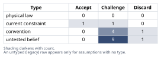
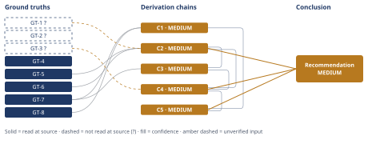

# Redis Cache vs. Postgres Upgrade Timing Decision

*First-principles analysis · 10 October 2026*

*Read with: [How to read this analysis](HOW-TO-READ.md) · [Working file](analysis-20261010T173536Z.md) · [All files](INDEX.md)*

## Executive Summary

**Recommendation:** Do not cancel or defer the scheduled Postgres vertical-scale upgrade based on this claim; proceed with it now while shipping the Redis cache in parallel as an independently, fully scoped workstream, revisiting any future deferral only once measured data exists (chain C4, chain C5).

**Band (from §6):** MEDIUM — every chain the Conclusion rests on (chain C2, chain C4, chain C5) is MEDIUM, not HIGH or LOW.

**Would change it:** Verifying whether the DB is actually read-bound vs. write/lock/vacuum/connection-bound (chain C2), and confirming the real procurement lead-time/cancellation terms (chain C4) — either would move the band or the recommendation.

## 1. Problem Essence

**Core problem:** Given that the platform lead's claim bundles several unverified technical preconditions (DB bottleneck type, cache hit-rate achievability, p95 latency composition, QPS growth, cache failure blast radius, and estimate completeness) with a decision that sits at an asymmetric reversibility boundary (cheap to reverse before the cache ships and the upgrade is cancelled; expensive and slow to reverse after procurement lapses), should the team cancel/defer the scheduled Postgres vertical-scale upgrade in favor of shipping the Redis cache, or preserve the upgrade (in full or in part) while treating the cache as independent work?

**Success criteria:**
1. The Conclusion section names which of (a) cache-and-defer, (b) upgrade-now-cache-later, or a composite option it recommends, and that recommendation cites the Derivation Chain that established it.
2. The Conclusion section's confidence rating names which of the claim's load-bearing assumptions (DB bottleneck type, cache hit-rate achievability, p95 latency composition, QPS growth rate, cache blast radius/fallback, estimate completeness) are verified versus unverified, and ties the rating to that status.
3. The Conclusion section's recommendation explicitly weighs the stated reversibility asymmetry (cheap now, expensive once procurement is cancelled/delayed) rather than treating options (a) and (b) as symmetric in cost-of-being-wrong.

## 2. Assumptions Table



| Assumption | Type | Treatment | Verdict | Verification |
|---|---|---|---|---|
| A-1: Read-QPS is representative of overall DB load (the DB is read-bound) | untested belief | Verify via read/write ratio telemetry, else flag unverified | Challenge — peak read-QPS measures read traffic volume only; per GT-5 it cannot distinguish a read-bound DB from a write/lock/vacuum/connection-bound one | unverified — flagged |
| A-2: The DB is read-QPS-bound rather than write/lock/vacuum/connection-bound | untested belief | Verify via `pg_stat_activity` wait-event breakdown and `pg_stat_user_tables` under peak load | Challenge — no lock-wait, vacuum-pressure, or connection-saturation telemetry was cited | unverified — flagged |
| A-3: Achievable cache hit-rate given listing data's freshness/invalidation needs is high enough to matter | untested belief | Verify by measuring per-key update frequency and cardinality before committing to a hit-rate expectation | Challenge — per GT-6, caching benefit is conditional on a read-heavy, infrequently-updated per-key access pattern, which was not evidenced | unverified — flagged |
| A-4: p95 latency on the listings endpoint is dominated by Postgres query time, not network/app-layer overhead | untested belief | Verify via distributed tracing/APM breakdown of the p95 request | Challenge — no latency-composition breakdown was cited, only aggregate QPS and instance cost | unverified — flagged |
| A-5: QPS growth over the next two quarters stays within the headroom a cached current-tier DB can sustain | untested belief | Project growth from at least 2 prior quarters of trend data; record as a current constraint until trend data exists | Challenge — only a peak snapshot was cited, no growth trend | unverified — flagged |
| A-6: Redis failure or cold-cache blast radius is bounded (graceful degradation, stampede protection, circuit breaking) | untested belief | Verify the design includes request coalescing, jittered TTLs, and a load-shedding/circuit-breaker fallback | Challenge — not mentioned in the cited evidence or the 2-engineer-week scope | unverified — flagged |
| A-7: The two-engineer-week estimate includes invalidation logic, monitoring/alerting, and cache-stampede protection | untested belief | Verify against an explicit scope breakdown / definition of done | Challenge — GT-6/GT-7's mechanics make these non-optional components of a production read-through cache; a bare 2-week figure for a new cache layer with invalidation is conventionally underscoped | unverified — flagged |
| A-8: Vertical-scaling the Postgres instance would fix whatever is currently driving capacity concern | convention | Explicitly challenge: vertical scaling is the default lever, but per GT-5 it only helps CPU/RAM/IO-bound symptoms | Challenge — the capacity-planning document's own framing assumes a resource-bound problem without ruling out lock/vacuum/connection-bound causes; accept only conditionally on the bottleneck actually being resource-bound | GT-5 (read-at-source) |
| A-9: Peak read-QPS and next-tier instance cost are sufficient evidence for this specific causal decision | convention | Challenge: these are the two figures conventionally tracked in capacity-planning docs, but per A-2/A-4 they do not speak to bottleneck type or latency composition | Challenge — necessary but not sufficient evidence for the causal claim being made | unverified — flagged |
| A-10: Reversing a cancelled/delayed Postgres procurement after the fact is expensive and slow, while the decision is cheap to reverse up until cache ship and formal cancellation | current constraint | Record expiry: holds while this organization's procurement lead time and cancellation terms remain as described; lapses if procurement moves to a no-lead-time/elastic model | Accept — expires if procurement terms change; until then this is the operative constraint on the decision, not a negotiable one | unverified — flagged (scenario context, no source document; GT-3?) |
| A-11: The decision is a binary choice between (a) and (b) | convention | Challenge: the framing excludes a composite (upgrade proceeds while cache ships in parallel, deferring only the irrevocable cancellation step) | Discard as framed — a composite option survives scrutiny in the Phase 4 trade-off and is carried forward as option (c) | n/a — framing challenge, resolved in Phase 4 (C4) |
| A-12: A read-through cache reduces both read and write DB load | untested belief | Verify against cache mechanics | Discard — per GT-6 (definitional), a read-through cache only intercepts reads; it cannot reduce write-path DB load by construction | GT-6 (definitional) |
| A-13: A newly-deployed Redis cache reaches steady-state hit rate quickly enough to matter within the two-quarter deferral window | untested belief | Verify via warm-up curve measured in a canary/staging rollout | Challenge — unevidenced; per GT-7, hit rate is 0% on first access to any key and ramps only as keys are re-read | unverified — flagged |
| A-14: Two quarters is a safe deferral window | convention | Challenge: chosen to align with the next capacity-planning cycle, not derived from growth data | Challenge — no growth-rate evidence ties this window to actual headroom | unverified — flagged |
| A-15: The trade-off weighting (Safety=5, Optionality=5, Cost=3, Speed=2, Capacity=2) reflects this organization's actual risk tolerance and priorities | convention | Challenge/validate with actual stakeholders before treating the weighted result as final | Challenge — a reasonable default prioritization of safety given the reversibility asymmetry (A-10), but not confirmed against this organization's actual risk appetite | unverified — flagged [surfaced in Assumption Audit, C4] |
| A-16: Decoupling cache delivery from a cancellation deadline reduces scope-cutting pressure on the implementing team | untested belief | Verify via retrospective/observation once implemented | Challenge — a plausible organizational-behavior claim, not verified for this specific team | unverified — flagged [surfaced in Assumption Audit, C5 2nd-order step] |
| A-17: Hit-rate, DB wait-event, and QPS-growth telemetry will actually be instrumented and reviewed at the next capacity-planning meeting | current constraint | Record expiry: holds only if a named owner and calendar trigger exist; this is exactly the risk the pre-mortem's Cluster A names | Challenge — not yet true by default; mitigated only if Phase 5's disposition (named owner + tripwire) is adopted | unverified — flagged [surfaced in Assumption Audit, C5 3rd-order step] |

## 3. Ground Truths

- **GT-1?** A peak read-QPS figure for the listings endpoint is cited in the architecture-review document circulated by the platform team lead — cited to: the architecture-review document; reported-by-delegate: the platform team lead's document, as described in this analysis's scenario context — cited source not opened by this analysis (no file or URL was supplied). Phase 3 failure record: source unreachable — the architecture-review document is referenced in the task description but no file, URL, or underlying figure was made available to this analysis; the figure's value, its read/write composition, and any growth trend are unknown.
- **GT-2?** A next-tier Postgres instance cost figure is cited in the architecture-review document — cited to: the architecture-review document; reported-by-delegate: the platform team lead's document — cited source not opened by this analysis. Phase 3 failure record: same as GT-1 — no file or URL was supplied; the actual cost delta is unknown.
- **GT-3?** Reversing a cancelled/delayed Postgres procurement decision after the fact is expensive and slow, given real procurement lead time, while the decision remains cheap to reverse up until the cache ships and the upgrade is formally cancelled — unverified: stated as given decision context in this analysis's task description, with no source document, procurement contract, or vendor lead-time figure supplied; treated as the operative current constraint for this analysis per the Input Contract (a supplied ground truth still enters Phase 2/3 classification rather than being taken on faith).
- **GT-4** Read-through/invalidated caching's benefit is conditional on a per-key access pattern that is read-heavy and infrequently updated; frequently-updated keys incur invalidation overhead that can exceed the caching benefit — source: Redis documentation, "Client-side caching introduction," section "Usage recommendations"; read-at-source: quoted — "Caching gives the most benefit for keys that are read frequently and updated infrequently... the performance overhead of the invalidation messages can be greater than the savings made by caching" (describing non-cache-friendly data). Scope boundary: this documentation addresses Redis client-side caching specifically; the read:write-ratio dependency it states is a general property of invalidated caches and is applied here to a server-side read-through cache by generalization, not by direct quotation of a source discussing that exact topology.
- **GT-5** Vertical-scaling a PostgreSQL instance (more CPU/RAM/IO) does not by itself change autovacuum triggering — which is governed by tuple-count/transaction-age thresholds, not hardware capacity — does not resolve lock contention caused by long-running transactions, and does not raise `max_connections`, which is a separately configured, restart-required parameter — source: PostgreSQL documentation, "Routine Vacuuming" and "Connection Settings (max_connections)"; read-at-source: quoted — vacuum-threshold formula ("vacuum threshold = Minimum(vacuum max threshold, vacuum base threshold + vacuum scale factor * number of tuples)"), the lock-conflict warning ("If a process attempts to acquire a lock that conflicts with the SHARE UPDATE EXCLUSIVE lock held by autovacuum, lock acquisition will interrupt the autovacuum"), and the `max_connections` definition ("This parameter can only be set at server start").
- **GT-6** A read-through cache intercepts only read operations between the application and the datastore; by construction it cannot reduce write-path load on the underlying database — definitional: a logical consequence of the definition of "read-through cache" (a cache populated on read-miss that serves subsequent reads), independent of this specific system; read-at-source: established by definition, not by external citation — verifiable by inspecting what operations a read-through cache intermediates.
- **GT-7** A read-through cache has a 0% hit rate on any given key's first read after that key is absent from the cache (cold start or post-expiry); N concurrent requests for the same absent key will each independently miss to the backing datastore unless an explicit request-coalescing/locking mechanism exists — definitional: a direct, irreducible consequence of a cache with no pre-population and no coalescing; read-at-source: established by definition.
- **GT-8** Request p95 latency is the composition of its component latencies (network transit, application/serialization, and datastore query time); reducing one component (datastore query time, via caching) reduces overall p95 only in proportion to that component's share of the total latency, and not at all if another component dominates — definitional: a consequence of how latency composes along a request path; read-at-source: established by definition.

**Provenance summary:**
```text
?-marked: GT-1, GT-2, GT-3 (3 of 8)
Read-at-source: GT-4 — Redis docs, "Client-side caching introduction," Usage recommendations (quoted)
Read-at-source: GT-5 — PostgreSQL docs, "Routine Vacuuming" vacuum-threshold formula and lock-conflict warning; "Connection Settings," max_connections definition (quoted)
Definitional (no external source needed, verified by inspection of the term's definition): GT-6, GT-7, GT-8
```

## 4. Derivation Chains



### Conclusion C1: The "cut p95 latency" half of the claim is unverified as stated

GT-8 (p95 is the sum of network, app, and query time) + GT-7 (cold cache is 0% hit rate on first reads; uncoalesced concurrent misses each hit the DB)
→ the claimed p95 cut requires both that query time is p95's dominant component and that the cache reaches steady-state hit rate within the deferral window *[Assumes: A-4 — query time dominates p95; A-13 — the cache reaches steady-state hit rate within two quarters]*
→ neither precondition is evidenced by the cited peak-read-QPS or next-tier-cost figures, which speak to traffic volume and hardware price rather than to latency composition or cache warm-up behavior
→ the "cut p95 latency" half of the claim is unverified as stated, resting on two unevidenced preconditions rather than on the cited evidence

**Confidence:** MEDIUM — Inputs are clean (GT-8, GT-7 are definitional, unsuffixed), but Inference is short: the endpoint depends on hop 1's `[Assumes: A-4, A-13]` premises, neither of which this analysis has priced against real telemetry. What would close it: an APM/tracing breakdown of p95 composition (settles A-4) and a measured cache warm-up curve from a canary rollout (settles A-13).

### Conclusion C2: The "reduce DB load enough" half of the claim is unverified, because the cited evidence cannot distinguish the DB's bottleneck type

GT-5 (vertical scaling does not fix lock/vacuum/connection limits) + GT-6 (a read-through cache cannot reduce write-path load) + GT-1? (peak read-QPS cited, read-traffic volume only)
→ the scheduled vertical-scale upgrade and the proposed cache target different failure mechanisms: the upgrade's remit is CPU/RAM/IO headroom, while GT-1? measures read traffic only, so neither figure establishes whether the DB is actually resource-exhausted, lock/vacuum-contended, connection-constrained, or write-load-driven today
→ because a read-through cache cannot reduce write-path load, if any material share of current DB load is write/lock/vacuum/connection-driven, the cache leaves exactly the share of risk the vertical-scale upgrade exists to cover untouched, regardless of achieved cache hit rate
→ the "reduce DB load enough" half of the claim is unverified as stated, because the cited evidence cannot distinguish a read-bound DB (where caching helps) from a write/lock/vacuum/connection-bound one (where it does not), and the two levers are not substitutes for each other

**Confidence:** MEDIUM — GT-1? is unverified (no source document was available to this analysis; verification: open the actual peak-QPS telemetry together with the DB's wait-event, lock, vacuum, and connection-saturation stats for the same window — this is also this chain's sensitivity ground truth, see §5 adversarial pass). Hops 1-2 follow deductively from GT-5 and GT-6, which are both unsuffixed and definitional/read-at-source, so the cap traces to GT-1? alone.

### Conclusion C3: Shipping the cache while cancelling the upgrade creates a new, higher-severity failure mode than the pre-cache system had

GT-7 (cold-cache/stampede mechanics) + C2 (DB-load reduction unverified; the upgrade's remit is untouched by caching)
→ if Redis becomes unavailable or is flushed/restarted — an ordinary operational event for a newly-introduced cache layer — every previously-cached read reverts at once to the backing Postgres instance near full pre-cache volume *[Assumes: A-6 — no circuit-breaker/load-shedding fallback was scoped]*
→ because the vertical-scale upgrade — whose remit is exactly this kind of resource headroom, per C2 — has been deferred or cancelled under the claim being evaluated, the DB absorbing that reverted load has less spare capacity than it would have had under option (b), turning an ordinary cache hiccup into a capacity incident it would not otherwise have been
→ shipping the cache while cancelling the upgrade converts a routine operational event into a new, higher-severity failure mode that the pre-cache, pre-cancellation system did not have

**Confidence:** MEDIUM — capped by C2's MEDIUM rating (see C2's own line for GT-1?'s verification path). Additionally, hop 1 rests on the unpriced `[Assumes: A-6]` premise: if a circuit-breaker/load-shedding fallback is in fact scoped, this chain's severity claim weakens; what would close it: confirm whether the cache design includes such a fallback before this risk can be downgraded.

### Conclusion C4: A weighted trade-off across (a), (b), and a composite option (c) favors (c) — proceed with the upgrade while shipping the cache in parallel — robustly against single-criterion reweighting

C2 (DB-load reduction unverified; vertical scaling's remit untouched by caching) + C3 (cache failure converts a routine event into a capacity incident during the deferred window) + GT-3? (reversal is cheap now, expensive once procurement lapses)
→ weighting Safety and Optionality highest (5 each, versus Cost 3, Speed 2, Capacity 2) because C2/C3 show the claim's technical mechanism is unverified and GT-3? shows the cost of being wrong is asymmetric, the weighted score favors composite (c) at 66 over upgrade-only (b) at 61 and cache-and-defer (a) at 41 *[Assumes: A-15 — this weighting reflects the organization's actual risk tolerance]*
→ the 5-point margin between (c) and (b) survives every single-criterion reweighting within the normal 1-4 range and is overturned only by maxing the opportunity-cost (engineering-capacity) weight to its ceiling of 5, so the preference for running both workstreams is a robust result rather than a near-tie
→ recommend composite (c): proceed with (or at minimum do not cancel) the Postgres procurement now, ship the Redis cache in parallel as an independently and fully scoped workstream, and treat any future deferral of DB scaling as a decision for a later capacity-planning cycle, gated on measured data

**Confidence:** MEDIUM — capped by C2 and C3 (each MEDIUM; see their own lines) and by GT-3? directly (unverified scenario context; verification: confirm actual procurement lead time and cancellation terms with procurement/finance). Hop 1 also rests on the unpriced `[Assumes: A-15]` premise — if the organization's real risk tolerance weights Cost/Speed/Capacity far above Safety/Optionality, the flip test in the same hop shows only the Capacity weight, raised to its ceiling, actually changes the winner (to (b), never to (a)), so this premise bounds the risk to a single, named, and small-magnitude scenario rather than an open-ended one. Rival: named in §5 (two dead ends: pure (a), pure (b)-only-no-parallel-cache).

### Conclusion C5: The claim does not hold as stated; approve the cache as independent work but do not cancel or defer the scheduled upgrade this cycle

C1 (MEDIUM — latency-cut half unverified) + C4 (MEDIUM — composite option robustly preferred under reversibility asymmetry)
→ because both halves of the platform lead's claim (latency cut, DB-load reduction) rest on unverified load-bearing preconditions, and because the decision sits at an asymmetric-reversibility boundary priced into C4, the claim does not currently warrant cancelling or deferring the scheduled upgrade
→ the trade-off-robust composite option identified in C4 captures the latency/cost upside the platform lead is pursuing without spending the irreversible token (procurement cancellation) on an unverified claim
→[2nd] decoupling cache delivery from a cancellation deadline removes the implementing team's incentive to cut invalidation, monitoring, and stampede-protection scope (A-7) to hit an artificial deadline, so that scope is more likely to actually ship *[Assumes: A-16 — decoupling reduces scope-cutting pressure]*
→[3rd] once hit-rate, DB wait-event, and QPS-growth telemetry accumulate for a full quarter, the next capacity-planning meeting can decide the next scaling step from measured data instead of from a projected claim, converting today's unverified assumptions into Phase-3-grade ground truths for that future decision *[Assumes: A-17 — the telemetry is actually instrumented and reviewed on schedule]*
→ the claim does not hold as stated; approve the Redis cache as an independent workstream, but do not cancel or defer the Postgres vertical-scale upgrade this cycle — revisit deferral only at a later capacity-planning meeting, gated on measured hit-rate, DB wait-event, and QPS-growth data

**Confidence:** MEDIUM — capped by C1 and C4 (each MEDIUM; see their own lines for GT-1?, GT-3?, and assumptions A-4/A-13/A-6/A-15). The [2nd]/[3rd]-order extensions rest on unpriced `[Assumes: A-16, A-17]` premises; neither contradicts GT-4 through GT-8, so no return to Phase 2 is triggered, but A-17 in particular is the exact risk the Phase 5 pre-mortem's Cluster A names, and that pass's disposition (a named owner and a calendar/data tripwire) is what keeps this hop from degrading into the same silent-deferral failure mode as option (a).

## 5. Abandoned Reasoning

### Dead End: Accept the claim at face value and approve option (a)

**What was tried:** Evaluated taking the platform lead's claim as sufficient justification on its own, on the reasoning that platform teams often calibrate such claims against dashboards not fully quoted in the review document, and that excess caution wastes the avoided next-tier spend.

**Why abandoned:** GT-3? establishes that this decision sits at an asymmetric reversibility boundary, and A-1 through A-7 — the claim's load-bearing preconditions — are all unverified by the two evidence items actually cited (GT-1?, GT-2?). Chains C2 and C3 show the cited evidence cannot distinguish the failure mode that actually determines whether caching helps, so betting the irreversible side of an asymmetric bet on an unverified causal story is not supported.

**What it ruled out:** Treating "the team that wrote the proposal presumably has more context" as a substitute for verifying the specific preconditions (A-1 through A-7) this analysis found unaddressed by the cited evidence. This is the rival to headline conclusion C5.

### Dead End: Pure option (b) only — upgrade now, no parallel cache work this cycle at all

**What was tried:** Considered rejecting the platform lead's proposal outright and deferring all cache work to a future, fully separate cycle, rather than running it in parallel with the upgrade.

**Why abandoned:** The Phase 4 trade-off (chain C4) scores pure (b) at 61, behind composite (c) at 66, because (b) forgoes the Speed and partial Cost upside of shipping the cache in parallel at no cost to Safety or Optionality (both tie at the maximum score between (b) and (c)). The flip test in C4 shows no single realistic reweighting reverses this preference in favor of pure (b) — only maxing the Capacity/opportunity-cost weight to its ceiling does, and even then it favors (b), never (a).

**What it ruled out:** The assumption that caution about the upgrade decision requires equal caution about the cache workstream — the two are decoupled once procurement is not gated on cache success. This is the rival to chain C4.

### Dead End: Treat peak read-QPS as a sufficient proxy for DB bottleneck type and skip further diagnosis

**What was tried:** Considered accepting peak read-QPS (GT-1?) as adequate evidence that the DB's constraint is read-volume-driven, on the grounds that it is the standard capacity-planning metric this organization already tracks.

**Why abandoned:** GT-5 (read-at-source, PostgreSQL documentation) establishes that autovacuum triggering, lock contention, and connection limits are governed by mechanisms independent of read-QPS and of vertical scaling's resource dimensions. A read-QPS figure cannot, by construction, rule these mechanisms in or out, so it is provably insufficient for the specific causal question chain C2 depends on, even though it may be perfectly adequate for ordinary read-capacity provisioning.

**What it ruled out:** Using a single traffic-volume metric as a stand-in for a DB wait-event/lock/vacuum/connection diagnostic when the decision specifically turns on which failure mechanism is binding. This is the rival to chain C2.

### Dead End: Run a numeric Fermi/theoretical-limit pass on growth rate and hit-rate to sharpen the recommendation

**What was tried:** Considered applying the Estimate (Fermi) and Theoretical-Limit techniques to bracket QPS growth and achievable cache hit-rate numerically, to give the trade-off harder numbers.

**Why abandoned:** No real figures (actual QPS, growth rate, cost delta, key cardinality) were disclosed in this hypothetical scenario — only the categories of evidence cited ("peak read-QPS," "next-tier instance cost") were named, without values. A Fermi estimate built from invented unit-factors would manufacture false numeric precision rather than genuine first-principles grounding, and a theoretical-limit framing does not apply because this decision is not bounded by a physical/mathematical ceiling being stripped of convention — it is an architectural risk-sequencing decision. See the "Techniques not applied" block (process output) for the formal not-applicable lines.

**What it ruled out:** Presenting invented numeric brackets as if they were evidence-grounded, which would have manufactured false confidence beyond what the unverified `GT-1?`/`GT-2?` inputs actually support.

---

## 6. Conclusion

**Recommended approach:** Proceed with (or at minimum do not cancel) the scheduled Postgres vertical-scale upgrade now, and ship the Redis read-through cache in parallel as an independently and fully scoped workstream (including invalidation logic, monitoring, and cache-stampede protection); revisit any deferral of future DB scaling only at a later capacity-planning meeting, gated on measured hit-rate, DB wait-event, and QPS-growth data (chain C4, chain C5).

**Key insight:** The claim conflates "we have a peak read-QPS figure" with "we know the database's bottleneck is reads." The two cited evidence items — peak read-QPS and next-tier instance cost — cannot by construction distinguish a read-bound database, where caching helps, from a write/lock/vacuum/connection-bound one, where it cannot, because vertical scaling and read-through caching are not substitutes: one adds general resource headroom, the other only ever intercepts reads (chain C2).

**Trade-offs acknowledged:** This recommendation pays for the upgrade's cost this cycle — the spend the platform lead's proposal sought to avoid — and absorbs the opportunity cost of running both workstreams in parallel rather than sequentially. The weighted trade-off explicitly accepts this cost because it is outweighed by the asymmetric reversibility cost of being wrong (chain C4), but it is a real, named cost, not a free optimization.

**Confidence:** MEDIUM — matches the weakest contributing chains, all of which are MEDIUM: C2 (capped by GT-1?, unverified — verification: open the actual DB wait-event/lock/vacuum/connection telemetry), C4 (capped by GT-3? and by citing C2/C3; also rests on the unpriced `[Assumes: A-15]` weighting premise, bounded by the flip test in C4's own line), and C5 (capped by citing C1 and C4, and by the unpriced `[Assumes: A-16, A-17]` second/third-order premises). None of these chains' own lines need re-explaining here; each carries its verification path.
