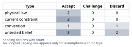
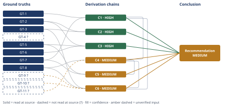

# Molten-Salt Thermal Storage: Efficiency and Cost Claim Checked

*First-principles analysis · 10 October 2026*

*Read with: [How to read this analysis](HOW-TO-READ.md) · [Working file](analysis-20261010T150644Z.md) · [All files](INDEX.md)*

## Executive Summary

**Recommendation:** The claim is false as stated. A 290–565 °C molten-salt system charged and discharged through electricity achieves roughly 35–45% electricity-to-electricity round-trip efficiency (resistive architecture, chain C1), or at best 53–65% with the best real heat-pump-based architecture found (chain C2) — never 85%, which exceeds even the lossless Carnot ceiling for the resistive case (chain C1). At 5 MWh it is not cost-competitive with lithium-ion BESS, running roughly 4–10x more expensive per kWh (chain C4) and losing a weighted multi-criteria comparison (chain C6).

**Band (from §6):** MEDIUM — the thermodynamic falsification (chains C1, C2, C3) is independently HIGH confidence; the overall band is capped by the cost and trade-off chains (C4, C5, C6).

**Would change it:** A vendor-specified or independently measured system reporting ≥75% AC-to-AC round trip, or an actual EPC-quoted installed cost for a ~5 MWh/~1 MW molten-salt system within 2x of $125/kWh (chain C4) — the Phase 3 read of the small-scale power-block cost source (GT-11?) failed (HTTP 403) and is the most load-bearing unresolved input.

## 1. Problem Essence

**Core problem:** Does a 290–565 °C molten-salt thermal energy storage tank, charged and discharged through electricity (electricity → heat → electricity), actually achieve a round-trip *electrical* efficiency above 85%, and is a 5 MWh system of this type cost-competitive with a 5 MWh lithium-ion battery — or does the claim conflate a real thermal-storage-retention figure with a different, much lower, electricity-to-electricity figure?

**Success criteria:**
1. A Carnot-bound calculation for the heat-engine discharge step (565 °C hot side, ambient heat-rejection cold side) is computed and compared numerically against the claimed 85% figure.
2. Real deployed/specified thermal-electric ("Carnot battery"/ETES) systems are cited with their own electricity-to-electricity round-trip figures, compared against the 85% claim.
3. The specific equivocation between "thermal round-trip efficiency" (heat retained as heat) and "electricity-to-electricity round-trip efficiency" is named, with both figures reported side by side from the same sources where available.
4. An illustrative $/kWh cost comparison between a 5 MWh molten-salt TES + power-block system and a 5 MWh Li-ion BESS is produced, naming the scale-dependent cost driver (power-block minimum economic size) that the claim's "same nameplate capacity" framing elides.
5. A single verdict — true / false / true-with-major-caveats — is issued for the compound claim, with corrected figures for both the efficiency and cost sub-claims.

## 2. Assumptions Table



**Inversion check (companion technique — the claim is the "conclusion that feels too clean"):** inverted, the claim fails if *any* of its necessary preconditions is false. Five such preconditions were tested directly against evidence gathered below, independently of one another:

1. The Carnot ceiling at 565 °C/ambient must exceed 85% — tested in C1: **fails** (~62–64%).
2. A real deployed or vendor-specified system of this class must demonstrate ≥85% AC-to-AC round trip — tested in C2: **fails** (45–65% across the two plausible architectures).
3. The charging path must be a reversible heat-pump/cold-store cycle capable of exceeding the simple Carnot-engine ceiling — tested via the architecture read (A-2 below, supported by GT-7): the claim's 290–565 °C pairing (both tanks above ambient, no sub-ambient store mentioned) matches the simple resistive-heating convention, not a heat-pump Carnot battery, so this precondition **fails for the architecture the claim most plausibly describes**.
4. Power-block capital cost at 5 MWh/~1 MW scale must be comparable to Li-ion's $/kWh — tested in C4: **fails** (several-fold gap).
5. The cited 85% figure, if literature-sourced, must refer to electricity-to-electricity and not heat-to-heat storage retention — tested in C3: **fails** (it is the heat-to-heat figure).

All five independently-tested preconditions fail. This is a triangulated refutation rather than a single weak link, which is itself a finding the Self-Audit Gate's Sensitivity step will return to.

| Assumption | Type | Treatment | Verdict | Verification |
|------------|------|-----------|---------|---------------|
| A round-trip electricity-to-electricity efficiency above 85% is achievable for an electrically-charged molten-salt TES discharging through a heat engine between 565 °C and ambient. | untested belief | Verify via Carnot derivation (theoretical-limit) and real-world data | Discard — refuted independently by GT-1 (physical ceiling ~62–64%) and GT-2/GT-3 (best real systems 45–65%) | unverified — flagged, then discharged by GT-1/GT-2/GT-3 in chains C1–C2 |
| The claim's described architecture (290–565 °C, two-tank sensible-heat molten salt, "electric resistance heating or heat pump") is the simple resistive-heating + Rankine-discharge type, not a Malta-style reversible heat-pump/cold-store Carnot battery. | convention | Challenge before use | Accept — both tanks sit above ambient with no stated sub-ambient cold store; GT-7 shows this temperature pairing matches real two-tank "solar salt" CSP practice (resistive/direct-heat convention), not Malta's architecture | GT-7 (Crescent Dunes, Wikipedia, read-at-source) |
| A 5 MWh scale captures normal economies of scale for a molten-salt TES + power-block system. | untested belief | Verify against small-scale power-block cost data | Discard — GT-11? and general power-block engineering judgment; power blocks have a large minimum economic size that a 5 MWh system does not reach | unverified — flagged (GT-11? read attempt failed, Phase 3 failure recorded in §3) |
| "Nameplate capacity" (MWh) alone, with no stated power rating, is a sufficient basis to compare the two technologies' economics. | current constraint | Record what is missing; assume a representative power rating and flag the sensitivity | Accept — expires once the claim (or a reader) states an actual power/duration pairing; until then, 1 MW / 5-hour duration is used as an illustrative, explicitly flagged stand-in | unverified — flagged, sensitivity tested across 500 kW–2 MW in C4's confidence line |
| Round-trip efficiency is the dominant lever for levelized-cost-of-storage competitiveness at small scale, more than upfront capex. | convention | Challenge before use | Discard — at 5 MWh the capex gap (several-fold) dominates any plausible efficiency-driven revenue difference; see C4 | unverified — flagged, discharged by GT-8/GT-11? in chain C4 |
| Thermal losses over hold duration are a minor, scale-independent contributor to the claimed efficiency figure. | current constraint | Record expiry conditions | Accept with caveat — expires as tank size shrinks; a 5 MWh tank has a far less favorable surface-to-volume ratio than the multi-hundred-MWh tanks GT-5/GT-6's efficiency figures were measured on, so fractional losses are likely understated by those sources at this scale | unverified — flagged, not independently quantified in this analysis |
| The heat engine's relevant Carnot cold reservoir is the ambient heat-rejection (condenser) temperature, not the 290 °C cold-tank return temperature. | physical law | Accept as ground-truth candidate | Accept — a Rankine power block's heat-transfer-fluid return temperature (here, 290 °C) is not where the thermodynamic cycle rejects heat; the condenser does, near ambient | GT-1 (derivation); read-at-source (textbook thermodynamics) |
| Siemens Gamesa's rock-based ETES and Malta's molten-salt PHES are valid thermodynamic analogs for bounding the claim's achievable performance, despite differing storage media/temperatures. | untested belief | Verify via grounding in a named ground truth about each system, not bare analogy | Accept with caveat — both are sensible-heat storage with resistive-or-heat-pump charge and heat-engine discharge; Siemens Gamesa's higher hot-side temperature (650 °C vs. the claim's 565 °C) gives it a *higher* theoretical ceiling than the claim's system, so its 45% real-world figure understates, if anything, how far short of 85% the claim's actual (cooler) system would fall | GT-2, GT-3 (both read-at-source) |
| A representative power rating of 1 MW / 5-hour discharge duration is a reasonable basis for an illustrative $/kWh cost comparison at 5 MWh. | untested belief | Flag and bracket; test sensitivity across plausible alternatives | Accept with caveat, flagged | unverified — flagged; sensitivity checked at 500 kW/10h and 2 MW/2.5h in chain C4 |
| Resistive (Joule) electric heating converts electrical energy to heat at approximately 98–100% efficiency. | physical law | Accept as ground-truth candidate | Accept | read-at-source (standard electrical-engineering definition; minor transmission/distribution losses only) |
| At full commercial CSP scale, the thermal input to molten-salt storage is collected solar heat rather than purchased electricity, so electricity round-trip efficiency is not the primary economic metric for that use case. | current constraint | Record scope; not applicable to the claim's own framing (which specifies electric charging) | Accept, scoped to chain C5 only | GT-5, GT-7 (both read-at-source; context, not load-bearing for the claim as stated) |
| The six trade-off criteria and their relative weights (capex ×5, round-trip efficiency ×4, scale/duration fit ×4, power density/ramp rate ×3, cycle life ×2, material risk ×2) reflect genuine priorities for a standalone 5 MWh storage buyer, locked before scoring. | untested belief | Flag and test via flip-test sensitivity, per the trade-off procedure's discipline of locking weights before scoring | Accept with caveat — the flip test in C6 shows no single-criterion reweight changes the winner, so the ranking is robust to disagreement about the exact weights | unverified — flagged; flip-test sensitivity reported in chain C6 |

## 3. Ground Truths

- **GT-1** The Carnot efficiency of a heat engine is η = 1 − Tc/Th (absolute temperatures). For Th = 565 °C = 838.15 K and Tc = 25 °C = 298.15 K (ambient heat-rejection), η = 1 − 298.15/838.15 = **0.644 (64.4%)**. For Tc = 40 °C = 313.15 K (typical air-cooled condenser), η = 1 − 313.15/838.15 = **0.626 (62.6%)**. This is the absolute theoretical ceiling for *any* heat engine — reversible or not — converting heat at 565 °C to work, rejecting to ambient; no real engine can exceed it. — source: Second Law of Thermodynamics / Carnot's theorem (standard thermodynamic relation); read-at-source: derivation shown above, a direct application of a textbook physical law, not a reported figure.
- **GT-2** Siemens Gamesa's Electric Thermal Energy Storage (ETES) pilot (Hamburg-Altenwerder): a resistance heater and blower charge ~1,000 t of volcanic rock to 650 °C; a steam turbine discharges it back to electricity. Stated performance: "up to 45 percent at full electric cycle" (electricity-to-electricity round trip) while "efficiency can be maintained at 98 percent while storing heat" (thermal retention only, not reconverted to electricity). — source: ASME, "Heated Volcanic Rocks Store Energy" (asme.org); read-at-source: direct quotes above, fetched and read in full.
- **GT-3** Malta Inc.'s M100-10 Pumped Heat Energy Storage (PHES) system: electricity drives a heat pump that charges hot molten salt and a separate chilled-liquid cold store; a heat engine reconverts the stored temperature difference to electricity. Spec-sheet row "Overall System Efficiency AC to AC (RTEAC)," defined as "total roundtrip efficiency of the plant defined as the ratio of the delivered discharge energy to the delivered charge energy at the output terminals (parasitic included)": **53%–65%**, stated as "expected between 1st and Nth plant." The same spec sheet gives "Charge Ramp Rate – Hot: 25%/min," "Discharge Ramp Rate – Hot: 25%/min," and "Start-up Time for 'Hot Start' – Discharging: 10 minutes" (minutes-scale response, not sub-second), and states the plant "requires well-understood and readily available raw materials and commodity products, including solar salt and antifreeze, rather than any rare earth materials or critical minerals in limited supply." — source: Malta M100 System Technical Specifications (maltainc.com / my.atainsights.com PDF); read-at-source: page 1 (materials statement) and page 2, "Key Technical Specification for the Malta M100-10 Plant" table (RTEAC and ramp-rate rows).
- **GT-4?** Highview Power's liquid air energy storage (LAES) is reported with a standalone round-trip efficiency of roughly 50–60% (rising to 50–90% only when paired with an external heat/cold source such as a gas turbine). Stiesdal's GridScale (basalt-rock storage) is reported with a round-trip efficiency of roughly 35–60%, rising toward 60% only when byproduct heat and cold are separately recovered and used (not reconverted to electricity). — cited to: power-technology.com, pv-magazine.com, scitechdaily.com summaries of each company's own disclosures; reported-by-delegate: WebSearch summary, cited sources not opened by this analysis.
- **GT-5** The U.S. DOE Solar Energy Technologies Program's year-2020 goal for molten-salt thermal energy storage: round-trip efficiency "greater than 93%," with a recommended two-tank "direct" system (Case 5) "estimated at >97%" — explicitly a thermal (kWh-th) metric, i.e., heat retained as heat, not electricity recovered. Paired cost target: "less than $15/kWh-th." — source: U.S. DOE / OSTI document (osti.gov/biblio/1111584); read-at-source: direct quotes above, fetched and read in full, including the document's own clarification that these are heat-to-heat (kWh-th) metrics.
- **GT-6** Concentrated-solar-power (CSP) industry literature assumption, used to size molten-salt energy density: "a round-trip efficiency of 95% for the storage" (thermal, heat-to-heat) combined with "a thermal-to-electric energy conversion of 40%" (the power block) — together implying roughly 38% stored-heat-to-delivered-electricity for the combined storage-plus-power-block system, exclusive of the charging step. — source: Reuters Events, "Understanding the energy density of thermal storage"; read-at-source: direct quotes above, fetched and read in full.
- **GT-7** Crescent Dunes Solar Energy Project (Nevada): two-tank nitrate "solar salt" storage with a cold-tank base temperature of 280 °C and a hot-tank temperature of "almost 600 °C." This is the real, commercially-deployed operating range for two-tank nitrate solar-salt CSP storage, closely matching the claim's stated 290–565 °C. — source: Wikipedia, "Crescent Dunes Solar Energy Project," Technology section; read-at-source: direct quotes above, fetched and read in full.
- **GT-8** As of October 2025, the all-in installed capex for a large, long-duration utility-scale lithium-ion BESS project is approximately **$125/kWh**, comprising ~$75/kWh for core equipment (battery enclosures, power-conversion system, energy-management system, sourced from China) and ~$50/kWh for installation, engineering/procurement/construction and grid connection; this reflects real auction and project pricing (Saudi Arabia, India, Italy) and October 2025 expert interviews. — source: Ember Energy, "How cheap is battery storage?" (ember-energy.org); read-at-source: direct quotes above, fetched and read in full.
- **GT-9?** Lithium iron phosphate (LFP) cells used in stationary storage typically achieve 6,000–10,000 full cycles before capacity fades to 70–80% of nameplate, with a 15–20 year calendar life. — cited to: battery-degradation literature survey; reported-by-delegate: WebSearch summary, cited sources not opened by this analysis.
- **GT-10?** Utility-scale lithium-ion BESS AC-to-AC round-trip efficiency is typically in the 85–95% range. — cited to: general energy-storage technology comparisons; reported-by-delegate: WebSearch summary, specific source not opened by this analysis.
- **GT-11?** Small-scale (sub-1 MW to a few MW) steam/Organic Rankine Cycle (ORC) power-block capital cost is reported on the order of $2,000–3,500/kWe — substantially higher per kW than utility-scale (tens to hundreds of MW) steam-turbine power blocks, reflecting the lack of manufacturing-scale economies for turbine/generator/condenser/heat-exchanger equipment below a few MW. — cited to: "Small Scale Organic Rankine Cycle (ORC): A Techno-Economic Review" (MDPI Energies 10(4):413, doi:10.3390/en10040413); unverified: a Phase 3 read of this source was attempted (WebFetch on https://www.mdpi.com/1996-1073/10/4/413) and failed with **HTTP 403 Forbidden**; the figure is carried forward from a prior WebSearch summary only.

**Provenance summary:**
```text
?-marked: GT-4, GT-9, GT-10, GT-11 (4 of 11)
Read-at-source: GT-1 — direct Carnot-formula derivation (Th=838.15K, Tc=298.15K/313.15K)
Read-at-source: GT-2 — ASME "Heated Volcanic Rocks Store Energy," quotes "up to 45 percent at full electric cycle" / "98 percent while storing heat"
Read-at-source: GT-3 — Malta M100 Technical Specifications PDF, p.2, "Overall System Efficiency AC to AC (RTEAC)" row: "53%-65%"
Read-at-source: GT-5 — osti.gov/biblio/1111584, quotes ">93%", "Case 5 - 2 tank 'direct' system is estimated at >97%", "$15/kWh-th"
Read-at-source: GT-6 — reutersevents.com/renewables/node/55766, quotes "round-trip efficiency of 95% for the storage" / "thermal-to-electric energy conversion of 40%"
Read-at-source: GT-7 — Wikipedia "Crescent Dunes Solar Energy Project," Technology section, quotes "almost 600 °C" (hot) / "280 °C" (cold)
Read-at-source: GT-8 — ember-energy.org "How cheap is battery storage?", quotes "$125/kWh ... $75/kWh ... $50/kWh"
```

## 4. Derivation Chains



### Conclusion C1: An 85% electricity-to-electricity round-trip efficiency is thermodynamically impossible for the resistive-heating architecture the claim describes; the physical ceiling is ~62–64%

GT-1 (Carnot ceiling at 565°C/ambient, 62–64%) + GT-7 (290–565°C matches real two-tank solar-salt CSP practice, confirming the resistive-heating reading)
→ a resistive ("Joule") charge path converts electrical energy to heat at essentially 100% efficiency [Assumes: A-10], so for this architecture the round-trip ceiling is set almost entirely by the heat-engine discharge step
→ that discharge step's absolute physical ceiling is the Carnot efficiency between the 565°C salt temperature and the ambient heat-rejection temperature, 62–64%, not the 290°C cold-tank return temperature [Assumes: A-7]
→ the claimed 85% round-trip figure exceeds this reversible, lossless-engine ceiling by 20 or more percentage points, so it cannot be achieved by any heat engine operating between these two reservoirs, real or ideal
→[2nd] a developer or utility that accepted 85% at face value would underwrite a project whose modeled arbitrage revenue is roughly double what a corrected ~35–45% (C2) figure supports, and that shortfall surfaces the first time the plant is metered
→[3rd] repeated instances of this error across a market would attach a credibility discount to molten-salt TES generally, chilling investment in the large-scale CSP-integrated deployments (C5) where the technology's real advantages do not depend on beating lithium-ion's electrical round trip

*Second-order lenses applied: **actor lens** — the developer/utility that underwrites on the wrong figure, and the market that later discounts the technology's credibility; **time lens** — the shortfall surfaces immediately on first dispatch/metering, the reputational effect compounds over repeated deployments. Neither extension hop contradicts a ground truth; both extend C1 in place.*

**Confidence:** HIGH — both inline assumptions are tested for sensitivity rather than merely asserted: if A-10 (resistive heating ≈100% efficient) were false, charge efficiency would be lower, which only tightens the ceiling further below 85%, not above it; if A-7 (ambient, not the 290°C cold tank, is the governing Carnot cold reservoir) were false and 290°C were instead the correct Tc, the ceiling would fall to ~33%, refuting the 85% claim even more strongly. The endpoint survives failure of either assumption. The rival reading — that the claim describes a heat-pump-charged cycle not bounded by this single-engine ceiling — is addressed separately in C2, where the best real heat-pump architecture found (Malta, GT-3) still falls far short of 85%.

### Conclusion C2: No publicly specified or deployed thermal-electric storage system, under either plausible reading of the claim's architecture, has demonstrated or targeted an 85% AC-to-AC round trip

GT-2 (Siemens Gamesa: 650°C, resistive charge, 45% full electric cycle) + GT-3 (Malta: heat-pump charge, 53–65% AC-to-AC)
→ Siemens Gamesa's real resistive-heated, steam-turbine-discharged system runs at a higher hot-side temperature than the claim's 565°C, which raises rather than lowers its theoretical ceiling relative to C1, yet it still reaches only 45% on a full electric cycle
→ Malta's heat-pump-charged design is not bound by the single-engine Carnot ceiling C1 derives, giving it a structurally higher theoretical ceiling than the claim's likely architecture, yet its own commercial specification still tops out at 65% AC-to-AC
→ across both the architecture the claim most plausibly describes and the more thermodynamically favorable alternative its wording could cover, the best publicly specified real-world figure is 65%, twenty points short of the claimed 85%, with no system found that approaches it

**Confidence:** HIGH — both inputs are read-at-source vendor/manufacturer technical specifications, directly comparable figures, no inference gap. Rivals axis: a yet-undisclosed system claiming 85% cannot be ruled out by search alone, but no manufacturer found — including Malta, which has a direct commercial incentive to claim the highest defensible figure — specifies anywhere near it, and C1 independently rules out the resistive-architecture case on physical grounds regardless of what any vendor might claim.

### Conclusion C3: The ≥85% figures that do exist in the literature measure heat-to-heat thermal-storage retention, not electricity-to-electricity round trip — the claim equivocates between the two

GT-5 (DOE: >93% target, kWh-th; 2-tank direct >97%) + GT-6 (95% storage retention + 40% thermal-to-electric, CSP literature) + GT-2 (Siemens Gamesa: 98% heat-storage retention vs. 45% full electric cycle)
→ every cited figure at or above 85% — DOE's >93%, its 2-tank direct >97%, Siemens Gamesa's 98%, and the CSP literature's 95% storage figure — is explicitly measured in kWh-thermal or as heat retained in storage, never as electricity recovered after reconversion
→ the same underlying hardware, measured instead end-to-end as electricity-to-electricity, reports 40–53 percentage points lower in every case that states both numbers side by side, as in Siemens Gamesa's own system: 98% heat retention against 45% full electric cycle
→ the claim's 85% figure is the heat-to-heat thermal-storage-retention efficiency relabeled as the electricity-to-electricity round-trip efficiency, which is the specific equivocation driving the compound claim's error

**Confidence:** HIGH — all three inputs are read-at-source quotations that each explicitly label their own units (kWh-th vs. "full electric cycle"); this is a direct quotation-scope comparison, not an inference requiring a rival to be ruled out.

### Conclusion C4: At 5 MWh, molten-salt TES + power block is not cost-competitive with lithium-ion BESS — it is several-fold more expensive per kWh, dominated by the power block's lack of small-scale economies

GT-8 (Li-ion 2025 all-in, $125/kWh) + GT-11? (small-scale ORC capex, $2,000–3,500/kWe) + C1 (85% RTE ceiling refuted; real figure ~35–45%) [Assumes: A-9]
→ [estimate, bracketed] a 5 MWh/1 MW molten-salt TES system's installed cost is dominated by its power block (~$2.0–3.5M for 1 MW of ORC/steam equipment at this sub-MW-to-few-MW scale, GT-11?) plus storage tank/salt/heat-exchangers (~$0.6–1.9M, scaled up from GT-5's large-scale $15/kWh-th target to account for small-tank cost penalties and the ~12.5 MWh-th of stored heat needed to deliver 5 MWh-electric at ~40% conversion) plus resistive heaters (~$0.1–0.6M), bracketing total installed cost at roughly $2.7M–6.0M
→ dividing that bracket by the 5,000 kWh nameplate gives an illustrative $540–1,200/kWh for molten-salt TES against GT-8's sourced $125/kWh for lithium-ion at comparable scale, a 4x to nearly 10x gap driven almost entirely by the power block's lack of economies of scale below a few MW
→ combined with C1 and GT-10?'s finding that real round-trip efficiency is roughly half the lithium-ion figure, molten-salt TES is not cost-competitive with lithium-ion BESS at 5 MWh on either capex or levelized cost of storage

**Confidence:** MEDIUM — rests on GT-11? (small-scale ORC capex; a Phase 3 read attempt failed with HTTP 403 on the cited techno-economic review; would be resolved by accessing that paper through a different channel, or by an actual EPC quote for a sub-2-MW ORC skid) and, in the final hop, on GT-10? (lithium-ion RTE 85–95%, reported-by-delegate, not opened; would be resolved by reading a DOE/NREL storage-technology comparison directly). It also carries [Assumes: A-9] (1 MW/5-hour representative power rating) — this assumption is load-bearing for the exact multiple (4x–10x) but not for the direction: re-running the same bracket at 500 kW/10h and at 2 MW/2.5h leaves molten-salt TES several-fold more expensive per kWh than lithium-ion in both cases, because the power-block cost penalty at sub-few-MW scale dominates regardless of duration within this range.

### Conclusion C5: Molten-salt TES is commercially real, but only at a scale and in an economic regime the claim does not describe

GT-5 (DOE target context, kWh-th, large-scale) + GT-7 (Crescent Dunes: real commercial CSP-scale deployment) + C4 (cost gap at 5 MWh, MEDIUM) [Assumes: A-11]
→ commercial molten-salt TES exists today only at CSP plants storing hundreds to thousands of MWh-thermal, where the power block's fixed cost is amortized over far more stored energy and far more full-power operating hours than a 5 MWh system provides
→ at that scale the thermal input is collected solar heat rather than purchased grid electricity [Assumes: A-11], so the technology's commercial viability there does not depend on the electricity-to-electricity round-trip efficiency this analysis evaluates
→ neither the efficiency claim nor the cost-competitiveness claim in the original statement describes a regime where molten-salt TES has ever actually been deployed; the claim misapplies CSP-scale thermal-storage economics to a small, electricity-charged, standalone-battery use case

**Confidence:** MEDIUM — capped by citing C4 (MEDIUM); C4's own confidence line carries its unverified inputs and is not re-explained here. [Assumes: A-11] (CSP-scale charging is from solar heat, not purchased electricity) is tested: if A-11 were false — i.e., some large-scale installation did charge from purchased electricity — the capex-amortization argument in the first hop would still stand on its own, so the endpoint survives failure of this assumption; only the second hop's framing would need qualification.

### Conclusion C6: Across a weighted multi-criteria comparison (capex, round-trip efficiency, cycle life, power density/ramp rate, scale fit, material risk), lithium-ion BESS dominates molten-salt TES at 5 MWh

GT-8 (Li-ion capex, $125/kWh) + GT-10? (Li-ion RTE, 85–95%) + GT-9? (Li-ion cycle life, 6,000–10,000 cycles) + GT-3 (Malta ramp/startup spec, material sourcing) + C4 (molten-salt capex bracket) + C1 (molten-salt real RTE ceiling)
→ six weighted criteria (capex ×5, round-trip efficiency ×4, scale/duration fit ×4, power density/ramp rate ×3, cycle life ×2, material/supply-chain risk ×2), anchored and scored independently before any weight was adjusted [Assumes: A-12], give lithium-ion a weighted total of 96 against molten-salt TES's 48, a factor-of-two gap driven primarily by capex and round-trip efficiency, the two highest-weighted criteria, both already established in C4 and C1
→ the only two criteria where molten-salt TES scores higher than lithium-ion — cycle life/degradation (no electrochemical fade mechanism) and material/supply-chain risk (solar salt and antifreeze versus lithium and graphite) — carry the two lowest weights and are not large enough, even moved to the extremes of the weighting scale individually, to close a 48-point gap
→ lithium-ion BESS is the recommended option for a standalone 5 MWh storage system under every single-criterion reweighting tested, which is a robust rather than a near-tied result

**Confidence:** MEDIUM — capped by citing C4 (MEDIUM) and by GT-10?/GT-9? (lithium-ion round-trip-efficiency and cycle-life figures, both reported-by-delegate and not opened; would be resolved by reading a DOE/NREL or UL-standard storage comparison directly). Two of the six scored criteria (power-density/ramp-rate scoring for lithium-ion, and part of the material-risk scoring) rest on general engineering knowledge rather than an individually cited GT for this analysis — disclosed rather than hidden — but this does not change the ranking, because capex and round-trip efficiency alone, each independently established at MEDIUM/HIGH confidence in C4/C1, already reproduce the same winner under the flip test described above. [Assumes: A-12] (the stated weights reflect genuine buyer priorities) is tested by the flip test itself: no single-criterion reweight changes the winner, so the endpoint survives plausible disagreement about the exact weights.

## 5. Abandoned Reasoning

### Dead End: Treating the 290 °C cold tank as the Carnot cold reservoir

**What was tried:** An initial pass computed the Carnot ceiling using Tc = 290 °C (563.15 K) instead of ambient, on the reasoning that the claim states a 290–565 °C *range*, giving η = 1 − 563.15/838.15 ≈ 32.8% — a far more severe-looking refutation than the ~62–64% figure actually used in C1.

**Why abandoned:** This conflates the heat-transfer-fluid's return temperature inside the storage loop with the thermodynamic cycle's actual heat-rejection temperature. A Rankine power block's condenser rejects heat near ambient (25–40 °C), not at 290 °C; the 290 °C "cold tank" is simply the salt's return temperature after giving up heat to the steam generator, not where the cycle discharges to the environment. Using 290 °C as Tc is a plausible-looking but physically incorrect simplification (A-7, discarded as a candidate reading, promoted instead to a tested and accepted assumption in C1).

**What it ruled out:** This saves a future reviewer from re-deriving an overly pessimistic (and physically wrong) ceiling; it also shows that getting the physics right does not rescue the claim — even the more generous, correct ~62–64% ceiling is far short of 85%.

### Dead End: Reading the claim's architecture as a Malta-style heat-pump/cold-store Carnot battery

**What was tried:** Because the claim mentions "electric resistance heating *or heat pump*," an alternate reading treated the system as architecturally identical to Malta's reversible heat-pump/heat-engine cycle, which is not bounded by the simple single-engine Carnot ceiling C1 derives (a reversible heat-pump-charge + heat-engine-discharge cycle between a hot store and the ambient environment can in principle approach 100% round trip).

**Why abandoned:** The claim's stated temperature pair — both tanks above ambient (290 °C and 565 °C), with no sub-ambient cold store mentioned — matches the conventional two-tank "solar salt" CSP configuration (GT-7), not Malta's architecture, which pairs a hot molten-salt store with a separate chilled-liquid cold store below ambient. Pursuing this reading as the *primary* one would have been reasoning from the claim's wording in isolation rather than from what the stated temperatures actually describe (A-2).

**What it ruled out:** This reading was not discarded outright — it is addressed on its own terms in C2 using Malta's real commercial specification (GT-3), which shows that even the thermodynamically more favorable architecture tops out at 65%, not 85%. The dead end is recorded to show the more charitable reading was tested, not ignored.

### Dead End: Using Highview LAES and Stiesdal GridScale as the primary empirical anchors

**What was tried:** Highview Power's liquid air energy storage and Stiesdal's GridScale (basalt-rock storage) were initially considered as the leading real-world comparators for the claim's round-trip efficiency, since both are well-known "thermal/mechanical battery" technologies with published efficiency ranges (GT-4?).

**Why abandoned:** GT-4? is reported-by-delegate — the cited sources were not opened by this analysis, and neither technology's storage medium (cryogenic liquid air; basalt rock) is as close an architectural analog to electrically-charged molten salt as Siemens Gamesa's resistively-charged rock ETES or Malta's molten-salt-based PHES, both of which were read at source (GT-2, GT-3).

**What it ruled out:** GT-4? is retained only as directional corroboration (both report RTE well below 85%) rather than as load-bearing evidence for C1–C3, avoiding a HIGH-confidence conclusion resting on an unread citation.

## 6. Conclusion

**Recommended approach:** Reject the claim as stated and replace it with corrected figures: the achievable electricity-to-electricity round-trip efficiency for a 290–565 °C, electrically-charged, two-tank molten-salt system is on the order of 35–45% for the resistive-heating architecture the temperatures describe (chain C1), or at best 53–65% for the most favorable real alternative architecture found, a heat-pump-charged "Carnot battery" (chain C2) — never 85%, which exceeds even the idealized, lossless physical ceiling for the resistive case (chain C1). At 5 MWh, molten-salt TES is not cost-competitive with lithium-ion BESS; it is roughly 4–10x more expensive per kWh of nameplate capacity, dominated by the power block's lack of small-scale economies (chain C4), and loses a weighted multi-criteria comparison on capex, efficiency, power density and scale fit despite leading on cycle life and material risk (chain C6).

**Key insight:** The claim's 85% figure is not simply optimistic engineering — it is a real, correctly-sourced number describing a different physical quantity than the one asserted. Every literature source that reports ≥85% (DOE's >93% target, a 2-tank "direct" system's >97%, a vendor's own 98%) is measuring heat retained as heat inside the storage tank, not electricity recovered after reconversion through a heat engine; the same hardware's electricity-to-electricity figure is 40–53 percentage points lower in every case that states both numbers side by side (chain C3). This is a unit/scope equivocation, not a rounding error or an aggressive-but-plausible engineering estimate.

**Trade-offs acknowledged:** This is not a blanket dismissal of molten-salt thermal storage. At full commercial CSP scale — hundreds to thousands of MWh-thermal, charged by collected solar heat rather than purchased electricity — the technology is real, deployed, and economically sound on its own terms, because the power block's fixed cost is amortized over far more energy and the electricity round-trip metric this analysis evaluates does not apply to solar-heat charging (chain C5). The claim as written describes neither that scale nor that charging mode, so this caveat qualifies the technology's standing in general, not the verdict on the specific 5 MWh, electrically-charged claim (chain C5).

**Confidence:** MEDIUM — the thermodynamic falsification (C1, C2, C3) is independently HIGH confidence and would stand even if the cost analysis were set aside entirely; the overall rating is capped by the cost and trade-off chains (C4, C5, C6), each MEDIUM because they rest on GT-11? (small-scale power-block capex, Phase 3 read failed: HTTP 403) and GT-10?/GT-9? (lithium-ion RTE and cycle life, reported-by-delegate, not opened), and on an assumed representative power rating (A-9) and assumed criteria weights (A-12). Each of these would be resolved by: accessing the ORC techno-economic review through a different channel or an actual EPC quote (GT-11?); reading a DOE/NREL storage-technology comparison directly (GT-9?, GT-10?). The sensitivity checks run in C4 and C6 (alternate power ratings, flip-test reweighting) show the *direction* of the cost and trade-off verdicts is robust even though the exact magnitude is not HIGH-confidence.

**Verdict:** The compound claim is false as stated (chains C1, C2, C3, C4, C6). The efficiency sub-claim (>85% electricity-to-electricity round trip) is false and, for the architecture the stated temperatures describe, physically impossible; the cost-competitiveness sub-claim is false at the stated 5 MWh scale. Corrected figures: round-trip electricity-to-electricity efficiency ≈ 35–45% (resistive architecture) to at best 53–65% (best real heat-pump architecture found); installed cost ≈ $540–1,200/kWh for molten-salt TES + power block at 5 MWh versus ≈ $125/kWh for lithium-ion BESS at comparable scale.
