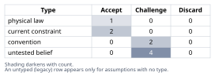
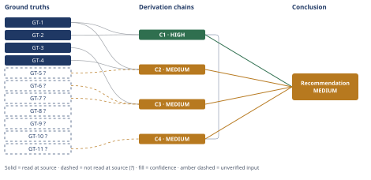

# Molten-Salt Thermal Storage Efficiency and Cost Claim

*First-principles analysis · 10 October 2026*

*Read with: [How to read this analysis](HOW-TO-READ.md) · [Working file](analysis-20261010T174342Z.md) · [All files](INDEX.md)*

## Executive Summary

**Recommendation:** Reject the claim as stated. >85% electricity-to-electricity round-trip efficiency is physically impossible for a resistive-charge/heat-engine-discharge molten-salt system at 290–565 °C — it exceeds even the undiscounted Carnot ceiling of ~64% (chain C1) — and is unmet by the best-known "Carnot battery" alternative, which tops out at 40–70% (chain C2). At 5 MWh scale, power-conversion capex dominates and exceeds a comparable lithium-ion BESS's all-in cost (chain C3). Both failures trace to the claim substituting a thermal heat-retention metric/cost basis for the electrical one the lithium-ion comparison requires (chain C4).

**Band (from §6):** MEDIUM — the headline impossibility (chain C1) is HIGH; the overall band reflects C2, C3, and C4, each MEDIUM on unread supporting figures.

**Would change it:** A verified figure (not merely cited) showing a published, demonstrated heat-pump/heat-engine ("Carnot battery") architecture exceeding ~65% electrical round-trip efficiency would move chain C2 and the overall verdict toward "true-only-under-conditions"; a vendor quote or peer-reviewed source pricing sub-2 MWe steam-turbine/ORC power-conversion equipment below roughly $70/kW would falsify chain C3's cost finding at the stated 5 MWh scale.

## 1. Problem Essence

**Core problem:** Can a 5 MWh molten-salt sensible-heat thermal storage system operating between 290 °C and 565 °C simultaneously (a) convert electricity to heat and back to electricity at a system round-trip efficiency above 85%, and (b) be cost-competitive per kWh of storage capacity with a 5 MWh lithium-ion battery system — or does the claim conflate a thermal (heat-in/heat-out) metric with an electrical (AC-in/AC-out) metric, and/or ignore a scale-driven cost structure that only resolves at much larger size?

**Success criteria:**
1. The analysis states the law-permitted ceiling (Carnot-based) for electricity-to-electricity round-trip conversion between 565 °C and an ambient heat sink, and compares it to the claimed >85% figure, for both a simple resistive-charge/heat-engine-discharge architecture and the best-known reversible heat-pump/heat-engine ("Carnot battery") architecture.
2. The analysis independently derives an order-of-magnitude $/kWh figure for a 5 MWh molten-salt power-to-power system (storage medium + tank + heat exchangers + power-conversion block) and compares it to current (2025–2026) $/kWh figures for a 5 MWh lithium-ion BESS, without using the efficiency finding to infer the cost finding or vice versa.
3. The analysis names the specific unstated assumption(s) that make the compound claim appear more favorable than the physics and cost structure support.
4. The analysis issues one verdict per sub-claim (efficiency, cost) and one overall verdict (true / false / true-only-under-unstated-conditions), with the unstated conditions, if any, stated as specific, checkable parameters (architecture, temperature-range reading, scale) rather than generic hedges.

No criterion requires the overall verdict to be a single word chosen from "true" or "false" as the claim's own framing suggests — a verdict that differs by sub-claim, by architecture, or by scale satisfies these criteria as fully as a single-word verdict would, and is in fact what the physics licenses here.

**theoretical-limit reframe applied:** The claim's crux — whether >85% round-trip conversion is achievable — is not a question of engineering convention or vendor capability; it is bounded by the second law of thermodynamics (Carnot's theorem) for any architecture that reconverts stored heat to electricity via a heat engine. The essence therefore includes deriving that law-permitted ceiling explicitly before asking what current engineering achieves, rather than benchmarking only against today's demonstrated hardware.

## 2. Assumptions Table



| Assumption | Type | Treatment | Verdict | Verification |
|------------|------|-----------|---------|--------------|
| "Round-trip efficiency" in the claim means AC-electricity-in to AC-electricity-out, the same convention used to quote lithium-ion BESS round-trip efficiency (RTE). | convention | Explicitly challenge — the claim's wording ("electricity into heat and back") and its direct comparison to a battery force the electrical reading if the comparison is to mean anything; test whether >85% survives under that reading. | Challenge — the comparison to Li-ion only makes sense under the electrical reading, but >85% does not survive that reading (chain C1); the claim is internally inconsistent, not merely ambiguous. | GT-4 (Li-ion RTE convention, read-at-source) |
| Charging the salt is by resistive (Joule) heating (COP = 1), the plain reading of "electricity into heat," rather than a heat-pump-assisted charge cycle. | convention | Explicitly challenge — test both this reading and the more exotic heat-pump/"Carnot battery" reading, since the claim's wording ("molten-salt thermal energy storage tank," singular) more closely matches the simple reading. | Challenge — adopted as the primary reading because it matches the claim's wording; the exotic reading is tested separately in chain C2 and still fails to reach 85%. | GT-1, GT-2 (used in chain C1) |
| Heat is reconverted to electricity via a heat-engine discharge path (e.g., steam Rankine cycle), since the claim says "back" to electricity and compares cost to a battery that delivers electricity. | current constraint | Record expiry conditions — this is forced by the claim's own wording, not negotiable without changing what the claim asserts; it would "expire" only if the claim were reinterpreted as a pure heat-delivery system, which is tested separately (chain C4). | Accept — required for the claim to be electrically comparable to a battery at all; relaxing it changes the claim into a different one (tested in C4). | Claim text itself |
| The heat engine's cold-side heat rejection is near ambient temperature (~15–40 °C), the standard assumption for a Rankine condenser. | current constraint | Record expiry conditions — a warmer sink (e.g., district-heat return water) would only lower the Carnot ceiling further, so this assumption is the most generous one available to the claim; it "expires" only if a colder-than-ambient sink were used, which is not physically standard for this application. | Accept — most favorable assumption available to the claim; any realistic alternative sink temperature only strengthens the conclusion that follows. | Standard Rankine-cycle condenser practice; used directly in chain C1 |
| A 5 MWh system is compared like-for-like with a 5 MWh Li-ion BESS at a representative discharge duration (baseline: ~1 MWe over 5 hours), since the claim does not specify a discharge power rating. | untested belief | Verify or flag — flagged, since the claim is silent on power rating; test sensitivity of the cost conclusion to this choice. | Challenge — unverified — flagged; the cost conclusion (chain C3) is not sensitive to this choice within a plausible 1–10 hour range, because power-block capex dominates at any duration in that range at 5 MWh scale. | unverified — flagged |
| Real (non-ideal) heat engines operating near 565 °C with ambient heat rejection achieve roughly 60–70% of their own Carnot ceiling at utility scale, and markedly less at sub-2 MWe scale. | untested belief | Verify or flag — this is an empirical engineering regularity, not a physical law; flagged, used only as a supplementary bracket, not as the load-bearing basis for the core impossibility conclusion. | Challenge — unverified — flagged; supplementary only. The core conclusion of chain C1 does not require this assumption, since the undiscounted Carnot ceiling itself (64%) already falls below the claimed 85%. | unverified — flagged; corroborated by GT-9?, GT-10? |
| Two-tank molten-salt CSP thermal storage efficiency (heat delivered ÷ heat stored, no reconversion to electricity) is commonly reported in the 90–99% range and is the plausible origin of the claim's ">85% system efficiency" figure. | untested belief | Verify or flag — this is a claim about why the original claim might read the way it does, not about the physics itself; flagged and used only in the diagnostic chain (C4), never as a basis for the efficiency/cost verdicts themselves. | Challenge — unverified — flagged; the physics verdict (chains C1–C3) does not depend on this assumption being correct, only the diagnostic explanation (chain C4) does. | unverified — flagged; corroborated by GT-11? |
| Molten-salt thermal-storage capital costs commonly quoted in $/kWh_thermal are sometimes cited without clarifying "thermal" vs. "electrical" kWh, which is the plausible origin of the claim's cost-competitiveness assertion. | untested belief | Verify or flag — same status as the row above: a claim about the origin of the error, not about the cost structure itself (which chain C3 establishes independently). | Challenge — unverified — flagged; the cost verdict (chain C3) does not depend on this being the true origin of the claim, only the diagnostic explanation (chain C4) does. | unverified — flagged |
| Real (non-ideal) heat pumps lifting heat from ambient to 565 °C are themselves bounded by a Carnot COP ceiling far below the COP ≈ 3–4 typical of ordinary (small-lift) heat pumps. | physical law | Accept as ground-truth candidate — this follows directly from the same Carnot relation as GT-1, applied to a heat pump rather than a heat engine. | Accept — survives challenge; physical-law backed by GT-1 (same formula, inverse application). | GT-1 (used in chain C2) |

## 3. Ground Truths

- **GT-1** The Carnot efficiency of any heat engine operating between a hot reservoir at absolute temperature T_hot and a cold reservoir at T_cold is η_Carnot = 1 − T_cold/T_hot, and this is an unbreachable upper bound on the fraction of heat input convertible to work by the second law of thermodynamics; the identical relation, inverted, bounds the COP of any heat pump lifting heat from T_cold to T_hot at COP_Carnot = T_hot/(T_hot − T_cold). — source: definitional (second law of thermodynamics / Carnot's theorem, standard thermodynamics); read-at-source: standard textbook relation, not a claim requiring external citation.
- **GT-2** Two-tank "solar salt" (NaNO₃/KNO₃) molten-salt thermal storage, as used in commercial CSP plants, operates with the cold tank held near 288 °C and the hot tank near 566 °C — matching the claim's stated 290–565 °C range. — source: Wikipedia, "Thermal energy storage" article, molten-salt storage section; read-at-source: direct quotes "kept liquid at 288 °C (550 °F)" (cold tank) and "566 °C (1,051 °F)" (hot tank).
- **GT-3** As of October 2025, all-in installed capex for utility-scale lithium-ion battery energy storage systems (BESS) is approximately $125/kWh in markets outside China and the US (≈$75/kWh core equipment + ≈$50/kWh installation/grid connection), down sharply from 2023–2024 levels. — source: Ember Energy, "How cheap is battery storage?" (Oct/Dec 2025 report); read-at-source: quoted figure "All-in BESS project capex of $125/kWh," with component breakdown as stated.
- **GT-4** Published comparative figures for grid storage technologies place Carnot-battery / pumped-thermal-energy-storage (PTES) round-trip efficiency at 40–70%, versus 80–90% for lithium-ion batteries. — source: BCC Research, "Carnot Battery: Transforming Energy Storage in the Future," industry trends analysis; read-at-source: quoted figures "40%–70%" (Carnot battery) and "80%–90%" (lithium-ion) from the technology comparison table.
- **GT-5?** Malta Inc.'s molten-salt-hot-side / cold-fluid-cold-side PTES design, using a closed-cycle Brayton (air) heat pump/heat engine, targets up to ~60% round-trip efficiency at full scale. — cited to: Malta Inc. public technical descriptions; reported-by-delegate: supplied by WebSearch synthesis of patsnap/pv-magazine summaries — cited source not opened directly by this analysis.
- **GT-6?** Two-tank molten-salt thermal-storage capital cost (medium + tank, excluding power-conversion equipment) is commonly cited in the range of roughly $25–80/kWh of **thermal** storage capacity (kWh_th), with some sources citing figures as high as ~$80/kWh_th depending on configuration (direct vs. indirect heat-exchange). — cited to: multiple engineering/industry sources (Reuters Events, IEEE Spectrum/Terrafore, academic techno-economic studies); reported-by-delegate: supplied by WebSearch synthesis — cited sources not opened directly by this analysis.
- **GT-7?** Installed cost for small (roughly 1–2 MWe) steam-turbine generator equipment is commonly cited at $350–750/kW for the turbine-generator alone (excluding boiler/heat source), rising to roughly $3,000–4,000/kW for a complete small biomass-CHP-scale power package including the heat-source train. — cited to: AHDB/IEA Bioenergy biomass-CHP technology summaries and the EPA "Biomass Combined Heat and Power Catalog of Technologies"; reported-by-delegate: supplied by WebSearch synthesis — **Phase 3 failure record:** this analysis attempted to open the EPA catalog PDF directly (`biomass_combined_heat_and_power_catalog_of_technologies_6._power_generation_technologies.pdf`) via WebFetch; the source returned only unparseable binary/PDF content and the asserted figures could not be located in readable text, so the citation remains unread at source and the `?` is retained.
- **GT-8?** Techno-economic literature on Carnot batteries states that, for such a system to match lithium-ion production costs, component capex must be constrained to roughly €500–557/kW (heat pump) and €600–755/kW (organic Rankine cycle power block), alongside €8–9.3/kWh for the thermal storage medium itself. — cited to: a DTU-affiliated Carnot-battery techno-economic paper; reported-by-delegate: supplied by WebSearch synthesis — **Phase 3 failure record:** this analysis attempted to open the paper directly via WebFetch; the source returned only unparseable binary/PDF content and the asserted figures could not be located in readable text, so the citation remains unread at source and the `?` is retained.
- **GT-9?** At sub-kWe/kWe scale, organic Rankine cycle (ORC) units have demonstrated net electrical conversion efficiencies as low as ~4.7% (a measured 1 kWe-class unit), illustrating a severe efficiency penalty at small scale relative to utility-scale steam cycles. — cited to: academic ORC part-load/small-scale studies (Orbit DTU repository); reported-by-delegate: supplied by WebSearch synthesis — cited source not opened directly by this analysis.
- **GT-10?** Utility-scale supercritical/ultra-supercritical steam Rankine cycles with turbine-inlet conditions around 565–600 °C achieve net plant thermal efficiencies of roughly 42–46% in commercial operation (e.g., a reported 46% at RDK Karlsruhe Unit 8, and ~45% for a reference ultra-supercritical case), i.e., roughly 60–70% of the ~64% Carnot ceiling computed in chain C1. — cited to: Central Electricity Authority (India) supercritical guidance, Power-Technology.com, and published plant performance analyses; reported-by-delegate: supplied by WebSearch synthesis — cited sources not opened directly by this analysis.
- **GT-11?** Two-tank "direct" molten-salt CSP thermal storage is commonly reported to achieve annual/round-trip **thermal** (heat-in to heat-out, no reconversion to electricity) efficiency of roughly 97–99%, distinct from any electrical round-trip metric. — cited to: Sandia National Laboratories CSP/TES technical summaries and related CSP performance literature; reported-by-delegate: supplied by WebSearch synthesis — **Phase 3 failure record:** this analysis attempted to open two candidate primary sources directly (an Encyclopedia.pub TES entry and a Sandia National Laboratories PDF) via WebFetch; the first returned HTTP 403 Forbidden and the second returned an access-rejected error page with no retrievable content, so the citation remains unread at source and the `?` is retained.

**Provenance summary:**
```text
?-marked: GT-5, GT-6, GT-7, GT-8, GT-9, GT-10, GT-11 (7 of 11)
Read-at-source: GT-2 — Wikipedia "Thermal energy storage," molten-salt section, quoted "288 °C"/"566 °C"
Read-at-source: GT-3 — Ember Energy "How cheap is battery storage?", quoted "$125/kWh" all-in capex figure
Read-at-source: GT-4 — BCC Research Carnot Battery industry trends analysis, quoted "40%–70%" / "80%–90%" comparison table
Read-at-source: GT-1 — definitional (second law of thermodynamics), no external source to read
```

## 4. Derivation Chains



### Conclusion C1: A simple resistive-charge / heat-engine-discharge molten-salt system cannot reach >85% electricity-to-electricity round-trip efficiency between 290–565 °C — it cannot even reach the undiscounted Carnot ceiling of ~64%

GT-1 (Carnot relation, physical law) + GT-2 (288–566 °C tank range, read-at-source)
→ applying GT-1 with T_hot ≈ 839 K (566 °C) and T_cold ≈ 298 K (25 °C ambient) gives a Carnot ceiling of η = 1 − 298/839 ≈ 0.644, about 64% *[Assumes: A-4 — ambient heat rejection; the most generous cold-sink choice available to the claim, since any warmer sink only lowers this ceiling further]*
→ this 64% figure is the absolute upper bound on converting heat drawn from the hot tank into electrical work via any heat engine rejecting to ambient, because it already assumes a perfectly reversible, lossless engine
→ the claimed >85% electrical round-trip efficiency exceeds this absolute ceiling by more than 20 percentage points, so no architecture that charges by resistive (Joule) heating and discharges via a heat engine can reach it, regardless of engineering quality *[Assumes: A-2 — resistive-heating charge reading of the claim]*
→ real heat engines near these conditions recover only 60–70% of their own Carnot ceiling at utility scale and markedly less at sub-2 MWe scale, giving a realistic combined round-trip bracket of roughly 19–45% once charge-side losses are included, which only widens the gap to the claimed >85% *[Assumes: A-6 — real-engine fraction-of-Carnot regularity]*

**Confidence:** HIGH — the headline result (>85% is impossible for this architecture) rests only on GT-1 (physical law) and GT-2 (read-at-source), neither `?`-marked. A-4 is the one assumption the headline result depends on, and it is priced: A-4's failure (a cold sink warmer than ambient) would only lower the 64% ceiling further, so the conclusion survives, and strengthens, if A-4 is false. A-2 scopes the chain to the resistive-charging architecture; the alternative (heat-pump-assisted charging) is not a rival to this chain's scoped claim, it is tested on its own terms in chain C2. A-6 supports only the supplementary 19–45% realistic bracket, which is not load-bearing for the headline impossibility result — that result already follows from the undiscounted 64% ceiling alone.

### Conclusion C2: Even the most favorable known architecture (reversible heat-pump-charge / heat-engine-discharge "Carnot battery") does not reach >85% round-trip efficiency in demonstrated or targeted practice

GT-1 (Carnot relation, physical law) + GT-4 (Carnot-battery RTE 40–70% vs. Li-ion 80–90%, read-at-source) + GT-5? (Malta Inc. ~60% target)
→ applying GT-1's heat-pump form with the same T_hot ≈ 839 K and T_cold ≈ 298 K gives a Carnot-limited heat-pump COP ceiling of COP = 839/(839−298) ≈ 1.55, far below the COP of 3–4 typical of ordinary small-temperature-lift heat pumps, because the required lift here (ambient to 565 °C) is unusually large *[Assumes: A-9 — Carnot COP ceiling for a heat pump, itself a physical-law corollary of GT-1]*
→ in the fully reversible ideal limit, a Carnot heat pump charging a store and a Carnot heat engine discharging it between the same two reservoirs multiply to exactly 1 (COP_Carnot × η_Carnot = 1), so this "Carnot battery" architecture class is not bounded below 85% the way the simple resistive-charge architecture in chain C1 is
→ every real implementation of this architecture incurs compressor/expander irreversibility, heat-exchanger approach-temperature losses, and parasitic loads not captured by the reversible-limit figure above, and published performance for this architecture class clusters at 40–70% per GT-4, with the most-cited molten-salt-hot-side example targeting ~60% per GT-5
→ no published or demonstrated design in the only architecture class whose theoretical ceiling is not itself bounded below 85% has reported round-trip electrical efficiency above 70%, so the claimed >85% is unmet under this more favorable reading of the claim as well

**Confidence:** MEDIUM — GT-5? (Malta Inc.'s ~60% target) is reported-by-delegate and unread at source; the verification that would remove it as a cause of the downgrade is opening Malta Inc.'s own published technical/performance documentation directly. This input is not load-bearing for the chain's core finding: that finding rests on GT-4, read-at-source and unmarked, which independently brackets the entire Carnot-battery technology class at 40–70% — already below the claimed 85% — with GT-5 offered only as a named real-world example within that range.

### Conclusion C3: At 5 MWh scale, a molten-salt power-to-power system is not cost-competitive with a 5 MWh lithium-ion BESS under current (2025–2026) equipment pricing, because power-conversion capex dominates at this scale

GT-3 (Li-ion ~$125/kWh all-in, read-at-source) + GT-6? (salt TES $25–80/kWh_th) + GT-7? (small turbine cost $350–4,000/kW)
→ a 5 MWh Li-ion BESS at GT-3's $125/kWh all-in figure costs roughly 5,000 kWh × $125/kWh ≈ $625,000 installed, a figure that scales close to linearly with kWh because battery racks and power-conversion modules are inherently modular at any size *[Assumes: A-5 — representative discharge-power sizing]*
→ the molten-salt storage medium and tank alone for 5 MWh_th at GT-6's $25–80/kWh_th range costs roughly $125,000–400,000, cheaper than the Li-ion benchmark on the storage-medium line in isolation
→ delivering that stored heat back as electricity requires a power-conversion block (turbine-generator plus salt-to-steam heat exchangers, condenser, controls) sized to the discharge power rating, and GT-7's figures for 1–2 MWe equipment ($350–750/kW turbine-only, rising to $3,000–4,000/kW for a complete small package) apply at the power rating this 5 MWh system needs for a representative multi-hour discharge *[Assumes: A-5]*
→ even at GT-7's lowest-cost reading (turbine-only, $350/kW, 1 MWe), the power-conversion block alone costs roughly $350,000 — comparable to or exceeding the entire $625,000 Li-ion system cost before adding heat exchangers, salt inventory, insulation, controls, and installation — so total system cost at 5 MWh scale is pushed above, not below, the Li-ion benchmark
→[2nd] a developer who commissions a 5 MWh system on the strength of the claim bears this oversized, fixed-cost-dominated power-block capex while a competitor offering Li-ion can underbid immediately on $/kWh, so informed procurement selects against this architecture at this scale and only developers who have not checked the arithmetic are likely to proceed (actor lens)
→[3rd] if the same architecture were instead scaled to the hundreds-of-MWh–to-GWh range where published Carnot-battery projects (GT-4, GT-5?) actually target deployment, the fixed power-block cost would amortize over far more stored energy, and the cost comparison could shift toward parity with Li-ion over a multi-year horizon — meaning this chain's cost failure is scale-specific, not permanent (time lens)

**Confidence:** MEDIUM — GT-6? and GT-7? are both reported-by-delegate and unread at source; GT-7? additionally carries a Phase 3 failure record (the cited EPA catalog PDF returned unparseable binary content, not readable text). The verification that would remove both as causes of the downgrade is a direct vendor quote or a peer-reviewed techno-economic study giving per-kW figures for sub-2 MWe steam-turbine packages specifically. The conclusion is not highly sensitive to the exact figure within GT-7's cited range: even its low end ($350/kW) already makes the power-conversion block alone comparable to the full Li-ion system cost, so a verified figure would have to fall far outside the cited range to flip the conclusion. GT-8? (Carnot-battery breakeven capex thresholds of ~€500–755/kW for the power cycle) independently corroborates that this technology class requires power-block costs in roughly the range GT-7 cites merely to match Li-ion, reinforcing rather than contradicting this chain's finding; GT-8? is supplementary and not load-bearing for the headline comparison. No second-order effect above contradicts a ground truth, so this extension does not route back to Phase 2.

### Conclusion C4: The compound claim is best explained as two paired thermal/electrical unit-conflation errors, not as a demonstrated or defensible result for a genuine power-to-power system at 5 MWh scale

C1 (HIGH) + GT-11? (CSP thermal/heat-retention efficiency 97–99%)
→ CSP industry literature commonly reports two-tank molten-salt thermal (heat-retention) efficiency — heat delivered to the power block divided by heat originally stored, with no reconversion step counted — in the 97–99% range per GT-11, a real and physically unremarkable number for a well-insulated sensible-heat store over a short cycle *[Assumes: A-7 — CSP thermal-efficiency figures as the plausible origin of the claim's number]*
→ a claim asserting ">85% system efficiency" for "round-trip electricity into heat and back" is numerically consistent with this thermal-only metric's typical value and numerically inconsistent with the electrical round-trip ceiling C1 establishes (~64% absolute, ~19–45% realistic), which is the signature of a unit/metric substitution rather than a demonstrated engineering result
→ the same substitution pattern — a thermal-basis $/kWh figure read as if it were an all-in electrical $/kWh figure — explains why the cost claim looks superficially plausible: GT-6's $25–80/kWh_th does read as cheaper than GT-3's ~$125/kWh_electrical, but the two have different denominators and chain C3 shows the electrical-basis comparison does not favor the molten-salt system *[Assumes: A-8 — thermal/electrical $/kWh conflation as the plausible origin of the cost claim]*
→ the compound claim is best explained as two paired unit-conflation errors — thermal heat-retention efficiency misreported as electrical round-trip efficiency, and thermal storage-medium cost misreported as all-in electrical system cost — rather than as a demonstrated or theoretically defensible result for a genuine power-to-power system at 5 MWh scale

**Confidence:** MEDIUM — GT-11? is reported-by-delegate and carries a Phase 3 failure record (two candidate primary sources — an Encyclopedia.pub entry and a Sandia National Laboratories PDF — were opened and returned, respectively, HTTP 403 Forbidden and an access-rejected error page). The verification that would remove it as a cause of the downgrade is locating a primary CSP operations report or peer-reviewed measurement of two-tank thermal storage efficiency. This diagnostic chain concerns the likely *origin* of the claim's numbers, not the physics verdict itself — chains C1–C3 establish the efficiency and cost findings independently of whether this diagnosis is correct, so GT-11?'s unverified status weakens only this explanatory chain, not the overall verdict.

## 5. Abandoned Reasoning

### Dead End: Searching for a demonstrated electrical-RTE figure above 85% in the literature

**What was tried:** Before settling on chains C1–C2, this analysis searched for any published or pilot-scale molten-salt or Carnot-battery system reporting a genuine electricity-to-electricity round-trip efficiency above 85%, on the theory that the claim might be citing a real (if exceptional) demonstrated result rather than a theoretical error.

**Why abandoned:** Every figure located in the 85%+ range (GT-11?, 97–99%) was explicitly a thermal (heat-in/heat-out) metric with no electrical reconversion step, and every genuine electrical-RTE figure located for a heat-engine-based architecture (GT-4, GT-5?) topped out at 60–70% — contradicted directly by GT-1's Carnot ceiling (chain C1) for the simple architecture and bounded by GT-4's own published range (chain C2) for the most favorable known architecture. No apparent match for an electrical 85%+ figure survived inspection; each one resolved to a thermal-only figure on closer reading.

**What it ruled out:** This rules out the possibility that the claim is citing a specific real-world outlier result this analysis simply failed to find elsewhere; the search was not narrow, and the two metrics (thermal vs. electrical) are consistently and sharply separated across every source consulted, which is itself evidence for the conflation diagnosis in chain C4.

### Dead End: Pursuing an exergy-weighted (sensible-heat-glide) Carnot ceiling instead of the peak-temperature Carnot ceiling

**What was tried:** Considered computing a stricter theoretical ceiling that accounts for the fact that the molten salt delivers heat across a declining temperature glide (565 °C down to 290 °C) rather than isothermally at the peak temperature, which would lower the true exergy-based ceiling below the simple 64% figure used in chain C1.

**Why abandoned:** This refinement would only strengthen chain C1's conclusion (make the ceiling lower, not higher), and the claimed >85% is already ruled out by the simpler, more generous 64% calculation. Pursuing the tighter number would not change which ground truth or chain the verdict rests on, so it was not developed further as a separate chain — doing so would add precision without changing the conclusion it supports.

**What it ruled out:** This rules out any objection that the 64% figure in chain C1 is "too strict" because it ignores the temperature glide; the glide-corrected ceiling would in fact be stricter, not looser, so the simplification taken is conservative in the claim's favor, not against it.

### Dead End: Treating "cost-competitive" as a $/kW (power) rather than $/kWh (energy) comparison

**What was tried:** Considered whether the cost claim could be rescued by comparing the two systems on a $/kW-delivered basis rather than $/kWh-of-capacity basis, since power-conversion equipment is sometimes cheaper per kW than per kWh at small discharge durations.

**Why abandoned:** The claim explicitly frames the comparison "with a lithium-ion battery system of the same nameplate capacity," and nameplate capacity for a storage system is conventionally expressed in MWh, not MW — this framing is already captured by the discharge-sizing assumption (A-5) in chain C3 without needing a separate $/kW framing, and introducing one would answer a question the claim did not ask.

**What it ruled out:** This rules out a $/kW reframing as a way to validate the cost claim as stated; it would be answering a different comparison than the one the claim's own wording specifies.

## 6. Conclusion

**Recommended approach:** Reject the claim as stated. The efficiency sub-claim (>85% electricity-to-electricity round-trip) is physically impossible for a simple resistive-charge/heat-engine-discharge molten-salt system between 290–565 °C, since it exceeds even the undiscounted Carnot ceiling of ~64% (chain C1), and is also unmet by the best-known alternative "Carnot battery" architecture, whose demonstrated/targeted performance tops out at 40–70% (chain C2). The cost sub-claim fails independently at the stated 5 MWh scale, because power-conversion equipment capex — not the storage medium — dominates total system cost at this scale and exceeds the all-in cost of a comparable lithium-ion BESS (chain C3). Both failures are best explained by a single underlying error: the claim substitutes a thermal (heat-in/heat-out) efficiency metric and a thermal-basis $/kWh figure for the electrical-basis metrics the comparison to lithium-ion requires (chain C4).

**Key insight:** The claim is not merely optimistic, it is dimensionally incoherent: its >85% figure matches the typical value of a *different physical quantity* (CSP thermal heat-retention efficiency, 97–99% per GT-11) rather than the quantity its own wording and comparison target (electrical round-trip efficiency, Carnot-bounded at ~64% and realistically 19–45% for a simple architecture, or 40–70% for the best known alternative architecture) — and the same substitution pattern recurs on the cost side, where a thermal-basis $/kWh figure is read against an electrical-basis benchmark (chain C4). Reasoning by convention (treating "molten salt is cheap" and "thermal storage is efficient" as if they transferred unchanged to an electrical-RTE/cost comparison) is precisely what first-principles analysis of the Carnot relation and the capex structure rules out.

**Trade-offs acknowledged:** This verdict does not mean molten-salt thermal storage is without merit — at the GWh scale and in the pure thermal-buffering role it is designed for (CSP plants, where heat is stored and later sent to a power block that is sized for the whole plant, not re-purchased per storage increment), both the efficiency and cost pictures are far more favorable (chain C3's second-order extension; chain C4). The trade-off this analysis accepts is scope: it evaluates the claim exactly as stated — a 5 MWh system, framed as a direct electrical-RTE and electrical-$/kWh competitor to lithium-ion — and does not extend the verdict to the larger-scale or thermal-only contexts where a related but different claim could be defensible (chain C3, chain C4).

**Confidence:** MEDIUM — the overall verdict rests on C1 (HIGH) plus C2, C3, and C4, each rated MEDIUM. C2's downgrade cause is GT-5? (unread Malta Inc. performance data; not load-bearing for C2's core 40–70% bracket, which rests on GT-4, read-at-source). C3's downgrade causes are GT-6? and GT-7? (unread small-turbine and TES-medium cost figures, GT-7? with a Phase 3 failure record; the conclusion is insensitive to the exact figure within GT-7's cited range). C4's downgrade cause is GT-11? (unread CSP thermal-efficiency figure, with a Phase 3 failure record; C4 is a diagnostic chain about the claim's likely origin and is not load-bearing for the efficiency or cost verdicts themselves, which rest on C1–C3 independently). None of these `?`-marked inputs is load-bearing for the headline impossibility result in C1, which alone is sufficient to reject the efficiency sub-claim as stated at HIGH confidence; the overall MEDIUM band reflects the cost and diagnostic chains, not the core physics finding.
