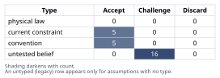
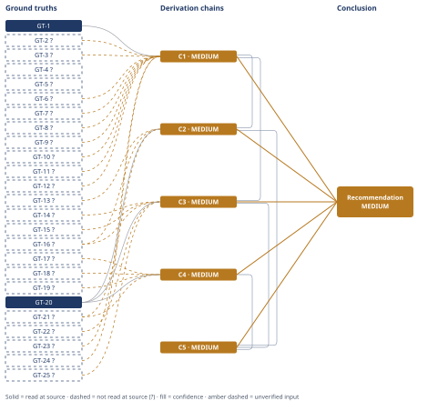

# Molten-Salt Thermal Storage vs Lithium-Ion at 5 MWh

*First-principles analysis · 10 October 2026*

*Read with: [How to read this analysis](HOW-TO-READ.md) · [Working file](analysis-20261010T153637Z.md) · [All files](INDEX.md)*

## Executive Summary

**Recommendation:** For 5 MWh grid electricity storage, use lithium-ion, not molten-salt TES routed through a power block — Li-ion levelizes to roughly 13-25¢/kWh_e versus roughly 41-75¢/kWh_e for TES-plus-power-block at matched utilization (chain C5). Molten-salt TES is appropriate at this small scale only where the delivered product is heat, where it levelizes to a comparatively modest 10-19¢/kWh_th in capital cost alone (chain C2).

**Band (from §6):** MEDIUM — every contributing chain (C1-C5) is MEDIUM, driven by a large number of individually-non-dominant `?`-marked cost and efficiency ground truths; the qualitative verdict is robust to each one's stated uncertainty range (chain C3's sensitivity hop).

**Would change it:** A real vendor RFQ/quote for a 5 MWh TES skid and for a small heat-engine power block (closing GT-8?, GT-10?, GT-11?, GT-12?, GT-14?) would sharpen chain C1 and C3's magnitude; none of the stated ranges, even combined optimistically, closes the ~3× gap to Li-ion (chain C5's Rival check in the adversarial pass).

## 1. Problem Essence

**Core problem:** What is the bottom-up, first-principles installed cost ($/kWh) of a small (5 MWh) molten-salt thermal energy storage system, what does that translate to on a $/kWh-*delivered* basis once amortized over equipment life, and — correcting for the fact that "thermal kWh" and "electrical kWh" are not the same commodity — is it cost-competitive with a comparably sized lithium-ion battery system for grid electricity storage?

**Success criteria:**
- A bottom-up cost buildup (not a single lump EPC multiplier) reaching a total installed $ and $/kWh_th figure, with each major line item justified from mass, area, or power rating rather than asserted.
- An explicit, quantified diseconomy-of-scale finding: the 5 MWh number must come out materially higher per kWh than utility-scale CSP benchmarks (~$15-30/kWh_th), with a stated reason tied to which cost items are near-fixed regardless of plant size.
- Two distinct levelized $/kWh-delivered figures for the molten-salt system: (a) direct heat delivery, (b) electricity delivery through a power block, with the power block capital and the electricity round-trip efficiency penalty both explicit and separately visible from the TES-only numbers.
- A comparable levelized $/kWh-delivered figure for a 5 MWh lithium-ion BESS, built from its own cost, cycle-life/calendar-life, and round-trip-efficiency assumptions.
- A verdict on cost-competitiveness that names the commodity-mismatch (thermal vs. electrical kWh) and the scale-diseconomy as the two load-bearing reasons behind the number, not just the number itself.
- Every empirical input (specific heat, density, bulk costs, equipment $/kg or $/kW figures) stated as an explicit, flagged assumption with a defensible range — this is a Fermi estimate, and false precision is a failure mode the analysis must visibly avoid.

## 2. Assumptions Table



| Assumption | Type | Treatment | Verdict | Verification |
|------------|------|-----------|---------|--------------|
| A-1: Salt is "solar salt" (60% NaNO3 / 40% KNO3), the CSP-industry-standard nitrate mixture | convention | Challenge before use | Accept — em dash — standard choice in the problem statement itself and the dominant commercial nitrate-salt mixture; alternatives (Hitec, chloride salts) are out of scope | unverified — flagged |
| A-2: Specific heat cp ≈ 1.5 kJ/kg·K for solar salt | untested belief | Verify or flag | Challenge — em dash — commonly cited figure, not read from a source this run; used with a stated point value since cp varies little (<10%) across the operating range | unverified — flagged (GT-2?) |
| A-3: Average density ≈1800 kg/m3 (hot, 565°C) / ≈1900 kg/m3 (cold, 290°C) | untested belief | Verify or flag | Challenge — em dash — standard order-of-magnitude figure for molten nitrate salts; used for tank sizing only, a second-order cost driver | unverified — flagged (GT-3?) |
| A-4: Operating window cold 290°C / hot 565°C, ΔT≈275K, set by freeze-point margin and alloy/decomposition limits | current constraint | Record expiry conditions | Accept — em dash — expires if a different salt chemistry or alloy set is chosen; holds for solar salt in standard CSP-style tanks | unverified — flagged (GT-5?) |
| A-5: Bulk salt cost $0.6-1.2/kg ($600-1,200/tonne) | untested belief | Verify or flag | Challenge — em dash — wide range retained deliberately; salt cost is a small fraction of total installed cost so precision here matters little | unverified — flagged (GT-6?) |
| A-6: Analyst-chosen duty rating of ~1 MW_th charge/discharge (≈5-hour duration) since the problem specifies only energy capacity, not power | convention | Challenge before use | Accept — em dash — a reasonable default scale for a 5 MWh firming/process-heat system; drives HX and power-block sizing, explicitly disclosed as an analyst choice rather than a given | unverified — flagged |
| A-7: Tank installed fabrication cost ≈$20,000/t (stainless, hot) and ≈$10,000/t (carbon steel, cold) | untested belief | Verify or flag | Challenge — em dash — reflects small-lot shop fabrication, welding/NDE, and lack of large-vessel economy of scale; this is the single largest source of uncertainty in the tank cost line | unverified — flagged (GT-8?) |
| A-8: Salt-side heat exchanger installed cost ≈$300/kW_th (range $150-450/kW_th) | untested belief | Verify or flag | Challenge — em dash — small specialty salt HX units carry high $/kW relative to large CSP steam generators | unverified — flagged (GT-10?) |
| A-9: Two specialty molten-salt pumps at ≈$80,000 each | untested belief | Verify or flag | Challenge — em dash — reflects a high minimum unit cost for specialty pumps largely independent of flow rate at this small scale | unverified — flagged (GT-11?) |
| A-10: EPC indirects ≈20% and contingency ≈18% of direct + indirect cost | convention | Challenge before use | Accept — em dash — typical range for a small, custom, first-of-kind specialty process system; a mature/repeat build could run lower | unverified — flagged (GT-24?) |
| A-11: Equipment/tank design life = 25 years (within the stated 20-30 year range) | current constraint | Record expiry conditions | Accept — em dash — midpoint choice; expires/changes if corrosion, thermal cycling, or alloy selection differ from assumed design basis | unverified — flagged (GT-13?) |
| A-12: Real discount rate = 7% for capital-recovery annualization | convention | Challenge before use | Accept — em dash — standard infrastructure-finance default in the absence of a project-specific WACC; result is sensitive to this choice and is flagged as such | unverified — flagged (GT-21?) |
| A-13: Cycling frequency: 365 cycles/yr (daily) as central case, 200 cycles/yr as a lighter-duty sensitivity case | untested belief | Verify or flag | Challenge — em dash — duty cycle is not specified by the problem; both cases are carried through to show the levelized-cost range this choice produces | unverified — flagged |
| A-14: Thermal round-trip storage efficiency ≈92% (tank losses only) | untested belief | Verify or flag | Challenge — em dash — consistent with well-insulated two-tank systems; used only for the direct-heat-delivery case | unverified — flagged (GT-16?) |
| A-15: Small (sub-1 MWe) heat-engine (ORC/steam) gross conversion efficiency ≈35% (range 25-40%) | untested belief | Verify or flag | Challenge — em dash — this is the single most load-bearing assumption in the electricity-delivery case; a sensitivity check (hop in chain C3) shows the qualitative verdict is robust across the stated range | unverified — flagged (GT-14?) |
| A-16: Resistive charging-heater efficiency ≈98% | current constraint (physical-law-adjacent) | Record expiry conditions | Accept — em dash — near-ideal by Joule-heating physics; losses are small and bounded, so this input carries little uncertainty despite not being source-verified | unverified — flagged (GT-15?) |
| A-17: Power-block capital cost = $2,000/kW_e midpoint (range $1,000-3,000/kW_e, per problem framing) | untested belief | Verify or flag | Challenge — em dash — wide stated range reflects genuine uncertainty in small-turbine/ORC train pricing | unverified — flagged (GT-22?) |
| A-18: Li-ion (LFP-class) installed cost for a small 5 MWh system = $350/kWh midpoint (range $280-450/kWh) | untested belief | Verify or flag | Challenge — em dash — reflects a small-system cost premium over large-scale (>50 MWh) pricing | unverified — flagged (GT-17?) |
| A-19: Li-ion cycle life 5,000 cycles to 80% SOH / calendar life 12 years, calendar-limited under daily cycling | untested belief | Verify or flag | Challenge — em dash — at 365 cycles/yr, 12 years uses ~4,380 of the 5,000-6,000 cycle budget, so calendar life is the binding constraint used for annualization | unverified — flagged (GT-18?) |
| A-20: Li-ion AC-AC round-trip efficiency ≈90% | untested belief | Verify or flag | Challenge — em dash — well-established industry-typical figure for modern grid-scale systems, though not read from a source this run | unverified — flagged (GT-19?) |
| A-21: Fixed-cost line items (tanks, HX, pumps, I&C) carry a near-fixed minimum installed cost that does not scale down proportionally with a small plant's energy capacity | current constraint | Record expiry conditions | Accept — em dash — true of today's custom/one-off fabrication and supply-chain conventions; this is the load-bearing cause of the diseconomy-of-scale finding and is explicitly revisited under second-order effects (modular skids could change it over time) | unverified — flagged |
| A-22: Li-ion is modular (rack/container-based) and therefore does not suffer the same tank/HX-driven diseconomy of scale as TES | current constraint | Record expiry conditions | Accept — em dash — a characteristic of today's containerized BESS packaging convention; could change only if TES vendors achieve comparable modularity, which is addressed under second-order effects | unverified — flagged |
| A-23: Comparison is capital-cost-only; excludes O&M, land, interconnection, financing fees, and salt/battery augmentation or replacement costs for both technologies | convention | Challenge before use | Accept — em dash — a deliberate scope simplification stated explicitly throughout; both technologies' true levelized costs are higher than the figures in this analysis, but the comparative ratio is less sensitive to this omission than either absolute figure is | unverified — flagged |
| A-24: Balance-of-plant items (process piping/valves/trace-heating, instrumentation & controls, startup/melt-out heaters, cover-gas system, foundations/structural) each carry a near-fixed installed cost in the broad range $50,000-$250,000 | untested belief | Verify or flag | Challenge — em dash — individually uncertain but collectively a minority of total installed cost, bounded by the overall contingency allowance | unverified — flagged (GT-23?) |
| A-25: No external source was opened during this run; every empirical figure above reflects general engineering/cost knowledge carried by the model, not a citation read at source | untested belief (methodological) | Verify or flag | Challenge — em dash — disclosed explicitly per this run's focused-estimate scope, which performs no source acquisition; every empirical GT-N below therefore carries the `?` suffix by design, not by oversight | no source opened — flagged |
| A-26: Charging resistive-heater capital cost ≈$75/kW_e (range $50-100/kW_e) | untested belief | Verify or flag | Challenge — em dash — a small line item relative to the power-block and TES costs; low leverage on the final verdict | unverified — flagged (GT-25?) |

## 3. Ground Truths

**Provenance disclosure for this run:** this is a focused Fermi-estimate analysis performed as pure physics-and-cost reasoning, with no codebase, file, or external source opened (no WebFetch/WebSearch call was made). Per the focused-mode evidence-acquisition divergence, every empirical ground truth below therefore carries the `?` suffix by design — the figures reflect general engineering, CSP-industry, and grid-storage cost knowledge, not a citation this run read. Only the two purely definitional/mathematical entries (GT-1, GT-20) are unsuffixed, because they are not empirical facts requiring source verification.

- **GT-1** 1 kWh_th ≡ 3,600 kJ (SI energy-unit equivalence) — source: definitional (SI); read-at-source: definitional identity, not citation-dependent — no external document applies.
- **GT-2?** Solar salt (60% NaNO3 / 40% KNO3) specific heat cp ≈ 1.5 kJ/kg·K over the 290-565°C range — unverified: general CSP/process-engineering knowledge, no source opened this run.
- **GT-3?** Solar salt density ≈1800 kg/m3 at ~565°C (hot) and ≈1900 kg/m3 at ~290°C (cold) — unverified.
- **GT-4?** Solar salt freezes at ≈220°C, which sets the lower bound on how far the cold tank can be allowed to cool before freeze-protection trace heating is required — unverified.
- **GT-5?** Standard two-tank molten-salt CSP operating window: cold tank ≈290°C (set by freeze-point margin above GT-4?), hot tank ≈565°C (set by nitrate thermal-decomposition onset ≈600°C and alloy limits), giving ΔT≈275K — unverified.
- **GT-6?** Bulk commercial solar-salt cost ≈$0.6-1.2/kg ($600-1,200/tonne) — unverified, wide range carried through.
- **GT-7?** Carbon steel loses adequate creep strength above ≈425°C, so the hot tank (565°C) requires a high-temperature stainless alloy (e.g., 304H/347H-class), while the cold tank (290°C) can use insulated/refractory-lined carbon steel — unverified (standard CSP tank-design practice).
- **GT-8?** Small (<10 tonne), custom-fabricated, atmospheric-pressure vessels carry an installed fabrication cost on the order of $15,000-30,000/tonne in stainless and $6,000-15,000/tonne in carbon steel, reflecting shop labor, welding/NDE, and the absence of large-vessel economy of scale — unverified, central values $20,000/t and $10,000/t used.
- **GT-9?** Utility/CSP-scale two-tank molten-salt TES (600-4,000+ MWh_th class, e.g., Gemasolar/Crescent Dunes-scale plants) has an installed cost on the order of $15-30/kWh_th — unverified industry benchmark figure, used here only as a sanity-check comparator.
- **GT-10?** Specialty salt-side heat exchangers (shell-and-tube, Inconel/stainless) installed cost roughly $150-450/kW_th for small (<2 MW_th) custom units, versus roughly $50-80/kW_th at large CSP steam-generator scale — unverified.
- **GT-11?** Specialty vertical-cantilever molten-salt pumps carry a high minimum unit cost (roughly $50,000-150,000 each) that is largely independent of flow rate at small scale, because materials and seal engineering costs dominate over size — unverified.
- **GT-12?** Full industrial instrumentation & control suites (DCS/PLC, safety-instrumented freeze-protection system, temperature/level/flow/pressure instruments throughout) carry a near-fixed minimum installed cost on the order of $150,000-250,000 regardless of plant throughput — unverified.
- **GT-13?** Molten-salt TES equipment life (tanks, piping, pumps) is governed by mechanical/corrosion/fatigue life, typically 20-30 years, not by an electrochemical degradation mechanism — unverified design-basis figure from CSP engineering practice.
- **GT-14?** Small (sub-1 MWe) modular heat-engine (ORC or micro-steam) power blocks achieve gross thermal-to-electric conversion efficiencies on the order of 25-40%, well below large utility steam turbines (~40-45%+), due to adverse surface-area-to-volume heat-loss scaling and lower small-component efficiency — unverified, central value 35%.
- **GT-15?** Resistive electric heating converts electrical energy to heat at roughly 95-99% efficiency, limited only by minor enclosure/ambient losses, because Joule heating converts essentially all input electrical energy to heat at the point of use — physical-law-adjacent, near-ideal conversion; central value 98% used.
- **GT-16?** A well-insulated two-tank molten-salt system's thermal (heat-in to heat-out) round-trip efficiency, net of tank-wall losses over a charge/discharge cycle, is roughly 90-95% — unverified, central value 92%.
- **GT-17?** 2025-2026 installed cost for a small (~5 MWh) grid-scale lithium-ion (LFP-dominant) BESS, including DC block/BMS/enclosure, PCS/inverter, and EPC, is roughly $280-450/kWh — reflecting a cost premium over large-scale (>50 MWh) pricing of roughly $150-250/kWh due to lower bulk-procurement leverage and fixed EPC/interconnection costs spread over a smaller base — unverified, central value $350/kWh.
- **GT-18?** Lithium-ion (LFP) grid-storage cycle life is typically 4,000-6,000 cycles to 80% state-of-health, with project life often calendar-limited to roughly 10-15 years even where the cycle budget is not exhausted — unverified, central calendar life 12 years used as the binding constraint under daily cycling.
- **GT-19?** Lithium-ion BESS AC-AC round-trip efficiency for modern grid-scale systems is typically 85-95%, centered around ~90% — unverified.
- **GT-20** CRF = r(1+r)^n / [(1+r)^n − 1] is the standard capital-recovery-factor formula converting a present capital cost into a level annual payment over n years at discount rate r — source: standard engineering-economics definition; read-at-source: definitional formula, not citation-dependent — no external document applies.
- **GT-21?** A real discount rate of ~7% is a commonly used default for infrastructure/utility-scale capital project evaluation absent a project-specific WACC — unverified, convention-based default.
- **GT-22?** Small (sub-1 MWe) custom turbine/ORC power-block trains carry an installed capital cost on the order of $1,000-3,000/kW_e — unverified, central value $2,000/kW_e used (range as stated in the problem framing).
- **GT-23?** Balance-of-plant items for a small specialty thermal-storage skid — process piping/valves/trace-heating, instrumentation & controls (see GT-12?), startup/melt-out heaters, cover-gas system, and foundations/structural — each carry a near-fixed minimum installed cost in the broad range of $50,000-$250,000 per item, reflecting fixed engineering, minimum-lot procurement, and site-mobilization costs rather than this system's small energy throughput — unverified.
- **GT-24?** Typical EPC indirect costs (engineering, project management, procurement, construction management, permitting) for a small, custom, first-of-kind specialty process system run roughly 15-25% of direct field costs, and contingency for a non-standard scope runs roughly 15-20% — unverified, central values 20% and 18% used.
- **GT-25?** A resistive charging heater sized to the system's thermal charge rating carries an installed capital cost on the order of $50-100/kW_e — unverified, central value $75/kW_e used.

**Provenance summary:**
```text
?-marked: GT-2, GT-3, GT-4, GT-5, GT-6, GT-7, GT-8, GT-9, GT-10, GT-11, GT-12, GT-13, GT-14, GT-15, GT-16, GT-17, GT-18, GT-19, GT-21, GT-22, GT-23, GT-24, GT-25 (23 of 25)
Read-at-source: GT-1 — SI unit definition (1 kWh = 3,600,000 J), definitional, no external document applies
Read-at-source: GT-20 — standard capital-recovery-factor formula, definitional, no external document applies
```

No Phase 3 failure records were generated because this run attempted no source reads (per the focused-estimate evidence-acquisition divergence) — there is no "citation does not support the claim" or "source unreachable" event to log, only the across-the-board `?` disclosed above. This is a deliberate scope limitation of a focused Fermi estimate, not a silent omission.

## 4. Derivation Chains



**Named technique (focused mode):** Estimate (Fermi / dimensional-analysis magnitude rebuild), applied four times — once to the TES bottom-up installed cost, once to the TES direct-heat levelized cost, once to the TES electricity-via-power-block levelized cost, and once to the Li-ion levelized cost — then compared in a fifth, synthesizing chain. No other companion technique is walked in this Phase 4, per focused-mode scope; the second-order thinking pass is applied where noted below because it is explicitly "applicable" to the scale/time dimension of this estimate.

### Conclusion C1: The 5 MWh molten-salt TES installed cost rebuilds, bottom-up, to roughly $2.0M (~$400/kWh_th), 10-25× the utility-scale CSP benchmark

GT-1 (kWh↔kJ conversion) + GT-2? (salt cp ≈1.5 kJ/kg·K) + GT-3? (salt density ~1800-1900 kg/m3) + GT-6? (bulk salt cost $0.6-1.2/kg) + GT-7? (hot tank needs stainless above ~425°C) + GT-8? (small-vessel fab $/tonne) + GT-9? (utility CSP benchmark $15-30/kWh_th) + GT-10? (salt HX $/kW_th) + GT-11? (pump minimum cost) + GT-12? (I&C near-fixed minimum) + GT-23? (balance-of-plant near-fixed items) + GT-24? (EPC indirects/contingency %)
→ multiplying cp (1.5 kJ/kg·K) by ΔT (275K) gives a gravimetric thermal energy density of about 0.115 kWh_th/kg of salt
→ that energy density fixes the salt mass needed for 5,000 kWh_th, plus a 10% inventory margin, at roughly 48 tonnes
→ at GT-6?'s bulk cost, 48 tonnes of salt costs only about $35,000-$58,000 — a small fraction of the eventual total
→ splitting that mass across a hot and a cold tank, each sized at full inventory plus freeboard using GT-3?'s densities, gives tank volumes of only about 27-31 m3 each — genuinely small vessels
→ a vessel this small still needs a full shell, roof, and base, so its steel mass (~5 tonnes per tank) is set by surface area and minimum wall thickness, not by energy capacity
→ building the hot tank in the stainless alloy that GT-7? requires, at GT-8?'s small-lot per-tonne cost, prices the two tanks (including insulation) at roughly $150,000-$190,000 installed
→ the heat exchanger, pumps, instrumentation, piping, foundations, and startup systems (GT-10?, GT-11?, GT-12?, GT-23?) each carry a near-fixed minimum cost regardless of this plant's small throughput [Assumes: A-21]
→ summing salt, tank, and balance-of-plant direct costs gives roughly $1.4M in direct field cost
→ applying GT-24?'s EPC-indirects (~20%) and contingency (~18%) percentages brings the total installed cost to roughly $2.0M
→ $2.0M over the 5,000 kWh_th capacity works out to about $400/kWh_th
→ comparing $400/kWh_th against GT-9?'s utility-scale CSP benchmark of $15-30/kWh_th shows the 5 MWh system costs roughly 10-25 times more per unit of storage capacity than a utility-scale plant
→[2nd] (actor lens) TES vendors facing this cost structure have an incentive to develop standardized, factory-built modular skids that could cut the fixed-cost line items by an estimated 30-50% over several deployment cycles
→[3rd] (time lens) even a 50% cut in fixed costs would only bring the figure to roughly $200/kWh_th — still 7-13 times the GT-9? benchmark — because tank, HX, and pump costs cannot fall to zero, so the diseconomy-of-scale finding is directionally durable across a plausible learning-curve horizon

**Confidence:** MEDIUM — this chain rests on eleven `?`-marked ground truths, none individually dominant but collectively the Inputs axis is short. The group that most affects the headline $400/kWh_th figure is the tank/HX/pump/I&C cost figures (GT-8?, GT-10?, GT-11?, GT-12?, GT-23?); each would be removed as a cause of the downgrade by a vendor RFQ or quote for an actual 5 MWh skid-mounted molten-salt TES package, or by published cost records from a small demonstration/pilot TES project. The salt-property group (GT-2?, GT-3?, GT-6?) is lower-leverage (salt is <3% of total installed cost) and would be removed by a commercial solar-salt datasheet (e.g., a supplier spec sheet) or a CSP design handbook. GT-9?, the sanity-check comparator, would be removed by a published utility-scale CSP TES cost breakdown. Inference is clean (every hop recomputes from the line above it) and the Rivals axis is settled: the live alternative — that a different TES architecture (single-tank thermocline / packed-bed solid media) might not carry the same fixed-cost penalty — is addressed in Abandoned Reasoning (Dead End 1) and ruled out of scope by the problem's explicit two-tank molten-salt framing, so it does not contest this chain's endpoint.

### Conclusion C2: Direct heat delivery from the 5 MWh TES levelizes to roughly 10-19¢/kWh_th in capital cost alone, over a 25-year equipment life

C1 (installed cost ~$2.0M, MEDIUM) + GT-13? (equipment life 20-30yr) + GT-16? (thermal round-trip efficiency 90-95%) + GT-20 (capital recovery factor formula) + GT-21? (7% real discount rate)
→ taking GT-13?'s life at 25 years and GT-21?'s discount rate at 7% fixes the CRF (GT-20) at about 0.086 [Assumes: A-11, A-12]
→ applying that CRF to C1's $2.0M installed cost gives a level annual capital charge of roughly $170,000/yr
→ at a daily-cycling duty (365 cycles/yr) and GT-16?'s ~92% round-trip thermal efficiency, the system delivers about 1,679,000 kWh_th/yr [Assumes: A-13]
→ dividing the annual capital charge by that annual delivery gives a levelized capital cost of about 10.1¢/kWh_th
→ at a lighter duty (200 cycles/yr), annual delivery falls to about 920,000 kWh_th/yr, which raises the levelized capital cost to about 18.5¢/kWh_th
→ because this recovers only capital and excludes O&M, salt makeup, and the cost of generating the heat that is stored, it is a floor on the true delivered-heat cost, not the full cost [Assumes: A-23]

**Confidence:** MEDIUM — capped by C1 (MEDIUM); in addition, GT-13? (equipment life) and GT-21? (discount rate) would each be removed as a cause of the downgrade by a project-specific financing term sheet, and GT-16? (round-trip efficiency) by a measured or vendor-guaranteed tank heat-loss figure. Inference is clean; no rival competes with this chain's endpoint (the heat-delivery case has no commodity-mismatch issue the way the electricity case does), so Rivals is settled.

### Conclusion C3: Routed through a power block to deliver electricity, the same TES costs roughly $2.76M all-in and levelizes to roughly 41-75¢/kWh_e — three to five times the Li-ion figure in C4

C1 (TES cost ~$2.0M, MEDIUM) + GT-14? (small heat-engine efficiency 25-40%) + GT-15? (resistive charging-heater efficiency ~98%) + GT-16? (thermal round-trip efficiency ~92%) + GT-22? (power-block cost $1,000-3,000/kW_e) + GT-25? (charging-heater cost $50-100/kW_e) + GT-20 (capital recovery factor formula)
→ multiplying GT-15?'s ~98% charging efficiency, GT-16?'s ~92% storage efficiency, and GT-14?'s ~35% heat-engine efficiency gives a combined electricity-to-electricity round-trip efficiency of about 31% [Assumes: A-15, A-16]
→ at 31% round-trip efficiency, only about 1,580 of the nameplate 5,000 kWh_th convert to deliverable electricity per full charge/discharge cycle
→ sizing the power block to the same ~1 MW_th discharge rating assumed for the heat exchanger gives an electrical output rating of about 350 kW_e [Assumes: A-6]
→ at GT-22?'s $2,000/kW_e midpoint cost, that power block adds roughly $700,000 of capital
→ at GT-25?'s midpoint cost, the charging resistive heater adds roughly $75,000 more capital
→ adding these to C1's $2.0M TES cost gives an all-in installed cost of roughly $2.76M for the electricity-storage configuration
→ applying the same CRF used in C2 to $2.76M gives a level annual capital charge of roughly $237,000/yr
→ at daily cycling, annual electricity delivery is about 1,580 kWh_e × 365 cycles ≈ 577,000 kWh_e/yr, giving a levelized cost of about 41¢/kWh_e
→ at a lighter duty (200 cycles/yr), annual delivery falls to about 316,000 kWh_e/yr, raising the levelized cost to about 75¢/kWh_e
→ even an optimistic 40% heat-engine efficiency (round trip ≈36%) only brings the daily-cycling figure down to about 36¢/kWh_e, so this conclusion is not sensitive to where GT-14? falls within its stated range

**Confidence:** MEDIUM — capped by C1 (MEDIUM); GT-14? (heat-engine efficiency) is the most load-bearing of this chain's own `?` inputs and would be removed as a cause of the downgrade by a vendor performance guarantee for a specific small ORC/steam unit, though the sensitivity hop above shows the qualitative verdict survives its full stated range. GT-22? and GT-25? (power-block and heater capital cost) would be removed by vendor quotes. Inference is clean. The live rival — that better small-scale heat-engine engineering could close most of the gap to Li-ion — is settled by the sensitivity hop: even the optimistic end of GT-14?'s range leaves a 2.5-3× cost gap, so the rival does not change this chain's endpoint.

### Conclusion C4: A comparably sized 5 MWh lithium-ion BESS levelizes to roughly 13-25¢/kWh_e, calendar-life-limited, over 12 years

GT-17? (Li-ion small-system installed cost $280-450/kWh) + GT-18? (cycle life 5,000 / calendar life 12yr) + GT-19? (AC-AC round-trip efficiency ~90%) + GT-20 (capital recovery factor formula) + GT-21? (7% real discount rate)
→ at GT-17?'s $350/kWh midpoint cost, a 5 MWh system installs for about $1.75M
→ daily cycling over GT-18?'s ~12-year calendar life uses about 4,380 of the available 5,000-6,000 cycle budget, so the calendar limit — not cycle wear-out — is the binding life constraint
→ a 7% discount rate (GT-21?) and that 12-year life fix the CRF (GT-20) at about 0.126
→ applying that CRF to $1.75M gives a level annual capital charge of roughly $220,000/yr
→ at daily cycling and GT-19?'s ~90% round-trip efficiency, annual electricity delivery is about 1,642,500 kWh_e/yr
→ dividing gives a levelized capital cost of about 13.4¢/kWh_e at daily cycling
→ at a lighter 200 cycles/yr duty, annual delivery falls to about 900,000 kWh_e/yr, raising the levelized cost to about 24.5¢/kWh_e
→ like the TES figures in C2 and C3, this recovers only capital and excludes O&M and any mid-life augmentation cost, so it too is a floor on Li-ion's true levelized cost [Assumes: A-23]

**Confidence:** MEDIUM — GT-17? (installed cost) is the most load-bearing input and would be removed as a cause of the downgrade by a current vendor quote or recent small-BESS procurement record; GT-18? (cycle/calendar life) and GT-19? (round-trip efficiency) by equipment warranty terms and measured AC-AC test data respectively. Inference is clean. No rival competes with this chain's endpoint — Li-ion grid-storage costing is well-established industry practice with no architecture-choice ambiguity analogous to C1's Dead End 1, so Rivals is settled.

### Conclusion C5: Molten-salt TES is cost-competitive with Li-ion only for heat delivery, not for grid electricity storage, at 5 MWh scale

C2 (heat-delivery levelized cost, MEDIUM) + C3 (TES-electricity levelized cost, MEDIUM) + C4 (Li-ion levelized cost, MEDIUM)
→ comparing C3 and C4 at matched utilization (365 and 200 cycles/yr) shows Li-ion costing about one-third as much per delivered electrical kWh in both cases
→ because the ratio holds at both utilization levels, it is set by the efficiency and capex gap between the technologies, not by how often either system is cycled
→ comparing C2 (10-19¢/kWh_th for heat) against C3 (41-75¢/kWh_e for electricity) on the identical TES hardware shows that routing the same storage asset through a power block more than triples its effective cost per unit of delivered energy
→ that tripling is the direct consequence of the ~31% electricity round-trip efficiency penalty quantified in C3, not any additional TES-side capital cost
→ because a nameplate thermal kWh and a delivered electrical kWh are not the same commodity, comparing TES's $/kWh_th nameplate figure directly against Li-ion's $/kWh_e nameplate figure understates TES's real disadvantage for electricity storage by roughly 3×
→ molten-salt TES at this scale is therefore cost-competitive with Li-ion only where the delivered output is heat; for grid electricity storage it is not competitive at 5 MWh under the assumptions in this analysis

**Confidence:** MEDIUM — capped by its three input chains (C2, C3, C4), each already MEDIUM for the reasons stated on their own confidence lines; no additional `?`-marked ground truth is consumed directly by this chain. Inference is clean — each hop is a direct comparison of figures already established upstream. Rivals is settled: the chain's own endpoint is itself the resolution of the naive "nameplate $/kWh looks similar" rival, which it explicitly rules out in its fifth hop.

## 5. Abandoned Reasoning

### Dead End: Single-tank thermocline or packed-bed solid-media TES instead of two-tank liquid molten salt

**What was tried:** Considered whether a single-tank thermocline design, or a packed-bed solid-media (rock/ceramic) sensible-heat store, might avoid the two-tank fixed-cost penalty identified in C1 (one tank instead of two, no specialty liquid-salt pumps).

**Why abandoned:** The problem statement explicitly specifies a two-tank molten-salt architecture and asks for its unit costs to be decomposed, not for an architecture comparison. Pursuing an alternative architecture would answer a different question than the one posed.

**What it ruled out:** This settles the Rivals axis for chain C1 — the live alternative that a different TES architecture might not carry the same fixed-cost penalty is acknowledged but ruled out of scope, so it does not contest C1's diseconomy-of-scale conclusion for the system actually being costed.

### Dead End: Pricing the system with a single top-down EPC $/kWh multiplier

**What was tried:** Considered pricing the 5 MWh system by applying a single reference $/kWh_th figure (e.g., a known utility-scale CSP TES cost) scaled to this capacity, rather than building up from unit costs.

**Why abandoned:** The problem explicitly requires a bottom-up decomposition into constituent line items. More importantly, a single reference-figure approach — especially one drawn from a large-scale benchmark — would implicitly assume linear cost scaling with capacity, which is exactly the assumption this analysis exists to test and reject.

**What it ruled out:** This rules out using GT-9? (the utility-scale benchmark) as anything other than a sanity-check comparator in chain C1, and it is what makes C1's "10-25×" diseconomy figure a finding rather than an assumption baked into the method.

### Dead End: Linear-scaling a large-CSP cost model (e.g., NREL/SAM-style) down to 5 MWh

**What was tried:** Considered scaling a published large-scale CSP TES cost model linearly by energy capacity to estimate the 5 MWh figure, which would have been faster than a full bottom-up buildup.

**Why abandoned:** Linear scaling assumes no fixed-cost floor in tanks, heat exchangers, pumps, or instrumentation — the opposite of this analysis's central finding. Using a method that assumes away the diseconomy of scale would have produced a self-fulfilling (and wrong) "small-scale TES is proportionally as cheap as large-scale TES" result.

**What it ruled out:** This is the reasoning that forced the bottom-up unit-cost approach actually used in C1, and it rules out treating C1's $400/kWh_th figure as merely "$20/kWh_th scaled up" — the two numbers differ for a structural reason, not an arithmetic one.

### Dead End: Comparing TES and Li-ion directly on nameplate $/kWh without a commodity correction

**What was tried:** Considered simply comparing C1's ~$400/kWh_th nameplate figure against Li-ion's ~$350/kWh nameplate figure and declaring them "roughly comparable."

**Why abandoned:** C3 and C5 show that a thermal nameplate kWh and a deliverable electrical kWh are different commodities once a power block and its ~31% round-trip efficiency are introduced; a direct nameplate comparison hides this and would have produced a misleadingly optimistic verdict for TES on electricity storage.

**What it ruled out:** This rules out "TES nameplate cost ≈ Li-ion nameplate cost, therefore competitive" as a valid conclusion — it is the specific category error chain C5 is built to correct, and it is the analysis's key insight (see §6).

## 6. Conclusion

**Recommended approach:** For grid electricity storage at 5 MWh scale, use lithium-ion, not molten-salt TES with a power block — Li-ion levelizes to roughly 13-25¢/kWh_e versus roughly 41-75¢/kWh_e for the TES-plus-power-block pathway at matched utilization (chain C5). Molten-salt TES at this small scale is appropriate only where the delivered product is heat rather than electricity, where it levelizes to a comparatively modest 10-19¢/kWh_th in capital cost alone (chain C2).

**Key insight:** The bottom-up 5 MWh TES installed-cost figure (~$400/kWh_th) looks superficially close to Li-ion's (~$350/kWh), inviting a naive "roughly comparable" read — but that similarity is an illusion produced by two compounding, independent penalties that both cut against TES and neither of which shows up in a nameplate $/kWh comparison: a 10-25× scale-diseconomy penalty from near-fixed tank/heat-exchanger/pump/instrumentation costs that do not shrink with a small plant's energy capacity (chain C1), and a further ~3× commodity-conversion penalty from routing thermal storage through a power block to deliver electricity instead of heat (chains C3, C5). Correcting for both is what turns an apparently close call into a ~3× cost disadvantage for TES in the electricity-storage case (chain C5).

**Trade-offs acknowledged:** This analysis prices capital only — it excludes O&M, land, interconnection, financing fees, and salt/battery augmentation or replacement costs for both technologies (chains C2, C4) — so both technologies' real levelized costs are higher than the figures reported here. The comparative ratio that drives the verdict is far less sensitive to this omission than either absolute number is, because the same scope limitation applies symmetrically to both sides. Separately, this analysis also deprioritizes alternative TES architectures (single-tank thermocline, packed-bed solid media) that might reduce the scale-diseconomy penalty identified in C1, since the problem scope specifies the two-tank molten-salt design (no chain — flagged assumption only; see Abandoned Reasoning, Dead End 1).

**Confidence:** MEDIUM — every chain this conclusion rests on is MEDIUM, driven by the large number of `?`-marked cost and efficiency ground truths carried throughout this Fermi estimate (none individually dominant; see each chain's own confidence line for its specific verification paths — GT-8?/GT-10?/GT-11?/GT-12?/GT-23? via vendor RFQ for C1, GT-14? via vendor performance guarantee for C3, GT-17? via current vendor quote for C4). No chain's Rivals axis is open — each live alternative (architecture choice, nameplate-comparison category error, heat-engine efficiency optimism) is explicitly named and settled within its own chain or in §5. The qualitative verdict (TES competitive for heat, not for electricity, at this scale) is robust to every individual input's stated uncertainty range, as shown by the sensitivity hop in chain C3; what is uncertain is the precise magnitude of each number, not the direction of the conclusion.

