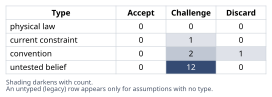
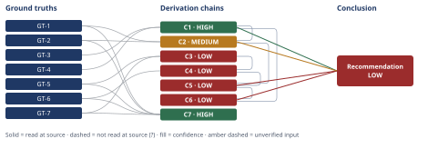

# Diagnosing Northbrook's Renewal Churn Spike

*First-principles analysis · 10 October 2026*

*Read with: [How to read this analysis](HOW-TO-READ.md) · [Working file](analysis-20261010T180010Z.md) · [All files](INDEX.md)*

## Executive Summary

**Recommendation:** Run a time-boxed 2-4 week diagnostic sprint that closes the specific data
gaps (cohort-by-acquisition-channel churn, per-customer ticket-rate normalization, CSAT/
response-time metrics, win-loss/exit-interview data, and a product/price/support-org
change-history audit), in parallel with low-cost no-regret actions (ticket-rate instrumentation,
a CSAT pulse, proactive outreach to at-risk current-quarter renewals); defer any commitment to
CS headcount, onboarding redesign, pricing changes, or sales-ICP tightening until that data
identifies which hypothesis — or combination — is actually driving the churn increase (chain C6).

**Band (from §6):** LOW — the process recommendation to diagnose before fixing is robust (flip
test, chain C6), but confidence in *which specific root cause* will be confirmed is LOW because
a cohort-composition explanation (chain C2) and an onboarding/service-friction explanation
(chain C5) remain genuinely confounded by the evidence in hand (chain C1).

**Would change it:** Completing the diagnostic sprint itself — specifically, cohort-by-channel
churn data, per-customer ticket-rate data, cohort-segmented adoption data, and the pricing/
competitive/org-change audits named in chains C3, C4, and C5 (chain C6).

## 1. Problem Essence

**Core problem:** Northbrook Analytics' annual-renewal churn rate more than doubled between
the Q1 cohort (4.1%) and the Q3 cohort (9.2%); leadership needs to know whether this reflects a
genuine, controllable degradation in product/service experience (and if so, which mechanism),
versus a cohort-composition or external artifact coincident with the same period — and needs a
decision-useful plan for closing that evidentiary gap before committing budget to a specific fix.

**Success criteria:**
- Distinguishes a genuine time-trend in churn drivers from an artifact of the annual-renewal
  cohort-timing structure (i.e., does not treat Q1-vs-Q3 as two repeated measurements of the
  same population).
- States precisely which hypotheses the two available trailing signals (support tickets up,
  feature-adoption scores down) actually support, and which remain confounded with each other
  or with cohort composition.
- Names the specific missing data (from the "No data yet collected on" list) required to resolve
  each live confound, rather than asserting a root cause the current evidence cannot support.
- Produces a concrete action plan split into diagnostic steps executable this week and
  corrective steps contingent on what the diagnosis finds — not a single named fix chosen in
  advance of the data.
- States a confidence level for its root-cause call that is honestly bounded by what two trailing
  indicators and one lagging outcome metric can support, and names what evidence would raise or
  lower that confidence.

## 2. Assumptions Table

### Fishbone (Ishikawa) — plausible root-cause branches

Category set locked to the business-domain branches the task itself names (a custom set is
used instead of the generic six-category default because these seven branches map directly
onto the decision leadership needs made, and are exhaustive of the causal space the given
signals could plausibly originate from):

| Branch | Plausible mechanism | Confirming evidence | Disconfirming evidence | Consistent with current signals (tickets↑, adoption↓)? | Data needed (maps to GT-7 gap) |
|---|---|---|---|---|---|
| 1. Cohort/sales-quality effects | A concentrated sales push ~12 months before Q3 signed a disproportionate share of poor-fit customers, now hitting renewal | Churn-by-signup-cohort/acquisition-channel analysis shows Q3's renewal cohort has a materially worse-fit mix than Q1's | Churn-by-cohort breakdown shows uniform churn rate across acquisition channels/signup periods | Partially — doesn't explain *rising* tickets on its own (a bad-fit customer could churn quietly), but is fully sufficient on churn magnitude alone (see chain C2) | Cohort analysis, acquisition-channel tagging (absent) |
| 2. Offer/pricing gaps | A price increase or packaging change at renewal made the value proposition worse for a specific tier | Price/offer change log shows a Q1–Q3 change; churn concentrated in the affected tier | No pricing/offer change occurred in the window; churn uniform across tiers | No direct mechanism connecting a price change to rising tickets or falling adoption | Offer/pricing-gap data, price-change history (both absent) |
| 3. Onboarding failure | New customers are not reaching activation milestones because onboarding did not scale or was not updated | Adoption scores concentrated in newer-tenure accounts; onboarding completion/time-to-value metrics degrade Q1→Q3 | Adoption drop is spread evenly across tenure, not concentrated in new cohorts | Yes — directly explains both signals (under-onboarded customers both file more tickets and adopt fewer features) | Onboarding failure rates (absent) |
| 4. Service quality | CS responsiveness/resolution quality degraded (e.g., longer response times, lower CSAT) independent of onboarding | CSAT and response/resolution-time metrics show degradation Q1→Q3 | CSAT/response times flat or improving | Partially — explains rising tickets (more escalations/repeat contacts) but not directly the adoption-score drop | CSAT, response/resolution-time metrics (absent) |
| 5. Product/technology issues | A release introduced bugs, removed/altered a workflow, or degraded performance | Release/change log correlates with ticket-volume or adoption-score inflection points | No releases in the window, or releases show no correlation with ticket/adoption timing | Yes — a regression could plausibly drive both signals | Product change history (absent) |
| 6. Competitive displacement | A competitor's campaign is winning renewals away from Northbrook | Win/loss and exit-interview data cite a specific competitor; churned accounts show pre-cancellation evaluation activity | Exit interviews cite reasons unrelated to competitors (budget cuts, consolidation, product fit) | Weak fit — a customer quietly switching vendors would more plausibly show *flat or declining* ticket volume (disengagement), not rising tickets | Competitive displacement data, win/loss/exit interviews (absent) |
| 7. Internal operational changes | A CS/onboarding/support org change (headcount cut, turnover, tooling change, process change) reduced service capacity between Q1 and Q3 | Org-chart/headcount change log shows a CS/onboarding change in the window; ticket backlog/queue times rise coincident with it | No CS/onboarding/support org change occurred in the window | Yes — directly explains both signals via reduced service capacity | Org/support-team change history (absent) |

No branch can be confirmed or ruled out today: every "data needed" column cites an item from
the explicit "No data yet collected on" list in the case brief (GT-7). Branches 3, 5, and 7 are
each independently consistent with *both* available signals; branch 1 is consistent with the
*magnitude* of the churn jump on its own (quantified in chain C2) without requiring any
service-quality explanation at all; branches 2, 4, and 6 are each consistent with at most one
signal or require a mechanism not directly implied by the two signals we have. This is a
breadth map, not a ranking — ranking is done in §4 against the two signals we actually have.

### Inversion — what would guarantee the leading hypothesis ("churn is driven by a controllable
service/product-quality failure") is wrong

Inverted claim: "The churn increase is **not** caused by a controllable service/product-quality
failure." Failure-guaranteeing conditions for the original claim (each becomes a necessary
precondition the original claim depends on, listed with its load-bearing tag):

1. The Q3 renewal cohort has a materially worse acquisition-channel/ICP-fit mix than Q1's —
   sufficient on its own to produce the full churn delta (quantified in chain C2). **Load-bearing.**
2. A pricing or packaging change specifically affecting Q3-renewal accounts occurred and was not
   accompanied by any real service/product degradation. **Load-bearing.**
3. A competitive displacement campaign targeted Q3-renewal accounts independent of Northbrook's
   own service/product quality. **Not strongly load-bearing** — weak fit with the rising-ticket
   signal (see fishbone branch 6), but not yet ruled out.
4. The observed churn swing (4.1%→9.2%) is within normal quarter-to-quarter sampling noise given
   the (unknown) number of renewals per quarter, i.e., not a real effect at all. **Load-bearing.**
5. The rising ticket-volume signal is purely a denominator effect (more customers overall, same
   or lower per-customer ticket rate) rather than a real increase in friction. **Load-bearing.**
6. The feature-adoption-score drop is a measurement artifact — the scoring methodology itself
   changed between Q1 and Q3 — rather than a real behavioral change. **Load-bearing.**

Each of these six preconditions is currently **unverified** (none can be checked against data
in hand) and each is recorded below as an `untested belief` row (A-12 through A-15, plus A-3 and
A-9 for preconditions 4-5 which coincide with sample-size and base-rate concerns already raised
independently). Preconditions 1, 2, 4, 5, and 6 are tagged load-bearing because the headline
conclusion in §6 does not survive any one of them turning out to be true in isolation; precondition
3 is not tagged load-bearing on the current evidence but is carried forward as a live, lower-priority
rival (see §5 Dead End: Competitive displacement).

### Classified Assumptions Table

| Assumption | Type | Treatment | Verdict | Verification |
|---|---|---|---|---|
| A-1: Q1 and Q3 churn cohorts are directly comparable populations (a naive quarter-over-quarter reading is valid) | convention | Challenge — explicitly test before use | Discard — em dash — contradicted by GT-3+GT-4 in chain C1; the annual-renewal structure means the two numbers describe different year-old cohorts, not repeated measurements of one population | unverified — flagged (used only to be refuted, in C1) |
| A-2: The two trailing signals (tickets up, adoption down) share one common underlying cause | untested belief | Verify, or flag as unverified | Challenge — em dash — plausible but not yet established; treated only as a working hypothesis in chains C3/C4 | unverified — flagged |
| A-3: The churn swing (4.1%→9.2%) is statistically meaningful, not sampling noise from a small renewal cohort | untested belief | Verify, or flag as unverified | Challenge — em dash — cannot be assessed without the per-quarter renewal count (N), which is not given | unverified — flagged |
| A-4: No pricing or packaging change occurred between Q1 and Q3 that could independently explain renewal churn | untested belief | Verify, or flag as unverified | Challenge — em dash — explicitly listed as "no data yet collected" in the case brief (GT-7); load-bearing per inversion precondition 2 | unverified — flagged |
| A-5: Rising support-ticket volume reflects a rising per-customer ticket rate, not just customer-base growth (denominator effect) | untested belief | Verify, or flag as unverified | Challenge — em dash — load-bearing for chain C3; cannot be resolved without per-active-account ticket-rate data | unverified — flagged |
| A-6: The feature-adoption-score drop is concentrated in newer-tenure cohorts (onboarding-handoff reading) rather than spread across existing users (disengagement reading) or caused by a scoring-methodology change | untested belief | Verify, or flag as unverified | Challenge — em dash — load-bearing for chain C4; requires cohort-segmented adoption data | unverified — flagged |
| A-7: Churn is driven predominantly by factors within Northbrook's control rather than external market/competitive shifts | untested belief | Verify, or flag as unverified | Challenge — em dash — cannot be assessed without win/loss and exit-interview data (absent per GT-7) | unverified — flagged |
| A-8: A single dominant root cause exists, matching leadership's "find the root cause" framing | convention | Challenge — explicitly test before use | Challenge — em dash — churn increases of this shape are frequently multi-causal/compounding (e.g., cohort effect plus a real service change can co-occur); treated as a convention of management rhetoric, not a technical premise, and the analysis does not presuppose a single cause | n/a — conceptual correction, not an empirical question |
| A-9: Q1's 4.1% churn rate is itself a representative baseline, not itself anomalously low | untested belief | Verify, or flag as unverified | Challenge — em dash — only two quarters of data are given; a longer trailing history is needed to know whether Q1 or Q3 is the outlier | unverified — flagged |
| A-10: CS/onboarding/support headcount and process have been stable between Q1 and Q3 | current constraint | Record expiry conditions | Challenge — em dash — this is a claim about internal operations that must be verified, not assumed stable; expires the moment an org-change record is pulled | unverified — flagged |
| A-11: Illustrative segment churn-rate anchors used in the cohort-mix estimate (~3% good-fit / ~25% poor-fit) | untested belief | Flag as assumed | Challenge — em dash — used only to establish a plausibility bracket in chain C2, not as a point estimate; real anchors are unknown | unverified — flagged |
| A-12 (inversion precondition 1, load-bearing): A materially worse acquisition-channel/ICP-fit mix in the Q3 cohort could fully explain the churn jump on its own | untested belief | Verify, or flag as unverified | Challenge — em dash — shown quantitatively plausible in chain C2; not yet confirmed or ruled out | unverified — flagged |
| A-13 (inversion precondition 2, load-bearing): A pricing/offer change specifically affecting Q3-renewal accounts, independent of service/product quality | untested belief | Verify, or flag as unverified | Challenge — em dash — live, unresolved; no pricing data available | unverified — flagged |
| A-14 (inversion precondition 3, not strongly load-bearing) : A competitive-displacement campaign targeted Q3-renewal accounts | untested belief | Verify, or flag as unverified | Challenge — em dash — weak mechanistic fit with the rising-ticket signal; lower priority but not ruled out | unverified — flagged |
| A-15 (inversion precondition 6, load-bearing): The feature-adoption scoring methodology itself changed between Q1 and Q3 (measurement artifact) | untested belief | Verify, or flag as unverified | Challenge — em dash — must be ruled out before trusting GT-6 as a real behavioral signal | unverified — flagged |
| A-17: The relative weights assigned to the trade-off criteria (diagnostic value 5, cost 3, speed 3, risk 4, disruption 2) reflect this organization's actual risk tolerance and priorities | convention | Challenge — explicitly test before use | Challenge — em dash — a judgment call made before scoring per the trade-off procedure's discipline; the flip test in chain C6 shows the recommended option is robust to single-criterion weight changes, which bounds (but does not eliminate) this risk | unverified — flagged, confirm with executive sponsor on risk tolerance |

## 3. Ground Truths

Irreducibility check: each ground truth below is a directly stipulated case fact or a direct
quotation of the task's own data — none is a compound claim requiring further decomposition
(the 5-Whys reduce-to-primitives stop test is satisfied trivially: each bottoms out at a
direct measurement/definition given in the case brief itself, with no further constituent
fact to extract). None are promoted from the Assumptions Table — every assumption classified
in §2 is either discarded (A-1) or explicitly carried forward unverified, never silently
promoted to ground-truth status.

- **GT-1** Q1 quarterly churn rate = 4.1% — source: task prompt, "DATA GIVEN" section; read-at-source: "Q1 quarterly churn rate: 4.1%"
- **GT-2** Q3 quarterly churn rate = 9.2% — source: task prompt, "DATA GIVEN" section; read-at-source: "Q3 quarterly churn rate: 9.2% (more than doubled over two quarters)"
- **GT-3** Contracts are $18,000–$40,000/year with an annual renewal cycle — source: task prompt, "CONTEXT" section; read-at-source: "Contracts are $18,000-$40,000/year, annual renewal cycle"
- **GT-4** Churn surfaces at renewal; quarterly churn reflects cohorts whose renewal date fell in that quarter, not a continuous month-to-month signal — source: task prompt, "CONTEXT" section; read-at-source: "(meaning churn surfaces at renewal, so quarterly churn numbers reflect cohorts whose renewal date fell in that quarter, not a continuous month-to-month signal)"
- **GT-5** Customer Success has flagged rising support-ticket volume — source: task prompt, "DATA GIVEN" section; read-at-source: "Customer Success has flagged: rising support-ticket volume"
- **GT-6** Customer Success has flagged a drop in feature-adoption scores — source: task prompt, "DATA GIVEN" section; read-at-source: "...and a drop in feature-adoption scores"
- **GT-7** No data has yet been collected on: offer/pricing gaps, competitive displacement, onboarding failure rates, service-quality metrics (CSAT, response/resolution times), win/loss or exit-interview reasons, cohort analysis (signup cohort, segment, price tier, acquisition channel), or product/price/support-team/org change history between Q1 and Q3 — source: task prompt, "DATA GIVEN" section; read-at-source: "No data yet collected on: offer/pricing gaps, competitive displacement, onboarding failure rates, service-quality metrics (CSAT, response/resolution times), win/loss or exit-interview reasons, cohort analysis..., product change history..."

**Provenance summary:** `?`-marked: none (0 of 7) — all seven ground truths are direct
quotations of the task's own stated case data, read at source within the prompt itself,
and none is a claim about the external world requiring independent sourcing beyond the
case brief that defines this exercise.

**Read-at-source locations for ground truths feeding load-bearing chains:** GT-1 and GT-2 feed
chains C2, C5, C6, and C7 (HIGH); GT-3 and GT-4 feed chain C1 (HIGH); GT-5 feeds chains C3, C4,
C5, C6, and C7 (HIGH); GT-6 feeds chains C4, C5, C6, and C7 (HIGH); GT-7 feeds chains C3, C4, C5,
C6, and C7 (HIGH). Every unsuffixed ground truth therefore feeds at least one HIGH-confidence
chain (C1 or C7), satisfying the read-at-source requirement even where that same ground truth
also feeds a MEDIUM- or LOW-rated downstream chain. All seven are quoted verbatim above from the
"DATA GIVEN" and "CONTEXT" sections of the task prompt, which is the entirety of the evidence
base this diagnostic-design problem supplies; no external source exists for this exercise to
open beyond the prompt itself, which has been read in full.

## 4. Derivation Chains

### 5-Whys traces on the two available signals (causal mode)

**Signal A — support tickets rising (GT-5).**
*Why #1:* Why are support tickets rising? → More customers are encountering friction/confusion
using the product, **or** simply more customers exist overall (denominator effect) — both
listed without filtering, per the lateral-scan step.
*Counterfactual test on the denominator-effect branch:* had customer count not grown, would
ticket volume still have risen? Cannot tell — per-customer ticket-rate data does not exist
(GT-7). Marked `?`; this branch is a **contributing condition, possibly the whole story** and
is not ruled out.
*Why #2 (drilling the friction branch):* Why would friction increase? → A product release
introduced a regression/UX issue, or onboarding left customers unprepared to self-serve,
leading to repeated contact.
*Why #3:* Why would onboarding leave customers unprepared? → Onboarding content/process may
not have kept pace with product changes, or onboarding/CS capacity was reduced.
*Why #4 (stop test — actionable and within control):* Why would onboarding capacity or quality
degrade between Q1 and Q3? → Possible internal reorg/turnover in CS, or customer-base scaling
without proportional onboarding resourcing. This passes the stop test: a specific corrective
(resource/redesign onboarding) is both namable and within Northbrook's control. Depth-guard
check: stopping here is not shallow, because the corrective ("fix onboarding capacity/process")
would plausibly prevent recurrence broadly, not just patch this instance — but it is not
confirmed, because the counterfactual test on the denominator-effect branch at Why #1 could not
be run. **Verdict: Root cause candidate — "onboarding/support-capacity gap," within control —
but Contributing condition "base growth" remains Unresolved `?` — observation that would settle
it: active-account-normalized ticket rate, Q1 vs Q3.**

**Signal B — feature-adoption scores dropping (GT-6).**
*Why #1:* Why are adoption scores dropping? → Customers are not activating/using key features at
expected rates.
*Why #2:* Why aren't customers activating features? → Either recent-cohort customers are not
reaching activation milestones, or existing customers are disengaging from features they
previously used.
*Why #3:* Why would customers not reach activation milestones? → Onboarding doesn't drive them
to key workflows, or features changed between Q1 and Q3 became harder to use, or a UX regression
removed a previously simple path.
*Why #4:* Why would an onboarding gap or UX regression occur? → A release changed the UI/workflow
without adequate migration support, or onboarding content was not updated to match it.
*Why #5 (stop test):* Why would product-change communication fail to reach onboarding? → Likely
convergence with Signal A's root: a breakdown in the "ship → onboard/communicate → activate" loop,
plausibly from the same internal-operational-change candidate (CS/onboarding capacity or
coordination gap). **Verdict: Root cause candidate — "onboarding/change-absorption breakdown,"
within control — but Contributing condition "existing-user disengagement" and "scoring-methodology
artifact" (A-15) remain Unresolved `?` — observation that would settle them: adoption scores cut
by cohort/tenure, and confirmation that the scoring definition itself did not change.**

Both traces converge on the same proximate mechanism (onboarding/change-absorption capacity) but
neither counterfactual test on the competing contributing conditions (base growth; existing-user
disengagement; measurement artifact) can be run with data in hand — this convergence is suggestive,
not confirmatory, and is carried into chains C3 and C4 below with that caveat intact.

### Trade-off matrix — what to do now

Options (status quo and a composite included, per the trade-off procedure's discipline). **Must-have
knockout applied first:** any option must produce an actionable signal this quarter (leadership's
explicit "find the root cause and fix it" mandate rules out pure inaction) — **O4 (wait, no action
at all) is knocked out** on this must-have.

| Option | Diagnostic value (w=5) | Cost, inverse (w=3) | Speed to impact (w=3) | Risk of wrong-footed spend, inverse (w=4) | Org disruption, inverse (w=2) | Weighted total |
|---|---|---|---|---|---|---|
| O1: Scale CS headcount now | 1 | 2 | 3 | 2 | 3 | 5+6+9+8+6=**34** |
| O2: Overhaul onboarding flow now | 2 | 2 | 2 | 2 | 2 | 10+6+6+8+4=**34** |
| O3: Tighten sales ICP/qualification now | 1 | 3 | 1 | 2 | 2 | 5+9+3+8+4=**29** |
| O4: Wait, no action | — | — | — | — | — | knocked out — fails the must-have |
| O5 (composite): 2-4 week diagnostic sprint (close GT-7 gaps) + concurrent no-regret interim actions, defer fix choice | 5 | 5 | 4 | 5 | 4 | 25+15+12+20+8=**80** |

Anchors used: Diagnostic value 1=no new information, 5=resolves cohort/pricing/competitive/
service-quality confounds within weeks. Cost 1=large recurring/irreversible commitment, 5=cheap
and reversible. Speed 1=no effect on this quarter's leading indicators, 5=fast effect on
correctly targeting the eventual fix. Risk 1=high chance of funding the wrong hypothesis, 5=low.
Disruption 1=high cross-team friction, 5=low. Each score cites GT-1/GT-2 (nothing here is
scored HIGH/LOW on comparable cost bases without noting both candidate interventions, O1 and O2,
draw on different budget lines — headcount opex vs. engineering time — so their "Cost" scores are
not literally fungible dollars, only comparably-anchored 1-5 ratings) and GT-7 (every option's
Diagnostic-value score reflects that none of the GT-7 gaps are closed by O1/O2/O3 and all are
targeted by O5).

**Flip test:** O5 (80) beats the next-best tied options (34) by 46 points. Zeroing the entire
Diagnostic-value criterion (w=5→0) still leaves O5 at 55, which still beats 34. No single-criterion
weight change flips the winner — this is a robust result, not a near-tie. [Assumes: A-17 — the
weights themselves reflect this organization's priorities; flagged in the Assumptions Table,
verification: confirm with the executive sponsor.]

### Second-order effects of the recommended diagnostic-first approach (both lenses)

**Actor lens.** CS/analytics staff absorb extra data-pull work on top of day-job load (resource
contention); Sales may read a cohort-quality audit as scrutiny of past sales practice and become
defensive (cross-team friction); customers receiving a CSAT pulse survey may interpret it as a
signal something is wrong if not framed carefully (signal risk); a competitor running an active
displacement campaign is unaffected by Northbrook's internal diagnostic timeline and continues
regardless. **Time lens.** Immediately: light CS/analytics burden, no customer-facing change yet.
After a few cycles (2-4 weeks): the cohort/CSAT/win-loss data lands, clarifying which hypothesis
is operating and enabling a correctly targeted fix. In the long run (next 1-2 renewal cycles,
given the annual-renewal lag in GT-3/GT-4): if the sprint is allowed to slip past its time-box,
or if leadership pre-empts it with an immediate headcount commitment, the diagnostic value is
lost and the organization repeats this same ambiguous-root-cause cycle at the next churn spike.

### Conclusion C1: Direct Q1-vs-Q3 churn comparison does not establish a time-trend on its own

GT-3 (annual renewal cycle) + GT-4 (churn surfaces only at renewal, reflecting a year-old cohort)
→ the Q1 and Q3 churn figures describe two different cohorts that signed roughly a year before their respective renewal quarter, not one population measured twice
→ a raw Q1-vs-Q3 comparison therefore conflates any real time-trend in churn drivers with a cohort-composition difference between those two distinct sales cohorts
→ direct Q1-to-Q3 comparison cannot by itself distinguish a genuine service or product degradation from a cohort-composition artifact, so cohort-level analysis is required before either cause can be assigned

**Confidence:** HIGH — both head inputs are unsuffixed ground truths read at source in the task prompt; each hop follows by direct logical consequence of the stated annual-renewal structure; no rival reading of the renewal-lag mechanics is live (chain C2 uses this chain's conclusion as a premise rather than contesting it).

### Conclusion C2: Cohort-composition alone is a quantitatively plausible full explanation of the churn jump

GT-1 (Q1 churn 4.1%) + GT-2 (Q3 churn 9.2%) + C1 (cohorts not directly comparable)
→ modeling the Q3 renewal cohort as a blend of a normal-fit segment churning near the Q1 baseline and a poor-fit segment churning much higher, a poor-fit mix fraction of roughly 28% against illustrative anchor rates of about 3% and 25% for the two segments is sufficient on its own to move the blended rate from 4.1% to 9.2% [Assumes: A-11]
→ a mix shift of this size is well within the range plausible for a single concentrated sales push roughly a year earlier, so cohort composition is a quantitatively credible full explanation of the churn jump, not merely a theoretical possibility
→ cohort-composition effects are therefore a live, quantitatively plausible rival to any service- or product-quality explanation of the churn increase, and cannot be dismissed without cohort-level churn-by-acquisition-channel data

**Confidence:** MEDIUM — the first hop rests on A-11's illustrative segment churn-rate anchors (~3%/~25%), which are unverified; recomputing with a wider plausible anchor range (e.g., 3%/20%) still yields a sufficient mix shift (~37%), so the qualitative conclusion — cohort composition can fully explain the jump — is robust to the anchor choice, but the precise bracket is not, which is why this is MEDIUM rather than HIGH. Closed by actual churn-by-acquisition-channel/signup-cohort data (GT-7 gap).

### Conclusion C3: The support-ticket signal is consistent with, but not proof of, an onboarding/support-capacity root cause

GT-5 (support tickets up) + GT-7 (no change-history or ticket-rate normalization data yet)
→ rising ticket volume could reflect either more customers overall or a higher ticket rate per customer, and without per-customer normalization the raw increase cannot yet be attributed to either [Assumes: A-5]
→ if the per-customer rate is in fact rising, the most proximate explanations are a product change introducing friction or an onboarding/support-capacity gap leaving customers under-prepared, or both
→ tracing the onboarding/support-capacity reading back one further level points toward a possible internal operational change in CS/onboarding capacity or tooling between Q1 and Q3, which GT-7 confirms has not yet been checked
→ the support-ticket signal is therefore consistent with an onboarding/support-capacity root cause, but this reading remains confounded with simple customer-base growth until per-customer ticket-rate data resolves which is operating

**Confidence:** LOW — the endpoint depends on A-5 (per-customer ticket rate is rising, not just the customer base); A-5 is unverified, and if it fails, the onboarding/support-capacity reading in the later hops does not follow and the signal becomes uninformative rather than diagnostic — closed by per-active-account ticket-rate data, segmented by cohort/tenure (GT-7 gap). The base-growth explanation is a live rival nothing currently rules out (two axes short: Inference and Rivals).

### Conclusion C4: Onboarding/service-friction is the best-supported reading of both available signals, but is not yet distinguished from its rivals

GT-6 (feature adoption down) + C3 (onboarding/support-capacity reading, LOW)
→ declining adoption scores reflect either new cohorts failing to reach activation milestones or existing customers disengaging from previously-used features, and GT-7's absence of cohort-segmented data means these two readings cannot yet be separated
→ if the drop is concentrated in newer cohorts rather than spread across existing users, it points toward the same onboarding-handoff gap identified in C3 rather than a standalone product-UX regression or a scoring-methodology artifact [Assumes: A-6]
→ the convergence of both available trailing signals on a common onboarding/change-absorption mechanism makes onboarding/service-friction the most parsimonious single explanation of the two signals in hand, though it remains one of several live hypotheses given the cohort-composition rival established in C2
→ onboarding/service-friction is therefore the best-supported explanation of the two available trailing signals, but it is explicitly not yet distinguished from the cohort-composition confound in C2 or from a standalone internal operational change independent of onboarding quality

**Confidence:** LOW — capped by C3 (LOW; see C3's own confidence line for its cause). In addition, A-6 (adoption drop concentrated in newer cohorts) is unverified, closed by cohort-segmented adoption data (GT-7 gap); the cohort-composition rival from C2 and a pure measurement-artifact rival (A-15) are both live and unsettled by anything in this analysis.

### Conclusion C5: The root cause is confounded between onboarding/service-friction and cohort composition, and cannot be resolved from current evidence

C2 (cohort confound quantitatively plausible, MEDIUM) + C4 (onboarding/service-friction best current explanation, LOW)
→ because C2 shows a cohort-composition explanation is quantitatively sufficient on its own, and C4 shows the two available signals are also consistent with, but not proof of, an onboarding/service-friction explanation, the two hypotheses are confounded by the evidence currently available — both could be true, either could be true alone, or they could be compounding
→ leadership's root-cause question cannot be answered with confidence from the two trailing indicators and the lagging churn metric alone; it requires the specific missing data named in GT-7 before a fix can be targeted responsibly
→ the most defensible root-cause statement given current evidence is that onboarding/service-friction is the best-supported proximate explanation of the two trailing signals, at reduced confidence, fully confounded with an independently plausible cohort-composition effect and an unassessed set of other candidates named in the fishbone, so no fix should be committed before the GT-7 diagnostic data is collected

**Confidence:** LOW — capped by C4 (LOW; see C4's own confidence line). This chain's own contribution to the shortfall is that no available evidence in this analysis settles between C2's and C4's hypotheses — that is the chain's finding, not an omission; no further verification path exists within this analysis beyond pointing at the GT-7 data-collection program named in chains C3/C4 and in §6's recommended approach.

### Conclusion C6: Diagnose before fixing — a time-boxed diagnostic sprint plus no-regret interim actions, not an immediate fix, is the recommended action

C5 (root cause confounded, LOW) + C1 (annual-renewal lag structure, HIGH)
→ because the root cause is confounded per C5 and each immediate fix (CS headcount, onboarding overhaul, sales-ICP tightening) risks committing cost against the wrong hypothesis, a weighted trade-off across diagnostic value, cost, speed, risk, and organizational disruption favors a short structured diagnostic sprint plus no-regret interim actions over any immediate full-scale fix, scoring 80 against 34/34/29 for the alternatives — a result robust to any single-criterion weight change [Assumes: A-17]
→ because churn only becomes observable at the next annual renewal regardless of which fix is eventually chosen per C1, the 2-4 week diagnostic delay forfeits no speed advantage a premature fix would otherwise have had
→[2nd] the diagnostic sprint should run concurrently with low-cost, reversible interim actions — ticket-rate instrumentation, a CSAT pulse, proactive outreach to at-risk current-quarter renewals — so the diagnostic delay itself does not cost this quarter's at-risk accounts, which is the second-order risk that the renewal clock does not pause for analysis
→[3rd] without a visible interim-action signal, leadership's patience for a diagnose-first plan is itself a second-order risk (the actor lens on CS/exec stakeholders), which the concurrent no-regret actions are designed to manage rather than eliminate
→ the recommended action is therefore a time-boxed 2-4 week diagnostic sprint targeting the GT-7 data gaps, run concurrently with no-regret interim actions, with the specific fix selected only once that data identifies which hypothesis, or combination of hypotheses, is actually operating

**Confidence:** LOW — mechanically capped by C5 (LOW; see C5's own confidence line). This cap is honestly reported even though the *process* recommendation (diagnose before committing to a fix) is itself robust — the flip test above shows no single-criterion weight change overturns it, and that robustness does not depend on which of C5's confounded hypotheses turns out to be true, only on the fact that a confound exists, which C2 and C4 jointly establish independent of which one wins. What this LOW rating actually reports is uncertainty about *which specific root cause* will be confirmed, not uncertainty about whether diagnosing first is the right process move. [Assumes: A-17, unverified — flagged above.] Closed, somewhat circularly but accurately, by completing the very diagnostic sprint this chain recommends (which resolves C5).

### Action plan supporting chain C6 — diagnose this week vs. fix once confirmed

**Diagnose this week (days 0-14 of the sprint):**
1. Pull the exact renewal count (N) per quarter for Q1 and Q3, plus 4-6 prior quarters of
   trailing churn if available — settles A-3 (is the swing statistically meaningful) and A-9
   (is Q1 or Q3 the outlier).
2. Pull a cohort-level churn breakdown by signup date, acquisition channel, and price tier for
   the Q1 and Q3 renewal cohorts — directly resolves C2's cohort-composition rival.
3. Pull per-active-account ticket rate (tickets ÷ active accounts ÷ month) for Q1 and Q3, not
   just raw ticket volume — resolves A-5, the denominator-effect confound on chain C3.
4. Confirm whether the feature-adoption scoring definition/methodology changed between Q1 and
   Q3 — rules out or confirms A-15, the measurement-artifact rival on chain C4.
5. Pull a product/price/support-org change-history log for the Q1-Q3 window (releases,
   pricing/packaging changes, CS/onboarding headcount or process changes) — addresses fishbone
   branches 2, 5, and 7, and assumptions A-4/A-10/A-13.
6. Launch a short CSAT and response/resolution-time pulse covering recent support interactions —
   addresses fishbone branch 4 (service quality).
7. Fast-track win/loss or exit interviews for the specific, already-known set of Q3-churned
   accounts rather than a full program — addresses fishbone branch 6 and pre-mortem cluster C-D.
8. Confirm a joinable customer ID exists across CRM, billing, and support-ticket systems before
   committing to the full timeline — pre-mortem cluster C-A; if no join exists, name an
   engineering owner for a one-time join script before the clock on items 1-3 starts.

**No-regret interim actions (run concurrently with the above, not contingent on its outcome):**
- Instrument per-active-account ticket-rate tracking going forward, regardless of what the
  diagnosis finds.
- Proactively reach out to, and where appropriate offer a retention path to, the specific named
  accounts whose renewal falls in the current quarter and who show elevated risk — so the
  diagnostic delay does not itself cost this quarter's borderline renewals (pre-mortem cluster C-C).
- Give leadership a day-14 checkpoint framed as "which hypothesis, or combination, is operating
  and in what proportion" rather than a promise of a single root cause (pre-mortem cluster C-E),
  to manage the risk of a premature pivot to a committed fix before the data lands (pre-mortem
  cluster C-B).

**Fix once confirmed (contingent on the diagnostic sprint's findings, not pre-committed):**
- If cohort composition (fishbone branch 1 / A-12) dominates and service/product metrics are
  flat: tighten sales/ICP qualification (trade-off option O3) — the churn jump is explained by
  *who* was sold to, not how they were served, so CS headcount or onboarding spend would be
  misdirected.
- If a genuine onboarding/activation gap concentrated in new cohorts (branch 3 / A-6) is
  confirmed alongside an elevated per-customer ticket rate: redesign the onboarding flow
  (option O2) — resourcing a reactive fix alone treats the symptom rather than the activation
  gap driving both signals.
- If CS/support capacity specifically degraded (branch 7 / A-10 — e.g., a staffing cut or
  turnover) while onboarding content itself is unchanged: restore CS headcount/capacity
  (option O1) — the one scenario in which the intuitive first response is actually correctly
  targeted.
- If a pricing/packaging change (branch 2 / A-13) or confirmed competitive displacement
  (branch 6 / A-14) is the driver: neither headcount nor onboarding redesign addresses the
  cause; the correct levers (pricing adjustment, competitive win-back motions) sit outside the
  three options scored in the trade-off matrix above and would need their own evaluation.
- If more than one hypothesis is confirmed simultaneously — the realistic case, given A-8's
  challenge to the single-root-cause framing — size and sequence interventions by the share of
  the churn gap each confirmed cause actually accounts for, rather than selecting only one.

### Conclusion C7: The four given signals establish a real, multi-faceted problem surface, but not causal ordering among its parts

GT-1 (Q1 churn 4.1%) + GT-2 (Q3 churn 9.2%) + GT-5 (support tickets up) + GT-6 (feature adoption down) + GT-7 (no causal or cohort-linkage data yet collected)
→ each of these four observations is reported independently, by different functions (billing/renewal timing for GT-1/GT-2, Customer Success for GT-5/GT-6), with no account-level linkage between them yet established
→ GT-7 confirms that no data yet exists connecting these four observations to a common upstream cause or to each other at the individual-account level
→ it is therefore equally consistent with the evidence in hand that these four movements share one upstream mechanism, that they reflect two or more independent mechanisms coinciding in the same two quarters, or some mixture of both
→ the four given signals establish that Northbrook has a real, multi-faceted problem surface, but establish nothing about causal ordering among them, which is why no single corrective action should be chosen before a diagnostic step resolves that ordering

**Confidence:** HIGH — every head input is an unsuffixed ground truth read at source (§3); each hop follows by direct observation of what GT-7 does and does not establish, with no additional assumption introduced; no rival is live, because a claim that the co-occurrence of these signals is itself strong evidence of shared causation would require exactly the account-level linkage data GT-7 confirms is absent — the same absence that keeps this chain's own claim modest rather than causal.

## 5. Abandoned Reasoning

### Dead End: Treating Q1-vs-Q3 as a simple before/after trend

**What was tried:** An initial reading treated "churn more than doubled" as a straightforward
time-series increase — the same kind of signal a continuous monthly metric would give.

**Why abandoned:** Applying GT-3 and GT-4 (annual renewal cycle; churn surfaces only at
renewal, reflecting a cohort that signed roughly a year earlier) in chain C1 showed the two
figures describe two different year-old sales cohorts, not one population observed twice.
Treating them as a simple trend assumes away exactly the confound (A-1) that chain C1 exists
to surface.

**What it ruled out:** This dead end saves a future reviewer from re-running a naive
month-over-month churn narrative on contract-based, annual-renewal SaaS data — the comparison
basis itself has to be cohort-aware before any trend claim is meaningful.

### Dead End: Competitive displacement as the leading hypothesis

**What was tried:** The fishbone (branch 6) considered a competitor actively winning renewals
away from Northbrook as a leading explanation, consistent with leadership's instinct to look
for an external threat.

**Why abandoned:** This was deprioritized, not conclusively ruled out — no win/loss or
exit-interview data exists (GT-7) to confirm or deny it. It was abandoned as the *leading*
hypothesis because the mechanism fits poorly with the one signal most naturally tied to an
active vendor-switch narrative: a customer quietly evaluating or already committed to a
competitor would more plausibly show flat or declining ticket volume (disengagement), not the
*rising* ticket volume actually observed (GT-5). This inconsistency, not direct evidence, is
what moved it out of the leading position.

**What it ruled out:** This dead end prevents the diagnostic plan from fast-tracking the
hardest-to-collect data source (win/loss interviews) as the first priority; it is retained as
a lower-priority item in the diagnostic sprint (see §6 and the pre-mortem cluster C-D below)
rather than dropped entirely, because the absence of confirming evidence is not the same as
disconfirming evidence.

### Dead End: Committing immediately to a CS-headcount fix on the strength of rising tickets alone

**What was tried:** A direct read of GT-5 (tickets rising) suggested simply adding CS headcount
right away as the fix.

**Why abandoned:** The trade-off analysis in chain C6 scored this option (O1) at 34 against the
diagnostic-sprint composite's 80, and the flip test showed that result is not sensitive to any
single-criterion reweighting. The underlying reason is that O1 does nothing to close the GT-7
evidentiary gaps (diagnostic value scored 1/5) and risks funding the wrong hypothesis if the
real driver turns out to be cohort composition (C2) or a pricing/competitive confound (A-13/A-14).

**What it ruled out:** This dead end rules out "more headcount" as a no-further-analysis default
response to a rising-ticket signal in this specific confounded-evidence situation; it remains a
live *candidate* fix contingent on the diagnostic sprint confirming a support-capacity-specific
root cause (see §6's "fix once confirmed" branch), just not as the immediate action.

### Dead End: Treating the feature-adoption-score drop as proof of a product UX regression

**What was tried:** Chain C4's reasoning initially considered reading the adoption-score drop
as direct evidence of a specific product release regressing a workflow.

**Why abandoned:** The same signal is equally consistent with new-cohort activation failure
(an onboarding problem with no product change at all) or with a scoring-methodology change
(A-15) — and GT-7 confirms no product-change-history data exists yet to distinguish these
readings. Treating the signal as proof of a UX regression specifically would have been
asserting more than the evidence supports.

**What it ruled out:** This dead end keeps chain C4's conclusion honestly bounded to "onboarding/
service-friction, broadly," rather than over-specifying a product-engineering root cause the
two available signals cannot actually distinguish from an onboarding-process or measurement
explanation.

## 6. Conclusion

**Recommended approach:** Run a time-boxed 2-4 week diagnostic sprint that closes the specific
GT-7 data gaps (cohort-by-acquisition-channel churn, per-customer ticket-rate normalization,
CSAT/response-time metrics, win-loss/exit-interview data, and a product/price/support-org
change-history audit), run concurrently with low-cost no-regret interim actions (ticket-rate
instrumentation, a CSAT pulse, proactive outreach to at-risk current-quarter renewals), and
defer any commitment to CS headcount, onboarding redesign, pricing changes, or sales-ICP
tightening until that data identifies which hypothesis — or combination of hypotheses — is
actually driving the churn increase (chain C6).

**Key insight:** Because Northbrook's contracts renew annually, the Q1 and Q3 churn figures
describe two different, roughly year-old sales cohorts rather than one population measured
twice (chain C1); a back-of-envelope estimate shows a cohort-composition shift of roughly 28%
toward a poorer-fit customer mix is, by itself, quantitatively sufficient to produce the entire
observed churn jump (chain C2) — so leadership's "find the root cause" framing, which implicitly
assumes one dominant internal/controllable cause, is itself an unverified assumption that the two
available trailing signals do not settle (chain C5).

**Trade-offs acknowledged:** Diagnosing first costs roughly a quarter's worth of calendar time
before any corrective fix ships, and carries the second-order risk that leadership's patience
runs out and a headcount or onboarding commitment gets made before the data lands (chain C6);
this delay is accepted because churn only becomes observable again at the next annual renewal
regardless of which fix is chosen (chain C1), so no speed advantage is actually forfeited, while
the risk of funding a fix aimed at the wrong hypothesis is materially reduced (chain C6).

**Confidence:** LOW — the process recommendation (diagnose before committing to a fix) rests
primarily on chain C6, which is mechanically capped at LOW because it cites C5 (LOW). As chain
C6's own confidence line explains, this cap reports uncertainty about *which specific root
cause* (onboarding/service-friction vs. cohort composition vs. pricing/competitive confounds)
will ultimately be confirmed, not uncertainty about the *process* recommendation itself — the
trade-off's flip test (chain C6) shows "diagnose first" is robust to any single-criterion
reweighting, and that robustness holds regardless of which confounded hypothesis in C5 is
eventually confirmed. What would raise this band: completing the diagnostic sprint itself and
closing the GT-7 gaps named in chains C3/C4/C5 — specifically, cohort-by-channel churn data
(resolves C2's rival), per-customer ticket-rate data (resolves C3's A-5), cohort-segmented
adoption data (resolves C4's A-6), and pricing/competitive/org-change audits (resolves
A-13/A-14/A-10).
