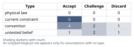
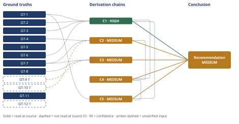

# Mortgage Paydown vs. Index Investing: A $60,000 Decision

*First-principles analysis · 10 October 2026*

*Read with: [How to read this analysis](HOW-TO-READ.md) · [Working file](analysis-20261010T155949Z.md) · [All files](INDEX.md)*

## Executive Summary

**Recommendation:** Direct the majority of the $60,000 to mortgage-principal paydown and keep a meaningful minority — illustratively 30%, about $18,000 — liquid and invested in the index fund, rather than committing the full amount to either pure strategy (chain C5).

**Band (from §6):** MEDIUM

**Would change it:** Realized nominal U.S. equity returns over the next decade averaging above roughly 7.6%/year (the entire top of Vanguard's current forecast range and beyond) would flip the comparison toward a larger invested allocation (chain C4).

## 1. Problem Essence

**Core problem:** Given $60,000 of genuinely surplus capital, a 6.25% mortgage with no tax shield, and a 10-year horizon, does directing that capital to mortgage-principal paydown, to a taxable broad-market index fund, or to some split of the two, produce the best risk-adjusted outcome for this household — and under what conditions does that answer change?

**Success criteria:**
- The comparison treats mortgage paydown as a guaranteed return and index investing as a *distribution* of possible after-tax returns, not two point estimates compared as if both were certain.
- The forward equity-return assumption used is conditioned on current valuation levels, not an unconditional historical average, and is traceable to a named, dated source.
- The after-tax cost of the debt and the after-tax return of the investment are computed on the same (after-tax, nominal) basis before being compared.
- The recommendation names a position on the full allocation spectrum from 100% paydown through 100% invest, including a split, rather than being pre-committed to picking exactly one of the two named options.
- The recommendation states the specific condition(s) under which it would reverse.

## 2. Assumptions Table



| Assumption | Type | Treatment | Verdict | Verification |
|---|---|---|---|---|
| A-1. Mortgage terms: $240,000 balance, 6.25% APR fixed, 27 years remaining, standard fully-amortizing, non-recast loan | current constraint | Record expiry: holds until refinanced, recast, or paid off | Accept — expires on refinance/recast/payoff; until then it is the contractual, binding term structure | stipulated by the user as the problem's defining parameter about their own loan; not independently verifiable by this analysis, and no third-party source exists for it |
| A-2. Household takes the standard deduction, so mortgage interest yields $0 marginal tax benefit | current constraint | Record expiry: holds until itemized deductions (SALT, charitable, medical, etc.) exceed the standard deduction, or tax law changes it | Accept — expires if the household's deduction mix changes or the law changes; until then the full 6.25% is the real after-tax cost | stipulated by the user |
| A-3. Marginal rates: ~28% combined ordinary, ~18% combined LTCG/qualified-dividend, held constant for 10 years | current constraint | Record expiry: holds until income bracket shifts or tax law changes these rates | Accept — expires on bracket shift or legislation; until then these are the binding rates | stipulated by the user |
| A-4. $60,000 is genuinely surplus, above an already-funded 6-month emergency reserve, with no other stated near-term claim on it | current constraint | Record expiry: holds until a new, larger near-term liquidity need is identified | Accept — as stated by the user | stipulated by the user |
| A-5. Decision horizon is 10 years | current constraint | Record expiry: the analysis is scoped to this horizon; a different horizon changes the forward-return math materially (see confidence caveats) | Accept — as stated by the user | stipulated by the user |
| A-6. Convention: compare Option A and Option B purely on expected annualized after-tax return, as if the two were equally liquid and equally accessible | convention | Explicitly challenge | Challenge — discarded as a simplifying convention; GT-1 establishes paydown is illiquid without a new borrowing transaction while an invested balance stays liquid, so the pure-return comparison materially understates Option A's true cost (chain C5) | challenged directly in this analysis; see C5 |
| A-7. Convention: use the unconditional long-run historical equity return (~10%/yr nominal) as the forward return expectation for Option B | convention | Explicitly challenge | Challenge — discarded as the forward assumption for this decision; replaced by the valuation-conditioned forecast GT-7, because today's starting valuation (GT-8) is far from the historical average the 10% figure is unconditioned on (chain C3; Abandoned Reasoning #1) | challenged directly in this analysis; see C3 and Dead End #1 |
| A-8. Convention: the mortgage-interest deduction lowers the effective cost of mortgage debt | convention | Explicitly challenge | Discard — directly contradicted by the user's own stipulation (standard deduction, GT-3); no tax-shield asymmetry applies to this household | discarded per user's own stipulated fact |
| A-9. Untested belief: paying extra principal lowers the required monthly mortgage payment | untested belief | Verify | Discard — contradicted by GT-1's amortization mechanics; absent a recast, the required payment is unchanged and the loan simply pays off earlier | verified by direct derivation from the amortization recursion (GT-1) |
| A-10. Current constraint: no recast will be requested on the paid-down balance | current constraint | Record expiry: lapses if the household proactively requests, and the servicer grants, a recast | Accept — expires on recast request; until then the required payment is fixed regardless of extra principal paid | stipulated by the user ("standard non-recast amortizing loan") |
| A-11. Broad-market index fund returns can be approximated by Vanguard's "U.S. Equities" 10-year forecast (GT-7) | convention | Explicitly challenge | Accept, with caveat — broad-market and S&P-500-style returns are highly correlated and the forecast is a reasonable stand-in, but it is an approximation, not an exact match to any specific fund | reasoning, not a separately sourced figure; flagged as an approximation |
| A-12. Annual-compounding, annual-dividend-tax approximation is adequate for a 10-year illustrative dollar projection | untested belief | Flag as a simplification | Accept — adequate for the "rough illustrative numbers" this analysis targets; a monthly or fund-specific tax-lot model would shift results by a few hundred dollars, not change the ranking | internal arithmetic approximation, not an empirical claim; see Phase 5 Recompute |
| A-13. The household does not plan to sell the home, move, or refinance away from this mortgage within the 10-year horizon | untested belief | Verify, or flag as unverified | Challenge — unverified; used as [Assumes: A-13] on chain C5, and is exactly the premise the liquidity/optionality second-order analysis (C5) stress-tests rather than takes for granted | unverified — flagged |
| A-14. The household will hold the Option B position with discipline through interim market volatility and will not sell in a downturn | untested belief | Verify, or flag as unverified | Challenge — unverified; surfaced by the Phase 2 inversion pass below and used as [Assumes: A-14] on chain C5's second-order actor-lens extension | unverified — flagged |
| A-15. Convention: cash is fungible — the $60,000 can be freely redirected between debt paydown and investment with no other operational, legal, or liquidity constraint beyond those already modeled | convention | Explicitly challenge | Accept — consistent with A-4's "surplus capital" framing; nothing in the stated facts contradicts free fungibility; used as [Assumes: A-15] on chain C4 | consistent with user's own stipulation (A-4); not independently verified beyond that |
| A-16. Convention: the relevant decision-maker is expectation-maximizing (dollar-expected-value-maximizing) rather than placing independent value on tail-upside optionality | convention | Explicitly challenge | Accept, with caveat — this is the chain's own live, unsettled Rivals-axis item (see C4's confidence line); a risk-tolerant household could reasonably weight optionality differently; used as [Assumes: A-16] on chain C4 | addressed in §6 Trade-offs, not independently verified |
| A-17. Convention: the trade-off weights used in C5 (return 5, certainty 4, liquidity 4, sequence-risk resilience 3, behavioral robustness 2, flexibility 3) reflect reasonable generic household preferences | convention | Explicitly challenge | Accept, with caveat — the flip test in C5 shows the ranking is robust to all but an extreme devaluation of the certainty criterion; a household with materially different stated priorities should re-weight before relying on this ranking; used as [Assumes: A-17] on chain C5 | flip test performed in C5; weights are analyst judgment, not independently sourced |

### Inversion pass (Phase 2) — stress-testing "Option B will outperform Option A over 10 years"

**Claim inverted:** "Investing the $60,000 will NOT outperform paying down the mortgage over the next 10 years" (paydown wins or ties).

**Failure-guaranteeing conditions enumerated (≥5):** (1) realized nominal equity total returns average below the computed breakeven of ~7.6%/yr over 2026-2036 (see C1/C2/GT-11); (2) a valuation-driven drawdown lands disproportionately late in the 10-year window (sequence-of-return risk) even if the long-run average is adequate; (3) the household is forced to liquidate at a depressed price before year 10 for an unrelated cash need; (4) capital-gains/dividend tax rates rise without any offsetting change to the mortgage's after-tax cost; (5) the household mistimes the market (sells low, buys high), realizing less than the index's own return; (6) today's elevated valuation (GT-8) mean-reverts via price decline rather than earnings growth, as it did historically from a comparable starting valuation (GT-12?).

**Necessary preconditions for Option B to actually win, derived from the negations above, each tagged load-bearing or not:** P1 — realized nominal equity returns exceed ~7.6%/yr for the decade (**load-bearing**: the conclusion does not survive P1 being false). P2 — no forced liquidation during a drawdown (**load-bearing**). P3 — capital-gains/dividend tax rates do not rise materially above 18% (not load-bearing on its own — it affects magnitude, not the sign, of the comparison). P4 — the household holds with discipline and does not panic-sell (**load-bearing** for realizing the modeled return at all).

**Status check:** P1 is currently an untested belief whose best available evidence (GT-7, 4.2%-6.2%) sits *below* the 7.6% bar — this is the single sharpest finding of this analysis and anchors chains C1-C4. P2 is carried into the table above as A-13, feeding chain C5. P4 is carried into the table above as A-14, feeding chain C5's second-order actor-lens extension. P3 is the A-3 row above, already accepted with its stated expiry.

### Theoretical-limit cross-check (Phase 2/3) — is GT-7's forecast itself plausible, independent of being told so?

The Gordon-growth identity decomposes sustainable total equity return into: dividend yield + real earnings/GDP growth + inflation + one-time valuation (multiple) change. Multiple expansion is not a repeatable source of return — a P/E ratio is bounded by what investors are willing to pay, so it cannot compound indefinitely. Stripping out further multiple expansion (a "flat-multiple" scenario, the closest this domain has to a governing hard constraint) and using illustrative, commonly-cited planning figures for real growth (~2.0%-2.5%) and inflation (~2.5%, consistent with the Fed's target) alongside GT-10?'s ~1.3% dividend yield gives a flat-multiple nominal return of roughly 5.8%-6.3% — landing almost exactly inside GT-7's independently-derived 4.2%-6.2% range. This is a corroborating cross-check, not a separately sourced ground truth: the growth and inflation inputs are illustrative planning figures, not GT-cited in this analysis, so this cross-check is reported as supporting context for C3, not as a load-bearing input to any chain. It also clarifies *why* the historical ~10% figure (GT-9?) overstates the forward-looking rate: a meaningful share of that historical figure came from one-time multiple expansion (CAPE rising from well below its long-run average decades ago to ~41 today, GT-8) — a source of return that is arithmetically bounded and, from today's already-elevated starting point, more plausibly a future headwind than a future tailwind.

## 3. Ground Truths

**Methodological note on provenance for stipulated personal facts.** Five ground truths below (GT-2 through GT-6) are facts about this household's own private financial situation — their mortgage terms, their tax election, their tax brackets, their surplus-cash status, their chosen horizon. There is no third-party source for these: the user is the sole authoritative source of their own mortgage statement and tax posture, and the normal "did this analysis read the figure in a cited source" test does not apply to them the way it applies to a market-data or published-spec claim. Rather than force a `?` that would misleadingly suggest these are empirical claims this analysis failed to verify, they are labeled **stipulated** — a fourth, disclosed category outside the three the template names, used only for facts about the decision-maker's own situation, supplied directly by the decision-maker. This is a deliberate, disclosed deviation, not a silent one. Every other ground truth below (market data, valuation levels, mathematical identities) uses the template's three standard labels.

- **GT-1** Standard fixed-rate, fully-amortizing, non-recast mortgage mechanics: (a) the monthly payment is fixed at origination and does not decrease when extra principal is paid, absent a recast; (b) by the linearity of the amortization recursion Bal(t+1) = Bal(t)·(1+r) − M, paying an extra lump sum L today against principal produces, at any future month t, a balance exactly L·(1+r)^t lower than the no-paydown counterfactual with the identical payment stream — i.e., paying down principal at note rate r is financially *identical* to depositing L in a side account compounding at r for as long as the debt would otherwise remain outstanding — source: derived directly in this analysis from the standard amortization recursion (a mathematical identity, not an empirical claim requiring external citation; verified independently by direct calculation, see Phase 5 Recompute)
- **GT-2** Mortgage: $240,000 balance, 6.25% APR fixed, 27 years (324 months) remaining, standard non-recast 30-year fixed loan — stipulated by the user
- **GT-3** Household takes the standard deduction; mortgage interest provides $0 marginal tax benefit, so the full 6.25% is the real after-tax cost of this debt — stipulated by the user
- **GT-4** Marginal tax rates: ~28% combined federal+state on ordinary income; ~18% combined on long-term capital gains and qualified dividends — stipulated by the user
- **GT-5** The $60,000 is surplus capital held above an already-funded six-month emergency reserve — stipulated by the user
- **GT-6** Decision horizon: 10 years — stipulated by the user
- **GT-7** Vanguard Capital Markets Model (VCMM), as of June 30, 2026, forecasts 10-year annualized nominal U.S. equity returns in the range 4.2%–6.2%, down from a 4.9%–6.9% forecast as of March 31, 2026, attributed to higher valuations following a Q2 2026 rally — source: Vanguard, "Setting realistic expectations" (corporate.vanguard.com/content/corporatesite/us/en/corp/vemo/vemo-return-forecasts.html); read-at-source: the page's stated VCMM range and quarter-over-quarter comparison, quoted directly via fetch of that page
- **GT-8** The Shiller CAPE (cyclically adjusted P/E) ratio for the S&P 500 stood at approximately 41 as of mid-2026, versus a long-run historical average of 17.8 — the highest level since the 1999–2000 dot-com peak, in roughly the top 1% of historical observations — source: The Motley Fool, "The Stock Market Just Flashed a Warning Seen Only..." (fool.com/investing/2026/08/13/the-stock-market-just-flashed-a-warning-seen-only), Aug 13, 2026; read-at-source: the article's stated CAPE value (~41) and long-term average (17.8), quoted directly via fetch of that page
- **GT-9?** Historical S&P 500 total-return CAGR is approximately 9.9%–10.0% nominal and approximately 6.6%–6.9% real, 1928–2025 — cited to: Damodaran-sourced historical return data, aggregated and summarized by a web search; reported-by-delegate: the search tool's own synthesis supplied this figure; the underlying NYU Stern/Damodaran dataset itself was not opened by this analysis — used only as the contrasting "unconditional historical average" in chain C3 and Dead End #1, not as a load-bearing input to the headline recommendation
- **GT-10?** The S&P 500's current dividend yield is approximately 1.2%–1.6% (used as ~1.3% in this analysis), versus a long-run historical median of ~4.22%, reflecting the low/no-dividend weighting of mega-cap technology constituents — cited to: aggregated dividend-yield data (dqydj.com, Yahoo Finance, multpl.com) summarized by a web search; reported-by-delegate: the search tool's synthesis supplied this figure; none of the underlying pages was opened directly by this analysis
- **GT-11** Breakeven check (derived, not separately sourced): solving for the nominal pre-tax equity total return at which Option B's after-tax 10-year terminal value equals Option A's guaranteed after-tax 10-year equity benefit ($111,913, see C1) yields approximately 7.6%/year — source: derived directly in this analysis by bisection on the after-tax compounding model defined in C2 (a computed figure, independently recomputed in Phase 5, not an external citation)
- **GT-12?** The Shiller CAPE reached 44.19 in December 1999 (dot-com peak); the S&P 500's realized annualized nominal total return over the following decade, December 1999–December 2009, was approximately −0.9%/year — only the second rolling decade in the index's history with a negative nominal total return — cited to: aggregated historical-return commentary (referencing the "lost decade" literature) summarized by a web search; reported-by-delegate: the search tool's synthesis supplied this figure; the underlying primary return series was not opened directly by this analysis — used only as a historically-grounded illustration that the sequence-of-return risk discussed in C5 has a real precedent from a comparably elevated starting valuation, not as a predictive point estimate for 2026–2036

**Provenance summary (required):**
```text
?-marked: GT-9, GT-10, GT-12 (3 of 12)
Read-at-source: GT-7 — Vanguard VCMM page, stated 10-yr U.S. equity range "4.2%–6.2%" (as of 6/30/2026), quoted directly
Read-at-source: GT-8 — Fool.com article, stated CAPE "stands at 41" vs "long-term average of 17.8", quoted directly
Derived (not externally sourced, no suffix): GT-1, GT-11 — mathematical identities verified by direct calculation in this analysis, independently recomputed in Phase 5
Stipulated (not externally sourced, no suffix, see methodological note above): GT-2, GT-3, GT-4, GT-5, GT-6
```

## 4. Derivation Chains



### Conclusion C1: Mortgage-principal paydown is mathematically equivalent to a guaranteed, after-tax 6.25%/6.43%-effective annual return

GT-1 (paydown ≡ guaranteed return at note rate) + GT-2 (loan terms: $240k, 6.25% APR, 27yr remaining) + GT-3 (no tax shield, full 6.25% is after-tax) + GT-6 (10-year horizon)
→ paying $60,000 toward principal today is financially identical to depositing $60,000 in a side account compounding at the loan's 6.25% APR for as long as that debt would otherwise remain outstanding
→ because the full 6.25% is already an after-tax cost with no deduction forgone, this equivalent return is itself guaranteed and after-tax, compounding monthly to an effective annual rate of about 6.43%
→ over the 10-year horizon, applying $60,000 to principal produces a guaranteed, risk-free, tax-free net-worth benefit of approximately $111,913 at year 10

**Confidence:** HIGH — every head input is unsuffixed (GT-1 derived and independently recomputed; GT-2/GT-3/GT-6 stipulated per the methodological note in §3); every hop follows by arithmetic recomputed independently in Phase 5; the one rival considered (discounting the paydown's return at a "safe" market rate below 6.25% instead of the loan's own rate) is ruled out in Abandoned Reasoning Dead End #2.

### Conclusion C2: Option B's forward-looking (valuation-conditioned) after-tax return over 10 years is materially lower than the naive historical assumption suggests

GT-7 (Vanguard VCMM 10-yr US equity forecast, 4.2%-6.2% nominal) + GT-10? (current S&P 500 dividend yield, ~1.3%) + GT-4 (LTCG/qualified-dividend rate, 18%)
→ decomposing Vanguard's forecast range into an approximate 1.3% dividend component taxed annually at 18% and a 2.9%-4.9% price-appreciation component that compounds tax-deferred until a year-10 sale
→ compounding this after-tax growth rate for 10 years and applying the 18% capital-gains tax once at sale produces after-tax terminal values of roughly $83,600 (low), $91,000 (central), and $99,100 (high) on the $60,000 investment
→ expressed as an annualized after-tax return, this is approximately 3.4% (low) to 5.1% (high), with a central estimate near 4.3% per year

**Confidence:** MEDIUM — GT-10? (current S&P 500 dividend yield) is reported-by-delegate and unverified; opening a primary index-provider yield figure directly (e.g., S&P Dow Jones Indices' own published yield) would remove it as a cause of this downgrade. The dividend-yield figure is a small contributor to the headline range (roughly 0.1-0.2 points of the total), so verifying it would refine rather than overturn this chain's range.

### Conclusion C3: The popular "stocks beat a 6.25% mortgage" comparison relies on an invalid, unconditional historical-average forward assumption at today's valuation level

GT-8 (Shiller CAPE ~41 vs historical average 17.8) + GT-9? (historical S&P 500 CAGR ~9.9%-10% nominal) + GT-7 (Vanguard VCMM forward range, 4.2%-6.2%)
→ the historical ~10% figure is an unconditional average across all starting valuations since 1928, including many decades that began far cheaper than today
→ today's CAPE of about 41 sits near the top 1% of historical observations, more than double the long-run average of 17.8, and valuation-aware forward models already price in materially lower expected returns from such a starting point
→ applying the unconditional historical average to a forecast made from a top-1%-valuation starting point is reasoning by convention rather than a first-principles estimate, so GT-7's valuation-conditioned 4.2%-6.2% range is the more defensible forward estimate for this decision

**Confidence:** MEDIUM — GT-9? (the historical CAGR figure) is reported-by-delegate and unverified; opening the primary NYU Stern/Damodaran historical-returns dataset directly would remove it as a cause of this downgrade. The rival this chain contends with — that the unconditional historical average remains the right forward assumption — is ruled out in Abandoned Reasoning Dead End #1, which names GT-7 and GT-8 as what rules it out.

### Conclusion C4: Holding the mortgage to invest instead is economically a leveraged equity bet with a negative expected after-tax risk premium at current valuations

C1 (guaranteed after-tax return, 6.25% APR / 6.43% effective, HIGH) + C2 (forward after-tax return range, 3.4%-5.1%, MEDIUM)
→ not paying down affordable debt in order to simultaneously hold a risk asset has the same cash-flow and balance-sheet effect as borrowing at the debt's own rate to buy that risk asset, so the household is implicitly long equities financed by a 6.25% loan *[Assumes: A-15 — cash is fungible between the two uses with no other operational constraint]*
→ the after-tax equity risk premium on this implicit leveraged position equals C2's forward after-tax range minus C1's guaranteed after-tax cost, which is negative across the entire plausible range, roughly -3.1 to -1.3 percentage points per year
→ a rational, expectation-maximizing investor does not knowingly accept a negative-expected-excess-return leveraged bet merely to absorb equity volatility and sequence-of-return risk over a fixed 10-year horizon, so under current forward-looking valuations the paydown side of this decision is better supported in expectation than the fully-invested side *[Assumes: A-16 — the relevant decision-maker is expectation-maximizing rather than valuing tail-upside optionality for its own sake]*

**Confidence:** MEDIUM — capped by C2 (MEDIUM; see C2's own confidence line for its cause). This chain's own Rivals axis also carries a live, unsettled value-dependent rival: a sufficiently risk-tolerant investor could rationally still prefer Option B's upside optionality despite the negative expected premium, since "rational" here means expectation-maximizing, not utility-maximizing for every risk preference — this is acknowledged in §6's Trade-offs rather than settled here.

### Conclusion C5: A split allocation tilted toward paydown, not a pure 100% commitment to either option, is the better-supported recommendation

C1 (guaranteed $111,913 benefit, HIGH) + C4 (negative after-tax risk premium favors paydown, MEDIUM) + GT-1 (no-recast illiquidity mechanic)
→ scoring 100%-paydown, a 70/30 paydown/invest split, and 100%-invest against six weighted criteria (return, certainty, liquidity, sequence-risk resilience, behavioral robustness, flexibility; weights 5/4/4/3/2/3) gives totals of 77, 73, and 64, with 100%-paydown's edge over the split driven mainly by the certainty criterion *[Assumes: A-17 — these weights reflect reasonable generic household preferences]*
→ the flip test shows that edge reverses only if the certainty criterion's weight is cut from 4 to 1, or to 2 for an exact tie
→ cutting certainty's weight that far is hard to justify for a decision whose entire premise is trading certainty for a risk premium, so 100%-paydown's edge over the split is real but not overwhelming
→ the amortization mechanic established in GT-1 shows paydown converts the $60,000 into equity that is illiquid without a new, not-guaranteed-available borrowing transaction, while an invested balance stays liquid at only the cost of tax on any gain realized
→ a real-but-not-overwhelming expected-value edge set against an illiquidity cost that falls entirely on one side of the choice favors splitting the allocation rather than committing the full amount to either pure strategy *[Assumes: A-13 — the household does not plan to sell or refinance within 10 years]*
→ the better-supported allocation is a split tilted toward paydown — illustratively, about 70% ($42,000) to principal and 30% ($18,000) invested — which captures roughly $78,300 of the guaranteed paydown benefit while keeping an estimated $27,300 (central case, after-tax) in liquid, growing assets at year 10
→[2nd] retail investors in taxable accounts systematically underperform the funds they hold by selling during drawdowns *[Assumes: A-14 — the household holds through interim volatility without panic-selling]*, so a 100%-invest allocation risks realizing less than even C2's low case, which is exactly what a smaller, easier-to-hold invested sleeve reduces
→[3rd] over a fixed 10-year window a downturn concentrated in years 8-10 is realized as a permanent shortfall at the comparison date, a risk GT-12? shows has occurred before from a comparably elevated starting valuation, whereas C1's guaranteed benefit carries no such timing dependence

**Confidence:** MEDIUM — capped by C4 (MEDIUM; see C4's own confidence line for its cause). Two flagged assumptions sit on this chain's hops: A-13 (no sale/refinance within 10 years) — if false, the practical liquidity gap between the options narrows, since a sale or refinance would itself convert equity to cash, which would weaken but not reverse the case for a liquid sleeve; A-14 (holds through volatility without panic-selling) — if false, the invested sleeve's realized return would fall below even C2's low case, which strengthens rather than undermines the recommendation to keep that sleeve smaller than the paydown share. Verifying either requires observing the household's actual future behavior, which is not available at decision time, so both are carried as explicit unverified premises rather than resolved.

## 5. Abandoned Reasoning

### Dead End: Using the unconditional long-run historical average (~10%/yr) as the forward-return assumption for Option B

**What was tried:** Comparing Option A's 6.25% guaranteed rate directly against the commonly-cited "stocks return ~10%/year" historical average (GT-9?), which is the popular framing the user asked this analysis to challenge.

**Why abandoned:** The historical ~10% figure is an unconditional average across all starting valuations since 1928 (GT-9?). Today's starting valuation (CAPE ~41, GT-8) sits near the top 1% of historical observations, more than double the long-run average of 17.8. A valuation-aware forward model built on current conditions (GT-7, Vanguard VCMM) already prices this in and produces a materially lower 4.2%-6.2% range. Using the unconditional average here is reasoning by convention/historical analogy rather than a first-principles estimate conditioned on the actual starting point — it is not supported by GT-7 or by GT-8.

**What it ruled out:** The "obvious framing" the user explicitly asked to be challenged — compare 10% historical equity returns to a 6.25% mortgage rate and conclude "always invest." This path was explored fully (chain C3) and found unsupported at today's valuation level, named here and in C3 as what GT-7 and GT-8 rule it out. It remains the single condition that would flip this analysis's conclusion if realized returns track the historical average rather than Vanguard's forecast (see Phase 5 Falsification).

### Dead End: Discounting the guaranteed mortgage-paydown return to a "safe market rate" (e.g., Treasury yields) instead of crediting it at the loan's own note rate

**What was tried:** Treating Option A's "guaranteed" return as equivalent to a generic risk-free market rate (e.g., 10-year Treasury yield) rather than the household's own contractual mortgage rate, on the intuition that "risk-free" should mean "government-bond rate."

**Why abandoned:** The arbitrage/recursion proof underlying GT-1 shows the paydown's implicit return is exactly the loan's note rate (6.25% APR), not a third party's borrowing rate — the relevant "risk-free rate" for this household is the rate it is contractually obligated to pay on its own debt, not the rate the U.S. government pays on its debt. Substituting a Treasury yield is a category error that would understate Option A's true, guaranteed benefit.

**What it ruled out:** An anchoring-biased, understated estimate of Option A's return that would have made the A-vs-B comparison appear closer than it actually is, and would have weakened chain C1's HIGH-confidence rating without cause.

### Dead End: Assuming "10 years is always long enough" for equities to deliver their expected return with no realized-loss risk

**What was tried:** Treating Option B's central-case forward return (chain C2) as a reliable point outcome rather than the center of a wide distribution, on the premise that a 10-year horizon is long enough to smooth out any interim volatility.

**Why abandoned:** Directly contradicted by GT-12?, which shows a full decade (December 1999-December 2009) of negative nominal total returns occurred historically from a comparably elevated starting CAPE (44.19 then vs. ~41 today). "10 years is always long enough" is an untested belief that the sequence-of-return-risk discussion in chain C5's second- and third-order extensions explicitly overturns.

**What it ruled out:** Treating Option B's point estimate as a safe stand-in for its realized outcome, which would have understated the liquidity/optionality argument for the split recommendation and overstated confidence in the dollar comparison.

## 6. Conclusion

**Recommended approach:** Direct the majority of the $60,000 to mortgage principal and keep a meaningful minority liquid and invested — illustratively, a 70/30 split (about $42,000 to principal, about $18,000 into the index fund) — rather than committing the full amount to either pure strategy (chain C5).

**Key insight:** The popular "stocks beat a 6.25% mortgage rate" framing is backwards at today's valuations: the best available forward-looking, valuation-conditioned model (GT-7) puts Option B's expected after-tax return at roughly 3.4%-5.1%/year, entirely below Option A's guaranteed, tax-free 6.25% APR (~6.43% effective) return — so *not* paying down the mortgage in order to invest is economically a leveraged equity bet carrying a *negative* expected after-tax risk premium, not the "free money" trade the historical-average framing implies (chain C4).

**Trade-offs acknowledged:** This recommendation gives up part of the $111,913 guaranteed benefit that a 100%-paydown strategy would lock in, in exchange for liquidity and optionality that the pure-return comparison does not price, and it also caps the household's participation if equities outperform the forecast band — a scenario a sufficiently risk-tolerant household could reasonably value even at a negative expected premium (chain C4). It further rests on the household not needing the invested sleeve as cash before year 10 and being able to hold it through interim volatility without panic-selling, both carried as explicit flagged assumptions on chain C5 (chain C5).

**Confidence:** MEDIUM — the recommendation rests on chains C4 and C5, both capped at MEDIUM through C2 (GT-10? unverified dividend-yield input; also see C3's GT-9? for the historical-framing contrast that corroborates C2 and C4's direction). The underlying mathematical result (chain C1: paydown = guaranteed 6.25% APR / ~6.43% effective) is itself HIGH confidence and is not in question; what is MEDIUM is the size of the gap between that guaranteed rate and Option B's forward-looking expected return, because GT-7 is a professionally-modeled forecast, not a certainty. The verification that would most directly raise this analysis's confidence is simply the passage of time: observing realized U.S. equity total returns over the next several years against the 7.6%/year breakeven computed in GT-11.

