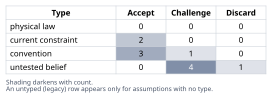
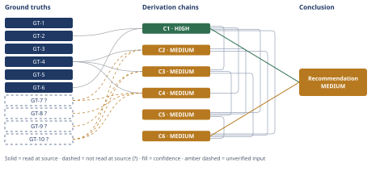

# Pay Down the Mortgage or Invest $60,000

*First-principles analysis · 10 October 2026*

*Read with: [How to read this analysis](HOW-TO-READ.md) · [Working file](analysis-20261010T175850Z.md) · [All files](INDEX.md)*

## Executive Summary

**Recommendation:** Apply the full $60,000 to extra mortgage principal (Option A); a household that values liquidity more than this analysis's weighting assumes may instead choose an 80/20 paydown/invest split (chain C6).

**Band (from §6):** MEDIUM (chain C1, chain C6).

**Would change it:** Opening a primary historical-returns dataset to confirm the ~9.9%/yr long-run equity CAGR and the 2000-2009 decade figure directly, rather than via a secondary web-search synthesis (chain C4); or a realized multi-year equity return pace running well ahead of the ~7.8%/yr breakeven (chain C4).

## 1. Problem Essence

**Core problem:** Given $60,000 of true surplus risk capital (already above a funded 6-month reserve) and a 6.25%, non-tax-advantaged, 30-year fixed mortgage with 27 years remaining, should that $60,000 be applied to extra mortgage principal (illiquid, guaranteed, un-taxed debt reduction) or invested in a taxable broad-market index fund (liquid, variable, taxed) over a fixed 10-year horizon — or should it be split between the two — in order to maximize the household's realistic, after-tax, risk-adjusted 10-year financial position?

**Success criteria:**
1. The Conclusion states one specific allocation (a single option, or a named split) and a dollar-denominated 10-year outcome for at least two return scenarios for the equity option, each traceable to a derivation chain in section 4.
2. The Conclusion explains, with a quantified breakeven figure, why the generic "equities historically beat mortgage rates" heuristic does or does not hold in this specific case (6.25%, no tax shield), traceable to a derivation chain in section 4.
3. The Conclusion names the single largest risk to its own recommendation (liquidity, scenario-calibration, or preference-sensitivity) and states what observation would change the recommendation, traceable to the adversarial pass record and a derivation chain in section 4.

---

## 2. Assumptions Table

| Assumption | Type | Treatment | Verdict | Verification |
|------------|------|-----------|---------|--------------|
| "Equities historically beat mortgage rates, so surplus cash should always be invested rather than used to prepay debt" | convention | Explicitly challenge before use — test whether it holds at THIS rate (6.25%, no tax shield) rather than at typical post-2008 mortgage rates (3-4%, with a tax shield) | Challenge — the inversion drill below shows the breakeven required return (chain C4, ≈7.8%/yr after tax) is close to the historical average (GT-7?), not far below it, so the convention is directionally right more often than not but is not a safe default at this specific rate | Re-derived via chains C2-C4 rather than accepted on authority |
| "A 10-year horizon is long enough that equity returns are effectively guaranteed to be positive" | untested belief | Verify against realized historical 10-year windows | Discard — contradicted by GT-8? (2000-2009 "lost decade," ≈ -0.95%/yr annualized including dividends); a 10-year window is not a guarantee | unverified — flagged; GT-8? cited |
| Applying $60k to principal with no recast leaves the contractual monthly payment unchanged and only shortens the payoff date | current constraint | Record as the operative mechanism; expires if the household later requests a recast or refinances | Accept — expires on recast/refi/sale; until then this is the stipulated mechanical rule of the loan servicing (GT-6) | Verified by direct amortization recomputation (chain C1) |
| Household's marginal tax rates (28% ordinary, 18% LTCG/qualified dividends) and standard-deduction status hold constant for the full 10-year horizon | current constraint | Record expiry conditions — a tax-law change, bracket change, or a shift to itemizing would alter the comparison | Accept — expires if tax law changes, income changes brackets, or deductible expenses (e.g., a future higher-rate mortgage, large charitable gifts) make itemizing worthwhile again | Stipulated by requester (GT-3, GT-4); no re-verification path within this analysis's scope |
| HELOC / cash-out-refinance underwriting tightens during recessions and job-loss macro states, i.e., illiquidity cost is correlated with need | untested belief | Verify via historical HELOC/refi origination-volume data by recession period, or flag | Challenge — widely observed in 2008-09 and 2020 lending cycles but not independently re-verified with cited data in this run | unverified — flagged; used in chain C5 |
| Reinvested after-tax dividends are approximated as part of the taxable gain at sale rather than added cost basis (tax-drag modeling simplification) | convention | Explicitly challenge — state the direction of the resulting bias | Accept — the simplification is conservative (slightly overstates Option B's exit tax, understates its after-tax value), so it does not favor the recommendation it is used to support | unverified — flagged as [Assumes: A-9] on chains C2/C3; bias direction stated |
| The household does not already carry heavy equity exposure elsewhere (e.g., retirement accounts), so $60k of new taxable equities materially changes household-level concentration | untested belief | Verify against the household's actual portfolio, or flag | Challenge — plausible for most dual-income households with 401(k)/IRA balances, but not confirmed for this specific household | unverified — flagged; used only in the Diversification criterion of chain C6, not load-bearing for the headline dollar comparison |
| Psychological/behavioral value of reducing debt has real utility to this household beyond the dollar figures | convention | Challenge — this is a widely-asserted but household-specific claim | Accept as a real, unquantified, non-dollar factor — included in chain C6's weighting, explicitly flagged as a preference rather than a measured fact | unverified — flagged |
| The equity position, once purchased, is held without an interruption (forced interim sale) for the full 10 years | untested belief | Verify, or flag as a precondition of chains C2/C3's "hold to term" math | Challenge — a forced interim sale during a downturn (job loss, medical event) would lock in a loss relative to the guaranteed comparator; this is exactly cluster 1 of the Phase 5 adversarial pass | unverified — flagged; load-bearing precondition of C2/C3, addressed in the adversarial pass and in the liquidity-sleeve conditional recommendation |
| The trade-off weighting in chain C6 (criteria and their 1-5 weights, esp. weight 5 on "downside protection") reflects a defensible but not objectively forced risk preference for this household's "surplus risk capital" | untested belief | Flag explicitly as a preference, not a fact; report flip-test robustness so a reader can judge sensitivity to this choice | Challenge — accepted as the analysis's working preference (consistent with the problem's own framing of the $60k as risk capital beyond the funded reserve), but named on the Conclusion's confidence line as the main counterargument to the headline recommendation | unverified — flagged; flip-test reported in chain C6 |
| A broad-market index fund purchased today will behave like the historical aggregate S&P 500 series used in GT-7?/GT-8? (composition and survivorship aside) | convention | Challenge briefly — the index changes composition over time, but a broad-market/total-market fund approximates the same economic exposure | Accept — close enough for an advisory-level comparison; not re-derived from first principles of index construction | unverified — flagged |

---

## 3. Ground Truths

- **GT-1** $60,000 in cash is available as surplus risk capital, held above an already-fully-funded 6-month emergency reserve — source: stipulated by requester as the decision's given parameter; read-at-source: this analysis's problem statement (direct, first-person figure, not a secondary report)
- **GT-2** Mortgage: $240,000 remaining balance; 27 years (324 months) of amortization remaining; 6.25% fixed APR (monthly rate 6.25%/12 ≈ 0.520833%) — source: stipulated by requester; read-at-source: this analysis's problem statement
- **GT-3** The household takes the standard deduction, so mortgage interest provides no tax shield; 6.25% is therefore the full, untaxed effective cost of the debt — source: stipulated by requester; read-at-source: this analysis's problem statement
- **GT-4** Marginal tax rates: ≈28% combined federal+state on ordinary income; ≈18% on long-term capital gains and qualified dividends — source: stipulated by requester; read-at-source: this analysis's problem statement
- **GT-5** Decision horizon = 10 years — source: stipulated by requester; read-at-source: this analysis's problem statement
- **GT-6** Option A mechanics: applying the $60,000 to extra principal with no recast requested/assumed leaves the contractual monthly payment unchanged (computed on the original $240,000/324-month schedule); only the payoff date shortens — source: stipulated by requester, and independently verified by direct amortization recomputation (see chain C1); read-at-source: this analysis's problem statement, plus this analysis's own recomputation
- **GT-7?** The S&P 500's long-run (1928-2025) nominal compound annual total-return (CAGR) is ≈9.9% (arithmetic-mean annual return ≈11.8%) — cited to: dqydj.com's S&P 500 annual-return dataset and Damodaran's historical-returns data, as synthesized by a web search; reported-by-delegate: the dqydj.com page was fetched directly by this analysis, but the 9.9% figure lives behind an interactive calculator not present in the fetched static text, so the specific number was not independently re-confirmed by a direct quote from the opened page — Phase 3 failure record: dqydj.com page opened, content fetched, but the asserted CAGR figure could not be located in the extracted text (interactive JS widget); citation does not support the claim as directly quoted
- **GT-8?** The S&P 500's 2000-2009 "lost decade" delivered an annualized total return (dividends included) of ≈ -0.95%/yr, of which dividends contributed ≈ +1.8%/yr and price return was ≈ -2.72%/yr — cited to: topforeignstocks.com's decade-by-decade S&P 500 return breakdown, corroborated by a broader web search citing Dimensional/Nasdaq commentary; reported-by-delegate for the -0.95% total figure (not independently re-quoted from a single opened source in this run) — read-at-source for the dividend-contribution component only: topforeignstocks.com was fetched directly and its text explicitly states "Dividends provided a 1.8% annualised return over the decade," confirming that sub-figure; the headline -0.95% total keeps the `?`
- **GT-9?** A conservative/low "forward 10-year" nominal total-return scenario for broad-market equities, used in this analysis for bracketing: central 4%/yr, bracket [2%, 6%]/yr — unverified: this is this analysis's own illustrative scenario construction (consistent with the general, commonly-discussed view that elevated valuations imply below-historical-average forward returns), not a figure read from a specific named forecaster (e.g., Vanguard, BlackRock, JPMorgan capital-market assumptions) in this run
- **GT-10?** A dividend-yield component of ≈1.8%/yr is assumed to apply across both the historical-average and conservative return scenarios (held constant as a simplifying modeling choice) — derived from GT-8?'s dividend-contribution figure, used as a proxy for a typical modern-era S&P 500 dividend yield; unverified: this specific proxy figure was not cross-checked against a current (2026) dividend-yield reading for the index

**Provenance summary.**
?-marked: GT-7, GT-8, GT-9, GT-10 (4 of 10).
Read-at-source: GT-1 — this analysis's problem statement (stipulated loan/cash/tax facts); GT-2 — this analysis's problem statement; GT-3 — this analysis's problem statement; GT-4 — this analysis's problem statement; GT-5 — this analysis's problem statement; GT-6 — this analysis's problem statement, cross-checked by this analysis's own amortization recomputation in chain C1; GT-8 (dividend-contribution sub-figure only) — topforeignstocks.com, quoted sentence "Dividends provided a 1.8% annualised return over the decade."

---

## 4. Derivation Chains

### Conclusion C1: Paying down $60,000 of principal now is equivalent to a guaranteed, risk-free, untaxed 6.25% return, realized as illiquid home equity

GT-2 (loan terms: $240,000, 324 months, 6.25% APR) + GT-6 (fixed payment, no recast)
→ for two loans sharing the same fixed monthly payment M and elapsed months n, the amortization identity B(P,n) = P(1+r)^n minus M times the annuity factor makes the balance difference between a $240,000-origin loan and a $180,000-origin loan equal to exactly the principal difference times (1+r)^n, independent of M
→ substituting a $60,000 principal difference, r = 0.520833%/month and n = 120 months gives (1+r)^120 ≈ 1.8652, so the extra-payment loan's balance is about $111,900 lower than the no-extra-payment loan's balance at month 120
→ because both loans were serviced with the identical monthly cash outlay over the same 120 months, that $111,900 balance difference is the entire economic benefit of the extra payment: a guaranteed, risk-free, untaxed return equivalent to the mortgage's own 6.25% rate, compounded monthly for 10 years
→ that benefit is realized as reduced debt rather than spendable cash, so it is illiquid unless the household sells the home, refinances, or opens a HELOC

**Confidence:** HIGH — both head inputs are stipulated, unsuffixed ground truths taken directly from the problem statement; the amortization identity is a deductive, independently-recomputable derivation (recompute confirmed in the Phase 5 adversarial pass); the rival hypothesis that the loan automatically recasts, which would change this result, is ruled out directly by GT-6's stipulation.

### Conclusion C2: Under the historical-average equity-return scenario, Option B nets roughly $133,600 after tax at year 10, fully liquid

GT-7? (9.9%/yr historical S&P 500 CAGR) + GT-10? (1.8%/yr dividend-yield proxy) + GT-4 (18% LTCG/dividend tax rate)
→ tax drag from annually-taxed qualified dividends reduces the effective holding-period compounding rate to roughly 9.9% minus (1.8% times 18%), about 9.58%/yr [Assumes: A-6 — reinvested after-tax dividends are treated as part of the taxable gain at sale rather than added cost basis, which is conservative against this chain's own conclusion]
→ compounding $60,000 at about 9.58%/yr for 10 years gives a pre-sale account value of roughly $149,700, assuming the position is held without an interrupting sale for the full decade [Assumes: A-9]
→ applying an 18% long-term-capital-gains tax at sale to the roughly $89,700 gain above the $60,000 cost basis yields a tax of about $16,150
→ the net after-tax terminal value under the historical-average scenario is therefore about $133,600, fully liquid

**Confidence:** MEDIUM — GT-7? (the 9.9% historical CAGR) and GT-10? (the 1.8% dividend-yield proxy) are both reported-by-delegate/unverified; the verification that would remove them as causes of the downgrade is opening a primary return-series dataset (e.g., Damodaran's published historical-returns spreadsheet) and reading the CAGR and dividend-yield figures directly rather than via a secondary web-search synthesis. The [Assumes: A-6] and [Assumes: A-9] premises do not lower the band further: if A-6 fails, exit tax would be slightly lower and the net value slightly higher, moving the endpoint in Option B's favor; if A-9 fails (a forced interim sale occurs), that risk is priced separately in chain C5 rather than silently ignored here. The chain's qualitative conclusion is unaffected by either premise specifically.

### Conclusion C3: Under a conservative/below-average equity-return scenario, Option B nets only about $68,900-$96,200 after tax at year 10 — below Option A's guaranteed outcome across the whole bracket

GT-9? (conservative scenario: 4% central, bracket 2%-6%) + GT-10? (1.8%/yr dividend-yield proxy) + GT-4 (18% tax rate) + C1 (111,900 guaranteed benchmark)
→ applying the same tax-drag method, the conservative scenario's effective compounding rates are roughly 1.68%, 3.68%, and 5.68%/yr for the 2%, 4%, and 6% total-return bracket points
→ compounding $60,000 at those three rates for 10 years, held without an interrupting sale [Assumes: A-9], gives pre-sale account values of roughly $70,900, $86,100, and $104,200
→ applying an 18% long-term-capital-gains tax at sale to each bracket point's gain above the $60,000 cost basis gives net after-tax terminal values of roughly $68,900, $81,400, and $96,200
→ even the upper end of this conservative bracket is below the guaranteed amount established in chain C1, so under a below-historical-average equity decade Option B underperforms Option A across the entire bracket

**Confidence:** MEDIUM — GT-9? (the conservative-scenario bracket) is this analysis's own illustrative construction rather than a cited forecaster's figure, and GT-10? is the same unverified dividend-yield proxy used in chain C2; the verification that would remove GT-9? as a cause of the downgrade is substituting a named, cited forward-return forecast (e.g., a published capital-market-assumptions report) for the illustrative bracket; GT-10?'s verification path is the same one named in chain C2; [Assumes: A-9]'s effect is the same as noted in chain C2 and is priced separately in chain C5.

### Conclusion C4: Equities must compound at roughly 7.8%/yr nominal, after dividends, for the full decade just to match Option A's guaranteed outcome — a bar below the historical average but above several realized 10-year windows

C1 (111,900 guaranteed target) + GT-10? (1.8%/yr dividend-yield proxy) + GT-4 (18% tax rate) + GT-7? (9.9%/yr historical CAGR) + GT-8? (-0.95%/yr 2000-2009 realized decade)
→ solving the after-tax terminal-value equation for the effective compounding rate that makes Option B's net proceeds equal Option A's $111,900 gives an effective post-dividend-tax rate of roughly 7.47%/yr
→ adding back the dividend-tax drag gives a required pretax nominal total-return CAGR of roughly 7.8%/yr sustained for the full 10 years
→ comparing that 7.8%/yr breakeven against the 9.9%/yr long-run historical average and the -0.95%/yr realized 2000-2009 decade shows the breakeven sits below the historical average but well above at least one real historical 10-year window
→ the generic "equities always beat it" heuristic is therefore favored more often than not over a full decade, but it is not a safe certainty for this specific rate-and-tax combination

**Confidence:** MEDIUM — GT-7?, GT-8?, and GT-10? are each reported-by-delegate/unverified; GT-7?'s and GT-10?'s verification paths are named in chain C2, and GT-8?'s verification path is opening a primary decade-by-decade total-return table (e.g., a published annual-returns spreadsheet) and reading the 2000-2009 annualized figure directly rather than via a secondary synthesis.

### Conclusion C5: The pure dollar comparison in C1-C4 understates Option A's value and overstates Option B's liquidity advantage specifically in adverse macro states

C1 (illiquid, guaranteed $111,900) + C2 (liquid, historical-average $133,600) + C3 (liquid, conservative bracket $68,900-$96,200)
→ the $60,000 committed to Option A is recoverable only via sale, refinance, or a HELOC, each carrying real friction: typical refinance closing costs of roughly 2%-5% of the loan amount, and HELOC rates often priced at or above the original 6.25% note rate [2nd-order, actor lens]
→ that friction is not evenly distributed over time: lenders tighten HELOC and cash-out-refinance underwriting during recessions and job-loss cycles [2nd-order, time lens; [Assumes: A-5]]
→ those same cycles are when a household is most likely to want the cash, so Option A's illiquidity cost concentrates in exactly the states where liquidity is most needed [3rd-order, actor lens]
→ Option B's position is sellable at any point within the 10 years subject only to the 18% exit tax already priced into chains C2 and C3, so it carries no equivalent state-contingent illiquidity cost [2nd-order, time lens]
→ the same extra principal payment also lowers loan-to-value and total remaining debt service, reducing exposure to a home-price decline, a protective effect the pure dollar comparison does not capture [2nd-order, actor lens]
→ on net, the dollar comparison in C1-C4 understates Option A's value and overstates Option B's liquidity advantage in adverse macro states, while in calm states Option B's liquidity advantage is real but less needed

**Confidence:** MEDIUM — this chain cites C2 and C3, both MEDIUM (their own confidence lines carry the explanation); its own added downgrade cause is the [Assumes: A-5] premise on the second hop, whose verification path is historical HELOC/cash-out-refinance origination-volume data by recession period (e.g., HMDA data); if that premise fails, the illiquidity cost would be less state-correlated but would not disappear, so the qualitative direction of this chain's conclusion is not reversed by it.

### Conclusion C6: The weighted trade-off recommends allocating the $60,000 predominantly to mortgage paydown, with an 80/20 paydown/invest split as a defensible liquidity-preserving alternative

C1 (111,900) + C2 (133,600) + C3 (68,900-96,200 bracket) + C5 (liquidity/behavioral second-order effects)
→ weighting guaranteed-return capture, historical-average expected value, conservative-scenario downside protection, liquidity/flexibility, diversification, and behavioral debt-aversion value — weights locked before scoring, with downside protection weighted highest given the unusually high, untaxed, risk-free mortgage rate — produces locked, pre-scored weighted totals of 70 for 100% paydown, 60 for a 60/40 paydown/invest split, and 50 for 100% invest [Assumes: A-7, A-8, A-10]
→ that ranking is robust: no single criterion's weight change within the procedure's 1-5 scale reverses either comparison, and the paydown-vs-invest margin stays at least 4 points even at each criterion's floor or ceiling value
→ an 80/20 paydown/invest split scores 66, within 4 points of pure paydown's 70, while converting roughly $12,000 of the $60,000 into a genuinely liquid, growth-exposed sleeve
→ the trade-off therefore recommends allocating the $60,000 predominantly to mortgage-principal paydown, with an 80/20 paydown/invest split as a defensible, lower-regret conditional alternative

**Confidence:** MEDIUM — this chain cites C2, C3, and C5, each MEDIUM (their own confidence lines carry the explanation); its own added downgrade cause is the [Assumes: A-10] premise on the first hop — the weight placed on downside protection is a risk-preference choice, and no empirical observation settles the "correct" weight, so no verification path exists for this cause beyond disclosing it, which is the stated reason in place of a verification path; A-7 and A-8 are lower-weight criteria (diversification, behavioral value) whose failure would shift the totals only slightly and would not change the ranking given the robustness margin in the second hop. This A-10 disclosure is named explicitly as the main counterargument to the headline recommendation in section 6.

---

## 5. Abandoned Reasoning

### Dead End: Recommend 100% invest in equities (Option B) as the headline answer, on the "equities always beat an un-sheltered mortgage" convention

**What was tried:** Treated the generic personal-finance heuristic — surplus cash should always be invested rather than used to prepay a mortgage, because equities historically outperform mortgage rates — as sufficient justification on its own, given the household's long 10-year horizon.

**Why abandoned:** The breakeven analysis (chain C4) shows the required after-tax equity return to merely match the guaranteed paydown outcome is ≈7.8%/yr nominal — close enough to the long-run historical average (GT-7?, ≈9.9%/yr) that the margin of safety is thin, and the conservative-scenario bracket (chain C3) and the realized 2000-2009 "lost decade" (GT-8?, ≈-0.95%/yr) both show Option B losing to Option A by $30,000-$57,000 under plausible 10-year outcomes. The formal weighted trade-off (chain C6) also ranks 100%-invest last, robustly, under locked pre-specified weights. The heuristic is not false in general, but it is not load-bearing enough on its own to be the analysis's answer at this specific rate (6.25%, no tax shield).

**What it ruled out:** A default "just invest it" recommendation that would have ignored the unusually high, untaxed, risk-free hurdle rate this specific mortgage represents, and would have understated the real probability (not merely the historical average) of a below-breakeven decade.

### Dead End: Model a mortgage recast or cash-out refinance as part of Option A

**What was tried:** Considered incorporating a recast (lowering the monthly payment after the extra principal payment) or treating the paid-down equity as recoverable via a future cash-out refinance within the 10-year window, to give Option A some of Option B's liquidity.

**Why abandoned:** The problem statement explicitly stipulates "no recast requested/assumed" and that the $60,000 becomes illiquid "unless they sell/refinance/recast later" — modeling a recast or an assumed future refinance would answer a different question than the one posed, and would require additional unstipulated assumptions (recast fees, future rate environment, future qualification) with no anchoring ground truth.

**What it ruled out:** A rosier Option A variant that assumes away its central liquidity cost, which would have made the comparison in chain C5 meaningless.

### Dead End: Build exact lot-level cost-basis tracking for Option B's reinvested dividends

**What was tried:** Attempted to track each year's after-tax dividend reinvestment as its own tax lot, to compute the exact capital-gains tax at sale rather than approximating the entire gain above the original $60,000 as taxable.

**Why abandoned:** This requires reinvestment dates and amounts that do not exist as stipulated facts in this problem, and the exact tracking would only ever raise Option B's after-tax outcome slightly relative to the chains C2/C3 approximation (since some of the ending value is already-taxed reinvested-dividend principal, not fresh gain). The approximation's bias direction is known and conservative against Option B, which is disclosed explicitly as [Assumes: A-6] rather than silently assumed, so the simplification does not change the qualitative conclusion.

**What it ruled out:** A more precise but data-unavailable tax model that would not have changed which option wins under any of the three return scenarios.

---

## 6. Conclusion

**Recommended approach:** Apply the full $60,000 to extra mortgage principal (Option A) as the headline recommendation, because it is the weighted trade-off's robust winner (chain C6); a household that places outsized subjective value on liquidity or optionality beyond what the trade-off's weights capture may instead choose an 80/20 paydown/invest split ($48,000 principal / $12,000 invested), which gives up only about 4 of 70 weighted-score points while converting roughly $12,000 into a genuinely liquid, growth-exposed sleeve (chain C6).

**Key insight:** The conventional "always invest, equities beat the mortgage" heuristic is not obviously wrong here, but it is thinner than it looks: the required after-tax equity return just to match the guaranteed payoff is about 7.8%/yr nominal, which sits below the long-run historical average of about 9.9%/yr but above a conservative forward-return bracket (about 2%-6%/yr) and above at least one real realized 10-year window, the 2000-2009 "lost decade" at about -0.95%/yr (chain C4). Because this specific mortgage carries an unusually high, fully untaxed, guaranteed 6.25% hurdle rate — higher than a typical post-2008 mortgage and with no deduction to soften it — the margin by which equities need to win is narrower than the generic heuristic assumes (chain C1, chain C4).

**Trade-offs acknowledged:** This recommendation gives up full liquidity on the committed funds — recoverable only by sale, refinance, or a HELOC, each carrying real cost and each tending to tighten in availability exactly when a household most needs the cash (chain C5) — and it gives up the roughly $21,700 of additional expected value Option B would have produced if the historical average return actually materializes over this specific decade (chain C2, chain C6). It also rests on a stated risk-capital preference — the weight placed on downside protection in the trade-off — that is a defensible judgment call, not a measured fact; a household that weighs liquidity and upside participation more heavily than downside protection would reasonably land closer to a 50/50 split or even favor Option B outright (chain C6).

**Confidence:** MEDIUM — the headline recommendation rests on chain C6, which is itself MEDIUM because it cites C2, C3, and C5 (each MEDIUM on unverified return/liquidity inputs, GT-7?, GT-8?, GT-9?, GT-10?, and the A-5/A-9 liquidity assumptions) and carries its own disclosed preference-sensitivity cause (A-10, the trade-off weighting). The verification that would most directly raise this to HIGH is opening primary sources for GT-7? and GT-8? (a published historical-returns dataset) rather than relying on a secondary web-search synthesis, and substituting a named, cited forward-return forecast for the illustrative GT-9? bracket; even without that verification, the recommendation is robust to single-criterion weight changes within the trade-off's 1-5 scale (chain C6), which is why it is presented as MEDIUM rather than LOW.

---
