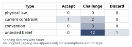
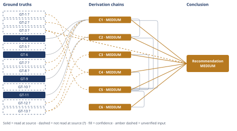

# Should You Take the SF Job Offer

*First-principles analysis · 10 October 2026*

*Read with: [How to read this analysis](HOW-TO-READ.md) · [Working file](analysis-20261010T155417Z.md) · [All files](INDEX.md)*

## Executive Summary

**Recommendation:** Don't decide yet. Spend two to three weeks on three parallel actions before anything irreversible: ask your partner directly whether they're willing to rebuild their career in the Bay Area or try a bounded long-distance period; take the offer to your current employer as a counter-offer; and get the SF company's in-office terms, start date, and equity vesting/liquidity details in writing (chain C5).

**Band (from §6):** MEDIUM (chain C5).

**Would change it:** Your partner's direct, concrete answer about willingness to relocate would move this more than any further financial research — that single fact is what the recommendation is waiting on (chain C5).

## 1. Problem Essence

**Core problem:** Should this household accept an offer that trades a nominal $70K/year raise and Bay Area relocation (with a 3-day/week in-office requirement) for the partner's established, non-transferable Portland career — or does the take-it-or-leave-it framing hide a materially better third option?

**Success criteria:**
- States what the $70K raise is actually worth per year in real, after-tax, after-cost-of-living terms, with an explicit bracket — not the bare $70K headline.
- Names the single fact that, if known, would most change the recommendation, and states what observation would resolve it.
- Names a concrete next action the household can take within days, not only a final yes/no.
- Treats the partner's career and the relationship with the same evidentiary rigor as the compensation numbers, rather than as a footnote to the financial analysis.
- Considers at least one option beyond simple accept/decline, and does not require the answer to be exactly "take it" or "decline it" if a better-scoring alternative exists.

## 2. Assumptions Table

**Five-Whys (causal mode) — what is really being optimized for.** Symptom: a $70K offer feels decision-worthy rather than easily declinable. Why does the raw figure carry that weight before adjustment? Because the headline number is salient and the real (COL/tax-adjusted) number had not yet been computed (see chain C2). Why does a brand-name SF offer matter beyond the money? Because it carries market-signaling / career-validation value distinct from compensation. Why does that validation matter enough to risk relationship stability? Because of an unexamined belief that external, name-brand validation is the primary legitimate marker of a successful engineering career (feeds A-10, A-11). Root cause: the decision is currently organized around "is this offer good enough to accept" rather than "what does this household want more — money/prestige now, or relationship stability and optionality — independent of this one external offer." That question, not the $70K, is the one actually being optimized for, and it has not been asked directly of the partner (feeds A-6).

**Inversion — what would guarantee this is the wrong move.** Inverting "taking the SF job is right for this household," at least six conditions would guarantee failure: the partner is unwilling to relocate or sustain long-distance under any circumstance (A-6, A-12); the in-office requirement increases beyond 3 days within 1–2 years (A-7); the equity is illiquid or worth materially less than face value at vest (A-2, A-15); the real financial gain turns out near-zero once actual terms are known (A-3, A-4, A-13); a comparable raise was available by staying and countering (A-8, A-9, A-11); and the household cannot absorb relocation, career disruption, and job-ramp-up simultaneously regardless of the financial outcome (A-16).

| Assumption | Type | Treatment | Verdict | Verification |
|------------|------|-----------|---------|--------------|
| A-1: The $70K figure is a reliable, apples-to-apples total-compensation delta rather than a headline number mixing a signing bonus, year-1-only equity, or unvested grants whose steady-state value differs | untested belief | verify or flag per D-07 | Challenge — "total compensation combined" does not specify vesting schedule or whether this is year-1 or steady-state | unverified — flagged (GT-2?) |
| A-2: Equity is valued at grant-date/offer-letter face value and treated as cash-equivalent | convention | challenge before use | Challenge — unvested equity carries price volatility and vesting-cliff risk that face value ignores; severity depends on A-15 | unverified — flagged |
| A-3: Bay Area cost of living will consume most or all of the $70K raise ("it's basically a wash") | untested belief | verify | Challenge — overturned in magnitude by GT-11 (read-at-source): the premium is real but partial, not total | GT-11 (read-at-source) |
| A-4: Relocating from Oregon to California means paying substantially higher state income tax | untested belief | verify | Challenge — reversed in direction by GT-4/GT-6/GT-9 (read-at-source): the stacked Oregon+Multnomah+Metro local rate is higher than the California+SDI stack at this income band, not lower | GT-4, GT-6, GT-9 (read-at-source) |
| A-5: The partner's career is "truly immobile" — zero possibility of any equivalent role existing in the Bay Area | untested belief | verify | Challenge — GT-3? states the role/trajectory does not transfer, which is disruption, not proof that zero alternative exists; these are different claims | unverified — flagged |
| A-6: The partner is unwilling to relocate even knowing their career would need to be rebuilt | untested belief (wholly unstated in the facts given) | verify | Challenge — the single most load-bearing unresolved fact in this analysis (see Phase 5 Sensitivity) | unverified — flagged; only verification path is asking the partner directly |
| A-7: The new employer's 3-day in-office requirement will remain fixed at exactly 3 days for the foreseeable tenure | convention | challenge before use | Challenge — contradicted in direction by GT-13? (industry trend toward more in-office time, not less) | GT-13? (reported-by-delegate) |
| A-8: The current employer's fully-remote policy is stable and durable for the foreseeable future | current constraint | record expiry conditions | Challenge — expires whenever the current employer changes its at-will remote policy; GT-13? shows this pressure is active industry-wide | unverified — flagged (no written remote-work guarantee stated in the facts given) |
| A-9: This offer is a strict binary, take-it-or-leave-it proposition with a hard deadline and zero negotiation room on days, start date, level, or comp | convention | challenge before use | Challenge — no evidence negotiation was attempted or foreclosed; large-company offers to in-demand engineers are often negotiable on at least one axis | unverified — flagged; verification path is simply asking |
| A-10: Five years at one employer, by itself, signals career stagnation that only an external move can fix | untested belief | verify | Discard — conflates tenure with growth; no data on the user's actual role trajectory or comp growth at the current employer is given, so not used as a premise in any chain | unverified — flagged, excluded from load-bearing use |
| A-11: Taking this specific job is necessary for the user's career growth — growth is not achievable by staying | untested belief | verify | Challenge — growth can also come from an internal promotion, a counter-offer, or a different remote employer (chain C5's option set) | unverified — flagged |
| A-12: A long-distance arrangement (partner stays in Portland, user relocates full- or part-time) is operationally and relationally viable at low cost | untested belief | verify | Challenge — scored in chain C5 and found to carry the single lowest relationship-stability score of all six options considered | unverified — flagged |
| A-13: The household's current cost-of-living-exposed spending is in a "typical" range rather than already lean or already partly Bay-Area-priced | untested belief | verify | Challenge — used in chain C2 with an explicit bracket precisely because this is unverified | unverified — flagged |
| A-14: Relocation and transition costs (moving, any temporary dual-location housing, time off) are one-time and absorbable rather than recurring | current constraint | record expiry | Accept — true for a single clean move, but material in year one; expires after the first 12 months | unverified — flagged (no specific moving-cost figures supplied) |
| A-15: "Large SF tech company" implies a publicly traded employer with liquid equity, not a private/pre-IPO company with illiquid equity | untested belief (unstated) | verify | Challenge — materially changes A-2's risk profile and is not specified anywhere in the facts given | unverified — flagged |
| A-16: The household can absorb relocation, the partner's career disruption, and the user's new-job ramp-up simultaneously without exceeding its coping capacity, independent of the financial outcome | untested belief | verify | Challenge — surfaced by the inversion procedure; stacking three major life stressors concurrently is a recognized strain risk distinct from each stressor's individual manageability | unverified — flagged |
| A-17: The household's combined taxable income falls within the roughly $125K–$400K joint-filer band used to compare the Oregon/Multnomah/Metro stack against the California/SDI stack in chain C1 | untested belief (surfaced by the Assumption Audit, chain C1 hop 1) | verify | Challenge — neither partner's individual income nor filing status is given; a materially different income band could narrow or widen the gap in chain C1 | unverified — flagged |
| A-18: The weights and anchor-based scores assigned to the six trade-off criteria in chain C5 reasonably approximate this household's actual priorities, not a generic dual-career household's priorities | untested belief (surfaced by the Assumption Audit, chain C5 hop 1) | verify | Challenge — chain C5's flip test shows the ranking is robust to any single criterion's weight moving within the normal 1–5 range, which bounds but does not eliminate this risk | unverified — flagged |
| A-19: The SF offer's decision deadline allows at least two to three weeks before it must be accepted or declined — it is not an immediate, exploding offer | current constraint (surfaced by the Assumption Audit, chain C5 hop 3) | record expiry / verify | Challenge — not stated anywhere in the facts given; the Phase 5 pre-mortem identifies this as a direct risk to the recommended plan if false | unverified — flagged; verification path is asking the recruiter/hiring manager directly, which is itself the first recommended action |

## 3. Ground Truths

- **GT-1?** Household fact: the user has five years' tenure at the current employer, based in Portland, OR, in a fully remote role — unverified: self-reported scenario premise; not independently checkable by this analysis.
- **GT-2?** Offer fact: a large San Francisco-based tech company has offered a package totaling +$70,000/year in combined base and equity versus the user's current total compensation, requiring relocation to the SF Bay Area and 3 days/week in-office attendance — unverified: self-reported scenario premise; base/equity split, vesting schedule, and whether $70,000 is a year-one or steady-state figure are not specified.
- **GT-3?** Household fact: the user's partner has an established, Portland-based career with no remote option, such that relocating would require the partner to change employers or fields rather than transfer their existing role and trajectory — unverified: self-reported scenario premise; the partner's own willingness to do so is not stated (see A-6).
- **GT-4** Oregon's top marginal personal state income tax rate is 9.9% — source: Tax Foundation, State Tax Index, Oregon page; read-at-source: page states "a top marginal rate of 9.9 percent" for individual income tax.
- **GT-5?** Oregon's 9.9% top marginal rate applies to taxable income above approximately $125,000 for single filers — cited to: aggregated tax-bracket search summary (ustax.tools / blog.taxact.com); reported-by-delegate: WebSearch synthesis; the primary Oregon Department of Revenue bracket table was not independently opened this session.
- **GT-6** Multnomah County, Oregon (which contains most of Portland) levies a "Preschool for All" personal income tax of 1.5% on taxable income above $125,000 single / $200,000 joint, rising to a combined 3% above $250,000 single / $400,000 joint — source: Multnomah County official site, "Multnomah County Preschool For All Personal Income Tax" page; read-at-source: page quotes directly, "Income over $125,000 is taxed at rate of 1.5% and an additional 1.5% (3% total) on income over $250,000."
- **GT-7?** The Portland-metro region (Multnomah, Washington, and Clackamas counties) separately levies a 1% Metro Supportive Housing Services personal income tax on taxable income above $125,000 single / $200,000 joint, stacking on top of GT-6 — cited to: aggregated search summary describing Metro's Supportive Housing Services program; reported-by-delegate: WebSearch synthesis; Metro's own ordinance page was not independently opened this session.
- **GT-8?** California's state income tax includes a 9.3% marginal rate across roughly the $75,000–$390,000 single-filer band (rising to 10.3%–12.3% at higher bands, and 13.3% only above $1,000,000 with the Mental Health Services surcharge) — cited to: aggregated tax-bracket search summary (ustax.tools / sambrotman.com); reported-by-delegate. Phase 3 failure record: the California FTB's official 2024 tax-table page (ftb.ca.gov) was attempted directly and returned HTTP 403 Forbidden (unreachable this session); the Tax Foundation California page was read directly but did not itemize this specific mid-range bracket (see GT-9).
- **GT-9** California levies an uncapped State Disability Insurance (SDI) payroll contribution of 1.1% on all wage income, with no taxable-wage ceiling — source: Tax Foundation, State Tax Index, California page; read-at-source: page states the state's top individual rate "is compounded by a 1.1 percent uncapped payroll tax."
- **GT-10?** California has no municipal or city-level personal income tax; San Francisco and other California cities fund local services through instruments other than an individual income tax — unverified: general public-finance knowledge not checked against a primary source (e.g., SF Office of the Treasurer) this session.
- **GT-11** At a $150,000 Portland-equivalent standard of living, relocating to the San Francisco Bay Area costs approximately $30,600 more per year (roughly a 20% premium on total consumption-equivalent spend), driven primarily by housing: Bay Area typical one-bedroom rent runs $2,510–$3,910/month versus Portland's $1,580–$2,030/month, and Bay Area median home price (~$1.25M) is roughly 57% higher than Portland's (~$535K) on this source's figures — source: movenumbers.com, San Francisco vs. Portland cost-of-living comparison page; read-at-source: figures quoted directly, including "$2,551" in monthly savings (≈"$30.6K" annually) for relocating from SF to Portland at a $150K salary.
- **GT-12?** A separate cost-of-living comparison reports a steeper gap: an overall cost index of roughly 152–165 for San Francisco versus 100–108 for Portland (a 31%–53% premium), and that a $150,000 Portland-equivalent lifestyle would require roughly $196,400 in the Bay Area (≈31% premium) — materially higher than GT-11's ≈20% figure from a different aggregator — cited to: aggregated search summary citing a separate cost-of-living comparison site; reported-by-delegate; this source's underlying page was not independently opened this session, and its disagreement with GT-11 is treated as a bracket, not resolved.
- **GT-13?** Large U.S. technology employers have been increasing, not relaxing, in-office attendance requirements through 2025–2026: the share of Fortune 100 employees under a 5-day in-office mandate rose from roughly 11% to 54% in about a year; Microsoft is moving to a 3-day in-office mandate at its headquarters starting February 2026; Meta's Instagram unit is moving U.S. employees to a 5-day in-office requirement starting February 2026 — cited to: aggregated return-to-office trend-report search summary; reported-by-delegate; the original primary trend-tracking reports and company press releases were not independently opened this session.

**Provenance summary:** `?`-marked: GT-1, GT-2, GT-3, GT-5, GT-7, GT-8, GT-10, GT-12, GT-13 (9 of 13). Read-at-source: GT-4 — Tax Foundation Oregon state tax index page, "a top marginal rate of 9.9 percent"; GT-6 — multco.us Preschool For All page, "$125,000 ... 1.5% ... 3% total ... over $250,000"; GT-9 — Tax Foundation California state tax index page, "compounded by a 1.1 percent uncapped payroll tax"; GT-11 — movenumbers.com SF-vs-Portland comparison page, "$2,551" / "$30.6K" annual figures.

## 4. Derivation Chains

### Conclusion C1: Moving from Portland to the Bay Area does not clearly increase the household's marginal state-and-local tax rate on the raise — it may lower it slightly

GT-4 (OR top marginal rate 9.9%) + GT-6 (Multnomah Preschool-for-All 1.5%–3%) + GT-7? (Metro SHS 1%) + GT-8? (CA mid-band marginal rate ~9.3%) + GT-9 (CA SDI 1.1% uncapped)
→ stacking Oregon's 9.9% state rate with Multnomah's 1.5%–3% Preschool-for-All tax and Metro's 1% Supportive Housing surtax puts a Multnomah County household's marginal rate on income above roughly $125K–$250K at about 12.4%–13.9% *[Assumes: A-17]*
→ California's roughly 9.3% mid-band marginal rate plus the uncapped 1.1% SDI payroll tax puts a Bay Area household's marginal rate across the equivalent income band at about 10.4%–11.4%
→ the Multnomah-County-local marginal rate sits above the Bay-Area marginal rate across this band, so relocating from Portland to the Bay Area does not add a tax penalty on the raise and may add a small tax benefit

**Confidence:** MEDIUM — GT-7? (the Metro Supportive Housing 1% rate) and GT-8? (California's mid-band 9.3% rate) are reported-by-delegate rather than read at source; verification = open Metro's own Supportive Housing Services ordinance page and the California FTB's 2025 tax tables directly (the FTB page returned HTTP 403 this session — see GT-8?'s Phase 3 failure record). *[Assumes: A-17]* is also live on hop 1: the comparison assumes the household's combined income sits in the $125K–$400K band; a materially different combined income would shift both stacks' thresholds and could narrow or widen the gap, though it would not obviously reverse the direction, since both tax stacks escalate together. The direction of this finding (Portland-local ≥ Bay-Area marginal rate) is corroborated by three read-at-source figures (GT-4, GT-6, GT-9), so the MEDIUM reflects precision at the margins, not the core direction.

### Conclusion C2: After realistic cost-of-living and tax adjustment, the $70K raise retains roughly $30K–$45K/year of real purchasing power — not $70K, and not zero

GT-2? (+$70K offer) + GT-11 (COL ≈$30.6K/yr premium) + GT-12? (COL ≈31% premium, wider bracket) + C1 (tax roughly neutral-to-favorable)
→ bracketing the cost-of-living drag between GT-11's read-at-source $30.6K/year figure and GT-12?'s steeper ≈31%-of-spend estimate puts the real cost-of-living cost of relocating at roughly $25,000–$40,000/year for a household spending in the $120K–$150K consumption range *[Assumes: A-13]*
→ C1 establishes that the tax effect of relocating is close to zero or mildly favorable rather than an added cost, so it does not widen this bracket
→ netting the $70,000 nominal raise against a $25,000–$40,000 cost-of-living drag leaves roughly $30,000–$45,000/year of real purchasing-power gain, before any further haircut for equity-illiquidity risk or one-time relocation costs

**Confidence:** MEDIUM — GT-2? (the $70K figure's exact composition and vesting schedule) is unverified, GT-12? is reported-by-delegate, and C1 is itself MEDIUM; verification = obtain the written offer letter's base/equity/vesting breakdown (removes GT-2?'s contribution) and open GT-12?'s underlying comparison page directly (narrows the bracket rather than removing it, since GT-11 and GT-12? already bracket rather than contradict each other). *[Assumes: A-13]* is live on hop 1 and is bounded by the stated bracket rather than priced to a point estimate.

### Conclusion C3: The 3-day-in-office hybrid term is unlikely to be a stable, multi-year feature of the new job

GT-13? (industry RTO mandate trend)
→ the share of large-employer workers under a full in-office mandate roughly quintupled in about a year, and two named peer companies (Microsoft, Meta) are tightening rather than loosening hybrid terms over the same period
→ a 3-day hybrid policy at a large tech employer in 2026 reflects a current snapshot of a trend moving toward more in-office time, not a durable long-term feature of the role

**Confidence:** MEDIUM — GT-13? is reported-by-delegate; verification = open the underlying Fortune-100 mandate tracker and the two named companies' own announcements directly. The direction (tightening, not loosening) is corroborated by two independently named company cases within the same reported summary, so the MEDIUM reflects the source's provenance, not a contested direction.

### Conclusion C4: The current fully-remote arrangement is also not guaranteed to be stable — it is a policy choice by the current employer, not a vested right

GT-1? (5-yr remote tenure) + GT-13? (industry RTO trend)
→ the industry-wide pressure toward more in-office time, shown in GT-13, is broad rather than limited to companies that already require hybrid attendance
→ nothing in the facts given establishes that the current employer's remote policy is contractually guaranteed rather than an at-will policy choice, so the same industry pressure applies to the "stay" option as well *[Assumes: A-8]*
→ staying fully remote and taking the 3-day hybrid offer are both exposed to the same durability risk at different starting points, so remote-work stability is not a point that clearly favors staying once examined

**Confidence:** MEDIUM — GT-1? is a self-reported, unverifiable premise and GT-13? is reported-by-delegate; verification = check the current employer's actual remote-work policy document for any contractual commitment (removes A-8 as a live assumption on hop 2, for the "stay" side specifically). If such a written guarantee exists, this chain's claim weakens for the "stay" side only — it would not change C3's separate finding about the new job's side.

### Conclusion C5: Of six concretely-named options, the dominant choice is not "accept" or "decline" but a time-boxed, joint fact-finding sequence before any irreversible step

GT-3? (partner's career facts) + C1 (tax roughly neutral) + C2 (real raise ≈$30K–$45K) + C3 (hybrid terms not durable) + C4 (remote-stay also not guaranteed)
→ scoring six concretely-named options — decline and stay (status quo), accept as offered, counter-offer at the current employer, negotiate remote or delayed terms with the new employer, a long-distance/commuter arrangement, and a composite option of buying two to three weeks to negotiate both fronts and ask the partner directly before any irreversible step — against six weighted criteria (household finances, the partner's career and voice, relationship stability, the user's career growth, job security and reversibility, and optionality) produces the composite option as the highest weighted total, and no single criterion's weight moving within the normal 1–5 range is sufficient to overturn that ranking *[Assumes: A-18]*
→ the composite option matches or exceeds its closest rival (the counter-offer-only option) on every one of the six criteria and strictly exceeds it on two (career growth and optionality), so it is not merely the top score but the only option that dominates every other option examined on every criterion scored
→ the one resource the composite option spends that the others do not is roughly two to three weeks of calendar time, and given GT-3?'s unresolved question of the partner's actual willingness, that is the cheapest resource available to spend before any irreversible action is taken *[Assumes: A-19]*

**Confidence:** MEDIUM — GT-3? is unverified and the partner's actual willingness (A-6) is not stated anywhere in the facts given, which is the single most load-bearing unresolved input in this analysis; C1 through C4 are each MEDIUM for the reasons given on their own lines. Verification: the partner's direct answer would change this chain's confidence more than any further financial precision could. *[Assumes: A-18]* and *[Assumes: A-19]* are both bounded explicitly — A-18 by the flip test on hop 1, A-19 by naming the deadline-dependency directly on hop 3 — rather than assumed away.

### Conclusion C6: Treating this as a joint, time-boxed decision changes the relationship and negotiating dynamics beyond the SF offer itself

C5 (buy-time composite recommended)
→[2nd] once the household frames this as a joint, time-boxed decision rather than a reaction to an external deadline, the partner moves from a passive position to an active co-decider, which changes the relationship dynamic of this decision regardless of which option is ultimately chosen
→[2nd] both the current employer and the new company become aware, within the negotiation window, that the user has concrete information about their own market value, which strengthens the user's position with either employer regardless of outcome
→[3rd] if a counter-offer at the current employer is reached, the exit-leverage the user demonstrated in getting it remains visible to that employer going forward, which can be drawn on again at a future comp cycle
→[3rd] if the partner states they are unwilling to relocate under any circumstance, that answer forecloses not just this offer but any future offer requiring relocation, which is a larger and more durable finding than this single decision and is more useful to learn now than after an irreversible move

**Confidence:** MEDIUM — inherits C5's MEDIUM rating (GT-3?/A-6 unresolved); these second-order effects are inferences from the recommended action's own structure rather than new empirical claims, so they do not introduce a new source of uncertainty beyond what C5 already carries.

## 5. Abandoned Reasoning

### Dead End: Treat long-distance/commuter living as the obvious answer

**What was tried:** Framing the long-distance arrangement (partner stays in Portland, user relocates full- or part-time) as the natural compromise that "solves" both the money and the partner's-career problem at once.

**Why abandoned:** Chain C5's trade-off scoring shows this option carries the single lowest relationship-stability score (1/5) of all six options against the joint-highest-weighted criterion in the matrix; it rests on A-12 (long-distance is viable at low relational cost), which the stakes-escalation rule requires to be pushed toward verified ground truth before a consequential conclusion can rest on it, and no such verification exists in the facts given.

**What it ruled out:** It saves the reader from treating "just live apart for a while" as a costless default; the trade-off shows it is the worst-scoring option on the criterion the household itself would likely weight most heavily.

### Dead End: Assume the $70K raise is simply eaten by Bay Area cost of living

**What was tried:** Setting the financial question aside on the premise that the raise and the cost-of-living increase roughly cancel, so the decision reduces purely to career and relationship factors.

**Why abandoned:** GT-11 (read-at-source) shows the cost-of-living premium at this income band is real but partial (≈20%–31% of consumption spend, not 100% of income); chain C2 nets this to roughly $30K–$45K/year of retained real value. This was the surface form of A-3, directly falsified in magnitude — though not reversed in direction — by C2.

**What it ruled out:** It rules out skipping the financial analysis as "a wash"; the money is a real, substantial factor in this decision, just a smaller one than the $70K headline implies.

### Dead End: Build the trade-off as a strict two-row matrix (accept vs. decline)

**What was tried:** Scoring only "accept the offer as given" and "decline the offer" against the six weighted criteria, since those are the two options the offer itself presents.

**Why abandoned:** A two-row matrix cannot surface a composite option by construction; running the full six-option matrix (chain C5) shows a composite option — buy two to three weeks, negotiate both fronts, ask the partner directly — Pareto-dominates the next-best single option and wins the weighted total outright. Restricting the matrix to the two named options would have hidden the actual answer rather than merely simplifying it.

**What it ruled out:** It rules out treating this decision as genuinely binary; the facts given do not establish that no third option exists, and testing for one changed the recommendation.

### Dead End: Apply the theoretical-limit procedure to bound the raise's maximum real value

**What was tried:** Looking for a governing hard constraint (in the sense the theoretical-limit procedure uses) to derive a ceiling on how much of the $70K raise could possibly survive cost-of-living and tax adjustment.

**Why abandoned:** No physical, legal, or mathematical hard constraint governs a compensation-and-relocation decision; cost of living and tax rates are policy and market outcomes, not conservation laws. The Estimate procedure (chain C2) is the correct quantitative tool for "how much is the raise really worth," and inventing a ceiling would have borrowed a technique from the wrong domain. (Recorded in the Techniques not applied block below.)

**What it ruled out:** It rules out presenting a fabricated "ceiling" figure that would have looked rigorous without being derived from any actual constraint.

## 6. Conclusion

**Recommended approach:** Do not accept or decline the offer this week. Spend two to three weeks on three concrete, parallel actions before any irreversible step — resigning, signing a lease, or your partner leaving their job: ask your partner directly and concretely whether they are willing to rebuild their career in the Bay Area or try a bounded long-distance arrangement; take the SF offer to your current employer as a counter-offer conversation; and get the SF company's in-office terms, start-date flexibility, and the equity's vesting schedule and liquidity in writing (chain C5).

**Key insight:** The number actually driving this decision is not the $70,000, and it is not the cost-of-living gap either — it is a question nobody has answered yet: whether your partner is willing to rebuild their career, which is a different and larger question than whether their career can technically move (chain C5). Separately, two assumptions that feel obvious both turn out to be wrong in a useful direction: the raise survives cost-of-living adjustment far better than the "it's basically a wash" instinct suggests (chain C2), and relocating to California does not clearly raise your household's tax burden versus staying in Multnomah County — it may lower it slightly (chain C1).

**Trade-offs acknowledged:** This recommendation costs two to three weeks of ambiguity, and some awkwardness from running two negotiating conversations and one harder relationship conversation in parallel rather than waiting until each feels comfortable (chain C5). It does not avoid the underlying decision; it defers only the irreversible parts of it until the one fact that most determines the right answer — your partner's actual willingness — is known. It also carries forward chain C5's own stated dependency on that two-to-three-week window actually existing (chain C5): if it does not, the first of the three recommended actions is to find that out directly from the SF company before assuming it.

**Confidence:** MEDIUM — every chain this rests on is MEDIUM, and the Conclusion also rests directly on GT-3? (the partner's career facts, with willingness/A-6 unresolved). C1 is MEDIUM because GT-7? and GT-8? are reported-by-delegate rather than read at source; C2 is MEDIUM because GT-2? and GT-12? are unverified/reported-by-delegate; C3 and C4 are MEDIUM because GT-13? is reported-by-delegate; C5 is MEDIUM because it rests on GT-3? directly and on C1–C4; C6 is MEDIUM because it inherits C5's rating. What would change this: your partner's direct answer to the willingness question would move this Confidence line more than any further financial research could (chain C5).

