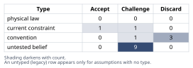
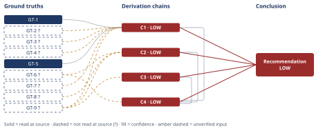

# Should You Take the SF Tech Job

*First-principles analysis · 10 October 2026*

*Read with: [How to read this analysis](HOW-TO-READ.md) · [Working file](analysis-20261010T181517Z.md) · [All files](INDEX.md)*

## Executive Summary

**Recommendation:** Decline the SF role on the terms currently offered — full relocation plus a 3-day/week in-office requirement — and instead run two things in parallel: use the offer as leverage to negotiate a retention counter at your current employer, and ask the SF company directly whether a modified arrangement (fully remote, delayed relocation, or a bounded trial) is available (chain C4). The headline $70,000/year is not a reliable financial signal — once cost-of-living, tax, and remote-value adjustments are applied it brackets roughly -$13,000 to +$35,000/year (chain C1).

**Band (from §6):** LOW — every chain this rests on (C1, C2, C3, C4) is rated LOW, mainly because the partner's actual career portability and the user's own motivation are unverified, not because the ranking is fragile.

**Would change it:** Whether the partner's career is genuinely non-portable or simply untested — it is the highest-weighted, least-verified input in the comparison (chain C3; chain C4). Resolving it would most change the picture, though the flip test shows "accept as offered" would still need to close a wide gap to become the top-ranked option (chain C4).

## 1. Problem Essence

**Core problem:** Given a $70,000/year offer that requires relocating to the SF Bay Area and working 3 days/week in-office, which of the real, executable paths available to the user — accept it as offered, decline it, or convert it into leverage/negotiation with either employer — maximizes the couple's joint long-run well-being once the headline number is corrected for cost-of-living, tax, remote-work value, and equity-liquidity risk, and once the partner's actual (not assumed) career constraints are accounted for?

**Success criteria:**
- The answer names a specific recommended path drawn from the full feasible option set, not forced into the two options the offer letter frames (accept exactly as offered / decline), with each option scored against the same stated criteria.
- The answer states the real, risk-adjusted financial delta in dollars, not the headline $70,000 figure, bracketed with explicit lower and upper bounds.
- The answer treats the partner's career situation and the relationship's long-run stability as a first-class variable with its own derivation, not a footnote discounted against the salary figure.
- The answer names which single unresolved fact, if the user learned it, would most change the recommendation.
- The answer states the condition under which the recommendation would turn out to be wrong, so it can be checked against events over the next 1-2 years.

## 2. Assumptions Table



| Assumption | Type | Treatment | Verdict | Verification |
|------------|------|-----------|---------|--------------|
| A-1: The $70,000/year gross comp increase equals $70,000 of real, usable benefit | convention | Explicitly challenge before use | Challenge — the real, risk-adjusted benefit is likely far smaller and may be near zero once cost-of-living, tax, remote-value, and equity-risk adjustments are applied | chain C1 (GT-1, GT-2?, GT-3?, GT-4?, GT-5, GT-7?) |
| A-2: The new company's equity is comparably liquid and valuable to cash | untested belief | Verify, or flag as unverified | Challenge — unverified — flagged; the company's public/private status, and therefore its equity's liquidity, is unknown | unverified — flagged |
| A-3: The current role's remote status and 5-year tenure carry no quantifiable value | convention | Explicitly challenge before use | Discard — contradicted by GT-5, which measures remote-work value at roughly 25% of total compensation on average | GT-5 |
| A-4: The partner's career has no remote option, and this is fixed rather than negotiable | current constraint, as framed by the user | Record expiry conditions; challenge whether it is genuinely fixed or merely unexplored | Challenge — unverified — flagged; the partner's specific occupation and whether local/remote/transfer options have actually been explored are not stated | unverified — flagged |
| A-5: The choice is a strict binary — relocate together (partner leaves their career) or decline the offer entirely | convention | Explicitly challenge before use | Discard — the real option set includes counter-negotiating with the current employer and negotiating a modified arrangement with the SF company (chain C4) | chain C4 |
| A-6: The 3-day/week hybrid arrangement will remain stable at 3 days | current constraint | Record expiry conditions | Accept — expires whenever the new employer's RTO policy next tightens; GT-6 shows this is an active, ongoing risk across the sector, not a one-time condition | GT-6? |
| A-7: If the new job does not work out, the user can simply return to a fully-remote role later | untested belief | Verify, or flag as unverified | Challenge — unverified — flagged; GT-6 shows the remote-job market contracting, not expanding, across this tier of employer | unverified — flagged (GT-6?) |
| A-8: Taking the new job and comp fully resolves whatever is motivating serious consideration of this move | untested belief | Verify, or flag as unverified | Challenge — unverified — flagged; this depends on the user's private motivation, which this analysis cannot observe (surfaced via 5-Whys, see chain C1/C4 narrative) | unverified — flagged |
| A-9: Equity's headline value will be realized at roughly its grant-date value | convention | Explicitly challenge before use | Discard — contradicted by GT-7? (vesting/cliff/forfeiture mechanics) and A-2 (liquidity unverified) | GT-7?, A-2 |
| A-10: Both partners will be equally resilient to relocation or long-distance stress, with no lasting resentment either direction | untested belief | Verify, or flag as unverified | Challenge — unverified — flagged; relationship-specific and cannot be verified by this analysis | unverified — flagged |
| A-11: The user has sufficient financial cushion or severance protection to absorb a pre-cliff layoff without lasting harm | untested belief | Verify, or flag as unverified | Challenge — unverified — flagged; no information on emergency fund or severance terms was supplied | unverified — flagged |
| A-12: The partner has a credible path to comparable income or career progress if they relocate to the Bay Area | untested belief | Verify, or flag as unverified | Challenge — unverified — flagged; the partner's field is not stated | unverified — flagged |
| A-13: The value lost from a 3-day hybrid arrangement, relative to full remote, is roughly 40-60% of the full remote-vs-fully-in-person premium GT-5 measures | untested belief | Verify, or flag as unverified | Challenge — unverified — flagged; this is this analysis's own interpolation, since GT-5's study does not split a hybrid-specific premium | unverified — flagged |
| A-14: The citywide cost-of-living averages in GT-1 represent this specific household's actual lifestyle and housing choices | untested belief | Verify, or flag as unverified | Challenge — unverified — flagged; the user's actual budget and housing plans were not supplied | unverified — flagged |
| A-15: The user's actual total income falls in the $150,000-$350,000 band used to compare California vs. Oregon/Portland marginal tax rates | untested belief | Verify, or flag as unverified | Challenge — unverified — flagged; the user's actual total compensation was not supplied | unverified — flagged |

## 3. Ground Truths

- **GT-1** The SF Bay Area's overall cost of living runs roughly 34% higher than Portland, OR; a 1-bedroom apartment ranges $2,510-$3,910/month in SF vs. $1,580-$2,030/month in Portland; and the aggregate monthly living-cost delta (rent, groceries, utilities, transportation, healthcare) is approximately $2,600/month (~$31,200/year) — source: movenumbers.com, San Francisco CA vs. Portland OR cost-of-living comparison; read-at-source: the page's "Overall Cost ↓ 34.0% Less expensive" line, its 1-bedroom rent ranges, and its "You'd save $2.6K/month moving to Portland, OR" line, fetched directly.
- **GT-2?** California's top marginal state income tax rate is 12.3%, rising to an effective 13.3% on taxable income above $1,000,000 because of the state's 1% Mental Health Services/Behavioral Health Services Act tax — cited to: ustax.tools, breakeven.tax, and taxbracketcalc.com (2025-2026 California bracket summaries); reported-by-delegate: synthesized across secondary tax-reference sites, California's own Franchise Tax Board rate schedule was not opened by this analysis.
- **GT-3?** Oregon's top marginal state income tax rate is 9.9%, applying to single-filer taxable income above $125,000 — cited to: nationaltaxtools.com and prosalarytax.com (payroll/tax-reference sites); reported-by-delegate: Oregon's own Department of Revenue tables were not opened directly.
- **GT-4?** Multnomah County (Portland) residents stack two additional local personal income taxes on top of Oregon's state tax: the Preschool for All tax (1.5% on income $125,000-$250,000 single / $200,000-$400,000 joint, 3% above that) and the Metro Supportive Housing Services tax (1% on income above $125,000 single / $200,000 joint), pushing the combined top marginal state-plus-local rate toward roughly 13.9% for high earners — the Preschool for All rate and thresholds were read-at-source from a Multnomah County news release (multco.us), corroborated by Baker Tilly and Paylocity tax-compliance alerts; the Metro Supportive Housing Services rate was not confirmed at its primary source — Phase 3 failure record: oregonmetro.gov's Supportive Housing Services tax page was fetched directly but did not contain the rate text, only a link to a separate payment portal; the 1% SHS figure is carried from secondary tax-reference sources only. Marked `?` because the SHS component of this combined claim is reported-by-delegate, not read-at-source.
- **GT-5** A 2025 field study by researchers at Harvard, Brown, and UCLA (using Levels.fyi job-offer/choice data collected May 2023-December 2024) found that, on average, workers are willing to forgo approximately 25% of total compensation for a job that is otherwise identical but offers partially or fully remote work instead of being fully in-person — source: Fortune, "The remote work fight isn't over..." (October 2025), directly quoting the researchers; read-at-source: the article's direct quotation, "individuals are willing to forgo approximately 25% of total compensation for a job that is otherwise identical but offers partially or fully remote work instead of being fully in person," fetched directly.
- **GT-6?** Major tech employers tightened in-office mandates through 2025-2026: Amazon moved to 5 days/week in-office for 350,000+ corporate employees (January 2025); Google pushed remote staff toward at least a 3-day/week minimum; Meta/Instagram moved to 5 days/week (February 2026); Microsoft was considering a 3-day/week mandate (January 2026); and by 2026, 55% of Fortune 100 companies mandate 5 days in-office, up from 5% in 2021 — cited to: CoStar, TechRepublic, Raconteur, and other news outlets (search-synthesized); reported-by-delegate: no single primary company policy document was opened, and the specific "large SF tech company" named in this scenario is unidentified, so the trend cannot be confirmed against that employer specifically.
- **GT-7?** Equity compensation at large tech employers typically vests on a 4-year schedule with a 1-year cliff (nothing vests before 12 months; roughly 25% vests at the cliff; the remainder vests monthly or quarterly thereafter), and unvested shares are forfeited in full if the employee departs before the relevant vesting date — cited to: paasa.com, techinterview.org, and vestedfinance.com (compensation-advisory summaries); reported-by-delegate: synthesized across secondary compensation-advisory sources; the specific unnamed employer's actual equity plan was not opened, since the employer is not identified in this scenario.
- **GT-8?** California taxes equity compensation (RSUs/options) earned by someone who was a California resident for only part of the vesting period using a workday-allocation method (FTB Publication 1004): California-source income equals total vest-date income multiplied by the ratio of California workdays to total workdays during the grant-to-vest period, creating a "trailing nexus" under which California can still tax equity vesting after the employee has left the state — cited to: Reed Smith, Dimov Tax, and NSKT Global (tax-advisory summaries); reported-by-delegate: California's Franchise Tax Board Publication 1004 itself was not opened directly.
- **GT-9?** Scenario facts as stated by the user: (a) 5 years' tenure in a fully-remote, Portland-based role; (b) a large SF-based tech company has offered approximately $70,000/year more total compensation (base plus equity combined); (c) the new role requires relocating to the SF Bay Area and working in-office 3 days/week; (d) the user's partner has an established, Portland-based career with no stated remote option — unverified: these are the user-stipulated premises of the decision itself; no external source exists against which a private job offer, employment history, or a partner's career circumstances could be checked, so this entry is carried as a given input rather than independently verified, and any dollar or feasibility conclusion that leans on its specifics (the exact "$70,000" figure, or "no remote option" being genuinely exhausted rather than merely unexplored) inherits this ceiling.

**Provenance summary:**
```text
?-marked: GT-2, GT-3, GT-4, GT-6, GT-7, GT-8, GT-9 (7 of 9)
Read-at-source: GT-1 — movenumbers.com SF-vs-Portland comparison page: "Overall Cost ↓ 34.0%", 1BR rent ranges, "$2.6K/month" savings line, fetched directly
Read-at-source: GT-5 — Fortune (Oct 2025) article, direct quote "...willing to forgo approximately 25% of total compensation...", fetched directly
```

## 4. Derivation Chains



### Conclusion C1: The advertised $70,000/year increase is not a reliable measure of real financial benefit

GT-9? (offer: +$70,000, relocation, 3-day/week hybrid) + GT-1 (SF vs. Portland cost of living) + GT-2? (CA top state tax) + GT-3? (OR top state tax) + GT-4? (Portland local tax stack) + GT-5 (remote-work value premium) + GT-7? (equity vesting and cliff)
→ the cost-of-living comparison in GT-1 implies roughly $18,000-$36,000/year in added Bay Area living costs, centered near $27,000/year, which the $70,000 gross increase must absorb first *[Assumes: A-14 — the citywide averages represent this household's actual lifestyle]*
→ the state and local tax figures in GT-2?, GT-3?, and GT-4? together show Oregon's rate plus Multnomah County's stacked local taxes landing close to California's state brackets at a plausible income level, so the income-tax delta is roughly neutral, bracketed at -$5,000 to +$5,000/year rather than a one-sided California penalty *[Assumes: A-15 — the user's income falls in the $150,000-$350,000 comparison band]*
→ a 3-day hybrid captures only part of the ~25%-of-total-comp remote-work value GT-5 measures for fully-remote-vs-fully-in-person, so an estimated 40-60% of that premium applied to a plausible new total-comp base implies $22,000-$42,000/year of remote-flexibility value given up *[Assumes: A-13 — a hybrid costs 40-60% of the full remote premium]*
→ netting these three adjustments against the $70,000 gross increase produces a risk-adjusted annual benefit bracketed from roughly -$13,000 to +$35,000/year, central near +$11,000/year, before any equity-liquidity haircut
→ a material share of the $70,000 is equity that vests over four years with a one-year cliff and is forfeited in full on early departure, so this bracket already overstates what is contractually guaranteed in year one
→ this employer's equity liquidity is itself unverified, so the true year-one realizable value is plausibly below the bracket above and could be negative if the role ends before the first vesting date
→ the advertised $70,000/year increase is not a reliable measure of real financial benefit — the risk-adjusted bracket runs from roughly -$13,000 to +$35,000/year and straddles the point where dollars alone would flip the decision, so the choice should turn on the non-financial chains below rather than on the offer letter's headline number

**Confidence:** LOW — Inputs axis short: GT-9? (verification: the user supplies actual total compensation and the offer's exact base/equity split), GT-2? and GT-3? and GT-4? (verification: read California's FTB and Oregon's DOR primary rate schedules directly, and confirm the Metro Supportive Housing Services rate at its own primary source rather than secondary tax-alert pages), GT-7? (verification: obtain the actual equity grant's vesting terms from the offer letter itself). Rivals axis also short: the ~25%-of-comp figure in GT-5 is a population average, and this specific user's individual revealed preference for remote flexibility is unverified and could sit well below or above it, which would shift this bracket's central estimate materially; nothing in this analysis measures the user's own preference directly.

### Conclusion C2: The reversibility the user may be counting on is weaker than it looks

GT-6? (sector-wide RTO tightening trend) + GT-8? (California trailing tax on equity) + GT-9? (5-year tenure fact)
→ the sector-wide shift from 2021 to 2026 toward more in-office days, not fewer, at the tier of employer the user is joining means both "the 3-day hybrid stays 3 days" and "fully-remote jobs stay as available as today" run against the market's direction rather than with it
→ a new hire at the SF company starts with none of the five years of accumulated standing the user currently holds, so the capacity to resist a future in-office-day increase, or to negotiate a graceful remote exit, is structurally weaker at the new company than at the current one
→ if the user later leaves California, equity vesting after departure can still be taxed by California on a workday-allocation basis for the portion of the vesting period worked there, so returning to Portland does not fully unwind the California tax exposure already accrued
→ the reversibility the user may be counting on — "if it doesn't work out, I can go back to remote" — is weaker than it looks: the market is moving away from remote roles, the new job carries no tenure-based leverage to protect the hybrid arrangement, and even a return to Portland does not fully undo the California tax exposure on equity already accrued

**Confidence:** LOW — Inputs axis short: GT-6? (verification: check this specific SF employer's actual, current RTO policy and its change history rather than the sector aggregate), GT-8? (verification: read FTB Publication 1004 directly, or have a CPA confirm the workday-allocation calculation for this specific grant), GT-9? (verification: confirm the current employer's own tenure-based flexibility and rehire policy, which is not independently known). Rivals axis also short: GT-6 is an aggregate trend, and this user's specific seniority or niche could retain above-average remote demand even as the aggregate tightens; nothing here measures that directly.

### Conclusion C3: The relationship risk is a separate, slower-moving variable that cannot be netted against the salary gain

GT-9? (offer terms and partner's stated situation)
→ because the partner's career has no stated remote option and this has not been independently verified as structurally true rather than merely unexplored, accepting the relocation as currently framed converts an unverified constraint into a real, irreversible cost the moment the move happens
→ through the actor lens, the partner is the party who absorbs the downside of this decision without receiving its upside, since the $70,000 and the career opportunity accrue to the user, which is a known driver of long-run resentment when the asymmetry is not explicitly negotiated and compensated for *[Assumes: A-10, A-12 — relationship resilience and the partner's re-employment prospects, neither priced]*
→ through the time lens, the user's job can be undone within a year or two if it does not work out, but the partner's lost career momentum, lost local professional network, and any accumulated resentment do not reset on the same timeline, so the relationship's cost curve and the job's cost curve run on different clocks
→ treating this as a job decision with a relationship side-effect understates the structure — the relationship risk is a separate, slower-moving, harder-to-reverse variable that cannot be netted against the salary gain in chain C1's units, and it should be resolved through an explicit conversation establishing the partner's actual options and consent before the financial case is allowed to decide anything

**Confidence:** LOW — Inputs axis short: GT-9? (verification: this requires direct, firsthand confirmation from the partner of their own occupation's actual portability, not the user's assumption of it). Inference axis short: the second hop rests on A-10 and A-12, two premises about relationship resilience and the partner's re-employment prospects that this analysis cannot verify and has not priced — if A-12 turns out true (the partner has a credible local or portable path), this chain's cost estimate shrinks substantially, which is why it is named below as the single fact most likely to change the overall recommendation. Rivals axis also short: a live rival reading — the partner is fully supportive and experiences the move as a positive joint choice rather than a sacrifice — is not ruled out by anything in this analysis.

### Conclusion C4: Accepting the SF role exactly as offered is the weakest of the four live options under essentially any reasonable weighting

C1 (LOW — risk-adjusted financial bracket straddles zero) + C2 (LOW — reversibility weaker than assumed) + C3 (LOW — relationship risk unresolved and asymmetric) + GT-6? (sector RTO trend)
→ scoring the four live options — accept as offered; stay and use the offer as leverage with the current employer; negotiate a modified or bounded arrangement with the SF company; or decline outright — against six weighted criteria locked before scoring (relationship impact weight 5, risk-adjusted financial benefit weight 3, career optionality weight 4, job security weight 3, equity realizability weight 2, execution risk weight 3) ranks "stay and negotiate" and "decline outright" in a near-tie at the top (87 each), the modified SF arrangement third (64), and accepting the relocation exactly as offered last (40)
→ the flip test shows no realistic single-criterion weight change lifts "accept as offered" out of last place, because it scores lowest on relationship impact, career optionality, and job security simultaneously rather than being weak on just one axis, so the ranking is robust to reasonable disagreement about priorities rather than an artifact of the specific weights chosen
→ the only genuinely close call is between staying as-is and converting the external offer into leverage at the current employer, and that comparison flips with just a one-point increase in how much weight is placed on execution risk — whether the current employer can actually be counted on to match
→ accepting the SF role exactly as offered is the weakest of the four live options under essentially any reasonable weighting; the decision that deserves the user's attention is the near-tie between staying put and using the external offer as negotiating leverage, with a parallel, low-cost inquiry into a modified SF arrangement worth attempting because it costs little and preserves the option

**Confidence:** LOW — capped by the lowest-rated chain on this chain's head: C1, C2, and C3 are each rated LOW (see their own confidence lines for the specific GT-N? inputs and axes responsible), and GT-6? is also carried directly here (verification: as given on chain C2). Independently, this chain's own Rivals axis is short: the weighted scoring emphasizes relationship impact (weight 5) and could underweight the long-run career-capital/brand value of a large, prestigious employer for a user whose dominant priority is long-horizon trajectory rather than near-term stability; the flip test shows the ranking is robust to reasonable reweighting within the 1-5 anchors used, but a user whose true priorities fall outside that range is not covered by this result.

## 5. Abandoned Reasoning

### Dead End: Treating the decision as a strict accept/decline binary

**What was tried:** Early framing considered only the two options the offer letter itself presents — accept the SF role exactly as offered, or decline it and keep the status quo.

**Why abandoned:** This is a false dichotomy (assumption A-5, discarded in §2). Phase 1's rule against forcing an answer into exactly the options a question names applies directly here: the trade-off analysis in chain C4 shows that counter-negotiating with the current employer and negotiating a modified arrangement with the SF company are both executable, low-cost, and outrank "accept as offered."

**What it ruled out:** A reader re-approaching this question does not need to re-derive that the two-option framing is incomplete — chain C4 already shows two composite/negotiated paths dominate the binary's "accept" branch under essentially any reasonable weighting.

### Dead End: Using the cost-of-living aggregator's bundled "all taxes" figure as the income-tax delta

**What was tried:** The movenumbers.com comparison (GT-1) reports that at a $150,000 salary there is roughly a $4,900/year "tax difference" favoring Portland. This was initially considered as a ready-made stand-in for chain C1's income-tax adjustment.

**Why abandoned:** That figure bundles property tax, sales tax, and income tax together, and is calibrated to a homeowner/consumer basket, not isolated to the marginal state-and-local income tax comparison relevant to a renter or to the specific incremental $70,000 of income. Using it directly would have conflated a different tax base with the one chain C1 actually needs, and it conflicts with the bracket-level comparison built from GT-2?, GT-3?, and GT-4? in that chain's second hop.

**What it ruled out:** This bundled aggregator figure is not a substitute for a marginal-rate comparison on the specific income band in question — a future pass should not reach for it as a shortcut for the income-tax adjustment in chain C1.

### Dead End: Presenting the 5-Whys root-cause trace as a derived conclusion

**What was tried:** A causal 5-Whys pass was run on the symptom "the user is seriously weighing an offer whose real financial benefit is likely marginal" to see whether an unstated driver — such as a felt career-growth ceiling after 5 years in one remote role — could be established as a ground-truth-backed cause.

**Why abandoned:** Each "why" step beyond the first could not pass the counterfactual test from the inlined 5-Whys procedure: this analysis has no access to the user's internal state, so whether a growth/validation concern is actually operating could not be verified or falsified from any available evidence, and the chain bottomed out at an unresolved `?` rather than a verified cause.

**What it ruled out:** Presenting a guess about the user's motivation as though it were a derived finding would overstate this analysis's reach into private information it does not have. Instead, the unresolved question is routed to the user directly as an action item (§6), not asserted as a conclusion with its own chain.

## 6. Conclusion

**Recommended approach:** Decline the SF role on the terms currently offered — full relocation plus a 3-day/week in-office requirement — and instead pursue, in parallel, the two options the weighted comparison ranks above it: use the offer as leverage to negotiate a retention counter at the current employer, and ask the SF company directly whether a modified arrangement (fully remote, a delayed relocation timeline, or a bounded trial period with a fixed decision date) is available (chain C4). Run both inquiries at the same time rather than sequentially, since the offer's decision window is unlikely to stay open long enough to try one after the other, and use the conversation with the current employer as the occasion to raise the growth/scope question directly, since this analysis could not rule out that an unaddressed career-growth concern, not the dollar figure, is part of what is driving the offer's appeal.

**Key insight:** The headline $70,000 figure is not a reliable measure of financial benefit once Bay Area cost-of-living, the Oregon/Portland-vs-California tax comparison, and the market value of lost remote-work flexibility are applied — the risk-adjusted range runs from roughly -$13,000 to +$35,000 per year before any equity-liquidity haircut (chain C1) — so the number most people would anchor on first is doing almost none of the real work in this decision. The relationship cost (chain C3) and the weaker-than-assumed reversibility (chain C2) are what actually separate the options in the trade-off ranking (chain C4), and the single fact most likely to change the recommendation is not a financial one at all: whether the partner's career is genuinely non-portable or has simply never been tested, since that assumption is carried at its lowest possible score in the highest-weighted criterion of the comparison (chain C3; chain C4).

**Trade-offs acknowledged:** Declining the relocation forgoes real, unquantified access to a larger company's brand, scale, and long-run career-capital — a rival reading of this decision that this analysis could not fully rule out (chain C4). The counter-negotiation path is not guaranteed to succeed, and exploring external options at all may cost some goodwill at the current employer even if nothing is said explicitly — a risk this analysis accepts as a cost of doing the comparison honestly rather than one it can eliminate (chain C4). This recommendation is also built on treating the partner's career constraint as currently unverified rather than resolved (chain C3); if the partner turns out to have a low-cost path to comparable work in the Bay Area, the standing of accepting the relocation improves substantially, though the flip test in chain C4 shows it would still need to close a wide gap to overtake the top-ranked options.

**Confidence:** LOW — every chain this conclusion rests on is rated LOW (chains C1, C2, C3, C4), each for reasons already explained on that chain's own confidence line (unverified secondary-sourced tax, market, and equity figures, and — most importantly — unverified facts about the partner's actual career portability and the user's own motivation that only the user and partner can supply). This LOW band describes how much remains unverified, not how fragile the ranking is: the flip test in chain C4 showed that "accept the relocation exactly as offered" stays last under essentially any reasonable reweighting of the comparison's criteria, so the directional recommendation — do not accept it as currently offered — is more robust than the LOW band alone suggests. What is genuinely uncertain is the finer-grained choice between staying and negotiating, and the magnitude of the cost if the relocation were taken anyway.

