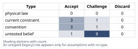
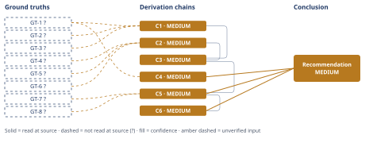

# Slack Integration vs Reporting Rewrite: Which to Build

*First-principles analysis · 10 October 2026*

*Read with: [How to read this analysis](HOW-TO-READ.md) · [Working file](analysis-20261010T161341Z.md) · [All files](INDEX.md)*

## Executive Summary

**Recommendation:** Fund a deliberately scoped reporting-rewrite MVP this quarter — sized to the LOI's "ships" criteria and the 3 top-10 tickets' limitations, not an open-ended rewrite — and defer Slack, starting CRM loss-reason tagging now so Slack's impact is measurable next quarter (chain C5).

**Band (from §6):** MEDIUM — every ground truth carries a `?` since no source could be opened here, though the ranking is robust to reweighting (chain C5).

**Would change it:** legal confirmation the LOI binds and precisely defines "ships" (chain C6); engineering confirmation a scoped MVP fits 3.2 engineer-quarters (chain C6); loss-reason data showing Slack-absence costs more than currently evidenced (chain C4).

## 1. Problem Essence

**Core problem:** Given exactly 3.2 engineer-quarters of capacity that can fund only one of two candidate initiatives this quarter — and cannot be split in a way that completes both — which initiative (in whatever scope actually fits that capacity) maximizes risk-adjusted retained-plus-expansion ARR, given the asymmetry between the two initiatives' evidentiary signals?

**Success criteria:**
- The recommendation traces to a complete derivation chain from the given facts alone (no invented data), not from analogy to how other SaaS companies prioritize.
- The recommendation explicitly compares the two signals' evidentiary strength (corroboration, causal linkage, quantification, urgency) rather than their raw volume.
- The recommendation accounts for second-order effects of deprioritizing each option (sales-pipeline/competitive effects for Slack; renewal, contagion, and trust effects for reporting).
- The recommendation names what must be verified before full commitment (LOI bindingness and precise "ships" definition; whether a scoped fix — not necessarily a ground-up rewrite — can satisfy that definition within 3.2 EQ; materiality of the $180K figure).
- The recommendation is not required to be literally "all of Option A" or "all of Option B as literally specified" if a scoped variant of one option dominates the pure either/or framing — a deliberately narrowed version of one option remains a legitimate answer.

## 2. Assumptions Table



**Companion techniques applied in this phase.**

*Fishbone (breadth-first cause/unknown scan).* Using an adapted six-category set (Information, Legal/Process, Technology/Tools, Resources, People/Relationship, Environment/Market), the unverified-risk space behind this decision was scanned by category rather than by intuition: Information (dedup of the 41 requests; churn-survey methodology completeness; company/account ARR magnitude), Legal/Process (LOI bindingness and "ships" definition), Technology/Tools (true engineering scope of "the rewrite" vs. a scoped fix; relative effort of Slack vs. reporting), Resources (firmness of the 3.2 EQ figure), People/Relationship (whether the exit-clause threat is genuine intent vs. leverage; whether the 2 non-LOI top-10 tickets are independent corroboration), Environment/Market (whether competitors' Slack integration is actually costing deals). Each branch below is attached to exactly one category and carries a discriminating observation — the check that would tell this cause apart from its neighbors.

*Inversion.* Before accepting the (suspiciously clean) emerging read that "fund reporting, defer Slack" is correct, the claim was inverted: "funding B and deferring A is the wrong call this quarter." Failure-guaranteeing conditions were enumerated (the LOI is not actually binding; the ship criteria exceed 3.2 EQ regardless of which option is chosen; deadline pressure causes quality regressions that damage trust worse than not shipping; Slack-absence is silently costing more in unmeasured pipeline than B's quantified risk; the 2 non-LOI tickets are a correlated artifact rather than independent corroboration; company scale renders B's dollar figures immaterial while Slack's long-run platform-completeness cost compounds). The necessary preconditions behind each are the load-bearing rows below (A-3, A-4, A-5, A-9, A-16, A-17, A-8).

| Assumption | Type | Treatment | Verdict | Verification |
|---|---|---|---|---|
| A-1: The 41 inbound Slack requests and 240-account figures, as given, are accurate counts | untested belief | verify or flag | Accept — stipulated as the complete evidence set for this decision; not independently re-verified | unverified — flagged (no CRM/ticketing source opened by this analysis) |
| A-2: Churn-survey reason codes reliably capture the true cause of departure, i.e. absence of a Slack-related code means Slack played no role in any departure | convention | explicitly challenge | Challenge — survey taxonomies undercount secondary factors and structurally cannot capture pre-signature pipeline loss (prospects who never became customers), so this evidence is valid for existing-customer churn only, not for funnel/pipeline attrition | unverified — flagged; no survey-methodology documentation available |
| A-3: The LOI's $180K commitment and exit clause are legally binding as described | untested belief | verify or flag | Challenge — LOIs are conventionally non-binding except for carved-out clauses (confidentiality, exclusivity, sometimes exit/penalty terms); bindingness and the precise meaning of "ships" are unverified | unverified — flagged; legal review of the actual LOI clauses required before full commitment |
| A-4: A full ground-up reporting "rewrite" is required to satisfy the LOI and resolve the 3 top-10 tickets, as opposed to a narrower scoped fix | untested belief | verify or flag | Challenge — "rewrite" is the term given, but the actual requirement is whatever specifically satisfies the LOI's ship clause and the 3 tickets' cited limitations, which may be materially narrower | unverified — flagged; needs direct confirmation of acceptance criteria from the customer and CS |
| A-5: 3.2 engineer-quarters is sufficient to complete a full reporting rewrite within this quarter | current constraint | record expiry conditions | Challenge — capacity is fixed and given, but "full rewrite" scope is undefined and may exceed it; resolves once a concrete scoped spec is sized against the 3.2 EQ budget | unverified — flagged; requires an engineering estimate against a defined MVP scope |
| A-6: The Slack integration's implementation effort is small/bounded relative to a backend "rewrite," consistent with typical point-integration patterns | convention | explicitly challenge | Accept (directionally) — generic engineering heuristic that bounded-API point integrations carry materially lower scope-creep risk than data-model-level rewrites; magnitude for this specific codebase is unverified | unverified — flagged; no engineering estimate given for either initiative individually |
| A-7: "Top-10 accounts by ARR" represent a materially outsized, concentrated share of total company revenue, consistent with typical B2B SaaS concentration | convention | explicitly challenge | Accept (directionally) — near-universal pattern in enterprise/B2B SaaS revenue distributions; magnitude for this specific company is unverified | unverified — flagged; no company-specific ARR concentration data given |
| A-8: The $180K expansion figure is material relative to overall company size/ARR | untested belief | verify or flag | Challenge — company total ARR is not given, so materiality of the $180K figure alone cannot be assessed; this does not gate the recommendation because the decisive risk is the downside (existing ARR loss plus contagion), not the $180K upside in isolation | unverified — flagged; cannot be resolved from the given evidence set; named as a residual open question, not a blocker |
| A-9: Sales prospects' repeated Slack requests indicate a measurable, recoverable loss of deals/pipeline conversion if not built | untested belief | verify or flag | Challenge — no win/loss, deal-size, or conversion-rate data is given to size this; plausible but unquantifiable from the evidence set | unverified — flagged; needs CRM loss-reason tagging going forward |
| A-10: Deferring the Slack integration by one quarter carries negligible incremental risk, i.e. the decision is easily revisited next quarter | current constraint | record expiry conditions | Accept — holds as long as no hard deadline or contractual trigger is attached to Slack (none given, unlike B); expires if a future commitment analogous to the LOI emerges for Slack | Accept — directly entailed by A-1/A-9 containing no stated deadline for Slack |
| A-11: Capacity constraints make a combined (A+B simultaneous, full-scope) build infeasible this quarter | current constraint | record expiry conditions | Accept — explicitly given as a hard constraint this quarter; expires whenever next quarter's capacity planning is redone | Accept — directly stated in the task's evidence set |
| A-12: The LOI's exit clause represents the account's genuine intent rather than a negotiating tactic | untested belief | verify or flag | Challenge — cannot be distinguished from the given facts alone; partially corroborated by the 2 independent, non-LOI top-10 tickets citing the same root limitation, which argues the underlying dissatisfaction is real regardless of whether this one account's threat is tactical | unverified — flagged; account-management judgment call, partially corroborated |
| A-13: The distinct-account count behind the 41 Slack requests can reasonably be bracketed at 10-35 accounts, absent dedup data | untested belief | verify or flag | Challenge — reasoned bracket, not measured | unverified — flagged; resolved by a CRM dedup query grouping requests by account ID |
| A-14: The given evidence set is complete for this quarter's decision; no additional unstated internal data (CRM loss reasons, company/account ARR, legal text of the LOI) should be assumed | current constraint | record expiry conditions | Accept — directly imposed by the task framing | Accept — expires once the named follow-up data (loss-reason tags, legal review, engineering sizing) is actually gathered, which the recommendation itself calls for |
| A-15: The trade-off criteria weights (revenue magnitude, evidence quality, urgency, downside addressed, execution feasibility, relationship/reputation, reversibility) locked before scoring reasonably reflect this decision's stakes | convention | explicitly challenge | Accept — weights were locked before any option was scored, per the trade-off procedure's discipline, and the flip test (chain C5) shows the ranking is robust to reasonable single-criterion reweighting | Accept — directly from the flip-test result in chain C5 |
| A-16: The reporting rewrite (or its scoped MVP) can be executed within the deadline without introducing quality regressions that themselves damage trust | untested belief | verify or flag | Challenge — not evidenced either way by the given facts | unverified — flagged; mitigated by a scope-freeze discipline named in the pre-mortem disposition |
| A-17: The 2 additional (non-LOI) top-10 tickets citing reporting limitations are independent corroboration of real renewal risk, not an artifact of a shared stakeholder or reporting cycle | untested belief | verify or flag | Challenge — plausible given they are separate accounts, but filer-identity/content review was not available to this analysis | unverified — flagged; verification is to review the ticket content and filer identity directly |

## 3. Ground Truths

**Companion technique applied in this phase: 5-Whys, reduce-to-primitives mode.** The LOI claim (GT-5?/GT-6?) was decomposed to test irreducibility. Immediate constituents: (a) a signed LOI document exists; (b) it states a $180K/year expansion commitment contingent on "the rewrite" shipping "this quarter"; (c) it contains an exit clause tied to the same condition; (d) the commitment and exit clause are legally binding; (e) "ships" and "the rewrite" are precisely defined somewhere. Constituents (a)-(c) bottom out at the stipulated evidence set itself — the lowest level this analysis can verify without opening the actual document in this environment — and are carried as `?`-marked ground truths. Constituents (d) and (e) fail the irreducibility stop test: "binding" depends on contract-law classification of the LOI's specific language (not supplied), and "ships" depends on acceptance-criteria language in the LOI or an accompanying SOW (not supplied). Both are therefore recorded as **Assumed — unverified** (A-3 and A-4 in section 2), and the parent claim is verified only at the level of "a document exists saying this," not at the level of "this is an enforceable, precisely scoped commitment." This is the direct source of the two highest-leverage open questions carried into chain C6.

No ground truth below could be read at its cited source: this analysis has no access to a CRM, ticketing system, churn-survey database, or the LOI's legal text in this execution environment — every figure is stipulated directly in the task prompt as "the complete evidence set." Per the Phase 3 verification step, opening each source was attempted conceptually and failed for the same reason in every case: **no citable source exists to open** — the facts are prompt-stipulated, not references to an external document or system this analysis can reach. That failure is recorded once, below, and applies to every ground truth in this list.

**Phase 3 failure record (applies to GT-1? through GT-8?):** source — none citable (CRM/ticketing/churn-survey/legal-contract systems, as applicable); reason unreachable — no such system or document is accessible in this execution environment; the figures are stipulated by the task requester as the complete evidence set rather than cited to an openable source.

- **GT-1?** Over the last two quarters, 41 inbound requests for a Slack integration were logged across 240 active accounts; the count is not deduplicated by account — unverified: no ticketing/CRM source accessible in this environment; stipulated by the task requester.
- **GT-2?** No churn-survey reason code attributes any account departure to the missing Slack integration — unverified: no churn-survey source accessible; stipulated.
- **GT-3?** Sales prospects, not necessarily existing paying accounts, continue to request the Slack integration — unverified: stipulated, no CRM/sales source accessible.
- **GT-4?** In the last two quarters, 3 of the top-10 accounts by ARR filed support tickets citing reporting limitations as a renewal risk — unverified: no ticketing source accessible; stipulated.
- **GT-5?** One of those top-10 accounts signed a Letter of Intent committing $180,000/year in expansion ARR, contingent on the reporting rewrite shipping this quarter — unverified: no legal/contract document accessible; stipulated.
- **GT-6?** That LOI contains an exit clause permitting non-renewal of the account's existing (not just expansion) ARR if the rewrite does not ship this quarter — unverified: same reason; stipulated.
- **GT-7?** Engineering build capacity available this quarter, net of on-call/maintenance, is 3.2 engineer-quarters — unverified: no resourcing/capacity-planning system accessible; stipulated.
- **GT-8?** This capacity can fund only one of the two initiatives this quarter; it cannot complete both via a partial-each combination — unverified: stipulated constraint, logically entailed by GT-7? together with each initiative's assumed full-quarter scope (A-11).

**Provenance summary (required):**
```text
?-marked: GT-1, GT-2, GT-3, GT-4, GT-5, GT-6, GT-7, GT-8 (8 of 8)
Read-at-source: none — no ground truth in this list was read at a citable source; every figure is stipulated directly by the task requester, and the single Phase 3 failure record above (no citable source exists in this environment) applies to all eight.
```

Because every ground truth carries `?`, every derivation chain in section 4 is capped at MEDIUM or below per the unverified-input rule (D-07). That is the honest state of this analysis: it reasons rigorously from stipulated facts, but none of those facts were independently verified by this analysis, and the named verification steps in chain C6 and section 6 are exactly what would lift that cap.

## 4. Derivation Chains



**Companion technique: Estimate (Fermi), supporting chain C4.** Target quantity: Q = plausible quarterly ARR-equivalent value at risk from *not* building the Slack integration this quarter, in $/quarter. Dimensional decomposition: Q [$/quarter] = (distinct accounts asking) [accounts] × (fraction of those at realistic risk of a lost deal or churn attributable to the missing integration) [dimensionless] × (average ARR per affected account/deal) [$/account] × (likelihood the risk materializes this quarter specifically) [dimensionless]. Factor 1 can be bracketed from GT-1? (10-35 distinct accounts, reasoned, not measured — A-13). Factors 2-4 have **no basis in the given evidence set at all** — no win/loss data, no deal-size data, no conversion-rate data is given for this company, and the task instructs against assuming unstated data. Per the estimate procedure's own guidance, inventing a range for an unanchored factor is not permitted; the honest output is that Q's lower bound is $0/quarter (consistent with GT-2?'s zero evidenced churn) and its upper bound is **unknown**, not merely wide. This is itself the finding: Option A's near-term dollar value cannot currently be sized, only its longer-run existence as an unmeasured risk is known (chain C4).

**Companion technique: Trade-off analysis, supporting chain C5.** Options named, including the status quo and composite variants as required: **Z** (defer both this quarter), **A** (build the Slack integration), **B-full** (build the reporting work as an unscoped, open-ended "rewrite"), **B-scoped** (build a deliberately narrowed reporting MVP sized to the LOI's ship clause and the 3 tickets' cited limitations). A cross-initiative split (part of A + part of B) is foreclosed by GT-8? and is not scored (Abandoned Reasoning, Dead End 1); B-scoped is the composite the procedure requires considering within a single initiative, and it is scored alongside the others. Must-haves (knockouts): (1) fits within 3.2 EQ, (2) requires no unstated data. All four options satisfy both — B-full's fit is *uncertain*, not failing, so it is scored rather than eliminated, with that uncertainty captured on the execution-feasibility criterion.

Criteria, weighted and locked before scoring (1-5, higher always better for the option being scored):
C1 Quantified revenue engaged (w5) · C2 Evidence quality engaged (w4) · C3 Urgency addressed (w4) · C4 Downside addressed (w5) · C5 Execution feasibility (w4) · C6 Relationship/reputation effect addressed (w3) · C7 Reversibility/optionality (w2).

Anchors: C1 1=no $ figure attached to this option's case, 5=specific contracted $ figure attached; C2 1=anecdotal/non-causal, 5=multiply-corroborated and causally linked; C3 1=no deadline engaged, 5=hard contractual deadline engaged; C4 1=leaves the largest known downside fully exposed, 5=directly resolves it; C5 1=scope/effort unknown or exceeds capacity, 5=effort bounded and fits capacity with margin; C6 1=no effect on existing key-account trust, 5=directly shapes it; C7 1=hard to undo if wrong, 5=easy to revisit next quarter.

| Option | C1(5) | C2(4) | C3(4) | C4(5) | C5(4) | C6(3) | C7(2) | Total |
|---|---|---|---|---|---|---|---|---|
| Z (defer both) | 1 | 1 | 1 | 1 | 5 | 1 | 2 | 45 |
| A (Slack) | 1 | 1 | 1 | 1 | 4 | 2 | 5 | 50 |
| B-full (unscoped rewrite) | 5 | 5 | 5 | 5 | 2 | 5 | 2 | 117 |
| B-scoped (sized MVP) | 5 | 5 | 5 | 5 | 4 | 5 | 2 | 125 |

**Flip test:** B-scoped leads A by 75 points. The only criterion where A outscores B-scoped is C7 (5 vs 2, weight 2); raising that weight to its maximum of 5 only closes 9 of the 75 points. Reducing any single B-favoring criterion's weight to its minimum of 1 closes at most 16 points (C1 or C4, each currently weight 5). **No single-criterion weight change flips the result.** B-scoped also leads B-full by 8 points, entirely on execution feasibility (C5) — the exact margin the deliberate scoping is designed to capture.

**Companion technique: Second-order thinking, folded into chain C5's second hop.** Actor lens — customers (the 3 renewal-risk top-10 accounts read B-scoped as being heard; A's prospects are not existing relationships and carry no analogous trust stake), sales reps (must manage prospect objections about missing Slack in the interim), engineering (committing all capacity to one undefined-scope deliverable is itself a concentration risk — this is the chain's own weakest link, carried into chain C6), competitors (may win deals on Slack-integration checkboxes, a real but currently unmeasured channel). Time lens — this quarter (B-scoped ships or the exit clause triggers; A's status quo continues with no measured harm); next few cycles (if B ships, renewal outcomes for the LOI account and likely some spillover benefit to the other 2 top-10 accounts are realized; A can be revisited with dedicated capacity once loss-reason data exists); long run (if Slack is never built, a platform-completeness gap could compound in competitive enterprise deals — a legitimate risk for a *future* quarter's roadmap, not evidence against this quarter's choice given the complete absence of current quantified harm). No second-order effect found here contradicts a ground truth, so none routes back to Phase 2.

### Conclusion C1: Option A rests on an anecdotal, non-causal, unquantified demand signal

GT-1? (41 raw, non-dedup requests across 240 accounts) + GT-2? (zero churn-survey attribution) + GT-3? (prospects, not necessarily accounts, keep asking)
→ the Slack signal is upper-bounded at roughly 17% of the active account base (41/240) even under the impossible best case that every request came from a distinct active account, and is further diluted because some requesters are non-paying prospects, not accounts at all
→ with zero churn-survey attribution and no deal-level data given, this signal cannot be connected to any quantified revenue outcome, existing or prospective
→ Option A rests on an anecdotal, non-causal, unquantified demand signal

**Confidence:** MEDIUM — GT-1?, GT-2?, GT-3? are each unverified (no CRM/churn-survey source opened, per the Phase 3 failure record); verification that would remove this cause: open the CRM ticketing system and churn-survey database directly to confirm counts and de-duplicate by account.

### Conclusion C2: Option B rests on a corroborated, partially quantified, contractually time-boxed revenue-risk signal

GT-4? (3 of top-10 ARR accounts cite reporting as renewal risk) + GT-5? (LOI: $180K expansion, contingent on shipping this quarter) + GT-6? (exit clause risks the account's existing base ARR)
→ the reporting-risk signal is corroborated independently by 3 separate top-10 accounts, not a single anecdote
→ one of those accounts has converted its dissatisfaction into a contractually time-boxed, dollar-quantified commitment-and-penalty structure *[Assumes: A-3 — LOI terms execute as described; if A-3 were false the dollar figures would be softer, but the underlying renewal risk corroborated by 3 independent accounts would still stand]*
→ Option B rests on a corroborated, partially quantified, contractually time-boxed revenue-risk signal

**Confidence:** MEDIUM — GT-4?, GT-5?, GT-6? are each unverified (no ticketing/legal source opened); hop 2 also rests on A-3 (LOI bindingness), priced above; verification: open the LOI document for legal review of which clauses bind, and confirm the 3 tickets directly.

### Conclusion C3: under the given evidence, Option B is the evidentiarily stronger claim, independent of any trade-off weighting

C1 (anecdotal, unquantified) + C2 (corroborated, quantified, time-boxed)
→ comparing the two signals axis-by-axis — corroboration, causal/contractual linkage, quantification, urgency — shows B dominating A on every axis the given evidence supports
→ under the given evidence, Option B is the evidentiarily stronger claim, independent of any trade-off weighting

**Confidence:** MEDIUM — capped by C1 and C2, both MEDIUM; no new input beyond those two chains.

### Conclusion C4: Option A's this-quarter dollar value cannot be sized from the given evidence; it is a real but currently unquantifiable tail risk, not a quantified near-term gain

GT-1? (41 requests / 240 accounts)
→ distinct-account requesters are bounded above by min(41,240)=41 but are realistically far fewer given duplicate follow-ups and non-account prospects, bracketed at an assumed 10-35 distinct paying accounts *[Assumes: A-13 — bracket is reasoned, not measured; if the true count fell outside 10-35 the endpoint would still stand, since factors 2-4 below are entirely unsized regardless of factor 1's precision]*
→ with no ARR-per-account, deal-size, or win-rate figures given anywhere in the evidence set, no dollar value can be attached to this bracket — the honest output is a bounded headcount, not a bounded revenue figure
→ Option A's this-quarter dollar value cannot be sized from the given evidence; it is a real but currently unquantifiable tail risk, not a quantified near-term gain

**Confidence:** MEDIUM — GT-1? is unverified and hop 1 rests on A-13 (reasoned bracket); verification: a CRM dedup query for the true distinct-account count, plus loss-reason tagging to size dollar impact going forward.

### Conclusion C5: fund a deliberately scoped reporting-rewrite MVP this quarter and defer the Slack integration, while instituting loss-reason tracking to re-evaluate it next quarter

C3 (B evidentiarily stronger) + GT-7? (3.2 EQ capacity) + GT-8? (only one initiative fundable)
→ weighted trade-off scoring across revenue magnitude, evidence quality, urgency, downside addressed, execution feasibility, relationship/reputation effect, and reversibility gives the scoped reporting MVP a total of 125 against 50 for Slack, 117 for an unscoped full rewrite, and 45 for deferring both, a gap no single-criterion reweighting closes
→ second-order analysis across the actor lens (customers, sales, engineering, competitors) and the time lens (this quarter, next few cycles, long run) shows both options carry real downside, but only Option B's downside is quantified, corroborated, and time-boxed within this quarter *[Assumes: A-4, A-5 — scope-to-capacity fit for the reporting work is not yet verified]*
→ fund a deliberately scoped reporting-rewrite MVP this quarter and defer the Slack integration, while instituting loss-reason tracking to re-evaluate it next quarter

**Confidence:** MEDIUM — capped by C3 (MEDIUM) and GT-7?/GT-8? (unverified); hop 2 also rests on A-4/A-5 (scope-to-capacity fit), priced here: if A-4/A-5 fail (the MVP does not fit 3.2 EQ as scoped), the endpoint itself — prioritize B's work over A this quarter — still stands, because C3's evidentiary-strength gap over A does not depend on exact scope; only the implementation plan changes (renegotiate a smaller deliverable or escalate capacity), so this hop does not short the Inference axis beyond what Inputs already caps; verification: engineering sizing of a defined MVP spec against the 3.2 EQ budget before scope is frozen.

### Conclusion C6: before fully committing capacity, the team must resolve the LOI's precise terms and confirm a scoped MVP fits capacity, and must start measuring Option A's currently invisible risk

C5 (recommend B-scoped, defer A)
→ the two highest-leverage unresolved unknowns behind this recommendation — the LOI's precise "ships"/bindingness terms and whether a scoped MVP satisfying them fits within 3.2 EQ — are exactly the inputs that, if wrong, flip this recommendation's execution risk from manageable to severe *[Assumes: A-3, A-4]*
→ before fully committing capacity, the team must resolve the LOI's precise terms and confirm a scoped MVP fits capacity, and must start measuring Option A's currently invisible risk

**Confidence:** MEDIUM — capped by C5 (MEDIUM); hop 1 rests on A-3 and A-4, whose verification paths are named in C2's and C5's own confidence lines and are not re-explained here; this chain adds no further unresolved cause of its own.

## 5. Abandoned Reasoning

### Dead End: Fund both initiatives this quarter via a split allocation of the 3.2 EQ

**What was tried:** Explored whether a partial-A-plus-partial-B allocation of the 3.2 EQ could deliver meaningful progress on both.

**Why abandoned:** Directly contradicted by GT-7?/GT-8?, which state the capacity can fund only one initiative this quarter and cannot complete either via a partial-each combination.

**What it ruled out:** Saves the team from re-litigating a split-capacity compromise that the stated constraint already forecloses.

### Dead End: Recommend Option A because raw demand volume (41 requests, 240 accounts, plus prospects) represents a broader-based signal than one enterprise account's contractual threat

**What was tried:** The inversion procedure's strongest rival conclusion — treat multi-account, multi-channel demand as inherently more decision-worthy than a single account's time-boxed threat, on the theory that broad-based signals scale better than concentrated ones.

**Why abandoned:** Inverts the evidentiary hierarchy established in chains C1-C3: it requires treating a non-deduplicated, prospect-inclusive, churn-uncorroborated count (GT-1?/GT-2?/GT-3?) as stronger evidence than a signal independently corroborated by 3 top-10 accounts and converted into a dollar-quantified, contractually time-boxed commitment (GT-4?/GT-5?/GT-6?). Ruled out by C1 and C2 directly.

**What it ruled out:** Saves the team from re-raising "just count the raw requests" as a standalone decision rule in this or a future prioritization debate.

### Dead End: Recommend the full, unscoped reporting rewrite exactly as specified

**What was tried:** Treating "the reporting rewrite" literally, committing all 3.2 EQ to an open-ended rewrite rather than a scoped MVP.

**Why abandoned:** The execution-feasibility axis (A-4/A-5, scored in the trade-off matrix as C5=2 for B-full vs. C5=4 for B-scoped) shows the scope is undefined and may exceed 3.2 EQ; committing to full scope risks the worst pre-mortem outcome below — shipping nothing and triggering the exit clause anyway, having spent the quarter's entire capacity.

**What it ruled out:** Saves the team from blindly committing all capacity to an undefined-scope deliverable; this is why chain C5 and C6 name the scoping step as a precondition, not an afterthought.

### Dead End: Treat the $180K materiality question (A-8) as decision-blocking

**What was tried:** Attempting to resolve whether $180K is material to the company before recommending anything.

**Why abandoned:** Company-size data is not given and cannot be obtained from the stipulated evidence set; more importantly, the decisive risk is the downside (loss of existing base ARR plus contagion risk to 2 more top-10 accounts), not whether $180K alone is material — so the recommendation does not depend on resolving A-8.

**What it ruled out:** Saves the team from stalling the decision on a data point that does not actually gate it; A-8 is carried forward as a named residual unknown rather than a blocker.

## 6. Conclusion

**Recommended approach:** Fund a deliberately scoped reporting-rewrite MVP this quarter — sized to the LOI's specific "ships" criteria and the 3 top-10 tickets' cited limitations rather than an open-ended rewrite — and defer the Slack integration, while immediately starting CRM loss-reason tagging so Option A's impact is measurable for next quarter's decision (chain C5).

**Key insight:** Raw demand-signal volume is not just smaller evidence than 3 corroborated enterprise tickets plus a contractual LOI — it is a categorically weaker evidence *type* on every axis that matters here (corroboration, causal/contractual linkage, quantification, urgency), so a decision rule based on "more requests means more demand" would pick the wrong option even though it looks data-driven; the first-principles comparison in chains C1-C3 is what exposes that raw volume and evidentiary strength are different things in this specific dataset (chain C3).

**Trade-offs acknowledged:** Choosing B-scoped accepts a real but currently unquantifiable risk that continuing to defer Slack erodes competitive win rate in deals where it is a checkbox requirement — a cost the given evidence cannot size today (chain C4). It also accepts genuine execution risk that a "scoped MVP" negotiated with the customer and legal may not land cleanly within 3.2 EQ, which is why the recommendation is conditioned on a pre-commitment sizing check rather than an unconditional "build the rewrite" (chain C6).

**Confidence:** MEDIUM — every ground truth this analysis rests on carries a `?` because no underlying source (CRM, legal, finance, churn-survey) could be opened in this execution environment (section 3's Phase 3 failure record); the recommendation's *direction* is robust — the trade-off flip test in chain C5 shows no single-criterion reweighting flips B-scoped below Option A — but its execution feasibility depends on two unverified, high-leverage items named in chain C6: the LOI's bindingness and precise "ships" definition (A-3), and whether a scoped MVP satisfying that definition fits within 3.2 EQ (A-4/A-5).
