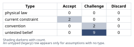
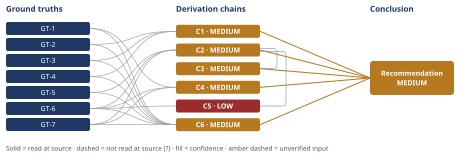

# Slack Integration vs. Reporting Rewrite: Which to Build

*First-principles analysis · 10 October 2026*

*Read with: [How to read this analysis](HOW-TO-READ.md) · [Working file](analysis-20261010T182705Z.md) · [All files](INDEX.md)*

## Executive Summary

**Recommendation:** Fund Option B — the reporting rewrite — with the full 3.2 engineer-quarters this quarter; do not fund Option A, the Slack integration, this quarter (chain C2, chain C6). Option B's risk case is dated, dollar-quantified, and contractually anchored, while Option A's benefit case is entirely unquantified and partially contradicted by churn evidence (chain C1, chain C3).

**Band (from §6):** MEDIUM

**Would change it:** Whether the LOI's "ships this quarter" contingency could be satisfied by a narrower scope than the full planned rewrite (chain C4); whether the account genuinely intends to exercise the exit clause and whether the other 2 non-LOI top-10 accounts' renewal risk is similarly time-boxed to this quarter (chain C2, chain C4).

## 1. Problem Essence

**Core problem:** Given 3.2 engineer-quarters of capacity this quarter — sized to fund exactly one of two candidate initiatives, not both — which initiative (the Slack integration, or the reporting rewrite) should receive that capacity, such that the choice is driven by which option's risk/opportunity case is actually supported by dated, attributable, or dollar-quantifiable evidence, rather than by which request is most recent or most vivid?

**Success criteria:**
- Names one initiative (or a strictly fact-justified partial/deferred path) as the recommendation for this quarter's 3.2 engineer-quarters.
- Grounds the choice in the *evidentiary quality* of each option's risk/benefit case (dated vs. undated, dollar-quantified vs. unquantified, attributed vs. unattributed) — not merely in which option has more raw signal volume.
- Explicitly surfaces whether the headline risk driver (the LOI's contingency and exit clause) is genuinely binding or could be renegotiated, and whether the un-quantified demand signal (41 requests) indicates real lost-deal risk or noise — both flagged by the task as load-bearing uncertainties.
- Accounts for second-order organizational effects (engineering morale, tech-debt risk from a rushed build, sales narrative, precedent for letting customer-negotiated deadlines reorder the roadmap) as inputs to the recommendation, not as a coda.
- States a confidence band and names the single piece of missing information that would most change the recommendation.
- Does not propose splitting the 3.2 engineer-quarters across both options unless a ground truth in the problem statement strictly supports a split.

## 2. Assumptions Table

| Assumption | Type | Treatment | Verdict | Verification |
|------------|------|-----------|---------|--------------|
| A-1: Building the Slack integration would measurably increase win rate or reduce churn among the 240 active accounts. | untested belief | Verify or flag; track post-launch win/loss and churn outcomes attributed to Slack availability. | Challenge — no supporting ground truth; GT-3 is directly contrary evidence on the churn side. | unverified — flagged |
| A-2: The 41 inbound Slack requests represent broad-based, non-duplicative demand rather than a vocal minority or repeat asks from the same accounts. | untested belief | Deduplicate by account; compare unique-account count against the 240-account base. | Challenge — GT-2 states the count is not deduplicated, so the true unique-account rate is unknown and could be materially lower than 41/240. | unverified — flagged |
| A-3: Sales prospects raising the Slack gap materially affects win/loss outcomes, rather than being a minor checkbox item prospects mention but do not act on. | untested belief | Pull sales lost-reason codes for any deal where Slack absence was logged as the decisive factor. | Challenge — no lost-deal log was supplied; GT-4 states only that it is "raised," not that it has caused a loss. | unverified — flagged |
| A-4: The LOI's $180,000/year contingent commitment reflects the account's genuine intent to exercise the exit clause, not primarily a negotiating lever with low follow-through probability. | untested belief (load-bearing) | Review negotiation history and the account executive's read of relationship intent; absent that, apply the stakes-escalation rule and treat conservatively. | Challenge — conservatively accepted given the clause's specificity (GT-6, GT-7) and the absence of any countervailing evidence that it is a bluff; still unverified. | unverified — flagged |
| A-5: The planned reporting-rewrite scope, deliverable within 3.2 engineer-quarters this quarter, actually covers the specific limitations cited in the LOI account's (and ideally the other two accounts') support tickets. | untested belief (load-bearing) | Scope-check the plan against the actual ticket content before committing capacity — immediately actionable, low cost. | Challenge — not verifiable from the facts given; this is the single highest-leverage open task before build begins. | unverified — flagged |
| A-6: The other 2 non-LOI top-10 accounts citing reporting limitations as a renewal risk are also time-boxed to this quarter, with urgency comparable to the LOI account. | untested belief | Check account-health and renewal-date records for those 2 accounts. | Challenge — not stated anywhere in the given facts; this is a material gap in the evidence base (see §6, "what would change this"). | unverified — flagged |
| A-7: 3.2 engineer-quarters is sufficient to ship a "reporting rewrite" that satisfies the LOI's "ships this quarter" bar without quality-compromising crunch. | current constraint | Record expiry conditions: track scope weekly against the quarter boundary; pre-define an MVP cut-line before deadline pressure forces an uncontrolled one. | Accept — expires if scope is not actively managed against the deadline; until then treated as a managed execution risk, not a disqualifying one. | unverified — flagged (engineering-estimate risk, not resolvable from given facts) |
| A-8: The probability the LOI account actually exercises the exit clause once the contingency is triggered (i.e., the rewrite does not ship this quarter) lies in the 40%–80% range. | untested belief (explicit analyst judgment, surfaced via Assumption Audit on chain C3, step 1) [Assumes: A-8] | Sharpen via direct input from the account executive or legal counsel on enforceability and the account's stated intent. | Challenge — used only as an illustrative bracket for a floor estimate, not presented as a precise probability; no data exists to narrow it further. | unverified — flagged |
| A-9: The LOI's contingency on "the reporting rewrite shipping this quarter" strictly requires the full planned scope of Option B, with no room for a smaller, faster, negotiated release to satisfy the clause. | convention (standard contract-reading default absent contrary evidence, surfaced via Assumption Audit on chain C4, step 2) [Assumes: A-9] | Challenge directly: an account-executive conversation to probe whether a narrower scope would satisfy the account is a near-zero-cost action independent of the capacity decision (this is the "could the timeline slip with a conversation" question the task raises). | Challenge — treated as the literal reading for the capacity decision, but flagged as worth testing via direct conversation before committing full scope. | unverified — flagged |
| A-10: Sales and account-management teams will rationally respond to a precedent of funding B in response to a dated LOI by structuring future expansion deals with similar ship-date contingencies. | untested belief (surfaced via Assumption Audit on chain C5, steps 2-3) [Assumes: A-10] | Monitor deal structures over the next 1-2 quarters; mitigate via explicit internal communication framing this decision as evidence-driven, not as a standing policy. | Challenge — speculative second-order projection; plausible given known principal-agent incentive patterns in sales organizations, but not verifiable from the given facts. | unverified — flagged |
| A-11: Churn-survey reason codes comprehensively and accurately capture the true drivers of customer departure, such that the absence of a "missing Slack integration" code reliably means it is not a departure driver. | convention | Challenge: cross-check against free-text churn comments or exit interviews if available; survey instruments are known to under-capture secondary or unprompted reasons. | Challenge — treated as weak-but-real evidence against Option A's urgency (not proof of zero impact), per GT-3. | unverified — flagged |
| A-12: The stated 3.2-engineer-quarter capacity figure (net of on-call/maintenance) is accurate and will remain stable for the quarter, i.e., it will not be further eroded by incident load. | current constraint | Record expiry condition: a major incident or on-call spike consuming the buffer would shrink effective capacity below the figure used in this analysis. | Accept — accepted as given per the problem statement (GT-1); monitor on-call load as the expiry trigger. | source: problem statement (GT-1) |

No assumption in this analysis rises to **physical law** status — this is a business resource-allocation decision, not a domain governed by physical constants, so that type is legitimately unpopulated here.
| A-13: The criteria weights and anchors used in the trade-off scoring (chain C6) reflect the company's actual strategic priorities, rather than an analyst's generic defaults. | untested belief (surfaced via Assumption Audit on chain C6, step 1) [Assumes: A-13] | Confirm weights with whoever owns the revenue/retention vs. product-completeness trade-off (typically CEO/CRO/Head of Product) before treating the ranking as final. | Challenge — the flip test (chain C6) shows the ranking is robust to any single-criterion reweighting within 1-5 bounds, which bounds this risk without eliminating it. | unverified — flagged |

## 3. Ground Truths

This analysis has exactly one source: the user-supplied problem statement. There are no external citations (URLs, files, or sub-agent reports) to open, so the Phase 3 verification step's "attempt to open the cited source" is not applicable to any ground truth below — each fact is directly quoted from the one and only source this analysis has, and that source has been fully read (it is the prompt itself). Accordingly every ground truth below carries provenance `read-at-source`, with "read-at-source" naming the clause of the problem statement it was read from, and none carries a `?` suffix.

- **GT-1** Capacity available this quarter is 3.2 engineer-quarters, net of on-call/maintenance, and is sized to fund exactly one of the two candidate options, not both. — source: problem statement; read-at-source: task preamble, "given only 3.2 engineer-quarters of capacity this quarter (net of on-call/maintenance) — enough to fund exactly one of the two options, not both."
- **GT-2** Inbound requests for the Slack integration totaled 41 over the last two quarters, across 240 active accounts, and this count is not deduplicated by account. — source: problem statement; read-at-source: "Option A" bullet, "41 inbound requests over the last two quarters (requests, not de-duplicated accounts) across 240 active accounts."
- **GT-3** No churn-survey reason code attributes any customer departure to the missing Slack integration. — source: problem statement; read-at-source: "Option A" bullet, "No churn-survey reason code attributes any departure to the missing Slack integration."
- **GT-4** Sales prospects raise the missing Slack integration during the sales process; frequency and deal-outcome impact are not quantified in the facts given. — source: problem statement; read-at-source: "Option A" bullet, "Sales prospects keep raising it."
- **GT-5** 3 of the company's top-10 accounts by ARR filed support tickets in the last two quarters citing reporting limitations as a renewal risk. — source: problem statement; read-at-source: "Option B" bullet, "3 of the company's top-10 accounts by ARR filed support tickets in the last two quarters citing reporting limitations as a renewal risk."
- **GT-6** One of those 3 accounts signed a Letter of Intent committing $180,000/year in expansion ARR, contingent on the reporting rewrite shipping this quarter. — source: problem statement; read-at-source: "Option B" bullet, "One of those accounts signed a Letter of Intent committing $180,000/year in expansion ARR, contingent on the reporting rewrite shipping THIS quarter."
- **GT-7** That LOI contains an exit clause permitting non-renewal if the rewrite does not ship this quarter. — source: problem statement; read-at-source: "Option B" bullet, "That LOI has an exit clause permitting non-renewal if the rewrite does not ship this quarter."

**Provenance summary (required):** `?`-marked: none (0 of 7). Read-at-source: GT-1 — task preamble capacity clause; GT-2 — Option A bullet 1; GT-3 — Option A bullet 2; GT-4 — Option A bullet 3; GT-5 — Option B bullet 1; GT-6 — Option B bullet 2; GT-7 — Option B bullet 3. All seven ground truths feed load-bearing chains in §4 (C1 through C5), and all seven are named above with their read-at-source location.

**Material gaps (not ground truths, named here so they are not mistaken for verified facts):** the facts given do not state (a) the base ARR of the LOI account beyond the $180K expansion figure, (b) whether the other 2 non-LOI top-10 accounts' renewal risk is also time-boxed to this quarter, (c) the dollar value of any deal known to have been lost due to the missing Slack integration, or (d) whether the LOI's "ships this quarter" bar could be satisfied by a narrower, faster scope than the full planned rewrite. These gaps are carried into §2 as explicit untested beliefs (A-6, A-9) and into §6 as the named "what would change this" items — they are not assumed true or false here.

## 4. Derivation Chains

### Conclusion C1: Option A's benefit case is entirely unquantified in dollar terms, and partially contradicted by churn evidence

GT-2 (41 requests/240 accounts, undeduplicated) + GT-3 (no churn attribution) + GT-4 (sales prospects raise it)
→ a request count that is not deduplicated and spans two quarters among 240 accounts cannot be read as a validated retention-risk signal without further account-level attribution
→ combined with zero churn-survey attribution, the available evidence supports only a diffuse, unquantified competitive or sales-friction signal for Slack, not a dollar-quantified retention or win-rate risk
→ Option A's benefit case rests on an untested belief about conversion or retention impact (A-1, A-2, A-3), with no dollar figure derivable from the facts given

**Confidence:** MEDIUM — Rivals axis short: a live rival reading holds that pre-customer prospects who walk away over the Slack gap would never appear in either the request count (GT-2, which only counts existing accounts) or the churn survey (GT-3, which only covers departing customers), so the true cost of inaction could be systematically undercounted. Nothing in the facts given settles this rival (see §5, Dead End 3), so it stays live; what would close it is a sales lost-reason log showing deals explicitly lost to the missing Slack integration — none was supplied.

### Conclusion C2: Option B carries a dated, dollar-quantified, contractually-anchored exposure that Option A's case does not have

GT-5 (3 of top-10 accounts cite reporting limitations as renewal risk) + GT-6 (LOI commits $180K contingent expansion ARR) + GT-7 (exit clause tied to this-quarter shipping)
→ the LOI converts a general renewal-risk ticket signal into an explicit, dated, dollar-quantified contractual contingency tied to this quarter's delivery
→ because the exit clause is scoped specifically to the rewrite not shipping this quarter, any decision that does not fund Option B this quarter makes that triggering condition certain to be met
→ Option B carries a dated, dollar-quantified, contractually-anchored exposure of $180,000 in expansion ARR if not funded this quarter, a specificity no fact given for Option A reaches

**Confidence:** MEDIUM — Rivals axis short: a live rival reading (A-4) holds the LOI is primarily a negotiating lever with low follow-through probability, or that the exit clause is less enforceable in practice than its text suggests; nothing in the facts given settles this, so it stays live. What would close it: direct input from the account executive or legal counsel on the account's stated intent and the clause's enforceability.

### Conclusion C3: The quantifiable floor of forgone-B expected cost already exceeds any dollar figure derivable for Option A

C2 (MEDIUM, contractual exposure established)
→ bracketing the probability that the account exercises the exit clause once triggered at 40%-80%, since no negotiation-history or legal-opinion data exists to narrow it further [Assumes: A-8]
→ multiplying that bracket by the $180,000 contingent expansion ARR yields an expected first-year loss of $72,000 to $144,000 if Option B is not funded this quarter
→ this floor excludes the unquantified, directionally additive renewal risk from the other 2 non-LOI top-10 accounts citing the same reporting-limitation concern, which the facts given do not size
→ even before counting that additional, unsized risk, the $72,000-$144,000 floor already exceeds the $0 dollar figure derivable for Option A's benefit case established in C1

**Confidence:** MEDIUM — Inputs axis capped at MEDIUM because this chain cites C2 (MEDIUM); C2's own confidence line carries that explanation and is not repeated here. This chain's own downgrade cause: the 40%-80% exercise-probability bracket (A-8) is explicit analyst judgment, not a figure derived from the facts given; what would remove it as a cause of the downgrade is direct account-executive or legal input narrowing the probability that the exit clause is actually exercised.

### Conclusion C4: A split of the 3.2 engineer-quarters between Option A and Option B is not justified by the facts given

GT-1 (capacity funds exactly one option, not both) + GT-6 (LOI contingent on "the reporting rewrite" shipping) + GT-7 (exit clause tied to this quarter)
→ the capacity constraint already establishes that each option is scoped to consume roughly the full 3.2 engineer-quarters, since the capacity is sized for exactly one and not both
→ a split allocation would therefore underfund both options relative to their scoped size
→ the LOI's contingency names the reporting rewrite itself, the same deliverable as Option B, rather than a specifically scoped subset of it, so a partial or under-resourced version of B has no stated contractual basis for satisfying the LOI's trigger [Assumes: A-9]
→ a split of the 3.2 engineer-quarters between A and B is not justified by the facts given; the binary choice holds, with only non-engineering-capacity parallel actions available as low-cost complements

**Confidence:** MEDIUM — Inference axis short: the third hop rests on [Assumes: A-9] (that "the reporting rewrite" in the LOI means the full planned scope, not a negotiable subset). If A-9 fails — i.e., the account would accept a narrower, faster release — the endpoint would not stand as written; a cheaper path could exist. What would close it: a direct account-executive conversation confirming or denying whether a narrower scope satisfies the LOI's contingency (this is the single cheapest, highest-leverage verification available before capacity is committed; see §6, "what would change this").

### Conclusion C5: Choosing B carries a second-order precedent and morale risk that must be actively managed, not silently absorbed

C2 (MEDIUM, contractual exposure established) + GT-6 (LOI mechanism)
→ funding B this quarter directly in response to a customer-negotiated, dated LOI is itself the decision that establishes an internal precedent for contingent-commitment-driven reprioritization
→[2nd] sales and account teams, observing this precedent, have an incentive over the next 1-2 quarters to structure future expansion negotiations with similar ship-date contingencies [Assumes: A-10]
→[2nd] engineering morale is affected in the near term by deadline pressure attached to a customer-facing commitment the team did not set, with severity depending on how transparently the trade-off is communicated
→[3rd] left unmanaged across several quarters, this normalizes a reactive, sales-led roadmap process that crowds out proactively planned technical investment, compounding future tech debt
→ choosing B remains correct on the revenue evidence in C2 and C3, but it carries a second-order organizational-process risk that must be actively managed rather than silently absorbed

**Confidence:** LOW — two axes short. Inputs axis capped at MEDIUM via C2 (its own line carries that explanation). Inference axis short: the first `[2nd]` hop rests on [Assumes: A-10] (that sales/account teams will rationally structure future deals around this precedent); if A-10 fails — no behavioral response occurs — the endpoint's risk claim would not stand as asserted, and no evidence in the facts given prices that failure. Rivals axis also live: the rival reading "no precedent effect occurs because this is understood internally as a one-off" is unsettled by anything in the facts given. What would close these: observing the next 1-2 quarters' actual sales deal structures, and a documented internal communication establishing this as a non-precedent-setting, evidence-driven exception.

### Conclusion C6: Weighted-criteria scoring recommends Option B over Option A and over doing nothing, and the result is not a near-tie

GT-1 (capacity funds exactly one option) + GT-2 (41 requests/240 accounts) + GT-3 (no churn attribution) + GT-4 (sales prospects raise it) + GT-5 (3 of top-10 cite reporting limitations) + GT-6 (LOI $180K contingent) + GT-7 (exit clause this quarter)
→ weighting seven decision criteria before scoring — quantified revenue risk (w5), demand breadth (w3), deadline urgency (w4), delivery feasibility within 3.2 engineer-quarters (w4), strategic alignment (w3), second-order/precedent risk (w2), and reversibility of a wrong urgency call (w3) — and scoring each option against anchored 1-5 scales yields weighted totals of B=102, A=54, do-nothing=60 [Assumes: A-13]
→ the 48-point margin is driven primarily by the weight-5 quantified-revenue-risk criterion (B scores 5 vs A's 1) and the weight-4 deadline-urgency criterion (B scores 5 vs A's 1)
→ a flip test confirms this is not a near-tie: no single criterion's weight can be moved within its 1-5 bound to flip the winner, since even zeroing the highest-weight criterion only closes 20 of the 48-point gap
→ recommend Option B over Option A and over doing nothing on weighted-criteria grounds, independent of, and consistent with, the contractual and expected-value reasoning in C2 through C4

**Confidence:** MEDIUM — Inference axis short: the first hop rests on [Assumes: A-13] (that the criteria weights and anchors reflect the company's actual strategic priorities rather than an analyst default). The flip test bounds, but does not eliminate, this risk: it shows the ranking survives any single-criterion reweighting within normal bounds, which is what keeps this chain at MEDIUM rather than LOW, but A-13 itself remains unverified. What would close it: confirming the weights with whoever owns the revenue-vs-completeness trade-off (e.g., CEO/CRO/Head of Product) before treating the ranking as final.

## 5. Abandoned Reasoning

### Dead End: Split the 3.2 engineer-quarters across both options

**What was tried:** Explored whether a partial allocation (e.g., a scoped-down Slack integration plus a scoped-down reporting fix) could satisfy both options' stakeholders within the same 3.2 engineer-quarters, since the task explicitly asked whether a split could be justified.

**Why abandoned:** GT-1 states the capacity is sized to fund exactly one option, not both — i.e., each option's planned scope already consumes roughly the full budget. GT-6 and GT-7 tie the LOI's contingency to "the reporting rewrite" (the same deliverable as Option B), not to a named subset, so an under-resourced partial rewrite has no stated contractual basis for satisfying the trigger. Splitting would plausibly deliver neither a usable Slack integration nor a rewrite that resolves the LOI.

**What it ruled out:** Chain C4 formalizes this; a reader does not need to re-derive why a split fails from the capacity and contingency wording — it is ruled out directly by GT-1, GT-6, and GT-7, subject to the one open question named in C4's confidence line (A-9: whether a narrower scope could satisfy the LOI via direct negotiation).

### Dead End: Discount the LOI as a non-binding negotiating tactic to justify choosing Option A

**What was tried:** Applied inversion to the claim "building B preserves the $180K and reduces renewal risk," asking what would guarantee this fails. One failure-guaranteeing condition is that the LOI was never a real commitment — a bluff with low follow-through probability (A-4) — in which case Option B's urgency case weakens substantially.

**Why abandoned:** No fact given supports this reading, and the LOI's specificity (a named dollar figure, a named contingency, an explicit exit clause) is the opposite of what a low-stakes bluff typically looks like. The stakes-escalation rule (Phase 2) requires pushing a load-bearing assumption toward verification rather than toward whichever reading is convenient for the preferred option; absent verification, the conservative reading — that the clause is real — is the one this analysis carries forward (A-4 remains flagged unverified, not resolved).

**What it ruled out:** This saves a future reviewer from re-litigating "maybe the LOI isn't real" without new evidence; it also identifies exactly what evidence (account-exec or legal input on intent and enforceability) would overturn the conservative reading, named on C2's and C3's confidence lines.

### Dead End: Treat sales prospects raising Slack as comparable urgency to the top-10 renewal risk

**What was tried:** Considered weighting GT-4 ("sales prospects keep raising it") as equivalent in urgency to GT-5/GT-6/GT-7 (support tickets, a signed LOI, and an exit clause from existing top-10 accounts), on the theory that lost future deals matter as much as at-risk current revenue.

**Why abandoned:** The two signals differ in evidentiary quality, not just in topic: GT-4 is undated, unattributed to any specific lost deal, and not tied to a dollar figure, while GT-5-7 are dated, tied to a named dollar figure, and backed by an enforceable contractual mechanism. Chain C1 and chain C2 make this contrast explicit; conflating them would have let recency and vividness of the sales anecdote substitute for evidentiary weight, which is exactly the reasoning-by-analogy failure mode this methodology exists to catch.

**What it ruled out:** Rules out using "sales keeps asking for it" as a decisive argument for Option A in this analysis; it does not rule out Slack mattering in a future quarter once better data (a lost-deal log, deduplicated request counts) exists.

### Dead End: Treat the hidden-pipeline-loss rival for Option A as decisive

**What was tried:** Explored whether pre-customer prospects who silently walk away over the missing Slack integration — never appearing in the request count (GT-2 only counts existing accounts) or the churn survey (GT-3 only covers departing customers) — represent a materially larger risk than the given facts show, which could flip the recommendation.

**Why abandoned:** The theory is logically coherent and is carried forward as a live, unsettled rival on chain C1 rather than ruled out outright — but it remains entirely unquantified. No sales lost-reason log, deal count, or dollar figure was supplied to size it, so even granting the theory in full, it cannot be shown to exceed the dated $72,000-$144,000 floor established for Option B in chain C3. It is not strong enough, on the facts given, to change the recommendation, though it is named explicitly as the best case for revisiting Option A sooner rather than later.

**What it ruled out:** Rules out dismissing Option A's case entirely as "zero risk" — it is better described as "unmeasured risk" — while still ruling it out as a basis for choosing A over B this quarter given the asymmetry in evidence quality.

### Dead End: Redirect the capacity to neither option (status quo / other backlog work)

**What was tried:** Scored as a third option in the weighted trade-off (chain C6), on the principle that "doing nothing" to this specific choice must always be named and tested, not silently excluded.

**Why abandoned:** It scored lowest or tied-lowest on every revenue-relevant criterion (quantified revenue risk, deadline urgency, strategic alignment) in chain C6's weighted comparison, and it does nothing to address either option's underlying driver. It is dominated by Option B on every criterion that matters at the stated weights.

**What it ruled out:** Confirms that the real decision is binary between A and B as posed, not a disguised three-way choice; the weighted totals (B=102, A=54, do-nothing=60) make the dominance explicit rather than assumed.

## 6. Conclusion

**Recommended approach:** Fund Option B — the reporting rewrite — with the full 3.2 engineer-quarters this quarter; do not fund Option A, the Slack integration, this quarter (chain C2, chain C6).

**Key insight:** The two options are not evidence-symmetric. Option B's risk case is dated, dollar-quantified ($72,000-$144,000 expected first-year ARR at a minimum, before counting two more top-10 accounts), and contractually anchored by an exit clause; Option A's benefit case is entirely unquantified in dollar terms and is partially contradicted by churn-survey evidence. Evaluating the two by raw signal volume alone (41 requests vs. 3 support tickets) would miss this asymmetry in evidentiary quality, which is the more decisive axis (chain C1, chain C3).

**Trade-offs acknowledged:** Choosing B defers Option A for at least another quarter, allowing sales friction and the 41+ already-logged requests to keep accumulating, and commits the full capacity to a scope-ambiguous "rewrite" that carries its own execution risk within 3.2 engineer-quarters (chain C1, chain C4).

This decision also sets an internal precedent — funding engineering work in direct response to a customer-negotiated, dated commitment — that should be explicitly communicated internally as a one-time, evidence-driven exception rather than absorbed silently; left unmanaged, this dynamic carries both a near-term engineering-morale cost and a longer-run risk of a reactive, sales-led roadmap (see chain C5, rated LOW — a secondary risk-management note, not a load-bearing input to the recommendation itself).

**What would change this:** The single fact that would most change this recommendation is confirmation of whether the LOI's "ships this quarter" contingency could be satisfied by a narrower, faster-to-build scope than the full planned rewrite (A-9) — if so, a cheaper path exists that this analysis cannot see from the facts given. A close second is direct account-executive or legal input on whether the account genuinely intends to exercise the exit clause (A-4) and whether the other 2 non-LOI top-10 accounts' renewal risk is similarly time-boxed to this quarter (A-6) — the facts given are silent on both (chain C2, chain C4).

**No-split note:** The facts given tie the capacity to funding exactly one option and tie the LOI's contingency to the full "reporting rewrite" deliverable, so no split of the 3.2 engineer-quarters across A and B is justified; the only parallel actions available are non-engineering-capacity moves — clarifying the LOI's scope definition with the account and auditing the other 2 accounts' tickets against the planned scope — which cost negotiation and product-management time, not build time (chain C4).

**Confidence:** MEDIUM — matches the weakest contributing chains: C1, C2, C3, C4, and C6 are all rated MEDIUM (none HIGH, none LOW cited here). Each chain's own confidence line carries its specific downgrade cause and verification path, not repeated here: C1 (hidden-pipeline rival, unsettled), C2 (LOI intent/enforceability, A-4), C3 (exit-probability bracket, A-8), C4 (LOI scope-strictness, A-9), C6 (criteria-weight judgment, A-13). No additional downgrade cause attaches to the Conclusion itself beyond what these five chains already carry. Chain C5 (LOW) is deliberately excluded from this Conclusion's head — it supports a secondary risk-management note, not the core recommendation — so it does not pull this line's Inputs ceiling down further.
