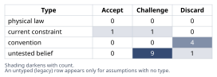
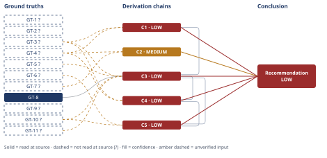

# Should This B2B SaaS Company Add a Free Tier

*First-principles analysis · 10 October 2026*

*Read with: [How to read this analysis](HOW-TO-READ.md) · [Working file](analysis-20261010T162514Z.md) · [All files](INDEX.md)*

## Executive Summary

**Recommendation:** Do not build a full, permanent free tier yet. Run a small, time-boxed, instrumented pilot — scoped so it cannot substitute for the paid $10,000 product, with a pre-committed kill/scale gate and a named signup-triage owner — to measure real conversion rate and unit cost first (chain C5).

**Band (from §6):** LOW (chain C5) — reflecting unmeasured inputs, not weak reasoning.

**Would change it:** Real pilot data on conversion rate and unit cost (chain C3), and win-loss evidence tying lost deals to competitors' free tiers (chain C2); the pilot-vs-build-vs-status-quo ranking is itself robust to how its weights are set (chain C5).

## 1. Problem Essence

**Core problem:** Given that this $2.4M-ARR, 240-customer, $10,000-ACV B2B SaaS company sells exclusively through outbound sales and referrals today, has no self-serve channel at all, has never run a freemium pilot (so free-to-paid conversion is a genuine unknown, not merely an unmeasured one), and has been told by Finance that free users consume real variable infrastructure/support cost — should it build a permanently-free product tier, and if the honest answer is contingent rather than binary, what is the cheapest way to resolve that contingency before committing capital to a full build?

**Success criteria:**
1. Names the specific causal mechanism(s) through which a free tier would have to create value for this company — not "competitors have one."
2. Produces an explicit, numeric breakeven calculation (required conversion rate / volume) anchored to the stated $10,000 ACV and the stated cost structure.
3. Names the organizational prerequisites this company currently lacks (per its outbound-only GTM) and what building them implies.
4. Treats cannibalization, sales-motion confusion, support-cost blowout, and pricing-anchor effects as explicit, quantified-where-possible risks — not hand-waved asides.
5. States a confidence level calibrated honestly to the stated unknowns (no internal conversion data, no self-serve infrastructure, unknown free-tier unit cost) rather than forcing false certainty.
6. Considers whether an option other than "build a full free tier" or "do nothing" — e.g., a scoped, instrumented pilot — outperforms the binary framing, rather than being forced to pick exactly one of "add it" / "don't add it."

## 2. Assumptions Table



| Assumption | Type | Treatment | Verdict | Verification |
|------------|------|-----------|---------|--------------|
| A-1: "All competitors have a free tier, therefore we should add one too" (parity-as-reason) | convention | Explicitly challenge — ask what causal mechanism parity would have to operate through here before treating it as a reason | Discard — the bare parity claim names no mechanism by which it affects this company's revenue; it is not itself a reason (see chain C2) until grounded in a specific, testable buyer-behavior claim | unverified — flagged; no win-loss data cited showing deals lost to a competitor's free tier |
| A-2: A free tier's purpose is self-evidently the same thing every company that has one uses it for (demand-gen/PLG top-of-funnel) | untested belief | Decompose into the distinct candidate mechanisms before building: demand-gen top-of-funnel, underserved-segment market coverage, evaluation-stage table stakes, brand/word-of-mouth | Challenge — decomposed into four distinct, non-equivalent candidate mechanisms; none independently verified for this company | unverified — flagged |
| A-3: This product can deliver real, self-perceived value to an unassisted self-serve user with no sales-rep touch | untested belief (load-bearing) | Verify via product activation data before relying on it | Challenge — no self-serve activation data exists for this product; treated as unverified and load-bearing for conversion quality (see chain C1) | unverified — flagged; the single most consequential unverified input in this analysis |
| A-4: A meaningful population of prospects exists who want the product but genuinely cannot or will not pay ~$10,000/year (a real underserved segment, not just current-ICP-minus-budget) | untested belief | Verify via market sizing / lead-source analysis | Challenge — no data given on addressable long-tail demand | unverified — flagged |
| A-5: Today's $10,000-ACV buyers' purchase decisions are actually influenced by whether a self-serve trial/free tier exists at evaluation stage | untested belief | Verify via win-loss interviews / sales team input | Challenge — plausible but unconfirmed; team-procurement deals at this ACV often move through security/compliance review regardless of a competitor's free tier, which would make parity irrelevant to actual win rate | unverified — flagged |
| A-6: Building a free tier is mainly a product/engineering feature-gating task | convention | Challenge directly against GT-4? | Discard — contradicted by GT-4? (no self-serve channel exists at all); the real requirement set also includes self-serve signup, self-serve billing/upgrade, usage metering and abuse prevention, PQL scoring/nurture, a support policy for non-paying users, and an inbound-handling adaptation of a sales org built only for outbound | unverified — flagged as an organizational gap per GT-4? |
| A-7: Free users cost the business nothing / a free tier is cost-free to run | untested belief, directly contradicted | None needed — resolved by ground truth | Discard — contradicted directly by GT-5? (Finance: costs scale with active users, not paying users) | resolved by GT-5? |
| A-8: This company's eventual free-to-paid conversion rate will resemble the general B2B SaaS freemium benchmark (median 3-5%) | untested belief (load-bearing for breakeven math) | Use the benchmark only as a reference ceiling, not an expectation, until a pilot produces this company's own figure | Challenge — the benchmarked population mostly already has self-serve motions and often lower-ACV, individual-buyer products; this company's starting position (GT-4?, high ACV) plausibly sits toward the low end of, or below, that distribution (see chain C1, C3) | unverified — flagged; GT-8 used only as an upper reference, not a point estimate |
| A-9: Adding a free tier will not cannibalize existing $10,000 deals — prospects who would have paid will still pay even with a free option available | untested belief / risk (surfaced via inversion) | Stress-test via inversion and second-order analysis | Challenge — no evidence either way; material risk given the product is team-based and divisible (a subset of a team could run on the free tier instead of the paid tier) — see chain C4 | unverified — flagged |
| A-10: A free tier, once launched, can be scaled back or shut down cheaply if it underperforms | convention (comforting assumption) | Challenge the reversibility claim directly | Discard — rejected; revoking free access generates reputational and customer-backlash cost disproportionate to the free users' economic value, making this largely a one-way door once a real free user base accumulates | unverified — flagged; informs the recommendation to pilot small rather than commit to a full build |
| A-11: "Free tier" (perpetual, no time limit) and "free trial" (time-boxed) are interchangeable solutions to the same problem | convention | Explicitly distinguish the two before using either as "the" answer | Discard — not interchangeable; a time-boxed trial preserves the sales-led motion and avoids a perpetual costed population, while a perpetual free tier creates an open-ended standing cost liability (GT-5?) and the cannibalization/anchor risks in A-9/A-13; trial-to-paid conversion also benchmarks far higher than freemium conversion (GT-9?) | unverified — flagged (GT-9?) |
| A-12: The current outbound-only sales motion will continue operating exactly as it does now, unaffected by a parallel inbound/self-serve motion | current constraint (today's org design), surfaced as a hidden premise of the "just add a free tier" framing | Record expiry conditions — holds only until a self-serve motion actually generates inbound leads/PQLs that someone must triage | Challenge — likely false in practice; a credible free tier requires either a new owner for inbound PQL triage or dedicated reps pulled off outbound, both of which change the current motion; expires the moment the first free signup needs handling | unverified — flagged |
| A-13: A free tier's existence will not put downward pressure on the $10,000 ACV in renewal/expansion negotiations (pricing-anchor risk) | untested belief / risk (surfaced via inversion) | Stress-test; mitigate via packaging/gating design if pursued | Challenge — plausible risk; a credible $0 reference point gives procurement a negotiating anchor, especially if the free tier is not clearly value-gated away from the paid product's core use case | unverified — flagged |
| A-14: The absence of a self-serve channel today (GT-4?) is a permanent structural fact about this business, not something that could change | current constraint | Record expiry conditions | Accept — expires once the company deliberately invests in self-serve signup, billing, metering, and PQL-handling infrastructure and process; until then it is a real, binding limitation on any freemium motion, not physical law | unverified — flagged (GT-4?) |
| A-15: The trade-off criteria weights used to compare status quo, full build, and a scoped pilot (cost-to-learn, downside exposure, ACV-motion preservation, competitive-response speed, org readiness, upside capture, weighted 5/5/4/2/3/3) reflect this company's actual risk tolerance and strategic priorities | untested belief (surfaced during the end-of-phase Assumption Audit, chain C5 step 1) | State the weights explicitly before scoring, and run the flip-test so the recommendation's sensitivity to this assumption is visible rather than hidden | Challenge — the weights are this analysis's own judgment, not confirmed with the company's actual decision-makers; the flip-test (chain C5) shows the ranking is nonetheless robust to any single weight moving within its 1-5 range | unverified — flagged |
| A-16: Competitors are willing and able to respond strategically — by investing further in their own self-serve motion, or by citing tenure in competitive deals — to this company piloting a free tier | untested belief (surfaced during the end-of-phase Assumption Audit, chain C5 step 6, second-order extension) | Treat as a named second-order risk to monitor during the pilot window, not a certainty | Challenge — plausible but unconfirmed; no competitor-response data exists for this specific scenario | unverified — flagged |

## 3. Ground Truths

- **GT-1?** Current ARR is $2.4M — unverified: user-stipulated scenario fact for this analysis; no external document (billing/finance system) was available to this analysis to open and confirm it against.
- **GT-2?** 240 paying teams/customers — unverified: user-stipulated scenario fact; same limitation as GT-1?.
- **GT-3?** Average Contract Value (ACV) ≈ $10,000/team/year — unverified: user-stipulated scenario fact. Verification note: 240 × $10,000 = $2,400,000, which matches GT-1? exactly — internally consistent, no contradiction found.
- **GT-4?** Today's go-to-market is outbound sales plus referrals only; no self-serve inbound channel exists at all — unverified: user-stipulated scenario fact.
- **GT-5?** Finance has confirmed that infrastructure and support costs scale with active users, not paying users — i.e., free users carry real variable cost — unverified: attributed to "Finance" within the given scenario; no underlying cost model or finance document was available to this analysis to open and confirm.
- **GT-6?** No internal freemium pilot has ever been run; free-to-paid conversion rate is a genuine unknown, not merely an unmeasured one — unverified: user-stipulated scenario fact.
- **GT-7?** All competitors in this space currently have a free tier; this company does not — unverified: user-stipulated scenario fact.
- **GT-8** Standard-freemium B2B SaaS free-to-paid conversion benchmark: 50th percentile ("good") = 3–5%; 75th percentile ("great") = 8–12%, per ChartMogul 2026 benchmark data as reported by Userpilot — source: Userpilot, "Freemium Conversion Rate Benchmarks" section; read-at-source: fetched https://userpilot.com/blog/saas-average-conversion-rate directly and located both percentage figures verbatim in the page's "Freemium Conversion Rate Benchmarks" section. This is a benchmark across the general freemium-SaaS population, most of which already has a self-serve motion built in by design — its applicability to this specific company is a separate, unverified question (see A-8, chain C1).
- **GT-9?** Free-trial-to-paid conversion (a time-boxed model, distinct from a perpetual free tier) runs materially higher than freemium conversion in B2B SaaS generally — reported-by-delegate: supplied by this analysis's web-search synthesis (not independently re-opened and quote-checked at a specific source the way GT-8 was); used only as color distinguishing "free trial" from "free tier" (A-11), not as a load-bearing input to the breakeven chain (C3).
- **GT-10?** Free-tier incremental infrastructure + support cost per active free account has no verified, company-specific figure; this analysis assumes an illustrative bracket of $50–$500 per active free account per year for a team-collaboration B2B SaaS product — unverified: Phase 3 failure record — this analysis searched for and opened a secondary source (getmonetizely.com) citing specific figures ("15–25% of infrastructure budget," "30–40% of support tickets," attributed respectively to an unlinked "Andreessen Horowitz 2022 analysis" and "Zendesk studies"); those primary sources were never independently opened by this analysis, the citing article reads as promotional/SEO content, and the figures are judged too unreliable to use as evidence — so this analysis deliberately uses an explicitly-assumed illustrative bracket instead of laundering an unverifiable secondary citation as fact (see Abandoned Reasoning, §5).
- **GT-11?** Typical SaaS gross margin on incremental recognized revenue ≈ 70–80% — unverified: standard working assumption for this analysis; not independently sourced in this session (not read — turn budget).

**Provenance summary:**
```text
?-marked: GT-1, GT-2, GT-3, GT-4, GT-5, GT-6, GT-7, GT-9, GT-10, GT-11 (10 of 11)
Read-at-source: GT-8 — Userpilot, "Freemium Conversion Rate Benchmarks" section (https://userpilot.com/blog/saas-average-conversion-rate), figures "3-5%" (50th percentile) and "8-12%" (75th percentile) located verbatim in the fetched page text.
```

## 4. Derivation Chains



### Conclusion C1: This company's plausible free-to-paid conversion rate cannot be assumed to resemble the general freemium benchmark — it starts from a structurally weaker self-serve activation base than most benchmarked products

GT-4? (no self-serve channel exists today) + GT-3? (ACV ≈ $10,000/team/year)
→ a $10,000-ACV, team-based sale today is activated through sales-rep-led onboarding, which a free tier by definition removes
→ removing sales-rep-led onboarding from a product whose activation has never been tested without it is an unverified bet on self-serve activation, not a proven one *[Assumes: A-3]*
→ therefore this company's free-to-paid conversion cannot be assumed to track the general freemium benchmark population, most of which was built for self-serve activation from the start

**Confidence:** LOW — two axes are short at once. Inputs: GT-4? and GT-3? are both unverified (verification: confirm both against the company's actual CRM/finance records rather than the stipulated scenario figures). Rivals: a live, unsettled rival — "this product may in fact be simple enough for self-serve activation despite having no track record" — is not ruled out anywhere in this analysis; resolving it is precisely what the pilot recommended in chain C5 is for. Separately, hop 2 rests on *[Assumes: A-3]*, and A-3 failing (self-serve activation turns out to work fine) would directly weaken this conclusion rather than leave it unaffected, so Inference is not a clean axis either — it is not the deciding factor here only because the first two axes already set the band.

---

### Conclusion C2: Competitive parity is not a free-standing reason to build a free tier — it is a reason only once a specific, evidence-backed mechanism is confirmed, and none is confirmed today

GT-7? (all competitors have a free tier) + GT-4? (no self-serve channel exists today)
→ "everyone else has one" only matters commercially if enterprise buyers' purchase decisions are actually gated by self-serve trial availability at evaluation time *[Assumes: A-5]*
→ this company's $10,000 deals flow entirely through outbound sales and referrals today, with no evidence in hand of any deal lost because a competitor offered self-serve access
→ whichever specific mechanism parity might operate through — evaluation-stage gating or earlier top-of-funnel brand and discovery effects — capturing it still requires building the same self-serve capability this company currently lacks, so identifying the exact mechanism does not change the action it implies
→ therefore parity with competitors is not, by itself, a validated justification for building a free tier — it becomes one only once win-loss evidence ties lost deals, or lost top-of-funnel reach, to the absence of self-serve access

**Confidence:** MEDIUM — exactly one axis is short. Inputs: GT-7? and GT-4? are both unverified (verification: pull actual win-loss/CRM data tying specific lost deals to a competitor's free-tier availability). Inference is not short: the *[Assumes: A-5]* premise on hop 1 is priced — if A-5 is false (buyers are not actually gated by free-tier availability at evaluation), this chain's conclusion is unaffected or strengthened, since parity would then matter even less as a standalone reason. Rivals is not short: the live alternative ("parity matters for brand/top-of-funnel reasons, independent of evaluation-gating") is addressed on hop 3 and settled in the Abandoned Reasoning entry "Parity-for-brand as an independent justification" below — either version of the mechanism implies the same required action, so the rival does not change this chain's endpoint.

---

### Conclusion C3: A free tier's unit economics are highly sensitive to two inputs this company has not measured, and the plausible range spans from solidly profitable to a clear loss depending on where those two land

GT-3? (ACV ≈ $10,000/team/year) + GT-5? (free users carry real variable cost) + GT-8 (freemium conversion benchmark: 3–5% median, 8–12% great) + GT-10? (assumed free-tier unit cost $50–$500/account/year) + GT-11? (assumed ~70–80% gross margin) + C1 (conversion starts from a weak activation base)
→ the breakeven conversion rate for a free tier is a fixed ratio — cost to serve one free account divided by net revenue from one converted account — not a matter of judgment once those two inputs are fixed
→ at the assumed low end of free-tier unit cost (about $50/account/year) against a roughly $7,500 net-contribution converted account (10,000 times a 75% margin), breakeven requires only about 0.7% conversion
→ at the assumed high end of free-tier unit cost (about $500/account/year), breakeven requires about 6.7% conversion — above the general freemium median of 3–5% and reachable only at "great"-tier performance of 8–12%
→ this company's plausible conversion rate sits toward the low end of that general distribution rather than the "great" tier the high-cost scenario would require, so the two unmeasured inputs point in opposite directions for how risky this bet actually is *[Assumes: A-8]*
→ at the illustrative worst case of 0.1% conversion, revenue per free account is about $7.50/year against a $50–$500 cost — a clear loss at every point in the assumed cost range — while at the illustrative best case of 5% conversion, matching the benchmark's "good" tier, revenue is about $375/account — profitable only if unit cost sits at the low end of the assumed range

**Confidence:** LOW — capped by C1 (LOW), which this chain cites on its head: a chain is rated no higher than the lowest-rated chain its head cites. Independently, Inputs is also short on its own terms: GT-3?, GT-5?, GT-10?, and GT-11? are all unverified (verification: pull actual CRM/finance figures for GT-3?/GT-5?, and instrument a real pilot to replace the GT-10?/GT-11? assumptions with measured figures rather than assumed ones). Hop 4 rests on *[Assumes: A-8]* — if A-8 is false and this company converts at or above the general median despite lacking a self-serve history, the "clear loss" scenario in the final hop becomes correspondingly less likely. This sensitivity is genuinely unsettled, which is exactly why the recommendation (chain C5) is to measure it directly rather than assume either direction.

---

### Conclusion C4: Cannibalization, pricing-anchor erosion, and sales-motion dilution are real costs a breakeven-conversion calculation alone does not capture, and a full launch is close to irreversible once made

GT-3? (ACV ≈ $10,000/team/year) + GT-4? (no self-serve channel exists today) + C3 (unit economics highly sensitive, LOW)
→ a free tier large enough to generate meaningful conversion volume is also large enough to be used internally by teams that today would have paid $10,000/year, redirecting some fraction of future paid demand into the free pool rather than adding net-new paying volume *[Assumes: A-9]*
→ a credible, permanent $0 price point gives procurement a reference point to negotiate the $10,000 figure down at renewal or expansion, even for accounts that never use the free tier themselves *[Assumes: A-13]*
→ servicing inbound signups from a free tier requires someone to triage and nurture them into paying accounts, and no such function exists in a sales org built only for outbound, so either outbound capacity is diverted or inbound leads go unconverted regardless of C3's breakeven math *[Assumes: A-12]*
→ because reversing a live free tier carries reputational and customer-backlash cost disproportionate to the free users' economic value, these three risks compound over a horizon where the decision is effectively one-way rather than a reversible experiment *[Assumes: A-10]*

**Confidence:** LOW — capped by C3 (LOW) cited on its head, and independently short on two further axes: Inputs (GT-3?, GT-4? unverified — verification: actual CRM/finance figures) and Inference (all four hops rest on unpriced premises — A-9, A-13, A-12, A-10 — none of whose failure case this analysis has priced; each needs its own evidence: a measured cannibalization rate, a measured renewal-price movement, an actual staffing/ownership decision, and a real wind-down attempt, respectively). Rivals: a live, unsettled rival — "cannibalization and anchor risk can be designed away by scoping the free tier narrowly enough that it never substitutes for the paid product" — is not ruled out here; it is the design principle the recommendation in C5 relies on, not a settled fact.

---

### Conclusion C5: The recommended course of action is a small, time-boxed, instrumented pilot — with a pre-committed kill/scale decision gate — designed specifically to measure free-to-paid conversion and free-tier unit cost, before any decision on a full freemium build

GT-6? (conversion rate is a genuine unknown) + GT-10? (free-tier unit cost is unmeasured) + C3 (unit economics highly sensitive, LOW) + C4 (second-order risk material and largely irreversible, LOW)
→ weighing cost-to-learn, downside exposure, preservation of the existing $10,000 motion, speed of competitive response, organizational readiness, and upside capture if latent demand is real — weights 5/5/4/2/3/3 — across three options (status quo, a full freemium build now, a scoped instrumented pilot) the pilot scores highest at 86 against the full build's 48 and the status quo's 70, driven by its unmatched cost-to-learn score and bounded downside exposure *[Assumes: A-15]*
→ this ranking is robust: no single criterion's weight, moved anywhere in its 1–5 range, flips the pilot below either alternative; the closest case — cost-to-learn moved to its floor of 1 — only ties the pilot with the status quo, it does not surpass it
→ therefore a scoped, instrumented pilot, not a full freemium build and not inaction, is the dominant choice given that both load-bearing unknowns — conversion rate and unit cost — are currently unmeasured rather than merely estimated
→[2nd] sales reps, today compensated on outbound-sourced $10,000 deals, will not spontaneously own triaging inbound pilot signups — leaving that unassigned confounds the very measurement the pilot exists to produce
→[2nd] immediately after launch the pilot requires no change to the core outbound motion; after two to three quarters, real conversion-rate and cost figures become available, replacing GT-6? and GT-10? with measured facts
→[3rd] competitors who already have a free tier (GT-7?) may respond to this company's pilot by investing further in their own self-serve motion or citing tenure in competitive deals, meaning first-mover standing in self-serve has already been ceded regardless of this pilot's outcome *[Assumes: A-16]*
→[3rd] once the pilot has run long enough to be taken for granted, around a year, the organization either has built real self-serve capability or has let the pilot decay into an unmanaged free population nobody owns, repeating C4's cost-blowout risk with real users instead of hypothetical ones

No step in this extension contradicts a named ground truth; each is consistent with GT-4? (no self-serve capability exists today, so someone must build and own even the small-scale pilot version) and GT-7? (competitors already have a head start). Checked against the decision's own purpose of resolving the two unknowns cheaply before committing capital, the final time-lens step above is itself a way the pilot could defeat that purpose if it runs without a hard decision gate — this is carried into the adversarial pass's disposition below rather than left as a bare observation.

**Confidence:** LOW — capped by C3 and C4 (both LOW) cited on its head, and independently by GT-6? and GT-10? being unverified (verification: the pilot itself is the proposed verification path — it exists specifically to convert these two inputs from assumed to measured). This LOW rating describes the predictive inputs the choice rests on, not the robustness of the choice among the three options given those inputs: the flip-test in hop 2 shows the ranking itself is stable across the full plausible weighting range. What is genuinely uncertain is how severe the downside turns out to be in practice — precisely what the recommended pilot is designed to resolve. Two further premises sit on this chain's own hops: *[Assumes: A-15]* (the trade-off weights) is priced on hop 2 — the flip-test shows no single weight move within its 1-5 range overturns the ranking, so A-15 failing does not change this chain's endpoint; *[Assumes: A-16]* (competitor response during the pilot window) is not priced — if competitors respond unusually aggressively, the competitive-response-speed criterion's relative standing could shift, though the flip-test's margin on that criterion (weight 2, the lowest of the six) makes it an unlikely single cause of a reversal on its own; no dedicated verification path beyond monitoring competitor behavior during the pilot exists for A-16 today.

## 5. Abandoned Reasoning

### Dead End: Treating a free tier's purpose as self-evidently "demand generation" without decomposing it

**What was tried:** Early framing assumed, as a starting point, that a free tier's job is simply to generate more paying customers (the generic PLG/demand-gen story), and proceeded to reason about volume and conversion from there.

**Why abandoned:** This begs the question (A-2). "Demand generation," "underserved-segment market coverage," "evaluation-stage competitive table stakes," and "brand/top-of-funnel discovery" are four distinct, non-equivalent mechanisms with different success metrics, different required infrastructure, and different failure modes. Treating them as one undifferentiated thing produces a plan that cannot be judged to have succeeded or failed against any specific criterion.

**What it ruled out:** A single-purpose, single-metric framing of the decision. The analysis instead carries all four candidate mechanisms forward explicitly (A-2) and tests the two most load-bearing ones directly (A-5 in chain C2, A-3/A-4 in chain C1), rather than picking one by default.

### Dead End: Parity-for-brand as an independent justification, distinct from evaluation-stage gating

**What was tried:** Considered whether "competitors having a free tier helps their top-of-funnel brand/discovery, independent of whether buyers use it to evaluate before purchasing" should be treated as a separate rival conclusion to chain C2, requiring its own separate justification and evidence path.

**Why abandoned:** Tracing the two mechanisms side by side (chain C2, hop 3) shows they imply the identical next action: this company would still need to build the same self-serve capability (GT-4?) to capture either the evaluation-stage effect or the brand/discovery effect, and would still need the same win-loss or market evidence to confirm either is actually operating. Distinguishing them in more detail does not change what this company should do next.

**What it ruled out:** Treating "which exact mechanism explains competitor parity" as a question this analysis needs to resolve before acting. It does not change chain C2's conclusion, so it was not pursued as a separate line of reasoning.

### Dead End: Using the general freemium benchmark (GT-8) as this company's expected conversion rate, rather than as a reference ceiling

**What was tried:** An early pass used the 3–5% "good" benchmark from GT-8 directly as the expected conversion rate for this company's breakeven math in chain C3.

**Why abandoned:** Chain C1 establishes that this company's self-serve activation path is untested and structurally weaker than that of the benchmarked population, most of which already has a working self-serve motion. Using the benchmark as a point estimate would have presented an untested, favorable assumption as if it were this company's expected outcome.

**What it ruled out:** Point-estimating this company's conversion rate at all. GT-8 is used only as an upper reference bracket in chain C3, with the honest conclusion being a wide plausible range rather than a single number.

### Dead End: Treating a live free tier as a cheap, easily-reversible experiment

**What was tried:** Considered modeling "launch a full free tier, and simply shut it down if the data looks bad after a quarter" as a lower-risk variant of the full-build option, on the theory that any bad outcome could be cheaply undone.

**Why abandoned:** A-10 — withdrawing free access from a live user base imposes reputational and customer-backlash costs disproportionate to those users' economic value; this is a documented pattern in freemium product management, not a hypothetical. Modeling the full build as reversible would have understated its downside-exposure score in the trade-off (chain C5) and inflated its attractiveness relative to a genuinely small pilot.

**What it ruled out:** Scoring "full build now, with an exit option" as a fourth, lower-risk option in the trade-off. It collapses into the same downside-exposure profile as "full build now" once the one-way-door property of A-10 is taken seriously.

### Dead End: Using the getmonetizely.com-sourced "15–25% of infrastructure budget" and "30–40% of support tickets" figures as verified inputs for free-tier unit cost

**What was tried:** A search for free-tier unit-cost benchmarks surfaced a vendor blog citing an unlinked "Andreessen Horowitz 2022 analysis" (15–25% of infrastructure budget spent on free users) and "Zendesk studies" (30–40% of support tickets from free users). An early draft considered using these as the basis for GT-10?.

**Why abandoned:** Neither primary source was independently located or opened by this analysis; the citing article reads as promotional content with the structural pattern of unverifiable secondary-source laundering (specific-sounding numbers attributed to named organizations with no link or reference the reader can check). Using them as ground truth would have dressed an assumption up as a verified fact.

**What it ruled out:** Presenting a false-precision cost figure. GT-10? instead carries an explicitly assumed $50–$500/account/year bracket with a Phase 3 failure record naming exactly why the stronger-looking sources were rejected.

## 6. Conclusion

**Recommended approach:** Do not build a full, permanent free tier right now. Instead, run a small, time-boxed, instrumented pilot — narrowly scoped so it cannot substitute for the paid $10,000 product — with a pre-committed kill/scale decision gate and a named owner for triaging any inbound signups it produces, specifically to measure this company's actual free-to-paid conversion rate and free-tier unit cost before committing to a full build (chain C5).

**Key insight:** The two numbers that would actually decide this question — free-to-paid conversion rate and free-tier unit cost — are both unmeasured, and the plausible range on each points in opposite directions: low assumed cost makes even weak conversion profitable, while realistic cost for a real team-collaboration product makes breakeven require performance at or above the general industry median, a bar this company's no-self-serve-history starting position (chain C1) gives no reason to expect it will clear (chain C3). "Competitors already have one" does not resolve this — it is not itself a mechanism, only a fact that becomes relevant once a specific buyer-behavior claim about evaluation-stage gating is confirmed, which it is not today (chain C2).

**Trade-offs acknowledged:** A pilot delays full competitive parity and delays any upside from latent underserved demand relative to launching broadly today (chain C5); it also still carries non-zero cannibalization and sales-motion-dilution exposure relative to pure inaction, because true zero-risk scoping may not be achievable (chain C4). Running it well also requires this company to build a small amount of the self-serve/PQL-handling capability it does not have today (chain C1) — the true size of that organizational cost is itself unpriced in this analysis, no chain — flagged assumption only.

**Confidence:** LOW — the recommendation rests most directly on C5 (LOW), which is itself capped by C3 (LOW) and C4 (LOW); C1 (LOW) and C2 (MEDIUM) inform the supporting argument against both "parity alone justifies a build" and "the benchmark conversion rate can be assumed." This LOW rating is calibrated, not a weakness in the reasoning: it reflects that the two numbers the whole decision turns on — free-to-paid conversion rate and free-tier unit cost — are genuinely unmeasured (GT-6?, GT-10?) rather than merely unestimated, exactly as stated at the outset. What a LOW-confidence recommendation can still say with this much structure behind it is which specific action reduces that uncertainty fastest and cheapest — a scoped, instrumented pilot — and that the ranking of pilot vs. full build vs. status quo is itself robust to how the trade-off weights are set (chain C5, hop 2). The band would move to MEDIUM once a pilot produces this company's own conversion-rate and unit-cost figures in place of GT-6? and GT-10?, and the weakest-link chains (C3, C4) are two further avenues of verification named directly in those chains' confidence lines.
