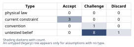
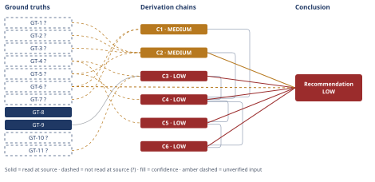

# Should this B2B SaaS Company Add a Free Tier?

*First-principles analysis · 10 October 2026*

*Read with: [How to read this analysis](HOW-TO-READ.md) · [Working file](analysis-20261010T183616Z.md) · [All files](INDEX.md)*

## Executive Summary

**Recommendation:** Run a scoped, time-boxed, capped-cost freemium pilot alongside the unchanged outbound/referral motion — gated on tiered support, lead-routing/comp protocol, a hard budget ceiling, and a minimum-sample go/no-go rule — rather than a full freemium launch or doing nothing (chain C6).

**Band (from §6):** LOW.

**Would change it:** The pilot's own instrumented data on signup buyer-profile and free-to-paid conversion (chain C3) — the unmeasured fraction of free signups who are genuine economic buyers is the one input that would move this band toward MEDIUM/HIGH (chain C4).

## 1. Problem Essence

**Core problem:** Given a $2.4M-ARR, 240-team, ~$10,000-ACV B2B SaaS company whose acquisition today is 100% outbound-sales-and-referral with no self-serve channel, and whose free-to-paid conversion economics are entirely unmeasured, which acquisition/product-strategy move — a full free tier, an alternative (trial/demo), or a bounded hybrid — most cost-effectively grows paid ARR without degrading the existing sales motion, the support cost structure, or the brand position?

**Success criteria:**
1. The recommendation names a specific acquisition/product-strategy option (free tier, an alternative, or a hybrid) and traces it to a derivation chain in section 4 — not to competitor comparison alone.
2. The recommendation explicitly addresses whether the direct infra+support cost (that scales with active, not paying, users) can be justified at an estimated or bracketed conversion rate/volume, given that the actual free-to-paid conversion rate is unknown.
3. The recommendation explicitly addresses compatibility with the existing 100%-outbound-and-referral motion — whether the chosen option creates channel conflict, sales-motion dilution, or support-SLA risk for the paying base.
4. At least one viable composite/hybrid option — not only the extremes of "add a standard free tier" vs. "don't" — is evaluated on equal footing with the pure options in the trade-off analysis, so the answer is not artificially constrained to exactly one of the originally-named choices.
5. The recommendation states an explicit confidence band and names the specific evidence or experiment that would move that band.

## 2. Assumptions Table



| Assumption | Type | Treatment | Verdict | Verification |
|------------|------|-----------|---------|--------------|
| Competitors all having a free tier justifies this company adding one | convention | Explicitly challenge before use | Challenge — parity is observed (GT-7?) but no evidence links competitors' free tiers to their own growth or to this company's specific deal losses; the 5-whys trace (chain C1) finds the proposal's root driver is competitive-parity anxiety, not a diagnosed internal symptom | unverified — flagged; would require win/loss data citing free-tier absence as a loss reason, not available in this analysis |
| A free tier will generate inbound/self-serve leads the current outbound-only motion doesn't reach | untested belief | Verify, or flag as unverified | Challenge — GT-6? confirms no pilot has tested this, and GT-4? establishes zero existing inbound motion to build on, so this benefit is not a free byproduct of adding a tier | unverified — flagged; resolved only by the pilot's minimum-sample-size go/no-go gate (chain C2, chain C6) |
| Finance's active-user cost-scaling model (GT-5?) is accurate and complete | current constraint | Record expiry conditions | Accept — accepted for this analysis as given; expires if infra is re-architected onto a near-zero-marginal-cost tier for free usage, which is not true today per Finance | unverified — flagged; GT-5? not independently opened by this analysis |
| This $10K-ACV product's core team value can be meaningfully previewed by a single self-serve user without the team/integration context that justifies the price | untested belief (load-bearing) | Verify, or flag as unverified | Challenge — nothing in the given facts confirms or denies this; it is the single highest-leverage unknown in the analysis (chain C3) | unverified — flagged; the recommended pilot should instrument whether free signups ever reach multi-seat/team usage patterns |
| Free-tier signups will include a non-trivial share of real economic buyers with $10K/year budget authority | untested belief (load-bearing) | Verify, or flag as unverified | Challenge — directionally challenged by GT-11?'s buyer-mismatch pattern; GT-9's sub-$25K PLG-viable band does not resolve it either way | unverified — flagged; capture job title/team size at signup during the pilot and compare against past closed-won profiles |
| Lead-routing and sales comp can be redesigned so outbound reps don't ignore free-tier-sourced leads | current constraint | Record expiry conditions | Accept — expires once a documented routing/comp protocol is adopted; until then this constraint holds and is treated as a pre-launch gate, not a caveat | unverified — flagged; addressed as a must-have knockout in the trade-off (chain C4) and pre-mortem Cluster A |
| Support can absorb free-tier ticket volume without degrading paying-customer SLA | current constraint | Record expiry conditions | Accept — expires once a tiered support model (self-serve docs/community/bot for free; dedicated queue for paying) is built; until then treated as a must-have knockout, not a caveat | unverified — flagged; pre-mortem Cluster B names this as the one must-have that cannot be compromised |
| A free tier, once launched with real users on it, is cheap and easy to shut down later if it doesn't work | untested belief (default optimism) | Explicitly challenge before use | Discard — rejected as a default assumption; a perpetual free tier creates an installed base whose withdrawal generates visible backlash (pre-mortem Cluster C), which is why a capped, time-boxed pilot scores far above a permanent free tier on reversibility (chain C4) | unverified — flagged; not used as true in any chain |
| The lack of a self-serve channel today (GT-4?) reflects a strategic choice rather than a hard product requirement | untested belief | Verify, or flag as unverified | Challenge — genuinely unknown from the given facts whether the $10K/team value requires human-assisted onboarding or whether outbound-only is simply inertia; this ambiguity is the root uncertainty chain C3 turns on | unverified — flagged; the recommended pilot's instrumentation is designed to surface this |
| Direct infra cost per active free user is roughly $2-$15/year | untested belief (illustrative estimate) | Verify, or flag as unverified | Challenge — no company-specific infra-cost-per-tenant figure was supplied; used only as an illustrative bracket in the breakeven estimate (chain C2) | unverified — flagged; would require actual cloud cost-per-tenant data from Engineering/Finance |
| Support cost per active free user is roughly $0.75-$6/year (5-15% ticket rate x $15-$40 loaded ticket cost) | untested belief (illustrative estimate) | Verify, or flag as unverified | Challenge — illustrative only; no comparable free-cohort ticket-rate data exists for this company | unverified — flagged; would require actual support-ticket-rate and loaded-cost data |
| Year-1 free-tier signup volume would fall in the 500-5,000 range | untested belief (illustrative estimate) | Verify, or flag as unverified | Challenge — depends entirely on whatever distribution/demand-gen motion is paired with the tier, which is itself undetermined | unverified — flagged; the recommended pilot should set a minimum-sample-size go/no-go gate rather than assume a volume |
| Sales compensation plans reward deals by source (outbound/referral) rather than being source-agnostic, so reps lack inherent incentive to nurture free-tier-sourced leads absent a redesign | untested belief | Verify, or flag as unverified | Challenge — a reasonable inference from GT-4? (100% outbound/referral to date implies comp has at least implicitly rewarded that motion), but comp-plan mechanics specifically are not given | unverified — flagged; feeds pre-mortem Cluster A and the trade-off's sales-motion-compatibility criterion (chain C4, chain C5) |

## 3. Ground Truths

- **GT-1?** Annual recurring revenue is approximately $2.4M — unverified: stipulated by the requester as a scenario premise with no source system (billing/finance ledger) cited or opened by this analysis.
- **GT-2?** There are 240 paying teams — unverified: stipulated by the requester; no source system cited or opened.
- **GT-3?** Average annual contract value is approximately $10,000/team/year — unverified: stipulated by the requester; no source system cited or opened. Internally consistent with GT-1? and GT-2? (2,400,000 / 240 = 10,000 exactly), which is a corroborating arithmetic check, not independent source verification.
- **GT-4?** Customer acquisition today is 100% outbound sales plus referral; no self-serve inbound channel exists — unverified: stipulated by the requester; no source system (CRM/attribution data) cited or opened.
- **GT-5?** Free-tier infrastructure and support costs scale with active users, not paying users, per Finance — reported-by-delegate: a named internal source ("Finance") supplied this figure; Finance's underlying cost model was not independently opened by this analysis.
- **GT-6?** No freemium pilot has ever been run; the free-to-paid conversion rate for this company is unknown — unverified: stipulated by the requester as an explicit known-unknown, not a claim requiring a source.
- **GT-7?** All named competitors have a free tier — unverified: stipulated by the requester; no specific competitors or source named or opened.
- **GT-8** Freemium (no-trial) B2B SaaS models convert roughly 2.6% of organic traffic and 2.8% of paid traffic to paid; free-trial (opt-in, no credit card) models convert roughly 17.4%-18.2%; median B2B SaaS trial-to-paid conversion is roughly 18.5%; top-quartile performance is 35%-45% — source: Flint, "B2B SaaS Free Trial Conversion Rate Statistics" (https://www.flint.com/blog/b2b-saas-free-trial-conversion-rate-statistics); read-at-source: figures located and quoted directly from the fetched page body via WebFetch on 2026-10-10.
- **GT-9** Self-serve/product-led-growth motions, including free tiers, are generally viable for ACV typically under roughly $25,000; above that, sales-led motion with dedicated sales personnel generally dominates — source: GetMonetizely, "PLG vs Sales-Led: Which Go-to-Market Strategy Fits Your SaaS?" (https://www.getmonetizely.com/articles/plg-vs-sales-led-which-go-to-market-strategy-fits-your-saas); read-at-source: the "$25,000" threshold located and quoted directly from the fetched page body via WebFetch on 2026-10-10.
- **GT-10?** B2B SaaS freemium models average roughly 9% conversion overall; trials using product-qualified-lead (PQL) scoring convert roughly 3x higher (~25%); products in the $1K-$5K ACV range reach 30%-39% — cited to: Userpilot, "B2B SaaS Funnel Conversion Benchmarks" (https://userpilot.com/blog/?p=113413); reported-by-delegate: figure supplied by a web-search results summary; a direct WebFetch attempt on the cited URL on 2026-10-10 returned Phase 3 failure record: unreachable — HTTP 404 Not Found.
- **GT-11?** Sales-led motion typically targets ACV above roughly $50,000 with 20%-30% close rates over 1-6 month cycles; product-led growth typically serves ACV under roughly $10,000 with CAC of $50-$500 and day/week-scale cycles; self-serve adopters (e.g., individual users such as developers) are frequently not the economic buyer when the product requires integration with existing infrastructure, change management, or multi-stakeholder alignment — cited to: multiple sources synthesized in a web-search results summary (including SaaS Hero and Tom Tunguz go-to-market material); reported-by-delegate: this analysis did not independently open a single citable URL for this specific synthesis, so it is carried as reported-by-delegate rather than read-at-source.

**Provenance summary:**
```text
?-marked: GT-1, GT-2, GT-3, GT-4, GT-5, GT-6, GT-7, GT-10, GT-11 (9 of 11)
Read-at-source: GT-8 — Flint "B2B SaaS Free Trial Conversion Rate Statistics", figures quoted directly from page body ("Freemium converts just 2.6%... 2.8% from paid traffic sources"; "18.2% of organic trial users..."; "median trial-to-paid conversion sits at 18.5%")
Read-at-source: GT-9 — GetMonetizely "PLG vs Sales-Led", "typically under $25,000" quoted directly from page body
Phase 3 failure record: GT-10? — cited source https://userpilot.com/blog/?p=113413 unreachable (HTTP 404 Not Found) as of 2026-10-10
```

## 4. Derivation Chains



### Conclusion C1: Competitive parity is an insufficient standalone justification for adding a free tier

GT-7? (all named competitors have a free tier) + GT-6? (no freemium pilot run; conversion rate unknown)
→ competitor parity is an observed pattern, not a measured link to this company's own deal losses or growth trajectory *[Assumes: A-1]*
→ the 5-whys causal trace finds the proposal's root driver is unverified competitive-parity anxiety, since none of the given facts cites a diagnosed internal symptom such as rising outbound CAC, stalled growth, or deals lost specifically for lacking a free tier
→ treating a free tier as the default response to competitor parity substitutes analogy for diagnosis, so parity alone cannot carry more than minor weight in the decision

**Confidence:** MEDIUM — GT-7? is unverified (no specific competitors or source named; verification would require naming the competitors and confirming via their own pricing pages whether a free tier correlates with measurable growth, neither done here); GT-6? is unverified by definition (it asserts an absence of data) and needs no removal path, since it states a known-unknown rather than a claim requiring verification; the chain's own downgrade cause is the A-1 assumption on hop 1, which would be removed by obtaining actual win/loss data citing free-tier absence as a loss reason — not available in this analysis.

### Conclusion C2: The direct infra+support cost bar a free tier must clear to break even is low relative to published freemium benchmarks

GT-1? (ARR $2.4M) + GT-2? (240 paying teams) + GT-3? (ACV ~$10,000/team/year) + GT-5? (cost scales with active users, not paying users)
→ combining A-10 and A-11 brackets total direct cost per active free user-year at roughly $2.75-$21, central near $11.90 *[Assumes: A-10][Assumes: A-11]*
→ dividing that per-user cost bracket by GT-3?'s $10,000 ACV gives a breakeven conversion-rate bracket of roughly 0.03%-0.21%, central near 0.12% — this rate is independent of signup volume, since both the required cost and the required conversions scale linearly with it
→ multiplying the per-user cost bracket by A-12's illustrative year-1 signup-volume bracket (500-5,000) separately brackets the absolute dollar exposure at roughly $1,400-$105,000, central near $32,700, which is the figure Finance would actually budget against *[Assumes: A-12]*
→ the breakeven conversion-rate bracket (0.03%-0.21%) sits far below the ~2.6%-2.8% real-world freemium conversion rate read at source in GT-8, so the direct-cost bar is low regardless of exactly how many people sign up

**Confidence:** MEDIUM — GT-1?, GT-2?, GT-3? and GT-5? are all unverified (stipulated scenario figures with no source system cited; verification would mean pulling ARR, customer count and ACV from the billing system and the cost model from Finance directly, not done in this analysis); A-10, A-11 and A-12 are explicitly illustrative Fermi brackets rather than company data; the conclusion is a directional finding (the breakeven bar is low) that is robust to where exactly each bracket lands within its stated range — the bracket's lower and upper ends (0.03%-0.21% needed vs. 2.6%+ observed in GT-8) both support the same directional reading, which is why this chain is not rated LOW despite the unverified/illustrative inputs. This would rise toward HIGH with real infra and support unit-cost data from Finance and Engineering.

### Conclusion C3: The real binding constraint on freemium payoff for this company is buyer-reach/ICP fit, not direct infra cost, and that constraint's magnitude is unmeasured

GT-4? (100% outbound/referral acquisition today) + GT-9 (self-serve/PLG motions generally viable under ~$25,000 ACV) + GT-11? (self-serve adopters frequently are not the economic buyer in multi-stakeholder, integration-heavy purchases)
→ this company's $10,000 ACV sits inside the generally PLG-viable band described in GT-9, so ACV level alone does not rule out a free tier
→ the buyer-mismatch pattern in GT-11? shows ACV alone is insufficient, since a per-team purchase requiring multi-stakeholder rollout or integration work often means the self-serve signer is not the actual $10,000 budget holder *[Assumes: A-5]*
→ outbound/referral motion has, to date, been required to reach the real economic buyer per GT-4?, with zero evidence yet on whether a self-serve channel could reach that same buyer *[Assumes: A-9]*
→ the governing structural constraint is therefore that conversion cannot exceed the fraction of free signups who are genuine economic buyers, and that fraction has never been measured for this company's ICP

**Confidence:** LOW — GT-4? and GT-11? are both unverified (GT-4? is a stipulated scenario fact with no source system cited; GT-11? is reported-by-delegate, a search-summary synthesis never opened at a single citable URL), and the Rivals axis is also short: an equally plausible rival reading — that this "per-team" product is simply a team-pricing wrapper around an individually-adoptable tool, putting the real economic-buyer fraction much closer to GT-8's generic benchmarks — is live and nothing in the given facts rules it out (see Abandoned Reasoning, Dead End 4). Both axes being short is why this chain is LOW rather than MEDIUM; this would rise once the recommended pilot's own instrumentation (job-title/team-size capture, assumption A-5) produces at least one cycle of real data.

### Conclusion C4: A scoped, time-boxed, capped-cost freemium pilot — gated on pre-launch fixes — dominates both a full freemium launch and doing nothing

C1 (MEDIUM) + C2 (MEDIUM) + C3 (LOW) + GT-5? (cost scales with active users)
→ removing competitive parity as sufficient justification, per the finding in C1, rules out launching a full, permanent free tier on parity grounds alone
→ the low direct-cost breakeven bar found in C2 removes "it's too expensive to even try" as a valid objection to experimentation
→ the buyer-reach/ICP-fit uncertainty established in C3 shows the true binding unknown can only be resolved by a real, instrumented test, not by analogy to competitors or to generic industry benchmarks
→ scoring five viable options (status quo, a time-boxed free trial, a guided demo, a permanent freemium-lite tier, and a composite scoped pilot) against seven weighted criteria — ARR impact, cost exposure, learning value, sales-motion compatibility, support-load risk, competitive positioning, and reversibility, with weights locked before scoring — ranks the composite scoped pilot highest at 110 of 135 weighted points, ahead of the free trial (101) and guided demo (100), with status quo (91) and a permanent freemium-lite tier (77) lowest
→ the flip test finds no single criterion's weight can move within the normal 1-5 scale to reverse this ranking, so the result is robust rather than a near-tie

**Confidence:** LOW — capped by C3 (LOW) per the lowest-rated-chain-cited rule; GT-5? is unverified (reported-by-delegate equivalent; Finance's underlying cost model not independently opened by this analysis) and would be removed as a cause by Finance providing the underlying active-user cost data directly to this analysis; C3's own LOW rating (buyer-reach fraction unmeasured) is the dominant cause of this chain's band and is not re-explained here per D-07 (see C3's own confidence line); the trade-off's flip-test robustness is real but cannot lift this chain above the ceiling C3 sets.

### Conclusion C5: Even a well-designed pilot carries second-order risks to the existing outbound motion and support SLA that must be actively managed, not assumed away

C4 (LOW) + GT-4? (100% outbound acquisition today)
→ outbound reps' compensation today plausibly rewards deals by source rather than being source-agnostic, so without an explicit routing/comp change they have no inherent incentive to nurture free-tier-sourced leads *[Assumes: A-13]*
→[2nd] existing prospects already in an active outbound sales cycle could use a newly available free tier as a reason to stall or de-scope an impending purchase, diluting near-term pipeline that today represents all of this company's revenue
→[2nd] in the immediate term the pilot is a net cost with little realized ARR, since the freemium conversion benchmarks read at source in GT-8 show meaningful conversion materializing over months rather than weeks
→[3rd] absent a pre-committed kill/scale gate, sunk-cost pressure and the optics of "removing a free tier" make an underperforming pilot likely to be extended past its intended window rather than closed on schedule

**Confidence:** LOW — capped by C4 (LOW); GT-4? is unverified (stipulated, no source system cited) and would be removed as a cause by confirming the current acquisition mix and comp-plan mechanics directly against CRM and comp-plan documents, not done here; the chain's own downgrade cause is the A-13 assumption on hop 1 (comp rewards by source), which would be removed by reviewing the actual sales comp plan.

### Conclusion C6: Run a scoped, time-boxed, capped-cost freemium pilot gated on four pre-launch fixes — not a full freemium launch, and not inaction

C4 (LOW) + C5 (LOW)
→ the trade-off result and the second-order risk picture together point to only one configuration that addresses competitive-parity pressure without jeopardizing the $2.4M paying base: a scoped, instrumented, capped-cost, time-boxed pilot carrying the pre-launch gates identified in the pre-mortem
→ a full, permanent, uncapped free-tier launch is rejected because it commits to an irreversible cost and brand position before the single largest unknown — buyer-reach/ICP fit — is resolved
→ doing nothing is rejected because it forecloses the one low-direct-cost way to convert the unknown conversion rate into a real, decision-useful number

**Confidence:** LOW — capped by C4 and C5 (both LOW); GT-6? is unverified by definition (it states an absence of data rather than a claim needing a removal path) and is named here because the conclusion rests on it directly — the recommended pilot (this chain's own conclusion) is precisely the action that would resolve it; the dominant cause of this LOW band is C3's unmeasured buyer-reach fraction (not re-explained here per D-07; see C3's own confidence line); this LOW band is itself part of the recommendation's content, since it is precisely why a bounded pilot rather than a full bet is the right-sized next action.

## 5. Abandoned Reasoning

### Dead End: Launch a standard freemium tier to match competitors

**What was tried:** Considered following GT-7?'s competitive pattern directly — adopt a standard, uncapped freemium tier because every named competitor has one.

**Why abandoned:** C1 shows this rests on unverified competitive mimicry rather than a diagnosed internal growth problem (assumption A-1, Challenged); the trade-off in C4 additionally scores a permanent freemium-lite tier lowest of all viable options (77/135) because of poor reversibility (assumption A-8, Discarded) and weak correlation to the real $10K team product's value.

**What it ruled out:** Any recommendation that treats "competitors have it" as sufficient justification on its own, without first testing buyer-reach/ICP fit.

### Dead End: Launch a full, permanent, uncapped free tier now, company-wide

**What was tried:** Considered a full-scale freemium launch sized to immediately compete on feature-comparison parity.

**Why abandoned:** It fails the must-have knockout criteria applied before scoring in the Phase 4 trade-off — no bounded cost ceiling, no fast falsifiable signal, and direct exposure to GT-5?'s active-user-driven cost scaling before the buyer-reach unknown (C3) is resolved.

**What it ruled out:** Any version of the recommendation that skips a bounded pilot stage.

### Dead End: Compute a single precise numeric conversion-rate ceiling

**What was tried:** Attempted to derive one exact theoretical-limit percentage for this company's achievable freemium conversion rate, analogous to a physical-constant-style bound.

**Why abandoned:** No company-specific data exists on the fraction of self-serve signups who are real economic buyers (assumption A-5, Challenged); manufacturing a precise number here would be false precision rather than a derived bound, so C3 states a directional/structural constraint (conversion cannot exceed the economic-buyer fraction) instead of a fabricated figure.

**What it ruled out:** Presenting any single-number "conversion ceiling" as more than illustrative; the bracket in C2 and the structural bound in C3 are the deliverable instead.

### Dead End: $10K ACV is comfortably inside the generic PLG-viable band, so buyer-reach risk is not a real concern

**What was tried:** Considered resting on GT-9 alone (self-serve/PLG motions generally viable under ~$25K ACV) to conclude buyer-reach risk is minor for this company.

**Why abandoned:** GT-11?'s buyer-mismatch pattern (self-serve adopters are frequently not the economic buyer in multi-stakeholder, integration-heavy purchases) is an equally live rival explanation that the given facts cannot adjudicate between; resting on GT-9 alone would be reasoning by benchmark-analogy rather than verifying this company's own ICP.

**What it ruled out:** Treating C3 as anything stronger than LOW confidence; this rival is precisely why C3 — and everything that cites it (C4, C5, C6) — carries a LOW band rather than MEDIUM.

## 6. Conclusion

**Recommended approach:** Run a scoped, time-boxed (one- to two-quarter), capped-cost freemium pilot alongside the unchanged outbound/referral motion, gated on four pre-launch fixes: a tiered support model built before any signup is allowed, a documented lead-routing/comp protocol for free-tier-sourced leads, a pre-committed hard budget ceiling with a named decision-owner, and a minimum-signup-sample go/no-go criterion decided in advance — not a full, permanent freemium launch and not inaction (chain C6).

**Key insight:** The decision is not actually cost-constrained — the direct infra+support breakeven bar is far below realistic freemium conversion benchmarks (chain C2) — it is buyer-reach/ICP-fit-constrained: no data exists on whether a self-serve signup for a $10,000/year team product ever reaches the real economic buyer, and that unmeasured fraction, not competitor parity or raw cost, is the actual binding constraint (chain C3).

**Trade-offs acknowledged:** This path deliberately forgoes the fast "competitive parity" story a full freemium launch would buy — competitive positioning was weighted lowest of all seven trade-off criteria and the winning option scores worst on exactly that axis (chain C4) — and it accepts real near-term execution risk to the existing outbound motion and support SLA (stalled deals, orphaned leads, support-ticket contagion) if the four pre-launch gates are skipped (chain C5).

**Confidence:** LOW — the contributing chains C2 (MEDIUM), C3 (LOW), C4 (LOW), C5 (LOW) and C6 (LOW) are each rated below HIGH, with their own confidence lines carrying the explanation; GT-6? (free-to-paid conversion rate unknown) is the one `GT-N?` this Conclusion rests on directly, and it needs no separate removal path beyond the recommendation itself — the recommended pilot (chain C6) is precisely the action that would resolve it. The dominant cause of this LOW band is C3's unmeasured buyer-reach fraction (not re-explained here per D-07; see C3's own confidence line). The qualitative ranking behind this recommendation (pilot over full launch over inaction) is comparatively robust on its own terms — the trade-off's flip test found no single criterion weight within the normal 1-5 scale that reverses it (chain C4) — but that internal robustness does not lift the overall band, since the band tracks the weakest contributing chain.
