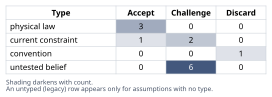
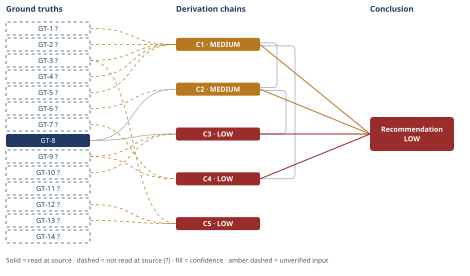

# Wind Turbine HSS Bearing Failure Root-Cause Analysis

*First-principles analysis · 10 October 2026*

*Read with: [How to read this analysis](HOW-TO-READ.md) · [Working file](analysis-20261010T163748Z.md) · [All files](INDEX.md)*

## Executive Summary

**Recommendation:** Reject the operator's lubricant-viscosity/boundary-lubrication wear-through hypothesis as the primary cause (chain C1); the verified failure mode is WEC-driven subsurface fatigue ("axial cracking"), documented industry-wide for this bearing class and position (chain C2). Electrical bearing current is the leading but unconfirmed driver (chain C3); the cold-snap is at most a secondary contributor (chain C4). Do not authorize a same-spec replacement without the diagnostic package first (chain C1).

**Band (from §6):** LOW

**Would change it:** Independent re-examination of the retained metallographic sections, SEM inspection for EDM/frosting/fluting signatures, converter/shaft-grounding current measurements, and a SCADA pull for transient-load and lubricant-temperature history (chain C1, chain C3, chain C4).

## 1. Problem Essence

**Core problem:** What is the verified root cause — grounded in the subsurface morphology and microstructure of the failed inner race, not in the operator's default explanation — of the premature (≈10% of L10 design life) generator-end HSS gearbox bearing failure, and what must a replacement/repair specification correct to prevent recurrence?

**Success criteria:**
1. Every physical finding (axial spall location/length, 0.4 mm subsurface origin depth, crescent microcrack morphology, white-etching cracks, butterfly microstructure) is classified by what rolling-contact-fatigue (RCF) / bearing-failure mechanism it is diagnostic of, before any hypothesis is accepted or rejected.
2. The operator's lubricant-viscosity / boundary-lubrication-wear-through hypothesis is explicitly tested, hop by hop, against each physical finding — not accepted as the default explanation because it is plausible or convenient.
3. At least one competing root-cause mechanism for the documented failure mode (electrical bearing current, transient-load/sliding, tribochemical/hydrogen effect, non-metallic-inclusion-initiated fatigue) is carried through its own derivation chain with its own named evidence and confidence band, not merely asserted.
4. A single verified root-cause conclusion is stated with an explicit confidence band (HIGH/MEDIUM/LOW) and the specific corroborating tests that would raise or lower that band.
5. The replacement/repair recommendation names what the specification must address beyond "same bearing, same lubricant, close the ticket" if the root cause is not primarily lubricant-driven, and names the concrete recurrence risk of accepting the operator's hypothesis without that work.

## 2. Assumptions Table

| Assumption | Type | Treatment | Verdict | Verification |
|------------|------|-----------|---------|--------------|
| A-1: For classical Hertzian line (cylindrical) contact, the maximum subsurface orthogonal shear stress occurs at depth z0 ≈ 0.7–0.8×b beneath the surface (b = contact semi-width). | physical law | Accept as a ground-truth candidate | Accept — well-established contact-mechanics/rolling-bearing-fatigue result (Hertz / Lundberg–Palmgren), promoted to GT-13? | unverified — flagged (exact multiplier not re-derived from a primary text opened this session) |
| A-2: Boundary-lubrication wear (asperity contact under insufficient EHL film: adhesive wear, abrasive wear, scuffing/smearing) is, by definition, a surface-initiated material-removal mechanism that propagates from the contact surface inward, mechanistically distinct from subsurface crack-nucleation fatigue. | physical law | Accept as a ground-truth candidate | Accept — standard tribological/metallurgical classification, promoted to GT-2? | unverified — flagged (ASM Handbook Vol. 18 / ISO 15243:2017 not opened this session) |
| A-3: White-etching cracks (WECs) and the associated butterfly microstructure are a recognized, reproducible, distinct rolling-contact-fatigue failure mode in bearing steels — not a measurement artifact and not a renaming of ordinary adhesive wear. | physical law | Accept as a ground-truth candidate | Accept — corroborated across independent literature threads (NREL/GE/SKF/Flender program; Imperial College/Chalmers research abstracts) located by search | GT-8 (read-at-source) + GT-14? (unverified) jointly support |
| A-4: This turbine's generator is connected through a power-electronic converter (partial- or full-converter architecture, standard for 1.5 MW-class machines), a documented source of common-mode voltage capable of driving circulating/discharge bearing currents absent effective shaft grounding or bearing insulation. | current constraint | Record expiry conditions | Challenge — architecturally plausible for this turbine class but not confirmed for this specific unit; expires once converter type, shaft-grounding-brush condition, and HSS shaft-voltage measurements are obtained for this unit and show negligible common-mode exposure at the HSS stage | unverified — flagged (no electrical/grounding inspection data furnished) |
| A-5: The gearbox experienced transient grid-loss, braking events, torque reversals, or roller-slip episodes during the 14,000-hour service window. | untested belief | Verify via SCADA event logs / torque-speed transient records | Challenge — plausible given GT-9?'s "bearing slip under heavy loads" mechanism, but no turbine-specific SCADA record furnished | unverified — flagged |
| A-6: Non-metallic inclusions (e.g., MnS) are present in this specific bearing's steel at a density/location consistent with known WEC-inclusion associations. | untested belief | Verify via SEM-EDS at the crack-origin site | Challenge — plausible per GT-12? but entirely unconfirmed for this specific bearing lot | unverified — flagged |
| A-7: The cold-snap drove a sustained drop in lubricant viscosity sufficient to push the HSS bearing's EHL contact into boundary/mixed lubrication (λ<1) for a period long enough to matter. | untested belief | Verify via SCADA lube-temperature/ambient-temperature trend and λ-ratio back-calculation for the cold-snap window | Challenge — this is the load-bearing premise of the operator's own hypothesis and is entirely unevidenced in the case record (no oil-temperature trend, viscosity grade, or heater-status log furnished) | unverified — flagged |
| A-8: Boundary-lubrication wear, by itself, is sufficient to explain the full observed failure signature (CM kurtosis step-change, 18 mm axial spall, 0.4 mm subsurface crescent cracks, WEC, butterflies) without invoking any subsurface fatigue/electrical/tribochemical mechanism. | convention | Explicitly challenge against the morphological evidence | Discard — directly contradicted by GT-2?, GT-3?, GT-4?, GT-5? (chain C1): a surface-wear mechanism does not produce a subsurface-origin, crescent-shaped, white-etching, butterfly-bearing crack network | contradicted by GT-2?, GT-3?, GT-4?, GT-5? (chain C1) |
| A-9: The absence of reported EDM-like craters, frosting, or fluting on the raceway can be read as evidence against the electrical-bearing-current hypothesis. | untested belief | Verify via dedicated SEM inspection of the full raceway (not just the spall) for EDM craters/frosting/fluting pitch pattern | Challenge — absence-of-reporting is not the same as absence-of-feature; the furnished summary may simply not have looked for it — this is an evidentiary gap, not a finding either way | unverified — flagged |
| A-10: The step-change in HSS vibration kurtosis at 14,000 h is a valid condition-monitoring indicator of a real, developing subsurface spall, not a sensor/mounting artifact. | current constraint | Accept provisionally; record expiry | Accept — expires once cross-validated by envelope-spectrum/order analysis; in any case superseded by the disassembly finding of an actual 18 mm spall, which physically confirms a real defect regardless of what first triggered the alarm | GT-1? (physical confirmation at teardown) |
| A-11: As the generator-end HSS bearing, this component sits electrically closer to the converter-coupled generator shaft in the drivetrain's current path than, e.g., a planetary-stage bearing, increasing its relative exposure to common-mode/circulating current not fully diverted by shaft-grounding provisions. | current constraint | Record expiry conditions | Challenge — directionally sound circuit-topology reasoning (shorter conductive path, fewer intervening insulating elements) but not confirmed for this unit's specific coupling/grounding hardware; expires once grounding-brush location and bearing-insulation status are inspected | unverified — flagged |
| A-12: The Winergy 4410.4 / SKF cylindrical-roller-bearing configuration studied in the NREL/GE/Flender/SKF Flatirons program (GT-8) is reasonably representative of this operator's own 1.5 MW HSS generator-end bearing. | untested belief | Verify by confirming the actual OEM/model of the failed unit's gearbox and bearing against the studied configuration | Challenge — plausible given both are 1.5 MW-class HSS cylindrical roller bearings (a narrow, common design space) but not confirmed for this unit | unverified — flagged |
| A-13: This unit's actual HSS bearing bore/contact geometry falls within a generic 1.5 MW-class catalog bracket (bore ~90–120 mm, Hertzian contact semi-width b ~0.15–0.35 mm under steady rated load), rather than being computed from this bearing's specific OEM datasheet and load spectrum. | untested belief | Verify via OEM bearing datasheet plus actual load-spectrum calculation | Challenge — used only for an order-of-magnitude sanity check (chain C5), not a precise discriminating measurement | unverified — flagged |

## 3. Ground Truths

- **GT-1?** Spalling on the inner race is axially aligned (~18 mm long, parallel to the shaft/roller axis), not circumferential. — unverified: this is the operator/field disassembly report's own characterization; no named investigator, lab, or micrograph identifier was furnished, and no chain-of-custody source was opened by this analysis.
- **GT-2?** Boundary-lubrication wear (asperity contact under insufficient EHL film — adhesive wear, abrasive wear, scuffing/smearing) is, by definition, a surface-initiated material-removal mechanism that propagates from the contact surface inward; it is mechanistically distinct from subsurface crack-nucleation fatigue. — cited to: ASM Handbook Vol. 18 (*Friction, Lubrication, and Wear Technology*); ISO 15243:2017 (rolling-bearing damage/failure terminology) — unverified: neither reference was opened this session; this is carried as established domain classification.
- **GT-3?** The crescent-shaped microcracks originate at a subsurface point approximately 0.4 mm below the raceway surface. — unverified: case-stipulated disassembly/metallurgical finding; no chain-of-custody source opened.
- **GT-4?** Metallographic sections show white-etching cracks (WECs) and an associated butterfly microstructure. — unverified: case-stipulated finding; no micrograph was furnished for independent inspection and no chain-of-custody source opened.
- **GT-5?** The metallographic sections examined were taken through the spall itself, so the WEC/butterfly findings are directly associated with the active spalling event rather than being an incidental finding elsewhere on the raceway. — unverified: case-stipulated ("Metallographic sections through the spall show..."); no chain-of-custody source opened. Load-bearing for ruling out the "coincidental pre-existing microstructure" rival (§5).
- **GT-6?** Time to failure ≈14,000 operating hours against an L10 design-basis of ≈130,000 hours, i.e., failure at roughly 10.8% of design life. — unverified: case-stipulated figures; no CM/SCADA log opened by this analysis. Recomputed: 14,000 / 130,000 = 10.77%, consistent with the stated "roughly 10%" characterization (see Recompute, adversarial pass record).
- **GT-7?** A cold-snap occurred during the service period that the operator associates with the onset of failure; the actual lubricant-temperature trend, λ-ratio, and duration during that period are not furnished. — unverified: cold-snap occurrence is asserted by the operator; its severity, duration, and actual effect on the EHL film are not evidenced in the case record.
- **GT-8** A Winergy/Flender 4410.4 gearbox with SKF-instrumented cylindrical roller bearings supporting the high-speed shaft was installed in a GE 1.5 MW wind turbine at the NREL Flatirons Campus (Dec. 2017), under a multi-year NREL/GE/Flender/SKF collaboration (Oct. 2017–Oct. 2023) that instruments "bearing temperatures, lubricant temperature and water content, air temperature and humidity, and stray electrical current across the bearings" on the gearbox's intermediate- and high-speed-stage bearings, because axial cracking/white-etching cracks "primarily affect the intermediate and high-speed-stage bearings." — source: U.S. DOE/NREL, OSTI record 1430825, *"Gearbox Instrumentation for the Investigation of Bearing Axial Cracking"*; read-at-source: osti.gov/biblio/1430825, abstract/record summary text, quoted directly (the full technical paper PDF was not retrieved — nrel.gov was unreachable, DNS failure, from this session).
- **GT-9?** Per a DOE/Argonne National Laboratory program (reported via a science-journalism summary), the mechanisms named as contributing to axial-crack/WEC failure in wind-turbine gearbox bearings are: (a) "bearing slip under heavy loads" (rolling/sliding contact), (b) "the presence of electrical current across the bearing surface," and (c) "certain chemical additives in the lubricant" — not low viscosity/boundary-lubrication wear-through; the source also states gearboxes are "designed to do this important work for 20 years or more, but often...must be repaired or even completely replaced several years earlier." — cited to: techxplore.com summary of a DOE/Argonne press release; read-at-source: techxplore.com/news/2020-11-drivetrain-reliability-collaborative-gearbox-failure.amp, quoted directly — flagged `?` because this is a secondary science-journalism account of the underlying DOE/Argonne technical program, not the primary paper.
- **GT-10?** Converter/VFD-driven common-mode voltage and (separately) electrostatic-discharge charging are documented sources of circulating/discharge current through rotating-machine bearings; once the induced electric field exceeds the dielectric withstand strength of the lubricant film, "an electric discharge will occur," and such currents prematurely age the lubricant and damage the races. — source: *Wind Energy Science* (wes.copernicus.org/articles/8/1809/2023); read-at-source: article text quoted directly — flagged `?` because the article's own scope is the turbine's main-shaft bearing, not the gearbox HSS bearing; the general electrical-discharge-damage mechanism is read at source, its direct applicability to the HSS position is not.
- **GT-11?** Electrical-current damage to rotating-machine bearings characteristically produces "frosting" (grey matte discoloration from many microscopic fusion/EDM pits), "fluting" (a regular washboard/picket-fence pitting pattern), and discrete EDM-type craters in the raceway — a surface-pitting signature, not a subsurface fatigue-crack signature. — source: EST/Aegis bearing-protection technical page; read-at-source: est-aegis.com/bearing-protection/shaft-voltage-and-bearing-currents, quoted directly — flagged `?` because the commonly-cited crater size (~5–10 µm) was found only in a broader search synthesis, not confirmed in the directly-fetched page text.
- **GT-12?** Non-metallic inclusions (commonly MnS) have been documented as subsurface initiation sites for white-etching-crack networks in wind-turbine-gearbox bearing steel, with WEC-associated subsurface cracks reported at depths "up to 630 µm" from the raceway surface in laboratory/field metallurgical studies. — cited to: University of Sheffield / White Rose eprints repository (eprints.whiterose.ac.uk/87875) — reported-by-delegate: the underlying PDF could not be parsed by this session's fetch tool. **Phase 3 failure record:** source opened (eprints.whiterose.ac.uk/87875/1/WRRO_87875.pdf) but content was binary/FlateDecode-compressed and not text-extractable by the fetch tool used — `citation does not support the claim` could not be ruled in or out; treated as unverified.
- **GT-13?** For classical Hertzian line (cylindrical) contact, the maximum subsurface orthogonal shear stress occurs at depth z0 ≈ 0.7–0.8×b beneath the surface (b = contact semi-width), versus ≈0.47×a for circular/point contact — a standard result of Hertz contact theory as applied in rolling-bearing fatigue analysis (Lundberg–Palmgren). — cited to: classical contact-mechanics / rolling-bearing-analysis literature (e.g., Harris, *Rolling Bearing Analysis*); partially corroborated via amesweb.info's Hertzian-contact-stress calculator page (confirms "depth of maximum shear stress" is a standard computed parameter) and a broader search synthesis giving the 0.786 line-contact multiplier — the exact multiplier was not independently re-derived or confirmed from a primary text opened this session — unverified.
- **GT-14?** There is no single accepted root cause of white-etching cracks in bearing steel in the materials-science/tribology literature; candidate mechanisms under active, unresolved investigation include non-metallic-inclusion decohesion, hydrogen embrittlement via tribochemical reaction, electrical-current damage, and severe transient loading/sliding. — cited to: Imperial College London / Chalmers University research abstracts located by search (*"A study into the origins and significance of white etching cracks in bearing steels"*; *"Influence of MnS inclusion characteristics on generation of white etching cracks in 100Cr6 bearing steel"*) — titles/abstracts located by search only, not opened — unverified (reported-by-delegate).

**Provenance summary:** `?`-marked: GT-1, GT-2, GT-3, GT-4, GT-5, GT-6, GT-7, GT-9, GT-10, GT-11, GT-12, GT-13, GT-14 (13 of 14). Read-at-source: GT-8 — osti.gov/biblio/1430825, abstract/record-summary paragraph (instrumented-variables sentence and the "primarily affect the intermediate and high-speed-stage bearings" sentence), both quoted verbatim above; GT-8 feeds load-bearing chains C2 (MEDIUM) and C3 (LOW) — no HIGH-confidence chain exists in this analysis, so the HIGH-feeding naming requirement is vacuously satisfied.

## 4. Derivation Chains

### Conclusion C1: The physical evidence rules out boundary-lubrication wear-through as the primary failure mechanism

GT-1? (18 mm axial spall) + GT-2? (wear mechanics: surface-initiated, not subsurface) + GT-3? (0.4 mm subsurface crack origin) + GT-4? (WEC + butterfly microstructure) + GT-5? (sections cut through the spall)
→ insufficient-EHL-film (boundary-lubrication) wear is, by definition, a surface-initiated material-removal mechanism that propagates outward from the contact surface
→ the crescent microcracks and the white-etching/butterfly microstructure instead originate at a point roughly 0.4 mm below the raceway surface
→ that origin location and morphology is the diagnostic signature of a subsurface fatigue-type mechanism, not of surface wear
→ the sections examined were cut through the active spall itself, so this subsurface finding is directly associated with the failure that produced the 18 mm axial spall, not a coincidental, unrelated feature
→ a mechanism that is definitionally surface-initiated cannot be the origin of a crack network that is definitionally subsurface-initiated and directly tied to the active spall
→ the operator's lubricant-viscosity/boundary-lubrication wear-through hypothesis is not supported by the physical evidence as the primary failure mechanism and should be rejected in that role
→[2nd] if this rejection is accepted, O&M must authorize a diagnostic package (EDM/SEM inspection, SCADA pull, electrical measurement, independent re-metallurgy) before closing the work order, rather than a same-spec replacement — actor lens: reliability engineers and the OEM warranty desk now face a cost/schedule trade-off they would not face under the operator's original hypothesis
→[2nd] conversely, if the rejection is not accepted and a same-spec bearing/lubricant replacement is installed on the assumption of a one-off cold-snap, no electrical, load-transient, or metallurgical corrective action is taken — actor lens: whoever owns the fleet-wide reliability program is not notified that a WEC-prone bearing/converter architecture may be present on sister units
→[3rd] time lens, near term: an uncorrected driver (electrical current, transient load, or inclusion susceptibility) continues acting on the replacement bearing exactly as it did on the original, so recurrence at a similarly short fraction of L10 life is the expected outcome, not bad luck
→[3rd] time lens, fleet horizon: because GT-8 shows this is an industry-wide, instrumented concern for this exact bearing class and position, uncritical acceptance at one site delays fleet-wide investigation on sister turbines sharing the same gearbox/converter architecture, compounding cumulative O&M cost and unplanned-downtime exposure well beyond the cost of the diagnostics recommended in §6

**Confidence:** MEDIUM — GT-1?, GT-3?, GT-4?, GT-5? are the case's own stipulated disassembly/metallurgical findings, not independently verified by this analysis (no named investigator, lab-report ID, or micrograph was opened); the verification that would remove them as a cause of this downgrade is an independent re-examination of the retained metallographic sections and disassembly photographs by a second lab, confirming chain of custody. GT-2? is a standard tribological definition not read at source this session; verification: open ASM Handbook Vol. 18 / ISO 15243:2017 directly. No live rival defeats this chain's narrow claim (that wear-through is not the primary mechanism): the only credible rival — that the WEC/butterfly features are a coincidental, pre-existing condition unrelated to the active spall — is ruled out by GT-5? and recorded in §5 ("Coincidental-microstructure rival"). The chain's logical structure is robust to modest measurement imprecision: it depends only on the reported findings being qualitatively accurate, not on their exact values.

### Conclusion C2: The documented failure mode is WEC-driven premature subsurface fatigue ("axial cracking"), a recognized, industry-wide phenomenon specific to this bearing class and position — not an isolated, climate-triggered event

GT-6? (≈10.8% of L10 life) + GT-8 (NREL/GE/Flender/SKF HSS axial-cracking investigation) + C1 (MEDIUM)
→ the exact turbine class, gearbox stage, and bearing type in this case match the subject of a dedicated, multi-year DOE/NREL/GE/Flender/SKF field investigation whose stated purpose is understanding axial-cracking/white-etching-crack failures that primarily affect intermediate- and high-speed-stage bearings *[Assumes: A-12]*
→ that program instruments stray electrical current across exactly this bearing position alongside bearing/lubricant temperature and ambient conditions, showing the industry already treats this bearing population as WEC-prone for reasons going well beyond one site's lubricant handling
→ this failure's roughly 10.8 percent life fraction matches the broader finding that such gearboxes, designed for 20-plus years, are often repaired or replaced several years earlier
→ a known, documented pattern for this exact failure mode is therefore a more parsimonious explanation than an ad hoc, site-specific one
→ combined with the prior rejection of wear-through as the primary mechanism, this failure is an instance of the documented WEC/axial-cracking phenomenon affecting HSS-stage bearings in this turbine class, independent of and prior to any assumption about lubricant viscosity

**Confidence:** MEDIUM — GT-6? (the 14,000 h / ≈10.8% life-fraction figure) is case-stipulated and not independently confirmed against the CM system or SCADA log; verification: pull the raw operating-hours and CM alarm-history record. C1 is cited at MEDIUM and caps this chain at MEDIUM per the lowest-rated-cited-chain rule; C1's own confidence line carries its explanation and is not repeated here. The *[Assumes: A-12]* premise (that this unit's gearbox/bearing OEM and model are comparable to the Winergy/SKF studied configuration) is priced: if the OEM/model differs materially, GT-8's direct corroboration weakens, but GT-9?'s broader claim — that WEC/axial-cracking is a known, non-climate-specific phenomenon across the wind-turbine-HSS-bearing population generally — still supports this chain's conclusion at reduced but non-zero strength, so the conclusion is weakened, not withdrawn, if A-12 fails. The strongest rival — that this is an unrelated, one-off inclusion-driven subsurface spall with no WEC/electrical component at all — is addressed in C3/§5, since it concerns which driver produced the WEC, not whether WEC/axial-cracking is the documented failure mode.

### Conclusion C3: Within the WEC/axial-cracking family, electrical bearing current is a leading, position-consistent candidate driver, but is not established to the exclusion of transient-load/sliding or tribochemical/inclusion mechanisms

C2 (MEDIUM) + GT-8 (stray electrical current instrumented at this bearing position) + GT-9? (slip, electrical current, lubricant chemistry named as contributing factors) + GT-10? (converter/VFD common-mode voltage and ESD drive bearing electrical-discharge damage)
→ as the generator-end HSS bearing, this component sits electrically closest to the converter-coupled generator shaft in the drivetrain's current-return path *[Assumes: A-11]*
→ the primary research program's own choice to instrument stray electrical current across exactly this bearing position corroborates that position argument independently of this analysis's own circuit-topology reasoning
→ three contributing mechanisms are named in the literature for axial cracking/WEC — slip/sliding, electrical current, and lubricant chemistry — with no case-specific inspection or measurement available to rank them for this unit
→ electrical bearing current is therefore a leading, mechanistically plausible candidate driver given this bearing's position, but it remains one of several live candidates rather than a confirmed, exclusive cause

**Confidence:** LOW — two axes are short at once. Inputs: GT-9? and GT-10? are unverified/secondary-source inputs (verification: open the primary DOE/Argonne technical report directly, and obtain this unit's actual converter type and shaft-grounding-brush condition), and this chain is in any case capped at its cited C2's MEDIUM band. Rivals: transient-load/sliding and non-metallic-inclusion-initiated WEC remain live, un-eliminated alternative drivers within the WEC family — nothing in the case evidence settles between the three; what would settle it: SEM inspection of the full raceway for EDM craters/frosting/fluting (confirms or weakens the electrical-current driver), a SCADA torque-transient/grid-loss event log (confirms or weakens the slip driver), and SEM-EDS inclusion analysis at the crack origin (confirms or weakens the inclusion driver). The *[Assumes: A-11]* premise on the first hop is priced: if this unit's grounding-brush placement instead diverts current upstream of this bearing, the position argument weakens, but GT-8's independent corroboration and the two other candidate drivers are unaffected, so this chain's conclusion (electrical current leading-but-unconfirmed, not sole) is unchanged either way.

### Conclusion C4: Lubricant-film / cold-snap conditions are credible only as a secondary, accelerating input layered on a pre-existing WEC-susceptible condition — not as an independently sufficient primary cause

GT-7? (cold-snap reported, severity/duration unevidenced) + C1 (MEDIUM) + GT-9? (lubricant chemistry/additives named as a contributing factor)
→ a transient reduction in EHL film thickness during a cold-snap would increase asperity-level traction and local micro-slip at the roller-raceway contact *[Assumes: A-7]*
→ that would not, by itself, necessarily reach the sustained, severe boundary-lubrication condition needed to wear through a hardened raceway
→ increased traction and local flash temperature are instead among the tribochemical pathways the literature proposes as promoting or accelerating WEC nucleation at a pre-existing susceptible site
→ the dominant, directly-observed damage mode has already been established as subsurface WEC/butterfly fatigue rather than surface wear, so any lubricant-film effect here contributes to that fatigue process rather than competing with it as a separate wear mechanism
→ the cold-snap/lubricant-film event is therefore plausible only as a secondary, accelerating input onto a pre-existing subsurface-fatigue-susceptible condition, and is not independently sufficient to produce the observed subsurface WEC/butterfly/crescent-crack signature

**Confidence:** LOW — Inputs: GT-7? and GT-9? are both unverified/secondary (verification: SCADA lube-and-ambient-temperature trend and λ-ratio back-calculation for GT-7?; the primary DOE/Argonne technical report for GT-9?), and the chain is capped at C1's MEDIUM regardless. Inference: the first hop rests on an *[Assumes: A-7]* premise that is itself the operator's own unverified claim — it is priced on the hop: if no viscosity drop in fact occurred, this chain's premise is withdrawn entirely, not merely weakened, and the lubricant-as-contributing-factor conclusion does not survive. Two axes short (Inputs and Inference) drive the LOW band.

### Conclusion C5: The 0.4 mm subsurface origin depth is quantitatively more consistent with a transient-load-enlarged classical-RCF or WEC-type subsurface mechanism than with any surface-originated wear mechanism

GT-3? (0.4 mm observed origin depth) + GT-13? (Hertzian z0≈0.78b subsurface shear-max rule) + GT-12? (WEC-associated subsurface cracks reported up to ~630 µm deep)
→ for a typical 1.5 MW-class HSS cylindrical roller bearing at steady rated load, with a catalog-scale contact semi-width b on the order of 0.15–0.35 mm, the z0≈0.78b rule brackets the classical steady-load subsurface shear-stress maximum at roughly 0.12–0.27 mm below the surface *[Assumes: A-13]*
→ the observed 0.4 mm origin depth sits beyond this steady-rated-load bracket
→ that same 0.4 mm depth sits well inside the 0–0.63 mm band reported for WEC-associated subsurface inclusion cracks in wind-turbine-gearbox bearing steel
→ a depth beyond the steady-load classical bracket is explained by a transient overload/torque-reversal event enlarging the contact width, or by WEC-specific subsurface nucleation at an inclusion/discontinuity, both of which empirically run deeper than steady-state Hertzian shear-depth alone
→ in neither reading does a surface-originated boundary-lubrication wear mechanism produce a crack origin at depth at all
→ the measured origin depth is therefore quantitatively consistent with a transient-load-enlarged classical-RCF or WEC-type subsurface mechanism, and is not quantitatively consistent with a surface wear-through mechanism

**Confidence:** LOW — all three head inputs are unverified: GT-3? (case-stipulated depth figure; verification: independent re-measurement from the retained metallographic section), GT-13? (the exact 0.786 multiplier and the assumed catalog bracket were not independently confirmed from a primary source this session; verification: compute b directly from this bearing's actual geometry and load spectrum using OEM datasheet values and SCADA torque history), GT-12? (the PDF source could not be read this session; verification: obtain a text-extractable copy or the published journal version and re-confirm the 630 µm figure). The *[Assumes: A-13]* premise on the first hop is priced: if this unit's actual contact geometry differs materially from the generic catalog bracket, the specific 0.12–0.27 mm figure shifts, but the qualitative conclusion — that WEC literature depths (0–0.63 mm) overlap with classical RCF depths and that neither classical-RCF-with-overload nor WEC is ruled out by depth alone, while surface wear is — does not depend on the precise bracket and is unchanged. The depth comparison is a bracket-level sanity check, not a precise discriminator: literature depth ranges for classical RCF and WEC overlap substantially, so this chain supports C1/C3 directionally but cannot, on its own, distinguish which specific mechanism produced the 0.4 mm origin.

## 5. Abandoned Reasoning

### Dead End: Coincidental-microstructure rival

**What was tried:** Considered whether the subsurface WEC/butterfly features are a coincidental, pre-existing, dormant microstructural condition unrelated to the active spalling event, with the active 18 mm spall instead propagated primarily by an undocumented surface-initiated boundary-lubrication wear process that the inspection summary simply did not separately characterize.

**Why abandoned:** Directly contradicted by GT-5?: the case record states the metallographic sections were taken "through the spall," meaning the WEC/butterfly findings were examined at the site of, and are directly associated with, the active spalling event — not found incidentally elsewhere on the raceway. A rival requires evidence it can stand on; here the case's own evidentiary structure forecloses it.

**What it ruled out:** This saves a future reviewer from re-litigating whether the subsurface findings and the active spall are the "same event" every time this case is revisited — they are linked by the sectioning method itself, not merely by proximity in the report.

### Dead End: CM-kurtosis-is-an-artifact rival

**What was tried:** Considered whether the step-change in HSS vibration kurtosis at 14,000 h was itself a sensor- or mounting-induced artifact rather than evidence of a real, developing subsurface defect, which would undercut the premise that condition monitoring correctly flagged a genuine fault.

**Why abandoned:** Rendered moot by the disassembly finding: regardless of what triggered the original CM alarm, teardown physically confirmed an actual 18 mm axial spall (GT-1?) with subsurface WEC/butterfly features (GT-3?, GT-4?). A real, developing defect was present at the time of removal, so the question of whether kurtosis was the ideal diagnostic channel does not change the root-cause determination — it only affects how early the defect could have been caught.

**What it ruled out:** This closes off a line of reasoning that would otherwise need re-opening every time someone asks "was the CM alarm even real" — the physical teardown evidence already answers that question independently of the vibration-analysis methodology.

### Dead End: Subsurface origin depth as a clean WEC-vs-classical-RCF discriminator

**What was tried:** Initially treated the 0.4 mm origin depth as a potential clean, stand-alone test that could by itself distinguish "ordinary" inclusion-initiated classical rolling-contact fatigue from WEC-specific subsurface nucleation — i.e., hoped a single depth number could assign the mechanism.

**Why abandoned:** GT-12?'s reported WEC-associated-crack depth band (0–630 µm) and the classical Hertzian z0 bracket for this bearing class under steady rated load (≈0.12–0.27 mm, GT-13?/A-13) overlap substantially with the observed 0.4 mm figure once transient overload is allowed to enlarge the classical bracket (chain C5). Depth alone therefore cannot cleanly separate the two subsurface mechanisms from each other — though it remains fully adequate, on its own, to separate either subsurface mechanism from a surface-originated wear-through mechanism, which produces no crack origin at depth at all.

**What it ruled out:** This prevents over-claiming a precise mechanistic discriminator from a single depth measurement; it redirects the discriminating burden onto the microstructure (white-etching, butterflies) and the axial crack orientation — both of which chain C1 and chain C2 already carry — rather than onto depth, which this dead end shows is not fit for that purpose.

## 6. Conclusion

**Recommended approach:** Reject the operator's lubricant-viscosity/boundary-lubrication wear-through hypothesis as the primary cause (chain C1); classify the verified failure mode as WEC-driven premature subsurface fatigue ("axial cracking"), a documented, industry-recognized phenomenon specific to HSS-stage bearings in this turbine class (chain C2); treat electrical bearing current as the leading, position-consistent candidate driver within that family, without excluding transient-load/sliding or inclusion-driven alternatives absent further diagnostics (chain C3); and treat the cold-snap/lubricant-film event as, at most, a secondary accelerating input rather than an independently sufficient cause (chain C4). Do not authorize a same-spec, same-lubricant replacement without first completing the diagnostic package named below.

**Key insight:** The physical evidence — a subsurface origin, crescent morphology, white-etching microstructure, and butterflies, directly tied to an axially-oriented spall — is the textbook signature of a well-documented, industry-wide wind-turbine HSS-bearing failure mode that the operator's hypothesis never engages with (chain C1); treating it as ordinary surface wear-through substitutes a convenient, climate-triggered narrative for a known subsurface material/electrical/load-fatigue phenomenon that calls for a completely different corrective-action profile (chain C2).

**Trade-offs acknowledged:** The diagnostic package recommended below (independent re-metallurgy, SEM/EDM inspection, converter-current logging, SCADA pull, hydrogen analysis) costs schedule and money relative to a same-spec swap, but chain C1's second-order extension shows that skipping it trades a bounded diagnostic cost now for an unbounded, fleet-wide recurrence risk later (chain C1).

**Confidence:** LOW — the overall recommendation rests on C3 and C4, both rated LOW, and per D-07 the Conclusion is rated no higher than its weakest contributing chain. C1 (MEDIUM) and C2 (MEDIUM) support the headline finding — reject wear-through as primary, classify as WEC/axial-cracking — at MEDIUM confidence, with named reasons and closing paths in C1's and C2's own confidence lines. C3 (LOW) and C4 (LOW) support the secondary claims — which specific driver dominates within the WEC family, and what role the lubricant played — and their own confidence lines name the closing diagnostics (SEM/EDM inspection, SCADA pull, converter-current measurement, hydrogen analysis, independent re-metallurgy). The practical recommendation — do not accept the operator's hypothesis uncritically; run the diagnostic package before finalizing a replacement spec — is itself robust even at this overall LOW band, because it follows from C1 alone (MEDIUM) and does not require resolving C3/C4 to be actionable.

### Replacement / repair specification

1. **Do not close the work order on "cold snap caused wear-through."** The physical evidence does not support that mechanism as primary (chain C1).
2. **Before finalizing a replacement bearing spec, complete this diagnostic package:**
   - Independent, chain-of-custody-verified re-examination of the retained metallographic sections (second lab) to confirm the WEC/butterfly/crescent-crack characterization (closes the GT-1?/GT-3?/GT-4?/GT-5? gap on chain C1).
   - SEM inspection of the *full* raceway (not only the spall) for EDM-type craters, frosting, or a regular fluting pitch pattern — presence strongly implicates electrical bearing current; absence weakens but does not eliminate that branch (closes the GT-9?/GT-10?/GT-11? gap on chain C3).
   - Converter/VFD common-mode-voltage and HSS shaft-to-ground voltage/current measurement (oscilloscope or Rogowski-coil based) on this unit or a sister unit of the same architecture, plus inspection of the shaft-grounding-brush condition and any bearing-insulation provisions (closes the A-4/A-11 gap on chain C3).
   - Pull SCADA records for the full 14,000-hour service window: lubricant temperature vs. ambient temperature, grid-loss/braking events, torque transients and reversals — this tests both the severity/duration of the claimed viscosity excursion (A-7, chain C4) and the transient-load/sliding hypothesis (A-5, chain C3) directly, rather than by inference.
   - SEM-EDS metallurgical/inclusion analysis at the crack origin to test the non-metallic-inclusion pathway (A-6, chain C3).
   - Hydrogen-content analysis / thermal desorption spectroscopy on material adjacent to the WEC region, to test the tribochemical/hydrogen-embrittlement pathway named in the literature (GT-14?, chain C3).
   - Independently confirm this unit's specified lubricant grade (ISO VG, viscosity index, pour point) against OEM cold-climate guidance, and confirm oil-heater/warm-up control-logic behavior — as a check on a possible lubricant-*specification* error, which is a distinct corrective action from "there was one cold snap" (chain C4; adversarial-pass Cluster D below).
3. **Specify the replacement bearing to address the corroborated driver(s), not just to match the original part number:**
   - If electrical current is corroborated: specify an electrically insulated bearing (hybrid ceramic rollers or an insulated coating) and/or an upgraded, actively-maintained shaft-grounding-brush program at the HSS/generator coupling (chain C3).
   - Regardless of outcome: confirm the lubricant grade matches OEM cold-weather guidance and that heater/warm-up control logic triggers correctly ahead of cold-weather events (chain C4).
   - Upgrade condition monitoring to cross-validate kurtosis trending with envelope-spectrum/order analysis, and add a permanent HF current/voltage monitoring channel on this bearing position, given its now-documented industry-wide risk profile (GT-8, chain C2).
   - Flag sister units sharing this gearbox/converter architecture for proactive inspection, independent of this single unit's root-cause outcome, given the fleet-wide exposure identified in chain C1's second-order extension.

**Key risk of accepting the operator's hypothesis uncritically:** recurrence at a similarly short fraction of L10 life, because the actual driver (electrical current, transient load, or inclusion/tribochemical WEC mechanism) remains unaddressed; continued warranty/liability mis-attribution; and undetected fleet-wide exposure on sister units sharing the same gearbox/converter architecture (chain C1, second-order extension).
