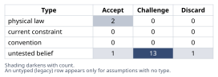
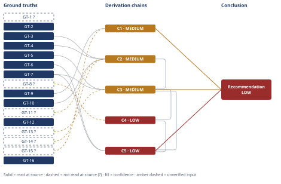

# Wind Turbine HSS Bearing Failure: WEC vs Lubricant Hypothesis

*First-principles analysis · 10 October 2026*

*Read with: [How to read this analysis](HOW-TO-READ.md) · [Working file](analysis-20261010T184456Z.md) · [All files](INDEX.md)*

## Executive Summary

**Recommendation:** Install a shaft grounding brush/conductive microfiber ring at the generator-end shaft now, specify a carburized (not through-hardened) replacement bearing element, and launch a common-mode-voltage/bearing-current field-measurement campaign to decide whether a converter-side common-mode choke is also warranted — treating a lubricant-grade review as secondary insurance, not the primary fix (chain C5).

**Band (from §6):** LOW

**Would change it:** Measuring shaft-to-frame voltage/bearing current at the HSS generator-end bearing, the single check most likely to confirm or overturn the electrical-cause finding (chain C3), and confirming the generator/converter architecture (chain C3), are what would move this band toward HIGH or overturn it.

## 1. Problem Essence

**Core problem:** Determine, from failure-mechanics and tribology evidence examined independently of the operator's narrative, which physical mechanism actually drove the HSS generator-end bearing's early failure — lubricant-viscosity-driven boundary-lubrication wear, as the operator hypothesizes, or white-etching-crack (WEC) hydrogen-assisted subsurface fatigue accelerated by converter-driven stray bearing currents — and translate that determination into a defensible replacement bearing/drivetrain specification.

**Success criteria:**
- Each evidence item (crack-origin depth, crescent/WEC morphology, butterfly microstructure, axial spall orientation and length, magnitude of life reduction) is independently classified against the mechanistic signature predicted by (a) boundary-lubrication wear and (b) WEC/hydrogen-assisted subsurface fatigue, with a recorded verdict for each.
- The operator's lubricant-viscosity hypothesis is tested by deriving what it mechanistically predicts (surface-initiated wear morphology, a different crack-origin depth/timing signature) and checking that prediction against the actual evidence, not dismissed by assertion.
- A root-cause verdict is stated with an explicit confidence band, and the specific field measurements still needed to close residual uncertainty before finalizing the replacement spec are named.
- A replacement bearing/drivetrain specification recommendation discriminates between electrical mitigations (shaft grounding brush, insulated/hybrid bearing, common-mode choke) and lubrication-based mitigations, stating what the evidence supports acting on now versus what must be confirmed first.

No criterion requires the verdict to be exactly "electrical" or exactly "lubricant" alone — a combined or contributing-factor finding is admissible if the evidence supports it.

## 2. Assumptions Table

**Technique note.** Two companion techniques were applied to populate this table. **Fishbone** (category set: Machine/Mechanical, Material, Lubrication/Chemical, Electrical, Measurement/Information, Environment) brainstormed candidate cause categories beyond the operator's single hypothesis, surfacing the rows on mechanical overload, material defect, and material heat-treatment below as untested beliefs about rival causes. **Inversion** was applied to the headline claim "the operator's lubricant-viscosity hypothesis explains the failure": inverting it to "the failure is not explained by lubricant viscosity" and enumerating failure-guaranteeing conditions surfaced the necessary preconditions that hypothesis silently depends on — these became the rows on cold-snap timing, EHL-film/breakdown-voltage, and measurement-accuracy below. Per the inversion procedure's output contract, the full inverted-claim/failure-conditions/necessary-preconditions/stress-test record is carried in these rows and in the derivation chains (§4, C1) rather than as separate headers, because this is a full composed analysis, not a focused single-technique run. Three further rows (A-15, A-16, A-17) were added by the end-of-Phase-4 Assumption Audit (§4), which surfaced them from chain steps in C3 and C5.

| Assumption | Type | Treatment | Verdict | Verification |
|------------|------|-----------|---------|--------------|
| The L10 figure (~130,000 h) was computed from load/speed/duty-cycle inputs that match this turbine's actual operating history | untested belief | Verify against SCADA load history and gearbox alignment records before treating L10 as the correct baseline | Challenge — unverified whether actual mechanical loading (gust loading, misalignment, torque transients) matched design assumptions; if actual loads exceeded design inputs, part of the life reduction could be mechanical-overload-driven rather than purely electrical | unverified — flagged; field check named in §6 |
| A ~9× life reduction (to ≈11% of L10) is far outside what normal weakest-link statistical scatter would produce, even given that L10 is itself a 10th-percentile figure | physical law (statistical theory of Weibull-distributed fatigue life underlying the L10 definition) | Accept as a ground-truth candidate | Accept — survives challenge; GT-10 confirms L10 is already a 10th-percentile figure, so a population already selected for 10% early failures falling to 11% of that figure again is a compounding, not a single, deviation | source: GT-10 (read-at-source) |
| Hertzian contact theory's maximum-orthogonal-shear-stress depth (~0.3–0.5× contact semi-width) governs where classical subsurface-inclusion fatigue nucleates | physical law | Accept as a ground-truth candidate | Accept — standard contact-mechanics result | source: GT-1 (reported-by-delegate, flagged) |
| Butterfly microstructures by themselves prove electrical-current involvement | untested belief (common inference in CM failure narratives) | Explicitly challenge — test against literature on normal rolling-contact fatigue | Discard — contradicted by GT-2: butterflies form under adequate lubrication from inclusion stress concentration alone, independent of electrical current; treating butterflies alone as proof of an electrical cause is a non-sequitur | source: GT-2 (read-at-source) |
| WEC and classical subsurface-inclusion-fatigue butterflies are the same family of subsurface crack, with WEC representing an advanced/accelerated progression rather than a separate initiation mechanism | untested belief, now verified | Verify against literature | Accept — GT-3 states directly that a WEC is a butterfly/subsurface crack "grown into the advanced stage" | source: GT-3 (read-at-source) |
| The generator is a doubly-fed induction generator (DFIG) with a partial-scale rotor-side converter, making the generator-end bearing the primary stray-current discharge path | untested belief | Verify generator/converter architecture and grounding scheme in the field | Challenge — plausible given that DFIG is the dominant 1.5 MW platform architecture (GT-7), but not confirmed for this specific asset; the conclusion's electrical-cause finding must not assume the generator topology sight unseen | unverified — flagged; field check named in §6 |
| The operator-observed cold snap is accurately timed to coincide with the 14,000-hour kurtosis step change | untested belief | Verify against SCADA ambient-temperature and lubricant-temperature logs timestamped against the CM record | Challenge — no timestamped correlation data was supplied in the case brief; the coincidence is asserted by the operator's narrative, not demonstrated | unverified — flagged; field check named in §6 |
| A thinner EHL film during/after the cold snap would have plausibly altered the bearing's electrical breakdown voltage and discharge character, making the lubrication excursion a contributing/enabling factor for electrical damage rather than a standalone wear-through cause | untested belief | Verify via grease/oil analysis and, if feasible, bearing-current/common-mode-voltage monitoring bracketing the cold-snap period | Challenge — GT-8 establishes the mechanistic link in general (thinner film → lower breakdown voltage) but the net damage direction is not unambiguous in the literature, and no turbine-specific measurement confirms it occurred here | source: GT-8 (reported-by-delegate, flagged); unverified for this asset |
| Mechanical overload or shaft/gearbox misalignment, rather than an electrical or lubrication cause, could independently explain the life reduction | untested belief (fishbone: Mechanical category) | Verify via alignment records, torque/vibration trend history | Challenge — tested in §5 (Abandoned Reasoning); overload alone does not predict the specific WEC/butterfly microstructure, so it is ruled out as sole explanation, though it is folded into the first row's load-input question as a possible contributing factor | unverified — flagged; field check named in §6 |
| A manufacturing-stage material defect (an abnormal non-metallic inclusion population in this specific bearing's steel) could independently explain the life reduction without invoking electrical current | untested belief (fishbone: Material category) | Verify via inclusion-rating metallography / mill certification records for this batch of bearings | Challenge — tested in §5 (Abandoned Reasoning); an abnormal inclusion population would raise susceptibility to butterfly nucleation but does not by itself explain progression into networked WEC at only 11% of L10, nor the specific axial-crack signature | unverified — flagged; field check named in §6 |
| The metallurgical/CM measurements reported in the case brief (0.4 mm crack-origin depth, 18 mm spall length, 14,000 h onset, WEC/butterfly identification) are accurately measured and reported | untested belief (inversion: necessary precondition of every downstream inference in this analysis; load-bearing) | Verify by independently re-examining the raw micrographs/SEM images, the metallurgical lab report, and the CM waveform export | Challenge — accepted as given case input for this analysis (per the Ground Truths provenance convention), but not independently re-verified; every chain below inherits this as GT-14?/GT-15? | unverified — flagged; field check named in §6 |
| This bearing's roller-to-race contact is a line contact whose long axis runs axially, so subsurface damage breaking through tends to surface as an axially- rather than circumferentially-elongated flaw | untested belief (standard bearing-geometry reasoning, not independently checked against this bearing's exact dimensions) | Verify against the specific bearing's technical drawing/datasheet | Challenge — consistent with standard cylindrical-roller-bearing contact geometry and with GT-5's documented axial-crack failure mode, but not confirmed against this bearing's own drawing | source: GT-13 (flagged); GT-5 (read-at-source) |
| This specific bearing is through-hardened steel (raising WEC susceptibility per GT-6) rather than case-carburized | untested belief (fishbone: Material category) | Verify against the bearing manufacturer's material/heat-treatment specification | Challenge — not stated in the case brief; GT-6 shows this materially affects both susceptibility and the replacement-spec decision (§4, C5) | unverified — flagged; field check named in §6 |
| No stray-current or common-mode-voltage measurement at the HSS bearing, and no bearing-current monitoring data, currently exists for this turbine | untested belief (absence-of-evidence, surfaced by inversion step 6: is the load-bearing precondition verified, conventionally assumed, or untested?) | Acquire via field instrumentation (shaft-to-frame voltage probe, high-frequency current transformer) before finalizing the electrical-mitigation spec | Challenge — this is the single largest unresolved gap in the case as presented; the electrical-cause finding in §4/§6 is inferred from pattern-matching against documented wind-turbine WEC failure signatures (GT-5, GT-7, GT-12), not from a direct measurement on this asset | unverified — flagged; field check named in §6 |
| No other electrical-mitigation change is made to the drivetrain before the replacement bearing is installed | untested belief (surfaced by the Assumption Audit, §4 C3 step 5 — actor-lens second-order extension) | Confirm the maintenance/outage plan before relying on the second-order projection that an unmitigated replacement repeats the failure | Challenge — reasonable default assumption for a like-for-like replacement scenario, but not confirmed; if additional mitigation is already planned independently, C3's second-order actor-lens step would not apply | unverified — flagged |
| The converter's common-mode-voltage emission and resulting discharge severity remain roughly constant over the turbine's future operating life (no converter firmware/control change alters it) | untested belief (surfaced by the Assumption Audit, §4 C3 step 6 — time-lens second-order extension) | Check converter firmware/control revision history and any planned retrofit | Challenge — a plausible default, but converter control updates (e.g., modified PWM switching patterns) could change common-mode emission without a hardware change, which this analysis cannot rule out | unverified — flagged |
| Installing a shaft grounding brush and substituting a carburized bearing element are permissible under this turbine's OEM warranty/service agreement without voiding coverage or requiring OEM sign-off | untested belief (surfaced by the Assumption Audit, §4 C5 step 3) | Consult the OEM service agreement/warranty terms before procurement | Challenge — not addressed in the case brief; a warranty restriction would not change the root-cause finding but could change which composite-option variant is actually executable | unverified — flagged; field check named in §6 |

## 3. Ground Truths

**Provenance convention used in this list:** two case-input ground truths (GT-14, GT-15) restate the quantitative findings the requester supplied (CM trend data, disassembly/metallography report). This analysis did not independently re-examine the underlying raw CM waveform exports or the metallurgical lab's micrographs/SEM images — it reasons from the reported figures as given. Per the Phase 3 provenance test ("did this analysis read the asserted figure or wording in the cited source?"), that makes them `unverified` by this analysis's own standard even though they are the stipulated facts of the case, and they carry the `?` suffix on that basis; independently re-examining the primary inspection data is listed as a field check in §6. The asset-configuration facts (GT-16) are definitional stipulations of the scenario (turbine class, bearing location and type) rather than measured quantities, so they are not put through the same read-at-source test and are carried unsuffixed as given configuration.

- **GT-1?** Hertzian contact theory: the maximum orthogonal (alternating) shear stress in a rolling-element contact is subsurface, peaking at a depth on the order of 0.3–0.5× the contact's semi-minor half-width (for a Hertzian spherical point contact the peak is at ≈0.48a below the surface), and classical subsurface-inclusion-initiated rolling-contact-fatigue cracks nucleate near this depth of peak cyclic shear — reported-by-delegate: NASA contact-stress technical report (ntrs.nasa.gov), relayed via a web search summary; the source PDF was not opened directly by this analysis.
- **GT-2** Under adequate/ideal lubrication (a full EHL film), subsurface rolling-contact fatigue nucleates "butterfly" microstructures — paired white-etching-area wing cracks emanating from a non-metallic inclusion, oriented near 45° to the rolling direction, at the depth of peak Hertzian shear — through a mechanical/material stress-concentration mechanism that operates independently of lubrication quality and does not require electrical current — source: SKF Evolution, "A better understanding of material imperfections" (evolution.skf.com); read-at-source: fetched directly, confirms the inclusion-driven subsurface mechanism is distinct from, and operates independently of, poor-lubrication surface damage.
- **GT-3** A white etching crack (WEC) is mechanistically the same family of subsurface crack as a butterfly, advanced further rather than a categorically separate initiation mechanism — "a WEC is in essence a subsurface crack such as a butterfly… which has grown into the advanced stage" — source: SKF Evolution (evolution.skf.com); read-at-source: fetched directly.
- **GT-4** Hydrogen embrittlement (via the "HELP" hydrogen-enhanced-localized-plasticity mechanism) is identified in the wind-turbine-bearing failure literature as the primary microstructural-alteration driver of White Structure Flaking (WSF)/WEC formation; candidate hydrogen sources named are lubricant decomposition, electrical discharge/static electricity, and fresh nascent-metal exposure during asperity contact, and hydrogen-charged bearing-steel specimens show markedly shorter rolling-contact-fatigue life than uncharged controls in comparative testing — source: Wind Systems Magazine, "White Structure Flaking in Rolling Bearings for Wind Turbine Gearboxes" (windsystemsmag.com); read-at-source: fetched directly.
- **GT-5** Axial cracks — surface-breaking cracks on a bearing inner ring running roughly 1–3 mm to >10 mm in the axial direction, carrying the same white-etching microstructural signature as WSF/WEC in cross-section — are a documented failure mode specific to wind-turbine gearbox bearings, distinct in orientation from generic circumferential subsurface-fatigue spalling — source: Wind Systems Magazine (windsystemsmag.com); read-at-source: fetched directly.
- **GT-6** Through-hardened bearing steel is measurably more susceptible to WSF/WEC axial-crack failure than carburized (case-hardened/carbonitrided) bearing steel in equivalent application; carburized specimens show longer rolling-contact-fatigue life, attributed to compressive residual stress and retained-austenite effects that reduce hydrogen concentration in the high-stress zone — source: Wind Systems Magazine (windsystemsmag.com); read-at-source: fetched directly.
- **GT-7** In converter-fed wind-turbine drivetrains (e.g., doubly-fed induction generators, DFIG — the dominant architecture on 1.5 MW platforms), rotor-side PWM converter switching generates high-frequency common-mode voltages that, through parasitic capacitive coupling, produce shaft voltages reported as reaching on the order of tens of amps and ~1,200 V or more if unmitigated; these discharge through the generator's rolling-element bearings to ground, producing EDM-like damage (fusion craters, fluting/washboard pitting), and the generator-side bearing is specifically identified as the primary discharge pathway because the stator is grid-connected while the rotor circuit carries the switched converter voltage — source: Windpower Engineering & Development, "A better way to protect generator bearings" (windpowerengineering.com); read-at-source: fetched directly.
- **GT-8?** A thinner elastohydrodynamic (EHL) lubricant film lowers the electrical breakdown voltage across a bearing's rolling contact, increasing the likelihood/frequency of electrical discharge through the film, while also reducing the energy released per individual discharge event — film thickness modulates discharge character rather than making a thinner film unambiguously "worse" in net damage — reported-by-delegate: STLE2017 (Bader, "Capacitances and Lubricant Film Thicknesses…") and related EV-motor-bearing-lubrication literature, relayed via a web search summary; not opened directly by this analysis, and not specific to this turbine.
- **GT-9** Boundary-lubrication adhesive/abrasive wear from an inadequate EHL film (e.g., from low viscosity) is a surface-initiated damage mode: it begins as shiny micro-asperity shearing that progresses to a dull, smeared/matted or frosted surface appearance, with scoring/polishing wear scars; it is not a subsurface-crack-initiated mechanism and does not by itself produce subsurface crescent microcracks originating below the raceway surface — source: IBT Inc., "Investigating Bearing Failure — Spot The Clues & Uncover The Root Cause" (ibtinc.com); read-at-source: fetched directly.
- **GT-10** L10 (basic/design rating life) is defined as the life a bearing population can be expected to reach with 90% survival probability (10% cumulative failure probability) — L10 is itself a 10th-percentile figure within the population's fatigue-life scatter, not a typical or median life — source: Wind Systems Magazine, "Dynamic reliability estimation of wind turbine gearboxes" (windsystemsmag.com); read-at-source: fetched directly.
- **GT-11?** Field reliability studies of wind-turbine gearboxes report actual bearing lives frequently falling far short of 20–25-year design targets, with documented cases of premature failure within a small fraction of intended service life, and White Structure Flaking/WEC is named as "one of the main bearing failures which occurs well below the L10 bearing fatigue life" — reported-by-delegate: web search summary citing windpowerengineering.com and uomisan.edu.iq field-reliability literature; sources not opened directly by this analysis.
- **GT-12** Wikipedia's "White etching cracks" article states that roughly 60% of high-speed-shaft bearing failures in wind turbines are attributed to white etching cracking, and that despite this prevalence "no single definitive trigger has been established, with mechanical, electrical, operational, and chemical factors all implicated" in current research — source: Wikipedia, "White etching cracks" (en.wikipedia.org/wiki/White_etching_cracks); read-at-source: fetched directly. Caveat: Wikipedia is a tertiary source for the "~60%" figure; this analysis has not traced that number to its original primary measurement, so GT-12 is used only as corroborating context below, never as a load-bearing numeric input to a chain's inference.
- **GT-13?** A cylindrical roller bearing carries radial load only and its roller-to-race contact is nominally a line contact whose long axis runs axially (along the roller) and whose narrow half-width runs circumferentially (in the rolling direction); subsurface damage breaking through to the surface along this contact geometry tends to surface as an axially-elongated flaw rather than a circumferentially-elongated one — untested belief: standard rolling-bearing contact-geometry reasoning combined with the case-stated bearing type, not independently checked against a specific bearing-geometry reference for this asset's exact roller/race dimensions.
- **GT-14?** As reported in the case brief's condition-monitoring data: the HSS generator-end bearing's vibration kurtosis showed a step increase at ≈14,000 operating hours, and the bearing's actual service life was ≈11% of its ≈130,000-hour L10 rating — unverified: the underlying CM waveform/trend export was not independently reviewed by this analysis; accepted as given case input.
- **GT-15?** As reported in the case brief's disassembly/metallography findings: the inner race shows an axial-aligned spall ≈18 mm long; crescent-shaped microcracks originate ≈0.4 mm below the raceway surface; metallography through the spall shows white etching cracks (WEC) and butterfly microstructure (white-etching wings around subsurface inclusions/carbides) — unverified: the raw micrographs/SEM images and metallurgical lab report were not independently examined by this analysis; accepted as given case input.
- **GT-16** Asset configuration as given: a 1.5 MW upwind wind turbine; the bearing under analysis is the HSS gearbox bearing at the generator end; it is a cylindrical roller bearing (radial load capacity only, no thrust) — source: case brief (asset description); stipulated configuration fact, not a measured quantity requiring independent metrological verification.

**Provenance summary.** `?`-marked: GT-1, GT-8, GT-11, GT-13, GT-14, GT-15 (6 of 16). Read-at-source locations for the unsuffixed ground truths feeding load-bearing chains: GT-2 and GT-3 — SKF Evolution article, "material imperfections" / "WEC… advanced stage" passages quoted above; GT-4, GT-5, GT-6 — Wind Systems Magazine WSF article, HELP-theory, axial-crack-definition and carburized-vs-through-hardened passages quoted above; GT-7 — Windpower Engineering & Development article, DFIG shaft-voltage and generator-end-pathway passages quoted above; GT-9 — IBT Inc. bearing-failure-analysis article, adhesive-wear and subsurface-fatigue passages quoted above; GT-10 — Wind Systems Magazine reliability article, L10 definition passage quoted above; GT-12 — Wikipedia WEC article, ~60%-prevalence and no-single-trigger passages quoted above (carried with the tertiary-source caveat stated in its entry, never load-bearing alone); GT-16 — case brief, asset-description section.

## 4. Derivation Chains

**Trade-off write-up for C5 (full record; collapses into the single chain below per the output template's conversion rule).**

*Must-haves (knockouts), applied before scoring:* MH-1 — must not leave the generator-end bearing's demonstrated discharge path (chain C3) unaddressed. MH-2 — must not introduce a new, un-monitored electrical-discharge path elsewhere in the drivetrain (GT-7's documented caveat that insulated/ceramic-hybrid bearings can "redirect currents elsewhere" without a return path). Status quo (replace like-for-like, no mitigation) fails MH-1. Lubricant-grade change alone fails MH-1 — it addresses only the contributing factor C4 identifies, not the primary cause C3 identifies. A stand-alone insulated/hybrid-ceramic bearing with no grounding path conditionally fails MH-2 per GT-7's own caveat, so it is not scored as a stand-alone option; it survives only folded into a composite with a grounding path.

*Criteria and locked weights (anchored before scoring):* C-a "addresses the demonstrated root cause (C3)" (1 = does not address it, 5 = directly intercepts/grounds the demonstrated discharge path), weight 5. C-b "avoids shifting the discharge path to an unmonitored component per GT-7's caveat" (1 = introduces a new ungrounded high-impedance path, 5 = low-impedance return path, no new ungrounded component), weight 4. C-c "can be implemented at the current outage without a prerequisite measurement campaign" (1 = requires a multi-month campaign first, 5 = fit now), weight 2. C-d "cost/complexity, lower is better" (1 = >$50k/high complexity, 5 = <$2k/drop-in), weight 2. C-e "retains benefit even if the electrical hypothesis (C3) is later found incomplete" (1 = no benefit, 5 = meaningful benefit regardless), weight 3, citing GT-6's material-susceptibility finding and this analysis's own MEDIUM (not HIGH) confidence on C3 as the reason robustness-to-being-wrong is weighted rather than ignored.

*Scored options:*

| Option | C-a | C-b | C-c | C-d | C-e | Weighted total |
|---|---|---|---|---|---|---|
| Grounding brush/conductive microfiber ring only | 4 | 5 | 5 | 4 | 2 | 64 |
| Converter-side common-mode choke only | 5 | 5 | 2 | 1 | 1 | 54 |
| Composite: brush now + carburized replacement element + CMV/bearing-current field-measurement campaign + lubricant-grade review | 4 | 5 | 4 | 3 | 5 | **69** |

*Flip test:* only C-c, C-d, and C-e discriminate between the top two options (C-a and C-b are tied and contribute nothing to the gap). The composite's 5-point margin over the brush-only option is carried entirely by C-e (weight 3, contributing +9 to the gap). Recomputing with C-e devalued to weight 1 flips the ranking (brush-only would then win, 60 vs. 59); no single change to C-c or C-d's weight flips it (each would need to move past 7, far outside a defensible range). The ranking is therefore robust to ordinary weight revision and sensitive only to one specific judgment: whether retaining a benefit if the electrical hypothesis (C3) turns out to be incomplete is worth weighting at all. Given C3's own MEDIUM band (not HIGH), this analysis keeps C-e weighted.

### Conclusion C1: The operator's lubricant-viscosity/boundary-lubrication-wear hypothesis does not match the observed failure signature and is ruled out as the primary mechanism

GT-9 (boundary-lubrication wear is surface-initiated) + GT-15? (observed damage is subsurface-origin crescent WEC/butterfly at ≈0.4 mm)
→ boundary-lubrication wear predicts a surface-initiated, smeared/scored/frosted wear scar, not a subsurface crescent microcrack network
→ the actual damage shows the opposite signature: subsurface-origin crescent microcracking with WEC and butterfly microstructure, not surface wear scarring
→ the operator's lubricant-viscosity hypothesis, inverted and stress-tested against the evidence, fails and is ruled out as the primary failure mechanism

**Confidence:** MEDIUM — GT-15? is unverified by this analysis (the raw micrographs/metallurgical lab report were not independently re-examined); the verification that would remove it as a cause of the downgrade is named in §6 as a field check (independent re-examination of the micrographs/SEM images and measurement data). A residual rival — minor concurrent boundary-lubrication wear coexisting with the dominant WEC spall elsewhere on the raceway — is noted in §5 (Dead End: Concurrent Minor Wear) as neither supported nor excluded by the report as given, and is treated as disclosed rather than live, so it does not add a second short axis.

### Conclusion C2: The magnitude of life reduction combined with an advanced WEC network indicates an external accelerant, not normal fatigue scatter

GT-10 (L10 is a 10th-percentile figure) + GT-14? (actual life ≈11% of L10) + GT-3 (WEC = advanced butterfly progression) + GT-11? (WSF/WEC documented as failing well below L10 in the field) + GT-4 (hydrogen-charged specimens show markedly shorter fatigue life)
→ a population already selected for 10% early failures (GT-10) falling to ≈11% of that already-low figure (GT-14?) is a compounding deviation, not a single one
→ ordinary dormant or isolated inclusion-driven butterflies rarely advance into a networked, surface-breaking WEC within such a small fraction of L10 absent an accelerant (GT-3, GT-4, GT-11?)
→ the combination of extreme life shortfall and advanced-stage WEC networking indicates an external accelerant drove the damage, beyond what normal fatigue scatter produces

**Confidence:** MEDIUM — GT-14? (case CM/life figures not independently re-verified; verification: re-examine the raw CM trend export, field check in §6) and GT-11? (field-reliability prevalence statistic relayed via a search summary, source not opened directly; verification: open and read the primary field-reliability study) both leave the Inputs axis short. Inference and Rivals are otherwise clean: the "normal scatter alone" rival is settled by A-2's accepted statistical reasoning on L10's own 10th-percentile definition.

### Conclusion C3: Stray electrical bearing-current-driven, hydrogen-assisted WEC subsurface fatigue is the most probable primary root cause

GT-5 (axial-crack WEC failure mode documented for wind-turbine gearbox bearings) + GT-7 (DFIG converter-driven stray current, generator-end bearing as primary discharge path) + GT-13? (cylindrical-roller line-contact geometry surfaces axially) + C2 (external accelerant indicated)
→ the case's ≈18 mm axial-aligned spall, on a cylindrical roller bearing whose line-contact geometry runs axially, matches the documented axial-crack WEC failure mode rather than generic circumferential subsurface spalling
→ the bearing's generator-end location is the documented primary discharge path for converter-driven common-mode stray currents in DFIG drivetrains *[Assumes: A-6 — generator is DFIG-architecture; if false, GT-7's converter-driven common-mode mechanism still applies in kind via a different parasitic path, so this chain's qualitative finding survives even though the specific "generator-end bearing is the primary pathway" framing would need re-examination]*
→ hydrogen-assisted subsurface fatigue accelerated by stray electrical-current discharge is the most probable primary root cause, consistent with C2's external-accelerant finding
→[2nd] (actor lens) *[Assumes: A-15 — no other electrical-mitigation change is made to the drivetrain before the replacement bearing is installed]* absent intervention, a like-for-like replacement bearing will face the same unaddressed discharge path and the people who re-open this gearbox in a few years inherit the same failure
→[2nd] (time lens) *[Assumes: A-16 — the converter's common-mode-voltage emission and resulting discharge severity remain roughly constant over the turbine's future operating life]* absent grounding or insulation intervention, the degradation this chain identifies recurs on a similarly short timescale regardless of which lubricant grade is specified

**Confidence:** MEDIUM — GT-13? (bearing contact-geometry reasoning not checked against this bearing's own manufacturer drawing; verification: obtain the drawing/datasheet, field check in §6) leaves the Inputs axis short, and C2's own MEDIUM band caps this chain at MEDIUM regardless of any other axis. The hop asserting the generator-end bearing is the primary discharge pathway carries `[Assumes: A-6]`; as stated on that hop, if A-6 fails the chain's qualitative finding (electrical discharge as probable accelerant) survives via GT-7's general mechanism, so this is priced as an Inputs-axis flag rather than an unaddressed Inference gap. The rival "manufacturing-defect-alone" explanation is addressed and ruled out as *sole* cause in §5 (Dead End: Manufacturing-Defect-Alone Explanation), so Rivals is not independently short.

### Conclusion C4: The operator-observed cold snap is better explained as a contributing/enabling factor for discharge severity than as a standalone wear-through root cause

GT-8? (thinner EHL film lowers breakdown voltage, alters discharge character) + C3 (electrical root cause established)
→ a reduced EHL film during the cold snap would lower the bearing contact's electrical breakdown voltage, altering discharge frequency/character rather than causing wear-through on its own
→ this reframes the operator's lubricant observation as a plausible contributing or enabling factor for the discharge-driven damage C3 identifies, not as the standalone root cause the operator's hypothesis claims

**Confidence:** LOW — two axes are short at once. Inputs: GT-8? is reported-by-delegate general EV/bearing-current literature, not specific to this turbine (verification: grease/oil analysis plus, if feasible, bearing-current monitoring bracketing a future cold-weather period, field check in §6). Inference: the hop's claim that the cold-snap-driven film reduction was large enough to matter at this specific bearing rests on an unstated magnitude premise this analysis cannot price without field data — there is no available evidence to state what would make this hop valid, which is the unbounded-shortfall condition for LOW rather than a nameable verification path alone.

### Conclusion C5: The replacement specification should prioritize electrical mitigation over a lubricant-grade change alone, via the composite option the trade-off ranks highest

GT-6 (carburized vs. through-hardened WEC susceptibility) + GT-7 (grounding-brush/CMV mitigation evidence) + C3 (electrical root cause, MEDIUM) + C4 (lubrication as contributing factor, LOW)
→ weighted totals favor the composite option (brush now + carburized replacement element + CMV/bearing-current field-measurement campaign + lubricant-grade review) at 69, ahead of grounding-brush-only at 64 and common-mode-choke-only at 54, the margin driven by the robustness-to-being-wrong criterion (C-e) and the avoid-new-ungrounded-path criterion (C-b)
→ the recommended replacement specification is the composite option *[Assumes: A-17 — installing a grounding brush and substituting a carburized bearing element are permissible under this turbine's OEM warranty/service agreement without voiding coverage]*

**Confidence:** LOW — capped by C4's LOW band, the lowest-rated chain this chain's head cites; C3's MEDIUM-banded electrical-cause finding and C4's LOW-banded contributing-factor finding both feed the recommendation, so it inherits the weaker of the two until the field checks named in §6 close them out. The trade-off ranking itself is stable to ordinary single-criterion weight revision (flip test above); the LOW band here reflects the inputs it rests on, not instability in the ranking method.

**Unverified input rule (D-07) summary for this section:** every chain above includes at least one `GT-N?` or cites a chain rated below HIGH, so every chain correctly ends MEDIUM or LOW rather than HIGH; none claims HIGH while resting on an unverified input.

**Assumption Audit scan (process output, end of Phase 4):**

| Chain | Step | Step Text (brief) | Assumption surfaced? | Added to Table? |
|---|---|---|---|---|
| C1 | 1 (head) | GT-9 + GT-15? | none | n/a |
| C1 | 2 | boundary-lube wear predicts surface-initiated scar | none | n/a |
| C1 | 3 | observed damage is subsurface WEC, opposite signature | none | n/a |
| C1 | 4 | operator's hypothesis ruled out as primary mechanism | none | n/a |
| C2 | 1 (head) | GT-10 + GT-14? + GT-3 + GT-11? + GT-4 | none (already covered by A-2) | n/a |
| C2 | 2 | compounding deviation from 10th-percentile baseline | none (already covered by A-2) | n/a |
| C2 | 3 | isolated butterflies rarely advance to networked WEC this fast | none | n/a |
| C2 | 4 | extreme shortfall + advanced WEC indicates external accelerant | none | n/a |
| C3 | 1 (head) | GT-5 + GT-7 + GT-13? + C2 | none (GT-13 already covered by its own table row) | n/a |
| C3 | 2 | axial spall + line-contact geometry matches axial-crack WEC mode | none | n/a |
| C3 | 3 | generator-end bearing is primary discharge path | A-6 (DFIG architecture) | yes — already present in table |
| C3 | 4 | electrical discharge is the most probable primary root cause | none | n/a |
| C3 | 5 (2nd, actor) | replacement bearing inherits same unaddressed discharge path | A-15 (no other electrical-mitigation change made first) | yes — added to §2 |
| C3 | 6 (2nd, time) | degradation recurs on similar timescale absent intervention | A-16 (converter CMV emission stays roughly constant) | yes — added to §2 |
| C4 | 1 (head) | GT-8? + C3 | none | n/a |
| C4 | 2 | reduced film lowers breakdown voltage, alters discharge | none | n/a |
| C4 | 3 | reframes cold snap as contributing/enabling factor | none (already covered by A-8) | n/a |
| C5 | 1 (head) | GT-6 + GT-7 + C3 + C4 | none — weights/anchors disclosed in the trade-off write-up above | n/a |
| C5 | 2 | weighted totals favor the composite option | none | n/a |
| C5 | 3 | recommend the composite replacement specification | A-17 (OEM warranty permits brush/bearing substitution) | yes — added to §2 |

Scan complete: 19 steps across 5 chains, one row per step in order; 3 assumptions surfaced (A-6 already present; A-15 and A-16 newly added for C3; A-17 newly added for C5).

## 5. Abandoned Reasoning

### Dead End: Mechanical-Overload/Misalignment-Alone Explanation

**What was tried:** Considered whether shaft/gearbox misalignment or load excursions beyond the design assumptions behind L10 (the first assumption-table row) could alone explain the life reduction, without invoking any electrical or WEC-specific mechanism.

**Why abandoned:** Generic mechanical overload would be expected to produce broadly distributed subsurface fatigue across the loaded zone, not specifically the white-etching crack network and butterfly microstructure the metallurgy reports (GT-15?). GT-2, GT-3, and GT-4 tie that specific microstructural signature to a hydrogen-driven mechanism that ordinary overload does not itself produce — the intermediate claim "if overload alone were the cause, WEC would not be the dominant signature" is contradicted by the reported metallography, so this path does not survive as a *sole* explanation.

**What it ruled out:** Treating the failure purely as a mechanical-design/loading problem — e.g., recommending only a gearbox alignment check as the fix — without addressing the electrical and metallurgical findings. It does not rule out mechanical loading as a secondary contributor worth checking, which is why it remains open as a field check in the assumptions table.

### Dead End: Manufacturing-Defect-Alone Explanation

**What was tried:** Considered whether an abnormal non-metallic inclusion population from this bearing's manufacturing batch, independent of any electrical cause, could alone explain both the early failure and the butterfly/WEC findings.

**Why abandoned:** GT-2 confirms butterflies nucleate from ordinary inclusions under adequate lubrication regardless of batch quality, so an abnormal inclusion population could raise susceptibility but does not by itself explain either the magnitude of life loss down to ≈11% of L10 (chain C2), which the literature ties specifically to hydrogen-assisted acceleration (GT-4, GT-11?), or the specific axial-crack geometry documented as a wind-turbine-specific WEC failure mode (GT-5) rather than a generic inclusion-driven spall. Taken as the sole cause, it is contradicted by C2 and C3's combined findings.

**What it ruled out:** Attributing the failure entirely to bearing manufacturing quality and recommending only a batch/supplier quality escalation, without addressing the electrical drivetrain path. It does not rule out inclusion-rating as worth checking as a secondary, aggravating contributor, which is why it remains open as a field check (assumption-table row on material heat-treatment/inclusion rating).

### Dead End: Concurrent Minor Wear (residual rival noted on chain C1)

**What was tried:** Considered whether minor boundary-lubrication wear could have occurred concurrently elsewhere on the raceway surface alongside the dominant WEC spall, which would partially vindicate the operator's hypothesis as a contributing factor rather than fully rule it out.

**Why abandoned:** The case brief's reported findings describe only the axial spall, subsurface crescent microcracking, and WEC/butterfly metallography; no surface wear scarring (the matted/frosted/scored appearance GT-9 associates with boundary-lubrication wear) is reported elsewhere on the raceway. Absent such a report there is no positive evidence for concurrent surface wear — though its absence from the report is not a fully conclusive exclusion either, since the metallurgical examination as summarized may not have specifically searched for it.

**What it ruled out:** Treating the absence of a surface-wear report as conclusive proof there was none. This residual is not promoted to a chain-level rival because it changes no chain's ranking; it is disclosed on C1's confidence line rather than silently dropped, and it does not reopen the C1 verdict.

## 6. Conclusion

**Recommended approach:** Specify the composite replacement package chain C5 ranks highest (chain C5): install a shaft grounding brush/conductive microfiber ring at the generator-end shaft now, specify a carburized (not through-hardened, not stand-alone insulated/ceramic-hybrid) replacement bearing element, and launch a common-mode-voltage/bearing-current field-measurement campaign to determine whether a converter-side common-mode choke is also warranted — treating a lubricant-grade review as secondary insurance rather than the primary fix.

**Key insight:** The operator's lubricant-viscosity hypothesis fails its own mechanistic test: boundary-lubrication wear is a surface-initiated damage mode (chain C1), while this bearing's dominant damage is subsurface-initiated WEC/butterfly microstructure matching a well-documented, converter-driven stray-bearing-current failure signature specific to wind-turbine HSS generator-end bearings (chain C3) — so the fix that would actually have prevented recurrence is electrical mitigation, not a lubricant-grade change.

**Trade-offs acknowledged:** The composite recommendation costs more up front than a brush-only fix and defers the common-mode-choke decision pending field data, accepting a short window of continued uninstrumented electrical exposure while that measurement campaign runs, in exchange for retaining benefit even if the electrical root-cause finding is later refined (chain C5). It also depends on OEM warranty/service-agreement terms permitting the grounding-brush and bearing-material substitution — no chain — flagged assumption only.

**Confidence:** LOW — the recommendation (chain C5) is capped by chain C4's LOW band (the reduced-film/discharge-severity linkage, not yet confirmed as asset-specific) feeding into it, even though the headline diagnostic finding that rules out the operator's hypothesis and identifies the probable electrical cause (chain C1, chain C3) is independently MEDIUM. The dominant unresolved causes of the downgrade, in order of leverage: (1) no stray-current or common-mode-voltage measurement exists for this specific turbine — the single field check most likely to move chain C3 toward HIGH or to overturn it; (2) the case's own metallurgical/CM figures (GT-14?, GT-15?, both load-bearing on chain C1 and chain C2) have not been independently re-examined by this analysis; (3) the generator's converter architecture (assumption A-6, carried on chain C3) is assumed, not confirmed. Closing (1) and (3) first is the recommended order of field work below, because they are what the composite spec in chain C5 is explicitly designed not to pre-empt.

**Field checks required before finalizing the replacement specification, in priority order:**
1. Measure shaft-to-frame (common-mode) voltage and, if feasible, bearing-current at the HSS generator-end position, bracketing normal operation — the check most likely to confirm or overturn chain C3's electrical-cause finding.
2. Confirm the generator/converter architecture (DFIG vs. full-scale-converter vs. permanent-magnet) and the existing shaft-grounding/bonding scheme — resolves the assumption chain C3 carries as `[Assumes: A-6]`.
3. Independently re-examine the metallurgical lab's raw micrographs/SEM images and the CM waveform export underlying the case brief's reported figures — resolves the GT-14?/GT-15? inputs chain C1 and chain C2 rest on.
4. Pull SCADA load, torque, and alignment history for the bearing's service life to test the rival chain C3's Mechanical-Overload dead end (§5) raised but did not fully close as a secondary contributor.
5. Obtain inclusion-rating metallography or mill certification for this bearing's manufacturing batch to test the rival chain C3's Manufacturing-Defect-Alone dead end (§5) raised but did not fully close as a secondary contributor.
6. Confirm this bearing's heat-treatment class (through-hardened vs. carburized) against the OEM spec — the input chain C5's weighted trade-off (criterion C-e) assumes in recommending a carburized element — and pull SCADA ambient/lubricant-temperature logs timestamped against the CM record to test chain C4's cold-snap/discharge-severity linkage.
7. Consult the OEM warranty/service agreement for whether a grounding-brush retrofit and bearing-material substitution are permitted without voiding coverage — resolves the flagged assumption on chain C5's recommendation above.
