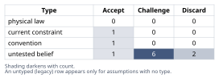
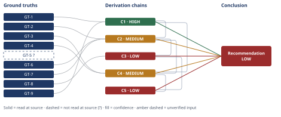

# What a Claude Code Skill Line Budget Actually Protects

*First-principles analysis · 10 October 2026*

*Read with: [How to read this analysis](HOW-TO-READ.md) · [Working file](analysis-20261010T165334Z.md) · [All files](INDEX.md)*

## Executive Summary

**Recommendation:** Do not reflexively split the file to satisfy the gate, and do not reflexively dismiss the gate as stale. First classify the real file's content as always-needed vs. conditionally-needed, measure how often each companion-tool procedure actually fires, and confirm whether this plugin's referenced files load on demand or eagerly (chain C4). Absent that inspection, extracting the six companion-tool procedures first into one-level-deep reference files is the lowest-regret opening move (chain C5).

**Band (from §6):** LOW.

**Would change it:** Reading the actual file's section lengths and per-run trigger logs, and confirming this specific plugin's reference-loading behavior for this Claude Code version (chain C4; chain C5).

## 1. Problem Essence

**Core problem:** Given a Claude Code plugin agent file that inlines five kinds of content (core methodology, six companion-tool procedures, an output template, a validation rubric) and has grown to 878 lines against a ~500-line/~5,000-token CI-enforced budget, what failure mode does that budget actually guard against, does extracting content into reference files address that failure mode or merely satisfy the gate's literal line-count check, and what concrete, evidence-gated action should be taken?

**Success criteria:**
- Names which candidate purpose(s) — context-window overflow protection, shared per-invocation attention/cost ("context rot"), human reviewability, load latency — the specific 500-line/5,000-token figure actually matches, with cited evidence, and states which candidates it does not fit.
- Determines whether splitting reduces the *total* tokens an executing instance of this agent processes end-to-end, distinguishing always-needed content from conditionally-needed content, grounded in how Claude Code / Agent Skills actually load referenced files (eagerly vs. on demand).
- States whether 878 lines is itself excessive for the described scope or whether the budget is a stale, un-recalibrated number, and names a concrete test that discriminates between the two.
- Gives a decisive, concrete recommendation that is explicit about which parts are conditional on facts unavailable in this conceptual exercise (no repo), naming exactly what to check and what each check result implies — not a recommendation that hedges every claim equally.

## 2. Assumptions Table

| Assumption | Type | Treatment | Verdict | Verification |
|------------|------|-----------|---------|--------------|
| The 500-line/5,000-token budget exists mainly to prevent the invoking session's context window from overflowing (a hard capacity failure). | untested belief | Verify against primary sources before using as the gate's rationale. | Discard — contradicted by GT-1's explicit shared-cost framing and GT-9's window-size facts; 5,000 tokens is a negligible fraction of a 200k-1M window and overflow is a separate hard-error state. | platform.claude.com best-practices + context-windows pages (read-at-source) |
| A subagent definition's size, when Task-tool dispatched, directly consumes the parent/invoking session's context budget. | untested belief (context-dependent) | Verify, then record the condition under which it does vs. does not apply. | Challenge — false for pure Task-tool dispatch per GT-5? (parent gets only the compressed result); true when this same file is loaded directly as a main-thread Skill body, which this skill's own Input Contract branching shows is also a real usage mode. | GT-5? (reported-by-delegate) + self-observed Input Contract text (read-at-source) |
| Splitting a file into reference files guarantees fewer total tokens processed over a complete run, regardless of content type. | untested belief (the reflexive "just split it" instinct) | Verify against the platform's documented loading mechanics. | Discard as an unconditional claim — per GT-2, saving is real only for content not read on a given run; per GT-3, content read on nearly every run should be reverted inline precisely because splitting it saves nothing. | platform.claude.com best-practices, "Runtime environment" and "Observe how Claude navigates Skills" (read-at-source) |
| The six companion-tool procedures in the hypothetical plugin file are, like this skill's own eight companion techniques, typically used only one or two at a time per run, not all six. | untested belief | Verify against the actual file and its usage logs; flag if unavailable. | Challenge — supported by direct analogy to this skill's own self-observed trigger-gated design (GT-6, GT-7), but not independently confirmed for the specific hypothetical file, which cannot be inspected here. | Unverified for the specific file — flagged; GT-6/GT-7 cover the one verified comparable instance |
| 878 lines for this content is self-evidently bloated prose (duplication, over-explanation) rather than legitimately necessary scope. | untested belief | Verify by reading the actual file; flag if unavailable. | Challenge — cannot be confirmed or denied without reading the file; a stale-budget reading and a genuine-bloat reading are both consistent with the same 878-line symptom. | Unverified — flagged; diagnostic named in Chains C4/C5 |
| The 500-line/5,000-token budget was set before the six companion-tool procedures were added across two milestones, and was never revisited. | untested belief (offered as a hypothesis by the scenario itself) | Verify against the gate's commit/change history; flag if unavailable. | Challenge — plausible and explicitly offered as a hypothesis, but unconfirmed without the gate's own history; GT-1 supplies a legitimate, citable rationale a team could use to deliberately re-derive the number, which is the test that discriminates staleness from correct calibration. | Unverified — flagged; requires git/CI history unavailable in this exercise |
| Claude Code's Agent Skills progressive-disclosure mechanism genuinely supports on-demand, zero-cost-until-read loading of bundled reference files. | current constraint (present runtime engineering, not an eternal law) | Record the expiry condition — what would have to change for this to stop holding. | Accept — documented directly by Anthropic for Agent Skills (GT-2); expires if a future harness version eagerly inlines bundled files instead, which is exactly why the recommended diagnostic insists on confirming this for the specific plugin and Claude Code version rather than assuming it by analogy. | platform.claude.com best-practices, "Runtime environment" (read-at-source) |
| A file mixing five distinct content types is harder for a human reviewer to maintain, independent of any token/context consideration. | convention (general software-engineering file-cohesion heuristic) | Explicitly challenge before using it to justify this specific 500-line figure. | Accept, narrowly, as a secondary maintainability-only justification — but ruled out as the PRIMARY explanation for this specific figure, since GT-1's source frames it exclusively in LLM-context terms with no mention of human-readability conventions. | platform.claude.com best-practices page (read-at-source); see §5 Dead End 2 |
| The phrase "the context window is a public good" in GT-1's source is best read as describing shared-resource allocation and per-invocation cost/quality, not merely a restatement that overflow is bad. | untested belief (interpretive) | Verify against the surrounding quoted text and any independently corroborating source. | Accept — directly supported by the adjacent text ("every token competes with conversation history and other context") and independently corroborated by GT-9's separately documented "context rot" phenomenon on a different primary-source page. | platform.claude.com best-practices + context-windows pages (read-at-source, two independent pages) |
| Markdown prose in this class of file converts to tokens at roughly the density implied by the stated budget itself (10 tokens/line), and companion-tool procedures occupy roughly 300-500 of the file's 878 lines, with 67-83% of that content unused on a typical run. | untested belief (the estimate's own bracketing assumptions) | Bracket explicitly; verify or flag. | Challenge — a defensible, internally-consistent illustrative bracket (Chain C3), not a measurement; the Phase 5 recompute shows the bracket straddles full closure of the overage rather than clearly settling it, arguing for measurement over trust in the estimate alone. | Unverified — flagged; requires reading the real file's actual section lengths |
| The described regression gate measures only the single agent file's own line/token count, not any reference files it might come to point to. | untested belief (implied by the scenario's framing, not independently confirmed) | Verify against the actual CI/gate script; flag if unavailable. | Challenge — a reasonable reading of "enforced... for this file," but unconfirmed; if false, the second-order "gate blindness" risk named in Chain C5 does not apply. | Unverified — flagged; requires reading the actual CI/gate script |

## 3. Ground Truths

- **GT-1** Anthropic's own Agent Skills authoring guidance states "Keep SKILL.md body under 500 lines for optimal performance" and frames the rationale explicitly as shared-resource competition inside an already-active context — "The context window is a public good. Your Skill shares the context window with everything else Claude needs to know... once Claude loads it, every token competes with conversation history and other context" — not as protection against a hard overflow failure. — source: platform.claude.com/docs/en/agents-and-tools/agent-skills/best-practices; read-at-source: "Core principles > Concise is key" and "Technical notes > Token budgets" sections, quoted directly above.
- **GT-2** Per the same source, bundled reference files incur "no context penalty... until actually read," and Claude accesses them via bash/Read tools on demand from the filesystem — this is the documented mechanism that makes progressive disclosure, and therefore splitting, effective, but only for content not read on a given run. — source: platform.claude.com/docs/en/agents-and-tools/agent-skills/best-practices; read-at-source: "Runtime environment" section ("No context penalty for large files... Files read on-demand").
- **GT-3** Per the same source, Anthropic's own guidance flags splitting content that turns out to be read on nearly every invocation as a smell to reverse: "If Claude repeatedly reads the same file, consider whether that content should be in the main SKILL.md instead" — i.e., the official guidance itself conditions splitting's benefit on infrequency of access, not on line-count alone. — source: platform.claude.com/docs/en/agents-and-tools/agent-skills/best-practices; read-at-source: "Observe how Claude navigates Skills" section.
- **GT-4** Per the same source, over-splitting into multi-level reference chains causes Claude to sometimes partially read files (e.g., via `head -100`) rather than reading them in full, producing incomplete information; official guidance caps this by requiring references stay "one level deep from SKILL.md." — source: platform.claude.com/docs/en/agents-and-tools/agent-skills/best-practices; read-at-source: "Avoid deeply nested references" section.
- **GT-5?** Claude Code Task-tool subagents execute in a context window isolated from the parent/invoking session; the parent receives only the subagent's final, compressed result, not its full loaded system prompt or intermediate steps. — cited to: general Claude Code subagent documentation and commentary; reported-by-delegate: synthesized via WebSearch across promptlayer.com, mindstudio.ai, and morphllm.com — cited sources not opened directly by this analysis this run.
- **GT-6** This very first-principles skill's own operating body defers its output template, validation rubric, per-technique "-detail.md" elaborations, report-figure/report-layout scripts, and assumption taxonomy to separate files loaded only via explicit, narrowly-scoped Read instructions tied to specific trigger points (e.g., "Open the output template once, before the first section is appended"; "Open the Self-Audit Gate's rubric once, before scoring the first criterion") — while inlining all eight companion-tool "Procedure" step-lists directly in the main body as compact summaries. — source: this analysis's own operating instructions (the body governing this run); read-at-source: directly observed in the text being executed under, not a report about it.
- **GT-7** The same body's "Step 0: Technique selection" instructs that in `focused-<technique>` mode, Phase 4 enumerates only the one named technique, not all eight, and in `full-composer` mode any companion technique whose trigger does not fire is recorded as "not applicable" rather than walked — establishing that, for this class of content, most companion-tool procedures go unused on any single given run. — source: this analysis's own operating instructions; read-at-source: directly observed in the "Step 0" and "Execution branching" sections of the text being executed under.
- **GT-8** The scenario stipulates the file is 878 lines against a ~500-line/~5,000-token budget (≈75% over), enforced by an automated regression gate — a given premise of this exercise, not an independently sourced external fact. — source: the user's own problem statement; treated as stipulated, not separately verified.
- **GT-9** Current Claude models have context windows of 200,000 tokens (standard) up to 1,000,000 tokens (default on several current models); context-window overflow is a distinct hard-limit error state (an `invalid_request_error` or `stop_reason: "model_context_window_exceeded"`) triggered only when total input/output approaches that full window size — a different failure mode from "context rot," the documented, separate, gradual accuracy/recall degradation from loading too much into context, which is what curation-level guidance like the 500-line Skill budget actually targets. — source: platform.claude.com/docs/en/build-with-claude/context-windows; read-at-source: "How the context window works," "Context window sizes by model," and "Context window overflow behavior" sections.

**Provenance summary:** `?`-marked: GT-5 (1 of 9). Read-at-source: GT-1 — "Core principles > Concise is key" and "Technical notes > Token budgets"; GT-2 — "Runtime environment"; GT-3 — "Observe how Claude navigates Skills"; GT-4 — "Avoid deeply nested references"; GT-6 — this run's own operating instructions, Input Contract and progressive-disclosure sections; GT-7 — this run's own operating instructions, "Step 0: Technique selection"; GT-9 — "How the context window works," "Context window sizes by model," "Context window overflow behavior." GT-8 is a stipulated scenario premise, not an externally-sourced claim, and carries neither a read-at-source location nor a `?`.

## 4. Derivation Chains

### Conclusion C1: The budget targets shared per-invocation context cost ("context rot"), not window overflow

GT-1 (500-line guidance framed as context-sharing) + GT-9 (200k-1M windows; overflow is a distinct hard-error state)
→ at 5,000 tokens the budget is under 3% of even the smaller 200k-token standard window, nowhere near large enough to matter for a hard overflow failure
→ the target named explicitly in GT-1's own source is shared-resource competition inside an already-loaded context, not capacity overflow
→ a separate, gradual quality-degradation phenomenon named context rot is independently documented in GT-9's own source as the reason curation matters even when the hard window limit is nowhere close
→ two independent primary sources therefore converge on the same target for a skill-body size budget *[Assumes: A-9 — the "public good" phrasing is read as shared-cost allocation rather than a restatement of overflow risk; priced below]*
→ the 500-line/5,000-token figure caps one triggered unit's claim on the active session's shared, finite attention and cost budget — it targets context rot and shared-cost allocation, not context-window overflow

**Confidence:** HIGH — both head inputs are read-at-source (GT-1, GT-9). The rival that the figure targets hard overflow is ruled out in §5 Dead End 1 (GT-9). The rival that it is a generic file-length convention unrelated to LLM context economics is ruled out as the primary driver in §5 Dead End 2 (GT-1). A-9 is priced: if the "public good" phrasing were instead read as pure overflow-avoidance language, GT-9's independently documented "context rot" phenomenon still supplies the same non-overflow target from an unrelated page, so the endpoint is unaffected by A-9's failure.

### Conclusion C2: Splitting's real benefit tracks which content is conditionally needed, not line count

C1 (HIGH) + GT-2 (no context penalty until read) + GT-6 (this skill's own design defers template/rubric/detail docs) + GT-7 (this skill's own design shows most companion techniques go unused per run)
→ for content a given run never reads — such as four or five of six companion-tool procedures when only one or two triggers fire — moving it to a separate file removes those tokens from that run's actual processed total, a genuine saving rather than a nominal one
→ for content every completed run does read regardless, such as a template consulted while writing every analysis or a rubric scored on every run, moving it to a separate file changes only when those tokens are paid, not whether
→ that same deferral also adds one extra tool round-trip per load, a cost that does not exist when the content is already inline
→ the official guidance itself names this second case as a smell to reverse, instructing that content read on nearly every invocation belongs back in the main body rather than split out
→ splitting's real benefit on total end-to-end tokens therefore tracks which of the file's content kinds are conditionally needed at runtime, not how the file's line count looks after the split *[Assumes: A-4 — this skill's own trigger-gated pattern generalizes to the hypothetical plugin file's six procedures; priced below]*
→ whether a split addresses the budget's real target depends on sorting the file's content by runtime necessity before touching it, and a split that skips that sort can satisfy the gate while leaving the always-needed portion's processed tokens essentially unchanged

**Confidence:** MEDIUM — one axis short: the Inference step generalizes this skill's own observed trigger-gated design (GT-6, GT-7) to the hypothetical plugin file's actual content, which has not been inspected [Assumes: A-4]. This would be removed as a cause of the downgrade by reading the actual plugin file and confirming its six companion-tool procedures are in fact conditionally triggered there too, in the same way they are in this skill.

### Conclusion C3: A bracketed estimate puts recoverable savings between roughly half and more than all of the overage

C2 (MEDIUM) + GT-8 (878 lines, 75% over 500, stipulated)
→ estimate: applying the budget's own implied density of 10 tokens per line (5,000 tokens over 500 lines) to the full 878-line file gives a central total of about 8,780 tokens
→ estimate: the same density applied to the 378 lines above budget gives an estimated overage of about 3,780 tokens
→ estimate: bracketing the six companion-tool procedures at 300 to 500 of those 878 lines (the remainder being methodology, template, and rubric) converts, at the same density, to roughly 3,000 to 5,000 tokens of procedure content
→ estimate: bracketing the unused fraction per typical run at 67 to 83 percent, consistent with GT-7's pattern of one or two techniques firing out of six, gives a savings bracket of roughly 2,010 to 4,150 tokens recovered per run by deferring the unused procedures
→ this bracket's lower end recovers only about half of the estimated 3,780-token overage while its upper end more than fully closes it, so the two ends of the bracket do not yet support one single qualitative verdict about sufficiency on their own *[Assumes: A-10 — the line and density proportions used in this estimate; priced below]*
→ a bracketed, admittedly unmeasured estimate puts the recoverable token savings from deferring unused companion-tool procedures between roughly half and more than all of the file's current overage — large enough to make those procedures the single highest-leverage candidate for extraction, not large enough on this evidence alone to promise the extraction is sufficient by itself

**Confidence:** LOW — two axes short: Inputs is capped at MEDIUM because this chain cites C2 (MEDIUM), and Inference rests on assumed, not measured, proportions for the unseen file's section lengths and per-run trigger frequency [Assumes: A-5, A-10]. This would be removed by directly measuring the real file's section lengths and, if logs exist, actual companion-technique firing rates across recent runs.

### Conclusion C4: Classifying the file by runtime necessity is correct regardless of which hypothesis is true

C1 (HIGH) + C2 (MEDIUM) + GT-3 (split-content-read-nearly-always anti-pattern) + GT-4 (one-level-deep nesting rule)
→ C1 establishes what the gate is actually protecting and C2 establishes that a split only serves that target for conditionally-needed content, so any action taken before classifying the file's content by runtime necessity is necessarily uninformed about whether it will work
→ the anti-pattern documented in GT-3 shows that even the authors of the progressive-disclosure guidance can mis-split content that turns out to be read on nearly every invocation, so guessing which content is conditional is not a safe substitute for checking actual read frequency
→ the one-level-deep rule stated in GT-4 shows that splitting itself carries a distinct, separate failure mode — nested references causing partial reads — that a classification-only diagnostic must also account for before extraction begins
→ the one action that is correct regardless of whether the budget turns out stale, the content turns out bloated, or a straightforward split turns out sufficient, is to classify the file's content by runtime necessity before changing anything
→ that same action also requires confirming the platform's actual loading behavior for this specific file before changing anything, since the on-demand mechanism documented in GT-2 cannot be assumed to hold for every packaging of a Claude Code agent file without checking

**Confidence:** MEDIUM — one axis short: Inputs is capped at MEDIUM because this chain cites C2 (MEDIUM). The cap lifts only if C2 itself reaches HIGH, which requires inspecting the real plugin file as named on C2's own confidence line.

### Conclusion C5: Extracting the companion-tool procedures first is the lowest-regret opening move, with second- and third-order effects that must be priced into the same decision

C3 (LOW) + C4 (MEDIUM)
→ if the diagnostic in C4 confirms the companion-tool procedures are written in full, expanded form and are rarely all used in one run, the single lowest-risk first move is to extract them into one-level-deep reference files with a per-technique Read trigger, mirroring the pattern this skill's own body already uses successfully
→ if the file is still over budget after that extraction, the residual overage is either concentrated in content every completed run reads anyway, in which case splitting it further satisfies the gate's line count but does not reduce a completed run's processed tokens
→ that further split is then justified only on separation-of-concerns or early-exit-savings grounds, not on context economics
→ if instead the diagnostic shows the core methodology body itself, not the companion procedures, is the bulk of the file and contains no duplicated or Claude-already-knows-this content, the finding flips entirely: the budget number is the stale artifact, and the correct fix is to raise it openly rather than fragment legitimate, necessary content to chase an unexamined figure
→ the first-order conclusion is that extracting the companion-tool procedures is the single most probable, lowest-regret opening move
→ that conclusion is an estimate-backed bracket, not a verified fact, so C4's diagnostic must still run before the template, rubric, and stale-budget questions can be answered
→[2nd] (actor lens) extracting the procedures changes the cheapest way to add a seventh technique from appending roughly seventy main-file lines to appending one reference file plus one trigger line, removing the friction that currently makes new scope visible to a line-count gate
→[2nd] (actor lens) the same extraction adds one Read round-trip per technique actually used, so a full-composer-style run exercising several techniques now spends extra turns on tool calls that previously cost nothing beyond context already loaded
→[3rd] (time lens) because the regression gate as described watches only the main file, reference-file growth from the cause above is invisible to it across future milestones, so the same unexamined-budget failure this analysis was asked to diagnose can recur one layer down, now spread across several smaller files instead of one large one *[Assumes: A-11 — the gate measures only the main file, not reference files; priced below]*

**Confidence:** LOW — Inputs is capped at LOW by C3's own band, and this chain also cites C4 (MEDIUM), itself rated below HIGH on C4's own confidence line. A live, unsettled rival is named directly in this chain's fourth hop (the methodology body, not the procedures, could be the dominant bulk) and nothing outside this chain settles it. A-11 (priced here) would, if false, remove the third-order gate-blindness risk entirely; it would be settled by reading the actual CI/gate script. Both the rival and A-11 close only by inspecting the actual file and its gate.

**Unverified-input rule (D-07) summary:** Chains C3 and C5 each carry a MEDIUM/LOW line naming their `[Assumes: ...]` inputs and the verification that would remove them, per the lines above. No chain in this section rests on a `GT-N?` input directly on its own head line (GT-5? is not cited on any chain head in this section); the unverified-input discipline here is carried entirely through the `[Assumes: A-N]` mechanism and the chain-citation ceiling rather than through a `GT-N?` head input.

## 5. Abandoned Reasoning

### Dead End 1: Hard context-window overflow as the budget's primary purpose

**What was tried:** Treated "a ~500-line/~5,000-token budget" as primarily a safeguard against the invoking session's context window overflowing — the most reflexive reading of any size-based engineering gate.

**Why abandoned:** GT-9 establishes that current Claude context windows run 200,000 to 1,000,000 tokens and that overflow is a distinct hard-error state triggered only when total input/output approaches that full size; 5,000 tokens is under 3% of even the smaller window. GT-1's own stated rationale for the figure names shared per-invocation cost ("the context window is a public good"), not overflow, with no mention of a capacity ceiling at all.

**What it ruled out:** Any recommendation framed as "split this to avoid blowing the context window" — that framing is factually wrong for any single file of this size against current window sizes, and using it to justify the gate (or to argue the gate is pointless because windows are huge) both rest on the same mistaken premise.

### Dead End 2: Generic software-engineering file-length convention as the primary driver

**What was tried:** Considered that the 500-line figure might be inherited boilerplate — a generic "files over 500 lines are a smell" engineering convention unrelated to LLM context economics at all (assumption A-8), with the LLM framing as post-hoc rationalization.

**Why abandoned:** GT-1's primary source frames the number exclusively in LLM-context terms — under a "Token budgets" heading, in a section titled "Concise is key" that opens with "The context window is a public good" — with no mention of human-readability or file-review conventions anywhere in that guidance.

**What it ruled out:** Treating the budget as interchangeable with an arbitrary code-style lint; A-8 survives only as a secondary, coincidental maintainability justification (§2), not as the explanation for why this specific figure is what it is.

### Dead End 3: Splitting as an unconditionally sufficient fix

**What was tried:** Explored treating "extract the companion-tool procedures, the output template, and the validation rubric into separate reference files" as sufficient on its own, regardless of which of those three is actually read on most runs.

**Why abandoned:** GT-2 establishes reference files cost nothing until read, which makes a split's benefit conditional on infrequent reading, not unconditional; GT-3 shows Anthropic's own guidance explicitly reverses splits of content that turns out to be read on nearly every invocation. Treating all three content kinds as equally good candidates for extraction ignores this distinction and risks satisfying the gate's line count while leaving a completed run's actual processed tokens for the template and rubric unchanged.

**What it ruled out:** A flat, undifferentiated "split everything that isn't core methodology" recommendation; see Chain C2 and C5 for the differentiated version.

### Dead End 4: Deriving a hard numeric "context rot" ceiling via the theoretical-limit technique

**What was tried:** Considered applying the theoretical-limit procedure to derive an exact token-count ceiling beyond which "context rot" measurably degrades reasoning quality, to replace the 500-line figure with a number derived from a governing hard constraint rather than from Anthropic's own heuristic.

**Why abandoned:** No quantified degradation threshold (e.g., "accuracy falls measurably past N tokens of system-prompt content specifically") was located in the sources opened this run; the context-windows page names context rot as real but does not quantify it as a function of skill-body size alone. Fabricating such a number would manufacture false precision the estimate procedure's own bracketing discipline exists to prevent.

**What it ruled out:** A false sense that this analysis could replace "500 lines" with a more rigorously derived number; it cannot, on the evidence available, and the recommendation in §6 does not pretend otherwise.

### Dead End 5: Scoring the three remediation options as a weighted trade-off

**What was tried:** Considered applying the trade-off procedure to score "split everything," "raise the budget," and "diagnose first, then branch" against weighted criteria (effort, risk, gate compliance, context-economics benefit).

**Why abandoned:** The three are not co-viable competing options under shared criteria to be weighed — they are mutually exclusive outcomes of a single unresolved factual question (which content kinds are actually conditional, and how the platform actually loads references for this specific file). Locking weights and scoring would manufacture a preference that the diagnostic, not a scorecard, is what should resolve; the trade-off procedure's own discipline (lock weights before seeing scores) does not fit a decision whose correct branch is a fact to be discovered, not a preference to be weighted.

**What it ruled out:** A false appearance of rigor from scoring three options when the real missing ingredient is evidence about the actual file, not a weighting judgment.

## 6. Conclusion

**Recommended approach:** Do not reflexively split the file to satisfy the gate, and do not reflexively dismiss the gate as stale — first run a concrete diagnostic that (a) classifies every section of the real 878-line file as always-needed-at-runtime vs. conditionally-needed, (b) measures, from logs if available, how many of the six companion-tool procedures actually fire per run, and (c) confirms whether Claude Code's loading mechanism for this specific plugin's agent file defers unread referenced content at zero cost or loads it eagerly (chain C4). Absent that inspection, the single most probable, lowest-regret opening move is to extract the six companion-tool procedures into one-level-deep reference files with per-technique Read triggers — mirroring this very skill's own proven pattern — and only then reassess the residual gap against the template, rubric, and the budget number itself (chain C5).

**Key insight:** The reflexive "it'll blow the context window" justification for a 500-line/5,000-token budget is factually wrong against current 200k-1M-token windows; the budget's real, documented target is the shared, finite per-invocation attention and cost pool ("context rot"), and a split only serves that target for content that is genuinely conditional at runtime — Anthropic's own authoring guidance explicitly reverses splits of content that turns out to be read on nearly every invocation anyway (chain C1; chain C2).

**Trade-offs acknowledged:** Extracting the companion-tool procedures first is estimated, not measured, to recover somewhere between roughly half and more than all of the current overage (chain C3) — it is the highest-leverage guess available without the real file, not a guarantee. The fix itself has second- and third-order costs: it adds a Read round-trip per technique actually used in a run, and it makes future scope growth cheaper to add and harder for the existing gate to notice unless the gate is extended to also bound reference-file size (chain C5) — no chain — flagged assumption only for the magnitude of the round-trip cost, which was not estimated.

**Confidence:** LOW — the overall recommendation's *procedural* core (classify before acting; chain C4) is comparatively robust at MEDIUM, capped only by C2's reliance on an unverified generalization from this skill's own design (chain C2's confidence line). The recommendation's *substantive* best guess about which content to extract first (chain C5, built on chain C3's estimate) is LOW, because it rests on assumed, unmeasured proportions of a file this analysis cannot inspect, and a live rival (the methodology body itself, not the procedures, being the dominant bulk) is not settled anywhere in this analysis. Verification that would raise the band: read the actual 878-line file and classify it by runtime necessity; check actual per-run companion-technique trigger frequency from logs if they exist; and confirm, for this specific plugin and Claude Code version, whether referenced files are loaded on demand or eagerly (all three named in chain C4).
