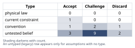
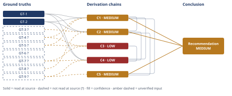

# Build vs. Buy Authentication for a Growing B2B SaaS

*First-principles analysis · 10 October 2026*

*Read with: [How to read this analysis](HOW-TO-READ.md) · [Working file](analysis-20261010T165100Z.md) · [All files](INDEX.md)*

## Executive Summary

**Recommendation:** Buy a managed identity provider now (WorkOS or Clerk, both effectively free at this company's current scale) rather than building on an open-source library, and integrate it with three disciplines: abstract the auth boundary in your own code, rely on the vendor's standards-based OIDC/SAML/SCIM surface, and don't let sales claim "enterprise-ready" until SAML/SCIM is actually smoke-tested against a real IdP (chain C5). This is faster and cheaper for the gated release itself (chain C1) and converts the 12-18 month enterprise SSO/SCIM requirement into a metered billing event instead of a second deadline-pressured build (chain C2).

**Band (from §6):** MEDIUM (chain C5)

**Would change it:** Opening WorkOS/Clerk/Auth0's own protocol-conformance docs (closing GT-9?), independently reading this company's actual codebase/team roster (closing GT-4?/GT-5?), and opening the primary source behind the enterprise-procurement statistics (closing GT-8?) could move this to HIGH; discovering this team's real engineering cost is far below the estimated bracket while still able to satisfy all six security preconditions in chain C3 without a review is the only scenario that would reverse it (chain C1).

## 1. Problem Essence

**Core problem:** Should this 7-person, early-stage B2B SaaS company build its first real per-tenant, multi-user authentication system on an open-source library, or integrate a managed identity provider, in order to ship an already-billed, auth-gated feature on schedule without either shipping a tenant-isolation/credential-handling defect or foreclosing the SSO/SAML/SCIM/audit-log capability its stated 12-18 month enterprise sales trajectory will require?

**Success criteria:**
- The chosen path can plausibly deliver real per-tenant, multi-user authentication (sessions, password reset, MFA capability, audit log) for the gated release without slipping the committed ship date by more than the smallest feasible margin.
- The chosen path does not knowingly ship a tenant-isolation or credential-handling defect under deadline pressure — it meets the baseline security requirements regardless of which path is chosen.
- The chosen path's total cost (engineering time plus any vendor fees) over the next 12-18 months is named explicitly, not just the cost to ship the first release.
- The chosen path leaves the company able to meet enterprise SSO/SAML/SCIM/audit-log requirements within the stated 12-18 month window without a second, deadline-pressured rebuild.
- The chosen path's consumption of the 7-person team's engineering capacity is named explicitly as an opportunity cost, not treated as free.

No criterion requires the answer to be exactly "build" or exactly "buy" as named in the prompt — a composite (e.g., buy now with specific portability/configuration discipline, or build-now-migrate-later) is explicitly eligible and is tested against the named options in the trade-off analysis in section 4.

---

## 2. Assumptions Table

**Five-Whys (causal mode) on the urgency itself.** Why is this urgent? → The next billed release is gated behind authenticated per-tenant accounts. Why is the release gated that way? → The new feature requires knowing which user within a tenant performed an action (multi-seat functionality), which a single shared password cannot represent. Why can't the current system represent that? → The product has run since early days on one shared password plus a Stripe customer link — tenant-level, not user-level, identity. Why was it built that way? → At very early stage, with few customers, a shared password was the fastest way to ship without investing in identity infrastructure — a reasonable shortcut at the time. Why is that shortcut reaching its limit now? → The business is moving toward multi-seat features, higher tenant counts, and (per the stated 12-18 month trajectory) enterprise customers — all of which structurally require real per-user identity. **Root cause: this is not a one-off feature need; the product's identity model has been lagging its business model, and this feature is the forcing function that exposes a gap the company will keep hitting (roles/permissions, SSO, SCIM, audit log) regardless of what triggered the first exposure.** This directly discards assumption A-8 below and reframes the decision as infrastructure, not a point feature.

**Five-Whys (reduce-to-primitives mode) on the security baseline (GT-7 below).** Claim: "production password authentication requires salted adaptive hashing, single-use expiring tokens, and rate-limiting." Decomposed: "salted adaptive hashing" reduces to a cryptographic hardness property (computationally expensive to invert at scale) — a definitional/mathematical primitive, not a negotiable convention. "Single-use expiring token" reduces to a definition (sufficient entropy + one-time redemption + bounded validity window). "Rate-limiting against brute force/credential stuffing" reduces to a direct, measurable property (bounded attempts per unit time). All three branches bottom out at a definition or a measurable property rather than an unverified belief, so the claim passes the irreducibility test and is promoted to GT-7 (marked `?` only because this analysis did not open NIST SP 800-63B / OWASP ASVS directly this session — see Ground Truths).

| Assumption | Type | Treatment | Verdict | Verification |
|------------|------|-----------|---------|--------------|
| A-1: 7 engineers have slack capacity to build a production-grade auth system without delaying other roadmap work | untested belief | verify or flag | Challenge — contradicted by the prompt's own urgency framing; treat build's opportunity cost as real, not assumed away | unverified — flagged |
| A-2: an OSS auth library makes building sessions/password-reset/MFA/audit-log fast and low-risk | convention | explicitly challenge before use | Challenge — true only for low-level primitives (hashing, session middleware); false for the full compliance-usable feature set, per the Fermi bracket in chain C1 | unverified — flagged |
| A-3: a managed-IdP integration can be completed within the urgent release timeline | untested belief | verify or flag | Accept — supported by chain C1's 1-3 engineer-week bracket, materially faster than build's 2-8 week bracket | supported by chain C1 |
| A-4: buying shifts security/compliance risk entirely to the vendor | convention | explicitly challenge | Challenge — partially true; implementation risk transfers, contractual/legal liability for a breach generally does not; reclassified as shared responsibility | unverified — flagged |
| A-5: vendor lock-in is a severe, hard-to-escape long-term risk that outweighs near-term speed | untested belief | verify or flag | Challenge — real but bounded (standards-based protocols per GT-9, forced-password-reset-scale migration, not a full rebuild); building also creates an unlabeled lock-in to an under-featured homegrown system | unverified — flagged |
| A-6: building in-house is cheaper over the product's lifetime than paying a recurring vendor subscription | untested belief | verify or flag | Discard — contradicted by chain C1 once engineer time is priced at market rate against the vendors' near-zero entry-tier cost at this company's current scale | discarded — contradicted by chain C1 |
| A-7: password reset / MFA / audit logging are solved problems requiring near-zero engineering time with a library | convention | explicitly challenge | Discard — contradicted by the Fermi decomposition in chain C1, where exactly these items dominate the build-time bracket | discarded — contradicted by chain C1 |
| A-8: this is a one-off feature need, not a foundational, recurring identity requirement | untested belief | verify or flag | Discard — contradicted by the 5-Whys causal-mode root cause above (structural gap, not a point feature) | discarded — contradicted by 5-Whys finding above |
| A-9: the team has in-house security expertise to get subtle auth details right under time pressure | untested belief | verify or flag | Challenge — no evidence given either way; absence of a stated dedicated security engineer on a 7-person team is the modal early-stage case, which raises build risk | unverified — flagged |
| A-10: enterprise customers requiring SSO/SAML/SCIM will materialize in roughly 12-18 months | current constraint | record expiry conditions | Accept — expires/updates on the first enterprise deal signed or a deliberate decision to stay SMB-only; until then it is the stated planning baseline, and the recommendation's downside is bounded if it fails to materialize (chain C2) | user-supplied business forecast — unverified |
| A-11: tenant-scoping (authorization boundary) is implemented and tested correctly across every query/session boundary before launch [load-bearing] | untested belief | verify or flag | Challenge — no evidence this has been tested; surfaced by the inversion procedure as a failure-guaranteeing gap | unverified — flagged, feeds chain C3 |
| A-12: password-reset and session tokens are cryptographically secure, single-use, and expiring [load-bearing] | untested belief | verify or flag | Challenge — baseline requirement per GT-7, not yet verified as implemented | unverified — flagged, feeds chain C3 |
| A-13: MFA, if shipped, is implemented with rate-limited verification and secure backup-code handling [load-bearing] | untested belief | verify or flag | Challenge — commonly under-built under deadline pressure | unverified — flagged, feeds chain C3 |
| A-14: the 120-tenant migration path is tested against production-like data before cutover [load-bearing] | untested belief | verify or flag | Challenge — no evidence given; surfaced by inversion as a billing/lockout failure mode | unverified — flagged, feeds chain C3 |
| A-15: the audit-log schema anticipates compliance/export needs (retention, immutability) rather than being designed ad hoc for one feature [load-bearing for the 12-18mo horizon] | untested belief | verify or flag | Challenge — unverified; feeds chains C2 and C3 | unverified — flagged, feeds chains C2, C3 |
| A-16: a security review/test pass occurs before shipping rather than being skipped under deadline pressure [load-bearing] | untested belief | verify or flag | Challenge — the single highest-leverage mitigation surfaced by the inversion and pre-mortem; recommended as a plan change regardless of build or buy | unverified — flagged, feeds chain C3 and the Phase 5 adversarial pass |
| A-17: fully loaded engineer cost at this company is approximately $3,000-$5,000 per engineer-week (~$150k-$250k/yr) | untested belief | verify or flag | Accept — standard range for an early-stage SaaS engineer; sensitivity-checked in chain C1 (conclusion direction holds across the plausible range) | unverified — flagged, feeds chain C1 |
| A-18: time-to-ship and security/defect risk are the two criteria weighted highest (5 each) in the trade-off scoring | convention | explicitly challenge | Accept — mirrors the prompt's explicit urgency framing and the inherent stakes of an authentication system; the flip test in chain C4 shows the recommendation is robust to this weighting choice | stated in trade-off procedure — feeds chain C4 |
| A-19: portability-hygiene practices (boundary abstraction, standards-based reliance, pre-sales SCIM/SAML smoke test) cost negligible additional engineering time over a plain vendor integration | untested belief | verify or flag | Accept — consistent with these being configuration/process disciplines rather than new engineering builds | unverified — flagged, feeds chain C5 |

---

## 3. Ground Truths

- **GT-1** WorkOS's free tier covers up to 1,000,000 monthly active users at $0/month, bundling email+password, social login, passkeys, MFA, and magic auth; Enterprise SSO and Directory Sync (SCIM) are billed separately per connection on an identical volume-tier table: $125/ea (1-15 connections), $100/ea (16-30), $80/ea (31-50), $65/ea (51-100), custom above 100 — source: WorkOS pricing page (workos.com/pricing); read-at-source: free-tier feature bullet list and the SSO/Directory Sync per-connection tier table, fetched directly this session.
- **GT-2** Clerk's free tier covers 50,000 monthly retained users (MRU) per app; Pro is $25/mo ($20/mo annual) and includes 50,000 MRU, then volume pricing beyond; the B2B multi-tenant offering includes 100 organizations per app, then $1/mo per organization for the 101st-1,000th; one enterprise SSO connection is included free, then $75/mo each for connections 2-15 — source: Clerk pricing page (clerk.com/pricing); read-at-source: Free/Pro plan cards, the B2B Organizations section, and the Enterprise SSO connections table, fetched directly this session.
- **GT-3?** Auth0's B2B Essentials plan starts at $150/month at 500 MAU, rising to $3,800/month at 20,000 MAU, and includes 3 Enterprise SSO connections; additional connections cost $100/month each beyond the plan's included limit (capped at 30 total); B2B Professional starts at $800/month at 500 MAU with 5 connections included — cited to: Auth0 pricing pages and a third-party comparison (ssojet.com); reported-by-delegate: supplied by a WebSearch summary this session; the primary Auth0 pricing page itself was not opened directly.
- **GT-4?** The company's current production system gates access behind a single shared password plus a Stripe customer link; there is no real per-user or per-tenant authentication today — unverified: this is the user's own stated description of their system in the problem statement; this analysis did not independently read the company's codebase or auth configuration.
- **GT-5?** The company has 7 engineers, ~$40K MRR, ~120 paying tenants, and no enterprise customers yet — unverified: user-supplied context, not independently verified by this analysis.
- **GT-6?** The next billed release is gated on shipping authenticated, per-tenant, multi-user accounts — unverified: user-supplied framing, definitional to why this decision is urgent; not independently verified.
- **GT-7?** Production-grade password authentication requires salted adaptive password hashing (bcrypt/argon2-class), cryptographically random single-use expiring tokens for sessions and password resets, and rate-limiting against brute-force/credential-stuffing attempts — unverified: this is the NIST SP 800-63B / OWASP ASVS baseline as generally known industry practice; neither standard was opened directly at source this session (see the Five-Whys reduce-to-primitives note in section 2, which establishes this claim's internal irreducibility independent of the citation).
- **GT-8?** Enterprise SaaS procurement increasingly gates purchase on SSO/SAML and SCIM support and on security review (SOC2-type diligence); a secondary research aggregator reported specific adoption figures (e.g., majority of enterprise RFPs requiring SSO/MFA, rising SCIM adoption) — reported-by-delegate: supplied by a WebSearch summary of a vendor-adjacent research site (ssojet.com) this session; the primary report was not opened, and the specific percentages are treated as directionally indicative only, not as verified figures, given the likely vendor bias of the source.
- **GT-9?** Managed identity providers' enterprise SSO and provisioning offerings are implemented via the standards-based protocols SAML 2.0/OIDC and SCIM 2.0, rather than proprietary protocols — unverified: this is common vendor-documentation/industry knowledge; not independently opened at a vendor's protocol-conformance documentation this session.

**Provenance summary:** `?`-marked: GT-3, GT-4, GT-5, GT-6, GT-7, GT-8, GT-9 (7 of 9). Read-at-source: GT-1 — WorkOS pricing page, free-tier bullet list and SSO/Directory Sync per-connection tier table; GT-2 — Clerk pricing page, Free/Pro plan cards, B2B Organizations section, and Enterprise SSO connections table.

---

## 4. Derivation Chains

**Second-order lenses applied to this decision (actor lens and time lens), feeding chain C2 below:**
*Actor lens* — engineers (pulled onto a security-critical path under deadline pressure if building, vs. spending that time on the gated feature's own product logic if buying); the sales/AE team (can quote "SSO available" confidently and sooner if buying, vs. telling an enterprise prospect to wait if building); the 120 existing tenants (experience a user-facing login migration either way, but a vendor-hosted, previously-tested login UI plausibly carries fewer onboarding defects than a rushed homegrown one); a competitor (already offering SSO can use its absence as a competitive wedge); the vendor itself (has a direct incentive to make the free tier generous now and monetize per-connection later — the mirror image of the "lock-in" worry).
*Time lens* — immediately (buy ships faster, freeing engineer time for the feature itself; build risks the ship date); after a few cycles (the operational burden of patching and supporting a homegrown auth system accrues to engineering if built, vs. sitting with the vendor if bought); once assumed (12-18+ months: enterprise SSO/SCIM demand, per the stated trajectory, turns into a config-and-fee change on the bought platform vs. a second, deadline-pressured build project on the built one).

### Conclusion C1: Buying costs less, in both time and near-term dollars, than building at this company's current scale

GT-1 (WorkOS pricing, read-at-source) + GT-2 (Clerk pricing, read-at-source) + GT-4? (current shared-password system) + GT-5? (7 engineers, $40K MRR, 120 tenants)
→ building a production-grade in-house multi-tenant auth system (sessions, tenant-scoped accounts, password reset, MFA, audit log, security hardening, and migrating the 120 existing tenants) brackets to roughly 2 to 8 engineer-weeks with a central estimate near 4 engineer-weeks *[Assumes: A-17 — fully loaded engineer cost of roughly $3,000-$5,000 per engineer-week]*
→ integrating a managed identity provider for the same functional scope brackets to roughly 1 to 3 engineer-weeks, while the recurring vendor fee at 120 tenants stays near $0-$50 per month under either vendor's entry tier
→ converting both brackets to one-time dollar cost at the same engineer-cost rate puts build's central cost near $16,800 against buy's central cost near $6,000 plus a negligible recurring fee
→ at this company's current scale the buy path costs less in both calendar time and near-term dollars across most of the bracket, and the two brackets overlap only when the build path skips the security-hardening and MFA-rigor work that chain C3 identifies as the likeliest source of a shipped defect

**Confidence:** MEDIUM — GT-4? and GT-5? are unverified user-supplied context; verification would mean reading the company's actual codebase/auth config and team roster, not performed here. The Fermi bracket (A-17) is sensitivity-checked: even at the low end of plausible engineer cost, build's one-time cost still exceeds several years of either vendor's entry-tier recurring fee, so the conclusion's direction is not sensitive to A-17's exact value. The live rival — "build could be faster/cheaper at the bracket's edges" — is bounded, not eliminated, by pointing to chain C3: that overlap only occurs in the corner-cutting scenario chain C3 identifies as carrying unpriced security-defect risk.

### Conclusion C2: Buying now converts the 12-18 month enterprise-SSO/SCIM requirement into a deferred billing event instead of a second urgent build

GT-1 (WorkOS SSO/SCIM per-connection pricing) + GT-2 (Clerk SSO connection pricing) + GT-3? (Auth0 pricing) + GT-8? (enterprise procurement gating on SSO/SCIM) + C1 (buy favored at current scale)
→ buying now leaves the company on a platform that already meters enterprise SSO/SCIM per connection rather than requiring new engineering, so enterprise-readiness becomes a billing event rather than a second engineering project
→[2nd] once the first enterprise prospect requires SSO/SCIM, per GT-8?'s direction and the stated 12-18 month horizon, the sales team can quote a configuration-and-fee change instead of an open-ended build, shortening the enterprise sales cycle relative to the build path, where the same prospect would instead be told to wait for a from-scratch SAML/SCIM implementation under live deal pressure
→[3rd] over several such deals, the per-connection vendor fee becomes a recurring cost line the company can price directly into enterprise contract economics, while the build-path alternative would instead accumulate an ever-larger, self-maintained SAML/SCIM/audit-log codebase that the 7-person team must keep patched indefinitely — a maintenance tax with no natural ceiling

**Confidence:** MEDIUM — GT-3? (Auth0 pricing) and GT-8? (procurement-gating statistics) were reported by a delegate search and not opened at their primary source; verification would mean fetching Auth0's own pricing page and the primary research report behind GT-8?'s figures directly. C1 is named at MEDIUM and carries its own explanation. The live rival — "enterprise demand may never materialize, making this moot" — is downside-bounded: if A-10 fails to materialize, the buy path's SSO/SCIM fee simply never triggers, so the recommendation is not harmed by that rival, only its second-order urgency is.

### Conclusion C3: The build path's apparent speed advantage rests on six unverified, load-bearing preconditions that are the classic shape of a shipped security defect

GT-4? (no prior tenant-scoped auth in this codebase) + GT-5? (7 engineers, no stated dedicated security engineer) + GT-7? (security baseline requirements)
→ inverting the claim "building in-house safely meets the deadline" into "building in-house fails to meet the deadline or ships a security defect" surfaces six load-bearing preconditions the build plan currently assumes rather than verifies: correct tenant-scoping across every query/session boundary, single-use expiring tokens for sessions and resets, rate-limited MFA with safe backup-code handling, a tested migration of the 120 existing tenants, a compliance-usable audit-log schema, and a pre-launch security review *[Assumes: A-11 through A-16]*
→ none of these six preconditions has been empirically verified against this specific team's skill or available time, and a 7-person team with no stated dedicated security engineer, building its first tenant-scoped authorization logic under an explicit revenue deadline, is the base-rate scenario in which exactly these defects (cross-tenant data leakage, token replay, MFA bypass) get shipped
→ the build path's apparent speed advantage over buying therefore only materializes in the scenario where one or more of these six preconditions is skipped under time pressure, which is a defect risk rather than a genuine efficiency gain

**Confidence:** LOW — Inputs are short (all three head ground truths are `?`-marked; verification would require reading the actual codebase, team roster, and the cited security standards directly, none performed here) and Inference is also short (six preconditions, A-11 through A-16, are stated but only generally priced — "a pre-launch security review would close most of them" — rather than individually priced one by one, which is more than the single unpriced hop a MEDIUM rating allows). Two axes short puts this chain at LOW. The rival — "a mature library handles MFA/reset safely out of the box, so the risk is overstated" — is addressed but not eliminated in Abandoned Reasoning (Dead End: library maturity), since even a mature library does not test the tenant-scoping or migration preconditions (A-11, A-14), which are specific to this codebase, not the library.

### Conclusion C4: A weighted trade-off across five viable options still selects buying, by a wide and weight-insensitive margin

GT-1 (WorkOS pricing) + GT-2 (Clerk pricing) + GT-7? (security baseline) + GT-9? (standards-based SSO/SCIM) + C1 (time/cost) + C2 (enterprise-readiness) + C3 (build-risk)
→ scoring four surviving options — build, plain buy, buy-with-portability-hygiene, build-now-migrate-later — against six locked, weighted criteria (time-to-ship ×5, near-term cost ×2, security/defect risk ×5, enterprise-readiness ×4, lock-in/switching cost ×2, engineering opportunity cost ×3), after knocking out "delay the release" for failing the must-have of shipping real per-tenant auth this cycle, yields weighted totals of buy-with-hygiene = 86, plain buy = 84, build = 46, build-now-migrate-later = 45 *[Assumes: A-18 — time-to-ship and security/defect risk are the two most heavily weighted criteria]*
→ the 40-point gap between the buy-family options and the build-family options is driven by the two highest-weighted criteria, time-to-ship and security/defect risk, both of which the build path scores poorly on precisely because of the risks named in chain C3
→ no single-criterion weight change closes that 40-point gap — even moving the one criterion (lock-in) where build scores better than buy-with-hygiene to its maximum weight only shifts a few points — while the narrower 2-point gap between the two buy variants is closed by portability hygiene costing negligible extra time, making buy-with-portability-hygiene the recommended option

**Confidence:** LOW — this chain is capped by citing C3 (LOW) on its head, since the security-risk criterion score it depends on rests on C3's finding. GT-7? and GT-9? are unverified (verification: open NIST SP 800-63B/OWASP ASVS and a vendor's protocol-conformance docs directly). This LOW rating reflects that the *formal scoring matrix's* security-risk input is LOW-confidence, not that the underlying cost/time numbers (C1, read-at-source pricing) are weak — those stand independently in chain C5 below. The flip test itself is robust (no single-criterion reweighting flips build over buy), which is a separate, well-supported finding even though the chain's overall band is capped by its weakest input.

### Conclusion C5: Buy a managed identity provider now, with portability and configuration discipline, rather than building in-house or deferring the decision

C1 (MEDIUM — cost/time favors buy at current scale) + C2 (MEDIUM — enterprise-readiness trajectory favors buy) + GT-9? (standards-based SSO/SCIM protocols)
→ since both the near-term cost/time comparison (C1) and the 12-18 month enterprise-readiness trajectory (C2) independently favor buying, and portability-hygiene practices (abstracting the auth boundary in code, relying on the vendor's standards-based OIDC/SAML/SCIM surface per GT-9?, and gating any sales claim of "enterprise-ready" on an actual SAML/SCIM smoke test) cost negligible additional engineering time, buying now with portability hygiene dominates plain buy, build, and build-now-migrate-later across the weighted trade-off scored in chain C4 *[Assumes: A-19 — portability-hygiene practices cost negligible additional engineering time over a plain integration]*
→ the specific, named residual risks of this recommendation — a single vendor now sitting on the critical path for all login traffic, and a configuration-correctness burden that does not transfer to the vendor — are addressed by named plan changes and accepted mitigations in the Phase 5 adversarial pass below, not left as open risk

**Confidence:** MEDIUM — GT-9? is unverified (verification: open a vendor's own protocol-conformance documentation directly to confirm the standards-based claim). C1 and C2 are each named at MEDIUM and carry their own explanations on their own confidence lines, which this line does not repeat. Chain C4's trade-off result is mentioned as corroboration, not head-cited, so this chain's own band is not capped by C4/C3's LOW rating — C5's own two logical supports (C1, C2) stand independently of the formal scoring matrix.

---

## 5. Abandoned Reasoning

### Dead End: Delay the release until auth is "done right"

**What was tried:** Treating "take however long it takes to build or buy auth properly, and ship the gated feature when ready" as a candidate path.

**Why abandoned:** It fails the problem's own must-have (GT-6?: the release is already billed and gated on this feature) and does not resolve the actual decision — it only defers it while also deferring revenue. The prompt frames this as urgent/critical-path, and no evidence in this analysis suggests that constraint is negotiable.

**What it ruled out:** This saves a future reviewer from re-litigating "just take more time" as if it were a serious third option; it is a non-option unless the revenue-gating decision itself is revisited by the business, which is outside this analysis's scope.

### Dead End: Build a fully custom, hand-rolled auth system without an OSS library

**What was tried:** Considering a variant of "build" with no third-party library at all, for maximum control.

**Why abandoned:** Strictly dominated by building on an OSS library — more engineering time, more surface area for hand-rolled cryptographic mistakes, and no offsetting benefit identified. OWASP guidance (reflected in GT-7?) specifically warns against hand-rolled cryptographic primitives.

**What it ruled out:** This narrows "build" to the one plausible variant (build on an OSS library), which is the version actually scored in chains C1, C3, and C4.

### Dead End: "A mature OSS library makes build just as fast and safe as buying"

**What was tried:** Treating library maturity as sufficient to close the time and risk gap between build and buy.

**Why abandoned:** Even granting a mature library handles hashing, session middleware, and MFA primitives well, it does not test this specific codebase's tenant-scoping boundary (A-11) or validate the 120-tenant migration path (A-14) — both are specific to this company's data model, not something any library ships pre-solved. Chain C3's risk finding survives even in the best-case library-maturity scenario.

**What it ruled out:** This is the strongest rival to chains C1/C4's headline numbers and to the overall recommendation; it is ruled out because it only closes the *time* gap in an optimistic case, not the *enterprise-readiness* gap (chain C2) or the *tenant-scoping/migration-risk* gap (chain C3), both of which are independent of library choice.

---

## 6. Conclusion

**Recommended approach:** Buy a managed identity provider now — integrate it for the gated release rather than building on an open-source library — and do it with three specific disciplines: abstract the auth boundary behind an interface in your own codebase, rely on the vendor's standards-based OIDC/SAML/SCIM surface rather than any proprietary extension, and do not let sales represent "enterprise SSO/SCIM ready" until it has been smoke-tested against a real IdP (chain C5). At the company's current scale (120 tenants, no enterprise customers yet), both WorkOS and Clerk's entry tiers cost roughly $0-$50/month, which is materially less than the one-time engineering cost of building the equivalent system in-house (chain C1).

**Key insight:** This is not actually a "move fast now, pay later" trade-off — it is the opposite. The 5-Whys root cause shows this auth gap is structural, not a one-off feature need (section 2), so the real choice is between paying a small, metered, deferred fee for enterprise-readiness (chain C2) or paying a larger, un-metered, deadline-pressured engineering cost twice — once now and again in 12-18 months when an enterprise prospect demands SSO/SCIM (chain C2) — while also carrying six unverified, load-bearing security preconditions in the meantime (chain C3).

**Trade-offs acknowledged:** This recommendation accepts a new single external dependency on the company's entire login path, and a configuration-correctness burden (redirect URIs, token audience/issuer validation, session handling) that the vendor does not assume on the company's behalf — both are named and given specific mitigations in the Phase 5 adversarial pass below, not left as open risk (chain C5). It also accepts that the formal weighted trade-off score (chain C4) is itself only LOW-confidence on its security-risk input, even though the underlying cost/time case (chain C1) and enterprise-readiness case (chain C2) each stand independently at MEDIUM confidence.

**Confidence:** MEDIUM — the recommendation rests on C1 and C2, each MEDIUM because they carry unverified (`?`-marked) ground truths (company context facts not independently verified, and two pricing/statistics citations reported by a web search rather than opened at primary source), and on C5, which is MEDIUM for the same reason (GT-9? unverified). None of these chains is LOW itself; chain C3 and C4 (both LOW) are named as the honest weak point of the formal trade-off scoring and the build-risk case specifically, not as something this headline recommendation's own chains rest on directly. What would move this to HIGH: opening WorkOS/Clerk/Auth0's own protocol-conformance documentation (closing GT-9?), independently reading this company's actual codebase and team roster (closing GT-4?/GT-5?), and opening the primary research behind GT-8?'s procurement-gating figures. What would reverse the recommendation: discovering that this team's fully-loaded engineer cost is far below the A-17 bracket's low end while the build path can still meet all six C3 preconditions without a security review — a combination nothing in this analysis's evidence supports.

