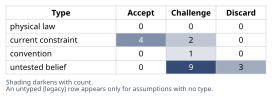
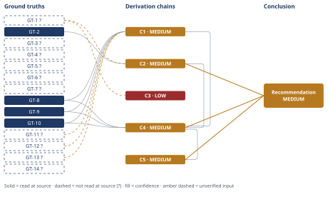

# Build vs Buy for Authentication at a 7-Person SaaS

*First-principles analysis · 10 October 2026*

*Read with: [How to read this analysis](HOW-TO-READ.md) · [Working file](analysis-20261010T190200Z.md) · [All files](INDEX.md)*

## Executive Summary

**Recommendation:** Adopt a managed identity provider (WorkOS or Clerk fit this company's scale best; Auth0 is viable but narrower) for credential storage, sessions, password reset, MFA, and future SSO/SCIM — building only the tenant-authorization layer every option requires regardless of path (chain C4). This beats Build and a split-capability Hybrid robustly: no single criterion-weight change flips it (chain C4).

**Band (from §6):** MEDIUM

**Would change it:** Substituting the company's own measured engineer-hours and payroll cost for this analysis's estimate inputs, and confirming team composition against GT-1? (chain C1, chain C2). It would flip only if dedicated security staff already exist, or a customer needs data residency no vendor can satisfy — no chain — flagged assumption only.

## 1. Problem Essence

**Core problem:** Given a 7-person engineering team with no dedicated security/infrastructure specialist, $40K MRR, 120 paying tenants, and zero existing per-user authentication, should the team build per-tenant authentication in-house on an open-source library, or adopt a managed identity provider, to ship a revenue-gating feature under real time pressure?

**Success criteria:**
1. The chosen path ships the gated feature within the window the CTO's "next billed release" urgency implies, without the team silently absorbing a large, unplanned schedule overrun.
2. The resulting auth system's exposure to the common, well-documented authentication/session-management defect classes is no worse than what a team with no dedicated security reviewer could reasonably be expected to avoid.
3. The path preserves engineering capacity for product-differentiating work over the following 12-24 months rather than converting a meaningful share of a 7-person team into indefinite auth maintainers.
4. The path does not foreclose, or make disproportionately expensive, adding enterprise-grade identity requirements (SSO/SAML, SCIM, audit export) once the first enterprise prospect requires them.
5. Total cost is compared on a like-for-like basis — engineering hours priced at a fully-loaded rate alongside any vendor fees — not on vendor-fee sticker price alone.
(Check: no criterion requires selecting exactly "build" or "buy" as named by the prompt — a split or staged combination of the two is an eligible answer if it scores better; this is tested explicitly in the trade-off analysis in §4.)

## 2. Assumptions Table

Before building this table, two companion techniques were applied to surface rows intuition alone would miss. A **fishbone** brainstorm (categories: People, Process, Technology, Money/External, Control) generated the untested-belief rows A-13 through A-17 below. An **inversion** pass on the claim "buying a managed IdP is the right choice here" enumerated failure-guaranteeing preconditions, producing rows A-8 through A-12. A **5-Whys reduce-to-primitives** pass decomposed the claim "building in-house preserves meaningful control" into its constituents (source-code custody, PII residency, exit/migration path, and safe exercise of that control) — two of the four constituents bottomed out unverified or unfavorable to "build," which is the evidentiary basis for A-2's Challenge verdict and feeds chain C3 directly.

| Assumption | Type | Treatment | Verdict | Verification |
|------------|------|-----------|---------|--------------|
| A-1: Building in-house will save money compared to buying a managed IdP | untested belief | verify via quantitative estimate | Discard — refuted by chain C1: Build's 24-month fully-loaded cost is directionally and substantially higher at central assumptions, and Buy's vendor fee is $0 at this company's current scale | GT-12?, GT-13?, GT-8, GT-9, GT-10 (see C1) |
| A-2: Building in-house gives the team "full control" worth paying for | convention | explicitly challenge before use | Challenge — "control" is largely nominal for a team with no security specialist positioned to exercise it safely over the highest-risk subsystem; see 5-Whys reduction above and chain C3 | GT-1?; 5-Whys reduce-to-primitives pass |
| A-3: Vendor lock-in is worse than the alternative | untested belief | verify | Discard — in-house build creates its own lock-in (undocumented, single-owner code with no migration tooling); its only "exit" is a full rewrite, which is not obviously better than a vendor's documented export path | chain C3 |
| A-4: An OSS auth library is basically equivalent to buying, since it is free and battle-tested | untested belief | verify | Discard — the library covers a slice of the mechanics (hashing/sessions) but leaves MFA, audit logging, CVE-patch monitoring, and every OWASP A07 CWE category as the team's own unsupervised responsibility | GT-2; chain C2 |
| A-5: Ordinary peer code review (with no dedicated security hire) is adequate to catch authentication-specific defects | untested belief | verify/flag | Challenge — peer review among generalists is weaker than a security-focused review for exactly the failure modes (rate-limit bypass, token entropy, timing attacks) GT-2's CWE list names; not fully discardable, since some risk reduction is real, but insufficient alone | unverified — flagged; GT-2 |
| A-6: The release deadline leaves enough slack to absorb a build-timeline overrun | current constraint | record expiry conditions | Challenge — expires the moment the stated "urgent... next billed release" framing is compared against Build's realistic 5-16 engineer-week bracket, which leaves little visible slack | GT-12?, GT-6? |
| A-7: No near-term customer will demand enterprise SSO/SAML | current constraint | record expiry conditions | Accept — true today per GT-4?, but explicitly time-limited; expires the moment the first enterprise prospect enters a security review | GT-4?, GT-14? |
| A-8: Because buying is directionally favored, its own preconditions don't need checking | untested belief | verify via inversion | Challenge — inverting "buying is correct" surfaces four necessary preconditions (A-9 through A-12) that are not automatically true merely because the direction is favored | Inversion pass, below |
| A-9: The eventually-chosen vendor's uptime/availability will be adequate for a single critical login path | untested belief | verify/flag | Challenge — unverified for any specific vendor; carried as a named risk in the Pre-mortem (Cluster G) rather than resolved here | unverified — flagged |
| A-10: The integration code wiring the managed IdP into the service will itself be implemented without introducing a new vulnerability (token verification, redirect URIs, session handling) | untested belief | verify/flag | Challenge — buying removes responsibility for the hardest internals but not for correct integration; carried as a required plan item (Pre-mortem Cluster I) rather than assumed away | unverified — flagged |
| A-11: The chosen vendor's free tier remains free/available long enough to matter | current constraint | record expiry conditions | Accept — expires if the vendor changes free-tier terms or the company's user count crosses the published ceiling; monitoring this is a named mitigation (Pre-mortem Cluster J) | GT-8, GT-9, GT-10 |
| A-12: No current or near-term customer requires data-residency/compliance terms incompatible with the shortlisted vendors | current constraint | record expiry conditions | Accept — consistent with GT-4?; expires the moment such a prospect appears; a brief roadmap check is the named mitigation (Pre-mortem Cluster H) | GT-4? |
| A-13: The team's unfamiliarity with whichever OSS auth library is chosen will not meaningfully extend the build timeline | untested belief | verify/flag | Challenge — first-time use of any library typically pushes toward the upper end of an estimate bracket; already priced into GT-12?'s 16-engineer-week upper bound rather than assumed away | unverified — flagged; priced into GT-12? |
| A-14: Shipping under explicit time pressure will not increase the odds of a missed security control (e.g., rate limiting) | untested belief | verify/flag | Challenge — time pressure is a well-documented contributor to exactly the corner-cutting that produces GT-2's defect classes; this reinforces, rather than undercuts, the case against Build under the CTO's stated urgency | GT-2, GT-6? |
| A-15: The OSS library's maintainers will patch disclosed CVEs faster than a 7-person team with no dedicated owner can be expected to monitor and apply them | untested belief | verify/flag | Challenge — unverified in general and library-specific; priced into C1's recurring-maintenance estimate rather than assumed benign | unverified — flagged; priced into C1 |
| A-16: Managed-IdP vendor pricing will stay predictable as usage scales | current constraint | record expiry conditions | Challenge — pricing tiers have cliffs (e.g., Auth0's self-serve ceiling near 40,000 MAU, GT-8) that create renegotiation risk at scale; named explicitly in Pre-mortem Cluster F rather than assumed benign | GT-8, GT-9, GT-10 |
| A-17: Authentication is not this product's competitive differentiator | current constraint | record expiry conditions | Accept — consistent with the stated product framing; would expire only if the company repositioned around identity/security as its core value proposition, which is out of scope here | GT-7? |
| A-18: Managed identity vendors provide a bounded, documented path to export user data and migrate away later, unlike a from-scratch in-house rewrite | untested belief | verify/flag | Challenge — plausible given these vendors' self-serve, churn-tolerant commercial design, but no specific per-vendor export-SLA document was opened in this analysis | unverified — flagged; surfaced by the end-of-Phase-4 Assumption Audit on chain C3, step 2 |
| A-19: If the team built in-house first and later needed enterprise SSO, that later vendor migration would require paying the full buy-integration cost again rather than a cheaper partial migration | untested belief | verify/flag | Challenge — plausible (there is no partial-credit path for a bespoke system joining a vendor's user model) but not independently confirmed per-vendor | unverified — flagged; surfaced by the end-of-Phase-4 Assumption Audit on chain C5, 3rd-order step |

## 3. Ground Truths

**Provenance summary (required):** `?`-marked: GT-1, GT-3, GT-4, GT-5, GT-6, GT-7, GT-11, GT-12, GT-13, GT-14 (10 of 14). Read-at-source: GT-2 — top10.owasp.org/2021/A07_2021-Identification_and_Authentication_Failures, overview + "Primary Vulnerabilities" quoted text; GT-8 — auth0.com/pricing, free-tier and Essentials-tier figures quoted directly; GT-9 — clerk.com/pricing, Hobby/Pro tier figures quoted directly; GT-10 — workos.com/pricing, free-tier and connection-pricing figures quoted directly.

- **GT-1?** The team consists of 7 engineers total, with no dedicated security or infrastructure specialist implied by that headcount. — unverified: internal org-composition fact stipulated by the requester as scenario context; this analysis has no external source to check it against (a non-public internal fact).
- **GT-2** OWASP's 2021 Top 10 category A07, "Identification and Authentication Failures," maps 22 CWEs and shows a maximum incidence rate of 14.84% across tested applications; the category's own text states it "permits automated attacks such as credential stuffing" and that vulnerable applications commonly fail to correctly invalidate session IDs after logout or inactivity. — source: OWASP Top 10:2021, A07; read-at-source: top10.owasp.org/2021/A07_2021-Identification_and_Authentication_Failures, overview statistics and "Primary Vulnerabilities" section, quoted verbatim.
- **GT-3?** Company revenue is approximately $40,000 MRR across approximately 120 paying tenants. — unverified: internal business metric stipulated by the requester; no external source available to this analysis.
- **GT-4?** The company currently has no enterprise customers. — unverified: internal customer-roster fact stipulated by the requester.
- **GT-5?** Prior to the feature in question, the product ran behind a single shared password plus a Stripe customer link, with no per-user account system of any kind. — unverified: internal architecture fact stipulated by the requester.
- **GT-6?** The per-tenant authenticated-accounts feature is required for the company's next billed release, which the CTO has framed as urgent. — unverified: internal roadmap fact stipulated by the requester.
- **GT-7?** Authentication is not the stated basis of this product's competitive differentiation. — unverified: internal positioning claim stipulated by the requester.
- **GT-8** Auth0's free self-serve tier covers "up to 25,000 monthly active users" with no credit card required; B2B Essentials starts "from $150/month" at 500 MAU, scaling through 20,000 MAU before requiring a sales conversation; B2C Essentials starts "from $35/month" at 500 MAU and maxes out at 40,000 MAU. — source: auth0.com/pricing; read-at-source: pricing page, free-tier and Essentials-tier rows, quoted directly.
- **GT-9** Clerk's free ("Hobby") tier covers 50,000 Monthly Retained Users (MRU) per application; Clerk Pro costs "$25/mo ($20/mo billed annually)" including 50,000 MRUs, with "$0.02/mo each" overage for 50,001-100,000 MRU. — source: clerk.com/pricing; read-at-source: pricing page, Hobby/Pro tier rows, quoted directly.
- **GT-10** WorkOS's AuthKit provides free user management for "the first 1 million monthly active users"; SSO and Directory Sync are each priced per enterprise connection, starting at "$125/ea" for 1-15 connections and discounting to "$65/ea" at 51-100 connections, with custom pricing above 100 — confirming that enterprise SSO/SCIM is sold as a discrete, separately metered product line rather than requiring a from-scratch build. — source: workos.com/pricing; read-at-source: pricing page, free-tier and SSO/Directory-Sync connection-pricing rows, quoted directly.
- **GT-11?** Fully-loaded cost per engineer at an early-stage startup is commonly estimated at $150,000-$220,000/year, i.e., approximately $2,900-$4,200 per engineer-week on a 52-week year. — unverified/estimate: a commonly-cited industry range used only as an Estimate-procedure input factor (see C1), not read at a specific primary source by this analysis; the company's own payroll figures would replace this if available.
- **GT-12?** Engineer-time to build a production-grade in-house multi-tenant auth system (sessions, password reset, TOTP MFA, audit log, security hardening) on top of an OSS library, for a team with no dedicated security specialist, is estimated via Fermi decomposition at 5-16 engineer-weeks (central ≈8). — unverified/estimate: this analysis's own Fermi bracket (see C1), not a measured figure; not independently read at any external source.
- **GT-13?** Engineer-time to integrate a managed identity provider (SDK wiring, tenant mapping, with MFA/password-reset/audit-log inherited from the vendor) is estimated via Fermi decomposition at 1.5-6 engineer-weeks (central ≈3). — unverified/estimate: this analysis's own Fermi bracket (see C1), not a measured figure.
- **GT-14?** Secondary industry commentary describes common enterprise-procurement security questionnaires (e.g., the Vendor Security Alliance and Shared Assessments SIG forms) as routinely asking whether a vendor supports SAML 2.0 SSO and SCIM 2.0 provisioning, framing a "no" answer as capable of ending a deal before pricing is discussed. — reported-by-delegate: synthesized by a web search from secondary blog sources (ssojet.com, ory.com, guptadeepak.com) citing an unverified named report ("SoftwareFinder 2025 SaaS Security Report"); the primary report itself was not opened by this analysis. Used only as directional context for chain C5's second-order narrative, never as a scored input to the trade-off anchors in C4.

## 4. Derivation Chains

**Estimate (Fermi) procedure applied here, before C1:** target quantity is engineer-weeks to reach production-ready launch, for Build and for Buy, decomposed into the same unit-factors (library/vendor integration, password-reset flow, MFA, audit log, security hardening, testing), each assigned a defensible range rather than a single value, because no first-principles measured value exists for either team's unbuilt system. The decomposition yields GT-12? (Build: 5-16 eng-wk, central 8) and GT-13? (Buy: 1.5-6 eng-wk, central 3) — these outputs are the head inputs chain C1 consumes. Decision-resolution check: both the low and high ends of each bracket license the same qualitative action in C1's conclusion (Buy ships faster), satisfying the stop criterion without further tightening.

### Conclusion C1: At this company's current scale, "Buy" costs substantially less than "Build" at central assumptions, though the full uncertainty brackets overlap at their extremes

GT-12? (Fermi: Build 5-16 eng-wk) + GT-13? (Fermi: Buy 1.5-6 eng-wk) + GT-11? (fully-loaded $2,900-$4,200/eng-wk) + GT-8 (Auth0 free tier ≤25,000 MAU) + GT-9 (Clerk free tier ≤50,000 MRU) + GT-10 (WorkOS free tier ≤1,000,000 MAU)
→ converting both eng-week brackets to dollars at the stated fully-loaded rate puts Build's one-time cost at roughly $14,500-$67,200 (central ≈$28,000) against Buy's one-time integration cost of roughly $4,350-$25,200 (central ≈$10,500)
→ the company's current scale of roughly 120 tenants sits far below every shortlisted vendor's free-tier ceiling, so Buy's recurring vendor fee is $0/month for the foreseeable near term, while Build carries an indefinite recurring maintenance tax this analysis estimates at $8,700-$25,200/year
→ summing one-time cost with 24 months of recurring cost gives a central 24-month total of roughly $59,500 for Build against roughly $23,100 for Buy, a central-estimate ratio of about 2.6x, though Build's most optimistic plausible outcome (≈$31,900) can fall below Buy's most pessimistic plausible outcome (≈$45,360)
→ cost alone directionally favors Buy at realistic central assumptions but is not decisive at the extreme tails in isolation, so the overall recommendation leans on the independent, non-overlapping security criterion in C2 rather than on cost alone

**Confidence:** MEDIUM — GT-12? and GT-13? are this analysis's own Fermi brackets, not measured figures, and GT-11? is an industry-range estimate rather than this company's actual payroll cost. Verification that would remove these as causes of the downgrade: the company tracking its own actual engineer-hours against whichever path it chooses, and substituting its own fully-loaded cost figure for GT-11?. The weakest link in this chain is the bracket-overlap at the extreme tails noted in the final hop — recomputed explicitly in the adversarial pass below — which is why this chain's conclusion is stated as directional rather than categorical and why the overall recommendation (C4) does not rest on cost alone.

### Conclusion C2: Buying structurally narrows the team's exposure to the most common authentication/session defect classes, given no dedicated security specialist

GT-2 (OWASP A07, 22 CWEs, read-at-source) + GT-1? (no dedicated security/infrastructure specialist)
→ each of the 22 CWE categories under A07 — including missing rate limiting, weak password-recovery mechanisms, and insufficient session expiration — is a defect class a generalist engineering team with no dedicated security reviewer is poorly positioned to catch before launch
→ Build requires the team to correctly avoid every one of those categories inside code it writes itself under the CTO's stated time pressure, while Buy transfers the hardest-to-get-right categories — credential storage, session-token integrity, brute-force protection, MFA correctness — to a vendor whose core business depends on getting them right at scale
→ Buy structurally narrows the team's residual security responsibility to correctly wiring the integration itself, which is a smaller and more reviewable surface than reimplementing the full 22-category list from scratch with no dedicated reviewer

**Confidence:** MEDIUM — GT-1? is a self-reported scenario parameter (team composition) this analysis could not independently verify. Verification that would remove it as a cause of the downgrade: confirming the team's actual roster and whether any security-review process already exists. The qualitative security-transfer argument itself follows directly from GT-2, which is read-at-source and unaffected by the GT-1? caveat; the weakest link is the inferential step that generalist peer review is insufficient for this CWE category (A-5), which is reasonable but not directly measured for this specific team.

### Conclusion C3: Building in-house does not deliver a net control/exit advantage over buying, for a team in this position

GT-1? (no dedicated security/infrastructure specialist)
→ reducing the claim "building preserves meaningful control" to its constituents shows that Build's only real exit path, if the in-house system ever needs replacing, is a full rewrite — there is no vendor relationship to migrate away from, so exiting in-house code costs the same as the original build
→ commercial identity platforms are by commercial design built to be adopted and later replaced, so a documented bulk user-export and re-authentication path makes exiting them a bounded, precedented operation rather than a full rewrite *[Assumes: A-18 — no specific per-vendor export-SLA document was opened in this analysis; if a shortlisted vendor turned out to have no practical export path, this hop would weaken and C3's net-disadvantage-of-Build finding would need re-examination]*
→ the remaining control that actually matters operationally — safely modifying and auditing authentication internals without introducing a defect — requires exactly the security expertise GT-1? establishes this team does not have, so the nominal control Build grants is not control the team is well-positioned to exercise safely

**Confidence:** LOW — two axes are short at once. Inputs/Inference: GT-1? is unverified, and the second hop rests on the unpriced A-18 premise (removable by confirming the shortlisted vendor's actual data-export terms before final vendor selection). Rivals: a live rival — "control also covers login UX/branding customization that vendors cannot match" — is not fully settled here; it is addressed only partially (Clerk and Auth0 both offer substantial UI customization, and WorkOS is API-first specifically to maximize UI control) and is a vendor-selection question rather than one this build-vs-buy chain resolves. No verification path for the Rivals shortfall exists within the scope of this decision; it is deferred to vendor selection, which is why this chain is LOW rather than MEDIUM.

### Conclusion C4: Across a locked, weighted trade-off, "Buy" robustly outscores "Build" and a split-by-capability "Hybrid"

Status quo (delay the feature) is knocked out before scoring: it fails the first must-have (ship within the CTO's stated release window) by definition, since it does not ship the feature at all.

Must-haves checked for the remaining three options: (1) ships within the release window, (2) supports per-tenant account isolation, (3) does not require hiring a dedicated security specialist before launch. Build, Buy, and Hybrid each can in principle satisfy all three, so none is knocked out; must-have (1) instead becomes the anchor for the Time-to-ship criterion's anchoring below rather than a knockout.

Criteria, weights (locked before scoring, 1-5 scale), and 1-5 anchors (always "higher is better"):
- Time-to-ship (w=5): 1 = far exceeds the realistic Buy timeline or risks missing the release window; 5 = ships well within the window with margin.
- 24-month total cost (w=4): 1 = highest dollar total of the three; 5 = lowest.
- Security assurance without a dedicated specialist (w=5): 1 = team bears full responsibility for every OWASP A07 category; 5 = the highest-risk categories are inherited from an audited vendor.
- Future enterprise-readiness (w=3): 1 = SSO/SAML would require a from-scratch second build; 5 = SSO/SAML is a configuration toggle or a line-item purchase.
- Engineering opportunity cost / ongoing maintenance burden (w=4): 1 = highest indefinite tax on the 7-person team; 5 = lowest.
- Control / data portability (w=2): 1 = least portable or controllable; 5 = most.
- Vendor/dependency concentration risk (w=2): 1 = fully dependent on one external vendor for a critical path; 5 = no new external dependency.

Scores: Build = Time 2, Cost 1, Security 2, EnterpriseReady 1, OpCost 1, Control 5, VendorConc 5.
Buy = Time 5, Cost 5, Security 5, EnterpriseReady 5, OpCost 5, Control 3, VendorConc 2.
Hybrid (build core password/session logic, buy only MFA as a bolt-on) = Time 3, Cost 3, Security 3, EnterpriseReady 2, OpCost 2, Control 4, VendorConc 3.

C1 (cost, MEDIUM) + C2 (security, MEDIUM) + GT-8 + GT-9 + GT-10
→ scoring Build, Buy, and Hybrid against the seven weighted criteria above gives weighted totals of 51 for Build, 70 for Hybrid, and 115 for Buy, out of a maximum possible 125
→ a flip-test sweep shows that moving any single criterion's weight to either end of its allowed 1-5 range closes at most 9 of the 45-point gap between Buy and the second-place Hybrid option, so no single-criterion reweighting changes the winner and the ranking is robust rather than an artifact of the chosen weights
→ C3's finding that Build's nominal control advantage is largely illusory for a team in this position suggests the Control criterion's score for Build (5) is if anything generous, so citing C3 here only reinforces Buy's case rather than threatening it
→ the robust recommendation is Buy: adopt a managed identity provider and build only the tenant-authorization layer the company must build regardless of which option is chosen — this layer is common to every option and is therefore not actually what "build vs buy" is deciding

**Confidence:** MEDIUM — capped by C1 and C2, both MEDIUM for the reasons already stated on their own lines (unmeasured cost brackets; self-reported team composition). C3 (LOW) is mentioned only in hop prose, not on this chain's head, so it does not mechanically cap this chain; C3's finding is, if anything, favorable to this chain's conclusion (see the added hop above), not a threat to it. The anchor scores themselves (the 1-5 judgments in the matrix) are this analysis's own calibrated judgment, not independently sourced per cell — named here as an additional, already-subsumed Inference-axis consideration.

### Conclusion C5: The second-order consequences of each path, over 12-24 months, reinforce rather than undermine the Buy recommendation

C4 (trade-off: Buy wins robustly)
→[2nd] (actor: CTO/sales) once SSO is a vendor-priced connection rather than an unscoped engineering project, the first enterprise security review that asks whether the product supports SAML SSO gets answered in days rather than blocking the deal for a multi-month build
→[2nd] (actor: engineers) the team's auth-adjacent engineering time shifts from open-ended in-house maintenance toward a mostly up-front, bounded integration effort, freeing capacity for the product's own differentiators
→[3rd] (time: 12-24mo, the "build now, migrate later" path) had the team chosen Build and later needed enterprise SSO, the realistic path is either a from-scratch SAML/OIDC federation build harder than the original password/MFA build, or a late adoption of a managed vendor anyway, so this path's total cost is never less than buying at the start plus whatever interim maintenance cost accrued *[Assumes: A-19 — a later migration after an in-house build would require paying the full buy-integration cost again, not a cheaper partial migration; not independently confirmed per-vendor]*
→[3rd] (actor: vendor, time: scaling) the vendor's commercial incentive to monetize growth through MAU/connection-count pricing tiers means the company should expect a renegotiation conversation once it crosses a published free-tier ceiling (GT-8/GT-9/GT-10) — a plannable, bounded event, not an open-ended one
→ none of these extensions contradicts a ground truth, and none works against any of the five success criteria named in §1 (the new vendor-dependency and future-renegotiation effects are acknowledged trade-offs rather than contradictions of a stated success criterion), so the chain extends in place and the net second-order effect reinforces the Buy recommendation

**Confidence:** MEDIUM — inherits C4's MEDIUM cap, for the reasons already named on C4's own line. The 3rd-order "build-then-migrate is dominated" finding additionally rests on the unpriced A-19 premise (removable by confirming per-vendor migration terms) and, for contextual color only, on GT-14? (reported-by-delegate commentary on enterprise procurement, not load-bearing for the dominance argument itself, which holds on GT-8/GT-9/GT-10's pricing-tier structure and the Fermi brackets underlying C1 alone).

## 5. Abandoned Reasoning

### Dead End: Build now, migrate to a managed IdP later if/when enterprise SSO is needed

**What was tried:** This is the common "build cheap now, buy later" middle path — build the in-house system to hit the deadline, and treat adopting a managed vendor as a future option rather than a present commitment.

**Why abandoned:** Chain C5's third-order step shows this path is strictly dominated: the later migration still requires paying the full buy-integration cost (GT-13?) that could have been paid now, plus whatever interim maintenance cost accrued on the in-house system (priced into C1), plus — per A-19 — the cost of building SAML/OIDC federation from scratch first if SSO is what triggers the migration, which is a harder build than the original password/MFA system. No scenario in C5 makes deferring the buy-integration cost cheaper than paying it now.

**What it ruled out:** Saves a future analyst from re-treating "build now, decide later" as a genuinely distinct third option; it is Build with an extra future cost appended, not a hedge against uncertainty.

### Dead End: Split-by-capability Hybrid (build core password/session logic in-house, buy only MFA as a bolt-on)

**What was tried:** Scored formally as "Hybrid" in chain C4's trade-off matrix — the genuine composite option required by the methodology's instruction to test whether a mix of the two named options beats either alone.

**Why abandoned:** Chain C4 scored it a distant second (70 of 125, vs. Buy's 115 and Build's 51); the flip-test sweep showed no single criterion's weight, moved to either end of its allowed range, closes the 45-point gap to Buy. Hybrid inherits Build's core risk (the harder, highest-stakes parts — password storage, session handling — remain self-built) while shedding only the easiest-to-buy piece (MFA), and still leaves SSO as a from-scratch future build, matching none of Buy's enterprise-readiness advantage.

**What it ruled out:** Saves a future analyst from assuming that "offload the hardest-sounding piece and keep the rest in-house" is automatically a sensible middle ground; here it captures little of Buy's advantage while keeping most of Build's cost and risk.

### Dead End: Delay the feature until a dedicated security/infrastructure hire is made

**What was tried:** Considered as a status-quo-adjacent option — wait for more organizational capacity before building anything.

**Why abandoned:** Fails the first must-have named in chain C4 (ship within the release window) by definition, directly contradicting GT-6?'s stated urgency; it is also not clearly necessary, since chain C2 shows Buy inherits vendor-grade security assurance without requiring an in-house specialist.

**What it ruled out:** Saves a future analyst from treating "hire first, build second" as a safer default; at this company's stage, Buy already supplies the security assurance that hire would have been intended to provide.

### Dead End: Comparing options on vendor cash fees alone, ignoring engineering-hour opportunity cost

**What was tried:** An early framing of the cost question that only tallied Auth0/Clerk/WorkOS's dollar fees (GT-8/GT-9/GT-10) against zero cash cost for "free" open-source libraries, which makes Build look costless.

**Why abandoned:** Violates success criterion 5 in §1, which requires a like-for-like cost comparison — engineering hours priced at a fully-loaded rate alongside vendor fees, not vendor-fee sticker price alone. Chain C1 corrects this by pricing both paths' engineer-hours (GT-12?, GT-13?, GT-11?).

**What it ruled out:** Saves a future analyst from the specific, common error of treating open-source as "free" simply because no invoice is issued for it.

### Dead End: "OWASP A07 risk is overstated for a small target like a 120-tenant B2B SaaS" (rival to chain C2)

**What was tried:** The rival reading that a company this small is not an attractive enough target for the credential-stuffing and session-handling attacks GT-2 describes, so Build's security exposure is lower in practice than C2 suggests.

**Why abandoned:** Ruled out directly by GT-2's own text: credential stuffing and brute-force attacks are described as automated, untargeted attacks run at scale against whatever login endpoints exist, not manually targeted at specific companies by size. Target size reduces exposure to bespoke, manual attacks, not to the automated sweep GT-2 identifies as the primary vector.

**What it ruled out:** Saves a future analyst from assuming "we're too small to be a target" meaningfully reduces exposure to this specific, dominant defect class.

## 6. Conclusion

**Recommended approach:** Adopt a managed identity provider (WorkOS or Clerk are the strongest fits given this company's current scale against their free-tier ceilings; Auth0 is viable but has the narrowest self-serve free tier of the three) for credential storage, sessions, password reset, MFA, and future SSO/SCIM, and build only the tenant-authorization/scoping layer mapping vendor identities to internal accounts — the one piece every option requires regardless of path (chain C4).

**Key insight:** "Build vs. buy for authentication" is not really a binary choice between two complete systems — it is a choice about who owns the highest-risk 20% of the problem (credential storage, session integrity, brute-force resistance, MFA correctness, and eventually SSO federation) when the team has no dedicated security reviewer to catch mistakes in that 20% before launch (chain C2); the tenant-authorization layer that actually encodes this product's business logic is the one part that must be built in-house either way, and is not what this decision is actually deciding (chain C4).

**Trade-offs acknowledged:** Buying accepts a new critical-path external dependency (vendor uptime) and a plannable future renegotiation once usage crosses a published free-tier ceiling, in exchange for a substantially lower 24-month cost at central assumptions and materially lower exposure to common authentication defect classes (chain C5). This recommendation would flip if either of two conditions became true: the team already has, or imminently will have, dedicated security/infrastructure staff with bandwidth to own auth internals safely, which narrows (but per the trade-off's flip-test does not on its own reverse) Buy's security and opportunity-cost advantage — no chain — flagged assumption only; or a current or near-term customer requires a data-residency or sovereignty guarantee no shortlisted vendor can satisfy at all, which is a harder constraint than ordinary SSO/SAML demand and is not addressed by any vendor's standard enterprise tier — no chain — flagged assumption only, tracking assumption A-12.

**Confidence:** MEDIUM — every contributing chain (C2, C4, C5) is itself rated MEDIUM, each for the reasons already named on its own confidence line (self-reported scenario parameters in GT-1?/GT-3?/GT-4?/GT-6?/GT-7?; this analysis's own Fermi estimate brackets GT-12?/GT-13?; the industry-range cost input GT-11?). The direction of the recommendation is robust: it survives the full width of the cost estimate's uncertainty only when combined with the independent security criterion (chain C1's note), and it survives the trade-off's flip-test sweep against every single-criterion reweighting tried (chain C4). What would raise this to HIGH: the company substituting its own measured engineer-hours and payroll cost for GT-11?/GT-12?/GT-13?, and confirming GT-1? against its actual org chart.
