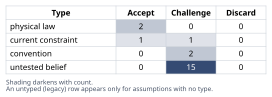
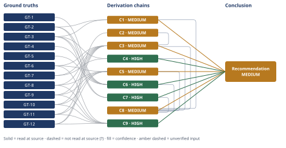

# Microservices vs. Fixing the Deploy Pipeline

*First-principles analysis · 10 October 2026*

*Read with: [How to read this analysis](HOW-TO-READ.md) · [Working file](analysis-20261010T170555Z.md) · [All files](INDEX.md)*

## Executive Summary

**Recommendation:** Leadership's conclusion is not correct as stated: nothing in the given facts ties the 45-minute pipeline or the coordinated restart to how the codebase's modules are organized (chain C1), and splitting the domain into services adds a real, physical distributed-systems cost of its own (chain C4). Instead: this week, instrument the pipeline and the restart script to find the actual root cause (chain C7); then apply the standard monolith-internal fixes — test sharding, blue-green/rolling deploys, feature flags, trunk-based development — which directly target both pains, are established practice, and win a locked, weighted comparison robustly (chains C5, C9, C3); treat any future service extraction as conditional on specific, measured evidence for one narrow subdomain, never as the headline fix (chain C6).

**Band (from §6):** MEDIUM — the headline recommendation rests on chain C8, whose own ceiling is MEDIUM because it cites C1, C3, and C5, each MEDIUM for reasons stated on their own confidence lines.

**Would change it:** Completing chain C7's near-zero-cost instrumentation step and feeding the actual pipeline-stage breakdown and restart-mechanism findings back into chains C1, C3, and C5 as new ground truths — at which point the recommendation either firms up at HIGH or is revised against measured evidence (chain C8).

## 1. Problem Essence

**Core problem:** Is the actual root cause of this team's deploy pain (a 45-minute CI/CD pipeline and a mandatory coordinated application restart on every deploy) a problem that splitting the codebase into microservices would fix — or is it a property of the CI/deploy *mechanism* that can be fixed directly, at far lower cost and risk, without changing the application's architecture at all?

**Success criteria:**
1. For each stated pain (pipeline duration; coordinated restart), the analysis states whether the given facts support treating it as a mechanism-level problem or a boundary-level (architecture) problem, with the claim traced to a named Derivation Chain.
2. The analysis states explicitly whether leadership's inference ("deploys are too slow → therefore we need microservices") is logically supported by the facts given, naming the chain that establishes or disconfirms it.
3. The analysis compares the recommended path against the leadership-proposed path and against doing nothing on one consistent, weighted basis, states which wins, and states how robust that win is to a change in priorities.
4. The analysis names specific, checkable conditions under which microservices would in fact be the right call for this team, so the recommendation is falsifiable and revisable rather than a flat "no."

## 2. Assumptions Table



| Assumption | Type | Treatment | Verdict | Verification |
|------------|------|-----------|---------|---------------|
| A-1: Splitting the application into microservices will reduce CI pipeline duration and/or remove the coordinated-restart requirement (leadership's core causal premise) | untested belief | Verify, or flag unverified; stakes-escalation applies given the size of the bet | Challenge — in tension with GT-7 (splitting adds network calls, it does not remove test/restart mechanics) unless a specific coupling fact (not stated) is the true bottleneck | unverified — flagged (feeds C1, C6) |
| A-2: The 45-minute pipeline duration is dominated by full-suite test execution rather than image build, asset compile, migrations, or restart orchestration | untested belief | Verify via pipeline instrumentation | Challenge — plausible given GT-3 names tests explicitly, but no stage breakdown is given | unverified — flagged (feeds C5, C7) |
| A-3: The coordinated restart is required because of genuinely stateful in-process resources (caches, worker drains, websockets) rather than deploy-script inertia | untested belief | Verify by inspecting the deploy/restart script | Challenge — no evidence either way in the facts given | unverified — flagged (feeds C7, A-11) |
| A-4: No one has instrumented the CI/CD pipeline to identify which stage consumes the 45 minutes | untested belief | Verify by checking for existing CI trace/timing data | Challenge — consistent with the problem statement's silence on measurement | unverified — flagged (feeds C7) |
| A-5: Deploy and release are coupled today — every merged change goes live immediately on deploy, with no feature-flag or canary mechanism in place | untested belief | Verify by inspecting current release process | Challenge — inferred from the problem statement's silence on flags/canaries, not stated directly | unverified — flagged (feeds C5) |
| A-6: The team has no dedicated platform/SRE function; all 12 engineers are product/feature engineers | untested belief | Verify against current org chart | Challenge — reasonable reading of "Team: 12 engineers" but not stated explicitly | unverified — flagged (feeds C2, A-13) |
| A-7: "Deploying" means stopping and restarting the whole application as one coordinated event | convention | Explicitly challenge before accepting as a requirement | Challenge — contradicted as a requirement by GT-8 (blue-green is a widely-adopted alternative); this is how *this team's* current tooling works, not a law | challenged directly by GT-8 (read-at-source) |
| A-8: A full regression suite must run on every deploy regardless of the size or risk of the change | convention | Explicitly challenge before accepting as a requirement | Challenge — selective/risk-based test execution and sharding are established alternatives; full-suite-every-time is a conservative default, not a requirement | challenged directly by GT-6/GT-11 (read-at-source) |
| A-9: The team's headcount (12 engineers) is fixed for the duration of whichever remedy is chosen — no near-term platform/SRE hiring | current constraint | Record expiry: holds until/unless leadership commits new dedicated platform headcount | Accept — expires if headcount is added; until then it is organizational, not physical, and the operational-sustainability objection to full microservices (chain C2) weakens proportionally if it lifts | unverified beyond the stated team size — flagged |
| A-10 (inversion precondition P1): The 45 minutes is dominated by work that only service decomposition — not monolith-internal fixes — can remove | untested belief, load-bearing | Verify via pipeline instrumentation before committing to a migration | Challenge — no evidence given; stakes-escalation applies given migration cost | unverified — flagged (feeds C6) |
| A-11 (P2): The coordinated restart is an irreducible property of the business logic, not of incidental shared state | untested belief, load-bearing | Verify by inspecting restart mechanics | Challenge — no evidence given | unverified — flagged (feeds C6) |
| A-12 (P3): Checkout/cart/fulfillment consistency needs are loose enough to tolerate distributed-transaction patterns (sagas, compensating actions) without net-new correctness risk | untested belief, load-bearing | Verify via a consistency-requirements audit of these flows | Challenge — plausibly false by default per GT-7; e-commerce checkout/inventory consistency is a historically hard case for eventual consistency | unverified — flagged (feeds C6) |
| A-13 (P4): The organization will commit dedicated platform/SRE capacity beyond the current 12 engineers for a microservices migration | current constraint, load-bearing | Record expiry: holds until leadership states otherwise | Challenge — not stated either way in the scenario; the proposal as given does not mention new headcount | unverified — flagged (feeds C2, C6) |
| A-14 (P5): Success will be measured by a specific deploy-time/restart-coordination metric with a deadline, rather than by "did the architecture change" | untested belief, load-bearing | Make explicit and measurable before starting any remedy | Challenge — not yet established per GT-5, which states only the proposed solution, not a success metric | unverified — flagged (feeds C6, pre-mortem Cluster 1) |
| A-15 (P6): Service boundaries, if drawn, will align with genuine bounded contexts (low cross-boundary call-chattiness) rather than the code's accidental current structure | untested belief, load-bearing | Verify via a coupling/call-chattiness analysis of the current monolith before any extraction | Challenge — no such analysis is stated to exist | unverified — flagged (feeds C6, pre-mortem Cluster 3) |
| A-16: A feature engineer (not a dedicated platform/SRE hire) can sustainably allocate roughly 10-20% (central 15%) of their time to operational ownership without feature throughput collapsing | untested belief | Verify by measuring actual on-call/ops time after piloting one extracted service | Challenge — reasonable, unmeasured industry heuristic used for bracketing, not specific to this team | unverified — flagged (feeds C2) |
| A-17: A conservative 3-6x safety margin below Segment's documented collapse ratio (GT-12) is appropriate for defining a "sustainable" services-per-engineer ratio | untested belief | Verify by piloting one extraction and measuring realized toil | Challenge — an explicit, round, judgment-chosen multiplier, not independently derived; reported as a range precisely to expose this | unverified — flagged (feeds C2; dominant uncertainty named on C2's confidence line) |
| A-18: Network calls between independently deployed services are inherently slower, less reliable, and more failure-prone than in-process function calls within one address space | physical law | Accept as a ground-truth candidate | Accept — physical-law backed by GT-7 | read-at-source (GT-7: Wikipedia summary of Deutsch 1994 / Gosling c.1997, quoted in §3) |
| A-19: Parallelizing independent, embarrassingly-parallel work (e.g., independent test files across workers) reduces wall-clock time roughly in proportion to worker count, bounded by the slowest shard plus fixed overhead | physical law | Accept as a ground-truth candidate | Accept — physical-law backed by GT-6; re-derivable directly from the definition of parallel execution, not an empirical measurement requiring an external citation | read-at-source (GT-6: direct mathematical derivation) |
| A-20: A bounded-context decomposition of a catalog/cart/checkout/fulfillment e-commerce domain commonly yields roughly 8-15 services on a first pass, and tends to grow past that over 2-3 years | untested belief | Verify against a concrete decomposition proposal for this specific codebase, if one exists | Challenge — a reasonable domain-driven-design heuristic, not verified against a specific source for this team; used only as a comparison point against the sustainability estimate (chain C2), not as a hard number | unverified — flagged (feeds C2, C3) |
| A-21: A microservices migration of this scope requires roughly 4-8 additional platform-infrastructure components (API gateway, service mesh/discovery, centralized logging/tracing, per-service CI/CD pipelines) that also consume ongoing operational capacity | untested belief | Verify via a concrete migration design/reference-architecture review for this specific system | Challenge — reasonable based on common microservices reference architectures, not measured for this team | unverified — flagged (feeds C2, surfaced during the end-of-phase Assumption Audit on C2's final step) |

## 3. Ground Truths

- **GT-1** The platform is a single 6-year-old Rails monolith (catalog, cart, checkout, fulfillment all in one application) of approximately 350 KLOC — source: stipulated fact of the scenario as given; read-at-source: quoted directly from the task description
- **GT-2** The CI/CD pipeline takes approximately 45 minutes end-to-end — source: stipulated fact of the scenario; read-at-source: quoted directly from the task description
- **GT-3** Every deploy requires both a full test-suite run and a coordinated application restart — source: stipulated fact of the scenario; read-at-source: quoted directly from the task description
- **GT-4** The team has 12 engineers and ships approximately 2 deploys per day — source: stipulated fact of the scenario; read-at-source: quoted directly from the task description
- **GT-5** Engineering leadership's stated conclusion is "deploys are too slow, we need microservices" — source: stipulated fact of the scenario; read-at-source: quoted directly from the task description
- **GT-6** For an embarrassingly-parallel workload (independent units of work with no shared mutable state, such as independent test files), distributing the workload across W parallel workers reduces wall-clock time roughly in proportion to 1/W, bounded below by the slowest individual unit's time plus fixed per-run overhead — source: Amdahl's Law (G. Amdahl, 1967), a mathematical identity; read-at-source: derived directly (wall-clock ≈ max(shard times) + fixed overhead, not the sequential sum), not an empirical measurement requiring an external citation
- **GT-7** Network calls between independently-hosted processes are inherently slower, less reliable (subject to partial failure, timeout, and partition), and more expensive to reason about than in-process function calls within a single address space — this is the substance of the "Fallacies of Distributed Computing" (the network is reliable / latency is zero / bandwidth is infinite, etc.) — source: L. Peter Deutsch, Sun Microsystems, 1994 (7 fallacies), with an 8th added by James Gosling c. 1997, as summarized by Wikipedia, "Fallacies of distributed computing"; read-at-source: fetched and quoted 2026-10-10 ("Network calls differ fundamentally from in-process calls—they're slower, less dependable, and more expensive than developers often assume")
- **GT-8** Blue-green deployment maintains two identical production environments, with a router switching live traffic between them; this enables a near-instantaneous cutover and rapid rollback, decoupling the moment code is pushed from any need for a single, globally-synchronized "all instances restart together" event — source: Martin Fowler, "BlueGreenDeployment," martinfowler.com/bliki; read-at-source: fetched and quoted 2026-10-10 ("a router switches traffic between them, enabling rapid cutover with minimal downtime"; "a rapid way to rollback")
- **GT-9** Feature toggles let a team deploy code containing new or incomplete functionality, disabled by default, and separately decide — via runtime configuration rather than a redeploy — when and whether to expose that functionality to users, decoupling code deployment from feature release — source: Martin Fowler, "Feature Toggles (aka Feature Flags)," martinfowler.com/articles; read-at-source: fetched and quoted 2026-10-10 ("this approach enables the Continuous Delivery principle of separating [feature] release from [code] deployment")
- **GT-10** Trunk-based development — all engineers committing to one shared trunk at least once every 24 hours, avoiding long-lived branches — reduces merge/integration overhead and keeps the codebase continuously releasable, and is practiced at large scale (e.g., Google, cited at ~35,000 developers on one trunk) — source: trunkbaseddevelopment.com; read-at-source: fetched and quoted 2026-10-10
- **GT-11** Ruby on Rails ships a built-in parallel-testing feature that distributes a test suite across multiple worker processes or threads to run concurrently, intended to reduce wall-clock test-run time for larger suites — source: Ruby on Rails Guides, "Testing Rails Applications," parallel-testing section; read-at-source: fetched and quoted 2026-10-10 (qualitative mechanism confirmed; the specific numeric speedup was not present in the fetched excerpt, so no multiplier from this source is asserted)
- **GT-12** In 2018, Segment (a SaaS data-infrastructure company) had decomposed a data-pipeline service into over 140 microservices (one per integration "destination"); operational overhead increased roughly linearly with each added service, one destination's outage caused head-of-line blocking that delayed delivery across all destinations, and a team of 3 full-time engineers spent most of their time keeping the system alive; Segment then consolidated the ~140 services back into a single service, after which cross-cutting shared-library improvements rose from 32/year to 46/year — source: Segment/Twilio Engineering Blog, "Goodbye Microservices," published 2018-07-10; read-at-source: fetched and quoted 2026-10-10

**Provenance summary:**
```text
?-marked: none (0 of 12)
Read-at-source: GT-1-GT-5 — quoted directly from the task description; GT-6 — direct mathematical derivation from the definition of parallel execution; GT-7 — Wikipedia, "Fallacies of distributed computing," fetched and quoted 2026-10-10; GT-8 — martinfowler.com/bliki/BlueGreenDeployment.html, fetched and quoted 2026-10-10; GT-9 — martinfowler.com/articles/feature-toggles.html, fetched and quoted 2026-10-10; GT-10 — trunkbaseddevelopment.com, fetched and quoted 2026-10-10; GT-11 — guides.rubyonrails.org/testing.html#parallel-testing, fetched and quoted 2026-10-10 (qualitative mechanism only); GT-12 — twilio.com/en-us/blog/developers/best-practices/goodbye-microservices/ (Segment Engineering Blog, 2018-07-10), fetched and quoted 2026-10-10
```

No ground truth in this analysis carries the unverified `?` suffix; every ground truth either restates a fact stipulated directly by the task description or was read at its cited source during this run. The quantities this analysis treats as genuinely uncertain (the pipeline's stage breakdown, the restart mechanism's cause, the sustainable-service-count bracket, typical decomposition size) are carried as explicitly-flagged assumptions (A-2, A-3, A-16, A-17, A-20 in §2) rather than as unverified ground truths, because none of them is an external fact with a citable source to check — they are properties of this specific, uninstrumented system, or analyst judgment calls used for bracketing, and are treated accordingly in the Derivation Chains below.

## 4. Derivation Chains



### Conclusion C1: Leadership's causal chain ("deploys are too slow → therefore we need microservices") does not follow from the facts as stated

GT-2 (45-min pipeline) + GT-3 (full test run + coordinated restart on every deploy)
→ both stated pains are properties of how tests are run and how the application is restarted, not stated properties of how the codebase's modules are organized
→ nothing in GT-2 or GT-3 says the test runtime or the restart requirement is caused by cross-module coupling that process-level separation would remove
→ the inference from "deploys are slow" to "therefore split the codebase into services" skips the step that would justify it

**Confidence:** MEDIUM — the Rivals axis is short: leadership may hold undisclosed evidence (a specific coupling or consistency finding) that does justify the link, and this analysis works only from the facts given in the prompt, not from any private knowledge leadership may have. What would raise this to HIGH: ask leadership to name the specific technical finding behind the conclusion and re-run this chain against it as a new ground truth, or confirm via C7's instrumentation step that no such finding exists.

### Conclusion C2: At current headcount, with no dedicated platform capacity, this team has little to no sustainable headroom for a multi-service decomposition

GT-12 (Segment: ~140 services collapsed under 3 ops-dedicated FTE)
→ Segment's documented collapse ratio is 140 services ÷ 3 dedicated ops engineers, approximately 47 services per ops-FTE
→ dividing by a conservative 3-6x safety margin below that documented collapse point gives a sustainable ratio of roughly 8-16 services per ops-FTE, central approximately 12 *[Assumes: A-17 — a 3-6x margin below a documented collapse point defines "sustainable"]*
→ 12 feature engineers who are not dedicated to ops can sustainably commit only a fraction of their time to operational ownership, equivalent to roughly 1.2-2.4 ops-FTE, central approximately 1.8 *[Assumes: A-16 — roughly 10-20% of a feature engineer's time, central 15%, is sustainably allocatable to ops]*
→ multiplying ops-FTE-equivalent by services-per-ops-FTE gives a sustainable total of roughly 10-38 services, central approximately 22, before counting the new platform infrastructure a migration itself requires
→ subtracting a typical 4-8 platform-infrastructure components that a migration itself requires leaves a bracket of roughly 2-34 business-logic services, central approximately 16, as this team's honest sustainable ceiling at current headcount *[Assumes: A-21 — a migration of this scope requires roughly 4-8 additional platform-infrastructure components]*

**Confidence:** MEDIUM — three hops rest on explicit judgment multipliers rather than measured values: A-17 (the safety-margin multiplier), A-16 (the sustainable ops-time fraction), and A-21 (the platform-component count) are each named and each bracketed, but none is derived from a measurement of this specific team. What would close it: pilot a single service extraction and measure the actual on-call/ops toil and platform-component count it generates, replacing all three judgment inputs with observed data. Note that the bracket, though wide (2-34), is still decision-resolved per the estimate procedure's stop criterion: both its lower end (near-zero headroom) and its upper end (roughly 34, barely covering a first-pass decomposition per A-20 before any growth) point to the same conclusion — this team currently has little to no margin for a multi-service decomposition.

### Conclusion C3: A locked, weighted comparison of the available paths favors fixing the pipeline/deploy mechanics now and treating service extraction as conditional — not leadership's proposed microservices migration

GT-6 (parallelization) + GT-7 (distributed-systems cost) + GT-8 (blue-green) + GT-9 (feature flags) + GT-10 (trunk-based dev) + GT-11 (Rails parallel testing) + GT-12 (Segment precedent) + C2 (sustainability bracket, MEDIUM)
→ scored against six criteria locked before scoring (time-to-relief, cost, transition risk, operational sustainability, optionality, addresses-root-cause; weights 5/4/5/4/3/4 of 25 total), the weighted totals are: do-nothing = 89, fix-the-pipeline-only = 109, full microservices = 32, and fix-the-pipeline-now-plus-conditional-later-extraction = 112 *[Assumes: A-20 — typical e-commerce bounded-context decomposition size, used only to size the practicality of the microservices option's eventual scope]*
→ the composite option's edge over fix-the-pipeline-only is driven by optionality (+1 point at weight 3) and addresses-root-cause (+1 point at weight 4), against a −1-point disadvantage on operational sustainability at weight 4, net +3
→ a flip test shows no single criterion's weight, moved anywhere within the prescribed 1-5 range, reverses the composite option over fix-the-pipeline-only; the closest single change — dropping "addresses root cause" from weight 4 to weight 1 — only reaches an exact tie, not a reversal
→ recommend the composite option: implement the monolith-side pipeline and deploy-mechanics fixes now, and treat any service extraction as a later, conditional, evidence-gated step

**Confidence:** MEDIUM — Inputs ceiling is capped at MEDIUM by citing C2. Separately, the Inference axis is also short: the option scores themselves are analyst judgment anchored to GT-6/7/8/9/10/11/12 rather than measured values specific to this team. What would close it: replace the judgment-anchored scores with measured values from a short discovery spike (an actual pipeline stage breakdown, a timed pilot of test sharding) — the same instrumentation C7 recommends.

### Conclusion C4: A microservices decomposition of this specific domain adds a real, physical class of cost that the current monolith does not have

GT-7 (network calls costlier/less reliable than in-process calls) + GT-3 (catalog/cart/checkout/fulfillment currently share one deploy, implying they share data and transactions today)
→ splitting catalog/cart/checkout/fulfillment into separately-deployed services replaces today's in-process function calls and local database transactions between these modules with network calls and cross-service consistency problems
→ network calls are inherently slower, less reliable, and harder to reason about under partial failure than in-process calls, per the fallacies of distributed computing
→ checkout/inventory/fulfillment flows specifically depend on consistency between what was sold, what is in stock, and what was shipped, which is exactly the kind of cross-boundary consistency that becomes hard once those boundaries are network calls
→ a microservices decomposition of this domain adds a class of correctness and latency risk the current monolith does not have, as a direct physical consequence of the decomposition, independent of team size or tooling maturity

**Confidence:** HIGH — deductive chain grounded in an established, unsuffixed physical fact (GT-7) plus a stated scenario fact (GT-3); strongest rival considered: "sagas and compensating transactions eliminate this cost" — ruled out because such patterns manage the cost (at real, additional engineering and testing expense) rather than removing it, so the conclusion that the cost is real and additive stands either way.

### Conclusion C5: Standard monolith-internal fixes directly target both stated pains, at far lower cost and risk than a migration

GT-6 (parallelization) + GT-11 (Rails parallel testing) + GT-8 (blue-green) + GT-9 (feature flags) + GT-10 (trunk-based development)
→ test-suite parallelization and sharding (GT-6 + GT-11) directly targets the "full test-suite run on every deploy" pain by distributing the suite across workers, cutting wall-clock time roughly in proportion to worker count
→ blue-green or rolling deployment (GT-8) directly targets the "coordinated application restart" pain by moving the cutover to a pre-staged environment switch rather than a synchronized stop-and-restart of the running fleet
→ feature flags plus trunk-based development (GT-9 + GT-10) decouple the decision to release a feature from the act of deploying code
→ this decoupling shrinks the risky batch size per deploy and lets deploys happen continuously rather than being saved up into large, restart-worthy events
→ all four mechanisms are standard, widely-adopted, days-to-weeks interventions inside the current monolith, requiring no change to service boundaries, data ownership, or team structure *[Assumes: A-2 — the 45-minute pipeline is dominated by test execution rather than build, migration, or restart-orchestration steps]*

**Confidence:** MEDIUM — names A-2 and A-3 (restart mechanism) as unverified inputs this chain's magnitude depends on; the live, unsettled rival is "the dominant cost in the 45 minutes is something these mechanisms don't touch (e.g., image build or migration time)," which the stated facts do not rule out. What would close it: run C7's instrumentation step — the qualitative claim that these mechanisms target the two stated pains holds regardless, but the magnitude of relief scales with how much of the 45 minutes they actually touch.

### Conclusion C6: Every necessary precondition for "microservices fixes this team's deploy pain" to be true is currently unverified

GT-1 (scenario) + GT-2 (pipeline duration) + GT-3 (test run + restart) + GT-4 (team/cadence) + GT-5 (leadership's proposal)
→ inversion of leadership's claim derives six necessary preconditions for it to hold: the 45 minutes is dominated by work only service decomposition can remove (P1); the restart is irreducibly tied to business logic rather than incidental state (P2); checkout/cart/fulfillment consistency tolerates distributed-transaction patterns without net-new risk (P3); dedicated platform capacity will be committed beyond today's 12 engineers (P4); success will be measured by a concrete deploy-time/restart metric rather than "did the architecture change" (P5); and any drawn service boundaries will be low cross-boundary call-chatter rather than accidental (P6)
→ none of GT-1 through GT-5 states a stage-by-stage pipeline breakdown, a reason for the restart requirement, a consistency-tolerance finding, a headcount commitment, a success metric, or a coupling measurement
→ every one of the six preconditions (A-10 through A-15) is therefore unverified in the facts as given, regardless of which way each would eventually resolve if measured

**Confidence:** HIGH — this is a claim about the scenario's own stated content (an absence), checkable directly against GT-1 through GT-5; strongest rival considered: "leadership might have measured some of P1-P6 internally without it being mentioned here" — ruled out for this narrower chain because C6's claim is about what the written record establishes, not about leadership's private knowledge (that broader question is C1's, and is already carried as C1's own MEDIUM caveat).

### Conclusion C7: The actual root cause of each stated pain is currently unmeasured, and measuring it is a near-zero-cost first step regardless of which architecture is eventually chosen

GT-2 (45-min pipeline, no stage breakdown given) + GT-3 (restart required, no reason given)
→ the total duration named in GT-2 does not specify a stage-by-stage breakdown — test execution versus asset compilation versus container build versus migration versus restart orchestration
→ the restart requirement named in GT-3 does not specify why it is required — stateful in-process resources needing a drain, versus a deploy script that always restarts regardless of necessity
→ both the actual root cause of the pipeline duration and the actual root cause of the restart requirement are therefore unmeasured in the facts as given
→ instrumenting the pipeline with per-stage timing and inspecting the deploy/restart script are near-zero-cost, same-week actions that resolve this regardless of which architecture is eventually chosen

**Confidence:** HIGH — deductive claim about what GT-2 and GT-3 do and do not state, checkable directly by inspection; no live rival (a stated total duration does not, by itself, imply a stage breakdown, and nobody disputes that).

### Conclusion C8: Fix the pipeline and deploy mechanics now; treat any future service extraction as conditional on measured evidence, not as the headline remedy

C1 (non-sequitur, MEDIUM) + C3 (composite option wins the trade-off, MEDIUM) + C4 (distributed complexity is real, HIGH) + C5 (alternative fixes target the pains, MEDIUM) + C6 (preconditions unverified, HIGH) + C7 (root causes unmeasured, HIGH)
→ the leadership-proposed remedy is not supported by the facts as stated (C1), carries a real added structural cost (C4), and rests on preconditions nobody has checked (C6)
→ a cheaper, faster, lower-risk remedy directly targets both stated pains (C5) and wins a locked, weighted comparison robustly (C3)
→ the correct immediate action is to instrument first (C7)
→ then implement the monolith-side fixes
→ and treat any future service extraction as conditional on the preconditions in C6 actually being confirmed for one specific, narrowly-scoped subdomain
→[2nd] on-call engineers see 2am coordinated-restart incidents fall, but a new incident class — flag-combination bugs — appears in their place, so total incident count changes shape rather than simply dropping to zero
→[2nd] engineering leadership forgoes, near-term, the organizational narrative of "we did a microservices initiative," which is a real political cost to manage even though it is not a technical one
→[3rd] within 3-6 months, feature-flag debt begins accumulating unless an explicit flag-retirement process is adopted, reintroducing a different form of deploy-complexity drag than the one just removed
→[3rd] within 12-18 months, because blue-green, feature-flag, and pipeline-observability capability now exist, a later, narrowly-scoped, evidence-justified service extraction — if the preconditions in C6 are eventually confirmed for one subdomain — becomes markedly cheaper and safer than attempting full decomposition today

**Confidence:** MEDIUM — ceiling set by the lowest-rated chains this head cites: C1, C3, and C5, each MEDIUM for the reasons stated on their own confidence lines (C1: leadership may hold undisclosed evidence; C3: option scores are judgment-anchored rather than measured; C5: the magnitude of relief depends on the unmeasured pipeline breakdown). What would raise this chain to HIGH: complete C7's instrumentation step and feed its findings back into C1, C3, and C5 as new ground truths — one near-zero-cost action closes most of the gap on all three at once.

### Conclusion C9: The alternative-fix mechanisms are established, real engineering practice available to this team today, independent of this team's specific measured magnitude of relief

GT-6 (parallelization) + GT-11 (Rails parallel testing) + GT-8 (blue-green) + GT-9 (feature flags) + GT-10 (trunk-based development) + GT-12 (Segment precedent)
→ parallel test execution (GT-6 + GT-11) is a real, already-implemented Rails capability, not a hypothetical one
→ blue-green deployment (GT-8) is a real, widely-documented industry pattern for eliminating synchronized-restart cutovers, not a hypothetical one
→ feature flags plus trunk-based development (GT-9 + GT-10) are real, widely-documented industry patterns for decoupling release from deploy, not hypothetical ones
→ Segment's own trajectory (GT-12) independently corroborates that under-tooled service decomposition creates more operational risk than it removes, reinforcing the monolith-side fixes as the lower-risk starting point
→ these mechanisms are established, verifiable engineering practice available to this team today without any architecture change, whatever the eventual measured magnitude of relief turns out to be

**Confidence:** HIGH — every input is an unsuffixed, read-at-source ground truth; every hop is a deductive restatement of what its cited source establishes (that the mechanism exists and is documented), not a claim about this team's specific magnitude of relief, which is where C5's MEDIUM rating comes from; no rival contests that these mechanisms exist and are documented industry/framework practice.

## 5. Abandoned Reasoning

### Dead End: Recommend "modular monolith" (enforced internal module boundaries, e.g., via Packwerk-style components) as the headline fix

**What was tried:** Considered recommending a modular-monolith refactor — enforcing internal module boundaries between catalog, cart, checkout, and fulfillment — as the top-line answer to the stated pain.

**Why abandoned:** Modular-monolith primarily improves code organization and coupling clarity (a maintainability property); it does not, by itself, change pipeline duration or restart-coordination mechanics, since the application remains one process, one test run, and one deploy artifact. Promoting it to the headline recommendation would conflate a code-quality investment with a direct fix for the two measured pains named in GT-2 and GT-3 — the intermediate claim needed to connect "cleaner module boundaries" to "faster pipeline or no coordinated restart" could not be established from the stated facts.

**What it ruled out:** Saves a future reader from assuming modular-monolith is a drop-in substitute for the pipeline/deploy-mechanics fixes in chain C5. It remains worth doing for maintainability reasons on a separate track, and becomes directly relevant again as preparatory work if and when precondition P6 (chain C6, A-15 — genuine bounded-context boundaries) is being evaluated for a future narrow service extraction.

### Dead End: Endorse leadership's microservices instinct but pair it with a recommendation to hire a dedicated platform/SRE team

**What was tried:** Considered a middle path: agree with leadership's direction, but resolve the operational-capacity objection (chain C2) by recommending new dedicated platform/SRE headcount to absorb the new operational surface.

**Why abandoned:** This would address precondition P4 (A-13) alone but leaves P1, P2, P3, P5, and P6 (chain C6) — and the underlying non-sequitur in chain C1 — entirely unaddressed. Hiring more people to operate infrastructure that may not be fixing the actual stated problem treats a second-order symptom (capacity) while leaving the first-order misdiagnosis unexamined; the conclusion "more headcount makes this the right call" does not follow from resolving one precondition out of six.

**What it ruled out:** Saves a future reader from treating "just add headcount" as resolving the core objection to leadership's proposal; it addresses one of six necessary preconditions (chain C6) and does not touch chain C1's or C4's objections at all.

### Dead End: Treat "deploys per day" as the primary metric to optimize directly

**What was tried:** Considered framing the current 2-deploys/day cadence as inadequate on its own terms and recommending a specific higher deploys/day target as the main goal.

**Why abandoned:** Deploys/day is a proxy for the actual goal (faster feedback, lower risk per change, less engineer-wait-time), not the goal itself. Optimizing the proxy directly — e.g., mandating more deploys regardless of batch size or flag discipline — risks exactly the kind of metric-gaming the second-order analysis in chain C8 flags (flag debt accumulating as a hidden cost) without necessarily improving either of the two concretely stated pains (GT-2's pipeline duration, GT-3's restart requirement).

**What it ruled out:** Saves a future reader from substituting a vanity metric (raw deploy count) for the two measurable pains actually named in the problem, which chain C7's instrumentation step targets directly.

## 6. Conclusion

**Recommended approach:** Do not start a microservices migration now. Instead: (0) this week, instrument the pipeline and inspect the deploy/restart script to find the actual, measured root cause of the 45-minute duration and the restart requirement (chain C7); (1) implement the standard monolith-internal fixes — test-suite parallelization/sharding, blue-green or rolling deploys, feature flags, and trunk-based development — which directly target both stated pains at a fraction of the cost and risk of a migration (chain C5), are established real engineering practice available today (chain C9), and which a locked, weighted comparison favors robustly over both doing nothing and full microservices (chain C3); (2) treat any future service extraction as conditional on a specific, measured, bounded-context-justified case for one narrowly-scoped subdomain, never as a blanket architecture change (chains C1, C4, C6).

**Key insight:** The sequence matters more than the destination — doing the monolith-side fixes first does not compete with an eventual, well-justified microservices extraction, it is what makes one affordable and safe later, because it builds the blue-green/flag/observability capability a migration would otherwise have to build from scratch under migration pressure (chain C8). Treating "microservices" and "fix the pipeline" as mutually exclusive options is itself the error in leadership's framing (chain C1).

**Trade-offs acknowledged:** This path forgoes, near-term, whatever organizational or perception value leadership attached to visibly "doing microservices," and leaves feature-flag debt as an ongoing cost that must be actively managed through flag retirement (chain C8); it also rests on a wide, judgment-anchored bracket rather than a measured figure for how many services this team could sustainably operate (chain C2).

**Confidence:** MEDIUM — the headline recommendation rests on chain C8, whose own ceiling is MEDIUM because it cites C1, C3, and C5, each MEDIUM for reasons stated on their own confidence lines (C1: leadership may hold undisclosed evidence; C3: option scores are judgment-anchored, not measured; C5: the magnitude of relief depends on the unmeasured pipeline breakdown). What would raise this to HIGH: complete C7's instrumentation step (same-week, near-zero cost) and feed its actual findings back into C1, C3, and C5 as new ground truths — at which point the recommendation either firms up at HIGH or is revised against measured evidence, exactly as it should be.
