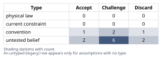
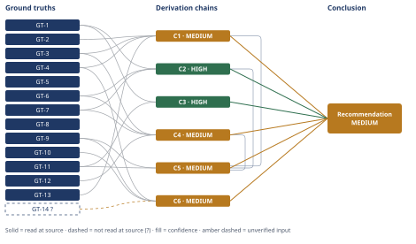

# Deploy Speed: Fix the Pipeline, Not the Architecture

*First-principles analysis · 10 October 2026*

*Read with: [How to read this analysis](HOW-TO-READ.md) · [Working file](analysis-20261010T192550Z.md) · [All files](INDEX.md)*

## Executive Summary

**Recommendation:** Leadership's causal claim is wrong — the bottleneck is coordination/deploy-mechanics overhead, not the monolith's architecture — so the team should fix the pipeline and deploy mechanics first (test parallelization, feature flags, rolling/blue-green restarts) and treat any service extraction as a reversible, headcount-gated future decision, not a current commitment (chain C5).

**Band (from §6):** MEDIUM (chain C5, chain C6).

**Would change it:** Measuring actual merge-queue/demand depth behind the 2-deploys/day cadence (chain C1); auditing current CI and deploy tooling against the named fishbone causes (chain C4); and confirming the team-size-to-service-count ratio at an independently-opened source beyond the general two-pizza heuristic (chain C6).

## 1. Problem Essence

**Core problem:** Leadership has attributed the symptom "deploys are too slow" to the wrong layer of the system — concluding that the number of independently-deployable services must change — without first decomposing which of (a) pipeline duration, (b) deploy-coordination/restart mechanics, or (c) deploy cadence policy is actually the binding constraint, and without pricing what a services split costs a 12-engineer team against what it would actually fix.

**Success criteria:**
1. The analysis names which of pipeline-duration, coordination/restart overhead, and deploy-cadence policy is the dominant, independently-addressable driver of "deploys are too slow," each backed by a derivation chain that can be checked against the Conclusion.
2. The analysis states, with a derivation chain, whether a full microservices decomposition would remove that dominant driver net of the new distributed-systems and operational costs it introduces for a 12-engineer team.
3. The analysis specifies a concrete, sequenced set of actions for the team's next 1-2 quarters, each traceable to a named cause identified under criterion 1.
4. The analysis states a team-size/complexity threshold claim and places this specific 12-engineer team above or below it, with a derivation chain, so a reader can check the placement against the stated threshold.

## 2. Assumptions Table

| Assumption | Type | Treatment | Verdict | Verification |
|------------|------|-----------|---------|---------------|
| A-1: "Deploys are too slow" means the 45-minute pipeline duration itself is the dominant complaint | untested belief | Verify by decomposing the complaint into independently-addressable components before accepting it as stated | Challenge — decomposed into pipeline duration vs. coordination/restart overhead vs. cadence policy | Decomposed in chain C1 |
| A-2: Microservices architecture inherently deploys faster than a monolith | convention | Explicitly challenge — ask whether it holds in this context or carries industry inertia | Discard — as a universal claim, contradicted by GT-6/GT-7 counterexamples and by the cost analysis in C3 | Falsified in chains C2, C3 |
| A-3: A full test-suite run is architecturally required on every deploy | convention | Challenge — determine whether this is forced by the codebase or by process/tooling choice | Challenge — decomposed by fishbone; most likely a process/tooling artifact, not an inherent property | Decomposed in chain C4 |
| A-4: A coordinated, synchronous application restart is required on every deploy | convention | Challenge — restart topology (rolling vs. synchronous) is a deploy-mechanics choice independent of codebase structure | Challenge — decomposed by fishbone; fixable via rolling/blue-green deploy tooling | Decomposed in chain C4 |
| A-5: 12 engineers can sustain operating N independently-deployed services without materially higher coordination cost than one pipeline | untested belief | Verify against team-size/coordination-overhead heuristics (Conway's Law, two-pizza team) | Challenge — Discard for a full N-service split; Accept-with-caveat for extracting 1-2 bounded services | Verified in chains C5, C6 |
| A-6: Splitting cart/checkout/fulfillment into services preserves current transactional integrity "for free" | untested belief | Push toward physical/structural ground truth about distributed transactions rather than accepting at face value | Discard — contradicted by GT-11 (no cross-datastore atomicity without added mechanisms) | Falsified in chain C3 |
| A-7: The 2-deploys/day cadence reflects pipeline+coordination overhead rather than low merge/demand volume | untested belief | Verify against pipeline-capacity arithmetic; flag if no direct demand data exists | Challenge — plausible given the capacity-vs-actual gap, but no direct PR/merge-volume data is given in the scenario | unverified — flagged; caps chain C1 at MEDIUM |
| A-8: Leadership's stated motivation is fully captured by "deploys are too slow" (not, e.g., a hiring/team-autonomy plan or a modernization narrative) | untested belief | Accept as the explicit scope stated in the prompt, but flag that a different underlying motivation could change the conclusion | Accept — scoped explicitly to the stated justification; flagged as a boundary condition on the Conclusion | unverified — flagged; carried as a caveat on the Conclusion section |
| A-9: For microservices to fix "deploys are too slow," the dominant bottleneck must be test-suite breadth coupled to one deployable unit, the split must reduce per-deploy surface more than it adds cross-service integration/contract-test surface, boundaries must follow real bounded contexts so ownership doesn't stay diffuse, and the org must fund N pipelines/on-call rotations without net throughput loss (inversion-derived preconditions) | untested belief (compound) | Verify each precondition; each one that is false or unverified is a reason the inverted claim ("microservices do not fix this") is more likely true | Discard as a rescuing set — the scenario as given does not establish any of the four preconditions, and two (ownership diffusion, funding N pipelines at 12 engineers) are directly contradicted by GT-9/GT-10 | Decomposed via inversion in chains C2, C3, C6 and the pre-mortem record |
| A-10: No feature-flag system currently decouples code deploy from feature release | untested belief | Verify by auditing current deploy tooling; treat as the default absence given the "every deploy requires a full test-suite run AND a coordinated restart" phrasing | Challenge — not stated either way in the scenario; treated as the likely default for a monolith with synchronous coordinated restarts | unverified — flagged; feeds chain C4, capped at MEDIUM |
| A-11: The test suite is not currently parallelized or scoped to changed code (runs serially/unsharded) | untested belief | Verify by auditing current CI configuration | Challenge — plausible given the 45-minute duration at only 350 KLOC relative to GT-6/GT-7's much larger, much faster suites, but not directly confirmed | unverified — flagged; feeds chain C4, capped at MEDIUM |
| A-12: The application restart is a single synchronous event across all instances, not a rolling/blue-green restart | untested belief | Verify by auditing current deploy scripts/orchestration | Challenge — strongly implied by "coordinated application restart" phrasing, but not independently confirmed | unverified — flagged; feeds chain C4, capped at MEDIUM |
| A-13: The monolith currently shares one database/transaction boundary across cart, checkout, and fulfillment, such that their state transitions are effectively atomic today | untested belief | Verify by inspecting the current data/transaction architecture; this is the default assumption for a single-database Rails monolith absent evidence otherwise | Accept, flagged — standard default for this kind of system; if false, the direction of chain C3's finding survives (a distributed-transaction cost appears somewhere it wasn't paid before), only the magnitude may shift | unverified — flagged; feeds chain C3 |
| A-14: Amazon's two-pizza-team headcount band (roughly 6-10 people) generalizes as a planning heuristic to this e-commerce domain's service boundaries | convention | Explicitly challenge — treat as an order-of-magnitude heuristic, not a precise figure, before using it to size a threshold | Accept as heuristic-only — used to bracket an estimate, not as a precise count | unverified — flagged; feeds chain C6, capped at MEDIUM |

## 3. Ground Truths

**Scenario-stipulated facts** (the given inputs of this analysis — this analysis read these directly in the user's problem statement, which is the authoritative source for facts about the team's own system; no external citation applies):

- **GT-1** The platform is a ~350 KLOC Rails monolith housing catalog, cart, checkout, and fulfillment in one codebase — source: problem statement; read-at-source: scenario description ("6-year-old e-commerce platform... all in one Rails monolith, ~350 KLOC").
- **GT-2** The CI/CD pipeline takes ~45 minutes end-to-end — source: problem statement; read-at-source: scenario description.
- **GT-3** Every deploy requires a full test-suite run AND a coordinated application restart — source: problem statement; read-at-source: scenario description.
- **GT-4** The team has 12 engineers and currently deploys ~2 times/day — source: problem statement; read-at-source: scenario description.
- **GT-5** Engineering leadership's stated conclusion is "deploys are too slow, we need microservices" — source: problem statement; read-at-source: scenario description (the decision under review).

**Externally-sourced ground truths** (read at source this session via WebFetch):

- **GT-6** GitHub.com's production Rails application is "nearly two million lines of code," worked on by "more than 1,000 engineers," and is deployed "as often as 20 times a day" — as a monolith — source: GitHub Engineering Blog, "Building GitHub with Ruby and Rails" (https://github.blog/engineering/architecture-optimization/building-github-with-ruby-and-rails/); read-at-source: quoted directly from the fetched article.
- **GT-7** Shopify's Rails monolith runs a "55k"-test suite, completes its deployment pipeline "end-to-end in about 15 minutes" plus a "six-minute 'quiet time'" after each deploy, and after automating deployment reached "almost 50 times each day" (up from "~30 to 40 times per day" before automation) — relies on feature flags and fast rollback rather than staging/canary deploys — source: Shopify Engineering, "Automatic Deployment at Shopify" (https://shopify.engineering/automatic-deployment-at-shopify); read-at-source: quoted directly from the fetched article.
- **GT-8** Conway's Law — "Organizations design systems that mirror their own communication structure" — originated by Melvin Conway, "How Do Committees Invent?" (1968), popularized as "Conway's Law" by Fred Brooks in *The Mythical Man-Month* — source: lawsofsoftwareengineering.com, "Conway's Law" (https://lawsofsoftwareengineering.com/laws/conways-law/); read-at-source: quoted directly from the fetched article.
- **GT-9** Amazon's "two-pizza rule" caps an "ideal" team under Conway's Law at a size "no more members than two pizzas could feed" — source: TechTarget, "The enduring link between Conway's Law and microservices" (https://www.techtarget.com/it-infrastructure/tip/The-enduring-link-between-Conways-Law-and-microservices); read-at-source: quoted directly from the fetched article.
- **GT-14?** The specific operationalization of the two-pizza rule as "5-10 engineers owning a service end-to-end: design, deployment, on-call" — cited to a secondary web summary; the specific source for this elaboration (concepts.dsebastien.net) could not be opened — reported-by-delegate: supplied by a WebSearch synthesis, source citation not independently confirmed by this analysis. Used only as an order-of-magnitude planning heuristic in chain C6, never as a precise figure.

**Self-derived ground truths** (mathematical/structural consequences, computed or reasoned directly by this analysis; no external citation applies):

- **GT-10** Pairwise communication channels among n people number n(n-1)/2: a team of 12 has 12×11/2 = 66 such channels; a team of 6 has 6×5/2 = 15 — source: combinatorics (definitional); read-at-source: computed directly in this analysis.
- **GT-11** Splitting a workflow that currently executes as in-process function calls within a single transactional boundary (e.g., cart → checkout → fulfillment) into independently-deployed services with independent datastores forfeits single-database atomicity for that workflow; preserving equivalent consistency requires additional mechanisms (sagas, compensating transactions, idempotency keys, eventual-consistency handling), each adding latency, code, and new failure modes — source: structural consequence of service decomposition (no shared commit log exists across independently-owned datastores); read-at-source: derived directly from the definition of a service boundary.
- **GT-12** Deployment-restart topology (synchronous/all-at-once vs. rolling/blue-green, i.e., draining and restarting instances one at a time behind a load balancer) is independent of codebase-boundary topology (one repository/deployable artifact vs. many): whether instances restart together or in sequence does not depend on whether the code behind them lives in one repo or several — source: structural/architectural consequence (restart orchestration operates at the instance/process level, which is orthogonal to the repository/service boundary); read-at-source: derived directly from the definitions of these two kinds of boundary.
- **GT-13** A 45-minute pipeline, run with zero coordination overhead back-to-back within an 8-hour working day, has a theoretical capacity of floor(480 minutes / 45 minutes) = 10 deploy slots/day — source: arithmetic derived from GT-2; read-at-source: computed directly in this analysis.

**Provenance summary:** `?`-marked: GT-14? (1 of 14; GT-1 through GT-13 are the other 13 entries, all unsuffixed/read-at-source). Not read — turn budget: none. Read-at-source locations: GT-6 (github.blog article, "nearly two million lines of code" / "more than 1,000 engineers" / "deploy as often as 20 times a day"), GT-7 (shopify.engineering article, "55k" tests / "about 15 minutes" / "almost 50 times each day"), GT-8 (lawsofsoftwareengineering.com, Conway's Law statement and 1967/1968 attribution), GT-9 (techtarget.com, two-pizza-rule statement), GT-10/GT-13 (computed directly in this analysis), GT-11/GT-12 (derived directly from structural definitions in this analysis), GT-1 through GT-5 (scenario description as given in the problem statement).

**Phase 3 failure record:** GT-14? — source: concepts.dsebastien.net, "Two-Pizza Teams." WebFetch was attempted; the tool returned only the page's header text ("Two-Pizza Teams - Concepts") with no extractable body content, so the specific "5-10 engineers, end-to-end ownership" figure could not be confirmed at this source. The `?` suffix is retained and the figure is used only as a bracket input, never as a load-bearing precise count.

## 4. Derivation Chains

### Conclusion C1: "Deploys are too slow" is at least two distinct, independently-addressable problems, not one

GT-2 (45-min pipeline) + GT-3 (full-suite run + coordinated restart) + GT-4 (12 eng, 2 deploys/day) + GT-13 (10-slot theoretical ceiling)
→ a 45-minute pipeline run back-to-back with zero coordination overhead permits roughly 10 deploy slots within an 8-hour day
→ the actual cadence of 2 deploys/day is roughly 5x below that pipeline-only ceiling
→ a gap this large is better explained by the coordinated-restart requirement than by the pipeline's 45-minute duration itself [Assumes: A-7 — the gap reflects overhead rather than low demand]
→ "deploys are too slow" therefore names two distinct, independently-addressable problems: pipeline duration, and coordination/restart overhead that caps how many pipeline windows actually get used

**Confidence:** MEDIUM — A-7 is unverified: the scenario gives no direct PR/merge-queue volume data, so attributing the 2-vs-10 gap to coordination overhead rather than low demand rests on an inference, not a measurement. The verification that would remove this as a cause of the downgrade is measuring actual merge-queue depth and how often engineers attempt but fail to get a deploy slot. A live rival — "2/day is a deliberate release-cadence policy, not an overhead symptom" — is not ruled out by the given facts and would be settled by the same measurement.

### Conclusion C2: Monolith architecture is not what caps this team's deploy frequency

GT-1 (350 KLOC monolith scope) + GT-6 (GitHub: ~2M LOC monolith, 1,000+ engineers, 20 deploys/day) + GT-7 (Shopify: monolith, 55k tests, ~15-min pipeline, ~50 deploys/day)
→ two organizations running monoliths substantially larger than this one achieve 10-25x this team's deploy frequency while remaining monoliths
→ this is a direct counterexample to the claim that monolith architecture itself caps deploy frequency near 2/day
→ the levers those organizations used were pipeline parallelization and deploy-automation mechanics, not a reduction in service count
→ architecture-type is therefore not what determines deploy frequency in this problem

**Confidence:** HIGH — every head input is an unsuffixed, read-at-source ground truth; the inference is a valid counterexample-based falsification of a universal claim (one real counterexample is sufficient). Rival named: "GitHub/Shopify's advantage is platform-engineering investment, not architecture" — even if true, this reinforces rather than contests the conclusion, since it still points toward pipeline/mechanics investment rather than toward splitting services, so the Rivals axis is not left short.

### Conclusion C3: Splitting cart/checkout/fulfillment into services adds a real, ongoing consistency-management cost

GT-11 (distributed transaction cost) + GT-1 (monolith scope: cart/checkout/fulfillment together)
→ cart, checkout, and fulfillment most likely execute today as in-process calls within one shared transaction boundary, so an order's state transitions are atomic without extra code [Assumes: A-13 — this monolith shares one DB/transaction boundary across these domains today]
→ splitting these domains into independently-deployed services with independent datastores converts each transition into a network call that can partially fail
→ compensating for that requires new, ongoing code — sagas, idempotency keys, retry/dedup logic, eventual-consistency handling — which is a cost the monolith does not currently pay

**Confidence:** HIGH — GT-11 is a structural/definitional consequence requiring no external verification; A-13 states what happens if it fails (the finding's direction survives, only its magnitude might shift), satisfying the HIGH-band allowance for an `[Assumes: A-N]` hop. No live rival contests that splitting a transactional workflow adds consistency-management cost — this is close to definitionally true of service decomposition.

### Conclusion C4: The full-suite run and coordinated restart are fixable implementation artifacts, not inherent monolith properties

GT-3 (full-suite run + coordinated restart) + GT-12 (restart topology independent of codebase boundary) + GT-6 (GitHub rolling/progressive deploys at scale) + GT-7 (Shopify feature flags, fast rollback, no staging/canary)
→ a fishbone pass surfaces concrete, fixable candidate causes: no feature-flag system decoupling deploy from release [Assumes: A-10], a serial/unsharded test suite [Assumes: A-11], and a single synchronous restart rather than rolling/blue-green [Assumes: A-12]
→ both levers this points to are achieved, per GT-6 and GT-7, on Rails monoliths far larger than this one
→ this rules out the monolith's size as the explanation for a 45-minute pipeline and a coordinated restart
→ "full test-suite run plus coordinated restart on every deploy" is an artifact of this team's implementation and process choices, not an inherent property of a monolith

**Confidence:** MEDIUM — A-10/A-11/A-12 are a compound, unverified belief about this team's specific tooling; the verification that would remove this as a cause of the downgrade is a direct audit of this team's CI configuration and deploy scripts. A live rival — "this team already tried parallelization and hit a hard technical wall" — is not ruled out by the given facts and would be settled by the same audit.

### Conclusion C5: Fix the pipeline and deploy mechanics now; treat any service extraction as a reversible, headcount-gated future decision

GT-9 (two-pizza/Conway's-Law heuristic) + GT-11 (distributed-transaction cost) + C1 (coordination overhead is the dominant driver) + C2 (monolith doesn't cap deploy frequency) + C4 (full-suite/coordinated-restart is a fixable artifact)
→ a weighted trade-off across time-to-relief, engineering cost, operational complexity, correctness risk, team-size fit, and preserved optionality knocks full microservices decomposition out at the must-have stage, since it cannot shrink the diagnosed bottleneck within 1-2 quarters and instead adds a larger one
→ the same trade-off ranks "fix pipeline and deploy mechanics now, with a headcount-gated checkpoint for future extraction" above both the status quo and an immediate 1-2-service extraction, 121 vs. 101 vs. 73 on locked weights
→ the gap to the closest competitor, "fix mechanics alone with no stated checkpoint" at 119, is driven entirely by one criterion (preserved optionality), and a flip-test shows no single-criterion reweighting restores either trailing option to the top
→ the recommended path is therefore to fix the monolith's pipeline and deploy mechanics first, and treat any service extraction as a reversible, headcount-gated future decision
→[2nd] once feature flags exist, product and engineering gain the ability to decouple release timing from deploy timing, which changes how rollouts and experiments get planned
→[2nd] leadership still needs this analysis's scope boundary made explicit if its real motivation is team-autonomy or a hiring narrative rather than deploy speed [Assumes: A-8]
→[3rd] feature flags accumulate as technical debt over time if no flag-retirement process exists, a cost to plan for rather than a reason to abandon the fix

**Confidence:** MEDIUM — capped at the lowest-rated chain this head cites (C1 and C4, both MEDIUM; their own confidence lines carry those explanations and are not repeated here). The trade-off weights were locked before scoring per the procedure's discipline, but the weights and scores are themselves this analysis's judgment rather than measured data, so this chain cannot exceed what C1/C4 already license regardless. Second-order pass: both the actor lens (engineers, leadership, on-call/ops named; the competitor lens was checked and found no material effect attributable to this internal process choice) and the time lens (immediate CI-dashboard improvement, a few-cycles rise in cadence toward GT-13's ~10/day ceiling as the falsifiable prediction, long-run flag-debt accumulation) have been walked; no extension step contradicts a ground truth.

### Conclusion C6: This 12-engineer team is well below the headcount threshold where a services split's coordination benefits would exceed its tax

GT-9 (two-pizza heuristic) + GT-14? (5-10 engineers, end-to-end ownership, unconfirmed elaboration) + GT-10 (pairwise-channel arithmetic) + GT-4 (12 engineers today)
→ at a two-pizza ratio of roughly 6-10 engineers per autonomously-owned service [Assumes: A-14 — this ratio generalizes to this domain only as an order-of-magnitude heuristic], staffing this scenario's 4 named domains with dedicated owning teams requires a bare floor of 4 x 6 = 24 engineers, with no headcount left for shared platform work
→ a more realistic threshold adds a dedicated platform/infrastructure function: 4 x 8 engineers plus an 8-person platform team is roughly 40, and allowing for further domain splitting over time brackets the realistic threshold at roughly 40-70 engineers
→ this 12-engineer team sits at least 2x below the bare floor and 3x-6x below the realistic range of that threshold

**Confidence:** MEDIUM — GT-14? (the specific headcount/ownership elaboration) is unverified per the Phase 3 failure record in section 3; the verification that would remove this as a cause of the downgrade is locating an independently-opened source stating team-size-to-service-count ratios empirically, beyond the general two-pizza heuristic. A-14's domain-generalization shares this same downgrade cause rather than adding an independent one.

## 5. Abandoned Reasoning

### Dead End: Treat "increase deploy cadence" as the headline fix, independent of cause

**What was tried:** Considered recommending leadership simply mandate a higher deploy cadence (e.g., "deploy at least 6x/day") as the fix, since cadence is the number leadership actually complained about.

**Why abandoned:** Cadence is a symptom-level metric, not a cause. Chain C1 shows the real gap is between pipeline-only capacity (~10/day) and actual cadence (2/day), which is explained by coordination overhead, not by a cadence target itself. Mandating a cadence number without first fixing what caps it (coordination/restart mechanics, per C4) would pressure the team to work around the real bottleneck rather than removing it — the intermediate claim here (chasing a metric instead of a cause) could not be grounded in any ground truth, so this path was abandoned rather than carried forward as a chain.

**What it ruled out:** Setting a cadence target as a standalone intervention, which this analysis's decomposition shows would not address the mechanism actually producing the low cadence.

### Dead End: Rescue the full-microservices conclusion by assuming parallel aggressive hiring

**What was tried:** Considered whether a full microservices decomposition could work if the team simultaneously hired enough engineers (e.g., tripling headcount) to meet the threshold estimated in chain C6.

**Why abandoned:** This changes the scenario's given constraint (12 engineers) rather than analyzing the decision as actually posed, and it contradicts the pre-mortem's Cluster A/B findings below: onboarding a large influx of new engineers while simultaneously building distributed-transaction handling for cart/checkout/fulfillment and establishing new service-ownership boundaries is close to the highest-risk compound failure pattern this record identifies, not a mitigation of it. The combination of GT-11's correctness-cost and GT-9's ownership-dilution finding means a simultaneous hiring-and-migration plan does not survive the must-have knockout applied in chain C5 — it was discarded as a rescue rather than developed into its own chain.

**What it ruled out:** "Also hire a lot" as an implicit way to make a full services split viable on the current timeline; the headcount math in C6 means this would require tripling the team before (not during) a migration, which is a different, much larger decision than the one leadership is actually weighing.

### Dead End: The 45-minute pipeline is a hard technical floor for a Rails codebase of this size

**What was tried:** Considered whether the 45-minute pipeline duration is simply what a ~350 KLOC Rails test suite costs, making "deploys are too slow" an inherent monolith property rather than a fixable implementation artifact.

**Why abandoned:** Directly contradicted by GT-6 and GT-7: Shopify's monolith (55k tests) completes its full deployment pipeline end-to-end in about 15 minutes, and GitHub operates a monolith roughly 5.7x this team's line count while deploying up to 20 times a day. Both are read-at-source counterexamples, not analogies used as standalone justification — they falsify the specific claim that monolith scale at or above this team's size forces a 45-minute pipeline.

**What it ruled out:** "This is just what a Rails monolith's CI costs" as an explanation for the 45-minute figure, which chain C4 instead traces to specific, auditable implementation choices.

## 6. Conclusion

**Recommended approach:** Leadership's causal claim is wrong: the bottleneck is coordination/deploy-mechanics overhead and inherited process convention, not the monolith's architecture, so the team should fix the pipeline and deploy mechanics — parallelize/shard and scope the test suite, add feature flags to decouple deploy from release, move to rolling or blue-green restarts — before considering any service extraction, and should treat extracting 1-2 bounded services as a reversible, headcount-gated future decision rather than a current commitment (chain C5).

**Key insight:** The 45-minute pipeline alone permits roughly 10 deploy slots a day; the team uses 2 — so the dominant constraint is the coordinated-restart/scheduling layer on top of the pipeline, not the pipeline's duration or the codebase's architecture (chain C1), and two companies running substantially larger Rails monoliths already prove that monolith architecture is not what caps deploy frequency (chain C2).

**Trade-offs acknowledged:** Fixing pipeline and deploy mechanics defers any architecture-driven team-autonomy benefit a later, properly-justified service split might offer, and it requires real CI/platform engineering investment now rather than a dramatic rearchitecture story (chain C5); this is accepted because at 12 engineers the team sits at least 2x below even the bare-floor headcount threshold, and roughly 3x-6x below a realistic one, at which a services split's coordination benefits would exceed its operational tax, so those deferred benefits are not currently available to capture regardless of which path is chosen (chain C6).

**Confidence:** MEDIUM — the Conclusion rests on C5 (MEDIUM, itself capped by C1 and C4) and C6 (MEDIUM, capped by the unverified GT-14? elaboration); C2 and C3 are HIGH and are not the source of the downgrade. The two downgrade causes are the ones already named on C1's and C4's own confidence lines (A-7's demand-vs-overhead attribution; A-10/A-11/A-12's unaudited CI/deploy tooling) and on C6's own line (GT-14?'s unconfirmed elaboration); each already states the verification that would remove it. A-8 (leadership's motivation may extend beyond deploy speed) is a scope caveat on this Conclusion directly: if leadership's actual goal is team autonomy ahead of a hiring plan rather than deploy speed, this Conclusion's recommendation still stands as the correct fix for the stated deploy-speed problem, but it would not be a complete answer to that different goal.
