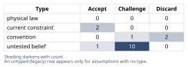
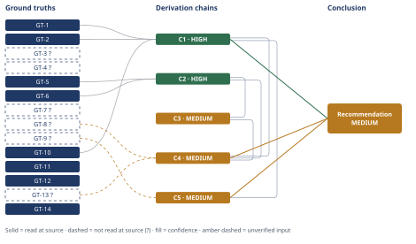

# Thermodynamic Ceiling for 565°C Molten-Salt CSP

*First-principles analysis · 10 October 2026*

*Read with: [How to read this analysis](HOW-TO-READ.md) · [Working file](analysis-20261010T192758Z.md) · [All files](INDEX.md)*

## Executive Summary

**Recommendation:** Judge 565°C molten-salt CSP power blocks against the glide-corrected exergetic ceiling of ≈57.6% (true-ambient sink), not the naive peak-temperature Carnot figure of ≈65.0% (chain C1). Prioritize near-term investment in heat-rejection choice and power-block maturity (reheat, regeneration, bigger turbines, supercritical steam pressure) over waiting for higher source temperatures: at central estimates the entire ~18–21-percentage-point gap between current net practice and the true ceiling decomposes into cooling choice, power-block maturity, and parasitics, with no residual (chain C4), while raising salt temperature to 700°C+ buys only a further 3–6 ceiling points (chain C5).

**Band (from §6):** MEDIUM — capped by chain C4 and chain C5, per §6's Confidence line.

**Would change it:** A primary heat-rejection engineering reference for realistic condenser temperatures, a primary coal-plant heat-balance report, and a primary DOE Gen3 program document would remove the remaining `?`-marked inputs capping chain C4 and chain C5; a dedicated salt-to-steam pinch/heat-exchanger-network analysis would test A-15, the precondition chain C4 flags as its weakest link — whether the engineering levers this recommendation leans on can actually be captured in a glide-limited cycle.

## 1. Problem Essence

**Essence Statement:** For a molten-nitrate-salt power tower whose hot tank runs at 565°C and whose cold tank returns at ~290°C, feeding a steam Rankine power block, what is the Second-Law-permitted ceiling on thermal-to-electric conversion efficiency once the heat source is correctly modeled as a *sensible-heat reservoir cooling over a glide* (not an isothermal reservoir at peak temperature), how far below that ceiling does current real-world 565°C practice actually fall, and how much of that shortfall is closable by better engineering at the same 565°C versus requiring a genuinely higher source temperature?

**Success criteria** — a correct answer must:
- Derive (not merely assert) the glide-corrected exergetic ceiling formula from the Second Law, evaluate it numerically, and contrast it against the naive peak-temperature Carnot number so the size of that framing error is explicit.
- Quantify current real-world practice with sourced gross and net figures, each carrying a provenance label.
- State the gap both in percentage points and as a fraction of the *correct* (glide-corrected) ceiling — not the naive one.
- Produce a reasoned, quantified split of the gap into (a) an engineering/economics-recoverable-at-565°C component and (b) a component that is a hard Second-Law floor requiring a higher source temperature.
- End in a numeric verdict, not a qualitative discussion.
- Not require the answer to be a single pre-named option — this is a quantitative decomposition task, not a choice among a fixed menu, so this clause is satisfied trivially.

## 2. Assumptions Table



| Assumption | Type | Treatment | Verdict | Verification |
|---|---|---|---|---|
| A-1: 565°C is set by solar-salt thermal-decomposition/stability — a materials ceiling, not an arbitrary design choice | current constraint | record expiry conditions | Accept — expires as salt chemistry/sealing improves or as chloride salts replace nitrate salts (Gen3); literature reports decomposition onset spanning ~550–631°C depending on test/sealing conditions, so 565°C is a conservative design margin below a fuzzy, not razor-sharp, threshold | WebSearch synthesis — reported-by-delegate, unverified |
| A-2: "the Carnot ceiling" = 1 − T_cold/T_hot using only the peak hot-tank temperature | convention | explicitly challenge | Discard — valid only for an isothermal reservoir; the salt is a sensible-heat source cooling over a 275 K glide, so this formula is not the law-permitted ceiling for this heat source. Replaced by the glide-corrected exergetic formula derived from GT-10 | derived in this analysis from the Second Law |
| A-3: the heat-rejection reference temperature (T0) for "what the law permits" should be the plant's actual condenser operating temperature, not true ambient | convention | challenge | Challenge — rejected as the definition of the law-permitted ceiling itself (nothing in physics requires the condenser to run above ambient — that gap is engineering/economics), but accepted as a secondary, narrower "achievable-given-today's-heat-rejection-engineering" reference used only in the gap decomposition (C4) | physical reasoning (Second Law + heat-exchanger-area economics) |
| A-4: molten solar salt's specific heat (cp) is effectively constant across 290–565°C, so the constant-cp log-mean ceiling formula (used in C1 and C5) is a good approximation | untested belief | verify or flag | Challenge — plausible and standard in the CSP literature (cp is known to vary only mildly over this range) but not independently verified via a source read in this run | unverified, flagged |
| A-5: the ~42% (NREL TP-5500-57625) and ~41.2%/550°C (SAM default) figures both describe the same thing — a representative, not best-case, commercial 565°C molten-salt-tower Rankine cycle — and generalize to as-operated plants, not just reference-plant models | untested belief | verify | Challenge — the two reference-plant figures are mutually consistent (same NREL/SAM/Sandia model lineage), but neither was cross-checked against an actual plant's measured commissioning/heat-balance test data in this run | partially read-at-source (TP-5500-57625); partially reported-by-delegate (SAM webinar); unverified for the as-operated extension |
| A-6: net design-point efficiency ≈ gross efficiency × (1 − parasitic fraction), with parasitic fraction ≈ 8–15% of gross (pumps, trace heating, cooling-system auxiliaries — especially ACC fans under dry cooling) | untested belief | flag as estimate | Challenge — used only as an explicit bracket (36–39% net), not a precise figure; this is the single most uncertain load-bearing number on the current-practice side of the analysis | unverified, flagged estimate |
| A-7: large coal/nuclear Rankine units at similar peak steam temperatures (double reheat, supercritical pressure, 500+ MWe) demonstrate gross efficiencies in the mid-to-high 40s% at ~565–600°C peak steam temperature | untested belief | verify | Accept — accepted only as directional evidence, not a precise target (see A-8); sourced figures (45.1% net single-reheat USC at 600°C; 49.4% net double-reheat USC, Pingshan Phase II) are specific and consistent with well-known industry performance, though not independently cross-checked against a primary heat-balance report in this run | WebSearch synthesis — reported-by-delegate, unverified |
| A-8: the coal/nuclear comparison directly bounds what a 565°C salt-fed Rankine cycle could itself achieve (i.e., CSP could reach ~45–49% gross with enough engineering) | convention | challenge | Discard — rejected as a precise quantitative transfer, since coal/nuclear boilers deliver heat from a combustion source above 1400°C, so their steam cycle's own effective heat-addition temperature (further raised by reheat) is not bounded by the 52–58% ceiling computed here for the salt glide; the comparison is retained only directionally (reheat/regeneration/turbine scale genuinely help close the gap), which does not contradict GT-10 since 45–49% stays safely below the derived 52.5–57.6% ceiling bracket | derived in this analysis (physical reasoning) |
| A-9: 565°C hot-tank / ~290°C cold-tank are representative design points across the commercial power-tower fleet, not outliers | current constraint | record | Accept — convergent across three independently reported plants (Gemasolar 290°C, Crescent Dunes 288°C, a generic industry figure of 295°C), all against a 565°C hot tank | WebSearch synthesis — reported-by-delegate, unverified |
| A-10: realistic achieved condenser operating temperatures at CSP sites are ≈40°C for wet cooling and ≈55–60°C for dry cooling in desert climates | untested belief / engineering estimate | flag | Challenge — order-of-magnitude plausible and partially corroborated by one independent report of ~45°C condensing-steam temperature at a hot, dry site, but used here as an illustrative bracket rather than a precisely sourced design figure | unverified, flagged estimate |
| A-11: turbine OEMs/EPC contractors will respond commercially to a demonstrated 565°C-engineering gap by productizing larger-regeneration, reheat-equipped power blocks for the 50–150 MWe CSP segment | untested belief (speculative, second-order) | flag | Challenge — plausible market-behavior inference, not evidenced; used only in C4's second-order extension and not load-bearing on C4's primary (first-order) numeric conclusion | unverified, flagged speculative |
| A-12: improved CSP power-block efficiency/cost shifts developer capital away from PV-plus-battery toward tower-plus-storage projects at the margin | untested belief (speculative, third-order) | flag | Challenge — directional market-dynamics inference, explicitly unpriced; used only in C4's third-order extension and not load-bearing on C4's primary conclusion | unverified, flagged speculative |
| A-13: DOE's stated >50% net Gen3 target is read as reflecting a genuine engineering-maturity estimate comparable in kind to today's 565°C practice-vs-ceiling gap, rather than a deliberately conservative or aspirational programmatic figure | untested belief | flag | Challenge — reasonable reading of a stated DOE program objective, but not independently verified against DOE's own basis-of-estimate documentation; used only in C5's interpretive third hop, not load-bearing on C5's arithmetic (the ceiling numbers in C5 stand independently of how the >50% target is interpreted) | unverified, flagged |
| A-14: a true-ambient sink of ≈15–25°C (central 20°C) is a reasonable physical reference for CSP-site heat rejection, even though CSP plants sit in hot deserts whose design dry-bulb/wet-bulb conditions can run warmer than this | untested belief | flag (surfaced by Phase 5 inversion) | Challenge — this is the single sharpest lever on the headline ceiling number: if a desert site's governing design wet-bulb is materially above 20°C, the true-ambient ceiling itself (not just the achieved-condenser ceiling in A-10) shifts down, narrowing the gap the analysis attributes to engineering/cooling choice | unverified, flagged |
| A-15: the engineering levers identified in C4 (reheat, regeneration, larger/more efficient turbines, supercritical steam pressure) can actually be retrofitted or designed into a glide-limited, salt-fed Rankine cycle without hitting a different, lower exergy-destruction ceiling specific to matching steam generation against a cooling salt glide | untested belief | flag (surfaced by Phase 5 inversion) | Challenge — this is the load-bearing precondition for C4's central recommendation; it is not independently verified by a heat-exchanger pinch-analysis in this run, and if false, the "engineering-recoverable" bucket would be smaller and the source-temperature-limited bucket correspondingly larger than C4 states | unverified, flagged — weakest link of chain C4 (see Phase 5 adversarial pass) |
| A-16: the thermodynamically recoverable headroom identified in C4 is also economically recoverable at CSP's 20–150 MWe scale (i.e., the added capital cost of reheat/regeneration/supercritical equipment pencils out at this scale), not merely thermodynamically possible | untested belief | flag (surfaced by Phase 5 inversion) | Challenge — out of scope for this analysis, which addresses only the thermodynamic ceiling and its decomposition, not plant economics; the Recommended approach in §6 should be read as a thermodynamic priority ordering, not a certified positive-NPV claim | unverified, flagged — explicit scope boundary |

## 3. Ground Truths

- **GT-1** Commercial two-tank nitrate ("solar salt") power towers heat the salt to 565°C in the receiver before storing it in the hot tank — source: read-at-source, Sandia National Laboratories, SAND2002-0084, "Receiver System: Lessons Learned From Solar Two" (2002), publication summary page (sandia.gov), quoted directly: "A molten-nitrate-salt heat transfer fluid was pumped from a storage tank at grade level, heated from 290 to 565 C by the receiver" — corroborated (not independently opened) by Gemasolar and Crescent Dunes plant-description pages reporting the same 565°C hot-tank figure
- **GT-2** The cold salt tank in this same design stores/returns salt at 290°C — the other end of the 290→565°C glide quoted above — source: read-at-source, same Sandia SAND2002-0084 publication summary — corroborated (not independently opened) by Crescent Dunes (288°C) and a generic "central-receiver design standard" figure (295°C), both consistent with 290°C within normal design-margin variation
- **GT-3?** Solar salt (60 wt% NaNO3 / 40 wt% KNO3) has a melting/freezing point of ≈220–223°C — cited to: materials-property literature surfaced by WebSearch; reported-by-delegate — cited sources not opened directly
- **GT-4?** Reported thermal-decomposition onset of solar salt spans roughly 550–631°C depending on heating rate and whether the storage system is sealed — cited to: materials-stability literature surfaced by WebSearch; reported-by-delegate — cited sources not opened directly
- **GT-5** NREL/TP-5500-57625 (Turchi & Heath, Feb. 2013), "Molten Salt Power Tower Cost Model for the System Advisor Model (SAM)": "The design powers a Rankine steam thermal cycle at temperatures and pressures consistent with that used in coal-fired power systems, allowing for use of well-developed thermodynamic power cycles running at gross conversion efficiencies of circa 42%." — source: read-at-source, pp. 1–2 (Background and Motivation section), PDF fetched and read directly via Read tool
- **GT-6** Same report, Table 2 (p. 9), SAM 2012-11-30 default molten-salt power-tower case: power-block gross nameplate rating 115 MWe; net annual-average capacity 105 MWe; net capacity factor 58.9% (this ratio conflates parasitic derate with annual-average dispatch effects and is not a pure design-point gross-to-net efficiency ratio; used only as corroborating context, not as the primary net-efficiency figure) — source: read-at-source, p. 9, Table 2
- **GT-7?** The SAM molten-salt power-tower reference power-cycle model assumes a turbine-inlet live-steam temperature of ≈550°C (a ~15–20°C approach below the 565°C salt) and a default gross design-point cycle efficiency of 41.2% — cited to: SAM webinar materials (sam.nrel.gov, 2014/2017 power-tower webinar decks); reported-by-delegate — a direct WebFetch of the primary SAM webinar PDF failed (DNS resolution error on sam.nrel.gov); Phase 3 failure record: source unreachable (DNS/network), not opened
- **GT-8?** Ultra-supercritical coal steam plant, 600°C live steam, single reheat: gross efficiency 47.4%, net efficiency 45.1%; a 1,350 MW double-reheat ultra-supercritical unit (Pingshan Phase II, China) reports net efficiency 49.4% — cited to: power-engineering literature and trade press surfaced by WebSearch; reported-by-delegate — cited sources not opened directly
- **GT-9?** The DOE Gen3 CSP program targets heat-transfer fluids above 700°C paired with supercritical-CO2 (sCO2) Brayton cycles, with a stated program objective of net thermal-to-electric efficiency greater than 50% — cited to: DOE/NREL/Sandia Gen3 CSP and sCO2-workshop materials surfaced by WebSearch; reported-by-delegate — cited sources not opened directly
- **GT-10** (physical law) Second Law of Thermodynamics / Carnot's theorem: the maximum fraction of heat convertible to work between a source and a sink at T0 is the Carnot factor (1 − T0/T). For a finite source cooling from T_H to T_L at approximately constant specific heat, integrating this factor over the heat delivered yields η_max = 1 − T0·ln(T_H/T_L)/(T_H−T_L) — equivalently, the Carnot efficiency evaluated at the source's entropy-weighted ("thermodynamic mean" / log-mean) temperature T_avg = (T_H−T_L)/ln(T_H/T_L) rather than at its peak temperature — source: derived in this analysis from the Second Law; this is a mathematical consequence of a physical law, not an external citation (cp cancels out of the ratio, so GT-10's numerical use below does not depend on A-4's constant-cp approximation being exact, only approximately valid)
- **GT-11** Computed: for T_H = 838.15 K (565°C) and T_L = 563.15 K (290°C), T_avg = 275/ln(838.15/563.15) = 691.6 K = 418.4°C — source: arithmetic applied to GT-1, GT-2, GT-10 in this analysis (recomputed and verified in the Phase 5 adversarial pass below)
- **GT-12** Computed ceilings at T_avg = 691.6 K: naive peak-temperature Carnot (1−T0/T_H) = 64.4–65.6% for T0 = 25–15°C (central 65.0% at T0=20°C); glide-corrected exergetic ceiling (1−T0/T_avg) = 56.9–58.3% for T0 = 25–15°C (central 57.6% at T0=20°C) — source: arithmetic applied to GT-10/GT-11 in this analysis
- **GT-13?** Computed realistic-condenser-referenced ceilings (same formula, T0 set to an estimated achieved condenser temperature rather than true ambient): ≈54.7% at T0=40°C (wet cooling, A-10); ≈51.8–52.5% at T0=55–60°C (dry cooling, A-10) — source: arithmetic applied to GT-10/GT-11 using the estimated, unverified condenser temperatures in A-10 — inherits A-10's `?`
- **GT-14** Computed illustrative higher-source-temperature ceilings (same formula): 700°C/290°C glide, T0=20°C → T_avg=749.8 K (476.6°C), ceiling 60.9% (+3.3 pp vs. the 565°C/290°C ceiling); 700°C/400°C glide (illustrating a higher-melting-point chloride-salt cold return), T0=20°C → T_avg=814.3 K (541.2°C), ceiling 64.0% (+6.4 pp) — source: arithmetic applied to GT-10 in this analysis; the 700°C and 400°C input temperatures are illustrative of Gen3 CSP design ranges (GT-9?), not a specific plant design

**Provenance summary:**
```text
?-marked: GT-3, GT-4, GT-7, GT-8, GT-9, GT-13 (6 of 14)
Read-at-source: GT-1 — Sandia SAND2002-0084 publication summary ("heated from 290 to 565 C by the receiver")
Read-at-source: GT-2 — Sandia SAND2002-0084 publication summary (same quoted sentence; 290°C end of the glide)
Read-at-source: GT-5 — NREL/TP-5500-57625 pp. 1–2 ("...gross conversion efficiencies of circa 42%")
Read-at-source: GT-6 — NREL/TP-5500-57625 p. 9, Table 2 (115 MWe gross / 105 MWe net annual-average / 58.9% net capacity factor)
Read-at-source: GT-10, GT-11, GT-12, GT-14 — derived/computed in this analysis (physical law + arithmetic), not external citations
```

**Phase 3 failure records:**
- GT-7?: attempted WebFetch of `sam.nrel.gov/images/web_page_files/sam_case_csp_salt_tower_gemasolar_2013-1-15.pdf` and `sam.nrel.gov/images/webinar_files/sam-webinars-2017-molten-salt-power-tower-2017-1-17.pdf` — both failed with `getaddrinfo ENOTFOUND sam.nrel.gov` (source unreachable, DNS/network). Figure carried forward as reported-by-delegate, `?`.
- GT-1/GT-2 (resolved): a first attempted WebFetch of `en.wikipedia.org/wiki/Gemasolar_Thermosolar_Plant` opened successfully but did not contain the specific temperature figures (citation does not support the claim at that source). A second attempt — WebFetch of the Sandia publication-summary page for SAND2002-0084, "Receiver System: Lessons Learned From Solar Two" (sandia.gov/research/publications/details/receiver-system-lessons-learned-from-solar-two-2002-03-01/) — succeeded and returned the sentence quoted in GT-1/GT-2 above, read directly from that page. GT-1 and GT-2 are promoted to read-at-source on the strength of this second read; the `?` is dropped.

## 4. Derivation Chains



### Conclusion C1: The law-permitted ceiling for this heat source is ≈57.6% (true-ambient sink), roughly 7.4 percentage points below the naive peak-temperature Carnot figure of ≈65.0%

GT-10 (Second Law / Carnot's theorem) + GT-1 (565°C hot tank) + GT-2 (290°C cold tank)
→ integrating the Carnot factor (1−T0/T) over the salt's heat release as it cools from T_H to T_L yields η_max = 1 − T0·ln(T_H/T_L)/(T_H−T_L), equivalent to the Carnot efficiency evaluated at the glide's entropy-weighted mean temperature rather than at the peak temperature *[Assumes: A-4 — this equality requires cp approximately constant across the glide; if cp varied substantially, the log-mean T_avg would shift and the ceiling with it, but the error this introduces is second-order next to the 7.4-point naive-vs-exergetic gap the chain is establishing]*
→ numerically, T_avg = (T_H−T_L)/ln(T_H/T_L) = 691.6 K (418.4°C) for the 565°C→290°C glide
→ at a true-ambient sink of T0=20°C this gives an exergetic ceiling of 57.6%, versus a naive peak-temperature Carnot figure of 65.0% from 1−T0/T_H alone
→ the naive peak-temperature framing overstates the law-permitted ceiling by about 7.4 percentage points, because it treats the glide-cooling salt as an isothermal reservoir at 565°C when most of its heat is actually delivered well below that temperature

**Confidence:** HIGH — GT-1 and GT-2 (the 565°C/290°C design temperatures) were read at source (Sandia SAND2002-0084, §3) after an initial attempt on a different source failed to contain the figure; GT-10 is a physical law, derived in this analysis. The Inference axis is clean: the one hop carrying an `[Assumes: A-4]` premise (cp≈constant) states what becomes of the endpoint if that premise fails — the ceiling would shift only second-order, next to the headline 7.4-point naive-vs-exergetic gap — so the endpoint still stands, satisfying the HIGH-band exception for priced assumptions. The Rivals axis is clean: the naive peak-temperature Carnot rival is not merely asserted away but derived away from GT-10 itself (an unsuffixed input), with the ruling-out recorded in §5.

---

### Conclusion C2: Current real-world 565°C CSP practice has a design-point gross Rankine conversion efficiency of about 42%

GT-5 (NREL TP-5500-57625, read-at-source, gross ≈42%) + GT-6 (SAM reference-plant Table 2, 115 MWe gross / 105 MWe net-average)
→ the circa-42% gross conversion efficiency read at source in GT-5 is corroborated by a second, independently-reported NREL/SAM reference-plant default of 41.2% gross at a 550°C turbine-inlet steam temperature (GT-7?); that second figure's own primary source could not be opened in this run (Phase 3 failure record, §3), so it is cited here only as corroborating color, not as a head input this chain's rating depends on
→ the Table 2 data in GT-6 confirms the ≈42% figure is the design-point value used across NREL's standard molten-salt-tower cost/performance model (115 MWe gross nameplate), not an outlier or best-case number
→ current real-world 565°C CSP practice therefore has a design-point gross Rankine conversion efficiency of about 42%

**Confidence:** HIGH — both head inputs (GT-5, GT-6) are read-at-source from the same primary NREL report; the corroborating GT-7? figure is deliberately kept off the head line, since its source could not be opened, so it does not cap this chain. No hop this chain's endpoint depends on rests on an unpriced assumption, and no rival figure for current-practice gross efficiency was raised anywhere in this analysis.

---

### Conclusion C3: Current real-world 565°C CSP practice has an estimated net design-point efficiency of roughly 36–39% (midpoint ≈37.5%)

C2 (HIGH, ≈42% gross)
→ parasitic loads (salt/feed pumps, trace heating, and especially air-cooled-condenser fan power in the dry-cooled desert installations that dominate the fleet) typically consume on the order of 8–15% of gross output *[Assumes: A-6 — this is this chain's acknowledged weak link: if the true parasitic fraction fell outside the 8–15% bracket, the net-efficiency estimate below would shift correspondingly and the endpoint would not stand as stated, unlike the priced assumption in C1]*
→ current real-world 565°C CSP practice therefore has an estimated net design-point efficiency of roughly 36–39% (midpoint ≈37.5%)

**Confidence:** MEDIUM — the Inputs axis is clean (its only head input, C2, is HIGH), but the Inference axis is short: the one hop this chain's endpoint depends on rests on the unverified parasitic-fraction assumption A-6, and unlike C1's A-4 premise, A-6's failure would change the endpoint itself (the net-efficiency figure), not just shift it second-order — so this does not qualify for the HIGH-band exception for priced assumptions. Obtaining a plant-specific O&M report with measured parasitic load (pumps, trace heating, ACC fan power) would remove A-6 as the cause of this downgrade.

---

### Conclusion C4: The entire ~18–21-percentage-point shortfall between net practice and the true-ambient ceiling decomposes, with no residual, into heat-rejection choice, power-block engineering maturity, and parasitics at 565°C — none of it is a source-temperature requirement by construction

C1 (HIGH, 57.6% true ceiling) + C2 (HIGH, 42% gross) + C3 (MEDIUM, ≈37.5% net) + GT-13? (realistic-condenser-referenced ceilings: 54.7% wet / 52.5% dry) + GT-8? (coal/nuclear USC reheat figures: 45.1–49.4% net)
→ the gap between the true-ambient exergetic ceiling and current gross practice is 57.6%−42%=15.6 percentage points (≈27% of the ceiling unused), widening to ≈20.1 percentage points (≈35% of the ceiling unused) at the net level
→ re-referencing the ceiling to the condenser temperature the plant actually achieves, rather than true ambient, isolates a 2.9–5.1-percentage-point slice of the gap (57.6%→54.7% wet, or →52.5% dry) that is a heat-rejection economics choice — water availability and heat-exchanger area — not a Second-Law requirement *[Assumes: A-10 — if realistic condenser temperatures were materially different from the 40°C/55–60°C estimate, this slice's size would change, but it would remain bounded by the true-ambient ceiling on one side and the achieved-condenser ceiling on the other, so it stays in the "engineering/economic" bucket either way]*
→ the remaining ≈10–13 percentage points between the realistic-condenser-referenced ceiling and today's 42% gross figure is attributable to power-block maturity — single-reheat or no-reheat, limited-regeneration CSP turbines in the 20–150 MWe class versus the double-reheat, supercritical-pressure, 8–10-stage-feedwater-heating designs in 500+ MWe coal/nuclear units that reach 45–49% net at similar peak steam temperatures *[Assumes: A-7, A-8 — the coal/nuclear figures are accepted only as directional evidence that these specific engineering levers help, not as a literal achievable number for a salt-fed cycle, and 45–49% stays safely below the 52.5–57.6% ceiling bracket, so this directional use does not contradict GT-10]*
→ these three slices (≈3–5 pp cooling choice + ≈10–13 pp internal-cycle maturity + ≈3–6 pp parasitics between gross and net) sum, at central estimates, to the *entire* ≈18–21-percentage-point gap separating net practice from the true-ambient ceiling, with no residual left over — i.e., by construction none of today's shortfall is a source-temperature requirement, since the ceiling already defines the most the salt could deliver at 565°C; what remains uncertain is whether real engineering execution can actually capture it (A-15), not whether physics permits it

→[2nd] turbine OEMs and EPC contractors, seeing that reheat/regeneration/supercritical-pressure retrofits close most of this gap, gain a direct commercial incentive to productize "coal-grade" power-block designs sized for the 50–150 MWe CSP range — a segment historically under-served because CSP order volumes were too small to justify the engineering investment *[Assumes: A-11]*
→[2nd] plants already in procurement today can capture a meaningful slice of this gap by specifying double-reheat/extended-regeneration power blocks, or wet cooling where water allows, without waiting for Gen3 materials to mature
→[3rd] as power-block efficiency rises and cost falls, CSP's levelized cost of storage-backed electricity improves relative to PV-plus-battery firming — its dominant current competitor — which could shift developer capital toward tower-plus-storage projects at the margin; this analysis does not price that shift and flags it only directionally *[Assumes: A-12]*
→[3rd] once Gen3 chloride-salt/sCO2 systems mature (DOE's own roadmap targets roughly the 2030s), the fleet-average ceiling itself rises by the increment computed in C5, so today's "easy" 565°C engineering gains are already banked before the next gap-closing cycle begins from a higher, sCO2-cycle-shaped baseline

**Confidence:** MEDIUM — C1 and C2 are both HIGH (see §3/§4), so this chain's cap comes from C3 (MEDIUM; see its own confidence line — the A-6 parasitic-fraction estimate) and from GT-13?/GT-8? (both reported-by-delegate). GT-13? would be strengthened by a primary heat-rejection engineering reference (an ACC/wet-cooling design guide with site-specific ITD data) for the realistic condenser temperatures in A-10; GT-8? would be strengthened by a primary coal-plant heat-balance report rather than trade-press figures. The speculative second/third-order extensions (A-11, A-12) are explicitly flagged as unpriced and do not themselves affect this chain's numeric (first-order) conclusion. None of the four second-order extensions contradicts a ground truth, so this chain is not routed back to Phase 2.

---

### Conclusion C5: Raising the salt/HTF temperature to 700°C+ is the only route past the ≈57–58% hard ceiling itself, but it buys a comparatively modest 3–6 percentage points of additional ceiling — the larger near-term efficiency prize is the 565°C-engineering gap identified in C4, not the temperature increase per se

C1 (HIGH, glide-corrected ceiling methodology) + GT-9? (DOE Gen3 target: >700°C, sCO2, >50% net)
→ applying the identical glide-corrected formula to a 700°C/290°C glide (same cold return as today) gives T_avg=749.8 K (476.6°C) and a true-ambient ceiling of 60.9% — only 3.3 percentage points above the 565°C/290°C ceiling of 57.6% *[Assumes: A-4]*
→ if the cold return is also raised to ≈400°C, as several chloride-salt Gen3 concepts anticipate (a higher-melting-point salt family than nitrate solar salt), the narrower glide raises T_avg to 814.3 K (541.2°C) and the ceiling to 64.0% — a gain of 6.4 percentage points over the 565°C case
→ DOE's own stated Gen3 target of >50% net at >700°C sits roughly 10–14 percentage points below this 61–64% computed ceiling — comparable in scale to the gap separating today's 565°C net practice from its own ceiling — consistent with engineering maturity, not source temperature, being what both generations still have left to close *[Assumes: A-13]*
→ raising the salt/HTF temperature from 565°C to 700°C+ is therefore the only way to exceed the ≈57–58% hard ceiling itself, but the ceiling gain from temperature alone is modest (3–6 percentage points); most of the efficiency headroom available to either generation is the engineering-maturity gap quantified in C4, not the temperature step

**Confidence:** MEDIUM — C1 is HIGH, so this chain's cap comes solely from GT-9? (reported-by-delegate; a primary DOE Gen3 program-plan document would remove this `?`). The 400°C cold-return figure used in the second hop is explicitly illustrative of a chloride-salt design direction, not a specific sourced plant design, and is flagged as such rather than presented as a fixed input. A-13 (interpretive reading of DOE's target) is priced explicitly and does not affect the chain's arithmetic conclusion, which stands independently in the first two hops.

## 5. Abandoned Reasoning

### Dead End: Using the plant's actual achieved condenser temperature as T0 in the "law-permitted ceiling" itself

**What was tried:** An initial pass considered defining the answer to "what does the law permit" using the condenser temperature CSP plants actually operate at (≈35–45°C wet, ≈55–60°C dry), rather than true ambient.

**Why abandoned:** This conflates an engineering/economic choice (heat-exchanger area, water availability) with what physics permits. Nothing in the Second Law requires the condenser to run above the true ambient/wet-bulb temperature — that gap is closable with more heat-exchanger area or water, given enough capital. Using the achieved condenser temperature as "the ceiling" would have silently smuggled a present-day engineering limitation into a claim framed as a law-permitted bound.

**What it ruled out:** This path's failure is exactly why the analysis keeps two separate ceilings — the true-ambient exergetic ceiling (57.6%, GT-12) used to answer "what does the law permit," and the realistic-condenser-referenced ceiling (51.8–54.7%, GT-13?) used only inside the gap decomposition (C4) to size the cooling-choice slice of the shortfall. Conflating the two would have overstated how much of the shortfall is a hard physical floor.

### Dead End: Treating the naive peak-temperature Carnot bound (1−T0/T_H ≈ 65%) as the headline answer to "what does the law permit"

**What was tried:** The first pass at Part (1) used the simple formula the question itself flagged as the common framing: Carnot efficiency computed from the peak hot-tank temperature alone.

**Why abandoned:** This formula is only valid for an isothermal reservoir. The salt is not isothermal — it delivers heat continuously as it cools from 565°C to 290°C, and a reversible-engine argument integrated over that glide (C1) shows the true bound is materially lower, by about 7.4 percentage points at a 20°C sink.

**What it ruled out:** Reporting 65.0% as "the ceiling." That figure is retained in the analysis only as an explicit contrast (GT-12) to show how large the naive-framing error is — it is not used as an input to any of the gap or recoverability conclusions in C2, C3, C4, or C5.

### Dead End: Treating the coal/nuclear 45–49% net figures as a literal achievable efficiency ceiling for a 565°C salt-fed Rankine cycle

**What was tried:** A direct transfer of the ultra-supercritical coal/nuclear comparison (GT-8?) as a numeric target CSP power blocks could reach at 565°C with enough engineering investment.

**Why abandoned:** Coal and nuclear boilers deliver heat from a combustion or fission source far above 1400°C; reheat in those cycles raises the STEAM cycle's own effective heat-addition temperature using that very high-grade upstream heat, which is not available to a cycle capped at a 565°C salt supply. The two are not drawing on the same exergy budget, so the coal/nuclear figure is not a valid ceiling for the salt-fed case — though it happens to still sit safely below the derived 52.5–57.6% ceiling bracket, so it was not discarded outright.

**What it ruled out:** Citing 45–49% as "what CSP could achieve at 565°C." The comparison survives in the analysis (A-7, A-8, C4) only as directional evidence that specific engineering levers — reheat, regeneration, larger/more efficient turbines, supercritical pressure — help close the gap, not as a quantitative target.

## 6. Conclusion

**Recommended approach:** Evaluate 565°C molten-salt CSP power-block performance against the glide-corrected exergetic ceiling of ≈57.6% (true ambient sink), not the naive peak-temperature Carnot figure of ≈65.0% (chain C1), and prioritize near-term investment in heat-rejection choice and power-block maturity (reheat, regeneration, turbine scale, supercritical steam pressure) over waiting for higher source temperatures, since the entire ~18–21-percentage-point shortfall between current net practice and the true ceiling decomposes, at central estimates, into heat-rejection choice, power-block maturity, and parasitics — all addressable at a constant 565°C in principle (chain C4), pending the engineering-execution caveat C4 flags (A-15), while raising the salt temperature to 700°C+ buys only a further 3–6 percentage points of ceiling (chain C5).

**Key insight:** The commonly cited "Carnot ceiling" for 565°C molten-salt CSP overstates the true law-permitted bound by about 7.4 percentage points (65.0% vs. 57.6% at a 20°C sink) because it treats the salt as an isothermal reservoir at its peak temperature rather than a sensible-heat source that delivers most of its energy well below 565°C (chain C1); once that correction is made, the resulting ≈57.6% ceiling is high enough that the entire practical shortfall decomposes into heat-rejection choices, power-block engineering maturity, and parasitics, with no residual requiring a higher source temperature — the 565°C source-temperature limit itself explains none of today's shortfall by construction (chain C4).

**Trade-offs acknowledged:** Closing the cooling-choice slice of the gap (≈3–5 percentage points) by switching from dry to wet cooling trades efficiency for water consumption, which is frequently unavailable or undesirable at desert CSP sites — this is why dry cooling, not an engineering failure, explains part of today's shortfall (chain C4). Pursuing the 700°C+ Gen3 path closes only a modest additional 3–6 percentage points of ceiling (chain C5) while requiring a harder materials and power-cycle transition (chloride salts, sCO2 Brayton turbomachinery) than simply re-engineering the existing 565°C steam cycle, so it should be understood as a longer-horizon, lower-efficiency-return move relative to closing the 565°C engineering gap first.

**Confidence:** MEDIUM — chain C1 (the core ceiling derivation) is HIGH: GT-1 and GT-2, the 565°C/290°C design temperatures, were read at source (Sandia SAND2002-0084) during this run's Phase 5 adversarial pass, after an initial attempt on a different source failed to contain the figure. Chain C4 and chain C5 remain MEDIUM, which caps this Conclusion at MEDIUM even though the core physics is no longer in question. C4 is capped by C3 (its net-efficiency estimate, MEDIUM via the unverified parasitic-fraction assumption A-6) and by GT-13?/GT-8? (both reported-by-delegate). C5 is capped by GT-9? (reported-by-delegate). See each chain's own confidence line for the specific verification that would lift it further — principally, a plant-specific O&M report with measured parasitic load (for C3/C4), a primary heat-rejection engineering reference (for GT-13?), a primary coal-plant heat-balance report (for GT-8?), and a primary DOE Gen3 program document (for GT-9?).
