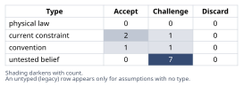
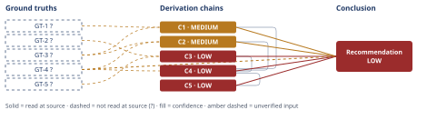

# Should a 20-Person Design Agency Adopt a Four-Day Week

*First-principles analysis · 9 October 2026*

*Read with: [How to read this analysis](HOW-TO-READ.md) · [Working file](analysis-20261009T154109Z.md) · [All files](INDEX.md)*

## Executive Summary

**Recommendation:** Do not decide "switch" or "stay" from general four-day-week evidence alone. First audit two firm-specific facts — whether this 20-person roster splits into client-facing and production coverage subgroups, and whether client contracts require 5-day availability — and only then run a time-boxed, metric-bound staggered pilot if both checks pass; otherwise remain at five days (chain C5, C4, C2).

**Band (from §6):** LOW.

**Would change it:** Firm-specific data resolving GT-4? (actual role composition) and A8 (client contract terms) — without it, the numeric trade-off's narrow preference for the status quo is not robust to a firm that weighs talent-retention pressure much more heavily than client-coverage risk (chain C4, C5).

## 1. Problem Essence

**Core problem:** Given a 20-person design agency's need to preserve client-facing coverage, creative output, and profitability while competing for scarce creative talent, should it reduce scheduled working time to four days — and if so, in what form (uniform closure, permanent staggered split, or a time-boxed pilot) rather than as a flat yes/no on "the four-day week" as a single undifferentiated policy?

**Success criteria:**
1. States a position (not a non-answer) on whether a hours-reduction move is advisable at this firm's size and in this industry.
2. Explicitly addresses the client-service/responsiveness risk specific to deadline- and relationship-driven agency work.
3. Explicitly addresses the talent-recruitment/retention angle relevant to competing for creative staff.
4. Names the specific unresolved, firm-level fact(s) that would most change the answer, rather than resolving the question on industry-wide evidence alone.
5. Allows a hybrid or phased answer (e.g., a bounded pilot, role-based staggering) to win over either named extreme ("switch" / "don't switch") if the reasoning supports it.

## 2. Assumptions Table



| Assumption | Type | Treatment | Verdict | Verification |
|------------|------|-----------|---------|--------------|
| A1: "Four-day week" means the 100-80-100 model — 100% of pay, ~80% of scheduled hours, 100% of output expected (not a pay cut, not unpaid hours compression) | convention | Explicitly challenge: confirm this is the variant meant before reasoning further; other variants (4x10 compressed, pay-cut) have different risk profiles | Accept — this is the variant with the most available trial evidence and the one the question implicitly invokes; analysis proceeds on this variant only | unverified — flagged; no source opened, adopted as the working definition |
| A2: Creative/design knowledge-work output tracks effective focused hours and deliverable completion more than total hours logged | untested belief | Verify or flag; this is the central lever the whole analysis depends on | Challenge — plausible and partially supported by broader hours-output research (GT-1?), but not verified for this specific firm | unverified — flagged GT-1? |
| A3: Client service requires availability across all 5 weekdays | current constraint | Record expiry conditions: holds only until/unless staggered or rotating coverage is adopted, or unless client contracts are renegotiated | Accept as current, with recorded expiry — ceases to bind once a staggered coverage scheme (chain C2) or revised contracts are in place | unverified — flagged; depends on actual client contracts, not inspected |
| A4: A 20-person firm has enough role diversity (distinct client-facing vs. production subgroups) to stagger days off without closing entirely | untested belief | Verify against actual roster; this is firm-specific and cannot be inferred from firm size alone | Challenge — unverifiable without the firm's actual role breakdown; treated as the single largest point of leverage on the answer | unverified — flagged GT-4? |
| A5: In the current creative/knowledge-work labor market, a four-day week functions as a meaningful recruiting/retention differentiator | current constraint (time-bound, era-specific labor-market condition) | Record expiry: holds only while competing firms have not also adopted it broadly (at which point the differentiator decays to a baseline expectation) | Accept as current, with recorded expiry | unverified — flagged GT-5? |
| A6: Results from multi-company four-day-week pilots (e.g., 2022 UK-style trials) generalize to this specific 20-person design agency | convention / analogy | Challenge explicitly — per the no-analogy rule, pilot results from other firms cannot be used as direct evidence of this firm's outcome; usable only as weak corroborating context | Challenge — retained only as weak, heavily caveated corroboration (GT-2?), never as the sole support for any chain | unverified — flagged GT-2?; explicit analogy risk, selection-bias risk (participating firms self-selected) |
| A7 [surfaced in Phase 4, chain C1]: Deadline-based output can be measured and verified independently of hours worked (i.e., the firm has or could have a deliverable/throughput metric, not just a time-logging system) | untested belief | Verify or flag; without such a metric the firm cannot actually test whether C1's structural compatibility claim holds in practice | Challenge — unverified; firm-specific, no evidence the agency currently tracks deliverable throughput separately from hours | unverified — flagged |
| A8 [surfaced in Phase 4, chain C2]: Existing client contracts/SLAs do not contractually require staff availability on all 5 weekdays | current constraint | Record expiry: holds only until contracts are checked; some retainer/SLA agreements may explicitly specify availability windows | Challenge — unverified; must be checked per-client before any staggering plan is finalized | unverified — flagged |
| A9 [surfaced in Phase 4, second-order actor lens]: Account/client-facing roles can rotate days off without client relationships suffering from reduced continuity of contact | untested belief | Verify or flag; relationship-based agency roles are often valued precisely for continuity | Challenge — unverified; plausible but not demonstrated, and account-management literature generally treats continuity as valuable | unverified — flagged |
| A10 [surfaced in Phase 4, second-order time lens]: A time-boxed pilot can genuinely be reversed without major morale cost if it underperforms | untested belief | Verify or flag; this is the premise behind recommending a "reversible" pilot as lower-risk than a permanent switch | Challenge — unverified; a well-known ratchet effect (benefits, once granted, are costly to withdraw) argues against assuming easy reversibility | unverified — flagged; directly informs the Conclusion's confidence cap |
| A11 [surfaced in Phase 4, chain C4]: The specific criterion weights used in the trade-off (client coverage ×5, talent/retention ×3, implementation complexity ×2, output/productivity risk ×4, cost neutrality ×3) reflect this firm's true priorities | untested belief | Verify or flag; these weights are this analyst's judgment calls, not independently verified facts about the firm's priorities | Challenge — unverified; the flip-test in chain C4 explicitly treats this as the chain's own sensitivity, not a settled fact | unverified — flagged |
| A12 [surfaced in Phase 4, chain C5, second-order actor lens]: Clients and competing agencies will actively react to a visible schedule change (clients testing whether off-days are honored; competitors using full availability as a pitch differentiator) rather than being indifferent to it | untested belief | Verify or flag; this is a behavioral prediction about third parties, not a fact already observed at this firm | Challenge — unverified; plausible given general incentive reasoning, but no direct evidence from this firm's clients or competitors | unverified — flagged |

## 3. Ground Truths

- **GT-1?** Labor-output research on sustained working hours (e.g., analyses of WWI-era munitions-output data, and broader knowledge-work studies on overwork) finds diminishing, and eventually negative, marginal output as weekly hours rise past a moderate threshold, and associates chronic overwork with higher error rates and reduced creative/cognitive performance. — unverified: drawn from training knowledge; no source opened in this analysis; provenance: unverified.
- **GT-2?** Multi-company four-day-week pilot programs (100-80-100 model; e.g., widely reported 2022 UK-style trials across roughly five dozen participating organizations) reported that a large majority of participating organizations maintained or grew revenue over the trial period and chose to continue the policy afterward. — unverified: drawn from training knowledge; no source opened; additionally an analogy risk (different firms, sizes, sectors, and likely self-selected toward firms already optimistic about the policy); provenance: unverified.
- **GT-3?** Design/creative-agency work is organized primarily around project deliverables and client deadlines rather than continuous real-time coverage for most roles, with account/project-management roles being the main exception that requires more continuous availability. — unverified: treated as a structural/definitional fact about how agency business models commonly operate, with acknowledged firm-to-firm variability; no source opened in this analysis; provenance: unverified.
- **GT-4?** A 20-person firm has sufficient headcount to split staff into at least two coverage subgroups (e.g., client-facing vs. production) so that staggered days-off preserve 5-day client coverage — conditionally true, entirely dependent on this specific firm's actual role composition, which is unknown to this analysis. — unverified: firm-specific fact not available to this analysis; provenance: unverified. This is the single most sensitive, load-bearing unresolved fact in the whole analysis (see Phase 5 Sensitivity).
- **GT-5?** As of the mid-2020s, a four-day week functions as a recruitment and retention differentiator in competitive creative/knowledge-work labor markets. — unverified: drawn from training knowledge of widely reported labor-market trends; no source opened; also time-bound (current constraint, not a permanent fact); provenance: unverified.

**Provenance summary (required):**
```text
?-marked: GT-1, GT-2, GT-3, GT-4, GT-5 (5 of 5)
Read-at-source: none (0 of 5) — this analysis opened no external source; every ground truth above, including GT-3 (a structural/definitional claim about agency operating models), is carried from the analyst's own training knowledge or domain reasoning, has not been read at any external source, and is marked ? accordingly.
```

## 4. Derivation Chains



### Conclusion C1: A compressed/staggered schedule is structurally compatible with production (design) roles at this agency

GT-1? (diminishing/negative marginal output from excess hours) + GT-3? (agency work is deadline-driven, not continuous-coverage-driven, for most roles)
→ reducing scheduled hours for production roles while holding deliverable deadlines fixed removes hours that were contributing little or negative marginal output rather than removing hours that were producing the deliverable *[Assumes: A7 — deliverable throughput is measurable independently of hours worked]*
→ for production (design) roles specifically, a four-day schedule is structurally compatible with how agency output is actually generated and measured

**Confidence:** MEDIUM — GT-1? is an unverified generalization from broader labor-economics/knowledge-work research, not firm-specific data; it would be removed as a cause of the downgrade by measuring this agency's own deliverable throughput before and during a trial period (see A7, which this chain surfaces and which remains unverified). GT-3? is also unverified (no source opened), though treated as structural/definitional rather than empirical; it would be removed as a cause of the downgrade by confirming this agency's own operating model matches the stated structure. Neither input independently lowers the band below MEDIUM.

### Conclusion C2: The client-coverage risk of a four-day week is manageable through role-based staggering, conditional on this firm's actual role composition

GT-3? (continuous availability mainly needed for client-facing roles) + GT-4? (20 staff may divide into at least two coverage subgroups)
→ if client-facing and production roles can be split into separate day-off cohorts, the agency can preserve 5-day client-facing coverage even though individual staff each work 4 days *[Assumes: A8 — existing client contracts/SLAs do not require 5-day staff availability]*
→ the client-service risk most commonly raised against a four-day week is addressable by schedule design rather than being an inherent blocker, but only if GT-4? holds for this specific firm

**Confidence:** MEDIUM — GT-4? is the load-bearing unverified input: it is a firm-specific fact (actual headcount split between client-facing and production roles) that this analysis has no access to. It would be removed as a cause of the downgrade by the agency auditing its own roster against a staggering plan before committing to any pilot. GT-3? is also unverified (no source opened) and would be removed as a cause of the downgrade by confirming this agency's own operating model matches the stated structure; it does not independently lower the band below what GT-4? already sets. GT-4? is the single most sensitive input in the whole analysis (see Phase 5 Sensitivity below).

### Conclusion C3: A talent-retention upside is real in direction but its revenue-neutrality claim rests on a heavily caveated analogy

GT-5? (four-day week is a current labor-market differentiator) + GT-2? (other firms' pilots report stable/grown revenue, but drawn from different, self-selected organizations)
→ the direction of the talent-retention argument is plausible on its own (a benefit valued by workers is a recruiting lever), but the claim that adopting it is also revenue-neutral cannot be transferred from other firms' pilot results without committing an analogy-as-evidence error
→ the talent-retention upside should be treated as a real but unquantified plus-factor, not as proof that this specific agency's revenue will be unaffected

**Confidence:** LOW — two inputs are both unverified (GT-5?, GT-2?), and GT-2? additionally carries an unresolved rival explanation (participating pilot firms self-selected toward organizations already optimistic about the policy, biasing the reported success rate upward) that nothing in this analysis rules out. GT-5? would be removed as a cause of the downgrade by this firm surveying its own candidate pool/exit interviews for how much a four-day week actually weighs in their decisions; GT-2?'s rival would be removed only by firm-level before/after data from a comparable agency, which is not available here.

### Conclusion C4: The numeric trade-off favors remaining at five days by a modest but not single-criterion-robust margin

C1 (structural compatibility for production roles) + C2 (client-coverage risk is manageable, conditional on GT-4?) + C3 (talent upside real but unquantified) + GT-4? (the unresolved role-composition fact both C2 and the trade-off's complexity/coverage scoring depend on)
→ weighted trade-off across three options — (A) uniform 4-day closure, (B) status quo, (C) a time-boxed staggered pilot — scored against five weighted criteria (client coverage ×5, talent/retention ×3, implementation complexity ×2, output/productivity risk ×4, cost neutrality ×3) yields totals A=59, B=72, C=66, so status quo (B) scores highest *[Assumes: A11 — these criterion weights reflect this firm's true priorities]*
→ the flip test shows no single criterion's weight, moved anywhere within a 1-5 scale, reverses this ranking; only a joint reweighting that raises talent/retention toward its maximum weight while simultaneously cutting client-coverage weight toward its minimum flips the ranking in favor of the pilot (C)
→ the trade-off's numeric answer is "stay at five days," but that answer is not robust to a firm that judges talent/retention pressure to matter far more than client-coverage risk, which is a plausible judgment in a tight creative labor market and is not something the arithmetic alone can settle

**Confidence:** LOW — capped by C3 (LOW) on this chain's head per the ceiling rule (a chain is rated no higher than the lowest-rated chain it cites), and independently by GT-4? directly. C3's cap would lift if GT-5? and GT-2? (see C3's own confidence line) were resolved with firm-level data; GT-4?'s cap would lift if the agency audited its own role composition. The trade-off's own criterion weights (client coverage ×5, talent ×3, etc.) are this analyst's judgment calls, not independently verified facts, which is itself an additional reason this chain cannot exceed LOW; the flip-test finding (robust to any single reweighting, not robust to a joint one) is the chain's load-bearing output and is reported as such rather than smoothed into a single confident number.

### Conclusion C5: The decision-relevant action is to resolve two firm-specific unknowns before choosing, and to prefer a reversible pilot over a permanent switch in either direction

C4 (status quo wins narrowly and non-robustly; sensitive to a joint reweighting toward talent/retention)
→[2nd] once either extreme policy (permanent switch or flat refusal) is announced, client-facing staff absorb schedule-rotation friction unevenly relative to production staff, clients may test whether "off days" are honored under deadline pressure, and competing agencies without the policy may use "always available five days" as a pitch differentiator against this firm — all of which are reactions by other parties that the first-order trade-off does not price *[Assumes: A9 — account roles can rotate without client-relationship continuity suffering]* *[Assumes: A12 — clients and competitors will actively react to the schedule change rather than being indifferent to it]*
→[3rd] once a chosen policy (of either kind) has been in place for a year or more, staff come to treat it as a baseline entitlement, which raises the practical cost of reversing it later even if output data turns out mixed — a ratchet effect that makes "try it and reverse if it fails" less reversible in practice than it sounds, and that argues for treating any trial as genuinely time-boxed with pre-announced metrics from day one rather than as an open-ended soft rollout *[Assumes: A10 — a time-boxed pilot can genuinely be reversed without major morale cost]*
→ given C4's narrow, non-robust numeric result and these second-order effects, the decision-relevant action is not to pick between "switch" and "don't switch" on current evidence, but to first audit the two unresolved firm-specific facts this analysis could not verify (role composition for staggering, per GT-4?/C2; and client contract/SLA terms, per A8) and only then run a pre-announced, time-boxed, metric-bound pilot if both audits permit it — otherwise remain at five days until they do

**Confidence:** LOW — inherited entirely from C4's cap (lowest-rated chain cited). No ground truth here contradicts another; the second-order effects extend C4 without contradiction, so this chain does not route back to Phase 2. The cap would lift only if C4's own causes (GT-4?, GT-5?, GT-2?, and the analyst-chosen trade-off weights) were independently resolved, as stated on C4's own confidence line.

## 5. Abandoned Reasoning

### Dead End: Using other firms' four-day-week pilot results as direct proof this agency's revenue is safe

**What was tried:** Treating widely reported multi-company pilot outcomes (GT-2?) as sufficient evidence that this specific 20-person agency could switch without revenue risk.

**Why abandoned:** This is a textbook analogy-as-evidence error (methodology Phase 4 ban on using "how others solved similar problems" as standalone justification). The participating firms in such pilots are typically self-selected toward organizations already optimistic about the policy, which is a live rival explanation for the reported success rate that nothing in this analysis rules out.

**What it ruled out:** Any version of the answer that cites "most companies that tried it kept it" as sufficient justification on its own. This is why chain C3 is capped at LOW and why GT-2? is never used as a chain's sole support anywhere in Section 4.

### Dead End: Recommending a uniform, permanent four-day closure (Option A)

**What was tried:** Scoring a flat "close the office every Friday" policy against the same weighted criteria as the status quo and the staggered pilot.

**Why abandoned:** It scored lowest of the three options (59 vs. 72 for status quo and 66 for a staggered pilot; chain C4), driven mainly by client-coverage risk (GT-3?) and by discarding the staggering mechanism that chain C2 identifies as the main available control on that risk.

**What it ruled out:** The most commonly discussed version of "go to a four-day week" — and this analysis finds it to be specifically the weakest option for a client-facing agency of this size, which is itself a usable finding, not a null result.

### Dead End: Answering the question as a flat binary from industry-wide evidence alone

**What was tried:** Giving a confident "yes, switch" or "no, don't" based only on general labor-economics and pilot-program evidence (GT-1?, GT-2?, GT-5?), without naming any firm-specific fact as a precondition.

**Why abandoned:** The Phase 5 sensitivity check identifies GT-4? (this specific firm's role composition) as the single input whose falsity most directly flips the client-coverage conclusion (chain C2) and therefore the whole recommendation (chain C5). An answer that does not name this fact is answering an easier, generic question rather than the one asked about this specific 20-person agency.

**What it ruled out:** Delivering a one-line "yes" or "no" without naming the audit step (GT-4?, A8) that chain C5 identifies as decision-relevant before either extreme is chosen.

## 6. Conclusion

**Recommended approach:** Do not decide "switch" or "stay" directly from general four-day-week evidence. First audit two firm-specific facts this analysis could not verify — whether the 20 staff split into at least a client-facing and a production coverage subgroup (chain C2), and whether existing client contracts/SLAs require 5-day staff availability (chain C5) — and only if both audits permit staggering, run a pre-announced, time-boxed (one-to-two-quarter), metric-bound pilot of a role-staggered four-day week (chain C5); otherwise remain at five days until those facts change (chain C4).

**Key insight:** The debate most commonly had about four-day weeks (does cutting hours cut output?) is directionally favorable here and genuinely relevant (chain C1), but it is not what should decide this specific case — the deciding input is an unaudited, firm-specific fact about this agency's own roster (chain C2), and the numeric trade-off's narrow preference for the status quo is not robust to a firm that weighs talent-retention pressure much more heavily than client-coverage risk (chain C4), which the second-order ratchet and client-testing effects argue should be priced in before any trial is announced rather than discovered mid-trial (chain C5).

**Trade-offs acknowledged:** Auditing first and piloting only conditionally defers any recruiting/retention signal this agency could send by announcing a switch immediately (chain C3), and a staggered schedule carries more day-to-day coordination overhead than either a uniform closure or the unchanged status quo (chain C4). A live rival not ruled out by this analysis — remain at five days and do not commit even to a pilot timeline until both audits are complete — is the more risk-averse reading of the same chains and is explicitly not foreclosed here (chain C5).

**Confidence:** LOW — this conclusion rests on C5, which inherits its cap from C4, which is itself capped both by C3 (LOW, due to the unverified and analogy-exposed GT-5?/GT-2?) and directly by GT-4? (the unresolved, firm-specific role-composition fact). C1 and C2 are each MEDIUM on their own unverified inputs (GT-1?, GT-4?) as detailed on their own confidence lines. None of these caps would be removed by further general reasoning; each requires a specific piece of firm-level evidence this analysis does not have access to — chiefly GT-4? (role composition), A8 (contract terms), and firm-level data that would let GT-5?/GT-2? stop resting on an industry-wide analogy. The overall LOW band is therefore the analysis's own finding, not a hedge: the honest answer to "should this specific agency switch" cannot currently rise above LOW without two audits this analysis could not perform.
