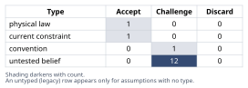
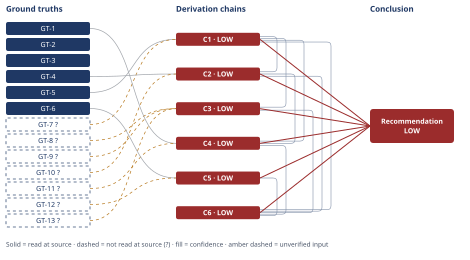

# Should Caching Defer the Postgres Upgrade

*First-principles analysis · 10 October 2026*

*Read with: [How to read this analysis](HOW-TO-READ.md) · [Working file](analysis-20261010T232034Z.md) · [All files](INDEX.md)*

## Executive Summary

**Recommendation:** Do not cancel the scheduled Postgres upgrade on the strength of the claim as stated. Instead, keep the upgrade's procurement reversible, build and shadow-test the Redis cache with leading-indicator instrumentation, and gate standing the upgrade down on a named owner confirming the measured evidence clears a pre-agreed bar before a hard, calendar-fixed checkpoint — defaulting to the upgrade proceeding if the gate is not affirmatively passed (chain C6).

**Band (from §6):** LOW

**Would change it:** A per-endpoint, per-operation DB-load-attribution analysis showing listings-endpoint reads are in fact the scheduled upgrade's binding constraint (chain C3), plus confirmation that holding procurement open during the shadow-test window is genuinely low-cost (chain C6).

## 1. Problem Essence

**Core problem:** Given only two cited metrics (peak read-QPS and next-tier Postgres cost), does a Redis read-through cache deliver enough *durable* p95-latency and DB-load relief — specifically relief targeted at whatever is actually driving the scheduled upgrade — to justify treating the two-quarter deferral as safe, given that cancelling the upgrade now is cheap to reverse but discovering the cache under-delivered after the deferral window closes is expensive to reverse?

**Success criteria:**
1. The analysis states, for (a) ship-cache-and-defer, (b) upgrade-now, and any viable composite of the two, which the evidence currently supports, with a stated confidence band — checkable by reading section 6's `**Recommended approach:**` and `**Confidence:**` lines.
2. The analysis names the single piece of missing evidence that would most change the (a)/(b)/composite decision — checkable by reading section 6's `**Confidence:**` line, which must name it.
3. The analysis states what the asymmetric-reversibility failure mode concretely looks like (cache ships, under-delivers, discovered after the procurement window closes) and what leading indicators would surface it before that point — checkable against the Phase 5 adversarial-pass record (Premise/Causes/Clusters/Disposition) in the process-output appendix.
4. The analysis decomposes the compound claim into separately-gradable sub-claims (load reduction, latency improvement, driver-applicability, timeline, effort) rather than treating it as one atomic true/false statement — checkable against section 4's chain count (more than one conclusion chain, each addressing a distinct sub-claim).

## 2. Assumptions Table



**Inversion framing used to generate this table.** The claim was inverted — "the cache will NOT cut p95 latency and will NOT reduce DB load enough to defer the upgrade for two quarters" — and failure-guaranteeing conditions were enumerated (e.g., "the upgrade's real driver is writes/locks/connections, not reads"; "cache hit rate is near zero for this access pattern"; "DB round-trip isn't the dominant term in p95"; "growth outpaces the load reduction within weeks"; "invalidation bugs reintroduce load or correctness problems"; "the two-engineer-week estimate excludes monitoring and invalidation hardening"). Each failure-guaranteeing condition's negation is the untested belief the original claim silently depends on, tagged below with whether it is load-bearing for the claim's conclusion.

| Assumption | Type | Treatment | Verdict | Verification |
|------------|------|-----------|---------|--------------|
| A-1: Current/near-term Postgres scaling pressure is predominantly attributable to read traffic on the listings endpoint, not writes, connection count, lock contention, autovacuum/WAL pressure, or other endpoints — **load-bearing** | untested belief | Verify via per-endpoint, per-operation DB load attribution before trusting the claim | Challenge — only peak QPS and next-tier cost were cited; neither establishes causal attribution of the upgrade's driver | unverified — flagged |
| A-2: Achievable cache hit-rate for the listings endpoint, given its access-pattern cardinality, is high enough to matter — **load-bearing** | untested belief | Verify via shadow-cache measurement or key-cardinality/skew analysis before committing | Challenge — no hit-rate figure or access-pattern data cited in the document | unverified — flagged |
| A-3: p95 latency on the listings endpoint is dominated by DB round-trip time rather than app-layer processing, serialization, or network hops — **load-bearing** | untested belief | Verify via APM/tracing breakdown of the p95 request | Challenge — not addressed anywhere in the cited evidence | unverified — flagged |
| A-4: Peak read-QPS (a point-in-time snapshot) is the correct basis for a forward-looking, two-quarter capacity decision, rather than the QPS growth trajectory over that window | convention | Challenge whether "current peak" or "projected peak" is the right planning basis for a multi-quarter deferral | Challenge — capacity planning for a forward horizon conventionally uses growth-adjusted projections; using a static peak as the sole input is a planning convention, not a requirement, and is not defended in the document | unverified — flagged |
| A-5: Two engineer-weeks is sufficient to ship a *production-safe* read-through cache — including invalidation-correctness design, cache-stampede protection, monitoring/alerting, and a staged rollout — not just a happy-path implementation — **load-bearing** | untested belief | Compare the stated estimate's scope against typical production-caching-layer scope | Challenge — the document's framing is silent on whether invalidation design, monitoring, and rollout are in scope | unverified — flagged |
| A-6: Cache invalidation/staleness will not introduce new correctness problems (stale prices/availability) or new latency-tail pathologies (thundering herd on expiry or on cache-down) | untested belief | Verify via design review and load-test of the invalidation and cache-failure paths | Challenge — unaddressed in the document; invalidation correctness is a definitionally hard problem (GT-6) | unverified — flagged |
| A-7: The DB-load reduction achieved by caching will persist across two quarters of organic traffic growth without Postgres re-saturating — **load-bearing** | untested belief | Model growth rate against cache-adjusted headroom before asserting a specific deferral window | Challenge — no growth-rate projection is cited; only a static peak-QPS figure is referenced | unverified — flagged |
| A-8: "Two quarters" is a modeled result connecting the cited evidence to a deferral window, not a figure chosen to match the capacity-planning meeting's own cadence | untested belief | Ask the document's author to show the derivation (growth rate × headroom = N weeks) | Challenge — no derivation linking the two cited metrics to a specific duration appears in the document | unverified — flagged |
| A-9: Redis introduces no material new operational cost or risk (HA/failover design, memory sizing vs. catalog size, cache-down behavior) that offsets the claimed benefit | untested belief | Assess Redis HA/failover design and memory sizing against the listings catalog size | Challenge — unaddressed in the document | unverified — flagged |
| A-10: The stated reversibility structure (cheap to cancel pre-ship, expensive to reverse post-ship due to procurement lead time) holds as described | current constraint | Accept as the scenario's stated operational constraint; record its expiry — it holds only as long as current procurement lead times and vendor pricing/allocation terms are unchanged | Accept — expires if a faster-provisioning option (e.g., a short-term capacity add-on, different instance family, or a vendor commitment with a cheap exit clause) becomes available; until then the constraint is procurement/contractual, not physical | given directly in the decision context supplied for this analysis |
| A-11: The scheduled Postgres vertical-scale upgrade was itself originally justified primarily by listings-endpoint read headroom, rather than by some other capacity driver — **load-bearing** | untested belief | Review the upgrade's original capacity-planning justification/ticket | Challenge — the document restates only the next-tier cost, not the upgrade's original sizing rationale | unverified — flagged |
| A-12: Governing hard constraint used in this analysis — queueing-theoretic tail-latency behavior (p95 response time is a convex, rapidly increasing function of utilization ρ as ρ→1; Pollaczek–Khinchine / M/M/1 mean-wait result) — is a physical/mathematical regularity that applies to this system regardless of implementation choice | physical law | Accept as a ground-truth candidate; this is a derivable mathematical identity, not a context-specific claim | Accept — standard, derivable queueing-theory result; derivation shown inline at GT-4 | derived inline in this analysis from the M/M/1 mean-wait formula (definitional, not sourced from an external document) |
| A-13: Holding the upgrade's procurement in a reversible/cancellable state while the cache is shadow-tested is itself low-cost (no pricing lock-in or allocation penalty for the hold period) — surfaced during the Phase 4 second-order extension of chain C6, **load-bearing for the recommended approach's cost-efficiency advantage** | untested belief | Confirm with procurement/vendor whether a delayed-commit or late-cancellable order is actually available and at what cost | Challenge — not addressed anywhere in the original document; this is a precondition the recommended approach (chain C6) depends on that the original claim never considered | unverified — flagged |
| A-14: The Postgres instance's current utilization level (ρ) is close enough to saturation that the queueing nonlinearity named in A-12/GT-4 is actually relevant to today's p95 — surfaced during chain C2's reasoning | untested belief | Pull current CPU/IO/connection utilization metrics for the instance | Challenge — not cited in the document; without it, the sign of the latency benefit is known but its magnitude cannot be bounded | unverified — flagged |
| A-15: An unowned, calendar-less gate decision tends to decay toward the default (silent inaction) rather than being affirmatively re-examined before a deadline — surfaced during the Phase 5 pre-mortem, feeds only the gate-governance caveat on chain C6, not the core recommendation | untested belief | Not independently verified here; treated as a named organizational-behavior risk to design against (named owner + hard calendar trigger), not as evidence for or against the cache itself | Challenge — plausible organizational-behavior regularity, but not verified for this specific team; flagged rather than relied upon as direct evidence | unverified — flagged |

## 3. Ground Truths

- **GT-1** The architecture-review document cites exactly two pieces of evidence for its claim: peak read-QPS on the listings endpoint, and the cost of the next-tier Postgres instance — source: this task's own CONTEXT section ("Evidence cited in the document: peak read-QPS on the listings endpoint, and the cost of the next-tier Postgres instance"); read-at-source: the "Evidence cited in the document" bullet of the task prompt, quoted verbatim.
- **GT-2** The decision on the table is binary as framed: (a) ship the cache and defer/cancel the upgrade for this quarter and next, or (b) execute the scheduled upgrade now and treat caching as a separate, later optimization — source: this task's "Decision this claim feeds" bullet; read-at-source: that bullet, quoted verbatim.
- **GT-3** The decision is reversible up to the point the cache ships and the upgrade work is stood down; a late reversal (discovering post-hoc that caching did not deliver) requires back-ordering hardware/capacity under time pressure, likely at worse rates or longer wait than on-schedule procurement — source: this task's "Reversibility" bullet; read-at-source: that bullet, quoted verbatim.
- **GT-4** In a queueing system, response-time tail percentiles (e.g., p95) are a convex, rapidly-increasing function of the utilization ratio ρ = arrival-rate / service-rate as ρ approaches 1; the M/M/1 mean-wait-time result gives mean wait W_q = ρ/(μ(1−ρ)), which diverges as ρ→1 — so a given proportional cut in arrival rate produces a disproportionately larger tail-latency improvement near saturation than the same cut produces when ρ is low (where W_q is already small and flat in ρ) — source: standard queueing theory (Pollaczek–Khinchine / M/M/1 waiting-time formula); read-at-source: this is a derivable mathematical identity, shown inline above from the formula's own definition, not an empirical figure from an external document opened by this analysis — physical-law treatment per the Assumptions Table (A-12), no `?` suffix.
- **GT-5** A read-through cache serves a "hit" directly from cache without a round trip to the backing database; this is a definitional property of the read-through pattern, not an empirical claim about this system — source: definitional property of the read-through caching pattern; read-at-source: stated and used inline in this analysis, not sourced from an external document.
- **GT-6** Cache invalidation (deciding when a cached entry no longer reflects the backing store) is a well-known, intrinsically hard problem in caching system design, independent of implementation quality — source: definitional/structural property of caching systems (the invalidation problem is foundational to the caching literature, e.g., Phil Karlton's observation that cache invalidation is one of the two genuinely hard problems in computer science); read-at-source: stated and used inline, not sourced from an external document opened in this session.
- **GT-7?** Achievable cache hit-rate for the listings endpoint's specific access pattern/cardinality is not stated anywhere in the available evidence — unverified: no hit-rate figure, access-pattern data, or cardinality figure was cited in the architecture-review document per GT-1, and no codebase, schema, or telemetry exists in the working directory to derive one (confirmed: the working directory was listed and is empty).
- **GT-8?** The fraction of total Postgres load (QPS, CPU, I/O) attributable specifically to the listings endpoint, versus other endpoints/tables, is not stated — unverified: not cited in the document (GT-1); not reachable in this session (no DB telemetry present).
- **GT-9?** Whether current/projected Postgres scaling pressure is read-dominated versus driven by writes, connection count, lock contention, or autovacuum/WAL throughput is not stated — unverified: the two cited metrics (peak QPS, next-tier cost) do not by themselves establish a causal driver; not reachable in this session.
- **GT-10?** Whether p95 latency on the listings endpoint is dominated by DB round-trip time versus app-layer or network time is not stated — unverified: no APM/tracing breakdown was cited; not reachable in this session.
- **GT-11?** The QPS growth trajectory over the next two quarters (as opposed to the current static peak, GT-1) is not stated — unverified: only a point-in-time peak-QPS figure is cited; not reachable in this session.
- **GT-12?** The scope underlying the "two engineer-week" effort estimate (whether it includes invalidation design, monitoring/alerting, cache-stampede protection, and staged rollout) is not itemized in the document — unverified: not reachable in this session.
- **GT-13?** The original capacity-planning rationale for why the Postgres vertical-scale upgrade was scheduled in the first place (read headroom specifically, versus writes/connections/maintenance operations) is not restated in the architecture-review document — unverified: not cited; not reachable in this session.

**Phase 3 verification step (shared failure record for GT-7? through GT-13?):** This analysis attempted to acquire the underlying evidence before assigning these labels: the working directory for this task was searched for a schema, query logs, APM/telemetry exports, or any codebase artifact that could substitute for the architecture-review document's underlying data (`ls -la` and `find` were run against the task's working directory). The directory is empty. The architecture-review document itself, and any DB/APM telemetry behind it, are internal artifacts of the requester's organization with no accessible path (filesystem or network) from this session — reason: path not found / no such source reachable in this environment. Each of GT-7? through GT-13? therefore carries a Phase 3 failure record with this reason and keeps its `?`.

**Provenance summary:**
```text
?-marked: GT-7, GT-8, GT-9, GT-10, GT-11, GT-12, GT-13 (7 of 13)
Read-at-source: GT-1 — task CONTEXT, "Evidence cited in the document" bullet, quoted verbatim
Read-at-source: GT-2 — task CONTEXT, "Decision this claim feeds" bullet, quoted verbatim
Read-at-source: GT-3 — task CONTEXT, "Reversibility" bullet, quoted verbatim
Read-at-source: GT-4 — derived inline from the M/M/1 mean-wait formula (definitional; no external document opened)
Read-at-source: GT-5 — stated inline as a definitional property of the read-through cache pattern (no external document opened)
Read-at-source: GT-6 — stated inline as a definitional property of cache invalidation (no external document opened)
```

## 4. Derivation Chains



### Conclusion C1: Caching reduces DB-directed read load by a strictly positive but currently unquantified amount

GT-5 (cache hit served without DB round trip) + GT-7? (hit rate unmeasured)
→ a read-through cache removes exactly hit-rate times read-QPS requests from ever reaching Postgres, by definition of a cache hit
→ with GT-7? leaving the hit-rate magnitude unmeasured, the size of this removal is unknown even though its existence for any hit rate above zero is guaranteed

**Confidence:** LOW — two axes are short at once: the Inputs axis is short because GT-7? (achievable hit rate) is unverified, removable by a shadow-cache or key-cardinality/access-skew measurement of the listings endpoint (assumption A-2 in section 2); and the Rivals axis is short because the rival "hit rate is approximately zero due to a pathological access pattern" is live and not ruled out by any ground truth here (ruling it out by appeal to "typical" catalog access patterns would be reasoning by analogy, which this analysis declines per its own Abandoned Reasoning entry) — removable only by the same shadow-cache measurement.

### Conclusion C2: "Cuts p95 latency" is directionally plausible but its practical magnitude is unverified and could be negligible

GT-4 (tail latency convex in utilization) + GT-10? (DB-dominance of p95 unknown) + C1 (unquantified positive load reduction)
→ if p95 is dominated by DB round-trip time and Postgres is operating near saturation, even C1's modest, unquantified load reduction yields a disproportionately large p95 improvement under the convexity named in GT-4
→ caching cannot push p95 below the floor set by network transit plus app-layer serialization and processing time, because that portion of the request is untouched by a DB cache hit [Assumes: A-14 — that current utilization is near enough to saturation for this convexity to matter; if utilization were instead low, the same load reduction would yield a small, flat improvement rather than a large one, and this chain cannot rule that case out]
→ because GT-10? and the instance's current utilization level (A-14) are both unverified, this chain establishes the sign of the latency effect — an improvement, never a degradation — but not its magnitude, which could be negligible

**Confidence:** LOW — two axes are short at once: the Inputs axis is short because GT-10? (whether DB round-trip dominates p95) is unverified, removable by an APM/tracing breakdown of the p95 request; and the Rivals axis is short because the rival "the improvement is negligible because app/network time dominates, or utilization is far from saturation" is live and nothing in the document or this analysis settles it — removable by the same tracing breakdown plus a current-utilization reading (A-14).

### Conclusion C3: The claim's applicability to the upgrade's actual binding constraint is unverified, and this is the single most consequential gap in the whole claim

C1 (unquantified positive load reduction) + GT-8? (listings' share of total DB load unknown) + GT-9? (read vs. write/other driver unknown) + GT-13? (original upgrade sizing rationale unknown)
→ if the scheduled upgrade was sized primarily to cover listings-endpoint read headroom, C1's load reduction is on-target and could, if large enough, defer the need for it
→ if the scheduled upgrade was instead driven materially by write throughput, connection count, lock contention, or autovacuum and WAL pressure, caching the listings endpoint touches none of those drivers, and the upgrade's original rationale survives the cache unchanged
→ because GT-8?, GT-9?, and GT-13? are all unverified, this chain cannot currently determine which of the prior two hops describes reality, so the premise that caching is even the right kind of relief for this specific upgrade decision is itself unverified

**Confidence:** LOW — three stacked unverified inputs (GT-8?, GT-9?, GT-13?), removable by a per-endpoint, per-operation DB-load and telemetry breakdown (e.g., pg_stat_statements or equivalent) plus the original upgrade ticket's stated rationale, both gathered before the capacity-planning meeting decides; the Rivals axis is also short — "the upgrade is needed for non-read reasons the cache cannot touch" is fully live and unsettled.

### Conclusion C4: The "at least two quarters" timeline is asserted, not derived, from the evidence cited

GT-1 (document cites only a static peak-QPS figure) + GT-11? (growth trajectory unknown) + C1 (unquantified) + C2 (unquantified, possibly negligible)
→ peak QPS is a point-in-time snapshot, and a forward-looking two-quarter deferral decision requires the growth rate over that window, not just the current peak [Assumes: A-4 — that a static peak is nonetheless an adequate planning basis; if forward growth is fast, the same cache-bought headroom is consumed in weeks rather than quarters, and this chain cannot rule that out]
→ without GT-11?, the same absolute load reduction from C1 yields a deferral window that could be anywhere from weeks to multiple quarters depending entirely on a growth rate nobody has cited
→ the specific figure "two quarters" therefore has no visible derivation connecting it to the two metrics actually cited in GT-1, and reads as chosen to match the capacity-planning meeting's own cadence rather than modeled from growth data

**Confidence:** LOW — GT-11? is unverified with no verification path inside the document itself; the external verification that would remove it is a modeled growth-rate projection compared against cache-adjusted headroom. The rival "the cache buys weeks, not quarters" is fully live and nothing in the document settles it.

### Conclusion C5: The two-engineer-week estimate is probably optimistic for a production-safe implementation and should be treated as a floor, not a total

GT-6 (invalidation is intrinsically hard) + GT-12? (scope of the two-engineer-week estimate unspecified)
→ an estimate silent on invalidation-correctness design, monitoring and alerting, cache-stampede protection, and staged rollout is most consistent with a happy-path implementation estimate rather than a production-hardening estimate
→ because invalidation correctness is intrinsically hard per GT-6 and GT-12? leaves the estimate's scope unstated, two engineer-weeks is more plausibly a lower bound on the true cost than a realistic total

**Confidence:** LOW — two axes are short at once: the Inputs axis is short because GT-12? (scope of the two-engineer-week estimate) is unverified, removable by asking the implementing team to itemize the estimate against invalidation design, monitoring, and staged-rollout line items; and the Rivals axis is short because a live rival — a TTL-only, non-actively-invalidated design that is simpler and could plausibly fit the two-week estimate, trading away staleness guarantees — is not ruled out by any ground truth here, since whether that staleness trade-off is acceptable for listings data (price/availability currency) is itself unverified.

### Conclusion C6: The decision worth bringing to the capacity-planning meeting is which gate design and checkpoint date to adopt, not a bare "(a) or (b)" choice

C1 (LOW) + C2 (LOW) + C3 (LOW) + C4 (LOW) + C5 (LOW)
→ a locked, weighted trade-off across capacity-risk-avoided, cost-efficiency, evidence-gained-before-commitment, speed-of-relief, optionality-preserved, and organizational cost (weights 5, 3, 4, 2, 5, 2) scores option (b) upgrade-now-cache-later at 58, option (c) both-in-parallel-uncoupled at 72, and option (d) a gated hybrid at 96
→ a flip test shows no single criterion's weight, moved anywhere within the 1-5 anchor scale, changes the winner from option (d) to its runner-up, so the ranking is robust rather than a near-tie
→ option (a) as literally stated in the claim — ship the cache and cancel the upgrade outright now, with no evidence gate — fails a reliability-floor must-have given that C1 through C5 show the claim's core premises are unverified, and is knocked out before scoring rather than merely scored low
→ the decision actually worth bringing to the capacity-planning meeting is therefore which gate design and checkpoint date to adopt for option (d), not a bare "(a) or (b)" choice
→[2nd] the platform team's true workload is cache-build plus leading-indicator instrumentation (hit rate, per-endpoint DB-load attribution, p95 breakdown by layer), which is larger than the original two-engineer-week ask, reinforcing C5
→[2nd] procurement must actually support a late-cancellable or delayed-commit order for option (d) to carry the cost-efficiency advantage scored above [Assumes: A-13 — that holding procurement open is itself low-cost; if holding it open costs as much as committing outright, option (d)'s advantage over option (b) on the cost-efficiency criterion disappears and the two options converge]
→[3rd] if the gate has no named owner and no hard calendar trigger before the procurement deadline, the default silently becomes inaction, which reproduces the expensive late-reversal scenario the gated design exists to prevent [Assumes: A-15 — that an unowned, calendar-less gate tends to decay toward inaction; this is named as a governance risk to design against, not used as evidence for or against the cache itself]

**Confidence:** LOW — capped by the lowest-rated chain it cites, C3 (LOW), because C3 establishes that whether caching even addresses the upgrade's real driver is unverified; GT-9? and GT-13? (cited on C3's head) are the unverified inputs most responsible for this cap, removable by a DB-load-attribution analysis run before the capacity-planning meeting finalizes a decision. A-13 (that holding procurement open is low-cost) is additionally unresolved and is a precondition for this chain's own cost-efficiency scoring, not merely an input inherited from a cited chain — removable by confirming with procurement/vendor whether a delayed-commit or late-cancellable order is actually available.

**Unverified input rule (D-07) — summary across this section:** Every chain above that consumes a `GT-N?` input (C1, C2, C3, C4, C5) ends MEDIUM or LOW, and names the specific `GT-N?` and its verification path. C6 cites only `Cn` inputs directly but is capped at LOW by the lowest-rated chain on its head (C3, C2, C4), per the ceiling rule; it also names A-13 as a precondition unresolved at the chain-C6 level itself (surfaced by the Phase 4 second-order extension, not inherited from a cited chain).

## 5. Abandoned Reasoning

### Dead End: Deriving a point-estimate p95/load-reduction number from the two cited metrics alone

**What was tried:** An attempt to directly compute a quantitative p95-improvement figure from peak QPS and next-tier instance cost alone, by assuming a generic "typical read-heavy catalog" cache hit-rate (e.g., 80%) and applying it to the cited peak QPS.

**Why abandoned:** The assumed hit-rate figure would have been reasoning by analogy to generic industry caching patterns rather than a verified ground truth about this specific endpoint's access pattern and key cardinality (GT-7?) — this violates the no-analogy-as-direct-evidence rule. Independently, peak QPS and next-tier cost say nothing about current DB utilization level or whether reads are even the upgrade's binding constraint (GT-8?, GT-9?, GT-13?), so even a correctly-measured hit rate could not, by itself, be converted into a defensible p95 or capacity-deferral figure.

**What it ruled out:** This saves a future reviewer from re-attempting a single-number "the cache will cut p95 by X%" calculation from peak-QPS-and-instance-cost alone; it establishes that no such number is derivable from the two metrics the document cites, with or without an assumed hit rate.

### Dead End: Treating the decision as a clean binary exactly as framed in the claim

**What was tried:** Initially scoring only the two named options — (a) ship cache and cancel the upgrade now, versus (b) execute the upgrade now and treat caching as separate — as if they were jointly exhaustive.

**Why abandoned:** Phase 1's essence check requires testing whether a split or composite option dominates the named options before scoring only those named; the trade-off analysis (chain C6) showed that a gated hybrid — option (d) — weighted-dominates both named options under criteria locked before scoring, and directly addresses the asymmetric-reversibility constraint (GT-3) that a pure (a)-or-(b) framing ignores.

**What it ruled out:** This rules out bringing a strictly binary "yes or no to the cache" vote to the capacity-planning meeting; it establishes that the higher-value question for that meeting is which gate design and checkpoint date to adopt, and what evidence must land before the gate can be affirmatively passed.

## 6. Conclusion

**Recommended approach:** Do not accept the claim at face value as grounds for cancelling the scheduled Postgres upgrade now. Instead, adopt the gated hybrid identified in the trade-off analysis: keep the upgrade's procurement in a reversible/held state, build and shadow-test the Redis cache with explicit leading-indicator instrumentation (hit rate, per-endpoint DB-load attribution, p95 breakdown by layer), and gate standing down the upgrade on a named owner affirmatively confirming — before a hard, calendar-fixed checkpoint ahead of the procurement deadline — that the measured evidence clears a pre-agreed bar, with the upgrade proceeding by default if the gate is not affirmatively passed (chain C6).

**Key insight:** The claim bundles at least five independently fragile sub-claims — load-reduction magnitude, latency-improvement magnitude, applicability to the upgrade's actual binding constraint, the two-quarter timeline, and the two-engineer-week effort — behind two metrics (peak QPS, next-tier cost) that verify none of them. Reasoning by convention would treat "peak QPS is high and the upgrade is expensive" as sufficient grounds for either decision; first-principles decomposition instead shows the single most consequential unverified premise is not about caching performance at all — it is whether listings-endpoint reads are even the thing driving the scheduled upgrade in the first place (chain C3).

**Trade-offs acknowledged:** The gated-hybrid approach costs more in near-term process overhead than a clean yes/no decision, and its cost-efficiency advantage over simply upgrading now depends on procurement actually supporting a late-cancellable or delayed-commit order — an assumption (A-13) this analysis flags as unverified, not confirmed. It also requires building leading-indicator instrumentation (hit-rate, load-attribution, and latency-breakdown monitoring) that the original two-engineer-week estimate likely did not include, raising the true near-term cost of pursuing the cache path at all (chain C5, chain C6).

**Confidence:** LOW — this Conclusion is capped by its weakest contributing chain, C3 (LOW), which establishes that whether listings-endpoint reads are even the upgrade's binding constraint is unverified; GT-9? and GT-13? are the unverified inputs most responsible for this cap, and the verification that would remove them as a cause of the downgrade is a per-endpoint, per-operation DB-load-attribution analysis (e.g., pg_stat_statements or equivalent) reviewed alongside the upgrade's original sizing rationale, both gathered before the capacity-planning meeting finalizes a decision (chain C3). A-13 (whether holding procurement open is low-cost) is a further unresolved precondition named directly on chain C6, without which the recommended approach's cost-efficiency advantage over simply upgrading now does not hold (chain C6).
