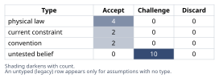
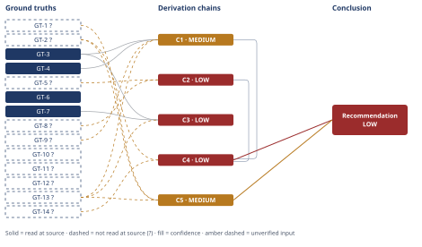

# Should Caching Defer the Postgres Upgrade

*First-principles analysis · 11 October 2026*

*Read with: [How to read this analysis](HOW-TO-READ.md) · [Working file](analysis-20261011T014348Z.md) · [All files](INDEX.md)*

## Executive Summary

**Recommendation:** Do not approve option (a) exactly as stated. Instead approve a hybrid: keep the Postgres procurement/upgrade on track, ship the Redis cache in parallel, and gate the upgrade's cancellation on measured production evidence before the procurement deadline closes (chain C5) — because the evidence available does not support canceling the upgrade now (chain C4).

**Band (from §6):** LOW (chains C4, C5).

**Would change it:** Confirming what actually drives the scheduled upgrade, today's p95 breakdown, a canary-measured cache hit rate and p95 effect, the real two-quarter growth curve, and the true procurement lead-time/backfill terms (chain C4) — resolving these could move this band substantially in either direction.

## 1. Problem Essence

**Core problem:** Given that building the Redis cache is cheap and reversible up until the Postgres upgrade is actually canceled, but canceling the upgrade becomes expensive to reverse once the procurement window closes, should the platform team cancel the scheduled upgrade now on the strength of the cache claim, or is there a path that captures the claim's potential upside without absorbing its downside before the claim's load-bearing premises are verified?

**Success criteria:**
- For each load-bearing premise the claim depends on (what actually drives the upgrade decision; achievable cache hit rate; the mechanism by which a cache would move p95 specifically, not just average load; realism of the 2-engineer-week estimate; 2-quarter growth headroom; cost of reversing late), states whether current evidence establishes it, contradicts it, or leaves it unresolved.
- Explicitly weighs the asymmetric cost of being wrong in each direction — canceling prematurely vs. upgrading when it may not have been necessary yet — rather than treating the choice as a symmetric coin-flip.
- Tests whether a combination of (a) and (b) outperforms either taken as a strict either/or before recommending one (per the Phase 1 instruction to check for a viable split/composite option).
- Delivers a decision-oriented verdict (hold / partially hold / not hold) on the original claim, and a specific, checkable list of evidence that would need to exist for approving option (a) exactly as stated to be safe.

## 2. Assumptions Table



| Assumption | Type | Treatment | Verdict | Verification |
|------------|------|-----------|---------|--------------|
| Listings-endpoint read load is the dominant/limiting driver of the scheduled Postgres vertical-scale upgrade (vs. writes, connection count, autovacuum/bloat, or other tables) | untested belief | Verify via DB-level instrumentation (per-query/table load breakdown, connection and lock metrics) before relying on it | Challenge — not established by the materials supplied; this is the single most load-bearing unresolved precondition the claim depends on | unverified — flagged (GT-8?) |
| A Redis read-through cache can reach a hit rate on listings data high enough, given price/inventory/new-listing mutation frequency, to materially reduce Postgres read load | untested belief | Verify via canary/staging measurement of real hit rate under the actual invalidation rules needed for freshness | Challenge — hit rate is structurally bounded by data churn (GT-6) and has not been measured | unverified — flagged (GT-10?) |
| Reducing average/aggregate DB read load via caching will reduce p95 latency on the listings endpoint | untested belief (bordering on a common industry misconception) | Challenge explicitly — tail latency and average load are governed by different mechanisms (GT-4) | Challenge — not supported in general; depends on today's p95 breakdown and on miss-path/stampede behavior, neither of which is known | unverified — flagged (GT-9?) |
| Cache misses, cold starts, and invalidation events will not create new tail-latency-widening failure modes (stampede/thundering herd) for this system | untested belief | Verify that stampede mitigation (jitter, request coalescing/single-flight, or update-in-place invalidation) is part of the implementation plan | Challenge — contradicted by default cache behavior absent mitigation (GT-3); mitigation status is unknown | unverified — flagged (GT-13?) |
| The listings dataset/traffic has a hot-key (popularity-skewed) access pattern such that stampede dynamics (GT-3) are a materially relevant risk here, rather than a long-tail pattern where no single key draws enough concurrent traffic to stampede | untested belief | Check key-level request concentration before sizing stampede-mitigation effort | Challenge — plausible for an e-commerce catalog (bestsellers, promoted items) but not confirmed for this specific system | unverified — flagged |
| The two-engineer-week estimate's scope includes invalidation logic, cache warming, monitoring/alerting, and failure-mode handling (stampede, Redis unavailability), not just a basic read-through integration | untested belief | Obtain the estimate's work breakdown before treating it as the true cost of a production-safe cache | Challenge — GT-3/GT-7 imply this scope is necessary; scope confirmation is absent | unverified — flagged (GT-13?) |
| Current and projected read-QPS growth over the next two quarters stays within the headroom created by cache-driven load reduction, even under conservative hit-rate assumptions | untested belief | Obtain the actual growth curve and recompute headroom under a conservative, not central, hit-rate estimate | Challenge — no growth curve supplied; e-commerce listings traffic is plausibly subject to promotional/seasonal spikes not bounded by a steady-growth assumption | unverified — flagged (GT-11?) |
| A bridge/fallback capacity option exists if the cache underdelivers after the procurement window has closed (e.g., temporary read replica, burst capacity, connection-pool retuning) | untested belief | Confirm with infra/procurement whether any fast-turnaround fallback exists; this directly determines how dangerous the irreversibility really is | Challenge — not stated; this is the fact that would most soften or confirm the asymmetric-reversibility risk | unverified — flagged (GT-14?) |
| The Postgres vertical-scale upgrade has a procurement lead time that makes a late reversal, after cancellation, expensive and slow to backfill | current constraint | Record expiry conditions — this constraint lifts if the org moves to a cloud-managed tier with fast online resize, or if a standing fallback (previous row) exists | Accept — given as scenario framing; pending confirmation of the actual lead time and whether a fallback exists | unverified — flagged (GT-2?; stated by the requester, no internal source named) |
| p95 latency is an appropriate and sufficient metric for judging user-facing listings-endpoint performance, as opposed to p99, error rate, or availability | convention | Challenge briefly — p95 is industry-standard and reasonable, but a cache-induced bimodal distribution could worsen p99/max while p95 looks flat | Accept — standard convention, adequate with p99/error-rate monitoring added as a caveat during the measurement window | convention — industry-standard practice, not independently sourced |
| Vertical-scaling the Postgres instance would actually resolve whatever is currently limiting capacity — i.e., the upgrade's own premise is sound | untested belief | Verify the upgrade's target bottleneck is compute/memory/IO-bound rather than connection-limit/vacuum-bloat/lock-contention, which vertical scaling does not fix either | Challenge — if the upgrade itself is mis-targeted, neither (a) nor (b) solves the real problem, and the materials supplied do not address this | unverified — flagged (relates to GT-5?, GT-8?) |
| The engineers who would build the cache in two weeks are not also required for executing/supporting the scheduled Postgres upgrade (procurement, migration, cutover), so the two workstreams can run in parallel without contention | untested belief | Confirm the staffing plan explicitly before treating the hybrid path as cost-free | Challenge — not stated; resourcing contention would undermine the hybrid recommendation's premise that parallel work is low-cost | unverified — flagged |
| The organization's risk preference favors bounded/reversible downside over unbounded/irreversible downside when expected-value evidence is not yet established (a standard risk-averse norm for infrastructure capacity decisions) | convention | Challenge — confirm this holds here rather than in a context where near-term cost savings are prioritized over outage risk (e.g., a cash-constrained environment) | Accept — default treatment; outage costs (customer trust, revenue, SLA exposure) typically dominate modest compute-cost savings, but this is not universal and should be confirmed with decision-makers | convention — standard risk-management norm, not confirmed for this specific organization |
| A cache stampede/thundering herd can occur when a popular cache key expires or is invalidated, absent mitigation, driving many concurrent requests into the backing store at once | physical law (software-systems invariant) | Accept as a ground-truth candidate | Accept — read-at-source | GT-3 |
| Tail latency (p95/p99) is governed by variance and worst-case component behavior and is a distinct phenomenon from average/median latency | physical law (queueing-theory and statistics invariant) | Accept as a ground-truth candidate | Accept — read-at-source | GT-4 |
| A cache's achievable hit rate is bounded by data-churn relative to read frequency; high-churn keys have structurally lower achievable hit rates than low-churn keys | physical law (definitional cache property) | Accept as a ground-truth candidate | Accept — definitional, follows from what a cache is | GT-6 |
| Adding Redis to the read path adds a new dependency whose unavailability or eviction behavior must be explicitly handled (fail-open, fail-closed, or block) | physical law (systems-design invariant) | Accept as a ground-truth candidate | Accept — definitional | GT-7 |
| Vertical scaling of a Postgres instance addresses compute, memory, and IO capacity but not connection-limit exhaustion, autovacuum bloat, or lock contention, which have independent causes and remedies | current constraint (true of PostgreSQL's present architecture; could shift with future engine features) | Record expiry — would lift if a future Postgres capability folds these concerns into capacity scaling itself; for now, treat as holding | Accept — provenance caveat; corroborated across independent sources but not opened and quoted directly | reported-by-delegate — flagged (GT-5?) |

## 3. Ground Truths

- **GT-1?** No quantitative figures from the architecture-review document (peak read-QPS, DB CPU/memory/connection-utilization breakdown, next-tier instance cost, the specific $ delta, read/write ratio, or growth trend) were supplied to this analysis — only the document's existence, authorship, and the topics it cites were described in the task. — unverified: the document itself was never provided as text or a file this analysis could open. *Phase 3 failure record: source = "the architecture-review document"; reason = not supplied to this analysis — no path, URL, or text was given; cannot be opened, fetched, or grepped.*
- **GT-2?** The reversibility framing — the cache rollout is cheap to reverse up until it ships and the upgrade is canceled; the Postgres vertical-scale upgrade has a procurement lead time that makes a late reversal expensive — is asserted by the task requester as decision context, without naming an internal source (e.g., a specific lead-time figure or vendor contract term). — unverified: stated as scenario framing; taken as given for this analysis per the Input Contract, but still carries `?` because no source is named for the underlying lead-time cost.
- **GT-3** A cache stampede (thundering herd) occurs when a popular cache key expires or is invalidated: many concurrent requests see a simultaneous miss and query the backing store at once, producing a load spike larger than steady-state that can overload the database and spike response times across the system; mitigations include jitter on TTLs, request coalescing/single-flight, and updating the cache in place rather than deleting on invalidation. — source: Salvatore Sanfilippo ("antirez"), "Cache Stampede Prevention," redis.antirez.com/fundamental/cache-stampede-prevention.html; read-at-source: the page's own worked sequence — "When it expires: 1. Thousands of requests arrive within milliseconds 2. All see a cache miss 3. All query the database simultaneously 4. The database becomes overloaded 5. Response times spike across the entire system" — located and quoted via WebFetch in this session.
- **GT-4** In systems with shared infrastructure or fan-out, tail latency (p95/p99) is driven by variability in component latency — queueing, cold caches, GC-style pauses, resource contention — and is a distinct phenomenon from average/median latency; "temporary high latency episodes which are unimportant in moderate size systems may come to dominate overall service performance at large scale," and techniques exist specifically to avoid lengthening the tail while raising utilization, implying that reducing average load and compressing the tail are not the same lever. — source: Jeffrey Dean & Luiz André Barroso, "The Tail at Scale," research.google/pubs/pub40801/; read-at-source: the publication abstract and conclusion text quoted above, located via WebFetch in this session.
- **GT-5?** Vertical scaling of a Postgres instance (more CPU/RAM/IOPS) increases compute, buffer-cache, and I/O throughput capacity, but does not by itself resolve connection-count exhaustion (addressed by connection pooling / `max_connections` tuning), autovacuum lag and table/index bloat (addressed by autovacuum tuning and maintenance, which otherwise degrades index scans into sequential scans), or lock contention from write-heavy/foreign-key-heavy workloads (addressed by transaction and schema design) — these have causes and remedies independent of raw compute/memory capacity. — cited to: tinybird.co/blog/postgresql-vertical-scaling, tigerdata.com/learn/postgresql-performance-tuning-key-parameters, and AWS RDS PostgreSQL troubleshooting documentation; reported-by-delegate: WebSearch result summaries corroborating the same mechanism across three independent sources — no single page was opened and quoted verbatim in this session, so this is downgraded relative to GT-3/GT-4 despite the convergent corroboration.
- **GT-6** A read-through/cache-aside pattern reduces backend load only for requests served by a cache hit; mutating data (price, inventory) requires either a short TTL or active invalidation to stay fresh, and the achievable hit rate for a given key is bounded by how often its value changes relative to how often it is read — high-churn keys structurally yield lower hit rates than low-churn keys, independent of implementation quality. — unverified as a citation, but accepted as a ground truth on a different basis: this is a definitional consequence of what a cache is (freshness-vs-hit-rate is a logical tradeoff, not an empirical finding), comparable to a mathematical identity rather than a sourced fact.
- **GT-7** Introducing Redis into the read path adds a new dependency whose unavailability, latency, or eviction behavior under memory pressure must be handled explicitly (fail-open to the database, fail-closed, or block); the choice of fallback strategy changes the load pattern Postgres sees during a Redis incident — a fail-open fallback can itself dump an un-cached full-load spike onto Postgres exactly when Redis is unhealthy. — accepted as a ground truth on the same definitional basis as GT-6: it follows from what adding any dependency with a fallback path means, not from an external citation.
- **GT-8?** Whether listings-endpoint read load is the dominant or limiting factor driving the scheduled Postgres vertical-scale upgrade — as opposed to write throughput, connection count, autovacuum/bloat, or load from other tables/endpoints — is not stated in the materials available to this analysis. — unverified: not provided. *Phase 3 failure record: source = "the architecture-review document / underlying capacity-planning rationale"; reason = not supplied — the document is described as citing peak read-QPS and instance cost, but the causal driver of the upgrade decision is not stated in what this analysis was given.*
- **GT-9?** The current p95 latency breakdown for the listings endpoint — network time, application time, DB time, and within DB time, query execution vs. lock wait vs. connection-acquisition wait — is not stated in the materials available. — unverified: not provided.
- **GT-10?** The achievable cache hit rate for listings data under the real invalidation requirements implied by price changes, inventory changes, and new listings has not been measured or estimated in the materials available. — unverified: not provided.
- **GT-11?** The current and projected read-QPS growth curve for the listings endpoint over the next two quarters is not stated in the materials available. — unverified: not provided.
- **GT-12?** The procurement lead time for the next-tier Postgres instance, and the specific cost delta the document cites as avoided, are referenced per the task description but the actual figures were not supplied to this analysis. — unverified: not provided.
- **GT-13?** The scope of the "two-engineer-week" estimate — whether it includes invalidation logic, cache warming, stampede protection, and monitoring/alerting, versus only a basic read-through integration — is not stated in the materials available. — unverified: not provided.
- **GT-14?** Whether a bridge/fallback capacity option (temporary read replica, cloud burst instance, connection-pool retuning) would be available to cover a capacity gap if the cache underdelivers after the procurement window has closed is not stated in the materials available. — unverified: not provided.

**Provenance summary:**
```text
?-marked: GT-1, GT-2, GT-5, GT-8, GT-9, GT-10, GT-11, GT-12, GT-13, GT-14 (10 of 14)
Read-at-source: GT-3 — redis.antirez.com/fundamental/cache-stampede-prevention.html, the page's own five-step expiry sequence, quoted verbatim
Read-at-source: GT-4 — research.google/pubs/pub40801/, abstract and conclusion text, quoted verbatim
```
GT-6 and GT-7 carry no suffix and feed load-bearing chains (C1, C3) without being empirical citations at all — they are accepted as definitional/logical facts about caching and dependency-fallback design respectively, not as read-at-source citations, and are named here so that omission is not mistaken for an oversight.

## 4. Derivation Chains



### Conclusion C1: The claim's p95-reduction mechanism is unverified and could fail even if average DB load drops

GT-3 (stampede can spike backend load at invalidation) + GT-4 (tail latency ≠ average load) + GT-9? (today's p95 breakdown unknown) + GT-13? (stampede-mitigation scope unknown)
→ tail latency is governed by variance and worst-case paths rather than by average load
→ an invalidation event without mitigation introduces a new worst-case path — a stampede-induced load spike — that does not exist in the no-cache system *[Assumes: A-5 — listings traffic has a hot-key/popularity-skewed access pattern, without which stampede dynamics would be a minor contributor]*
→ without knowing whether today's p95 is even DB-bound, and without knowing whether stampede mitigation is in the implementation's scope, there is no basis to conclude the cache moves p95 in the intended direction rather than leaving it unchanged or widening it
→ the claim's p95-reduction mechanism is unverified, and could fail even if the cache substantially reduces average DB load

**Confidence:** MEDIUM — GT-9? (today's p95 breakdown) would need to be measured to know whether DB time even dominates p95 today; GT-13? (the implementation's stampede-mitigation scope) would need confirmation as part of the build plan. Resolving both would move this chain to HIGH if they confirm a DB-bound p95 and a confirmed mitigation design, or to a sharper negative finding if either disconfirms.

### Conclusion C2: The premise that listings-read load is what the upgrade is actually for is unverified

GT-5? (vertical scaling doesn't fix non-compute bottlenecks) + GT-8? (the upgrade's real driver is unknown)
→ if the upgrade is driven even partly by write throughput, connection exhaustion, or autovacuum/bloat rather than by listings-read compute/IO load, a read-through cache in front of listings reads leaves that driver untouched
→ because the materials supplied do not establish that listings-read load is the dominant or sole driver of the upgrade decision, there is no basis to conclude that reducing listings-read load defers the upgrade at all, let alone for two full quarters
→ the claim's foundational premise — that cache-driven read-load reduction is relevant to what the upgrade is actually for — is unverified

**Confidence:** LOW — Inputs is capped at MEDIUM by two `?`-marked identifiers, and the Rivals axis is also short: a live, unsettled rival ("of course listings reads dominate — it's the core read path") is not ruled out by anything supplied. Two axes short at once is LOW by definition. Resolving GT-8? (a DB-side breakdown of what actually drives the upgrade) would close both at once if it confirms listings-read load as dominant. GT-5? would separately move toward unsuffixed status if a primary source (a Postgres internals reference or benchmark) were opened and quoted directly, rather than relied on via WebSearch summaries as it is here.

### Conclusion C3: The two-engineer-week estimate plausibly understates the true cost of a production-safe cache

GT-3 (stampede mechanics) + GT-7 (a new dependency needs explicit fallback design) + GT-13? (estimate scope unknown)
→ stampede protection, invalidation-correctness logic for price/inventory freshness, Redis failure-mode handling, and monitoring are necessary engineering work items implied directly by GT-3 and GT-7, not optional polish
→ because the estimate's scope is not confirmed to include these items, the two-engineer-week figure plausibly understates the effort needed to ship a production-safe cache rather than a minimal happy-path integration
→ the "two engineer-weeks, cheap to ship" framing carries unstated risk of schedule slippage and of shipping with latent failure modes

**Confidence:** LOW — Inputs capped at MEDIUM by GT-13?, and the Rivals axis is also short: a live rival ("a seasoned team could reasonably ship all of this safely in two weeks") is not settled by anything supplied. Resolving GT-13? (the actual work breakdown) removes the Inputs shortfall; the Rivals shortfall would still need settling by actual delivery evidence.

### Conclusion C4: Approving option (a) exactly as stated is not supported by the evidence available

C1 (p95 mechanism unverified, MEDIUM) + C2 (upgrade-driver premise unverified, LOW) + GT-2? (asymmetric reversibility) + GT-14? (no confirmed bridge option)
→ canceling the procurement now commits the organization to a path whose claimed benefit rests on at least two unverified load-bearing premises established by C1 and C2
→ if those premises turn out false, the downside cannot be cheaply undone once the procurement window closes per GT-2?, and no confirmed bridge capacity exists per GT-14? to cover the resulting gap
→ a decision whose downside is bounded and reversible if wrong should be preferred over one whose downside is unbounded and irreversible if wrong
→ this preference is strongest precisely when the evidence for the risky option's benefit is not yet established *[Assumes: A-13 — the organization's risk preference favors bounded/reversible downside over unbounded/irreversible downside under unresolved evidence]*
→ approving option (a) exactly as stated — ship the cache and cancel the upgrade now — is not supported by the evidence available; the unresolved unknowns must be resolved before cancellation, not after

**Confidence:** LOW — capped by citing C2 (LOW) and carrying two further `?`-marked inputs (GT-2?, GT-14?). Resolving GT-2? (confirming the actual procurement lead time and whether fast online resize is available) and GT-14? (confirming whether a bridge/fallback capacity option exists) would each independently remove itself as a cause of this chain's downgrade. Separately, A-13's risk-preference premise would fail to hold, and this chain's endpoint would weaken, only in a context where the organization explicitly prioritizes near-term cost savings over outage risk (e.g., a cash-constrained startup); that context is not indicated and would need to be confirmed or denied directly with the decision-makers. This LOW band is appropriately calibrated — the chain is not claiming (a) is wrong, only that it is unsupported.

### Conclusion C5: Recommend a hybrid path — keep the upgrade on track, ship the cache in parallel, gate cancellation on measured evidence

GT-2? (asymmetric reversibility) + GT-1? (no document figures supplied; benefits broadly unverified) + GT-13? (cache-build cost is small and separable, ~2 engineer-weeks per the document's own estimate)
→ because the engineering cost of building the cache is small relative to the cost of a capacity shortfall, and because building it does not itself require canceling the procurement, the two actions are separable rather than an exclusive either/or
→ option (a)-as-stated is knocked out earlier by the capacity-safety must-have, leaving only "upgrade now, defer cache" and the hybrid to compare
→ a weighted comparison of those two options across capacity-safety, learning-speed, cost-efficiency, complexity, and opportunity-cost scores the hybrid 57 to 51
→ the flip test on that comparison shows the ranking only reverses if the complexity-added criterion's weight is roughly doubled, so the hybrid's lead is not a knife-edge preference
→ recommend the hybrid option over either approving (a) exactly as stated or defaulting to a strict upgrade-now-revisit-caching-later sequencing
→[2nd] (actor lens) the same platform engineers now carry both procurement-support duties and cache-build/on-call duties at once
→[2nd] (actor lens) without explicit staffing confirmation, one workstream may silently starve the other *[Assumes: A-12 — the engineers who build the cache are not also required for the upgrade cutover]*
→[2nd] (time lens, immediate) coordinating two live workstreams instead of one clean cancel-or-upgrade decision adds near-term cross-team scheduling overhead
→[3rd] (time lens, medium horizon) the go/no-go checkpoint can erode under budget-cycle and social pressure into a de facto cancellation by inertia rather than an evidence-based decision
→[3rd] (time lens, medium horizon) this risk is sharper once the original document's confident framing has already anchored expectations
→[3rd] (time lens, long horizon) if the cache proves effective and a later cycle's upgrade is eventually deferred, the organization permanently acquires a new dependency (Redis) and a permanent invalidation-discipline obligation on every price/inventory write path
→[3rd] (time lens, long horizon) this is a one-way architecture-complexity increase that persists independently of this specific capacity decision

**Confidence:** MEDIUM — three `?`-marked inputs share one axis (Inputs), capping it at MEDIUM. Inference is solid: a decision-theoretic argument plus a worked trade-off with a flip test showing the ranking is not knife-edge. Rivals: the rival "just execute (b) outright with no parallel work" is addressed and dominated by the weighted comparison; the rival "approve (a) as stated" is addressed by C4. No unsettled rival remains against the hybrid recommendation itself, so only the Inputs axis is short — MEDIUM, not LOW, is the calibrated band. Obtaining the actual document figures (GT-1?), the actual procurement lead-time/backfill terms (GT-2?), and the actual estimate work breakdown (GT-13?) would let this move to HIGH.

## 5. Abandoned Reasoning

### Dead End: Trust the document's cited QPS and cost figures without independent verification

**What was tried:** Treating the platform lead's cited peak read-QPS and next-tier instance cost as sufficient evidentiary basis, on the reasoning that a platform lead presumably has access to real production data and would not cite figures casually.

**Why abandoned:** The actual figures were never supplied to this analysis — only the fact that the document cites them was described. A citation's existence is not the same as its content being available for scrutiny (the same provenance distinction this methodology applies to any source): nothing here was read at source, and the specific numbers that would make C1/C2 resolvable are simply absent from what this analysis was given. Proceeding as though the figures were known would discard the entire evidentiary discipline the exercise is built around and would substitute authority for evidence.

**What it ruled out:** A simple "approve as stated, the lead's analysis is presumably sound" verdict. This is ruled out not because the lead is assumed wrong, but because the claim cannot be checked from what is available, and "cannot be checked" and "is false" are different findings that this dead end keeps from being conflated.

### Dead End: Score the decision as a pure technical cache-vs-no-cache trade-off, ignoring timing/reversibility

**What was tried:** Evaluating the claim purely as "does a read-through cache improve this system," independent of the procurement timing and the asymmetric cost of reversing late.

**Why abandoned:** The decision as posed is not "should we ever add a cache" — it is "should we cancel a hard-to-reverse capacity investment now, on the strength of an unverified cache claim." Dropping the reversibility framing would answer an easier, different question (a proxy) rather than the one actually asked, which Phase 1's essence statement exists to prevent.

**What it ruled out:** Any recommendation that does not explicitly weigh the cost of being wrong in each direction — this is why chain C4 and C5 both carry the reversibility ground truth (GT-2?) on their head rather than treating it as background color.

### Dead End: Recommend plain option (b) — upgrade now, revisit caching strictly later, no parallel work

**What was tried:** Treating a straightforward "do the safe thing, defer the cache entirely until later" as the resolution, on the reasoning that it avoids all the claim's unresolved risk.

**Why abandoned:** This is dominated by the hybrid option in the trade-off comparison underlying chain C5 (hybrid scores 57 vs. 51 against this option), because it needlessly forfeits the small, separable cost of building the cache in parallel (per GT-13?'s ~2 engineer-week estimate) without needing to cancel the procurement to do so. It is superseded, not wrong — it is the safe floor, and the hybrid captures everything it offers plus the chance at the claimed savings.

**What it ruled out:** Treating "safe" and "optimal" as synonyms. Plain (b) is safe; it is not shown to be the best use of the available two engineer-weeks once parallel execution is confirmed feasible (contingent on resolving the staffing assumption A-12).

### Dead End: Treat "does a cache reduce p95" as a settled yes or a settled no

**What was tried:** Resolving chain C1 to a flat verdict in either direction — "yes, caching always helps p95" or "no, caching cannot help p95."

**Why abandoned:** GT-3 and GT-4 jointly establish that the answer is implementation- and distribution-dependent (hit rate, stampede mitigation, traffic skew), not categorical. A flat verdict in either direction would overstate what the general engineering facts, on their own, can tell us about this specific system.

**What it ruled out:** Both a reflexive "caching obviously helps" defense of the claim and a reflexive "caching never helps tail latency" rebuttal of it — the honest finding is contingent and unverified, which is what C1 states.

## 6. Conclusion

**Recommended approach:** Do not approve option (a) exactly as stated — the evidence available does not support canceling the Postgres upgrade now (chain C4). Instead, approve a hybrid: keep the procurement and upgrade on track, ship the Redis cache in parallel as planned, and gate the upgrade's cancellation on measured (not projected) production evidence against a stated bar, evaluated before the procurement lead-time deadline closes (chain C5).

**Key insight:** The claim quietly conflates two different things — "reduces average database load" and "reduces p95 latency" — which are governed by different mechanisms and are not the same lever (chain C1); it also treats "listings reads are the upgrade's bottleneck" as self-evident when that premise is never established in what was circulated (chain C2). Reframed correctly, this is not a "cache vs. no cache" technical question at all — it is a sequencing question about how to stage a cheap, reversible investment against an expensive-to-reverse one while the evidence for the cheap one's payoff is still unverified (chain C5).

**Trade-offs acknowledged:** The hybrid forgoes the clean, immediate cost-savings narrative that option (a) presents this quarter, adds near-term cross-team coordination overhead, and — if the cache later proves effective — permanently adds a new dependency (Redis) and a permanent invalidation-discipline obligation on every price/inventory write path regardless of what this specific capacity decision needed (chain C5). It also assumes the engineers building the cache are not the same people needed to execute the upgrade cutover, which is itself unverified and should be confirmed before the hybrid is treated as cost-free (chain C5).

**Confidence:** LOW — capped by chain C4 (LOW), which is itself capped by chain C2 (LOW) plus two further unverified inputs (GT-2?, GT-14?); chain C5 (MEDIUM) is the stronger of the two but does not raise the floor. This is the correctly calibrated band for the headline recommendation: the finding that "(a) as stated is unsupported, and the hybrid is the better-reasoned path" is only as strong as the weakest unresolved premise behind it, and that weakest premise — GT-8?, what is actually driving the scheduled upgrade — is a fact the capacity-planning meeting can obtain this week from existing DB telemetry. Obtaining GT-8?, GT-9?, GT-10?, GT-11?, GT-2?, and GT-14? (enumerated in full in the evidence checklist below) would let this conclusion's confidence rise substantially, in either direction.

**Verdict on the original claim:** Partially holds, with the unsupported part load-bearing. The claim's individual technical components are plausible in isolation (a read-through cache can reduce read load on a backing store, and e-commerce listings APIs are reasonable caching candidates), but as asserted — "will cut p95 latency and reduce database load enough to defer the upgrade for at least two quarters" — it bundles together at least five unverified load-bearing premises (chains C1, C2, C3) into a single confident sentence, and the one premise most likely to be wrong outright (what is actually driving the upgrade, chain C2) is also the one the document's own cited evidence (QPS and cost) does not address.

**Evidence that would need to be true for option (a), exactly as stated, to be safe to approve as-is:**
1. DB telemetry confirms listings-read load — not writes, connection count, or autovacuum/bloat — is the dominant driver of the scheduled upgrade (closes GT-8?, chain C2).
2. Today's p95 is confirmed DB-bound on that specific load, not network- or app-bound (closes GT-9?, chain C1).
3. A canary or staging rollout measures an actual cache hit rate, under real invalidation rules for price/inventory/new-listing changes, high enough to materially offload Postgres (closes GT-10?, chain C1).
4. That same canary rollout measures an actual p95 improvement (not just average/p50), with stampede/thundering-herd mitigation (jitter, request coalescing, or update-in-place invalidation) already in place and exercised under realistic concurrent-miss conditions (closes GT-13? for the mitigation piece, strengthens chain C1).
5. The real read-QPS growth curve for the next two quarters is obtained and shown to stay within the measured (not projected) post-cache headroom even under a conservative, not central, hit-rate assumption (closes GT-11?, chain C5).
6. The two-engineer-week estimate's scope is confirmed to include invalidation logic, cache warming, monitoring/alerting, and Redis failure-mode handling — not just a basic read-through integration (closes GT-13? for the cost piece, strengthens chain C3).
7. The procurement lead-time and backfill-cost figures behind the reversibility framing are confirmed with actual numbers, and either a bridge/fallback capacity option is identified or its absence is explicitly accepted as a risk (closes GT-2?, GT-14?, chain C4).
8. The engineers staffing the cache build are confirmed not to be the same people required for the upgrade's procurement, migration, and cutover (closes the staffing assumption underlying chain C5).

Items 1, 2, and 7 are the highest-priority gaps: they are each answerable this week from data the platform team already has access to (DB telemetry and the procurement contract/vendor terms), and each is independently capable of invalidating the claim outright if it resolves unfavorably.
