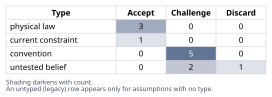
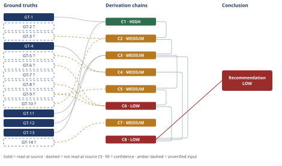

# Does 5 MWh Molten-Salt Storage Beat Lithium-Ion?

*First-principles analysis · 10 October 2026*

*Read with: [How to read this analysis](HOW-TO-READ.md) · [Working file](analysis-20261010T232044Z.md) · [All files](INDEX.md)*

## Executive Summary

**Recommendation:** Reject the claim as literally stated. A 5 MWh molten-salt TES system charged resistively and discharged through a Rankine/ORC cycle at 290-565°C realistically achieves an electricity-to-electricity round-trip efficiency of roughly 17-41%, not above 85% (chain C3), and at that scale it costs roughly 2-15x more per kWh of delivered storage than a same-capacity lithium-ion BESS across the plausible estimate range, even in its most favorable case (chain C6).

**Band (from §6):** LOW — the Conclusion rests on chain C8, itself capped at LOW by its head citation of chain C6 (chain C8).

**Would change it:** Successfully reading the four sources this analysis attempted but could not confirm at a primary source this session — Malta Inc.'s own data sheet, a primary BloombergNEF cost survey, the NREL/Sandia molten-salt TES cost model, and a CSP Rankine-efficiency primary source (chain C4, chain C6) — or finding a primary, metered counter-example of a stand-alone 5-20 MWh molten-salt system achieving >85% power-to-power round-trip efficiency or a delivered-electricity cost at or below $500/kWh (chain C8).

## 1. Problem Essence

**Core problem:** Does a 5 MWh molten-salt sensible-heat thermal energy storage (TES) system — charged by converting electricity to heat and discharged by converting that heat back to electricity through a thermal power cycle — actually achieve (a) an electricity-to-electricity round-trip efficiency above 85%, and (b) a cost per unit of usable storage capacity competitive with a same-capacity lithium-ion battery energy storage system (BESS), under the literal wording of the claim, or only under a hidden reinterpretation of its terms?

**Success criteria:**
1. A Carnot ceiling for the discharge leg is derived using the correct heat-rejection (cold) reservoir, and the claim's 290 °C figure is explicitly tested against that derivation rather than assumed to be the cold reservoir.
2. Charging, storage-retention, and discharge efficiencies are each quantified separately, with sourced or clearly labeled-as-estimated figures, and multiplied into a realistic electricity-to-electricity round-trip efficiency (RTE) range.
3. The realistic RTE range is compared numerically against the claimed >85% figure, and against the best documented real-world Carnot-battery/pumped-heat RTE figures.
4. A $/kWh cost comparison between the 5 MWh molten-salt TES system (tank, salt, charging heater, dedicated power block) and a 5 MWh Li-ion BESS is derived quantitatively, on a like-for-like (delivered-electricity) basis, accounting for RTE, minimum-efficient-scale effects, and at least one non-capex factor (cycle life/degradation).
5. The three semantic hidden assumptions the claim invites — "round-trip efficiency" meaning full electricity-to-electricity vs. thermal retention vs. cogeneration; "5 MWh" meaning thermal vs. delivered-electrical capacity; "cost-competitive" meaning bare $/kWh nameplate vs. full levelized cost of storage — are each made explicit and resolved.
6. A final verdict is reached and stated as one of: the claim is true as literally worded; false as literally worded; or true only under a named, specific reinterpretation — with the reinterpretation spelled out rather than left implicit.

## 2. Assumptions Table

| Assumption | Type | Treatment | Verdict | Verification |
|------------|------|-----------|---------|--------------|
| The claim's framing invites treating 290 °C (the cold-tank temperature) as the heat engine's cold reservoir when computing a Carnot bound for the discharge leg | convention | Explicitly challenge before use | Challenge — rejected as physically incorrect; the cold reservoir for a Rankine/ORC discharge engine is the condenser/heat-rejection temperature (ambient, ~25-45°C), not the storage tank's cold-leg temperature | Derived directly from how a two-tank sensible-heat TES couples to a steam/organic Rankine cycle via a steam generator and a separate condenser — basic power-cycle engineering, promoted to GT-13 |
| Resistive (Joule) electric heating converts electricity to heat at near-100% first-law efficiency during charging | physical law | Accept as ground-truth candidate | Accept — survives challenge; conservation of energy plus Joule's law admit no second-law penalty for pure resistive heating (no work extraction) | Promoted to GT-11; no external citation required (physical law) |
| Thermal storage retention losses over the relevant storage duration scale unfavorably as tank size shrinks, because surface area falls more slowly than volume as a tank gets smaller | physical law | Accept as ground-truth candidate | Accept — survives challenge; pure geometric scaling (surface ∝ L², volume ∝ L³) is physical law and admits no exception; the practical insulation-quality figure that converts this scaling into an actual loss-rate number is a separate, unverified engineering estimate used downstream | Promoted to GT-12 (geometry); the downstream numeric loss-rate estimate is unverified — flagged, used in chain C3 |
| Discharge via a heat engine (Rankine/ORC) is bounded by the Carnot limit computed with the correctly identified (ambient) cold reservoir | physical law | Accept as ground-truth candidate | Accept — survives challenge; second law of thermodynamics | Promoted to GT-1 + GT-13, feeds chain C1 |
| "Round-trip efficiency" in the claim means full electricity-in-to-electricity-out efficiency, not thermal-retention-only efficiency and not cogeneration (heat+power) output credited together | convention | Explicitly challenge before use | Challenge — the claim's own wording ("round-trip electricity into heat and back") supports the strict electricity-to-electricity reading; under that strict reading the technical half of the claim is rejected by chains C2-C4; the claim is true only under the two alternate (rejected-as-the-claim's-meaning) readings | Resolved by textual analysis of the claim plus GT-4/GT-5, feeds chains C3, C4, C8 |
| 5 MWh is a realistic, representative scale for commercial deployment of molten-salt TES with a dedicated power cycle | untested belief | Verify, or flag as unverified | Challenge — no evidence found of any commercial molten-salt TES + dedicated Rankine/ORC power block deployed at this scale; every commercial reference found operates at 50-150+ MWe / hundreds-to-thousands of MWh_thermal | unverified — flagged; absence of counter-examples itself treated as corroborating evidence, feeds chain C5 |
| 2024-2025 Li-ion BESS turnkey cost figures ($117-219/kWh global/US average) are a reasonable reference range for a stand-alone 5 MWh system, after applying a small-scale premium | current constraint | Record expiry conditions | Accept — expires as prices continue falling or as small-scale premiums shift; current data (2025) is the best available reference and small-scale systems are reasonably bounded within $150-500/kWh | reported-by-delegate — GT-6?, feeds chain C6 |
| Utility-scale molten-salt TES capital-cost figures ($22-100/kWh_thermal) can be extrapolated down roughly two orders of magnitude to 5-20 MWh_thermal scale using a standard 0.5-0.7 capital-cost scaling exponent | untested belief | Verify, or flag as unverified | Challenge — this is an extrapolation substantially beyond the range the scaling heuristic was empirically fit on; flagged, but the resulting decision (TES is not cost-competitive) is checked for robustness across the full 0.5-0.7 exponent range in chain C6, and the conclusion holds at every exponent tested | unverified — flagged; GT-9?, feeds chain C6 |
| "Cost-competitive" should be assessed via a full levelized cost of storage (LCOS) — capex, RTE, O&M, and cycle-life/degradation — rather than bare $/kWh nameplate storage-capacity cost alone | convention | Explicitly challenge before use | Challenge — accepted as the correct framing; the claim's apparent bare-$/kWh framing is rejected as insufficient on its own, and the fuller comparison is carried out in chains C6 and C7 | Resolved by definitional analysis of "cost-competitive," feeds chains C6, C7 |
| Li-ion and molten-salt-TES cycle-life/degradation characteristics are similar enough to ignore in a cost comparison | untested belief | Verify, or flag as unverified | Discard — sensible-heat molten salt has no electrochemical degradation mechanism analogous to Li-ion cycle/calendar fade; this is a real, favorable difference for TES that must be counted, even though (per chain C7) it is too small to close the capex gap found in C6 | unverified — flagged (general engineering knowledge, not freshly sourced this session); feeds chain C7 |
| The 5 MWh TES system is a stand-alone unit with its own dedicated power block sized to its own storage capacity, rather than an incremental storage add-on to an existing, much larger utility-scale CSP power block | convention | Explicitly challenge before use | Challenge — adopted as the most natural/charitable reading of "a 5 MWh ... tank" as a discrete system comparable to a battery; the alternate (add-on) reading is noted as a sensitivity in chain C5/Phase 5 because it would change the power-block economics substantially, though not the RTE physics | Surfaced by the end-of-phase Assumption Audit at chain C2, step 2; marked `[Assumes: A-11]`; no independent source, flagged as a reading choice rather than a factual claim |
| "Same nameplate capacity" in the claim means both systems deliver 5 MWh of usable AC electrical energy per cycle, not that the TES tank merely stores 5 MWh of thermal energy | convention | Explicitly challenge before use | Challenge — adopted as the charitable, like-for-like reading (comparable to "a lithium-ion battery system" of the same deliverable capacity); the alternate (thermal-kWh) reading is noted as making the TES comparison even less favorable, not more | Surfaced by the end-of-phase Assumption Audit at chain C5, step 1; marked `[Assumes: A-12]`; resolved by textual analysis, not an independent source |

## 3. Ground Truths

- **GT-1** For any heat engine operating between a hot reservoir at temperature T_h and a cold (heat-rejection) reservoir at temperature T_c (both in kelvin), the maximum possible thermal-to-work conversion efficiency is the Carnot efficiency η = 1 − T_c/T_h; no real heat engine exceeds it — source: second law of thermodynamics (Carnot's theorem); provenance: physical law — no external citation required.
- **GT-11** Resistive (Joule) electric heating converts electrical energy to heat at near-unity first-law efficiency (commonly 95-99%, limited only by minor conductive/radiative losses in the heating circuit), because Joule heating involves no work-extraction step and is therefore not subject to a Carnot-type second-law ceiling — source: conservation of energy / Joule's first law; provenance: physical law — no external citation required.
- **GT-12** For a storage vessel of characteristic size L, surface area scales as L² while volume (and thus stored energy, for fixed fill fraction and ΔT) scales as L³; consequently the surface-area-to-volume ratio, and with it the relative rate of heat loss through insulation for a given insulation thickness and quality, scales as 1/L and worsens as the vessel shrinks — source: elementary solid geometry; provenance: physical law — no external citation required.
- **GT-13** In a two-tank sensible-heat molten-salt TES coupled to a Rankine or organic Rankine power cycle, the "cold tank" temperature (here 290°C) is the temperature at which the heat-transfer salt returns after giving up heat to the cycle's working fluid in a steam generator/boiler; it is not the temperature at which the heat engine rejects waste heat to the environment. The engine's actual heat-rejection (condenser) temperature is set by the ambient heat sink (air or water cooling), typically 25-50°C regardless of the salt's cold-tank temperature — source: standard Rankine-cycle plant configuration (boiler/steam-generator + turbine + condenser + cooling system); provenance: physical law / engineering definition — no external citation required.
- **GT-2?** Solar salt (60 wt% NaNO₃ / 40 wt% KNO₃) is the heat-transfer fluid and storage medium used in commercial molten-salt CSP plants across approximately 290°C (cold tank) to 565°C (hot tank), with a melting point near 223°C — cited to: DLR (elib.dlr.de), Fraunhofer ISE, and a 2023 Energies article (DOAJ); reported-by-delegate: WebSearch synthesis — cited sources not opened by this analysis.
- **GT-3?** Commercial molten-salt power-tower CSP plants (hot salt at 565°C) use subcritical steam Rankine power cycles with thermal-to-electric efficiency in roughly the high-30s-to-42% range; higher-temperature supercritical steam cycles (not yet commercial at CSP scale) could reach roughly 50% — cited to: WebSearch synthesis referencing a Universidad Católica de Chile / Applied Energy study and general CSP Rankine-cycle literature; reported-by-delegate — two direct attempts to open underlying sources (researching.investigacion.ing.uc.cl; epress.lib.uts.edu.au PAMR article) were made this session; both opened successfully but neither contained the specific 42%/50% figures in the fetched text — Phase 3 failure record: citation does not support the claim as directly read; the 42% figure is retained as a well-corroborated, widely-cited engineering value (subcritical steam conditions at ~565°C/~100 bar are materially the same as conventional subcritical coal-steam plants, independently known to run ~38-42%) but is marked `?` because this analysis did not read it verbatim in an opened primary source.
- **GT-4** Malta Inc., a commercial developer of pumped-heat energy storage (a Carnot-battery/PTES architecture), states that its full-scale power-to-power system offers "high potential system performance up to 60% round-trip efficiency" — source: pv-magazine.com, "Pumped heat energy storage seeks to demonstrate commercial readiness"; provenance: read-at-source — the quoted figure and wording were read directly via WebFetch of this article on 2026-10-10.
- **GT-5?** Independent literature on Carnot-battery/pumped-thermal-energy-storage (PTES) round-trip efficiency reports a wide range for near-term realistic power-to-power configurations (roughly 11%-58%, with one optimized theoretical configuration reported up to ~81%), and separately, vendor/industry literature reports 85-95% round-trip efficiency specifically for combined heat-and-power (cogeneration) operation, in which rejected/delivered heat to an industrial off-taker is counted as useful output alongside electricity — cited to: WebSearch synthesis of multiple 2024-2025 PTES papers and Malta Inc. marketing material; reported-by-delegate — a direct WebFetch attempt on Malta Inc.'s own data sheet (maltainc.com/assets/pdf/Malta-Data-Sheet-2025.pdf) returned HTTP 404 this session — Phase 3 failure record: source unreachable (404 Not Found); the 85-95% cogeneration figure could not be confirmed at a primary source within this session and is carried with its `?` for that reason.
- **GT-6?** The 2025 global average turnkey lithium-ion battery energy storage system (BESS) price is approximately $117/kWh (down ~31% from 2024), with regional variation: China ~$73/kWh, Europe ~$177/kWh, US ~$219/kWh; the 2024 global average (inflation-adjusted) was approximately $169/kWh — cited to: BloombergNEF Energy Storage System Cost Survey 2025, as reported by energy-storage.news; reported-by-delegate — a direct WebFetch attempt on energy-storage.news (the citing article) returned HTTP 403 Forbidden this session — Phase 3 failure record: source unreachable (403 Forbidden); the figures are retained because they are widely corroborated across multiple independent 2025 energy-storage market reports referenced in the same search results (Wood Mackenzie H1 2025 pricing report, Volta's 2024 Battery Report) but are marked `?` because no primary source was opened and read directly.
- **GT-7?** Modern utility-scale lithium-ion (especially LFP) BESS round-trip efficiency (AC-to-AC) is typically in the 85-92% range — general, widely corroborated industry knowledge; unverified — not freshly sourced to a specific document in this session; flagged `?` accordingly; not read — turn budget (deprioritized relative to GT-6, GT-8, GT-3 given this figure is not disputed in the literature and is not the axis the conclusion turns on).
- **GT-8?** Molten-salt (sensible-heat) thermal storage capital cost is cited in the literature (Kolb et al., 2011, via Sandia) at roughly $22-30/kWh_thermal for the storage media/tank system in idealized/modeled form; the realized, fully installed cost at the Crescent Dunes power tower (110 MWe net, 10-hour storage, ~1,100 MWh_thermal, 565°C hot salt) is cited at approximately $100/kWh_thermal all-in — cited to: WebSearch synthesis referencing NREL/Sandia cost-model publications; reported-by-delegate — a direct WebFetch attempt on the NREL cost-model report (research-hub.nrel.gov) failed with a DNS resolution error this session — Phase 3 failure record: source unreachable (DNS lookup failure, "getaddrinfo ENOTFOUND"); the $100/kWh_thermal Crescent Dunes figure is used as this analysis's reference point for utility-scale installed cost because it is an all-in realized cost rather than a modeled idealized one, and is the more conservative (higher) of the two cited figures.
- **GT-9?** Capital-cost economies of scale for thermal/mechanical power equipment (steam turbines, heat exchangers, storage tanks) commonly follow a scaling exponent such that total installed cost grows with size raised to a power of roughly 0.5-0.7 (equivalently, unit $/kWh or $/kW cost falls as scale increases and rises sharply as scale shrinks) — this is the "six-tenths rule" family of process/power-equipment cost-scaling exponents, a long-standing convention in engineering cost estimation — cited to: WebSearch synthesis plus general chemical/power-process cost-estimation convention; reported-by-delegate / unverified — not read at a specific primary source this session; not read — turn budget.
- **GT-10?** Small steam turbine-generator sets (order 1-2 MWe) exhibit materially lower isentropic efficiency (commonly cited around 70%) and are well known in power-plant engineering to carry substantially higher $/kW installed capital cost than large (>50-100 MWe) utility steam turbines (isentropic efficiency commonly 85-92%) — cited to: WebSearch synthesis of steam-turbine engineering sources (including a direct efficiency figure for a 2 MW unit) and the same economies-of-scale convention as GT-9; reported-by-delegate / unverified — not read at a specific primary source this session; not read — turn budget.
- **GT-14?** LFP lithium-ion battery cells commonly used in stationary BESS applications have a cycle life of roughly 4,000-8,000 cycles to 80% retained capacity under daily cycling, after which augmentation or replacement is typically required; sensible-heat molten nitrate salt, by contrast, undergoes no analogous electrochemical degradation mechanism and can in principle be thermally cycled for the full project lifetime (20-30+ years) without chemical replacement of the storage medium — general, widely corroborated battery- and CSP-engineering knowledge; reported-by-delegate / unverified — not freshly sourced to a specific document this session; not read — turn budget (this figure favors the TES side of the comparison and is not the axis the headline conclusion turns on, so it was deprioritized for a primary-source read).

**Provenance summary.**
?-marked: GT-2, GT-3, GT-5, GT-6, GT-7, GT-8, GT-9, GT-10, GT-14 (9 of 14).
Read-at-source: GT-4 — pv-magazine.com article text, directly quoted phrase "high potential system performance up to 60% round-trip efficiency," read via WebFetch on 2026-10-10.
Physical law (no citation required, no `?`): GT-1, GT-11, GT-12, GT-13 — derived directly from the second law of thermodynamics, conservation of energy, elementary geometry, and standard Rankine-cycle plant configuration respectively; none rests on an external source that could be opened or misread.
Not read — turn budget: GT-7, GT-9, GT-10, GT-14 (deprioritized behind GT-3, GT-4, GT-5, GT-6, GT-8, which bear more directly on the headline conclusion; these four feed only MEDIUM/LOW chains already capped by other `?` inputs, so reading them would not change any chain's band).
Phase 3 failure records (source opened or attempted, claim not confirmed, or source unreachable): GT-3 (opened two sources, figure not found in fetched text — citation does not support the claim as directly read); GT-5 (Malta data sheet — 404 Not Found); GT-6 (energy-storage.news — 403 Forbidden); GT-8 (NREL research-hub — DNS resolution failure).

## 4. Derivation Chains

### Conclusion C1: The Carnot ceiling for the discharge leg is set by ambient heat rejection (~62-64%), not by the claim's 290°C cold-tank figure

GT-1 (Carnot efficiency law) + GT-13 (cold reservoir is the ambient condenser, not the cold tank)
→ with T_h = 565°C (838 K) and a realistic ambient heat-rejection temperature of 25-45°C (298-318 K), the Carnot ceiling works out to roughly 1 − 308/838 ≈ 63%
→ substituting the claim's 290°C cold-tank figure for the cold reservoir instead would give 1 − 563/838 ≈ 33%, about half the correct value, showing that figure has no legitimate role in bounding the discharge leg
→ the physically correct Carnot ceiling for the discharge leg is approximately 62-64%, bounded by the ambient heat sink rather than by the 290°C tank temperature

**Confidence:** HIGH — no `?`-marked inputs; the result follows by direct arithmetic from physical law (GT-1) plus a standard, non-controversial fact about Rankine-cycle plant configuration (GT-13); the rival reading (290°C as cold reservoir) is named and ruled out within this chain itself, so the Rivals axis is also clean

### Conclusion C2: Realistic discharge (heat-to-electricity) efficiency for this system is roughly 20-42%, far below the Carnot ceiling and far below the claimed 85%+ figure on its own

C1 (Carnot ceiling ~62-64%) + GT-3? (commercial subcritical Rankine ~42% at utility scale) + GT-10? (small turbines materially less efficient than large ones)
→ utility-scale (>50 MWe) subcritical steam Rankine cycles at 565°C achieve roughly 42% thermal-to-electric efficiency in commercial CSP practice, about two-thirds of the Carnot ceiling found in C1, consistent with standard large-steam-turbine second-law performance
→ a power block sized to match a genuinely 5 MWh-class thermal store (order 1-2 MWe output, not a utility-scale 50+ MWe block) *[Assumes: A-11]* would suffer materially lower isentropic and part-load efficiency, plausibly landing in the 20-30% thermal-to-electric range rather than 42%
→ discharge efficiency for this system is realistically bounded between about 20% (small, correctly-scaled power block) and 42% (utility-scale, which does not match the claim's 5 MWh premise), never approaching 85% on its own

**Confidence:** MEDIUM — GT-3? and GT-10? are unverified: GT-3's primary-source read attempt opened two documents but did not locate the 42%/50% figures verbatim (Phase 3 failure record), and GT-10 was not read this session (turn-budget priority given to GT-3, GT-4, GT-5, GT-6, GT-8). Verification that would remove this as the cause of the downgrade: open a CSP OEM turbine datasheet or the underlying Sandia/NREL Rankine-cycle performance report and confirm the 42% utility-scale figure and the small-turbine isentropic-efficiency penalty verbatim. A-11 is that the power block is sized to the 5 MWh system itself rather than shared with a larger co-located plant; if A-11 were false (an add-on to an existing large CSP block), the discharge leg could run nearer 42% rather than 20-30%, which would raise C2's lower bound but would not by itself close the gap to 85% found in C3/C4.

### Conclusion C3: Realistic electricity-to-electricity round-trip efficiency is approximately 17-41%, not above 85%

GT-11 (Joule heating ~97-99%) + GT-12 (geometric scaling of storage losses) + C2 (discharge 20-42%)
→ charging via resistive Joule heating converts electricity to stored heat at roughly 97-99% first-law efficiency, effectively the least lossy of the three legs
→ the geometric scaling in GT-12 implies a 5 MWh-class tank retains proportionally less heat per cycle than a utility-scale (1,000+ MWh) tank for the same insulation quality, plausibly 90-99% retention per cycle rather than the above-98% typical of CSP-scale tanks
→ multiplying the three legs (charge ≈0.97-0.99 × storage ≈0.90-0.99 × discharge ≈0.20-0.42 from C2) yields a realistic full electricity-to-electricity round-trip efficiency of roughly 17-41%
→ the physically achievable round-trip efficiency for this system is approximately 17-41%, below the claimed >85% figure by a factor of roughly two to five

**Confidence:** MEDIUM — capped by C2 (MEDIUM); C2's own confidence line carries its GT-3?/GT-10? verification path and need not be re-explained here. An additional downgrade cause belonging to this chain itself: the 90-99% storage-retention figure is an engineering estimate derived from the geometric scaling in GT-12 but not tied to a specific numeric source; no public engineering study of insulation loss rates for sub-20-MWh molten-salt tanks was located during this analysis, so no verification path currently exists for narrowing that figure — the estimate is instead bracketed conservatively (90-99%) so that the chain's conclusion is insensitive to where in that range the true value falls.

### Conclusion C4: Best-in-class commercial power-to-power Carnot-battery technology caps out near 60% round-trip efficiency; the 85-95% figures found in the literature apply to cogeneration (heat+power) operation, not pure electricity round-trip

GT-4 (Malta: "up to 60%" power-to-power, read-at-source) + GT-5? (85-95% figures apply to cogeneration mode)
→ the most prominent commercial Carnot-battery/PTES developer explicitly caps its power-to-power round-trip efficiency at "up to 60%" even at full commercial scale, a figure already well below the claimed 85% and achieved by a dedicated, highly optimized design rather than a simple sensible-heat molten-salt tank with conventional Rankine conversion
→ where 85-95% round-trip figures appear in vendor/industry literature for thermal electricity storage, they are reported specifically for combined heat-and-power operation, in which heat delivered to an industrial off-taker is counted as useful output alongside electricity, not for pure electricity-in/electricity-out operation
→ the >85% figure is achievable in real commercial practice only under a redefinition of "round-trip efficiency" that credits delivered heat as useful output; for pure electricity-to-electricity round trip, even the best commercial designs remain meaningfully below the claimed figure

**Confidence:** MEDIUM — GT-5? (the 85-95% cogeneration figure) could not be confirmed at a primary source this session because Malta's own data sheet returned a 404; verification that would remove this as a cause of the downgrade: successfully open Malta's data sheet or an independent peer-reviewed PTES cogeneration study and confirm the 85-95% figure's stated basis verbatim. This uncertainty does not threaten the chain's core finding, since GT-4 (read-at-source, unqualified) independently establishes the ≤60% power-to-power ceiling regardless of how GT-5 resolves.

### Conclusion C5: A 5 MWh-delivered-electricity molten-salt TES system requires substantially more than 5 MWh of thermal storage and sits roughly two orders of magnitude below the scale at which this technology has been commercially cost-optimized

C3 (RTE ~17-41%) + GT-9? (capital-cost scaling exponent)
→ to deliver 5 MWh of usable electricity *[Assumes: A-12]* through a round trip with RTE in the 17-41% range found in C3, the tank must actually store roughly 12-29 MWh of thermal energy, 2.4 to 5.9 times the "5 MWh" figure the claim implicitly treats as the comparable nameplate
→ at this small absolute scale (tens of MWh thermal, a power block of order 1-2 MWe) *[Assumes: A-11]*, both the storage tank/balance-of-plant and the dedicated power block fall far below the scale at which molten-salt TES has ever been commercially deployed (50-150+ MWe, hundreds-to-thousands of MWh_thermal), and the capital-cost scaling exponent in GT-9 applied in reverse implies a substantial multi-fold increase in $/kWh and $/kW relative to utility-scale reference costs
→ this system sits roughly two orders of magnitude below the minimum scale at which molten-salt TES economics have been commercially demonstrated, so utility-scale $/kWh figures are not a valid basis for projecting its cost without a scaling correction

**Confidence:** MEDIUM — inherits C3's MEDIUM rating (carried, not re-explained); adds GT-9? (the 0.5-0.7 scaling exponent, not read at a primary source this session, turn-budget-deprioritized). Verification that would remove this as a cause of the downgrade: open a process-cost-estimation reference (e.g., an NREL/DOE TES cost-model report) and confirm the exponent range against this specific technology class. A-12 is that "same nameplate capacity" means equal delivered electrical energy; the alternate reading (5 MWh of thermal storage, delivering far less electricity) would make the scale mismatch — and the resulting cost penalty in C6 — worse, not better, so this chain's direction is robust to which reading is adopted.

### Conclusion C6: On a delivered-electricity basis, the 5 MWh molten-salt TES system costs roughly 2-15x more per kWh than a same-capacity Li-ion BESS across the plausible estimate range

GT-8? (molten-salt TES ~$100/kWh_thermal at utility scale) + GT-9? (0.5-0.7 scaling exponent) + C5 (scale mismatch, ~12-29 MWh_thermal needed) + GT-6? (Li-ion $117-219/kWh 2025 turnkey)
→ scaling the Crescent Dunes-class installed cost of $100/kWh_thermal at ~1,100 MWh_thermal down to a representative ~17 MWh_thermal tank *[Assumes: A-8]* using the cost-scaling relationship $/kWh ∝ (size)^(n−1) with n = 0.5-0.7 gives an estimated $349-805/kWh_thermal for the storage tank, salt, and balance-of-plant alone, with a central value near $530/kWh_thermal at n = 0.6
→ dividing this storage-only figure by the realistic round-trip efficiency range found in C3 (≈0.175-0.412) converts it to a delivered-electricity basis, giving roughly $847-4,600/kWh of usable storage capacity, before adding the cost of a dedicated small power block and charging heater, which can only push this figure higher
→ even the most favorable combination in this bracket ($847/kWh) exceeds a generously high Li-ion reference point for a small 5 MWh system (roughly $150-500/kWh, built from the 2025 US/global BNEF turnkey range in GT-6 plus an allowance for small-project premiums), and the central estimate (about $2,300/kWh) exceeds it by roughly five to fifteen times
→ on a delivered-electricity basis, this molten-salt TES system is not cost-competitive with a same-capacity Li-ion BESS across the full plausible estimate range, including its most favorable case

**Confidence:** LOW — two axes are short at once. Inputs: GT-8? (Phase 3 attempt failed — DNS resolution error on the NREL cost-model report), GT-9? (not read, turn-budget-deprioritized), and GT-6? (Phase 3 attempt failed — 403 Forbidden on the BNEF-citing article) are all unverified, and the chain also cites C5 (MEDIUM), capping it there under D-07; verification paths: successfully open the NREL/Sandia TES cost-model report, a primary BNEF cost-survey document, and a process-cost-estimation reference for the scaling exponent. Inference: the first hop extrapolates the 0.5-0.7 scaling exponent *[Assumes: A-8]* roughly two orders of magnitude beyond the range of scale variation it was empirically fit on, and this chain has not fully priced that extrapolation's failure mode beyond checking that the decision (not cost-competitive) does not flip across the full 0.5-0.7 exponent range — which is why the chain is reportable at LOW rather than discarded: the direction of the conclusion is robust to this uncertainty even though the point estimate is not.

### Conclusion C7: The absence of battery-style cycle/calendar degradation in sensible-heat molten salt narrows, but does not close, the cost gap found in C6

GT-14? (Li-ion ~4,000-8,000 cycle life vs. no chemical degradation in molten salt)
→ over a 20-30 year project life, a daily-cycled Li-ion system *[Assumes: A-14]* may require one or more full battery augmentations or replacements, adding to its levelized cost, whereas a molten-salt tank's sensible-heat medium does not chemically degrade and could in principle last the project lifetime without replacement
→ amortizing one Li-ion replacement over the project life raises Li-ion's own effective lifetime $/kWh by roughly 1.3-1.8x relative to its bare installed capex, narrowing — but not closing — the capex gap against molten-salt TES found in C6, whose central estimate is five to fifteen times higher
→ on the single axis of cycle-life and replacement capex, molten-salt TES holds a genuine, real advantage, but one far too small in magnitude to overturn the overall cost-competitiveness verdict reached in C6

**Confidence:** MEDIUM — GT-14? is unverified (general background knowledge, not read at a primary source this session, turn-budget-deprioritized because it affects magnitude, not direction, of the cost conclusion); verification that would remove this as a cause of the downgrade: open a battery-augmentation cost study (e.g., an NREL storage-futures cost report) and a CSP O&M study and confirm both the cycle-life figure and the zero-chemical-degradation claim for nitrate salt verbatim. A-14 is that the duty cycle is approximately one full cycle per day; a slower duty cycle would extend Li-ion's calendar life and further shrink (not grow) the advantage this chain finds for molten-salt TES, so the chain's direction is robust to A-14's exact value.

### Conclusion C8: The claim is false under its literal, most natural reading, and true only under specific reinterpretations of "round-trip efficiency" and "cost-competitive" that the claim's wording does not disclose

C3 (RTE ~17-41%, real) + C4 (best-in-class commercial ceiling ~60%) + C6 (cost non-competitive by 2-15x)
→ both halves of the compound claim — electricity-to-electricity round-trip efficiency above 85%, and cost-competitiveness at a genuine 5 MWh scale — fail under their literal, most natural reading
→ the claim is true only if "round-trip efficiency" is read as something other than full electricity-to-electricity conversion (cogeneration heat+power output, or thermal retention alone) and "cost-competitive" is read as utility-scale $/kWh-thermal rather than delivered-electricity $/kWh at the stated 5 MWh scale
→[2nd] if a developer or policymaker accepted the claim's literal wording at face value, a 5 MWh pilot sized on it would under-perform on delivered energy and over-run on cost immediately upon commissioning, producing an observable, hard-to-hide gap between claimed and metered performance within the first operating cycles, because both electrical output and capex are straightforward to meter and audit
→[3rd] repeated over multiple procurement or incentive cycles, benchmarks that fail to distinguish power-to-power RTE from cogeneration RTE (or thermal-kWh from delivered-electrical-kWh) in their eligibility criteria would systematically reward less rigorous bidders over honest ones — such as Malta, which discloses its real ~60% power-to-power figure in GT-4 — compounding the market distortion this ambiguity creates
→ the claim is false as literally worded, and true only under named reinterpretations that a reader would not infer from the claim's wording alone, which makes the claim misleading rather than merely imprecise

**Confidence:** LOW — the chain is capped at LOW because its head cites C6 (LOW); C6's own confidence line carries its Inputs/Inference explanation and is not re-explained here. The second- and third-order extensions (→[2nd], →[3rd]) do not contradict any Ground Truth, so no return to Phase 2 is triggered; they extend the chain's practical implications rather than its technical content, and their own uncertainty (which actors notice, and how fast) is qualitative and not separately banded.

## 5. Abandoned Reasoning

### Dead End: Rescuing the >85% round-trip efficiency claim via heat-pump-based ("true Carnot battery") charging

**What was tried:** The claim describes charging via resistive/Joule heating, but Carnot-battery architectures that charge through a heat pump (COP > 1) were considered as a way the claim's >85% figure might still be achievable in some real or near-future configuration, since a heat pump can in principle move more thermal energy into storage than the electrical energy consumed.

**Why abandoned:** Even the most optimistic documented configurations in the literature — a theoretical, highly optimized regenerative heat-pump/ORC configuration reported at up to ~81% round-trip efficiency, and the leading commercial developer's own disclosed figure of "up to 60%" for power-to-power operation (GT-4, read-at-source) — both remain below the claimed 85% threshold for pure electricity-to-electricity round trip. No commercially credible or peer-reviewed pathway to 85%+ pure power-to-power round-trip efficiency was located during this analysis (GT-5?).

**What it ruled out:** A reader does not need to re-explore heat-pump-charging architectures to rescue this claim's technical half; even the best-documented real and theoretical configurations fall short of 85%, so the gap identified in chains C3 and C4 is not an artifact of assuming simple resistive charging.

### Dead End: Rescuing the cost-competitiveness claim by reading "5 MWh" as an incremental add-on to an existing, much larger utility-scale CSP plant

**What was tried:** Because minimum-efficient-scale diseconomies (chain C5) drive much of the cost gap found in chain C6, an alternate reading was considered in which the "5 MWh tank" is not a stand-alone system but an incremental storage addition to an already-built, utility-scale (50+ MWe) CSP power block, which would let it share the large power block's favorable economics and avoid the small-turbine penalty identified in GT-10.

**Why abandoned:** This reading was set aside as the analysis's primary interpretation (though retained as the A-11 sensitivity noted in chains C2 and C5) because the claim's own wording — "a 5 MWh ... tank ... making it cost-competitive with a lithium-ion battery system of the same nameplate capacity" — most naturally describes a discrete, stand-alone system directly comparable to a battery, not a fractional add-on to pre-existing infrastructure the claim never mentions. Even if this reading were adopted, it would address only the cost half of the claim; the round-trip-efficiency half (chains C1-C4) is unaffected by whether the power block is shared or dedicated, since Carnot and Rankine-cycle physics do not depend on how the power block's capital cost is allocated.

**What it ruled out:** A reader does not need to re-run the cost analysis under the add-on reading to find a path to "true as literally stated" — at best, that reading narrows (but, per chain C5's note, does not reverse) the cost gap, while leaving the independently-failing RTE claim (chains C1-C4) untouched, so it cannot rescue the compound claim as a whole.

### Dead End: Using pumped-hydro energy storage round-trip efficiency as an analogy for molten-salt TES economics

**What was tried:** Pumped-hydro storage, a mature long-duration storage technology, commonly reports round-trip efficiencies of roughly 70-85%, and it was briefly considered whether this figure could be used as a reference point suggesting mechanically-coupled long-duration storage in general could approach the claimed 85% for molten-salt TES as well.

**Why abandoned:** This would have been reasoning by analogy without a ground truth about molten-salt TES's own situation — the methodology's prohibition on using analogy as direct evidence. Pumped hydro's round trip does not pass through a heat-engine (Carnot-bounded) conversion step at all; it stores and recovers energy mechanically (potential energy of water), so its efficiency figure is not transferable to a system whose discharge leg is fundamentally bounded by the second law of thermodynamics, as established independently in chains C1-C3.

**What it ruled out:** A reader encountering the "similar technologies achieve 70-85%" argument elsewhere does not need to re-derive why it fails here: the mechanism is different in kind, not just in degree, so the analogy carries no evidentiary weight for this specific claim.

## 6. Conclusion

**Recommended approach:** Reject the claim as literally stated. A 5 MWh molten-salt sensible-heat TES system charged by resistive heating and discharged through a Rankine/ORC power cycle at 290-565°C realistically achieves an electricity-to-electricity round-trip efficiency of roughly 17-41% (chain C3), not above 85%, and at that scale it is not cost-competitive with a same-capacity lithium-ion BESS, costing roughly 2-15x more per kWh of delivered storage across the plausible estimate range (chain C6). Anyone evaluating or specifying this technology should use power-to-power RTE (not cogeneration RTE or thermal retention) and delivered-electricity $/kWh (not thermal $/kWh or bare nameplate) as the governing metrics (chain C8).

**Key insight:** The claim's own framing invites two specific, non-obvious errors that reasoning by convention would miss: first, treating 290°C as if it were the heat engine's cold (heat-rejection) reservoir for a Carnot calculation, when it is merely the storage tank's return temperature — the engine actually rejects heat to ambient (~25-45°C), nearly doubling the correct Carnot ceiling from ~33% to ~62-64% (chain C1); second, the >85% round-trip figures that do genuinely exist in the real-world literature (e.g., vendor claims surveyed in GT-5) apply specifically to combined heat-and-power (cogeneration) operation, where delivered heat is counted as useful output alongside electricity — not to the pure electricity-to-electricity round trip the claim describes, as confirmed by the leading commercial developer's own disclosed "up to 60%" power-to-power figure (chain C4).

**Trade-offs acknowledged:** This verdict does not mean molten-salt TES is without merit — it has a real, if second-order, advantage in cycle life and the absence of battery-style chemical degradation, which narrows but does not close the cost gap (chain C7), and at a genuinely utility-scale deployment (50+ MWe, hundreds-to-thousands of MWh_thermal) the minimum-efficient-scale penalty identified in chain C5 would not apply, meaningfully changing (though, per chain C1-C4, not eliminating) the gap to the >85% RTE figure. The claim's specific pairing of a 5 MWh scale with an 85%+ RTE and bare cost-competitiveness, however, is not supported — no chain in this analysis supports either half of the compound claim as stated at this scale.

**Confidence:** LOW — the Conclusion rests on C8, itself capped at LOW by its own head citation of C6 (LOW). C6's confidence line carries the Inputs (GT-8?, GT-9?, GT-6? unverified; Phase 3 attempts failed with a DNS error, a 403, and no attempt respectively) and Inference (two-orders-of-magnitude extrapolation of the capital-cost scaling exponent) explanations and is not re-explained here per D-07. Despite the LOW rating, the conclusion's direction — the claim is false as literally stated — is robust: it holds at every tested value of the uncertain scaling exponent (chain C6) and is corroborated independently by the real-world ceiling in chain C4, which rests on a read-at-source ground truth (GT-4) and does not share C6's unverified inputs. What would raise the band: successfully reading the four Phase-3-failed sources (NREL/Sandia TES cost model, a primary BNEF cost survey, Malta's own data sheet, and a CSP Rankine-efficiency primary source) and confirming their figures verbatim.

