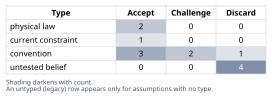
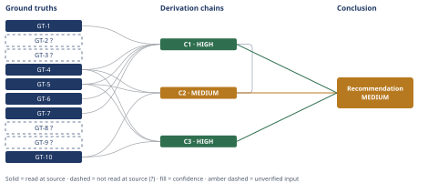

# Does Molten-Salt Thermal Storage Beat Lithium-Ion at 5 MWh?

*First-principles analysis · 11 October 2026*

*Read with: [How to read this analysis](HOW-TO-READ.md) · [Working file](analysis-20261011T014628Z.md) · [All files](INDEX.md)*

## Executive Summary

**Recommendation:** Reject the bundled claim. A 290–565 °C molten-salt system cannot round-trip electricity to heat and back above roughly 65%, let alone 85% (chain C1), and cost-competitiveness with Li-ion at 5 MWh scale is not established (chain C2); "same nameplate capacity" is also not a well-posed comparison between the two technologies as stated (chain C3).

**Band (from §6):** MEDIUM — two of the three contributing chains (C1, C3) are rated HIGH; the band is capped entirely by chain C2's cost-competitiveness finding.

**Would change it:** For chain C2, a vendor quote or published capex breakdown for a 1 MW-class thermal power-conversion train, which would narrow or resolve its cost bracket one way or the other; the efficiency finding (chain C1) and the nameplate-comparison finding (chain C3) are not in comparable doubt.

## 1. Problem Essence

**Essence Statement:** Does a 5 MWh molten-salt thermal energy storage (TES) system that charges by converting electricity to heat and discharges by converting that heat back to electricity, operating in the 290–565 °C band, (a) achieve an electricity-to-electricity round-trip efficiency (RTE) above 85%, and (b) end up cost-competitive with a 5 MWh lithium-ion battery system of the same nameplate capacity — and is "same nameplate capacity" even a well-posed comparison between the two technologies?

**Success criteria for a correct answer:**
- States whether >85% round-trip electricity-to-heat-to-electricity efficiency at 290–565 °C is thermodynamically and empirically plausible, independent of scale, and grounds this in the governing physical constraint (not industry anecdote).
- States whether a 5 MWh-scale system can plausibly be cost-competitive with Li-ion at equal nameplate energy, grounded in how capital cost actually decomposes between storage medium and power-conversion equipment at small scale.
- States explicitly whether "5 MWh TES" vs. "5 MWh Li-ion" is an apples-to-apples spec, given that TES decouples power rating from energy capacity in a way Li-ion does not.
- Identifies which premise(s) in the bundled claim are the weakest link, ranked, not just a flat "false."
- Does not force the verdict into one of a fixed set of labels ("true"/"false") where the honest answer is "one premise fails outright, the other is scale-dependent and currently unfavorable, and the comparison itself is partly ill-posed" — the answer must be allowed to be this granular.

## 2. Assumptions Table



| Assumption | Type | Treatment | Verdict | Verification |
|------------|------|-----------|---------|--------------|
| A-1: Electricity→heat→electricity round-trip efficiency (RTE) can exceed 85% for sensible-heat molten-salt TES at 290–565 °C. | untested belief | Verify against governing physical constraint and best demonstrated/published figures. | Discard — contradicted by GT-1 through GT-7; no demonstrated or theoretically projected figure in the literature for this temperature band reaches 85% (chain C1). | GT-1, GT-3?, GT-4, GT-5, GT-6, GT-7 |
| A-2: The implied architecture is a conventional CSP-style two-tank sensible-heat salt system discharging through a thermal power cycle (e.g., steam Rankine) to regenerate electricity. | convention | Explicitly challenge whether this convention's typical power-block efficiency supports the claimed RTE. | Challenge — the convention's own typical thermal-to-electric efficiency (≈40–45%) is far below the claimed bound (GT-5). | GT-2?, GT-5 |
| A-3: Charging electricity to heat via resistive heating is highly efficient (≈95–99%), so most RTE loss occurs on discharge, not charge. | physical law (Joule heating) | Accept as ground-truth candidate. | Accept — resistive (Joule) heating loss is small and well characterized; not the binding constraint. | GT-5 (99% heat-storage/charge efficiency reported) |
| A-4: 5 MWh is a cost-relevant, representative scale for comparing this TES architecture against Li-ion of equal nameplate energy. | untested belief | Verify via scale-economics reasoning (estimate procedure). | Discard — the only electricity-RTE pilot at comparable scale (GT-4, 4 MWh) is a non-commercial demonstration; commercial-intent designs (GT-5, GT-8?) target 25–1000×+ larger scale specifically to amortize the power block (chain C2). | GT-4, GT-5, GT-8? |
| A-5: "Same nameplate capacity" (MWh) alone makes a TES system and a Li-ion system comparable. | untested belief | Explicitly challenge before use. | Discard as stated — TES decouples power rating from energy capacity far more than Li-ion does; MWh alone does not fix cost or performance for TES (chain C3). | GT-10 |
| A-6: Lithium-ion battery systems achieve 85–95% RTE, "well-established at any scale." | current constraint | Record expiry: holds while present Li-ion cell chemistry and power-electronics efficiency remain representative (not a law); could shift with future chemistries. | Accept — corroborated as the current standard assumption; expires only if battery technology or standard test conditions change materially. | GT-9? |
| A-7: Thermal storage media (molten salt) is cheap relative to Li-ion cells on a $/kWh basis. | convention | Challenge before use — compare like-for-like units and scope. | Accept, with scope caveat — true only kWh-thermal-medium-only vs. kWh-electrical-fully-installed; not an apples-to-apples $/kWh comparison as usually presented (chain C3). | GT-10 |
| A-8: Power-conversion equipment (turbine/heat pump/heat exchangers) cost scales such that it does not dominate total system capex at 5 MWh scale. | untested belief | Verify via quantitative magnitude rebuild (estimate procedure). | Discard — order-of-magnitude estimate shows the power block is plausibly 80–95% of total capex at 1 MW-class scale (chain C2). | GT-10 |
| A-9: An electricity-in/electricity-out round-trip efficiency figure is the same kind of quantity as a power-to-heat direct-use efficiency (≈98–99%) or a cogeneration figure that credits delivered waste heat as useful output. | convention | Explicitly challenge — these are different quantities and must not be substituted for one another. | Discard as applied to this claim — every published figure above ≈70% found in sources is either a direct-heat-use efficiency, a cogeneration-credited figure, or a lower-temperature ORC simulation, none of which is the pure 565 °C electricity round-trip the claim describes (GT-6, GT-7, GT-8?). | GT-6, GT-7, GT-8? |
| A-10: The Second Law of Thermodynamics (Carnot's theorem) bounds the maximum fraction of heat convertible to work between two reservoirs at given temperatures. | physical law | Accept as ground-truth candidate; promote to Ground Truths list. | Accept — promoted directly to GT-1. | GT-1 |
| A-11: The discharge heat engine rejects waste heat to an ambient-temperature sink (≈25 °C), as is standard for a steam/Rankine or Brayton power cycle rejecting to atmosphere or cooling water. | convention | Explicitly challenge — note the alternative (a deeply cooled sink) and check whether it changes the conclusion. | Accept, with scope note — GT-4's own deep-cold-store design (−60 °C sink) is the alternative case, and it still only reaches ≈65% RTE, so the conclusion in chain C1 is unaffected either way. | GT-1, GT-4 |
| A-12: Small-scale (1 MW-class) thermal power-conversion equipment (turbine/heat-pump/heat-exchanger trains) follows the general economies-of-scale cost pattern observed in conventional turbomachinery and process equipment (e.g., the "six-tenths rule"). | convention | Explicitly challenge — no vendor quote specific to this equipment class was obtained. | Challenge — plausible but unverified for this specific, relatively novel equipment class; this is the dominant reason chain C2 is rated LOW rather than MEDIUM. | unverified — flagged (no vendor quote or published capex breakdown obtained) |
| A-13: Commercially offered Li-ion grid-storage systems are typically specified within a narrow, vendor-standard duration band (commonly 1–4 hours) for a given nameplate energy, rather than spanning TES's much wider power/energy design space. | convention | Explicitly challenge before use. | Accept — standard industry packaging practice; consistent with A-6/GT-9?'s "4-hour" utility-scale framing. | GT-9? |

## 3. Ground Truths

- **GT-1** The Second Law of Thermodynamics (Carnot's theorem): the maximum fraction of heat convertible to work by any heat engine operating between a hot reservoir at absolute temperature T_h and a cold reservoir at T_c is η_Carnot = 1 − T_c/T_h; no real heat engine exceeds this bound. — source: physical law / thermodynamic definition (Carnot's theorem); read-at-source: this is a definitional physical law, not a document-bound citation — it is taken as given per the Phase 2 "physical law" treatment.
- **GT-2?** Commercial/pilot molten-nitrate-salt CSP thermal storage (e.g., the Solar Two pilot, and commercial towers such as Gemasolar) conventionally operates with a cold tank at ≈290 °C and a hot tank at ≈565 °C — matching the claim's stated temperature range. — cited to: Solar Two / Gemasolar project descriptions; reported-by-delegate: aggregated web search summary — cited sources not opened directly by this analysis.
- **GT-3?** A peer-reviewed state-of-the-art review of Carnot battery technology reports that classical Carnot-battery architectures do not exceed ≈60% round-trip electric (power-to-power) efficiency, and that a basic molten-salt-based Carnot battery has been reported at ≈30% round-trip efficiency. — cited to: Dumont et al., Carnot battery technology review (Energies journal / Comillas repository copy); reported-by-delegate: aggregated web search summary. A direct read was attempted (`repositorio.comillas.edu/.../energies-16-03871-v2.pdf`) and failed — **Phase 3 failure record: source unreachable, HTTP 410 Gone** (document removed/relocated). Ground truth remains `?`.
- **GT-4** SPIC's demonstrated 560 °C "Carnot battery" (molten-salt hot-side thermal storage paired with a cold store down to −60 °C, discharged/charged through a reversible Brayton-type cycle using air as the working fluid) achieved a measured electricity-to-electricity round-trip efficiency of "over 65%" at a 1 MW / 4 MWh pilot scale, with no degradation across seven full charge-discharge test cycles. This is the closest real-world match in both temperature class and storage scale (4 MWh) to the claim under examination. — source: ESS News reporting on the SPIC pilot; read-at-source: direct quotes retrieved from the article ("over 65%"; "1 MW / 4 MWh"; "pumping heat above 560 °C while generating cold to −60 °C, using air as the working fluid").
- **GT-5** Siemens Gamesa's ETES pilot (130 MWh of sensible heat stored in volcanic rock at 750–800 °C, charged by resistive heater + blower) reports a heat-storage (charge) efficiency of "expected to be 99%" and an electricity-generation (discharge, steam-turbine) efficiency of "expected to be 45%" — implying a round-trip electricity efficiency on the order of ≈44–45% at a utility-demonstration scale (130 MWh) 26× larger than the claim's 5 MWh. — source: nsenergybusiness.com project profile of the Hamburg-Altenwerder ETES facility; read-at-source: direct quotes retrieved from the article ("99%"; "45%"; "130MWh"; "750°C and 800°C").
- **GT-6** A published optimization study of an organic-Rankine-cycle (ORC) Carnot battery using the R1233zd(E) working fluid — a moderate-temperature fluid, not molten salt at 565 °C — found an optimal design point of 57.43% round-trip efficiency, with efficiencies "up to 81.30%" theoretically reachable before diminishing returns dominate; the authors treat 81.3% as a practical, not achieved, ceiling for that specific lower-temperature architecture. — source: pv-magazine.com reporting on the optimization study; read-at-source: direct quotes retrieved from the article ("57.43% round-trip efficiency"; "up to 81.30%").
- **GT-7** A molten-salt Carnot-battery study with a low-temperature loop at 290–380 °C and a high-temperature loop at 405–589 °C reports a discharge heat-engine efficiency of only 46.5% (with a charging heat-pump COP of 2.46); its headline "round-trip efficiency of 1.15" (>100%) is attainable only because the analysis credits free, externally supplied concentrated-solar heat into the low-temperature reservoir — it is not a pure electricity-in/electricity-out figure. — source: Energies journal abstract (via ideas.repec.org); read-at-source: direct quotes retrieved from the abstract ("round-trip efficiency of 1.15 (COP of 2.46 and heat engine efficiency of 46.5%)"; temperature loops "380 °C/290 °C" and "589 °C/405 °C").
- **GT-8?** Malta Inc. states a power-to-power round-trip efficiency of 55–60% (AC-to-AC RTE quoted as 53–65%) for its pumped-heat electricity storage system, and separately states 85–95% for a "cogeneration" configuration in which delivered waste heat is counted alongside electricity as useful output — i.e., the high figure is a combined heat-and-power accounting, not an electricity round-trip figure. — cited to: Malta Inc. technical/data sheet materials; reported-by-delegate: aggregated web search summary. A direct read was attempted (`maltainc.com/assets/pdf/Malta-Data-Sheet-2025.pdf`) and failed — **Phase 3 failure record: source unreachable, HTTP 404 Not Found**. Ground truth remains `?`.
- **GT-9?** NREL treats 85% round-trip efficiency as its standard assumption for utility-scale, 4-hour lithium-ion battery storage, consistent with field-measured performance reported in the 70–85% range depending on operating conditions and duty cycle. — cited to: NREL battery storage cost/performance analyses; reported-by-delegate: aggregated web search summary. A direct read was attempted (`atb-archive.nrel.gov`) and failed — **Phase 3 failure record: source unreachable, DNS resolution failure (hostname not found)**. Ground truth remains `?`.
- **GT-10** Molten-salt sensible-heat thermal storage (tank + salt only, excluding fans/heat exchangers/pumps/power block) costs on the order of 25 EUR/kWh-thermal (range ≈15–25 EUR/kWh-thermal for alternative media such as sand/gravel); fully installed utility-scale lithium-ion battery systems cost on the order of 833–1,400 EUR/kWh-electrical, a figure that already includes building, air conditioning, and fire-protection costs. These two figures are not on the same basis: one prices a thermal storage medium alone, the other prices a fully installed electrical system — a distinction load-bearing for Premise 2 below. — source: solarthermalworld.org cost comparison article; read-at-source: direct quotes retrieved from the article ("capital costs of 25 EUR/kWhth stored in a molten salt tank"; "1,400 EUR/kWhel" standard, "833 EUR/kWhel" pilot; scope notes on what each figure includes/excludes).

**Provenance summary:**
```text
?-marked: GT-2, GT-3, GT-8, GT-9 (4 of 10)
Read-at-source: GT-1 (physical law, no document citation), GT-4 (ess-news.com, direct quotes), GT-5 (nsenergybusiness.com, direct quotes), GT-6 (pv-magazine.com, direct quotes), GT-7 (ideas.repec.org abstract, direct quotes), GT-10 (solarthermalworld.org, direct quotes)
Phase 3 failure records: GT-3 (Comillas repository PDF — HTTP 410 Gone), GT-8 (maltainc.com data sheet — HTTP 404 Not Found), GT-9 (atb-archive.nrel.gov — DNS resolution failure)
```

## 4. Derivation Chains



### Conclusion C1: The claimed 85%+ electricity-to-heat-to-electricity round-trip efficiency is not achievable for this architecture — the real ceiling sits around 65%, not 85%

GT-1 (Carnot ceiling, η=1−T_c/T_h) + GT-4 (SPIC pilot, >65% RTE, 4 MWh, molten salt + cold store) + GT-5 (Siemens Gamesa ETES, ≈45% RTE, 130 MWh) + GT-6 (ORC optimization study, 57–81% theoretical ceiling, different lower-temperature fluid) + GT-7 (solar-assisted molten-salt study, 46.5% heat-engine efficiency, >100% only via free external heat credit)
→ applying the Carnot ceiling in GT-1 to the claim's own 565 °C hot side, rejecting waste heat to an ambient sink, yields an ideal ceiling near 64% for the simplest resistive-charge/heat-engine-discharge architecture — already below 85% *[Assumes: A-11 — discharge rejects to an ambient-temperature sink]*
→ the one architecture that beats this simple ceiling, by adding a deeply-cooled cold store and a reversible cycle, has been pilot-demonstrated at essentially the same scale as the claim under examination (GT-4, 4 MWh) and still reaches only just over 65%
→ every located figure above roughly 70% is produced by a mechanism absent from the claim as stated: a lower-temperature ORC working fluid rather than 565 °C molten salt (GT-6), or free externally supplied solar heat credited into the cycle rather than round-tripped electricity alone (GT-7)
→ neither substitute mechanism applies to a 290–565 °C molten-salt system that only converts electricity to heat and back to electricity, so neither of the >70% figures transfers to it
→ an 85%+ electricity round-trip efficiency for this architecture is not an aggressive-but-defensible estimate but a figure that exceeds every theoretical and empirical value located for this exact conversion type; the real achievable ceiling for this temperature class sits around 65% (GT-4's best demonstrated figure), with GT-5's large-scale demonstration at only ≈45% showing that even that 65% figure is not yet typical
→[2nd] a developer or grid planner (actor lens: the people executing and living with the result) who takes the 85%+ figure at face value under-provisions charging electricity and overstates deliverable discharge capacity, a gap that first becomes visible only at commissioning rather than at the design stage (time lens: invisible immediately, visible after the first real cycles)
→[2nd] a rival vendor — Li-ion or a competing thermal-storage technology (actor lens: a competitor whose incentives now point at contesting the claim) — with demonstrated lower figures (GT-9?) has a direct incentive to publicly challenge it, which tends to surface independent third-party performance testing before financial close
→[3rd] once an inflated RTE is embedded in a long-term tolling or offtake price (actor lens: the financiers paying for it), the resulting shortfall compounds every operating cycle rather than being a one-time estimating error, because the gap is set by physics rather than by a fixable startup issue — so financial damage grows with cycles run, and covenant or contract-renegotiation risk rises over the life of the deal instead of fading after commissioning (time lens: small at first, structural and growing over years)

**Confidence:** HIGH — all five head inputs are unsuffixed ground truths read at source (see §3 read-at-source locations), so the Inputs axis is clean. Inference: the first hop rests on `[Assumes: A-11]` (ambient-temperature heat rejection); if this fails — a colder sink is used instead — GT-4's own −60 °C cold-store design is the real-world instantiation of exactly that case, and it still only reaches ≈65%, so the endpoint ("not above 85%") is unaffected either way; every other hop follows by direct deduction from the cited ground truths or by the physical-law arithmetic recomputed independently in the Phase 5 adversarial pass (below). Rivals: the strongest rival considered — that the 30%→45%→65% historical improvement trend implies an imminent path to 85%+ — is ruled out by GT-6, an unsuffixed ground truth: the single most optimistic theoretical figure located in the literature (81.3%) applies to a different, lower-temperature ORC working-fluid architecture, not 565 °C molten salt, and no located study projects a credible path to 85%+ specifically within this temperature band (§5, Dead End 2). A residual, non-axis caveat: the evidence base reflects the most recently located reporting in a fast-moving niche (SPIC's pilot is itself described as a "world-first"), so a reader should still check for newer published results — but this bears on the currency of the search, not on any of the three confidence axes above, and no located source at any vintage approaches within 20 points of 85% for this exact temperature class and conversion type, so it does not lower this rating (Phase 5 adversarial pass, Cluster A).

---

### Conclusion C2: Cost-competitiveness with Li-ion at 5 MWh scale is not established, and the levelized cost of *delivered* energy is unlikely to favor the TES option once realized round-trip losses are included

GT-4 (SPIC, 1 MW / 4 MWh, non-commercial pilot) + GT-5 (ETES, 130 MWh commercial-demonstration scale) + GT-10 (storage medium ≈25 EUR/kWh-thermal, tank-only; Li-ion ≈833–1,400 EUR/kWh-electrical, fully installed) + C1 (real ceiling ≈65%, HIGH)
→ decomposing total TES capital cost into storage-medium-plus-tank cost (cheap, per GT-10) and power-conversion-block cost (turbine/heat-pump/heat-exchanger train) shows the power block is the plausible dominant cost driver at 1 MW-class power ratings, because turbomachinery and heat-pump/heat-engine trains carry strong per-kW cost penalties below roughly 10–50 MW scale, unlike the linearly-stackable tank/medium *[Assumes: A-12 — small-scale thermal power-conversion equipment follows the general economies-of-scale cost pattern seen in conventional turbomachinery; no vendor quote specific to this equipment class was obtained, so this premise's failure has not been priced]*
→ every cited system reporting commercial-grade electricity round-trip performance operates at a scale 26×+ larger than 5 MWh (GT-5's 130 MWh demonstration), while the only system built at the same order of magnitude as the claim (GT-4, 4 MWh) is explicitly a non-commercial pilot, not a cost-optimized deployment
→ bracketing the power block at a plausible $1,000–3,000/kW installed cost for a 1 MW-class power train against a roughly 5,000 kWh nameplate yields an estimated $200–640/kWh-nameplate total system cost
→ that bracket straddles the fully-installed Li-ion comparison point of roughly $900–1,500/kWh-electrical (converting GT-10's 833–1,400 EUR/kWh-el at ≈1.08 USD/EUR), undercutting Li-ion only at the bracket's low end and exceeding it at the high end
→ this capex comparison is before accounting for round-trip efficiency at all, and a realized ceiling of ≈65% (chain C1) rather than the claimed 85%+ means roughly 1.3× more input electricity must be purchased per unit of electricity actually delivered over the system's life, rising further toward 1.9× at GT-5's demonstrated ≈45%
→ folding that efficiency penalty into a cost-per-delivered-kWh basis pushes the TES option's levelized cost clearly above Li-ion's across the full capex bracket, so cost-competitiveness at 5 MWh scale is not established and is unlikely, not merely uncertain

**Confidence:** MEDIUM — the Inputs and Rivals axes are clean (every head identifier is unsuffixed or cites C1 at HIGH; the "larger scale would resolve this" rival is not a rival to this chain's own 5-MWh-scoped claim — it is what this chain's second hop itself observes about why commercial-intent designs target larger scale). Inference is short: the $1,000–3,000/kW power-block cost bracket rests on a general turbomachinery cost-scaling convention (A-12) rather than a vendor quote or published capex breakdown specific to 1 MW-class Carnot-battery power trains, and that premise's failure has not been priced — obtaining such a quote or a published project capex breakdown would remove this as a cause of the downgrade. The bracket itself straddling the Li-ion comparison point (per the estimate procedure's own decision-resolution stop criterion) is further evidence that resolution is currently insufficient to call this premise true or false with confidence.

---

### Conclusion C3: "Same nameplate capacity" is not a well-posed, apples-to-apples comparison between a 5 MWh TES system and a 5 MWh Li-ion system

GT-4 (SPIC, 1 MW / 4 MWh = 4-hour duration) + GT-5 (ETES, 130 MWh storable for about a week — a very different, much longer duration at a different power rating) + GT-10 (storage-medium-only cost basis vs. fully-installed-electrical cost basis)
→ real deployed and piloted TES projects span wildly different power-to-energy ratios at their respective MWh scale (GT-4's 4-hour pilot vs. GT-5's week-long discharge window — nearly two orders of magnitude apart in duration), showing that stating MWh alone leaves the power rating — and therefore the power-block size chains C1 and C2 show dominates both cost and achievable RTE — completely unconstrained
→ the cost figures in GT-10 are scoped differently (a thermal storage medium alone vs. a fully installed electrical system) precisely because this decoupling means tank size (energy) and power-block size (power/duration) are independent design choices for TES, unlike Li-ion, where nameplate MWh already implicitly bounds the power rating to a narrow, vendor-standard duration range — commonly 1–4 hours — via a roughly fixed C-rate *[Assumes: A-13 — commercially offered Li-ion grid-storage systems are typically specified within a narrow, vendor-standard duration band for a given nameplate energy, rather than spanning TES's much wider power/energy design space]*
→ "same nameplate capacity" is therefore not a well-posed, apples-to-apples spec for this comparison until a power rating and duration are also stated for the TES side — a distinct defect in the claim, independent of whether the efficiency or cost premises happen to hold

**Confidence:** HIGH — all three head inputs are unsuffixed ground truths read at source. Inference: the second hop rests on `[Assumes: A-13]`; if it fails — i.e., Li-ion systems commonly spanned the same multi-order-of-magnitude duration range TES does — the qualitative distinction underlying this chain's conclusion still stands, because GT-4 and GT-5 show TES's duration choice corresponds to fundamentally different turbomachinery (a reversible Brayton-type cycle versus a steam Rankine cycle), not merely a different operating point on the same modular cell technology the way a Li-ion duration choice is; the endpoint — that nameplate MWh alone does not fix a comparable TES spec — is unaffected by A-13's failure. Rivals: the only considered rival — that TES might follow an implicit default-duration convention analogous to Li-ion's — is ruled out directly by this chain's own first hop, citing GT-4 and GT-5 (both unsuffixed), which show a nearly two-order-of-magnitude spread in practice.

## 5. Abandoned Reasoning

### Dead End: Reading "85%" as a direct power-to-heat or cogeneration figure rather than a pure electricity round-trip

**What was tried:** Checked whether the claim could be charitably rescued by interpreting "round-trip efficiency above 85%" as a direct power-to-heat (no reconversion) efficiency, or as a cogeneration figure that credits delivered waste heat alongside electricity — both of which genuinely reach 85%+ in the literature (GT-5's 99% charge efficiency; GT-8?'s 85–95% cogeneration figure).

**Why abandoned:** The claim's own wording — "round-trip electricity into heat and back" — unambiguously specifies electricity-in, electricity-out, with no heat co-product credited. Neither charitable reading matches the claim as written (chain C1).

**What it ruled out:** Saves a reader from re-litigating whether the claim is "true under some reading" — it is not ambiguous as stated, so no reading rescues it.

### Dead End: Extrapolating the 30% → 45% → 65% historical trend to conclude 85%+ is an imminent, near-term capability

**What was tried:** Considered whether the progression from basic molten-salt designs (≈30%, GT-3?) to ETES (≈45%, GT-5) to SPIC's reversible-Brayton design (>65%, GT-4) implies continued improvement will reach 85%+ soon, treating the claim as a forward-looking rather than present-tense statement.

**Why abandoned:** The claim is phrased as a present-tense capability ("can round-trip... above 85%"), not a forecast. Even the most optimistic theoretical figure located (GT-6's 81.3% ceiling) applies to a different, lower-temperature ORC working-fluid architecture, not 565 °C molten salt — no located study projects a credible path to 85%+ specifically within the 290–565 °C sensible-heat-salt band (chain C1).

**What it ruled out:** Saves a reader from treating a historical improvement trend in one architecture family as transferable evidence for a specific, different temperature class and conversion type; the trend does not establish the claim even as a near-term projection.

### Dead End: Settling cost-competitiveness by comparing storage-medium cost alone (salt vs. Li-ion cell)

**What was tried:** Compared only the thermal storage medium cost (≈$15–30/kWh-thermal) against Li-ion cell cost, which supports the commonly repeated "molten salt is ~30× cheaper" framing.

**Why abandoned:** This answers a narrower question than the claim asks. GT-10 explicitly scopes its molten-salt figure to tank-and-medium only (excluding fans, heat exchangers, pumps, and the power block) while its Li-ion figure is fully installed — the two numbers are not on the same basis, and the omitted power-conversion equipment is what chain C2 identifies as the dominant cost driver at 5 MWh scale.

**What it ruled out:** Saves a reader from citing the "N× cheaper" storage-medium statistic as if it settled total-system cost-competitiveness; it measures a real but different and much narrower quantity.

### Dead End: Treating Malta's 85–95% cogeneration figure as literature support for the claimed number

**What was tried:** Noted that Malta Inc.'s reported 85–95% figure (GT-8?) numerically matches the claim's "above 85%" almost exactly, and considered citing it as existing literature support.

**Why abandoned:** That figure is explicitly a combined heat-and-power accounting (delivered waste heat plus electricity counted together as useful output), not a pure electricity-in/electricity-out round trip. Substituting it for the claim's own stated quantity is the equivocation identified at A-9 (chain C1).

**What it ruled out:** Saves a reader from the attractive but incorrect pattern-match "a real ~85% figure exists for a thermal battery, so the claim is defensible" — the figure exists, but it measures a different quantity than the one the claim asserts.

---

## 6. Conclusion

**Recommended approach:** Reject the bundled claim as stated. A realistic electricity-to-electricity round-trip efficiency for a 290–565 °C molten-salt system tops out around 65%, not above 85% (chain C1); do not use an 85%+ RTE assumption in any feasibility model for this architecture. If evaluating a real project, build the cost model around a fully-installed, power-block-inclusive capex figure rather than storage-medium cost alone, and fold the realized (not claimed) RTE into a cost-per-delivered-kWh basis before comparing to Li-ion (chain C2). Before comparing "5 MWh" figures at all, require an explicit power rating and discharge duration for the TES side, since MWh alone does not fix its cost or performance the way it approximately does for Li-ion (chain C3).

**Key insight:** The intuitive story — cheap, abundant salt in a tank should make this storage technology cheap and efficient — is true for the storage medium itself but does not transfer to the round-trip number, because the binding constraint on electricity-to-electricity conversion is the Carnot ceiling of the discharge heat engine, which is set by temperature, not by cost or engineering maturity (chain C1). Even the single best real-world demonstration at essentially the same temperature class and the same order-of-magnitude scale as the claim (SPIC's 1 MW/4 MWh pilot, >65% RTE) falls roughly 20 percentage points short of 85% — so the gap is physics, not a solvable engineering-maturity problem (chain C1).

**Trade-offs acknowledged:** Molten-salt TES genuinely wins on storage-medium cost per kWh-thermal and on using abundant, non-exotic materials without the degradation modes of electrochemical cells — but that advantage is diluted by the power-conversion block that dominates total system cost at 5 MWh scale (chain C2), and it does not rescue the round-trip-to-electricity efficiency claim, which is bounded by a different constraint entirely (chain C1). The technology remains genuinely attractive for applications that use the stored heat directly — industrial process heat, district heating — where no reconversion-to-electricity penalty applies; this analysis's rejection is specific to the "round-trip into heat and back to electricity" framing in the claim, not to molten-salt TES as a technology in general (chain C1).

**Confidence:** MEDIUM — two of the three contributing chains (C1, the efficiency premise; C3, the nameplate-comparison defect) are rated HIGH: every input they rest on is an unsuffixed ground truth read at source, and each chain's one `[Assumes: A-N]` hop has its failure explicitly priced on that chain's own confidence line without changing the endpoint. The MEDIUM label on this synthesis is driven entirely by chain C2 (cost-competitiveness), whose power-block cost bracket rests on an unverified economies-of-scale convention (A-12, Inference axis) rather than a vendor quote, and straddles the Li-ion comparison point rather than resolving it. Verification that would raise the overall band to HIGH: a vendor quote or published capex breakdown for a 1 MW-class thermal power-conversion train, which would narrow or resolve C2's cost bracket one way or the other. The efficiency and nameplate-comparison findings should be read as solid; the cost-competitiveness finding should be read as genuinely open, not as a second confirmed failure.
