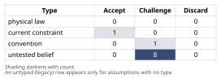
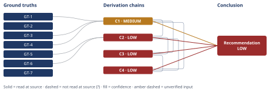

# Diagnosing Northbrook's Rising Quarterly Churn

*First-principles analysis · 10 October 2026*

*Read with: [How to read this analysis](HOW-TO-READ.md) · [Working file](analysis-20261010T234627Z.md) · [All files](INDEX.md)*

## Executive Summary

**Recommendation:** Run three cheap, internal-data checks, in order, before any customer-facing research or fix commitment: (1) confirm how "quarterly churn rate" is actually computed and whether Q1 and Q3 are comparable cohorts (chain C1); (2) pull cohort composition, a ticket/adoption-to-churn correlation cut, staffing/incident timeline, and pricing/loss-reason records (chain C2); (3) only then decide on win-loss interviews or a structural fix, scoped to what the checks implicate (chain C3).

**Band (from §6):** LOW — rests on C2, C3 and C4, all rated below HIGH (chain C2, chain C3, chain C4).

**Would change it:** Confirming the metric's computation basis (chain C1) and a cohort-level ticket/adoption-score correlation check that tests whether the decline is broad-based rather than concentrated in a few accounts, plus a pricing/loss-reason check against the pricing and competitive-displacement rivals (chain C2) — all three are internal-data checks named in the recommendation itself, not new analysis.

## 1. Problem Essence

**Core problem:** Determine which single driver — or minimal combination of drivers, among a metric/measurement artifact, a cohort or sales-motion vintage effect, an onboarding failure, a service-quality/reliability degradation, pricing pressure, and competitive displacement — best explains why Northbrook's measured quarterly non-renewal rate rose from 4.1% (Q1) to 9.2% (Q3), and what the minimal-cost, correctly-sequenced action is to confirm that driver and reverse it.

**Success criteria:**
1. The analysis states explicitly how "quarterly churn rate" is computed (cohort-relative to that quarter's renewal-eligible accounts, vs. a trailing/rolling blend across cohorts), and the Conclusion section's recommendation does not treat the 4.1%→9.2% move as self-evidently a real-time acceleration until that computation basis is named as unresolved or resolved.
2. The Conclusion section names a single leading hypothesis (or an explicit minimal combination) for the churn rise, and that hypothesis is traceable to a derivation chain in section 4 that cites the CS-flagged signals (ticket volume, adoption scores) and states what would distinguish it from the pricing and competitive-displacement rivals.
3. The Conclusion section's recommended approach names a diagnostic sequence in which every action requiring only existing internal data precedes every action requiring new data collection (customer interviews, surveys, or a structural fix), and each action names what it would confirm or rule out.
4. The Conclusion section separates, in explicit language, what can be told to leadership now (independent of the open questions) from what requires further diagnostic data before any resourcing commitment is made.

## 2. Assumptions Table

| Assumption | Type | Treatment | Verdict | Verification |
|------------|------|-----------|---------|--------------|
| A-1: Northbrook's "quarterly churn rate" is computed on a comparable basis in Q1 and Q3 (same denominator definition, no silent change in scope). | untested belief | Verify, or flag unverified; if used in a chain, inherits a confidence caveat (D-07). | Challenge — no computation basis is stated in the brief; this is the single highest-leverage unknown and must be resolved before the 4.1%→9.2% move can be interpreted at all (chain C1). | unverified — would require confirming with Northbrook's analytics/BI/RevOps team how the denominator is defined |
| A-2: The CS-flagged rise in ticket volume and drop in adoption scores reflect a genuine, broad-based change in customer behavior sharing a common upstream driver with the churn rise, rather than measurement noise or a confound concentrated in a few accounts. | untested belief | Verify, or flag unverified; used in chain C2, inherits a confidence caveat. | Challenge — plausible but unconfirmed; equally plausible the signals are noise concentrated in a handful of large or vocal accounts (chain C2, marked `[Assumes: A-2]`). | unverified — flagged |
| A-3: "Quarterly churn rate" is calculated cohort-relative to that quarter's renewal-eligible accounts, rather than as a trailing/rolling blend across multiple annual cohorts. | convention | Explicitly challenge: ask whether this reporting convention holds in this specific context, or is carried by inertia from a monthly-churn SaaS template that doesn't fit an annual-renewal business. | Challenge — both conventions are common in different reporting stacks and the brief does not say which Northbrook uses; this materially changes whether the two quarters are comparable (chain C1). | unverified — would require reading the churn dashboard's own query/definition |
| A-4: The Q1 and Q3 renewal-eligible cohorts are of comparable size and segment composition, so the two percentages are commensurable. | untested belief | Verify, or flag unverified. | Challenge — unequal cohort sizes alone could let a handful of accounts swing a percentage from 4% to 9% without any change in underlying customer health. | unverified — would require the renewal-eligible account count and segment mix for each quarter |
| A-5: "Support ticket" and "feature-adoption score" are defined and measured identically in Q1 and Q3 (no tooling change, no redefinition). | untested belief | Verify, or flag unverified. | Challenge — a redefinition or new tool could mechanically shift both figures without any real change in customer behavior. | unverified — would require a change log for the support/analytics tooling |
| A-6: No pricing change (list-price increase, or a first-year discount cliff) was applied to accounts renewing in Q3 relative to Q1. | untested belief | Verify, or flag unverified. | Challenge — unverified; if confirmed true, this weakens the pricing-pressure hypothesis relative to onboarding/service-quality (chain C2). | unverified — would require the pricing/quote history for the two cohorts |
| A-7: No named competitor shipped a materially better or cheaper alternative in the window relevant to these renewals. | untested belief | Verify, or flag unverified. | Challenge — unverified; if confirmed true, this weakens the competitive-displacement hypothesis relative to onboarding/service-quality (chain C2). | unverified — would require loss-reason notes and sales/CS competitive-mention logs |
| A-8: CS and onboarding staffing and process were stable (no turnover, no reorg) across the 6-15 month window preceding Q3's renewals. | untested belief | Verify, or flag unverified. | Challenge — unverified; a staffing or process change is a cheap internal fact to confirm and, given the evidence pattern, a leading candidate root cause. | unverified — would require an HR/org-chart timeline for the CS and onboarding functions |
| A-9: No platform reliability incident (outage, major regression, degraded SLA) occurred in the 6-15 month window preceding Q3's renewals. | untested belief | Verify, or flag unverified. | Challenge — unverified; an incident-log and status-page check is a cheap, fast way to rule this in or out. | unverified — would require engineering's incident log/postmortem history |
| A-10: Churn is not yet tracked at finer granularity than quarterly cohort percentages (no existing weekly/monthly cohort dashboard). | current constraint | Record expiry conditions — what would have to change for this constraint to lift. | Accept — expires once Northbrook builds cohort-level tracking finer than quarterly; until then, the diagnostic plan must scope itself to what existing quarterly/account-level data can answer. | stated as a working scoping constraint on the diagnostic plan; not independently verified |

## 3. Ground Truths

- **GT-1** Northbrook sells annual contracts that renew annually, i.e., churn is a discrete, once-per-year renewal event per customer rather than a continuous monthly cancellation — source: user-provided problem brief, CONTEXT paragraph; read-at-source: "Annual contract value ranges $18,000-$40,000, contracts renew annually (i.e., churn is a discrete annual renewal event per customer, not a continuous monthly cancellation)."
- **GT-2** Northbrook's ACV ranges $18,000-$40,000, sold to mid-market operations teams — source: problem brief, CONTEXT paragraph; read-at-source: "Annual contract value ranges $18,000-$40,000."
- **GT-3** The reported Q1 quarterly churn rate is 4.1% — source: problem brief, OBSERVED DATA; read-at-source: "Q1 quarterly churn rate: 4.1%."
- **GT-4** The reported Q3 quarterly churn rate is 9.2% — source: problem brief, OBSERVED DATA; read-at-source: "Q3 quarterly churn rate: 9.2% (more than doubled over two quarters)."
- **GT-5** Customer Success has flagged rising support-ticket volume — source: problem brief, OBSERVED DATA; read-at-source: "Customer Success has flagged: rising support-ticket volume."
- **GT-6** Customer Success has flagged a drop in feature-adoption scores — source: problem brief, OBSERVED DATA; read-at-source: "...and a drop in feature-adoption scores."
- **GT-7** No root cause has yet been identified among leadership's listed candidate explanations (offer/product gaps, pricing pressure, onboarding failure, service-quality degradation, competitive displacement, or a combination) — source: problem brief, OBSERVED DATA; read-at-source: "No root cause has yet been identified among the candidate explanations... Leadership's mandate: 'find the root cause of churn and fix it.'"

**Provenance summary:** `?`-marked: none (0 of 7). Read-at-source: GT-1 through GT-7 — all seven facts were read directly in the user-provided problem brief quoted above; no sub-agent, search, or secondary summary supplied any of them, so none requires the `?` suffix.

## 4. Derivation Chains

**Fishbone brainstorm (Phase 2 technique, feeding this section).** Locked category set for this problem (domain-selected rather than a generic preset, because the candidate causes named in the brief and the ones it omits cluster naturally this way): Measurement/Definition, Cohort & Sales-Motion, Onboarding, Service Quality & Reliability, Offer/Product, Pricing, Competitive Displacement, Segment Concentration. Candidate causes brainstormed per category, each already carried into section 2 as an `untested belief` row: Measurement/Definition → A-1, A-3, A-5; Cohort & Sales-Motion / Segment Concentration → A-4; Onboarding / Service Quality & Reliability → A-2, A-8, A-9; Pricing → A-6; Competitive Displacement → A-7; Offer/Product → no distinct candidate beyond what A-2's usage-decline signal already covers (feature-adoption drop is the observable proxy for an offer/product gap as much as for onboarding friction, so this category does not add a row the others do not already cover). Discriminating observations for the two highest-priority branches (A-1/A-3 vs. A-2) are named inline in chains C1 and C2 below.

**Second-order pass (mandatory, Phase 4 exit criterion), both lenses named and walked:**
- **Actor lens:** CS reps are likely already triaging the ticket spike reactively rather than diagnostically, which could mask the upstream cause by the time anyone investigates; sales reps, if unaware of a cohort problem, will keep selling into the same risky segment or motion this quarter; leadership, on receiving only the headline 4.1%→9.2% figure, is the actor most likely to over-react into a broad, costly fix before the cheap checks below are run.
- **Time lens:** immediately, the only observable facts are the two percentages and the two CS flags; after one or two more quarters, if this is a cohort-vintage effect, the rate should mean-revert on its own as later, unaffected cohorts come up for renewal; if instead it keeps rising quarter over quarter after the vintage effect should have faded, that is the observation that would turn a cohort explanation into a systemic one.

These effects extend chain C3 below (`→[2nd]`, `→[3rd]`) rather than standing alone; neither contradicts GT-1 through GT-7, so no return to Phase 2 is triggered.

### Conclusion C1: The computation basis of "quarterly churn rate" is unresolved, and the two quarters may not be measuring the same kind of thing

GT-1 (annual, once-per-year renewal event) + GT-3 (Q1=4.1%) + GT-4 (Q3=9.2%)
→ because churn is a discrete, once-per-year event per customer, a "quarterly churn rate" must be computed over some specific subset or blend of customers, not over a continuously-occurring process, so the number's meaning depends entirely on which subset or blend was used
→ at least two distinct computation bases are possible: cohort-relative (only that quarter's renewal-eligible accounts, each cohort having signed roughly 12 months earlier) or trailing/rolling (a blend across many cohorts' renewal outcomes) — and a reader could mistake either for "churn accelerating in real time"
→ discriminating observation: if cohort-relative, the Q3 figure describes a different, specific group of customers (those who signed ~9-15 months before Q3) than the Q1 figure does, and the strongest rival reading — "the business is deteriorating continuously, right now, across the whole base" — is only supported if the basis is trailing/rolling; nothing in the brief states which basis is used, so that rival is neither confirmed nor ruled out
→ the size of alarm the 4.1%→9.2% move should trigger cannot be assessed until Northbrook's own metric definition is confirmed

**Confidence:** MEDIUM — Inputs and Rivals are clean (GT-1/GT-3/GT-4 are all read-at-source with no `?`, and the live rival — "trailing/rolling basis, meaning real-time systemic acceleration" — is named explicitly above rather than hidden), but Inference is short: the second hop's enumeration of "at least two" bases is not exhaustive of every possible denominator convention, so the conclusion is only as strong as that enumeration; what would close this is reading Northbrook's own churn-metric query/definition (A-1, A-3), which would convert this chain's conclusion from "unresolved" to a confirmed computation basis.

### Conclusion C2: Given only the evidence stated, the leading hypothesis is a cohort/onboarding/service-quality driver, not a pricing or competitive-displacement driver — but this is not yet distinguished from those rivals

GT-5 (rising tickets) + GT-6 (falling adoption) + C1 (metric basis unresolved)
→ rising ticket volume and falling adoption scores are both patterns typically produced by product-usability friction or under-resourced onboarding/support, and both are mechanical, usage-side signals that typically precede a renewal decision by months rather than appearing only once an account has already decided to leave
→ no evidence has been provided of a pricing change (A-6) or of a named competitive-displacement event (A-7), which are the other two leading candidates on leadership's own list
→ `[Assumes: A-2]` treating the two CS-flagged signals as reflecting a genuine, broad-based change in the customer base rather than noise concentrated in a few accounts, the joint appearance of both signals is best explained by a single upstream driver in the onboarding/service-quality family, which produces both symptoms and, with a lag, non-renewal, rather than by pricing or competitive displacement, for which no supporting evidence has been offered
→ the primary-hypothesis family is onboarding/service-quality/cohort-concentration, with pricing and competitive displacement as live but currently unsupported rivals

**Confidence:** LOW — two axes are short at once. Inference is short because the third hop rests on the undischarged premise `[Assumes: A-2]`; if A-2 is false (the signals are noise or concentrated in a few large accounts rather than broad-based), the entire hypothesis loses its evidentiary support, and that failure mode has not been priced beyond naming it — what would close it is the cohort-level ticket/adoption-score correlation check named in chain C3 below. Rivals are also short: pricing pressure and competitive displacement remain live, unruled-out alternatives — "no evidence provided" is an absence, not a disconfirmation — and what would settle between them is confirming A-6 and A-7 (pricing/quote history and loss-reason notes), also named in chain C3.

### Conclusion C3: The correct diagnostic sequence runs cheap, internal-data checks before any customer-facing research or structural fix

C1 (MEDIUM, metric basis unresolved) + C2 (LOW, leading hypothesis unconfirmed)
→ C1's ambiguity (A-1, A-3) and C2's two short axes (A-2's premise, and the A-6/A-7 rivals) are all resolvable by inspecting data Northbrook already has internally — metric definition, cohort composition and sizes (A-4), a ticket/adoption-score-to-churn correlation cut by cohort, a staffing/incident timeline (A-8, A-9), and pricing/loss-reason records — none of which requires new data collection from customers, so these checks are both cheaper and faster than the alternative
→ the alternative — customer-facing win-loss interviews, or committing to a structural fix (an onboarding overhaul, a pricing rollback, a product investment) — requires customer or cross-team time measured in days to weeks and should run only once the cheap checks have narrowed which hypothesis is live
→[2nd] running the cheap checks first also avoids the actor-lens risk named above: leadership authorizing a broad, systemic response (an org-wide price or product commitment) before C1/C2 narrow the scope would misallocate resources if the real driver turns out to be confined to one cohort or one sales-motion wave, and would itself create a new confound for next quarter's measurement
→[3rd] per the time-lens observation above, if the cheap checks confirm a cohort-relative basis and trace the worse cohort to a specific sales-motion or staffing change, the churn rate should mean-revert within one to two further quarters on its own as unaffected cohorts come up for renewal — and continued rise past that point is the observation that would convert this into a systemic finding requiring the broader response
→ the diagnostic plan should run the internal-data checks (metric definition, cohort composition, correlation cut, staffing/incident timeline, pricing/loss-reason records) before any customer-facing research or structural fix, in that order

**Confidence:** LOW — capped by C2 (LOW), cited on this chain's head; C2's own confidence line carries the explanation of why it is LOW and is not repeated here.

### Conclusion C4: What can be told to leadership now is narrower than a diagnosis, and no resourcing commitment should be made before C1/C2 are resolved

C1 (MEDIUM) + C2 (LOW) + C3 (LOW)
→ what is solid enough to state now is bounded to what does not depend on the open questions in C1 and C2: churn has risen in magnitude between Q1 and Q3, CS has independently observed two deteriorating leading indicators (ticket volume, adoption scores), and nothing currently on hand supports a pricing-led or competitor-led story over an onboarding/service-quality-led one
→ what is not solid enough to act on is the causal attribution itself — cohort vintage versus ongoing systemic decline, and onboarding versus support capacity versus a specific incident — and therefore any resourcing decision tied to a specific fix path
→ leadership should be told the diagnosis is open but narrowing, given a short, dated list of the cheap checks in C3, and asked to withhold a fix commitment until those checks return — not given a root cause today

**Confidence:** LOW — capped by C2 and C3, both cited on this chain's head and both rated below HIGH; their own confidence lines carry the explanation and are not repeated here.

## 5. Abandoned Reasoning

### Dead End: Treating the CS-flagged signals as direct causal drivers of churn

**What was tried:** An early framing treated rising ticket volume and falling adoption scores as themselves the root cause — i.e., jumping straight to "fix support capacity and re-run onboarding" as the headline recommendation.

**Why abandoned:** This conflates symptom with cause and ignores the confound A-2 explicitly names: both signals could equally be produced by, and lag, a shared upstream driver (a cohort problem, a staffing change, an incident) rather than being the driver themselves. Treating them as causal would also make chain C2 a non-sequitur, since its own confidence line depends on A-2 being tested, not assumed.

**What it ruled out:** Committing a support-capacity or onboarding-process fix as the first action, before checking whether the signals are broad-based (A-2) or concentrated in a cohort/segment the fix wouldn't even reach.

### Dead End: Reading the 4.1%→9.2% move as a continuous, real-time acceleration requiring an emergency, company-wide response

**What was tried:** Modeling the quarter-over-quarter change as if churn were a continuously-occurring process doubling in real time, the way monthly churn would in a monthly-subscription business.

**Why abandoned:** GT-1 establishes that churn here is a discrete, once-per-year, per-customer event. A "quarterly churn rate" in this setting is necessarily a cross-section of some specific subset of the customer base (chain C1), not a rate at which the same population is failing faster and faster. Reading it as continuous acceleration requires assuming the trailing/rolling computation basis, which is one of two live possibilities and is not confirmed by anything in the brief.

**What it ruled out:** Authorizing a broad, costly, company-wide response (e.g., an across-the-board price rollback or a blanket onboarding overhaul) before confirming which customers the 9.2% figure actually represents.

### Dead End: Treating pricing as the primary driver because of the mid-market ACV size

**What was tried:** An early hypothesis treated the $18K-$40K ACV range as inherently price-sensitive, reasoning that accounts this size are the ones most likely to balk at a renewal price.

**Why abandoned:** No evidence of any pricing change is given anywhere in the brief (A-6 is entirely unverified in either direction), and the two concrete signals that are given — rising tickets, falling adoption — are usage/support-side signals, not negotiation-side signals. Prioritizing a pricing hypothesis over those two stated signals would be reasoning from account size (an analogy to "mid-market deals are price-sensitive") rather than from the evidence actually in hand.

**What it ruled out:** Running a pricing/discount audit ahead of the cheaper, more directly evidenced cohort and metric-definition checks in chain C3.

## 6. Conclusion

**Recommended approach:** Run three cheap, internal-data checks before any customer-facing research or fix commitment, in this order: (1) confirm the churn metric's computation basis and whether Q1 and Q3 are comparable cohorts or a blended trailing rate (chain C1); (2) pull cohort composition/sizing, a ticket- and adoption-score-to-churn correlation cut by cohort and segment, a CS/onboarding staffing-and-incident timeline, and pricing/loss-reason records for Q1 vs. Q3 (chain C2); (3) only once 1-2 return, decide whether a customer-facing win-loss round or a structural fix is warranted, and scope that fix to what the checks actually implicate rather than to the whole customer base (chain C3).

**Key insight:** Because churn here is a discrete, once-per-year, per-customer event (GT-1), the 4.1%→9.2% "doubling" is not, by itself, evidence that the business is deteriorating continuously, right now, across the whole customer base — it is equally consistent with two different quarterly cohorts being compared, which only looks like an accelerating trend because quarterly reporting cadence disguises the underlying event's yearly periodicity (chain C1). This is the one finding that reasoning by analogy to a monthly-churn SaaS playbook would miss entirely.

**Trade-offs acknowledged:** Deferring a fix commitment costs the calendar time it takes to run the three checks above, which leadership may want to spend immediately given the mandate to "find the root cause and fix it" — that cost is accepted because committing budget or headcount to the wrong fix (for example, an org-wide pricing rollback when the real driver is one bad onboarding cohort) costs more than the days the checks require (chain C4). Separately, the current best hypothesis — an onboarding/service-quality driver over a pricing or competitive one — is rated LOW confidence and could be wrong; pricing and competitive displacement are deprioritized for investigation, not ruled out, because no evidence for or against either currently exists (chain C2).

**Confidence:** LOW — the recommendation rests on C2, C3 and C4, all rated below HIGH; each of their own confidence lines names what would close its shortfall (A-2's cohort-level correlation check, and the A-6/A-7 pricing and competitive-displacement checks), and none of those checks has been run as part of this analysis — only the plan to run them is being presented.
