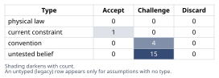
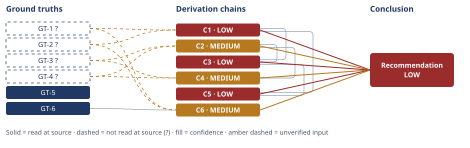

# Diagnosing Northbrook's Doubled Churn Rate

*First-principles analysis · 11 October 2026*

*Read with: [How to read this analysis](HOW-TO-READ.md) · [Working file](analysis-20261011T021226Z.md) · [All files](INDEX.md)*

## Executive Summary

**Recommendation:** Run Northbrook's week-1/2/3 internal-data-first diagnostic plan immediately and in parallel across all five candidate categories, rather than sequentially chasing one story (chain C3). In parallel, launch three low-risk interim actions — adoption-triggered save-desk outreach, ticket triage for near-renewal accounts, a temporary pricing-increase freeze for at-risk accounts (chain C4) — without waiting for root-cause confirmation. Hold "internal-operations friction" (onboarding/service-quality) as the provisional leading hypothesis given the two CS signals in hand, but only provisionally (chain C2), and require every candidate-cause conclusion to cite a specific diagnostic cut before leadership acts on it (chain C5).

**Band (from §6):** LOW — matching the weakest contributing chains (C1, C3, C5, all LOW).

**Would change it:** Pulling raw churn counts/denominators to verify the two churn figures (GT-1?, GT-2?) and running the cohort/renewal-anniversary decomposition to confirm the trend is structural rather than seasonal (A-5) — both zero-new-data-collection, week-1 tasks under the same diagnostic plan this recommendation already calls for (chain C3).

## 1. Problem Essence

**Core problem:** Which of the five candidate factors — offer/product gaps, pricing pressure, onboarding failure, service-quality degradation, competitive displacement — or what combination of them, is driving Northbrook's quarterly churn rate to more than double (4.1% → 9.2%) within two quarters, and what diagnostic data pull would let Northbrook isolate the dominant driver(s) within weeks, using data it plausibly already holds, before it commits to a remediation?

**Success criteria:**
- Separates what is actually known (the two churn numbers, the two CS signals) from what is being assumed (single cause, segment concentration, structural-vs-seasonal trend, causal direction of the CS signals), with each assumption individually classified and verdicted in section 2.
- Does not presuppose the five candidate categories are mutually exclusive or equally weighted at the outset — section 2 and section 4 explicitly challenge both premises.
- Names specific, falsifiable data cuts Northbrook can run within weeks using data it plausibly already holds, each tied to which candidate cause(s) it would confirm or rule out — present in section 4/6 as a sequenced plan, not a generic "do more research" instruction.
- Produces a ranked, evidence-grounded provisional hypothesis derived from the two given CS signals (ticket volume up, adoption score down) and from no other unstated assumption, explicitly flagged as provisional pending the data cuts (chain C2).
- Names interim actions whose value does not depend on which candidate cause is eventually confirmed (chain C4).
- Surfaces, as a named second-order risk, the organizational incentive to converge on a politically convenient but unverified cause before the data cuts complete (chain C5).

## 2. Assumptions Table

| Assumption | Type | Treatment | Verdict | Verification |
|---|---|---|---|---|
| A-1: The Q1 (4.1%) and Q3 (9.2%) churn figures are computed on a consistent methodology/denominator across quarters | untested belief | Verify by pulling raw churn counts and the active-account denominator for each quarter and confirming the same churn definition was applied both times | Challenge — plausible but unverified; in a mid-market book a handful of logos can swing a percentage point or more | unverified — flagged (feeds GT-1?/GT-2?) |
| A-2: Rising ticket volume and falling adoption scores are causally upstream of churn (leading indicators), not downstream symptoms of churn itself or of a shared upstream cause | untested belief | Run a lagged correlation: do a customer's ticket/adoption trends precede that customer's churn by a meaningful lead time, or do they move together only in the final weeks before cancellation? | Challenge — directionally plausible but the given facts alone cannot distinguish cause from shared symptom | unverified — flagged (used in chain C2) |
| A-3: The churn increase has one dominant root cause rather than several compounding causes | convention | Explicitly challenge: test each of the five categories independently rather than stopping at the first confirmed cause | Challenge — the mandate's own phrasing ("find THE root cause") is a simplifying convention, not a finding; a near-doubling of churn in two quarters is exactly the shape multi-cause stories produce | n/a — framing challenge, not a sourced fact |
| A-4: Churn is concentrated in a specific segment/cohort/vertical/contract-size band rather than spread evenly across the book | untested belief | Pull churn by cohort (signup month), contract-size band, and vertical for Q1 and Q3 | Challenge — unverified; "more than doubled" in aggregate could be a book-wide shift or a concentrated pocket surfacing at the aggregate level | unverified — flagged |
| A-5: The Q1→Q3 churn trend reflects a real structural shift rather than seasonality, renewal-date clustering, or a single weak cohort reaching its anniversary in Q3 | untested belief | Decompose churn by renewal-anniversary month and compare Q3's cohort mix to Q1's | Challenge — load-bearing for every urgency claim in this analysis (chains C1, C3, C5, C6) and currently untested | unverified — flagged (used in chains C1, C6) |
| A-6: CS's qualitative flags (rising tickets, falling adoption) are representative of the broader churned population, not just the loudest/most visible accounts | untested belief | Compare ticket/adoption trends for the full book vs. the churned-only subset | Challenge — CS's flags may reflect which accounts complain, not which accounts actually churn | unverified — flagged |
| A-7: No known internal change (list-price increase, support-headcount reduction, a buggy release, a CS reorganization) occurred between Q1 and Q3 that independently explains a shift in one or more candidate categories | untested belief | Pull the internal change log for product releases, pricing/discount policy, and CS/support staffing between Q1 and Q3 | Challenge — an unexamined internal change is the single most common confound in a "why did churn jump" investigation and costs one cheap data pull to rule out | unverified — flagged |
| A-8: A single fix, once the root cause is identified, will resolve the churn increase | convention | Challenge: even a correctly identified dominant cause may require multiple coordinated interventions (e.g., an onboarding fix plus a save-desk catch-up motion for the cohort already damaged) | Challenge — conflates diagnosis with remediation; a correct diagnosis does not guarantee one corrective action closes the gap | n/a — framing challenge |
| A-9: If competitive displacement is occurring, it is visible in win/loss notes, exit interviews, or CS/sales commentary rather than silently invisible | current constraint | Record expiry: holds only as long as sales/CS actually logs competitor names at churn; lifts if that logging is shown to be sparse (see A-10) | Accept — expires if churn-reason logging is shown unreliable | unverified — depends on A-10 |
| A-10: Cancellation reason codes / exit-interview notes in the CRM are complete and reliable enough to use as evidence, not just sales-entered boilerplate ("pricing," "budget") | untested belief | Audit a sample of logged cancellation reasons against account ticket/usage history for internal consistency | Challenge — self-reported churn-reason fields are a well-known weak link in CRM data generally; treat as corroborating, not primary, evidence until audited | unverified — flagged |
| A-11: The five candidate categories (offer, pricing, onboarding, service quality, competitive) are mutually exclusive — a churned account's cause fits exactly one bucket | convention | Explicitly challenge: expect overlap (e.g., slow onboarding → low adoption → perceived weak offer → openness to a competitor's pitch) | Challenge — categories are analytically convenient, not causally exclusive; the diagnostic plan must allow one churned account to score on more than one branch | n/a — framing challenge |
| A-12: The teams investigating churn will weight evidence impartially rather than gravitating toward whichever candidate cause is least damaging to their own function | untested belief | No single data pull verifies this; mitigate structurally (chain C5) rather than test empirically | Challenge — a standing organizational risk, not a one-time fact to check off | unverified — flagged (used in chains C5, C4) |
| A-13: The reported rise in support-ticket volume is measured in a way that already accounts for growth in active users/seats, i.e. it is not simply mechanical growth in a raw count | untested belief | Normalize ticket volume per active seat/account for both quarters before treating the rise as a quality signal | Challenge — an un-normalized raw count would mechanically rise if the customer base or seat count grew, independent of any quality problem | unverified — flagged |
| A-14: The feature-adoption score is computed on a stable methodology across Q1 and Q3 (same feature catalog, same scoring weights, same measurement window) | untested belief | Confirm with Product/Analytics whether the adoption-score model or feature catalog changed between Q1 and Q3 | Challenge — adding newly-shipped features to the scoring denominator mechanically lowers an adoption score even with flat usage of existing features | unverified — flagged |
| A-15: The five candidate categories are, a priori, equally likely to be the dominant driver | convention | Explicitly challenge: weight candidate causes by how well they match the two concrete signals already in hand, not by even odds or narrative appeal | Challenge — treating all five as equally weighted at the outset wastes the two signals Northbrook already has; they should shift the prior before any new data is pulled (chain C2) | n/a — framing challenge |
| A-16: Because Northbrook sells a data-integration/reporting platform, its own internal systems (usage telemetry, ticketing, billing/CRM) are well-instrumented and queryable at the account level without new engineering work | untested belief | Confirm with Northbrook's own data/BI team that usage, ticket, and billing data can be joined at the account level today | Challenge — "a data company's own data is clean" is a common but unsafe inference; verify before the week-1 diagnostic plan assumes it (used in chains C3, C4) | unverified — flagged |
| A-17: Support-ticket-volume growth, if real, is driven by a supply-side service-quality problem (support capacity not scaling, a buggy release) rather than a demand-side cause (legitimate growth in usage or in feature complexity) | untested belief | Categorize tickets (bug / how-to / integration-failure / billing) and track resolution-time trend; rising bug/integration tickets with lengthening resolution times signals quality, rising how-to tickets on a growing base signals demand-side | Challenge — the raw count alone cannot discriminate between these two readings | unverified — flagged |
| A-18: Onboarding completion rate / time-to-first-value has gotten worse for recent cohorts, consistent with an "onboarding failure" causal story | untested belief | Pull time-to-first-value and onboarding-completion-rate trend by cohort | Challenge — no onboarding-specific evidence has been given yet; this is a candidate, not an observation | unverified — flagged |
| A-19: A list-price increase or reduced discounting at renewal is driving "pricing pressure" churn | untested belief | Pull average discount depth and list-to-realized-price ratio at renewal, Q1 vs Q3, split churned vs retained | Challenge — no pricing signal has been given at all; currently the least evidenced of the five candidates | unverified — flagged |
| A-20: A specific named competitor's recent feature parity or price move is driving "competitive displacement" churn | untested belief | Pull win/loss notes and any exit interviews naming a competitor, Q1 vs Q3 | Challenge — plausible in any mid-market SaaS category, but per chain C2 not the best fit for the two signals actually in hand | unverified — flagged |

## 3. Ground Truths

- **GT-1?** Q1 quarterly churn rate was 4.1% — unverified: stipulated in the problem statement as an "observed fact"; no internal billing/subscription system report was named or opened by this analysis.
- **GT-2?** Q3 quarterly churn rate was 9.2% — unverified: same reason as GT-1?.
- **GT-3?** Customer Success flagged rising support-ticket volume between the two periods — unverified: a qualitative flag stated in the problem statement; no specific ticket-count series or source system was named or opened.
- **GT-4?** Customer Success flagged a drop in feature-adoption scores between the two periods — unverified: a qualitative flag stated in the problem statement; no specific adoption-score series or source system was named or opened.
- **GT-5** Northbrook's annual contracts ($18,000–$40,000 ACV) renew yearly, and "churn" in this analysis means non-renewal/cancellation, with the quarterly figures (GT-1?, GT-2?) serving as an explicitly stated *proxy* measure for that annual event rather than a direct measurement of it — source: the problem statement's own definition of the metric; read-at-source: the problem statement's second sentence ("Annual contracts run $18,000-$40,000, renewing yearly (so churn here means non-renewal / cancellation, observed quarterly as a proxy)"), quoted verbatim and read directly by this analysis.
- **GT-6** For a quantity experiencing a constant per-period incidence rate q over n independent periods, the cumulative incidence is 1-(1-q)^n — source: the compounding-complement identity (elementary probability), a mathematical necessity rather than an empirical claim requiring a citation; read-at-source: n/a (derivable identity).

**Provenance summary:** ?-marked: GT-1, GT-2, GT-3, GT-4 (4 of 6). Read-at-source: GT-5 — problem statement's own definitional sentence, quoted above; GT-6 — mathematical identity, no external source required. No ground truth in this list feeds a HIGH-confidence chain (see section 4: the highest band reached by any chain is MEDIUM), so the Criterion 3 "every unsuffixed GT feeding a HIGH chain names its read-at-source location" requirement is vacuously satisfied by GT-5 and GT-6, both of which name their read-at-source location above regardless.

## 4. Derivation Chains

### 4.0 Reasoning build-up (narrative)

**Fishbone (Ishikawa) brainstorm on the five given categories.** The task fixes the branch set — offer/product gaps, pricing, onboarding failure, service-quality degradation, competitive displacement — overriding the default category presets. Per branch, candidate sub-causes and the discriminating observation that would separate that branch from its neighbors:

- **Offer/product gaps** — roadmap has fallen behind customer needs; a competitor shipped a capability Northbrook lacks; the product's integration catalog hasn't kept pace with customers' own stack changes. Discriminating observation: churned accounts cite a missing capability in exit notes *and* that capability appears on a competitor's public feature list *and* NPS "likelihood to recommend" verbatims mention a specific gap, not a vague "not a fit." (A-18 is the onboarding-specific sibling of this branch; A-20 is its competitive-specific sibling.)
- **Pricing** — a list-price increase; reduced willingness to discount at renewal; a shift in perceived price-to-value as adoption falls (adoption drop lowers perceived value even at an unchanged price). Discriminating observation: realized price (post-discount) at renewal rose for churned accounts relative to retained accounts in the same segment, or renewal-time discount requests were denied more often in Q3 than Q1. (A-19.)
- **Onboarding failure** — slower time-to-first-value for recent cohorts; a changed onboarding process or tooling; onboarding-team capacity not scaling with new-logo growth. Discriminating observation: cohorts onboarded in the window before Q3's churn spike show lower onboarding-completion rates than the cohort before them, and lower adoption scores specifically among new-ish accounts rather than tenured ones. (A-18.)
- **Service-quality degradation** — support capacity not scaling with the customer base; a release regression; lengthening resolution times. Discriminating observation: ticket *category* mix shifted toward bugs/integration failures (not how-to questions) and resolution time for those categories lengthened, on a per-account-normalized basis. (A-13, A-17.)
- **Competitive displacement** — a named competitor's feature parity or price move; a competitor-driven churn wave concentrated in one segment/vertical. Discriminating observation: win/loss notes or exit interviews name a specific competitor, and churn is concentrated in the vertical/segment where that competitor is actively selling, not spread evenly. (A-20.)

No branch's discriminating observation is yet available — all five remain live. The brainstorm converts the five labels into five testable predictions (fed into the Assumptions Table as A-17 through A-20, plus A-18's onboarding counterpart), which is the branch's handoff into Phase 2/3.

**Five-whys (causal mode) on the churn-rate increase itself.**
1. Why did the churn rate rise from 4.1% to 9.2%? → More customers in the Q3 cohort of up-for-renewal accounts declined to renew than in the Q1 cohort.
2. Why did more of them decline? → *[lateral scan, not yet resolved to one branch]* Candidates: they weren't getting value (adoption/offer), they found support frustrating (service quality), the price felt too high for the value received (pricing), they found a working alternative (competitive), or some mix. Counterfactual test on "a single unnamed cause" at this depth: had any one candidate not occurred, would the symptom (doubled churn) still appear? Unknown — this is exactly what the diagnostic plan (chain C3) is built to answer, and the drill cannot go deeper without data.
3. Why would any of those candidates have worsened specifically between Q1 and Q3 (not been constant all along)? → Something changed in that window: a product release, a pricing policy change, a support-capacity change, a competitor's move, or a cohort-composition change (a weak cohort hitting its anniversary). This is A-7's content — check the internal change log before attributing the shift to any external story.
4. Why hasn't this change log already been checked? → It is operationally cheap (one pull) but has not yet been prioritized because leadership's mandate ("find the root cause") was issued before any data pull, framing this as a research project rather than a one-day confound check.
5. Stop test reached: the chain bottoms out at "an unidentified change in the Q1→Q3 window, category unknown" — this is an *actionable, in-control* stop (pull the change log), not a further-reducible claim. Depth-guard check: stopping here is not too shallow, because the corrective action (pull the log) would prevent recurrence of *this specific diagnostic gap*, not necessarily of churn itself — churn's actual fix still depends on which category the change log (and the other cuts) implicates.

**Five-whys on CS signal 1: rising support-ticket volume.**
1. Why did ticket volume rise? → Either (a) more tickets per account (quality/complexity problem) or (b) the same tickets-per-account rate applied to a larger active-account or seat base (mechanical growth, A-13).
2. Why distinguish these before going further? → Counterfactual test: had the customer base not grown, would ticket volume still have risen? If normalized-per-seat volume is flat, the "rise" is not a quality signal at all — it is a contributing condition of growth, not a cause of churn. This fails the counterfactual test until the ticket-per-seat figure is pulled.
3. (Conditional on the per-seat rate actually rising) Why would per-seat ticket volume rise? → Either the product got harder to use/more broken (service quality) or customers are attempting more complex workflows and generating legitimate how-to volume (demand-side, not a quality problem) (A-17).
4. Why would the product have gotten harder to use/more broken in this window? → A release regression, a support-capacity cut, or an unaddressed backlog of known issues — each independently checkable against the change log (A-7) and ticket-category/resolution-time trend (A-17).
5. Stop test reached: "ticket volume" as given cannot be assigned a cause past step 3 without the per-seat normalization and the category/resolution-time breakdown — both are one data pull each, in-control, actionable stops.

**Five-whys on CS signal 2: falling adoption scores.**
1. Why did adoption scores fall? → Either (a) usage of existing tracked features genuinely declined, or (b) the scoring denominator changed (new features added to the catalog, mechanically lowering the score even with flat usage) (A-14).
2. Why distinguish these? → Counterfactual test: had the feature catalog/scoring model stayed fixed, would the score still have fallen? Unknown until Product/Analytics confirms whether the model changed (A-14's verification).
3. (Conditional on a genuine usage decline) Why would usage have declined? → Onboarding never got new cohorts to habitual use (onboarding failure), the product stopped fitting a workflow customers now use elsewhere (offer gap or competitive displacement), or friction (rising tickets) is suppressing usage (service quality, in which case this signal is not independent of CS signal 1 — it is a shared downstream effect of the same upstream cause, which is exactly what A-2 asks the lagged-correlation cut to establish).
4. Why would any of those have changed in this specific window? → Same confound check as above: internal change log (A-7), cohort-level onboarding metrics (A-18), win/loss data (A-20).
5. Stop test reached: "adoption score drop," read at face value, bottoms out at the same three-way fork as ticket volume and cannot be resolved further without the cohort/category/change-log data — an in-control, actionable stop, not a further-reducible claim. Notably, step 3's "friction is suppressing usage" branch is the one that would make GT-3? and GT-4? *the same underlying signal counted twice* rather than two independent corroborating signals — a possibility the diagnostic plan must not assume away.

**Inversion, applied per candidate category.** For each category, the condition that would have to hold for it to **not** be the (or a) driver, and the observable evidence that would falsify it:

- **Offer/product gaps** — NOT the driver if churned accounts' exit notes and win/loss data show no recurring missing-capability theme, and NPS verbatims from churned accounts do not cluster on product-fit language. Falsified by: a feature-gap theme actually appearing in >20% of exit notes for churned accounts, concentrated enough to be more than noise.
- **Pricing** — NOT the driver if realized price at renewal (post-discount) for churned accounts is statistically indistinguishable from retained accounts in the same segment, and discount-request denial rates did not change Q1→Q3. Falsified by: churned accounts showing a materially higher realized-price-to-value ratio or a denied-discount-request pattern concentrated among churned accounts.
- **Onboarding failure** — NOT the driver if time-to-first-value and onboarding-completion rates for recent cohorts are flat or improving relative to older cohorts. Falsified by: a measurable decline in onboarding-completion rate or a lengthening time-to-first-value specifically for cohorts onboarded in the months leading into the Q3 churn spike.
- **Service-quality degradation** — NOT the driver if ticket category mix and per-seat-normalized resolution times are flat, i.e. the raw ticket-count rise (GT-3?) is fully explained by seat growth (A-13) and the category mix is unchanged. Falsified by: a shift toward bug/integration-failure tickets with lengthening resolution times, normalized per seat.
- **Competitive displacement** — NOT the driver if win/loss notes and exit interviews name no specific recurring competitor, and churn is spread evenly across segments/verticals rather than concentrated where a competitor is known to be active. Falsified by: a named competitor recurring in win/loss or exit notes, concentrated in a specific vertical/segment.

Each of these falsification conditions becomes one of the week-1/week-2 diagnostic cuts named in chain C3 below — inversion did not stop at listing preconditions; it produced the test list the diagnostic plan runs.

**Second-order thinking, both lenses, feeding chain C5.** *Actor lens:* Sales/Account execs are incentivized to point at pricing or competitive displacement (externalizes the cause from their own renewal conversations); Product is incentivized to point at onboarding or a vague "customers didn't adopt correctly" (externalizes from the roadmap); CS is incentivized to point at product/pricing (externalizes from support quality); a competitor, if this becomes public or semi-public (e.g., in a board deck), gains from Northbrook's own narrative converging on "we're losing to Competitor X," which is a story some of Northbrook's own salespeople may also prefer to tell leadership over "our onboarding/support is failing." *Time lens:* immediately, the mandate creates pressure to name *a* cause this week, which rewards whichever story reaches leadership first, correct or not; after a few cycles (1-2 quarters), if the wrong cause was actioned, churn continues rising while the org believes it already "fixed" the problem, so no one revisits the diagnosis; once this has been in place long enough to be assumed (a year+), the wrong attribution becomes institutional folklore ("we lost that cohort to Competitor X") that shapes product and pricing roadmaps long after the actual cause (if it was, say, an onboarding capacity gap) has either resolved itself or gotten worse unaddressed.

### Conclusion C1: The "find THE root cause" framing is itself a risk, not a finding — the magnitude and shape of the shift are more consistent with compounding causes than a single one

GT-1? (Q1 churn 4.1%) + GT-2? (Q3 churn 9.2%)
→ a quarterly churn rate more than doubling within two quarters is a magnitude of shift unlikely to be produced by one marginal factor acting alone against an otherwise-stable book *[Assumes: A-5 — the shift is structural, not seasonal/cohort-anniversary noise]*
→ the five candidate categories are not mutually exclusive mechanisms and commonly co-occur (e.g., service-quality degradation suppresses adoption, which weakens the offer's perceived value, which opens the door to competitive displacement)
→ treating this as a single-root-cause search, per leadership's mandate, risks stopping investigation at the first plausible cause rather than testing for compounding causes across all five branches

**Confidence:** LOW — two axes are short at once. Inputs: GT-1? and GT-2? are both unverified (stipulated in the problem statement, no source system opened); verification would be pulling raw churn counts and denominators directly from Northbrook's billing/subscription system (A-1's verification), which would remove both as a cause of the downgrade. Inference: the first hop rests on A-5 (structural, not seasonal/cohort-anniversary), which is not yet priced — if A-5 is false (Q3 is a cohort-anniversary bulge rather than a structural shift), the "magnitude rules out a single marginal cause" claim weakens considerably, because a concentrated cohort effect can look large in aggregate while having one simple, non-compounding explanation; this chain does not yet state what survives if A-5 fails, so the Inference axis stays short rather than priced. Rival: the live rival reading — "this is a seasonal/cohort-anniversary bulge with one simple explanation, not evidence of multiple compounding causes" — is not yet settled by any data in hand; it is named here and carried forward on chains C3, C5, and C6, which inherit this same shortfall rather than re-arguing it.

### Conclusion C2: The two given CS signals (rising tickets, falling adoption) are a provisional pattern-match toward an internal-operations (onboarding/service-quality) cause, not yet a demonstrated causal link

GT-3? (CS flag: rising ticket volume) + GT-4? (CS flag: falling adoption scores)
→ both signals move in the same "rising friction" direction simultaneously — more reported problems, less usage — which is the pattern internal-operations causes (onboarding failure, service-quality degradation) produce; it is not the pattern pure pricing pressure or pure competitive displacement would be expected to produce on their own, since neither of those typically moves product-usage telemetry downward as a leading indicator *[Assumes: A-2 — these signals are causally upstream of churn, not downstream symptoms of churn-in-progress or of a shared, unidentified upstream cause]*
→ absent the lagged-correlation cut (not yet run), this remains a pattern-match hypothesis rather than a demonstrated causal link, and it is equally consistent with the five-whys finding that GT-3? and GT-4? could be the same underlying "friction" signal measured twice rather than two independent corroborating signals
→ the provisional highest-ranked hypothesis, pending verification, is an internal-operations (onboarding/service-quality) driver — not competitive displacement or pricing, which the given signals do not fit as well — but it must be held provisionally, not actioned, until the week-1 cuts in chain C3 confirm it

**Confidence:** MEDIUM — one axis is short. Inputs: GT-3? and GT-4? are both unverified (qualitative CS flags, no ticket-count or adoption-score series or source system named); verification would be pulling the actual ticket-volume and adoption-score time series from Northbrook's own ticketing and product-analytics systems (A-13's and A-14's verification), which would remove both as a cause of the downgrade. Inference: the first hop rests on A-2; A-2 has been priced rather than left open — if A-2 is false and the two signals are downstream symptoms of churn-in-progress rather than upstream causes, the pattern-match is spurious as a causal claim, but the chain's own endpoint already states the hypothesis as "provisional... must be held provisionally, not actioned, until the week-1 cuts... confirm it," so the endpoint survives A-2's failure by design — the lagged-correlation cut named in chain C3 is exactly the test that distinguishes the two readings, so no further downgrade is needed on this axis beyond the Inputs shortfall already counted. Rival: a live rival — "both signals are symptoms of churn-in-progress, not causes" — is named and not yet settled; it is the dead-end discussed in section 5 regarding competitive displacement's ranking, inasmuch as if this rival is correct none of the five categories is implicated by GT-3?/GT-4? at all, and the book-wide-shock reading in the falsification condition (section 6) becomes live instead.

### Conclusion C3: The diagnostic plan should run internal-data cuts across all five categories in parallel this week, before any slower customer-facing investigation, sequenced by data-access speed rather than by narrative appeal

C1 (LOW — single-cause framing is suspect, magnitude suggests compounding causes) + C2 (MEDIUM — internal-ops signals pattern-match, unverified)
→ because the two highest-information signals already in hand point provisionally toward an internal-operations locus (C2), and because the single-root-cause framing itself is suspect (C1), the diagnostic plan must run cuts across all five categories in parallel rather than sequentially chasing the first plausible story *[Assumes: A-16 — Northbrook's own BI/data stack makes internal usage, ticket, and billing data queryable at the account level without new engineering work]*
→ cohort/segment churn decomposition (tests A-4, A-5), ticket categorization with per-seat normalization and lagged correlation to churn (tests A-13, A-17, A-2), and adoption-score lagged correlation with a methodology-stability check (tests A-14, A-2) are the three cuts that use only data Northbrook's own systems already capture — no new instrumentation, no customer outreach — and can plausibly be run within days once A-16 is confirmed
→ sequence: **week 1** — cohort/segment churn decomposition, ticket categorization + per-seat normalization + lagged correlation, adoption-score lagged correlation + methodology check, and the internal change-log pull (tests A-7); **week 2** — pricing/discount-depth trend at renewal churned-vs-retained (tests A-19), cancellation-reason-code audit (tests A-10); **week 3** — win/loss notes and any available NPS/CSAT trend, and targeted exit interviews for recently churned accounts (tests A-20, A-9, A-18's onboarding-completion data if not already captured internally) — ordered by data-access speed and cost, not by which story is organizationally preferred

**Confidence:** LOW — capped by the lowest-rated chain this head cites (C1, LOW), per the chain-head ceiling rule; C1's own confidence line already names its shortfalls (GT-1?/GT-2? unverified, A-5 unpriced) and need not be re-explained here. This chain's own additional shortfall is A-16, which is unpriced on this hop: if A-16 is false and Northbrook's internal systems are not actually joinable at the account level without engineering work, the week-1 timeline in the third hop would slip, but the *ordering* recommendation (internal cuts before customer-facing ones) would still hold, so the hop's conclusion is partially robust to A-16's failure; the timeline estimate specifically is not, and should be read as conditional on A-16 until confirmed.

### Conclusion C4: Three interim actions — adoption-triggered save-desk outreach, ticket triage for near-renewal accounts, and a pricing-freeze for at-risk accounts — are low-risk/high-value regardless of which candidate cause is eventually confirmed

GT-3? (rising ticket volume) + GT-4? (falling adoption scores) + C2 (MEDIUM — internal-ops pattern-match)
→ a save-desk program keyed to "low or declining adoption score plus renewal within ~180 days" targets exactly the accounts GT-4? already flags as at-risk, independent of whether the ultimate cause is onboarding, service quality, pricing, an offer gap, or competitive displacement — a declining-adoption trend is a leading indicator shared by nearly every candidate cause except a pure price-driven churn with stable usage *[Assumes: A-16 — the accounts can actually be identified and targeted via Northbrook's own systems]*
→ fast-tracking ticket resolution for accounts nearing renewal reduces the service-quality dimension of risk even if service quality turns out not to be the dominant driver, at a bounded cost (CS triage capacity); a temporary freeze on planned price increases for at-risk accounts removes one candidate cause from compounding with whatever the dominant cause turns out to be, at a bounded cost (temporary revenue upside foregone) — but only if the teams running these actions do not treat "we're already doing something" as a substitute for the diagnosis itself *[Assumes: A-12 — the teams will not use interim action as a reason to short-circuit the parallel diagnostic in C3]*
→ these three interim actions should launch immediately and in parallel with the chain-C3 diagnostic plan, not be delayed until a root cause is confirmed, and not be treated as a substitute for running chain C3

**Confidence:** MEDIUM — Inputs: GT-3? and GT-4? are unverified (same cause and same verification path as named in chain C2's confidence line; C2 is cited on this head and need not be re-explained). Inference: this chain rests on two declared assumptions, A-16 and A-12; A-16's failure mode is priced the same way as in chain C3 (targeting logistics would slow down, not invalidate, the recommendation); A-12's failure mode is priced here directly — if the teams do treat the interim actions as a reason to deprioritize chain C3, the interim actions themselves remain individually low-risk, but the overall diagnostic timeline would stall, which is exactly the organizational risk chain C5 names and is not a reason to withhold this recommendation, only a reason to monitor for it.

### Conclusion C5: The largest process risk is converging on a politically convenient but unverified cause before the diagnostic cuts land, which costs more than the cuts themselves

C1 (LOW — single-cause framing is suspect) + C3 (LOW — diagnostic plan sequencing)
→[2nd] once leadership's mandate to "find THE root cause" meets organizational incentives, the least self-damaging story for each function tends to surface first — Sales/CS may point to competitive displacement or pricing (externalizes blame from the renewal conversation), Product may point to "customers didn't adopt correctly" (externalizes blame from the roadmap) — and whichever function's narrative reaches leadership before the chain-C3 data cuts land can anchor the decision regardless of whether it is correct *[Assumes: A-12 — teams will not weight evidence impartially by default]*
→[3rd] if a politically convenient but unverified cause is acted on (e.g., a competitive-displacement-driven discounting response) while the actual driver is an internal onboarding/service-quality problem, the real driver continues unaddressed, churn keeps rising through the next one to two quarters, and the eventual correction costs more in lost ARR and in lost trust in CS's own diagnostic signals than running the chain-C3 cuts up front would have cost — this extends chain C3's urgency rather than contradicting any ground truth, so it extends C3 in place rather than routing back to Phase 2
→ governance safeguard: require every candidate-cause conclusion to cite a specific chain-C3 data cut before it is actioned, as the structural control against the politically-convenient-but-unverified path

**Confidence:** LOW — capped by the lowest-rated chains this head cites (C1 and C3, both LOW); neither is re-explained here, since each chain's own confidence line already carries its explanation. This chain's own additional shortfall is A-12, which is partially priced (the chain's second hop already describes what happens if A-12 fails — the mis-attribution risk is realized rather than averted) but has no verification path of its own, since organizational impartiality is not something a single data pull confirms; the governance safeguard in the third hop (require a cited data cut before acting) is the proposed mitigation rather than a verification, which is why this chain remains LOW rather than MEDIUM despite A-12 being priced.

### Conclusion C6: If the Q3 rate represents the new run rate rather than a one-off blip, annualized logo attrition would roughly double — from ~15% to ~32% — a magnitude large enough to justify pulling the week-1 diagnostic cuts immediately

GT-1? (Q1 churn 4.1%) + GT-2? (Q3 churn 9.2%) + GT-6 (compounding identity: cumulative incidence = 1-(1-q)^4 for four quarterly periods)
→ restating both measured quarterly rates on the same annualized basis for comparison: 1-(1-0.041)^4 ≈ 15.4% annualized attrition if the Q1 rate were sustained for four quarters, versus 1-(1-0.092)^4 ≈ 32.0% annualized attrition if the Q3 rate were sustained for four quarters
→ a shift from roughly one customer in seven to roughly one customer in three, annualized, if sustained, is a magnitude large enough that even a four-to-eight-week delay in diagnosis is costly, independent of which candidate cause from chain C2 is eventually confirmed *[Assumes: A-5 — the Q3 rate reflects a structural shift rather than a one-quarter anomaly or cohort-anniversary bulge]*
→ this magnitude is the quantitative basis for recommending that the chain-C3 diagnostic plan start immediately rather than waiting for a Q4 data point to confirm the trend is real

**Confidence:** MEDIUM — Inputs: GT-1? and GT-2? are unverified, same cause and verification path as in chain C1 (pulling raw churn counts/denominators would remove both as a cause of the downgrade); GT-6 is an unsuffixed mathematical identity and contributes no shortfall. Inference: this chain rests on A-5, the same assumption chain C1 carries unpriced — here it is priced: if A-5 is false and the Q3 rate is a one-quarter anomaly, the 32.0% annualized figure overstates the true run rate and the urgency framing in the third hop should be softened, but the chain's actionable core — "pull the week-1 diagnostic cuts now" — is a low-cost, purely diagnostic action rather than a remediation commitment, so that part of the endpoint is unaffected by A-5's failure; only the magnitude of urgency, not the recommendation itself, depends on A-5 holding.

## 5. Abandoned Reasoning

### Dead End: Computing a dollar ARR-at-risk figure from the churn-rate increase

**What was tried:** An attempt to convert the annualized-attrition shift in chain C6 (~15.4% → ~32.0%) into a dollar figure using the given $18,000–$40,000 ACV band.

**Why abandoned:** No customer count or ARR-base figure was given anywhere in the problem statement, and assuming one (e.g., "a typical mid-market SaaS company has roughly N logos") would be a reasoning-by-analogy number dressed up as a calculation — exactly what this analysis was told not to pad with. The intermediate could not be established without an unfounded input.

**What it ruled out:** Saves a future analyst from re-deriving a precise dollar figure from these inputs alone. Any such figure requires Northbrook's actual customer count and ACV distribution, which should be pulled as part of the week-1 cut (chain C3) rather than estimated here; chain C6 instead reports the annualized rate shift, which needs no customer-count assumption.

### Dead End: Ranking competitive displacement as the top provisional hypothesis

**What was tried:** Treating competitive displacement as the leading candidate, on the reasoning that losing mid-market deals to a competitor is a common and plausible story in this category.

**Why abandoned:** The two given CS signals (rising tickets, falling adoption) are not the pattern pure competitive displacement typically produces — usage tends to stay flat-to-normal until a late, sudden non-renewal, rather than degrading gradually alongside rising support friction. Chain C2 establishes that the pattern-match favors an internal-operations cause instead, given only the two signals in hand.

**What it ruled out:** Saves the team from anchoring on competitive displacement by default — precisely the second-order, politically-convenient-narrative risk named in chain C5 — before the win/loss data cut (week 3 of chain C3) actually confirms or denies it. Competitive displacement is not eliminated as a contributing factor; it is ruled out only as the *top-ranked* provisional hypothesis given current evidence.

### Dead End: Treating the Q1→Q3 trend as already-confirmed structural and moving straight to remediation

**What was tried:** Skipping the cohort/anniversary decomposition and proceeding directly from "churn more than doubled" to selecting and funding a fix.

**Why abandoned:** A-5 (structural vs. seasonal/cohort-anniversary) is explicitly unverified, and two quarterly data points are too few to rule out a renewal-date clustering effect or a single weak cohort reaching its anniversary in Q3 by inspection alone — this is exactly the gap the five-whys drill on the churn-rate increase (section 4.0) surfaced at its first lateral scan.

**What it ruled out:** Saves the team from committing budget or headcount to a remediation before confirming the trend is real and sustained — a one-cut, low-cost check (cohort/anniversary decomposition, week 1 of chain C3) that is cheaper than any remediation it would gate.

### Dead End: Drilling the adoption-score "why" chain to "because customers don't value the product" as a root cause

**What was tried:** Continuing the five-whys drill on falling adoption scores past the three-way fork in section 4.0's step 3, down to a statement like "adoption fell because customers don't value the product enough to use it."

**Why abandoned:** This fails the counterfactual test for a root cause — it is a restatement of the symptom (low adoption) in causal-sounding language, not an independent cause, and it names no corrective action distinguishable from "fix adoption." A circular endpoint of this kind cannot anchor a derivation chain.

**What it ruled out:** Saves the team from mistaking a relabeled symptom for a diagnosed root cause, and from reporting "customers don't value the product" to leadership as if it were an actionable finding rather than a restatement of the original observation.

## 6. Conclusion

**Recommended approach:** Launch the week-1/2/3 internal-data-first diagnostic plan (chain C3) immediately and in parallel across all five candidate categories — do not sequentially chase the first plausible story. In parallel, launch the three low-risk interim actions — adoption-triggered save-desk outreach, ticket triage for near-renewal accounts, and a temporary pricing-increase freeze for at-risk accounts (chain C4) — without waiting for root-cause confirmation. Hold "internal-operations friction" (onboarding and/or service-quality degradation) as the provisional leading hypothesis, given the two signals already in hand, but treat it as provisional pending the week-1 cuts, not as a basis for action yet (chain C2). Require every candidate-cause conclusion that leadership acts on to cite a specific chain-C3 data cut before it is actioned, as the structural safeguard against converging on a politically convenient but unverified cause (chain C5).

**Key insight:** Leadership's own framing — "find THE root cause" — is a hypothesis-narrowing move the data does not yet support: a churn rate more than doubling in two quarters is exactly the magnitude multiple compounding causes produce, not the signature of one isolated factor (chain C1), and the two CS signals already in hand point provisionally toward an internal-friction story rather than confirming any single external cause — the opposite of where unmanaged organizational incentives default without evidence disciplining the search (chain C5).

**Trade-offs acknowledged:** Running parallel diagnostic cuts across all five categories in week 1 costs more analyst time up front than picking one story and chasing it sequentially, and the three interim actions consume CS and sales capacity while foregoing some near-term discounting-driven revenue upside (chain C4). Both are accepted because the alternative — acting on an unverified single cause — risks a four-to-eight-week delay in correctly diagnosing a churn rate that, if the Q3 level is sustained, implies annualized attrition rising from roughly one customer in seven to roughly one customer in three (chain C6), a cost that exceeds the diagnostic overhead (chain C3). A further trade-off: the pricing-increase freeze itself is not risk-free — reversing a planned increase can read internally as a signal of weakness to the sales organization — a tempering consideration on chain C4's "low-risk" framing that the adversarial pass below names explicitly but that does not change the recommendation, only its communication — no chain — flagged assumption only.

**Confidence:** LOW — matching the weakest contributing chains (C1, C3, C5, all LOW). The overall rating is capped by C1's and C3's unverified churn-figure inputs (GT-1?, GT-2?) and by C1's unpriced A-5 (structural-vs-seasonal) assumption, both of which C1's own confidence line already explains and need not be re-explained here; C5 adds no further downgrade cause beyond what it inherits from C1 and C3. This LOW rating is expected to resolve quickly rather than stand as a lasting weakness: verifying GT-1?/GT-2? (pulling raw churn counts/denominators) and A-5 (the cohort/anniversary decomposition) are both zero-new-data-collection, week-1 tasks under chain C3 — the same plan this conclusion recommends launching immediately.

