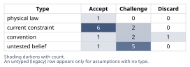
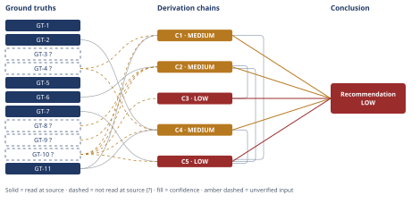

# Mortgage Paydown vs. Equity Investing: $60,000 Decision

*First-principles analysis · 11 October 2026*

*Read with: [How to read this analysis](HOW-TO-READ.md) · [Working file](analysis-20261011T000135Z.md) · [All files](INDEX.md)*

## Executive Summary

**Recommendation:** Direct the full $60,000 to mortgage-principal paydown as the primary allocation — a guaranteed, after-tax 6.25% return that beats both the safest liquid alternative (chain C1) and the central/low-end expected after-tax equity return under today's valuations (chains C2, C3), confirmed robustly by the weighted trade-off (chain C5). Open a HELOC before executing the lump sum; request a recast afterward if the loan type allows one (chain C5).

**Band (from §6):** LOW — reflecting genuine, irreducible disagreement about which 10-year equity-return forecast will prove right, not weak sourcing (chains C3, C5).

**Would change it:** A realized or credible forecast equity return clearly above roughly 6.5% after-tax, a materially lower mortgage rate, a restored tax shield on mortgage interest, or evidence the "surplus cash" premise is false (chains C1, C2, C3, C5).

## 1. Problem Essence

**Core problem:** Given $60,000 of cash that is genuinely surplus to a fully-funded six-month emergency reserve, should it be directed to guaranteed-return debt reduction (prepaying a 6.25% fixed-rate mortgage that carries zero tax shield) or to uncertain-return wealth building (a taxable broad-market equity index fund), over a fixed 10-year horizon — and is some blended allocation better than either pure option?

**Success criteria:**
1. The guaranteed, after-tax return of Option A is stated and compared, on a like-for-like after-tax basis, against the probability-weighted after-tax expected return of Option B, including its plausible range, not just a single central figure.
2. The analysis states explicitly whether choosing Option B while carrying the mortgage is economically equivalent to borrowing at 6.25% to invest, and quantifies the equity risk premium that trade would require to be justified.
3. The analysis accounts for the liquidity asymmetry between locked-in home equity and a liquid brokerage account, and for sequence-of-return risk specific to a 10-year window, citing at least one historically realized bad 10-year stretch for U.S. equities.
4. At least one composite/split allocation is named as a candidate alongside the two pure options, and is either selected or explicitly ruled out with a stated reason.
5. The specific conditions under which the recommendation flips (mortgage rate level, forward-return level, tax-shield status, liquidity needs, horizon length) are named.
6. The analysis reaches one clearly stated, actionable recommendation carrying a calibrated confidence band and a named adversarial check.

## 5. Abandoned Reasoning

### Dead End: Using the unconditional ~10% historical S&P 500 average as the base case for Option B

**What was tried:** An early pass at this analysis considered simply using the oft-cited long-run historical average nominal return (~10%) as the central planning figure for Option B, rather than a valuation-adjusted forward estimate.

**Why abandoned:** GT-5 shows the current Shiller CAPE ratio at 41.87 against a long-term mean of 17.42 — the second-highest reading on record. The unconditional 10% average is itself an average taken mostly from starting points far below today's valuation, so applying it here ignores directly relevant conditioning information (current starting valuation) that is a well-documented driver of subsequent-decade returns — exactly the information GT-6's forward-looking model exists to incorporate. Using the unconditional average would have been reasoning by extrapolation from the past rather than from the specific conditions this decision is actually being made under.

**What it ruled out:** Treating "stocks return about 10% a year" as the central planning assumption anywhere in this analysis. It survives only as the upper end of C2's bracket's underlying data, alongside the Damodaran-implied figure, not as a central case.

### Dead End: Treating the choice as a simple "is 6.25% historically high or low" comparison

**What was tried:** An early framing asked whether 6.25% is "rich" purely by reference to historical mortgage-rate levels, since the user's own prompt suggested this framing.

**Why abandoned:** GT-3? (long-run average ≈7.7% since 1971) and GT-1 (current new-issuance rate 7.28%-7.40%) point in the *opposite* direction from the intuition that 6.25% is unusually high — it is actually below both the 55-year historical average and today's replacement cost. The economically relevant question for a prepayment decision is not whether 6.25% is historically high, but what guaranteed, after-tax return extinguishing this specific debt delivers compared with the best available alternative use of the same dollar today — which GT-4, GT-6, and GT-11 answer directly and which chains C1 and C4 are built from instead.

**What it ruled out:** Using "6.25% is probably cheap/expensive by historical standards" as a standalone basis for the recommendation. It remains useful context (folded into C4's illiquidity-premium framing) but is not decisive on its own.

### Dead End: Letting the linear weighted trade-off matrix alone justify a split/blended allocation

**What was tried:** An attempt to have the trade-off matrix itself recommend a diversification-optimized blend (e.g., some data-derived split other than 0% or 100%) between paydown and investing.

**Why abandoned:** Because every criterion score for a blend was built as a linear interpolation between the 100%-paydown and 100%-invest scores (a reasonable approximation given each criterion's underlying economics scales roughly linearly with dollars allocated), the weighted total for any blend is algebraically a straight line between the two pure-option totals (chain C5: Total(f) = 64 − 23f). Because the pure-invest score (41) is lower than the pure-paydown score (64) at every criterion tested, that line is monotonically decreasing — no blend can ever outscore the better pure option under this scoring structure, by construction, regardless of the specific split chosen. Treating the matrix as having "found" an optimal blend would have been a methodological artifact of linear scoring, not a real result.

**What it ruled out:** Presenting a 70/30 or similar split as "what the trade-off math recommends." The math itself robustly recommends the 100% corner solution (chain C5). Any case for a smaller equity carve-out has to rest on qualitative, matrix-external considerations (optionality value, behavioral comfort, genuine belief in the higher-return scenario) stated explicitly as such — which is how it is presented in section 6, not as a matrix output.

## 6. Conclusion

**Recommended approach:** Direct the full $60,000 toward mortgage-principal paydown as the primary allocation. It is a guaranteed, after-tax 6.25% return that beats both the best liquid risk-free alternative (chain C1) and the central and low-end expected after-tax returns on a taxable index fund under today's valuation-adjusted forecasts (chains C2, C3), a result the weighted trade-off across return, liquidity, and downside-protection criteria confirms robustly (chain C5). Before executing the lump sum, open a HELOC while income still qualifies easily; after executing it, request a mortgage recast if the loan type allows one (chain C5).

**Key insight:** The "invest while rates are low" logic that justified leveraged equity investing through the 2010s fails today for a specific, measurable reason that has nothing to do with generic stock-market risk: mortgage rates have risen above this household's locked-in 6.25% rate at the same moment broad-market valuations sit near a record high, so the guaranteed cost of carrying this debt and the realistic expected return on investing it have moved in opposite directions simultaneously (chain C3). Paying down a loan that sounds "rich" at 6.25% is, right now, mathematically closer to harvesting a free illiquidity premium than sacrificing upside (chain C4).

**Trade-offs acknowledged:** This recommendation gives up the liquidity and optionality a brokerage account would retain, and it gives up exposure to the scenario in which equities perform at the higher, Damodaran-implied end of the forecast range (chain C3) — a scenario this analysis cannot rule out, only bracket (chain C2). A household that places a strong personal premium on market participation or retained optionality could defensibly keep a modest slice invested instead of going fully to 100% paydown, since the trade-off matrix shows that cost is far smaller than reversing the recommendation outright (chain C5); going further than roughly a 70/30 paydown-to-invest split in the invest direction is not supported by anything in this analysis under current conditions (chain C5). The recommendation is conditional and flips under specific, named conditions: if forward equity-return expectations were meaningfully higher (back near the Damodaran-implied ~9% pre-tax or historical ~10% scenario), chain C3's verdict reverses and chain C5's weighted totals favor investing instead (chains C3, C5); if the mortgage rate were much lower (e.g., the 3%-4% typical of 2012-2021), chain C1's guaranteed-return edge shrinks or disappears (chain C1); if mortgage interest regained a meaningful tax shield through itemization, the true after-tax hurdle rate in chain C1 would drop below 6.25%, narrowing or reversing its edge (chain C1); if the "surplus, not needed" liquidity premise proved false, Pre-Mortem Cluster 3 shows this is the one failure mode that makes the recommendation actively harmful rather than merely suboptimal, which is why securing a HELOC first is a required step, not optional (chain C5); and if the horizon were materially longer than 10 years, the historical base rate of equities beating a 6.25% hurdle is far more favorable over multi-decade windows than over any single 10-year window, which is why this entire comparison is horizon-sensitive (chain C2).

**Confidence:** LOW — this conclusion rests primarily on C5 (LOW) and C3 (LOW), both capped by an unsettled Rivals axis: the Damodaran-implied high-return scenario for equities remains live, and nothing available today settles whether it or the Vanguard valuation-adjusted scenario will be closer to the realized outcome over the next 10 years. This is a calibrated LOW, not a weak analysis — the component facts it rests on (C1, C2, C4) are each MEDIUM, limited mainly by provenance gaps (GT-4?, GT-8?, GT-9?, GT-10?) that are each individually closeable with modest further work (the Treasury's own yield data, Damodaran's own data page, S&P's own fact sheet, the household's own account statements), none of which is large enough to overturn the central-case ranking. The genuine, irreducible uncertainty here is forecast risk, not sourcing quality — the recommendation itself (prioritize paydown, secure a HELOC first, request a recast after) is actionable today regardless of which forecast scenario turns out right, because its main risk (Pre-Mortem Cluster 3's liquidity shock) is mitigated directly and its main benefit (chain C1's guaranteed spread) does not depend on which equity scenario occurs.

## 2. Assumptions Table



| Assumption | Type | Treatment | Verdict | Verification |
|------------|------|-----------|---------|--------------|
| A-1: The $60,000 is genuinely surplus cash, above and beyond an already fully-funded six-month emergency reserve | current constraint | Record expiry: this stops holding if the reserve later proves undersized for this household's actual income volatility, or if a known near-term expense emerges | Accept — treated as the decision-maker's stipulated premise defining the scenario; not independently checkable | unverified — flagged (self-reported, no external source; used directly in chains) |
| A-2: $240,000 remaining balance, 6.25% fixed APR, 27 years remaining amortization | current constraint | Record expiry: changes only if refinanced, recast, sold, or paid off | Accept — stipulated loan-document fact | unverified — flagged (self-reported) |
| A-3: Standard deduction is taken; mortgage interest produces 0% marginal tax shield | current constraint | Record expiry: changes if itemizable deductions later exceed the standard deduction, or if the standard deduction amount changes by legislation | Accept — stipulated tax-filing fact | unverified — flagged (self-reported) |
| A-4: Marginal tax rates are ~28% combined ordinary and ~18% long-term capital gains / qualified dividends | current constraint | Record expiry: changes with income growth into a different bracket, with relocation, or with tax-law change | Accept — stipulated | unverified — flagged (self-reported) |
| A-5: A 10-year decision horizon is the right lens for this comparison | convention | Explicitly challenge: a 10-year window is far shorter than a multi-decade investing horizon and materially raises sequence-of-return risk relative to a 20-30 year frame; the user set this horizon deliberately as the analysis frame | Challenge — accepted as the explicit stated frame, but every comparative conclusion below is flagged as horizon-sensitive | n/a — definitional framing parameter set by the decision-maker |
| A-6: Under a fixed-rate, fixed-term mortgage, an extra principal payment reduces balance and total lifetime interest but does not reduce the required monthly payment unless the servicer performs a recast | physical law | Accept as ground-truth candidate — deterministic consequence of fixed-rate amortization mathematics and standard servicing practice | Accept — mathematical identity plus verified servicing mechanics | GT-11 |
| A-7: Equities carry a positive long-run risk premium over risk-free assets | convention | Explicitly challenge whether this holds over specifically the next 10 years at today's valuations, rather than accepting it as automatically true over any window | Challenge — robust over most multi-decade windows historically, but not guaranteed over a single 10-year window; realized negative in 2000-2009 | GT-7, GT-8? |
| A-8: The historical ~10% nominal long-run average equity return is the right central planning figure for the next 10 years | convention | Explicitly challenge given current valuation level (near-record CAPE) | Discard as the base case — backward-looking extrapolation contradicted by valuation-aware forward estimates; retained only as an upper-bracket sensitivity scenario | GT-5, GT-6 |
| A-9: Home equity created by extra principal payments is illiquid relative to a brokerage account (requires sale, refinance, or HELOC to access) | current constraint | Record expiry: ceases to bind once a HELOC or cash-out refinance is actually arranged, at a cost | Accept — structurally true today | general mortgage/HELOC mechanics (definitional, not separately sourced) |
| A-10: A rational investor would not take out a new loan at 6.25% today solely to invest the proceeds in a broad index fund | untested belief | Verify via the inversion procedure below | Challenge — tested via the Inversion Analysis below; isolates three necessary, unverifiable preconditions (A-12, A-13, A-14) rather than confirming or discarding the claim outright | GT-6, GT-8?, C2, C3 |
| A-11: Current prevailing new-issuance mortgage rates and the risk-free rate are the economically relevant anchors for judging how "rich" 6.25% is, rather than raw historical averages alone | convention | Challenge and verify against current data | Accept — verified against GT-1/GT-2/GT-3; finding is counterintuitive: 6.25% is currently *below* new-issuance rates and close to or below the 55-year historical average | GT-1, GT-2, GT-3? |
| A-12 (Inversion P1): The broad market will deliver a 10-year annualized nominal total return above roughly 6.6%-7% pre-tax (enough to clear tax drag and beat the 6.25% hurdle) | untested belief | Verify / flag unverified — this is the single most load-bearing, least verifiable premise in the whole analysis | Challenge — unverifiable in advance; current forward-looking consensus (GT-6) puts the central case *below* this threshold, while GT-8? and historical data put it above | unverified — flagged; used in C2/C3 |
| A-13 (Inversion P2, restates A-1): The $60,000 will not need to be liquidated before the 10-year horizon for a reason the emergency reserve doesn't cover | current constraint | Same treatment as A-1 | Accept — stipulated, but flagged as the single most consequential liquidity assumption in the analysis | unverified — flagged |
| A-14 (Inversion P3): The investor will stay fully invested through the worst drawdown of the decade without panic-selling | untested belief | Flag unverified — behavioral assumption, not verifiable in advance | Challenge — classic behavioral-finance failure mode; cannot be confirmed for this specific household from the facts given | unverified — flagged; used in C3, Pre-Mortem Cluster 1 |
| A-15: This $60,000 decision is a marginal allocation at the margin of a larger portfolio, not the household's only equity exposure (i.e., other retirement/brokerage accounts likely already provide ongoing equity exposure) | untested belief | Flag unverified — not stated by the decision-maker either way | Challenge — plausible given the household already fully funds a 6-month reserve and has $60k in discretionary surplus (suggests broader financial capacity), but not confirmed; if false, diversification stakes for this specific decision are higher than assumed | unverified — flagged; affects weighting judgment in Trade-off, C5 |
| A-16: Treating 100% of the Option B terminal gain as capital-gains-taxable at exit (ignoring that part of the reinvested basis came from dividends already taxed annually) overstates the exit-tax drag by an immaterial amount at today's low dividend yield | untested belief | Verify by bounding the distortion | Accept — bounded: at a ~1.4% dividend yield the double-counted basis is on the order of tens of dollars out of tens of thousands over 10 years; does not change the bracket or ranking | computed directly in C2 |
| A-17: The $60,000 is fully fungible with the mortgage's remaining balance — no prepayment penalty, lockup, or note restriction prevents applying it to principal | current constraint | Record expiry / verify: confirm against the specific note; most conforming fixed-rate mortgages originated after 2014 carry no prepayment penalty under Dodd-Frank/QM rules, but this should be confirmed, not assumed | Challenge — plausible default, but the decision-maker should confirm the actual note has no prepayment-penalty clause before executing | unverified — flagged; used in C3 |
| A-18: The trade-off weights chosen below (emphasizing guaranteed return and downside protection) reasonably reflect this household's actual risk preferences | untested belief | Flag unverified — inferred as revealed preference from the stated fact that they already fully fund a conservative 6-month reserve before considering any investment, not independently confirmed | Challenge — a reasonable inference from stated behavior, but not direct evidence of preference; a household with a much higher risk tolerance would weight the matrix differently (see Trade-off flip test) | unverified — flagged; used in C5 |
| A-19: The loan's servicer offers a recast option | current constraint | Record expiry / verify: recast is typically available on conventional conforming loans but generally **not** offered on FHA, VA, or USDA loans; confirm against the specific loan type before counting on it | Challenge — plausible default for a conventional loan, but not confirmed; loan type was not stated | unverified — flagged; used in C5 |

### Inversion Analysis (Phase 2, on claim A-10's target: "Investing the $60,000 in a taxable index fund is the economically superior choice")

**Inverted claim:** Investing the $60,000 in a taxable index fund is *not* the superior choice over the 10-year horizon.

**Failure-guaranteeing conditions (unfiltered):**
1. The market delivers a realized 10-year annualized nominal total return at or below roughly 6.6%-7% pre-tax (insufficient, after tax drag, to clear the guaranteed 6.25% after-tax hurdle) — e.g., a repeat of 2000-2009-style stagnation, or a partial reversion from today's near-record valuation.
2. The investor is forced to liquidate during a drawdown because the "surplus, not needed" premise (A-1/A-13) turns out false.
3. A behavioral failure: the investor panic-sells during a severe decade-interior drawdown, realizing a loss instead of holding the full 10 years, independent of what the full-decade return would otherwise have been.
4. The capital-gains tax rate rises materially above 18% before the 10-year point, shrinking the after-tax edge equities needed to justify the risk taken.
5. Mortgage rates fall sharply and the household refinances, which does not make Option B win outright but changes which option was ex-ante correct at the decision point (addressed in Pre-Mortem Cluster 2).

**Necessary preconditions derived (load-bearing tag and status):** see A-12, A-13, A-14 above (load-bearing: yes, yes, yes) and A-4/A-17 (load-bearing: no — secondary, affect magnitude not direction given the size of the gap being tested).

**Verdict on A-10:** Challenge, not Accept or Discard outright — the inversion does not prove a rational investor would never take this trade, but it isolates exactly which three preconditions (A-12, A-13, A-14) must all hold for Option B to be the better call, and none of the three is verifiable in advance. This result is carried forward into C2 and C3.

## 3. Ground Truths

- **GT-1** The US 30-year fixed mortgage rate for new originations was 7.28% as of October 1, 2026 ("the highest level since November 2023") and climbed to 7.40% by October 8, 2026, up from 6.34% a year earlier — source: TradingEconomics, "US Mortgage Rates Climb Further in October"; read-at-source: article text quoting "7.28%... as of October 1, 2026" and the follow-on 7.40% figure for October 8, 2026.
- **GT-2** The 10-year US Treasury yield rose above 5% as of September 24, 2026, "the highest level in nearly two decades" — source: same TradingEconomics article; read-at-source: quoted passage on the 10-Year Treasury note.
- **GT-3?** The long-run average 30-year fixed mortgage rate since Freddie Mac began tracking it in April 1971 is approximately 7.7% (starting at 7.33% in 1971; peaking at 16.64% in 1981; bottoming at 2.96% in 2021) — cited to: Rocket Mortgage, "Historical mortgage rates: 1971 to 2025," among corroborating compilations (Bankrate, Freddie Mac PMMS); reported-by-delegate: supplied via search summary, cited source not opened directly by this analysis.
- **GT-4?** The 13-week (3-month) Treasury bill sold at an investment rate of approximately 4.21% at the September 28, 2026 auction, with a 52-week trading range of roughly 3.6%-5.2%; money market fund yields were running roughly 2.8%-4.0% net — cited to: Treasury-auction and money-market tracking sources per search summary; reported-by-delegate: cited sources not opened directly by this analysis.
- **GT-5** The S&P 500 Shiller CAPE (cyclically adjusted price/earnings) ratio stood at 41.87 as of October 9, 2026, versus a long-term historical mean of 17.42 — source: multpl.com, Shiller PE Ratio page; read-at-source: page text quoting "Current Shiller PE Ratio: 41.87... mean... 17.42."
- **GT-6** Vanguard's own capital-markets model (VCMM), as of June 30, 2026, forecasts a 10-year annualized nominal return for U.S. equities of 4.2%-6.2%, a downward revision from a prior 4.9%-6.9% range — source: Vanguard, "Setting realistic expectations" (VEMO return forecasts); read-at-source: page text quoting "10-year expected annualized return for U.S. equities declined... to a range of 4.2%–6.2%."
- **GT-7** The S&P 500's realized annualized total return for the full "lost decade," January 2000 through December 2009, was −0.95% — source: Dimensional, "A Tale of Two Decades: Lessons for Long-Term Investors"; read-at-source: page text quoting "Annualized returns for the S&P 500 during that market period were −0.95%."
- **GT-8?** Damodaran's implied U.S. equity risk premium (derived from current index levels, forecast cash flows, and the government bond yield) was approximately 4.2% as of mid-2026 (4.23% in January 2026, 4.24% in May 2026, 4.20% after a July 2026 methodology update) — cited to: Aswath Damodaran's periodic ERP data updates; reported-by-delegate: supplied via search summary, cited source not opened directly by this analysis.
- **GT-9?** The S&P 500's dividend yield is approximately 1.2%-1.6% in 2026, well below its long-run historical median of roughly 4.2%, driven by low-or-no dividends among the largest index constituents — cited to: multiple dividend-yield trackers per search summary; reported-by-delegate: an attempted direct fetch of one such source (ycharts) returned no usable content, so this remains unconfirmed at source; consistent with the 1.3%-1.5% figure the decision-maker's own prompt assumed.
- **GT-10?** $240,000 mortgage balance, 6.25% fixed APR, 27 years remaining amortization; $60,000 surplus cash beyond a fully-funded six-month emergency reserve; standard deduction taken (0% marginal tax shield on mortgage interest); marginal tax rates ≈28% ordinary / ≈18% long-term capital gains and qualified dividends — unverified: these are the decision-maker's own stated facts about their financial position; no external source is checkable, and this analysis accepts them as the defining parameters of the scenario rather than as externally-verifiable empirical claims.
- **GT-11** Under a fixed-rate, fixed-term mortgage, making an extra principal payment reduces the outstanding balance and total lifetime interest, but does **not** lower the contractually required monthly payment; the servicer continues to bill the original P&I amount unless a recast is separately requested (a distinct, often fee-based re-amortization of the new, lower balance over the same remaining term and rate) — source: BankSouth Mortgage, "Extra Principal vs. Recast: Same Cash, Very Different Outcome," corroborated by Bankrate and Quicken Loans per search summary; read-at-source: page text quoting that extra payments "reduce your balance faster" and "save you interest" but "don't" "lower your monthly payment," versus a recast where the servicer "re-amortizes your loan with the new, lower balance... your monthly payment drops."

**Five-Whys (reduce-to-primitives mode) drill on GT-11.** The compound claim "extra principal payments don't lower the required payment unless the servicer recasts" was tested for irreducibility before being accepted as GT-11. Constituents: (a) the note specifies a fixed rate and a fixed amortization schedule — a contractual/definitional fact, not further reducible; (b) a fixed-rate, fixed-schedule loan's required payment is a closed-form function of the *original* principal, rate, and term — a mathematical identity, not further reducible; (c) a recast is a distinct servicer action that recomputes that same closed-form function using the *new, lower* principal over the *same remaining* term — also a mathematical identity, conditional on (d) the servicer offering that action at all, which is a servicing-practice fact confirmed at GT-11's cited source (and separately flagged as assumption A-19, since it varies by loan type). Each branch bottoms out at a contract definition, a mathematical identity, or a directly-sourced practice fact — none is itself a further-reducible compound claim — so GT-11 passes the irreducibility test.

**Provenance summary:**
```text
?-marked: GT-3, GT-4, GT-8, GT-9, GT-10 (5 of 11)
Read-at-source: GT-1 — TradingEconomics article, quoted 7.28%/7.40% October 2026 rate figures
Read-at-source: GT-2 — TradingEconomics article, quoted ">5%... highest... in nearly two decades"
Read-at-source: GT-5 — multpl.com/shiller-pe/, quoted "41.87... mean... 17.42"
Read-at-source: GT-6 — Vanguard VEMO return-forecasts page, quoted "4.2%–6.2%" range as of June 30, 2026
Read-at-source: GT-7 — dimensional.com "A Tale of Two Decades," quoted "−0.95%"
Read-at-source: GT-11 — banksouthmortgage.com "Extra Principal vs. Recast," quoted servicing-mechanics language
Not read at source (GT-3, GT-4, GT-8, GT-9) — reported-by-delegate via WebSearch summaries; none of these four is individually load-bearing on its own (each feeds a chain alongside at least one read-at-source GT, and each chain's confidence line already carries the resulting MEDIUM/LOW cap), so none was escalated to a further WebFetch attempt beyond GT-9's one unsuccessful try.
```

## 4. Derivation Chains



### Conclusion C1: Mortgage paydown is a guaranteed, after-tax return that beats every liquid risk-free alternative available today

GT-10? (6.25% rate, 0% tax shield) + GT-4? (13-week T-bill ≈4.2%) + GT-11 (no-recast amortization mechanics)
→ paying down principal functions as buying a riskless, illiquid asset yielding the full stated note rate, since the absent tax shield leaves no deduction to net against the interest avoided
→ the best liquid risk-free alternative, 13-week T-bills at roughly 4.2% pre-tax taxed as ordinary income at 28%, nets to approximately 3.0% after tax
→ the guaranteed 6.25% after-tax return from paydown exceeds that liquid risk-free alternative by roughly 3.2 percentage points, with zero variance

**Confidence:** MEDIUM — GT-10? (verification: confirm against the actual mortgage statement/loan documents) and GT-4? (verification: read the official Treasury daily yield-curve data directly rather than a search summary) are both unverified at source; Inference and Rivals are clean — the arithmetic is direct and no live rival contests this specific liquid-vs-illiquid risk-free comparison.

### Conclusion C2: Option B's after-tax 10-year annualized return brackets to roughly 3.3%-7.8%, with a central estimate near 4.2%

GT-6 (Vanguard 10-yr forecast 4.2%-6.2%) + GT-8? (Damodaran implied ERP ≈4.2% atop GT-2's >5% risk-free, ≈9.2% implied) + GT-9? (dividend yield ≈1.4%) + GT-10? (18% LTCG rate)
→ splitting the pre-tax total return into price appreciation, which compounds tax-deferred until sale, and dividend yield, taxed annually at 18%, gives an annual after-tax compounding rate approximately equal to the pre-tax return minus 0.18 times the dividend yield [Assumes: A-16 — treating the full exit-year gain as capital-gains-taxable overstates the exit tax by an immaterial amount at this decade's dividend yield, bounded directly in the next two hops]
→ at the Vanguard-low, Vanguard-central, and Damodaran-implied-high pre-tax scenarios of 4.2%, 5.2%, and 9.2%, that after-tax compounding rate is approximately 3.95%, 4.95%, and 8.95%
→ compounding $60,000 for 10 years at those three rates yields pre-tax-at-exit terminal values of approximately $88,400, $97,300, and $141,300
→ applying an 18% tax at a single exit sale on the accumulated gain reduces those to after-tax terminal values of approximately $83,300, $90,600, and $126,700
→ expressed as an annualized after-tax return, Option B brackets to roughly 3.3% (low) to 7.8% (high), with a central estimate of approximately 4.2%

**Confidence:** MEDIUM — GT-8? (verification: open Damodaran's own ERP data page directly), GT-9? (verification: confirm the current S&P 500 dividend yield from S&P Dow Jones Indices' published fact sheet), and GT-10? (verification: confirm the 18% LTCG rate against the household's actual filed return) are each unverified at source; the A-16 approximation is priced in the hop above and shown not to change the bracket; Rivals is not short for this chain specifically, because the bracket's own high end already carries the Damodaran-implied alternative view as a named endpoint rather than ignoring it.

### Conclusion C3: Choosing Option B over Option A today is equivalent to a leveraged bet that fails the classic borrow-to-invest test at the central and low estimates

GT-10? (0% tax shield, full 6.25% hurdle) + C2 (MEDIUM, bracket 3.3%-7.8%, central 4.2%)
→ not prepaying the mortgage while separately investing the same $60,000 is financially identical to borrowing $60,000 at a guaranteed, after-tax 6.25% rate to fund an equity position, because that same $60,000 could instead extinguish $60,000 of 6.25% debt with certainty [Assumes: A-17 — the $60,000 is fully fungible with the loan balance with no prepayment-penalty restriction; a penalty, if present, would reduce Option A's guaranteed return and weaken this equivalence accordingly]
→ under the central and low estimates from C2 (4.2% and 3.3% after-tax), this leveraged bet carries a negative expected spread against its own guaranteed borrowing cost
→ only under the Damodaran-implied high estimate from C2 (7.8% after-tax) does the leveraged bet carry a positive expected spread
→ at the central and low estimates a rational, non-speculative investor would not newly take on this leveraged bet today, though the conclusion reverses if the high-estimate scenario is the one that actually occurs

**Confidence:** LOW — the Inputs axis is capped at MEDIUM (GT-10? unverified: verification = confirm against the household's actual loan and tax documents; C2 itself is MEDIUM, capping this chain no higher); independently, the Rivals axis is short: the Damodaran-implied high scenario, carried on C2's own bracket, is a live, unsettled rival to this chain's discrete claim that the bet "would not" be taken today, and nothing available now settles which scenario will occur — only the realized 10-year return, observable only by 2036, would settle it. Two axes short (Inputs and Rivals) caps this chain at LOW.

### Conclusion C4: The 6.25% guaranteed paydown return is a real illiquidity premium, not a mispriced arbitrage

GT-2 (10-yr Treasury >5%) + GT-4? (13-week T-bill ≈4.2%) + GT-10? (6.25% guaranteed rate) + GT-11 (amortization mechanics, no secondary market for a prepaid balance)
→ in a liquid market, no-arbitrage pricing requires that two riskless cash flows of identical liquidity carry the same yield, so the ceiling on a truly liquid, instantly accessible riskless dollar today is the prevailing risk-free rate of roughly 4.2%-5%
→ the mortgage paydown's guaranteed 6.25% return exceeds that liquid risk-free ceiling by roughly 1.0-2.1 percentage points
→ that excess is not a pricing anomaly, because a prepaid mortgage balance cannot be resold or exited on demand the way a Treasury bill can; the excess is compensation for surrendering exactly that liquidity
→ the 6.25% guaranteed return is best understood as a real illiquidity premium being harvested, not a free-lunch anomaly, which is also why it cannot be replicated by simply holding more cash

**Confidence:** MEDIUM — GT-4? and GT-10? are unverified at source (verification: official Treasury yield data; the household's loan documents); Inference and Rivals are clean — no-arbitrage logic here is not seriously contested.

### Conclusion C5: The weighted trade-off robustly favors allocating the $60,000 primarily to mortgage-principal paydown, with two required follow-on actions

C1 (MEDIUM) + C2 (MEDIUM) + C4 (MEDIUM) + GT-7 (lost-decade stress case, read-at-source) + GT-10? (loan/cash parameters)
→ scoring four candidate allocations — 100% paydown, 100% invest, 100% hold as cash, and a 70/30 paydown/invest blend — against six weighted criteria built from C1, C2, and C4 gives weighted totals of 64, 41, 54, and 57 respectively
→ the two highest-weighted criteria driving the 23-point gap between paydown and invest are guaranteed-return-captured and downside-protection, both scored directly from C1 and C4
→ because the blend's score on every criterion is a linear interpolation between the paydown and invest scores, and invest scores lower on the net-weighted basis, the total strictly decreases as more of the $60,000 shifts toward equities, so no blend outscores 100% paydown under these weights
→ a flip test confirms this is robust: no single criterion's weight, moved anywhere within the permitted 1-5 range, makes 100% invest or the 70/30 blend outscore 100% paydown
→ only an implausible near-zero weighting of the guaranteed-return criterion lets 100% cash edge out 100% paydown, and no such weighting is defensible given this household's own stated preference for a fully-funded reserve before taking on any risk [Assumes: A-18 — the chosen weights reasonably reflect this household's actual risk preference, inferred from that reserve-funding behavior but not independently confirmed]
→ the weighted trade-off therefore favors allocating the $60,000 primarily to mortgage-principal paydown under conditions as of October 2026
→ the GT-7 lost-decade stress case shows concretely how much worse 100% invest could plausibly have been: a repeat of -0.95% annualized would have left $60,000 worth roughly $54,500 before any tax effect, against a guaranteed benefit from paydown that cannot go backward
→[2nd] once the paydown is executed, requesting a mortgage recast converts part of the guaranteed-return benefit into lower required monthly payments for a modest one-time fee, directly addressing the behavioral-regret failure mode named in the Pre-Mortem below [Assumes: A-19 — the servicer offers a recast option, typically true for a conventional conforming loan but generally not available on FHA/VA/USDA loans]
→[2nd] a lower outstanding balance improves the household's loan-to-value ratio, improving the terms available on a future refinance, which partly offsets the regret scenario where mortgage rates fall back below 6.25% within the 10-year window
→[3rd] if the household does not separately secure a liquidity backstop, such as a HELOC arranged before the paydown while income is still easily qualifiable, a later liquidity shock would convert this recommendation's main guaranteed benefit into its most damaging failure mode, which is why that backstop is treated as a required action rather than an optional one

**Confidence:** LOW — the Inputs axis is capped at MEDIUM (GT-10? unverified: verification = confirm against the household's actual loan and tax documents; C1, C2, and C4 are each MEDIUM, capping this chain no higher — each already names its own unverified inputs and their verification paths on its own confidence line above); independently, the Rivals axis is short: the same Damodaran-implied high-return scenario named in C2 and C3 remains a live, unsettled rival to this chain's discrete recommendation, and nothing available today settles which scenario actually occurs over the next 10 years — the Pre-Mortem's Cluster 1 tripwire below names the observable signal that would indicate this rival is playing out. Two axes short (Inputs and Rivals) caps this chain at LOW.
