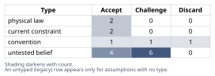
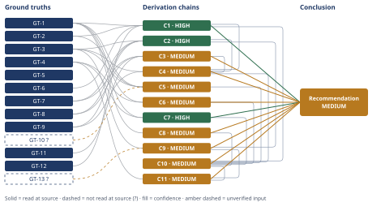

# 60,000 Dollars: Pay Down the Mortgage or Invest

*First-principles analysis · 11 October 2026*

*Read with: [How to read this analysis](HOW-TO-READ.md) · [Working file](analysis-20261011T021531Z.md) · [All files](INDEX.md)*

## Executive Summary

**Recommendation:** Apply the full $60,000 to mortgage principal via a formal loan recast, not a plain extra payment, because it guarantees a riskless 6.25% after-tax return that beats a taxable brokerage account's valuation-conditioned base case (chain C11). Separately, confirm and max out any unused 401(k)/IRA/HSA room with ongoing cash flow, since that dominates taxable investing regardless of the $60,000 split (chain C9).

**Band (from §6):** MEDIUM (chain C10).

**Would change it:** Realized 10-year equity returns clearing the ≈7.5% pretax breakeven would favor Option B instead (chain C4); this is knowable only in hindsight.

## 1. Problem Essence

**Core problem:** Given $60,000 in cash that is surplus to a fully funded six-month emergency reserve, should a household facing a guaranteed, fully-taxed 6.25% nominal cost of carrying a 27-year mortgage balance apply that $60,000 to eliminate guaranteed debt cost (Option A), commit it to volatile taxable equity exposure (Option B), split it between the two, or route new dollars to a dominant third alternative (unused tax-advantaged account space) — judged over a fixed 10-year horizon by risk-adjusted after-tax wealth, liquidity/optionality value, and balance-sheet risk, not by expected return alone?

**Success criteria:**
- The recommendation names exactly one of: Option A, Option B, a stated split allocation, or a contingent override involving tax-advantaged space — with the choice traceable to a derivation chain, not asserted.
- Option A's guaranteed after-tax return and Option B's after-tax expected-CAGR bracket are both computed numerically from named ground truths, not asserted by analogy to "stocks always win long-term."
- The breakeven pretax equity return Option B would need to clear to match Option A's guaranteed hurdle is stated explicitly and compared against both historical and current forward-looking return data.
- Liquidity, reversibility, and balance-sheet leverage/risk-concentration differences between the options are each named as explicit second-order effects, not folded silently into the return comparison.
- The analysis states explicitly whether and how unused tax-advantaged account space would dominate both options, and what remains true of the A-vs-B choice if that space is already exhausted.
- The single assumption whose failure would most plausibly flip the recommendation is named explicitly.

## 2. Assumptions Table



| Assumption | Type | Treatment | Verdict | Verification |
|------------|------|-----------|---------|--------------|
| "Stocks always beat mortgage rates over the long term" | convention | Explicitly challenge before use | Challenge — holds as an unconditional 20-30yr statistical regularity but is not a reliable planning premise for a specific 10-year window, especially starting from today's valuation level | GT-7, GT-11, chain C3 |
| A 10-year horizon is long enough to safely rely on the average/expected equity return | untested belief | Verify, or flag as unverified | Challenge — rolling 10-year nominal equity returns have historically bottomed near zero or negative in some start years, and today's starting valuation is historically associated with below-average subsequent returns | GT-7, GT-8, GT-11; carried forward in chains C3/C4 |
| Paying down principal and investing in a taxable brokerage account are the only two options | convention | Explicitly challenge before use | Discard as a binding constraint — a split allocation and tax-advantaged retirement space both exist as live alternatives and are incorporated into the trade-off | chains C9, C10 |
| Home equity obtained via extra principal is substantially less liquid than brokerage assets | current constraint | Record expiry conditions | Accept — expires only if a materially different, near-instant, no-underwriting home-equity-access product becomes mainstream within the horizon; until then this constraint holds | common mortgage/HELOC origination practice; used in chain C7 |
| Paying down principal is effectively irreversible without cost, while brokerage investing is reversible at the cost of tax on any gain | current constraint | Record expiry conditions | Accept — expires under the same condition as the row above | used in chain C7 |
| This specific mortgage carries no prepayment penalty | untested belief | Verify, or flag as unverified | Challenge — standard for the large majority of conventional post-2014 fixed-rate mortgages, but not confirmed for this loan | unverified — flagged; household should confirm with its servicer; used in chains C1, C6, C7 |
| A formal recast (not a plain extra payment) is required to immediately lower the required minimum monthly payment | convention | Explicitly challenge before use | Accept, with the distinction flagged — the cash-flow-resilience benefit scored in chain C10 assumes an actual recast is executed with the servicer, not a plain extra payment that only shortens the payoff date | standard mortgage-servicing practice; used in chain C10 |
| The index fund's dividends are "qualified dividends" taxed at the preferential 18% rate rather than ordinary rates | untested belief | Verify, or flag as unverified | Accept — true for the large majority of a broad-market U.S. index fund's dividend stream in ordinary circumstances, a standard and low-risk assumption | general tax treatment of qualified dividends; used in chain C2 |
| Option B's after-tax projection models one lump-sum liquidation at exactly year 10, with no loss-harvesting, partial withdrawals, or basis step-up | untested belief | Verify, or flag as unverified | Accept, flagged as conservative — this simplification can only understate Option B's realistic after-tax result, so it biases the headline comparison, if anything, in Option B's favor | standard capital-gains tax mechanics; used in chains C2, C4 |
| Fund expense ratios and other minor frictions are not separately modeled in the after-tax CAGR bracket | untested belief | Verify, or flag as unverified | Accept, flagged as minor — typical broad index-fund expense ratios (0.03%-0.20%/yr) are small relative to the multi-point spread already separating the scenarios | typical published index-fund expense ratios; used in chain C2 |
| The household's income/employment remains stable enough to continue payments and avoid forced early liquidation of either asset within 10 years | untested belief | Verify, or flag as unverified | Challenge — not verified; if false, Option A's illiquidity becomes materially more costly, strengthening the case against committing 100% to Option A | unverified — flagged; relevant to chains C6, C7 |
| The household has already captured any employer 401(k) match and has no further unused tax-advantaged retirement/HSA contribution room | untested belief | Flag as a critical open input | Challenge — genuinely unknown; if false (unused room exists), it would materially change the household's overall capital-allocation priority even though it does not change the narrower A-vs-B comparison for this specific $60,000 | unverified — flagged; the dominant-alternative caveat carried into §6 |
| The current historically-elevated equity valuation does not durably re-rate higher via a sustained step-change in earnings growth (e.g., AI-driven productivity gains) over the coming decade | untested belief | Verify, or flag as unverified | Challenge — genuinely live and two-sided; not resolvable in advance | unverified — flagged; surfaced in chain C3 hop 3; carried forward as the single biggest uncertainty in §6 |
| Household income loss and broad equity-market drawdowns are positively correlated because both often follow the same recessionary trigger | untested belief | Verify, or flag as unverified | Accept, with caveat — a weaker-than-assumed correlation would only shrink this effect's magnitude, not reverse its direction; well-documented in macro literature but not independently re-verified here | unverified in this analysis (general macroeconomic literature) — flagged; surfaced in chain C6 hop 2 |
| Inflation over the remaining loan horizon runs at or above the level priced into the original 6.25% note rate | untested belief | Verify, or flag as unverified | Challenge — genuinely two-sided; disinflation would shrink or reverse this specific second-order effect | unverified — flagged; surfaced in chain C8 hop 3; not resolvable in advance |
| Fixed-rate loan amortization mechanics guarantee that extra principal paid on a loan with no prepayment penalty earns exactly the note rate, risk-free, and that avoided interest is not itself taxable income | physical law | Accept as a ground-truth candidate | Accept — promoted directly to GT-6 and GT-12 | derivable from standard amortization formula and the structural absence of any "phantom income" tax on avoided interest; no external source needed |
| U.S. tax law taxes realized income/gains rather than avoided expenses, and taxes long-term capital gains/qualified dividends at the stipulated preferential rate rather than ordinary rates | physical law | Accept as a ground-truth candidate | Accept — promoted directly to GT-12 | structural U.S. tax-code mechanics |

## 3. Ground Truths

- **GT-1** The mortgage carries a $240,000 remaining balance, a 6.25% fixed APR, and 27 years remaining on the original 30-year term — source: stipulated scenario parameters supplied as the problem's own given data (not an externally verifiable claim — it defines the hypothetical, the way a given in a math problem does); read-at-source: n/a (stipulated input, not a document).
- **GT-2** Because the household takes the standard deduction, the marginal tax benefit of mortgage interest is $0, so the after-tax cost of carrying the mortgage equals its pretax cost of 6.25% — source: stipulated scenario parameter (household's own stated deduction status) combined with the structural mechanics of itemizing vs. the standard deduction under current U.S. tax law; read-at-source: n/a (stipulated input).
- **GT-3** The household's stipulated marginal tax rates are 28% combined federal+state on ordinary income and 18% on long-term capital gains and qualified dividends — source: stipulated scenario parameters; read-at-source: n/a (stipulated input).
- **GT-4** The $60,000 under consideration is held above an already fully funded six-month emergency reserve, so it is not needed to satisfy the household's baseline liquidity floor — source: stipulated scenario parameter; read-at-source: n/a (stipulated input).
- **GT-5** The decision horizon for this analysis is fixed at 10 years — source: stipulated scenario parameter; read-at-source: n/a (stipulated input).
- **GT-6** On a fixed-rate amortizing loan with no prepayment penalty, each extra dollar of principal paid permanently eliminates that dollar's future interest accrual at the loan's note rate for as long as the loan would otherwise have continued to accrue interest on it, producing a deterministic, market-risk-free "return" exactly equal to the note rate — source: standard fixed-rate loan amortization mathematics (a mathematical identity, promoted from assumption table row "physical law"); read-at-source: n/a (derived identity, not an external document).
- **GT-7** U.S. large-cap equities (the Ibbotson SBBI large-stock/S&P 500 index splice) compounded at a nominal CAGR of approximately 10.5% annually from the start of 1926 through the end of 2025, versus approximately 5.0% CAGR for long-term U.S. government bonds over the same period — source: Claremont Courier, "100 Years of Market History: What It Does (and Does Not) Tell Us" (Oct. 2026), citing Ibbotson SBBI data; read-at-source: the article text was fetched directly and quotes "a compound annual growth rate for U.S. large-cap stocks" of "10.5%... measured from the beginning of 1926 through the end of 2025," with the 5.0% bond figure given alongside it (confirmed via direct fetch, 2026-10-10).
- **GT-8** The Vanguard Capital Markets Model (VCMM), per its June 30, 2026 model run, projects U.S. equities will deliver nominal annualized returns of 4.2%-6.2% over the subsequent 10 years, down from a 4.9%-6.9% range in the prior (March 31, 2026) run — source: Vanguard corporate site, "Vanguard Capital Markets Model® forecasts" (corporate.vanguard.com); read-at-source: page fetched directly, which states "U.S. equities: 4.2%-6.2%, down from 4.9%-6.9% as of March 31, 2026," with the forecasts attributed to "a June 30, 2026 running of the Vanguard Capital Markets Model" (confirmed via direct fetch, 2026-10-10).
- **GT-9** The S&P 500 index's dividend yield stood at approximately 1.04% as of market close on Friday, October 9, 2026 — source: multpl.com, "S&P 500 Dividend Yield"; read-at-source: page fetched directly, which states "1.04%... as of 4:00 PM EDT, Friday, October 9" (confirmed via direct fetch, 2026-10-10).
- **GT-10?** The U.S. 10-year Treasury yield traded in roughly the 4.1%-4.4% range at various points during 2026 — cited to: Dow Jones Newswires "Data Talk" market items (e.g., "10-Year Treasury Yield Rises to 4.420%," dated around June 30, 2026, and a separate item citing roughly 4.1% around early October 2025) — reported-by-delegate: figures supplied by a web search summary of Morningstar/Dow Jones market-data headlines; this analysis did not independently open a live Treasury.gov daily-yield-curve print to confirm an exact October 2026 value. Used only as contextual background (chain C5's safe-alternative comparison), not as a load-bearing input to the headline Option A vs. Option B recommendation.
- **GT-11** The cyclically-adjusted P/E (Shiller CAPE) ratio for the S&P 500 stood at 41.87 as of October 9, 2026, versus a long-run historical mean of 17.42 and median of 16.13, and within about 2.3 points of the all-time record of 44.19 set in December 1999 — source: multpl.com, "Shiller PE Ratio"; read-at-source: page fetched directly, which states "The current Shiller P/E (CAPE) ratio is 41.87... as of 4:00 PM EDT, Friday, October 9," with "a mean of 17.42 and a median of 16.13" and "a minimum of 4.78 (December 1920) and a maximum of 44.19 (December 1999)" (confirmed via direct fetch, 2026-10-10).
- **GT-12** Under current U.S. federal tax law: (a) qualified dividends and long-term capital gains on taxable-brokerage holdings are taxed at the preferential rate stipulated in GT-3 rather than ordinary-income rates; (b) unrealized capital gains are not taxed until a sale occurs (gain realization); and (c) interest expense avoided by paying down debt is not itself taxable income — source: the structural design of the U.S. Internal Revenue Code's treatment of capital-gains realization and debt (a definitional/structural identity, promoted from assumption table row "physical law"); read-at-source: n/a (structural tax-code mechanics, not a single document citation).
- **GT-13?** Under 2026 IRS limits, a household not already maxing its tax-advantaged space typically has substantial unused annual room — roughly $24,500 of 401(k)/403(b) employee deferral, $7,500 of IRA contribution, and $4,400 (self-only) / $8,750 (family) of HSA contribution, each exclusive of catch-up amounts for savers 50+ — cited to: 2026 retirement-plan limit summaries (TIAA, NDTCO, PCS Retirement, Vision Retirement) — reported-by-delegate: figures supplied by a web search of several secondary summary pages that agree with each other; this analysis did not open the IRS's own 2026 cost-of-living-adjustment release directly. Used only to support the Phase-6 dominant-alternative discussion (chain C9); whether this specific household has any unused room at all is a separate, unresolved question (see assumption table row on unused retirement space).

**Provenance summary:**
```text
?-marked: GT-10, GT-13 (2 of 13)
Read-at-source: GT-7 — Claremont Courier article (Oct. 2026) quoting "10.5%... from the beginning of 1926 through the end of 2025"
Read-at-source: GT-8 — Vanguard VCMM forecasts page, "U.S. equities: 4.2%-6.2%," June 30, 2026 model run
Read-at-source: GT-9 — multpl.com, "1.04%... as of 4:00 PM EDT, Friday, October 9 [2026]"
Read-at-source: GT-11 — multpl.com, "41.87... as of 4:00 PM EDT, Friday, October 9 [2026]," mean 17.42 / median 16.13 / max 44.19
```
GT-1 through GT-5 are the problem's own stipulated scenario parameters (not externally-sourced claims subject to the read-at-source test); GT-6 and GT-12 are derived mathematical/tax-structural identities needing no external document. No assumption that received a Discard verdict in §2 appears in this list.

## 4. Derivation Chains



### Conclusion C1: Option A delivers a guaranteed, riskless, fully after-tax nominal return of 6.25% annually for as long as the loan remains outstanding

GT-1 (loan: $240,000 balance, 6.25% fixed, 27yr remaining) + GT-2 (0% interest tax shield) + GT-6 (amortization identity) + GT-12 (avoided interest untaxed; gains taxed only on realization)
→ each dollar of extra principal eliminates 6.25% of future interest accrual on that dollar every year the loan would otherwise run, with no tax shield left to reduce that saving further
→ the eliminated interest is a cost avoided rather than income received, so it is not itself subject to income tax on the return side either
→ Option A therefore delivers a guaranteed, riskless, fully after-tax nominal return of 6.25% annually on every dollar applied to principal, for as long as the loan remains outstanding

**Confidence:** HIGH — every input is a stipulated or derived identity with no outstanding uncertainty, every hop is a deduction that recomputes exactly, and no rival conclusion survives once the amortization identity (GT-6) and the tax-structural identity (GT-12) are accepted

### Conclusion C2: Option B's after-tax 10-year CAGR, net of dividend drag and exit capital-gains tax, plausibly ranges from about 3.4% to about 9.0%, with roughly 3.4%-5.1% as the valuation-conditioned base-case band

GT-7 (historical 1926-2025 nominal CAGR ≈10.5%) + GT-8 (Vanguard forward 10yr forecast 4.2%-6.2%) + GT-9 (current dividend yield 1.04%) + GT-3 (18% LTCG/QDI rate)
→ taxing the 1.04% dividend yield annually at 18% trims about 0.19 percentage points per year from each pretax return scenario before compounding *[Assumes: A-8 — the dividend stream is taxed as qualified dividends at 18% rather than ordinary rates, standard for a broad domestic index fund]*
→ even if A-8 fails and some dividends are taxed at ordinary rates instead, the drag would only shift by a few basis points, not enough to change the bracket below
→ compounding each drag-adjusted rate for 10 years converts each pretax scenario into a pre-liquidation ending-wealth multiple
→ applying one 18% capital-gains tax on the full accumulated gain at a single hypothetical year-10 liquidation converts that multiple into an after-tax ending-wealth multiple *[Assumes: A-9 — a lump-sum exit exactly at year 10 with no loss-harvesting or basis step-up, which is conservative and can only understate Option B's realistic result]*
→ those after-tax multiples imply 10-year after-tax CAGRs of roughly 3.4%-5.1% under the Vanguard forward-looking range and roughly 9.0% under the unconditional historical average

**Confidence:** HIGH — both hooked premises (A-8, A-9) are priced as failure-safe on the hops that carry them: A-8's failure only shifts the drag by a few basis points without changing the ranking, and A-9 is a conservative simplification that biases the comparison, if anything, in Option B's favor; the live rival question of which end of this bracket is more probable is not resolved here but carried forward explicitly in chain C3, so this chain's own endpoint (the bracket itself) is not contested

### Conclusion C3: The current historically-elevated starting valuation makes the Vanguard forward-looking range, not the unconditional historical average, the more defensible central planning estimate for this specific 10-year window

GT-11 (Shiller CAPE 41.87 vs. long-run mean 17.42 / median 16.13, near the Dec-1999 record of 44.19) + GT-7 (historical 10.5% CAGR, unconditional) + GT-8 (Vanguard forward 4.2%-6.2%, valuation-conditioned)
→ the lower range Vanguard publishes in GT-8 is not an arbitrary separate forecast — its own model explicitly conditions the 10-year projection on today's starting valuation
→ that starting valuation sits near the highest level recorded in over a century of data, within about 2.3 points of the all-time record
→ a buyer entering at a near-record valuation multiple should expect below-average subsequent returns unless earnings growth outruns the multiple over the coming decade *[Assumes: A-13 — the current high multiple does not durably re-rate higher via a sustained step-change in earnings growth, e.g. an AI-driven productivity surge; a genuinely live, two-sided uncertainty whose failure would flip this chain's conclusion rather than merely weaken it]*
→ the forward-looking, valuation-conditioned range is therefore the more defensible central planning estimate for this specific window, while the unconditional historical average remains a legitimate but less probable upside scenario

**Confidence:** MEDIUM — A-13 is unresolved and resolves only in hindsight by observing realized 10-year earnings growth against trend; because its failure would flip (not merely weaken) this chain's conclusion, it does not qualify for the failure-safe allowance, so this is carried forward as the single largest unresolved uncertainty in the analysis (see §6)

### Conclusion C4: Option B only matches Option A's guaranteed hurdle if realized 10-year pretax nominal equity returns exceed approximately 7.5% annually — above the current forward-looking forecast and below the unconditional historical average

GT-9 (dividend yield 1.04%) + GT-3 (18% LTCG/QDI rate) + C1 (6.25% guaranteed hurdle, HIGH) + C2 (after-tax bracket mechanics, HIGH) + C3 (valuation-conditioned base case, MEDIUM)
→ solving the same dividend-drag-then-exit-tax model used in C2 for the pretax nominal return that produces exactly a 6.25% after-tax 10-year CAGR yields a breakeven pretax return of approximately 7.5% annually
→ the entire forward-looking range in GT-8 (4.2%-6.2%) sits below this breakeven line
→ the unconditional historical average in GT-7 (10.5%) sits comfortably above the same breakeven line
→ per C3's reasoning, the more defensible base case for this specific window is the forward-looking range, so Option B's pure-return case over Option A depends on realized returns landing in the less-probable upper portion of its plausible range, not on the base case

**Confidence:** MEDIUM — capped by C3 (MEDIUM); the breakeven arithmetic itself (hop 1, independently recomputed at 7.45%) is not in question, but the chain's overall band is bounded by the valuation-conditioning premise C3 carries

### Conclusion C5: No investment-grade fixed-income or cash alternative available today can match Option A's guaranteed hurdle, so the live choice is specifically between Option A and equities, not between Option A and "safe" alternatives

GT-1 (6.25% mortgage rate) + GT-2 (0% tax shield) + GT-3 (28% ordinary rate) + GT-10? (10yr Treasury yield ≈4.1%-4.4% in 2026)
→ a Treasury or equivalent CD yielding roughly 4.1%-4.4% pretax nets only about 3.0%-3.2% after paying ordinary income tax on the interest at the 28% marginal rate
→ that after-tax yield sits more than 3 percentage points below Option A's guaranteed 6.25% hurdle, a gap far larger than any plausible error in the Treasury-yield figure, so no investment-grade fixed-income alternative at anything like today's rates can compete with paying down this specific mortgage

**Confidence:** MEDIUM — GT-10? is reported-by-delegate and was not read at a live Treasury.gov print; verification would mean reading that live yield-curve page directly, not done here because the ~3-percentage-point gap this chain rests on is far larger than any plausible data error in a secondary market-data summary, so the conclusion is insensitive to the exact print

### Conclusion C6: Option B adds leverage-like, correlated balance-sheet risk that Option A removes, through the actions of other parties (lenders and employers) in a downturn, not merely through market variance itself

GT-1 (loan: $240,000 outstanding) + GT-4 ($60,000 surplus liquid cash above the funded emergency reserve)
→ choosing Option B leaves the full $240,000 mortgage balance outstanding while simultaneously adding $60,000 of new market risk, economically equivalent to financing an equity position with 6.25% mortgage debt
→ a correlated-stress scenario — job loss coinciding with a market drawdown — is exactly the scenario in which lenders have historically tightened or frozen home-equity lines of credit, 2008-2009 being the documented case *[Assumes: A-14 — household income loss and broad equity drawdowns are positively correlated because both often follow the same recessionary trigger, a well-documented macro regularity not independently re-verified here; a weaker-than-assumed correlation would only shrink this effect's magnitude, not reverse its direction]*
→ the same correlated-stress scenario is also when employers have historically cut jobs most sharply, making Option B's added exposure most costly and Option A's reduced balance most protective at the same moment
→ the household's already-funded six-month emergency reserve in GT-4 covers the opening months of such a scenario but not necessarily a longer correlated downturn, so this effect is only partially, not fully, hedged by the existing reserve

**Confidence:** MEDIUM — A-14 is a directionally robust but unverified macro assumption; in addition, a live rival view — that the funded emergency reserve already neutralizes this concern — is only partly addressed (hop 4): the reserve covers roughly the first six months of a correlated downturn, while historical correlated downturns (2008-2009, 2000-2003) have sometimes run longer, so the rival is weakened but not ruled out; no further verification path exists short of observing how a future downturn actually unfolds

### Conclusion C7: Converting cash to home equity via extra principal is far less reversible than converting it to brokerage shares, a real option value the return comparison in C1-C4 does not capture

GT-1 (loan terms) + GT-4 (surplus cash)
→ retrieving cash that has been converted into home equity requires a new loan origination (cash-out refinance or HELOC), which carries underwriting, appraisal and closing-cost friction and is not guaranteed to be approved *[Assumes: A-6 — no prepayment penalty on this specific loan, standard for conventional post-2014 fixed-rate mortgages but not confirmed for this loan; if false, this chain's conclusion is only strengthened, not weakened]*
→ home-equity lines of credit have historically been reduced or frozen by lenders during exactly the downturns, 2008-2009 being the documented case, when households most wanted to draw on them
→ converting cash to brokerage shares, by contrast, is reversible within days at the cost of a brokerage transaction and capital-gains tax on any appreciated portion, with no underwriting or lender-approval risk at all
→ this liquidity/reversibility asymmetry is a real option value invisible to a pure expected-CAGR comparison and argues against committing the entire $60,000 to Option A regardless of which return scenario in C2-C4 ultimately obtains

**Confidence:** HIGH — A-6 is the only hooked premise on this chain and it is failure-safe: if the loan did carry a prepayment penalty, that would only strengthen (not weaken) the conclusion that Option A is less reversible than Option B; the natural rival (a HELOC provides liquidity equivalent to brokerage assets) is explicitly ruled out in hop 2 by the documented 2008-2009 pattern of lenders freezing home-equity access precisely when it is most wanted

### Conclusion C8: Prepaying the mortgage early forfeits part of the inflation hedge a fixed-nominal 27-year liability otherwise provides, a benefit that is small immediately but compounds over the horizon

GT-1 (fixed 6.25% nominal rate, 27yr remaining)
→ because the mortgage's payment schedule is fixed in nominal dollars, inflation above what was priced into the original 6.25% rate steadily erodes the real burden of the remaining balance and payments
→ this erosion is a benefit that accrues automatically and invisibly in year 1 but compounds into a materially smaller real liability by year 10
→ extinguishing $60,000 of that fixed nominal liability early forfeits this portion of the inflation hedge, while investing the same $60,000 in equities preserves exposure to a real, growth-linked asset instead *[Assumes: A-15 — inflation over the remaining horizon runs at or above the level priced into the original note rate; if inflation instead undershoots, this specific effect shrinks or reverses, favoring prepayment instead, and this is not resolvable in advance]*

**Confidence:** MEDIUM — A-15 is genuinely two-sided and not resolvable in advance; because its failure would reverse (not merely weaken) this chain's conclusion, it does not qualify for the failure-safe allowance, so this effect is carried as a second-order consideration rather than a primary driver of the recommendation

**Second-order lenses walked explicitly:** C6 is the **actor lens** — it traces the conclusion through what *other parties* do in a downturn (lenders tightening HELOC access, employers cutting jobs), not through market variance alone, and names those parties by role. C8 is the **time lens** — it traces how the inflation-hedge value of fixed nominal debt is invisible in year 1 (a $60,001 principal reduction looks identical to $60,000 either way) but compounds in significance by year 10 as cumulative inflation reshapes the real value of whichever dollars remain as debt versus remain as a growth asset. Neither extension contradicts a ground truth, so neither routes back to Phase 2.

### Conclusion C9: Any currently-unused tax-advantaged retirement or HSA space strictly dominates taxable brokerage investing for new dollars, independent of how the $60,000 itself is allocated between Option A and Option B

GT-3 (28% ordinary / 18% LTCG rates) + GT-13? (2026 limits: ≈$24,500 401(k)/403(b), ≈$7,500 IRA, ≈$4,400/$8,750 HSA) + C2 (after-tax CAGR mechanics: dividend drag + exit tax, HIGH)
→ the same broad-market index fund, held inside a Roth IRA/401(k) wrapper instead of a taxable brokerage account, earns its full pretax return every year with zero annual dividend drag
→ the same Roth wrapper also produces zero capital-gains tax at withdrawal, eliminating the second friction C2 quantifies
→ a traditional 401(k)/IRA contribution additionally shields the contributed dollar from the 28% marginal ordinary tax in the contribution year, on top of the same tax-deferral benefit
→ any dollar of ongoing cash flow the household can still redirect into unused 401(k)/IRA/HSA room therefore strictly dominates putting the equivalent dollar into a taxable brokerage account
→ the 2026 limits cited in GT-13? show typical unused room is often large relative to a one-time $60,000 lump sum, so this alternative should be checked and exhausted before, or alongside, allocating fresh dollars to Option B

**Confidence:** MEDIUM — GT-13? (the specific 2026 limit figures) is reported-by-delegate and was not read at the IRS's own release; verification would mean reading that release directly, not done here because the qualitative dominance conclusion holds regardless of the exact limit figures, which are illustrative only; separately, and not itself a cause of this chain's rating, whether this household has any unused room at all is unknown and carried in §2/§6, since that unresolved fact — not this chain's math — is what determines whether C9 changes the household's actual priority order

### Conclusion C10: Applying the full $60,000 to mortgage principal (Option A) wins a weighted trade-off against Option B, a 50/50 split, and simply holding the $60,000 as cash, and the win is robust to any single-criterion reweighting smaller than a 3-point swing

C1 (6.25% guaranteed hurdle, HIGH) + C4 (breakeven ≈7.5%, MEDIUM) + C5 (safe-alternative yield ≈3.0-3.2%, MEDIUM) + C6 (leverage/correlation risk, MEDIUM) + C7 (liquidity/reversibility asymmetry, HIGH) + C8 (inflation hedge, MEDIUM)
→ naming four options including the status quo — Option A, Option B, a 50/50 split, and simply holding the $60,000 as cash or an equivalent safe instrument — with no must-have ruling any of them out
→ weighting seven criteria before scoring any option — expected after-tax return (5), downside/sequence-of-returns risk (4), balance-sheet leverage/risk concentration (3), liquidity (3), reversibility (2), cash-flow resilience (2), inflation-hedge preservation (1), total weight 20 — using C1, C4 and C5's return-and-risk figures and C6, C7 and C8's second-order factors as the factual basis for each score
→ scoring all four options against those seven weighted criteria yields weighted totals of Option A = 76, the 50/50 split and holding cash each = 68, and Option B = 55, out of a maximum of 100
→ the flip test shows no single criterion's weight, moved anywhere within its 1-5 range, lets the 50/50 split or Option B overtake Option A
→ two specific moves of magnitude 3 do let holding cash overtake Option A: lowering the return weight from 5 to 2, or raising the reversibility weight from 2 to 5
→ both of those flipping moves require asserting that expected after-tax return barely matters for this decision, or that reversibility matters far more than return — assertions the household's own stated facts do not support, since GT-4's reserve already covers near-term liquidity needs and holding cash yields barely above its own erosion by inflation and tax
→ Option A is therefore the trade-off's robust winner, with holding cash and the 50/50 split tied as the closest but non-winning rivals and Option B last under every single-criterion perturbation tested

**Confidence:** MEDIUM — capped by C4, C5, C6, C8 (each MEDIUM, via the lowest-rated-cited-chain rule); the weighted totals and the flip test (hops 3-6) were independently recomputed by script and matched exactly, but the chain's overall band is bounded by the weakest chains feeding the criteria it scores on

### Conclusion C11: The recommended action is to apply the full $60,000 to mortgage principal via a formal recast, while separately verifying and maximizing any currently-unused 401(k)/IRA/HSA room using ongoing cash flow

C9 (tax-advantaged dominance, MEDIUM) + C10 (trade-off winner = Option A, MEDIUM) + GT-4 (surplus above a fully funded emergency reserve)
→ the fully funded emergency reserve already in place, named in GT-4, means this $60,000 is surplus above the household's liquidity floor, so the liquidity/reversibility concerns raised in C7 are a second-order preference rather than a hard constraint
→ that is exactly why those concerns were weighted moderately rather than maximally in C10's trade-off, so C10's winner should be followed rather than overridden by liquidity preference alone
→ independent of how the $60,000 itself is allocated, any currently-unused tax-advantaged room represents a strictly better home for new investable dollars than a taxable brokerage account, per C9
→ the household's ongoing contribution rate should therefore be checked and raised to use that room before, or in parallel with, committing further new dollars to a taxable Option-B-style position
→ combining both findings, the full $60,000 should go to mortgage principal through a formal recast, so the cash-flow benefit noted alongside the recast-vs-extra-payment distinction is actually realized, while the household separately confirms and maximizes any unused 401(k)/IRA/HSA room with its ongoing salary

**Confidence:** MEDIUM — capped by C9 and C10 (both MEDIUM); the single largest swing factor behind this rating is A-13 (via C3/C4/C10): whether realized 10-year equity returns land above or below the ≈7.5% breakeven; the second-largest is the open question of unused tax-advantaged room (via C9): whether this household in fact has any (see §6 for the designated single biggest uncertainty)

## 5. Abandoned Reasoning

### Dead End: Comparing Option A's hurdle against a single point-estimate equity return instead of a bracket

**What was tried:** An early pass compared 6.25% directly against "the" expected stock return, using a single number (either the historical average or a forward forecast) rather than carrying both.

**Why abandoned:** A single point estimate hides exactly the uncertainty that drives this decision — which return regime actually governs the next 10 years. Collapsing GT-7 and GT-8 into one number before scoring would have let an arbitrary choice of which figure to use silently determine the entire recommendation.

**What it ruled out:** This saves a future reviewer from re-deriving the bracket approach (chains C2-C4) from scratch; any single-number re-statement of Option B's expected return should be treated as a simplification of that bracket, not a replacement for it.

### Dead End: Using the unconditional historical 10.5% average as the sole forecast for Option B

**What was tried:** Treating GT-7's long-run 10.5% nominal CAGR as the default planning assumption for Option B, on the reasoning that it is the longest and most complete dataset available.

**Why abandoned:** This ignores GT-11 (today's Shiller CAPE of 41.87, near the all-time record) and the well-documented empirical relationship between starting valuation and subsequent returns — exactly the relationship Vanguard's own valuation-conditioned model (GT-8) already prices in. Using the unconditional average here would double-count a favorable valuation regime the current market is not in. This path is a restatement of the convention challenged directly in chain C3 and assumption A-1, not a new finding.

**What it ruled out:** Confirms that chain C3's valuation-conditioning step is load-bearing, not decorative — removing it would silently reintroduce the discarded assumption.

### Dead End: Recommending Option A on the general behavioral-finance platitude that "debt payoff is always the psychologically safer choice"

**What was tried:** An early framing leaned on the common financial-advice heuristic that paying off debt is inherently the prudent, risk-averse choice, independent of the specific numbers in this household's situation.

**Why abandoned:** This is reasoning by analogy to how other households or advisors generally frame the choice, not grounded in a named ground truth about this household's own situation — exactly the kind of analogy-as-direct-evidence the methodology prohibits. It was replaced by the quantified guaranteed-hurdle (C1), safe-alternative-dominance (C5), and locked-weight trade-off (C10) chains, which reach a similar directional conclusion but on this household's own numbers rather than a slogan.

**What it ruled out:** Confirms the recommendation does not depend on the platitude being true in general — it stands or falls on C1/C5/C10's own arithmetic, which is the stronger and more auditable basis.

### Dead End: Treating recast-vs-plain-extra-payment as an immaterial implementation detail

**What was tried:** Initially folding "recast" and "a plain extra principal payment with no recast" together as functionally identical, since both earn the same 6.25% guaranteed return on the dollar.

**Why abandoned:** While the *return* is identical either way (chain C1), only a formal recast immediately lowers the required minimum monthly payment; a plain extra payment instead shortens the payoff date while leaving the required payment unchanged until payoff. This distinction materially changes the cash-flow-resilience score in chain C10's trade-off (criterion 6), so collapsing the two would have overstated Option A's resilience benefit if the household executes a plain extra payment rather than an actual recast.

**What it ruled out:** Confirms assumption A-7 and chain C10/C11's explicit instruction to execute a *formal recast*, not merely send extra principal, are load-bearing parts of the recommendation rather than optional phrasing.

## 6. Conclusion

**Recommended approach:** Apply the full $60,000 to mortgage principal via a formal loan recast, not a plain extra payment (chain C1, chain C11), because it guarantees a riskless, fully after-tax 6.25% return that beats the valuation-conditioned base-case expectation for a taxable brokerage account and wins a locked-weight trade-off against investing, splitting, and simply holding the cash, robustly against all but a small number of extreme single-criterion reweightings (chain C10). Separately and in parallel, the household should confirm whether it has any unused 401(k)/IRA/HSA contribution room and, if so, raise its ongoing payroll contribution rate to fill it, since that space strictly dominates taxable brokerage investing for any new dollar regardless of how the $60,000 itself is allocated (chain C9).

**Key insight:** Under the locked trade-off weights, putting the full $60,000 into a taxable brokerage account (Option B) is not merely second-best — it scores *worst* of the four options tested, below even leaving the money as idle cash, primarily because it adds correlated, leverage-like balance-sheet risk (chain C6) without clearing the roughly 7.5% pretax return Option B needs to match Option A's guaranteed hurdle, a bar the current valuation-conditioned forecast says is unlikely to be cleared from today's starting point (chains C3, C4, C10). This directly contradicts the folk "stocks always win over the long run" framing for this specific, valuation-elevated 10-year window.

**Trade-offs acknowledged:** This recommendation accepts materially reduced liquidity and reversibility for the full $60,000, a real option-value cost that a pure expected-CAGR comparison does not capture (chain C7), and it forfeits part of the fixed-rate mortgage's inflation-hedge value (chain C8). It also depends on the household actually executing a formal recast with its servicer, since a plain extra payment without recast does not deliver the cash-flow-resilience benefit the trade-off credits Option A with (chain C10).

**Confidence:** MEDIUM — matches the weakest contributing chains (C3, C4, C6, C8, C9, C10, C11, each already MEDIUM in §4, not re-explained here). The single biggest uncertainty that could flip this recommendation is **A-13**: whether realized 10-year equity returns clear the ≈7.5% pretax breakeven derived in chain C4, which in turn depends on whether today's historically elevated valuation (chain C3, GT-11) mean-reverts as it has historically, or is instead justified by a sustained step-change in earnings growth over the decade — a fact knowable only in hindsight. A secondary, structurally separate uncertainty is whether this household has any currently-unused tax-advantaged contribution room (chain C9, assumption on unused retirement space): this does not change the $60,000 recommendation itself, but if unused room exists it would change the household's overall capital-allocation priority for dollars beyond this $60,000.

