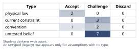
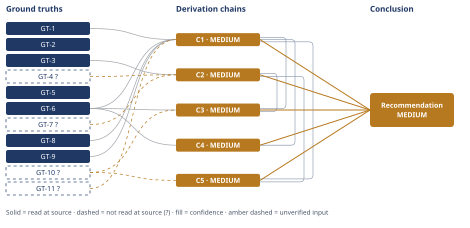

# Should You Take the SF Tech Offer

*First-principles analysis · 11 October 2026*

*Read with: [How to read this analysis](HOW-TO-READ.md) · [Working file](analysis-20261010T235904Z.md) · [All files](INDEX.md)*

## Executive Summary

**Recommendation:** Don't decide "accept" or "decline" on the terms as given. Request the SF offer's written base/equity breakdown, raise a market-rate counter-offer conversation with your current employer, and have an explicit, fully-informed conversation with your partner before committing to any form of the move (chain C5).

**Band (from §6):** MEDIUM

**Would change it:** Confirming your partner's actual Bay Area options and preference directly (chain C2), and obtaining your current total comp plus the offer's equity type/breakdown (chain C1) — the two inputs this analysis could not verify and that most determine the real answer.

## 1. Problem Essence

**Core problem:** Given that the two inputs most load-bearing on this decision — the real, cost-of-living-and-liquidity-adjusted financial delta, and the partner's actual (not assumed) range of career options and preference — are currently unverified, the question is not a binary "accept or decline" but which course of action (including negotiated or staged alternatives) maximizes the couple's joint long-term welfare once those inputs are properly resolved.

**Success criteria:**
1. The Conclusion names the specific unresolved inputs that are decision-determinative, rather than reasoning from the sticker numbers as given.
2. The Conclusion treats the partner's career and preference as a co-equal, independently-verified variable, not a secondary constraint inferred from the user's characterization alone.
3. The Conclusion provides a decision rule or sequenced plan usable once the missing inputs are gathered, not a guessed binary verdict.
4. The Conclusion states explicitly whether a negotiated/staged/composite option outperforms the pure "accept as offered" or "decline" options, rather than assuming the choice is between only those two.
5. The Conclusion names the most likely way each live path (proceeding vs. not proceeding) would look like a mistake in 18 months, and what observable signal would indicate it early.

## 2. Assumptions Table



| Assumption | Type | Treatment | Verdict | Verification |
|------------|------|-----------|---------|--------------|
| **A-1.** The stated "$70K more" represents a real increase in household financial well-being as given. | untested belief | Verify via cost-of-living, tax, and equity-liquidity adjustment before use. | Challenge — the raw nominal figure is not usable as a decision input without adjustment. | unverified — flagged (feeds C1 via GT-11?) |
| **A-2.** The equity component of the offer is liquid (public-company RSUs) rather than illiquid private equity. | untested belief | Verify against the employer's written grant terms. | Challenge — breakdown and type are explicitly unspecified per GT-6. | unverified — flagged |
| **A-3.** The Bay Area's cost of living is substantially higher than Portland's. | convention | Challenge/verify rather than accept on reputation alone. | Accept — promoted to GT-1/GT-2 via a cost-of-living index read directly at source. | read-at-source: movenumbers.com comparison page |
| **A-4.** The 3-day/week in-office requirement necessarily means full relocation rather than a long commute, temporary housing, or a negotiated reduced cadence. | current constraint | Record expiry/negotiability conditions; do not treat as fixed. | Challenge — not necessarily fixed; the employer has not been asked about alternatives. | unverified — flagged |
| **A-5.** The partner has no viable path to an equivalent or better career in the Bay Area, and "cannot simply move" is a complete, final characterization. | untested belief | Verify directly with the partner and against the Bay Area labor market in the partner's specific field. | Challenge — the single highest-stakes assumption in this analysis; it is the user's secondhand characterization, not an independently confirmed fact. | unverified — flagged (feeds C2 via GT-7?) |
| **A-6.** The relationship would survive the partner sacrificing their career for this move. | untested belief | Verify via an explicit, informed conversation with the partner. | Challenge — cannot be verified by this analysis; must be resolved by the couple directly. | unverified — flagged |
| **A-7.** Relocating for this job is a one-way, effectively irreversible decision. | convention | Challenge; record the actual cost of reversal rather than assuming it is infinite. | Challenge — reversible at a cost (moving expenses, lease terms, possible relocation clawback), not structurally irreversible. | unverified — flagged as to this specific offer's clawback/trial terms (feeds GT-10?) |
| **A-8.** Declining the offer leaves the current employer's trajectory and comp unchanged, i.e., no counter-offer is available. | untested belief | Verify by actually raising the external offer with the current employer. | Challenge — untested and directly actionable. | unverified — flagged |
| **A-9.** The "large SF tech company" brand name meaningfully improves the user's long-term career optionality relative to staying. | convention | Challenge against the specific company and the user's specific goals. | Challenge — plausible but unquantified; no company-specific evidence was supplied. | unverified — flagged |
| **A-10.** This is correctly modeled as primarily a compensation decision, i.e., money is the true crux. | untested belief | Run the counterfactual test: would the offer still be attractive at comp parity with full remote status at the current employer? | Challenge — may be a proxy for growth, prestige, or dissatisfaction with the current role. | unverified — flagged |
| **A-11.** The couple has already incorporated the partner's preferences into evaluating this offer. | current constraint | Record expiry — resolved as soon as an explicit, fully-informed conversation occurs. | Challenge — explicitly not yet established per the situation as given. | unverified — flagged |
| **A-12.** A nominal compensation increase represents a real increase in financial well-being only once adjusted for cost-of-living and tax-regime differences between locations. | physical law | Accept as a ground-truth candidate (standard accounting identity). | Accept — promoted to GT-8. | definitional — standard real-income/purchasing-power accounting |
| **A-13.** Public-company RSUs are near-liquid at vest (sellable, taxed as ordinary income); private-company equity is illiquid until a liquidity event and carries valuation/dilution/forfeiture risk. | physical law | Accept as a ground-truth candidate (standard equity-instrument structure). | Accept — promoted to GT-9. | definitional — standard equity-compensation structure |
| **A-14.** The current employer's and the SF company's reactions to a negotiation/delay request follow typical, rational signaling patterns rather than atypical overreaction (e.g., immediate rescission or retaliatory treatment). | current constraint | Record expiry — some employers/managers are atypical; treat as a working assumption with a named tripwire, not a certainty. | Challenge — treated as the typical case; the pre-mortem's Cluster 1 tripwire is the mitigation if it proves false. | unverified — flagged |
| **A-15.** The user has not yet run the "would I still want this at comp parity plus remote status" counterfactual test against the current employer. | untested belief | Run the test explicitly and in writing before finalizing. | Challenge — directly actionable; distinguishes a compensation-driven crux from a growth/prestige-driven one. | unverified — flagged |

## 3. Ground Truths

- **GT-1** The cost-of-living index used by this analysis states that $150.0K of income in San Francisco carries equivalent purchasing power to $119.4K in Portland, OR — i.e., maintaining Portland-equivalent purchasing power in San Francisco requires roughly 1.256× the nominal income ($150.0K / $119.4K ≈ 1.256), and the same index states Portland is "34.0% less expensive" than San Francisco overall. — source: movenumbers.com, "San Francisco, CA vs Portland, OR" cost-of-living comparison; read-at-source: the page's "Overall Cost" and income-equivalency figures, quoted directly ("Overall Cost ↓ 34.0% Less expensive"; "$150.0K in your current city equals $119.4K in Portland, OR"). This is a published third-party aggregator index, not a government statistic (e.g., BLS regional price parities); treat the 1.256× figure as a reasonable estimate of the COL multiplier, not a precise measurement.
- **GT-2** Per the same index: median 1-bedroom rent is $2,950/month in San Francisco vs. $1,655/month in Portland; median home price is $1.25M in San Francisco vs. $535K in Portland. — source: movenumbers.com comparison page; read-at-source: quoted directly from the page's rent and home-price fields.
- **GT-3** Research on dual-career commuter couples (as summarized in a tertiary source) reports that commuter couples generally had more work-life satisfaction than dual-career couples living in a single residence (attributed to Bunker et al., 1992), but that commuting arrangements also carry disadvantages including loneliness, financial strain, and decreased marital satisfaction; partners who perceived their social circle viewed the commuting lifestyle as "the beginning of a divorce" experienced more stress (attributed to Jackson et al., 2000). — source: Wikipedia, "Dual-career commuter couples"; read-at-source: fetched directly, quotes checked against the article text. Note: this is a tertiary synthesis of the underlying 1992/2000 studies, not those studies themselves.
- **GT-4?** A broader search of the literature on dual-career relocation indicates that at least one partner often suffers career interruption, a decline in occupational status, or career relinquishment after a relocation, and that the most common reasons an accompanying-partner relocation fails are the accompanying partner's career concerns and difficulty adapting to the new environment. — cited to: Frontiers in Psychology (2023) and a Journal of Management & Organization article ("Snakes and ladders: relocation and the dual-career couple"); reported-by-delegate: supplied by a web-search synthesis; neither underlying journal article was opened directly by this analysis.
- **GT-5** The user has 5 years of tenure at their current employer, in a fully remote role, based in Portland, OR. — source: user's direct statement (self-report of their own verifiable employment facts).
- **GT-6** The new offer is $70K/year more in total compensation (base plus equity combined) than the user's current compensation; it requires relocating to the SF Bay Area and working in-office 3 days/week; the breakdown between base and equity, and the equity's type (public vs. private), has not yet been specified. — source: user's direct statement.
- **GT-7?** Per the user's characterization, the partner has an established, Portland-based career with "no remote option," i.e., cannot simply relocate their job. Whether this fully describes the partner's actual feasible option set (e.g., an equivalent or better Bay Area role in the partner's field, or a remote arrangement with a different employer) has not been independently examined, nor confirmed directly with the partner within the scope of this analysis. — source: user's direct statement; unverified: this is the user's secondhand characterization of the partner's situation, not a confirmed labor-market fact or a confirmed statement of the partner's own preference.
- **GT-8** A nominal compensation increase represents a real increase in financial well-being only to the extent it exceeds the cost-of-living and tax-regime adjustment required to maintain equivalent purchasing power between the two locations. — source: definitional (standard real-income / purchasing-power accounting identity); read-at-source: n/a — this is a definitional ground truth per the Phase 3 irreducibility test (bottoms out at a definition, not an external citation).
- **GT-9** Vested restricted stock units (RSUs) at a publicly-traded company are generally near-liquid (sellable on the open market, taxed as ordinary income at vest); equity in a privately-held company (RSUs or options) is generally illiquid until a liquidity event (IPO, acquisition, or tender offer) and carries additional valuation, dilution, and forfeiture risk. — source: definitional (standard equity-compensation instrument structure); read-at-source: n/a — definitional.
- **GT-10?** Relocation and employment decisions of this kind are generally reversible at a cost (moving expenses, lease terms, re-entering the prior job market) rather than structurally irreversible; however, many relocation packages include clawback clauses requiring repayment of relocation costs if the employee departs within a stated period (commonly 1–2 years), and this specific offer's trial period, probationary terms, and clawback terms (if any) have not been stated. — source: general labor-market/contract-practice knowledge; unverified: the specific terms of this offer are unknown and were not supplied.
- **GT-11?** The user's current total compensation in Portland (base plus any equity or bonus) has not been specified in this analysis, and is required to compute the real, cost-of-living-adjusted value of the new offer. — source: absence noted directly from the facts as given; unverified: not supplied.

**Provenance summary:**
```text
?-marked: GT-4, GT-7, GT-10, GT-11 (4 of 11)
Read-at-source: GT-1 — movenumbers.com comparison page, "Overall Cost" and income-equivalency fields, quoted verbatim
Read-at-source: GT-2 — movenumbers.com comparison page, median rent and home-price fields, quoted verbatim
Read-at-source: GT-3 — Wikipedia "Dual-career commuter couples" article, fetched directly, quotes checked
GT-5, GT-6 — user's direct statement (self-report of own situation; not externally sourced, not suffixed per Phase 3 treatment of decision-maker testimony about their own stated facts)
GT-8, GT-9 — definitional; no external source applicable
```

## 4. Derivation Chains



### Conclusion C1: The sticker "$70K more" cannot be treated as a real financial gain until cost-of-living, tax, and equity-liquidity adjustments are applied

GT-1 (SF requires ~1.256× Portland income for equal purchasing power, read at source) + GT-6 (offer: $70K more nominal, equity breakdown unspecified) + GT-8 (real-vs-nominal accounting identity) + GT-9 (public RSU liquidity vs private equity illiquidity, definitional) + GT-11? (user's current Portland total comp not specified)
→ applying GT-1's ~1.256× multiplier to any current Portland total comp X means the Bay Area offer must exceed X by roughly 25.6% in nominal terms just to preserve today's purchasing power, before any equity-liquidity discount from GT-9 is applied
→ solving for the break-even point shows the nominal $70K premium stops representing a real purchasing-power gain once X exceeds roughly $273K, since (X+70,000)/1.256 = X implies X ≈ 273,000, and the premium's realized value shrinks further still if a large share of it is illiquid private equity per GT-9 rather than liquid salary or public RSU
→ because GT-11? leaves X unknown and GT-6 leaves the equity split unknown, the real purchasing-power-adjusted value of this offer currently ranges from a plausible gain in the low tens of thousands of dollars to a plausible net loss, and cannot be signed with confidence until both inputs are supplied

**Confidence:** MEDIUM — GT-11? (current total comp unspecified) is unverified; naming the user's current Portland total compensation figure would remove it as a cause of this downgrade. The chain also depends on GT-6's unspecified equity breakdown, the same open item GT-9 bears on and not a separately-suffixed ground truth; obtaining the offer's written base/equity split and equity type from the employer would close this second source of range-width. No hop in this chain rests on a declared `[Assumes: X]` premise. The rival reading — comparing the raw $70K figure directly across locations without adjustment — is ruled out inline by this chain's first two hops via GT-1 and GT-8.

### Conclusion C2: The partner's actual career options and preference, not the financial math, are the single highest-leverage unresolved variable in this decision

GT-7? (partner's "no remote option" characterization, completeness unverified) + GT-3 (commuter-couple research: satisfaction and disadvantages) + GT-4? (relocation-failure research: accompanying-partner career concerns as the leading failure driver)
→ the finding in GT-4? that accompanying-partner career concerns are the most common reason this type of relocation fails converts the partner's situation from a constraint to be worked around into the primary risk variable for this specific decision
→ because GT-7?'s characterization of the partner's options has not been checked against what the Bay Area labor market actually offers in the partner's field, nor against the partner's own stated willingness, this analysis cannot currently distinguish "the partner genuinely has no viable path" from "the partner has not yet looked, or the couple has not yet had the full conversation" [Assumes: A-11 — the couple has not yet had an explicit, fully-informed conversation about this decision]
→ the finding in GT-3 that commuter couples report more work-life satisfaction than co-located dual-career couples, alongside real disadvantages of its own, shows a long-distance arrangement is a live third option with its own profile, not simply an inferior version of relocating together
→ the decision cannot be responsibly resolved until the partner's actual range of options and preference is established directly, because this input dominates the relationship-risk and feasible-option-set dimensions of the decision more than the financial math in C1 does

**Confidence:** MEDIUM — GT-7? (the partner's option set as characterized by the user) is unverified; a direct, informed conversation with the partner, and a brief check of the partner's field against Bay Area postings, would remove it as a cause of this downgrade. GT-4? is reported-by-delegate, since the underlying journal articles were not opened directly; opening the Frontiers in Psychology (2023) article and the Cambridge Journal of Management & Organization article directly, and confirming the quoted findings appear in them, would remove it as a cause. This chain's declared assumption, A-11, is priced: if the conversation has already happened, its actual outcome supersedes GT-7? as the operative input and this chain's conclusion is satisfied rather than contradicted. The rival reading — taking the partner's characterization at face value without further inquiry — is addressed in Section 5, Dead End 1.

### Conclusion C3: A sequenced, information-gathering path dominates both "accept as offered" and "decline outright" as stated

GT-6 (offer terms) + GT-10? (relocation reversible at a cost; this offer's specific terms unknown) + C1 (financial delta small and currently indeterminate) + C2 (partner's actual options are the dominant unresolved variable)
→ because C1 shows the real financial gain is small, uncertain in sign, and resolvable with two inputs the user can obtain before deciding, and C2 shows the single highest-risk variable is also unresolved, the expected value of a short delay to gather both inputs exceeds its cost, since GT-10?'s costly-not-free reversibility means avoiding an unnecessary reversal has real value
→ the offer as described is not the only negotiable form this opportunity can take: a delayed start date, a phased relocation with a reduced initial in-office cadence, or using the offer to prompt a counter-offer at the current employer are not foreclosed by anything in GT-6, so the realistic choice set is wider than "accept as offered" versus "decline entirely"
→ the dominant option is neither pure acceptance nor pure decline, but a sequenced path: gather the missing financial and partner-preference inputs, then negotiate a modified arrangement or an explicit counter-offer, before making an irreversible commitment either way
→[2nd] raising the SF offer with the current employer, and requesting a delay or modified terms from the SF company, changes how both employers perceive the user regardless of outcome: the current employer may read it as a retention signal and respond, or as a flight-risk signal and quietly deprioritize the user; the SF company may read a delay request as reasonable diligence, or as lukewarm interest and re-rank the user against other candidates [Assumes: A-14 — both employers react in a typical, rational way to a negotiation or delay request rather than atypically]
→[2nd] immediately, both employers' perceptions shift as above; within a few weeks, the current employer's actual counter-offer, or its absence, becomes a new and harder fact that replaces much of C1's uncertainty; once whichever arrangement is chosen has been in place for a year or more, accrued tenure and trajectory at the current employer, or brand-name and scope growth at the new one, becomes the dominant factor, outweighing today's point-in-time comp gap
→[3rd] if the partner was not given genuine agency in this decision per C2, resentment can compound over the following one to three years independent of whether the financial math in C1 turned out favorably — this is the single most severe, slowest-to-surface risk this analysis identifies

**Confidence:** MEDIUM — this chain cites C1 and C2, both MEDIUM, whose own confidence lines carry their respective downgrade causes and are not re-explained here. GT-10? (this offer's specific reversibility/clawback terms) is unverified; requesting the written offer letter's relocation and trial-period terms would remove it as a cause of this downgrade. The declared assumption A-14 (typical employer reaction) is priced: the adversarial pass's Cluster 1 (Section 5 / Appendix) names the observable signal that would indicate the atypical case and the plan change that follows from it. The rival reading — that deliberation itself is costly and a fast binary decision is better — is addressed by this chain's own second-order time-lens step and is ruled out quantitatively in C5, where the time-to-resolution criterion is priced into the trade-off and the composite option still wins.

### Conclusion C4: Before finalizing, the user should explicitly test whether compensation is the true crux or a proxy for a different need

GT-6 (offer: $70K more, requires relocation plus RTO) + C1 (financial delta small and currently indeterminate)
→ if, per C1, the cost-of-living-adjusted real financial delta is only modestly positive or possibly negative, then choosing to proceed anyway would reveal that factors other than pure compensation — growth, prestige, dissatisfaction with the current role's trajectory, or a desire for change — are doing the real work in this decision [Assumes: A-15 — the user has not yet run this counterfactual test against the current employer]
→ naming the true driver changes what evidence actually resolves the decision: a growth or change-seeking motive is tested by asking whether the offer would still be attractive if the current employer matched the comp and preserved remote status, while a pure compensation motive is tested by C1's arithmetic alone
→ the user should run this counterfactual explicitly and in writing before finalizing, because a recommendation based only on C1's sign would be correct on the math and still wrong for the person if the true driver is something money does not fix

**Confidence:** MEDIUM — this chain cites C1 (MEDIUM), whose own confidence line carries its downgrade causes and is not re-explained here. Its declared assumption A-15 is priced: if the user has already run this counterfactual test, its actual answer supersedes the open question this chain poses, and the chain's conclusion is satisfied — the test exists and was applied — rather than contradicted.

### Conclusion C5: The composite path — pursue a counter-offer, request the missing offer details, and have an explicit partner conversation before committing — outscores every pure option in a weighted trade-off

C1 (financial delta small and indeterminate) + C2 (partner's options are the dominant unresolved variable) + GT-10? (reversibility costly but not structurally prevented; this offer's specific terms unknown)
→ scoring five options — decline outright, accept as offered, negotiate a modified offer, pursue a counter-offer only, and the composite path — against six weighted criteria (joint welfare weight 5, real financial upside weight 3, reversibility weight 4, career trajectory weight 3, time-to-resolution weight 2, information quality weight 4) yields weighted totals of 48 for accept-as-offered, 78 for counter-offer-only, 79 for decline-outright, 79 for negotiate-a-modified-offer, and 89 for the composite path, with the composite path's margin driven by its clean scores on joint welfare, reversibility, and information quality — exactly the three axes C1, C2, and GT-10? identify as currently unresolved
→ a flip-test against both 79-point rivals finds no single criterion's weight, moved anywhere within the 1-to-5 scale, reverses the ranking; the closest attempt, dropping the financial-upside weight to its floor, still leaves the composite path ahead by 4 points, so this is a robust win rather than a near-tie
→ the recommended path is the composite option: request the SF offer's written base/equity breakdown and type, raise the offer with the current employer as a market-rate conversation, and have an explicit, fully-informed conversation with the partner, before deciding to accept, decline, or relocate in any form

**Confidence:** MEDIUM — this chain cites C1 and C2, both MEDIUM, whose own confidence lines carry their downgrade causes and are not re-explained here. GT-10? is unverified as to this specific offer's reversibility/trial terms; obtaining the written offer letter would remove it as a cause of this downgrade. The rival reading — accept the offer now, because large comp jumps at identifiable companies are rare and hesitation itself risks withdrawal or appearing indecisive — is the strongest rival to this chain's conclusion and is ruled out by the trade-off itself: "accept as offered now" scores lowest of all five options (48), and the flip-test shows the composite path's win is not sensitive to how heavily time-to-resolution is weighted.

## 5. Abandoned Reasoning

### Dead End: Trusting the partner's "no remote option" characterization at face value

**What was tried:** An early pass treated GT-7 (the partner's constraint) as a settled, fixed input and proceeded directly to comparing the financial math of relocating versus not.

**Why abandoned:** GT-4?'s research finding that accompanying-partner career concerns are the most common driver of relocation failure, combined with the fact that "no remote option" is the user's secondhand characterization rather than a verified fact about the Bay Area labor market in the partner's specific field, means treating it as settled would smuggle in exactly the assumption the user's own framing asked to have interrogated (A-5).

**What it ruled out:** Any conclusion that proceeds straight to a financial-only comparison without first resolving the partner's actual option set — which would have been the single most consequential blind spot in the analysis.

### Dead End: Treating this as a pure compensation-arbitrage decision

**What was tried:** Computing only the cost-of-living-adjusted financial delta (C1) and recommending acceptance or decline based on its sign alone.

**Why abandoned:** Per C4, a positive or negative financial delta does not resolve the decision if the true driver is growth, prestige, or dissatisfaction with the current role rather than money (A-10); ignoring this risk would have produced a recommendation that could be correct on the arithmetic and still wrong for the person.

**What it ruled out:** A conclusion driven solely by the sign of C1's bracket, with no counterfactual check on motivation.

### Dead End: Scoring only "accept as offered" and "decline outright" in the trade-off

**What was tried:** An initial, narrower version of the trade-off in C5 scored only options A (decline) and B (accept as offered).

**Why abandoned:** This reproduced exactly the binary-framing convention flagged in the Assumptions Table; once the negotiated and composite options (C, D, E) were added per C3's reasoning, the composite path scored 89 against decline's 79 and accept-as-offered's 48 — materially better than either side of the original binary, which the narrower framing would have missed entirely.

**What it ruled out:** Any conclusion of the form "accept" or "decline" stated without first checking whether a negotiated middle path scores higher — which, per C5, it does, robustly.

## 6. Conclusion

**Recommended approach:** Do not decide "accept" or "decline" on the terms as currently known. Pursue the composite path instead: request the SF offer's written base/equity breakdown and equity type, raise the external offer with the current employer as a market-rate/retention conversation (not a resignation threat), and have an explicit, fully-informed conversation with the partner in which anything short of genuine enthusiasm is treated as equivalent to "no" for planning purposes (chain C5, chain C3, chain C2).

**Key insight:** The two facts that make this decision look easy — a clean "$70K more," and a partner constraint stated as settled — are exactly the two facts this analysis could not verify, and both plausibly point the other way: the real, cost-of-living-adjusted gain could be small or negative above roughly $273K in current total comp or if the equity is illiquid (chain C1), and the partner's situation is the single most common reason this category of decision fails specifically because it looks settled when it has not actually been tested (chain C2).

**Trade-offs acknowledged:** The composite path is slower than deciding today, and it carries its own second-order risk of signaling ambivalence to the current employer or the SF company during the delay (chain C3); it also asks the user to tolerate a few weeks of ambiguity rather than resolving the question immediately (chain C5). These costs are priced into the trade-off's time-to-resolution criterion and the composite path still wins by a robust margin (chain C5).

**Confidence:** MEDIUM — every chain this conclusion rests on is MEDIUM, each capped by its own named GT-N? inputs (GT-11?, GT-7?, GT-4?, GT-10?) with the verification that would remove each as a cause of the downgrade already stated on that chain's own confidence line (chains C1, C2, C3, C5) and not re-explained here. The single highest-leverage action that would most raise this band is resolving GT-7? directly with the partner (chain C2) and GT-11?/GT-6's equity breakdown with the numbers in hand (chain C1); resolving both would let a future pass re-score C1 and C2 toward HIGH and, through them, raise C3, C4, and C5.
