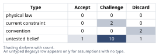
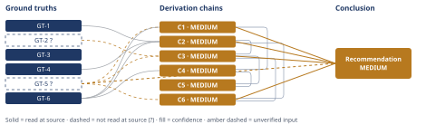

# Should You Accept the Bay Area Job Offer

*First-principles analysis · 11 October 2026*

*Read with: [How to read this analysis](HOW-TO-READ.md) · [Working file](analysis-20261011T022931Z.md) · [All files](INDEX.md)*

## Executive Summary

**Recommendation:** Don't treat this as a binary accept/decline yet. First spend 1-2 weeks jointly testing whether the offer's terms (timeline, in-office days) are negotiable and whether your partner's "no remote option" is truly exhausted, and replace the "$70K more" headline with real comp, equity, and cost-of-living numbers before choosing (chain C1, chain C2, chain C6).

**Band (from §6):** MEDIUM

**Would change it:** Confirming whether your partner's career immobility is actually exhaustive, getting the real base/equity/vesting and cost-of-living breakdown, and re-running the trade-off with your own (not illustrative) weights (chain C1, chain C2, chain C6).

## 1. Problem Essence

**Core problem:** Given competing objectives — the engineer's compensation and career trajectory, the partner's rooted and non-transferable career, shared location/lifestyle preference, and each person's risk tolerance — which course of action (accept the offer as given, decline it, or negotiate a modified arrangement) maximizes the couple's joint long-term wellbeing, under the large uncertainty in what is currently known?

**Success criteria:**
- Names which of accept / decline / negotiate-a-middle-path is favored by the facts given, and states explicitly what additional facts would flip that call.
- Treats the partner's career and the relationship as a primary variable in the objective function, not a side constraint bolted onto a compensation comparison.
- Tests whether "accept vs. decline" is the real choice set, or whether a negotiated/compromise option has been assumed away by the framing.
- Names the specific missing inputs that most change the recommendation, so the user (and partner) can resolve them directly rather than be given a false-precision verdict.

## 2. Assumptions Table

Assumption-space breadth was scanned with a fishbone pass across five categories: Financial, Relational/Partner, Career, Logistics/Location, and Informational (missing data). Each branch below is tagged with its category in brackets.

| Assumption | Type | Treatment | Verdict | Verification |
|------------|------|-----------|---------|--------------|
| A-1 [Financial]: The $70K/year figure represents a real, risk-adjusted net economic gain | untested belief | Verify or flag | Challenge — the figure is nominal/gross; cost-of-living and equity-vehicle risk are unpriced (chain C2) | unverified — flagged; GT-1 partially addresses COL but equity vehicle and partner income remain unknown |
| A-2 [Logistics/Location]: Accept vs. decline, on the terms given, is the only choice available | convention | Explicitly challenge | Discard — large-company hybrid offers are routinely negotiable on start date, in-office day count, and relocation timeline; treating the offer as fixed is a framing default, not a fact of this specific offer | unverified for this specific employer; general hiring-market pattern only |
| A-3 [Relational/Partner]: Partner's career is fully, exhaustively immobile (no remote, no transfer, no pivot, no equivalent Bay Area role) | untested belief | Verify | Challenge — this is the user's current characterization, not independently confirmed as exhaustive; carried forward as GT-5? | unverified — flagged; the couple jointly re-examining this is the verification path |
| A-4 [Logistics/Location]: In-office 3 days/week necessarily requires full household relocation to the Bay Area | untested belief | Verify | Challenge — a sustained long-distance commute or a temporary non-relocated arrangement is logistically possible, with its own quality-of-life costs, so "relocate" may not be strictly binary | unverified; depends on commute distance/mode not stated |
| A-5 [Financial]: The equity portion of the offer is reliably realizable, liquid value | current constraint | Record expiry conditions | Challenge — depends entirely on an unstated vehicle (public RSU vs. private options) and vesting; this expires into "verified" only once the offer letter's equity terms are read | unverified |
| A-6 [Career]: This specific offer is a one-time, non-repeating opportunity | untested belief | Verify | Challenge — a software engineer with 5 years' tenure is a repeatedly-recruited profile; this exact package may not recur, but comparable opportunities are not generally one-time in this labor market | unverified — base-rate judgment only (addressed in chain C4) |
| A-7 [Relational/Partner]: Compensation gap is the dominant variable in relationship/life satisfaction after a relocation decision | untested belief | Challenge | Discard as primary driver — GT-2? indicates partner occupational-status loss, not income delta, is the more commonly cited driver of dissatisfaction in this literature | GT-2? — read-at-source for what the cited paper states; its own upstream sources unopened |
| A-8 [Career]: Staying at the current employer (declining) is a risk-free status quo | current constraint | Record expiry conditions | Challenge — remote-work policy, team stability, and growth trajectory at the current employer can change independently of this decision; expires whenever the employer changes remote policy, has layoffs, or stalls growth | unverified — inherent to any employer's future |
| A-9 [Financial]: The Bay Area cost-of-living premium over Portland is large enough to materially erode the $70K gain | untested belief | Verify | Accept — corroborated by GT-1 (overall +51.5%, housing +107.7%) | read-at-source — movenumbers.com Portland-vs-San-Francisco comparison page |
| A-10 [Logistics/Location]: A long-distance commute 3 days/week is a sustainable middle path | untested belief | Verify or flag | Challenge — plausible only within a modest distance/mode; at flight-commute distances this is a known burnout vector | unverified; depends on actual distance/mode not stated |
| A-11 [Relational/Partner]: The partner's stated "no remote option" should be accepted as a fixed input the engineer optimizes around, rather than re-examined jointly | convention | Explicitly challenge | Discard — this is a joint decision; treating one partner's constraint as fixed while only the other's is optimized is an unexamined default, not a requirement | n/a — framing challenge, not an empirical claim |
| A-12 [Relational/Partner]: Both partners share the same risk tolerance and weighting of money vs. stability | untested belief | Flag | Challenge — not stated anywhere in the prompt and not inferable; no universal answer substitutes for the couple's own values | unverified — flagged; must be supplied directly by the couple (feeds chain C6's weights) |
| A-13 [Financial]: Household housing spend approximates the ~35-45% budget-share range used to size the cost-of-living erosion bracket in chain C2 | untested belief | Verify or flag | Challenge — a modeled anchor, not this household's actual budget | unverified — flagged; the user's real budget breakdown would close this |
| A-14 [Relational/Partner]: The illustrative criterion weights/scores used in the trade-off (chain C6) approximate the couple's actual priorities | untested belief | Verify or flag | Challenge — explicitly illustrative, supplied by this analysis absent the couple's real values | unverified — flagged; re-running chain C6 with the couple's own weights would close this |
| A-15 [Relational/Partner]: Designing in reversibility (trial period, lease not purchase, pre-agreed review point) measurably reduces the accept-path relational/financial failure modes identified in chain C3 | untested belief | Verify or flag | Challenge — plausible but not evidenced for this specific couple | unverified — flagged; no path other than trying it and observing |
| A-16 [Career]: Actively maintaining external market visibility (projects, network, portable skills) while remote measurably reduces decline-path regret | untested belief | Verify or flag | Challenge — plausible, consistent with general career-capital reasoning, but not evidenced specific to this user | unverified — flagged |

No assumption in this analysis qualifies as a **physical law** — nothing in a joint relationship/career/relocation choice is governed by an unchangeable physical or logical constraint, which is why the theoretical-limit companion technique is recorded as not applicable below rather than applied.

## 3. Ground Truths

A 5-Whys reduce-to-primitives pass was applied to the headline claim "$70K/year more": it decomposes into (a) the nominal offer delta, which is a directly-stated primitive (GT-4, below — not further reducible, it is simply what was offered), and (b) real/risk-adjusted purchasing power, which is NOT a primitive — it depends on cost-of-living, tax, and equity-liquidity factors that must themselves be reduced to constituent figures. That reduction is what chain C2 (Estimate technique) performs; it is reported there rather than re-derived here.

- **GT-1** San Francisco's overall cost of living is approximately 51.5% higher than Portland, OR (cost index 152 vs. 100), with housing the dominant driver (+107.7%: modeled two-bedroom rent $3,570/mo in SF vs. $1,900/mo in Portland; modeled total housing spend $9,771/mo vs. $4,704/mo); transportation +25.4%, groceries +8.4%, healthcare +6.5%, with utilities and "other" roughly flat to slightly lower in SF — source: movenumbers.com, Portland-OR-vs-San-Francisco-CA comparison (HUD-based cost modeling); read-at-source: category breakdown table and headline "+51.5%, cost index 152 vs. 100" figures, fetched and quoted directly. These are modeled/typical figures, not this household's actual chosen housing — labeled as an estimate, not a measured personal budget.
- **GT-2?** Published psychology literature (Frontiers in Psychology, 2023, dual-career-couples study) states, citing prior research, that "at least one of the partners often suffers career interruptions after relocation," frequently producing an "occupational penalty" more often borne by the female partner, and that a partner's unresolved career sacrifice is a commonly cited source of that partner's career dissatisfaction — source: Frontiers in Psychology 2023 (fpsyg.2023.1125136); read-at-source: the paper's own stated text was fetched and quoted directly, but that text is itself a literature-review summary of further upstream primary studies this analysis did not open, and the paper's own measured variables are career satisfaction and community embeddedness, not relationship/marital satisfaction directly — `?` retained for that reason.
- **GT-3** The user is a software engineer with 5 years' tenure at their current employer, based in Portland, OR, in a fully remote role — source: user-reported, first-person statement of their own circumstances; provenance: given (not subject to external source verification — this is the decision's defining context, not a contested factual claim).
- **GT-4** The new offer is from a large San Francisco Bay Area tech company, pays $70K/year more than current total compensation via a combination of base-salary increase and equity, and requires relocation to the Bay Area plus 3 days/week in-office (hybrid) — source: user-reported; provenance: given. The composition of the $70K (base vs. equity split, vesting schedule, equity vehicle — RSU vs. options, public vs. private company) was not specified; this gap is carried forward in GT-6.
- **GT-5?** The user characterizes their partner as having "an established, Portland-based career with no remote option," i.e., the partner cannot simply relocate and keep their job/career — source: user-reported; provenance: given, but classified `?` because its completeness is an untested belief (A-3): whether every avenue (internal transfer, leave, pivot, an equivalent Bay-Area-based employer in the same field) has actually been exhausted, versus assumed, is not established by the facts given.
- **GT-6** No information was supplied on: current total compensation, the specific equity vehicle/vesting/liquidity of the new offer, actual cost-of-living impact on this household's real budget, how replaceable the partner's career/role is, whether there are children or other family ties to Portland, either partner's risk tolerance or savings cushion, visa/immigration status, timeline pressure on the offer's decision deadline, or whether "relocate" could be satisfied by a nearby-but-not-SF-proper location — source: user-reported, explicit scope statement in the prompt; provenance: given.

**Provenance summary.** `?`-marked: GT-2, GT-5 (2 of 6). Read-at-source: GT-1 — movenumbers.com comparison-page category table and headline index figures, fetched and quoted directly; GT-2 — the Frontiers in Psychology (2023) article's own stated text, fetched and quoted directly (its *upstream* sources remain unopened, which is why the `?` is retained). GT-3, GT-4, GT-6 are user-reported first-person context, not external citations, and carry no provenance suffix for that reason.

## 4. Derivation Chains

### Conclusion C1: The accept/decline choice cannot be resolved responsibly from the facts given — it is contingent on a short, named list of facts

*Technique: Inversion.*

GT-5? (partner's stated immobility, completeness untested) + GT-6 (critical missing info enumerated)
→ the conditions that would make accepting obviously correct — partner finds an equivalent-or-better Bay Area opportunity or is enthusiastic to pivot, the equity is realizable, and the relationship already handles stress and change well — are neither confirmed nor denied by the facts given
→ the conditions that would make declining obviously correct — partner's career is truly irreplaceable and highly valued by both, the equity is illusory or high-risk, and Portland itself is a shared core value outweighing career upside — are likewise neither confirmed nor denied
→ because the facts needed to resolve either extreme are exactly the facts the user did not supply, the honest reading is that the decision is currently underdetermined and contingent on a short, specific, answerable list of facts rather than resolvable by a generic rule

**Confidence:** MEDIUM — GT-5? (partner's immobility, taken as a stated given but not independently stress-tested) is the input driving the downgrade; verification = the couple jointly re-examining whether the partner's "no remote option" is exhaustive (internal transfer, pivot, sabbatical, an equivalent Bay-Area employer) would resolve this. This chain frames the decision rather than naming a winner, so no rival conclusion competes with it directly; the rival question (does a third, negotiated option exist at all) is picked up by chain C6.

---

### Conclusion C2: The "$70K/year more" headline is not a reliable estimate of real household financial benefit, and the partner's income/career-transition outcome is the largest unknown driver of the true number

*Technique: Estimate (Fermi/dimensional bracket).*

GT-1 (SF cost-of-living +51.5% overall, housing +107.7%) + GT-4 (nominal $70K raise, composition unspecified) + GT-6 (partner's income/career outcome unstated)
→ applying GT-1's category breakdown, a household whose budget is materially housing-weighted absorbs a cost increase on that share alone that can consume a large fraction of the cash portion of a $70K raise before any equity is counted *[Assumes: A-13 — household housing spend approximates the ~35-45% budget-share range used to size this bracket; unconfirmed for this household]*
→ because the equity component's realizable value depends on an unstated vehicle (public RSU, near-cash, vs. private options, heavily risk-discounted) and unstated vesting, the personal (non-household) risk-and-COL-adjusted gain brackets roughly from near-zero or slightly negative (equity-heavy offer, high housing exposure) to roughly $30-40K/year (cash-heavy offer, moderate housing exposure) — materially below the $70K headline across most of this range
→ layering the partner's potential income change (entirely unstated, plausibly ranging from no loss to a loss comparable to or larger than the raise itself) means the household-level net financial effect cannot be signed from the facts given — a naive calculation that nets the raise against COL alone and stops there (ignoring the partner's income) is the obvious rival reading, and it is ruled out precisely because it omits a term this analysis has shown is plausibly the largest one

**Confidence:** MEDIUM — the Inference axis is short: the first hop rests on an unpriced anchor (A-13, household housing-budget share) rather than this household's real figures; verification = the user's actual budget breakdown, replacing the modeled anchor with real numbers. The Inputs axis is otherwise clean (GT-1 read-at-source, GT-4/GT-6 given directly), which is why the ceiling above is HIGH even though the chain's actual band is capped lower by the Inference shortfall.

---

### Conclusion C3: The dominant 2-years-later accept-path failure mode is relational — the partner's career/status loss compounding into resentment — not logistical, and it is mitigated by joint authorship of the decision and engineered reversibility, not by money

*Technique: Pre-mortem.*

GT-2? (occupational-penalty literature) + GT-5? (partner's stated immobility) + C2 (financial bracket, uncertain and possibly disappointing)
→ premise, stated as already having happened: two years after accepting, the arrangement has failed — concretely, serious relationship strain, with one or both partners expressing clear regret
→ per GT-2?, the base-rate-most-likely driver is the partner's own career or occupational-status loss compounding into dissatisfaction and resentment, especially where the partner experienced the move as decided around them rather than with them as a genuine co-author
→ a second plausible driver, per C2, is financial disappointment — the realized gain turned out near the low end of the bracket — compounding with high-cost-of-living lifestyle lock-in (lease terms, a new job search for the partner, new routines) that makes reversing course expensive
→ both drivers are mitigated by the same two actions: making the partner a genuine co-decider with a named path of their own rather than a passenger, and deliberately engineering reversibility — a lease rather than a purchase, a stated trial period, a pre-agreed review point — rather than treating the move as a one-way bet *[Assumes: A-15 — engineered reversibility measurably reduces these failure modes; plausible but unevidenced for this couple specifically]*

**Confidence:** MEDIUM — GT-2? is unverified beyond what the cited paper itself states (its own upstream primary sources were not independently opened by this analysis); verification = locating and reading the primary studies the Frontiers paper cites on occupational penalty. GT-5? carries forward from C1 with the same verification path (joint re-examination with the partner). The competing rival explanation — commute/relocation logistics fatigue as the dominant driver — is named and ruled out as secondary, since the cited literature emphasizes occupational-status loss over logistics as the recurring driver.

---

### Conclusion C4: Decline-path regret is real, distinct from accept-path regret, and is driven by perceived career stagnation rather than lost compensation — addressed by staying professionally active and marketable regardless of which choice is made now

*Technique: Pre-mortem.*

C1 (decision is contingent, not obvious) + GT-6 (missing info, including whether the opportunity is truly one-time)
→ premise, stated as already having happened: two years after declining, regret has set in
→ the likely driver is not the forgone cash itself but a felt cap on career trajectory or status, amplified if the current remote role stagnates, the current employer's trajectory sours, or peers visibly advance into roles and compensation bands the user no longer has straightforward access to
→ this driver is structurally different from C3's accept-path failure mode (status/trajectory anxiety vs. partner-relational strain) and is mitigated by a different lever: using current tenure to actively build portable, externally-visible market value — projects, network, skills — rather than treating "stable and remote" as a passive, self-sustaining position *[Assumes: A-16 — actively maintaining market visibility measurably reduces decline-path regret; plausible but unevidenced for this user specifically]*

**Confidence:** MEDIUM — C1 (MEDIUM) caps this chain; GT-6's "is this one-time" component has a verification path (the user directly researching whether comparable senior-engineer roles recur in this market), which is a judgment call this analysis cannot make on the user's behalf.

---

### Conclusion C5: Neither path is risk-free on optionality grounds — accepting concentrates its risk early and pays off late; declining defers its risk and forgoes an optionality upside that gets harder to recover the longer it is deferred

*Technique: Second-order thinking (actor lens + time lens).*

C3 (accept-path dominant failure + mitigations) + C4 (decline-path dominant failure + mitigation)
→ actor lens: neither the hiring company's incentives nor competing employers' appetite to hire this skill profile change based on this one decision — the company secures its hire either way and rival employers keep recruiting regardless — so the opportunity is probably less uniquely perishable than "now or never" framing implies, while the partner's employer and professional network in Portland are the actors most directly and irreversibly affected by relocation timing
→ time lens: immediate costs (relocation logistics, the partner's job search, adjustment friction) concentrate in roughly the first 6-18 months regardless of outcome; the medium term (1-3 years) is where C3's and C4's failure modes actually resolve one way or the other; the long term (5-10 years) is asymmetric — Bay Area big-tech tenure plausibly raises the user's external network and career ceiling beyond what stays reachable from a single remote employer, while delaying any move keeps compounding the partner's Portland-career head start
→ synthesis: accepting trades a concentrated near-term relational and financial risk window for long-term career-network optionality; declining trades continued near-term stability for growing reliance on the current employer's trajectory remaining favorable, and for a widening gap in market exposure that gets harder to close the longer it is deferred

**Confidence:** MEDIUM — inherits C3/C4's cap; no new unverified input is introduced here. No ground truth is contradicted by this extension, so no return to Phase 2 is triggered. The rival reading — that the opportunity really is "now or never" and so this trade is overstated — is named and addressed in the actor-lens hop above.

---

### Conclusion C6: The shape of the trade-off favors attempting a negotiated modified arrangement over a binary accept-now/decline-now choice, and this holds up under reasonable changes to the weighting — though it must be re-run with the couple's real values before being trusted as final

*Technique: Trade-off analysis.*

GT-5? (partner's stated immobility) + C2 (financial bracket, MEDIUM) + C3 (dominant accept-failure mode, MEDIUM)
→ five options were scored against five weighted criteria (relationship/partner-career preservation, weight 5; risk-adjusted household financial upside, weight 4; reversibility, weight 4; career optionality, weight 3; location/lifestyle fit, weight 2): a negotiated modified arrangement (delayed relocation, reduced in-office days, or a time-boxed trial) scored highest, "decline + actively build outside leverage" scored a close second, and "accept as offered, now" scored lowest *[Assumes: A-14 — these illustrative weights and scores approximate the couple's real priorities; not yet confirmed by the user]*
→ the flip-test shows this ranking is not an artifact of the specific weights chosen: "accept as offered" only overtakes "negotiate" if the financial-criterion weight is pushed far beyond any realistic value on the 1-5 scale, and "negotiate"'s edge over its closest rival holds across the full realistic range of the reversibility and career-optionality weights

**Confidence:** MEDIUM — capped by C2 and C3's own MEDIUM ratings (their unverified GT-2?/GT-5? inputs and A-13 anchor), not by anything new in this chain; the flip-test above explicitly prices the sensitivity of A-14's illustrative weights, so this chain adds no fresh unpriced shortfall beyond what it inherits. Verification = re-running this scoring with the couple's own, explicitly stated weights and option-level facts.

## 5. Abandoned Reasoning

### Dead End: Pure compensation optimization (net the $70K against cost-of-living and stop there)

**What was tried:** An initial pass modeled this purely as a compensation-arbitrage problem — compare nominal comp delta against the Bay Area cost-of-living index and treat whichever number comes out ahead as the answer.

**Why abandoned:** This excludes the partner's income and career as a variable entirely, rather than correctly treating it as a primary term. GT-2? and GT-5? show it is frequently the dominant driver of both the real financial outcome (chain C2) and the relational-risk outcome (chain C3); a model that omits it is answering an easier, different question than the one actually posed.

**What it ruled out:** Any recommendation phrased purely in $/year terms, with no named path for the partner, is incomplete by construction — not merely under-informative.

### Dead End: Score "accept" against "decline" head-to-head as the only two options

**What was tried:** An initial framing jumped straight to a binary comparison between accepting the offer as given and declining it outright.

**Why abandoned:** Large tech employers routinely negotiate start dates, in-office day counts, and relocation timing for candidates they want (A-2). Collapsing the decision to a binary silently accepts the company's framing of the offer as fixed, when it most likely is not. Chain C6's trade-off shows a negotiated middle path plausibly dominates both binary endpoints.

**What it ruled out:** Any analysis that stops at "accept vs. decline" without first testing whether the offer's terms themselves are negotiable has skipped the step most likely to change the answer.

### Dead End: Treat the partner's "no remote option" as a fixed constraint and optimize only the engineer's side

**What was tried:** A framing that held GT-5 as settled and asked only "given that the partner cannot move, should the engineer accept?" — a single-player optimization.

**Why abandoned:** This is a joint decision, not a single-player one, and it treats the single fact most likely to flip the entire recommendation (GT-5?) as closed when it is explicitly unverified (A-3, A-11). Inversion (chain C1) shows that both the "obvious yes" and "obvious no" readings of this decision hinge on exactly this fact being settled one way or the other.

**What it ruled out:** Any recommendation that doesn't name re-examining the partner's actual option set, together, as the first concrete action.

## 6. Conclusion

**Recommended approach:** Do not accept or decline the offer as currently framed. First convert this from a binary into a short, time-boxed (1-2 week) joint fact-finding and negotiation exercise: (1) ask the company whether relocation timeline, in-office day count, or an initial remote/delayed-relocation period are negotiable (chain C1, chain C6); (2) with your partner, jointly re-test whether "no remote option" is actually exhaustive — internal transfer, leave, pivot, or an equivalent Bay-Area-based employer in the same field — rather than accepting it as settled (chain C1); (3) replace the "$70K more" headline with real numbers: current total comp, the new offer's base/equity split and equity vehicle, and actual Bay Area housing cost for your realistic target area (chain C2); (4) re-run the trade-off in chain C6 with your own weights and real option-level facts, not the illustrative ones used here, before committing either way (chain C6).

**Key insight:** The framing ("$70K more" vs. "uproot the partner") makes this look like a straightforward money-vs-relationship trade, but the same unresolved fact — what actually happens to the partner's income and career — is simultaneously the largest driver of whether the money is even real (chain C2) and the largest driver of relationship risk if you accept (chain C3). The salient number is the raise; the hidden pivot is the partner's career (chain C1, chain C2, chain C3).

**Trade-offs acknowledged:** Pursuing a negotiated middle path costs time and carries some signaling risk — the offer may carry a deadline, and asking for changes could be read as lukewarm interest — which is accepted because the alternative, a fast binary decision on materially incomplete information, risks a worse outcome on both the financial and relational axes examined here (chain C6). Separately, deliberately building in reversibility (a trial period, a lease rather than a purchase) trades away some upside if the move turns out well, by carrying costs a full-commitment move would avoid — no chain — flagged assumption only, since this specific cost trade has not been quantified in this analysis.

**Confidence:** MEDIUM — every chain this rests on is capped at MEDIUM by GT-2? and GT-5? (partner's-career facts this analysis could not independently verify beyond what was stated) and by the illustrative, not user-confirmed, weights underlying chain C6. None of this requires new methodology to resolve — only information the user and partner have direct access to and this analysis does not: (a) the couple directly re-testing GT-5?'s completeness, (b) real comp/equity/cost-of-living numbers to replace C2's bracket, (c) re-running C6 with the couple's real weights (chain C1, chain C2, chain C6).

