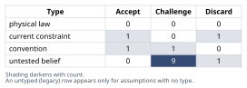
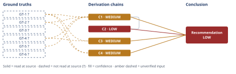

# Slack Integration vs. Reporting Rewrite: Q4 Engineering Priority

*First-principles analysis · 11 October 2026*

*Read with: [How to read this analysis](HOW-TO-READ.md) · [Working file](analysis-20261011T001415Z.md) · [All files](INDEX.md)*

## Executive Summary

**Recommendation:** Fund the reporting rewrite with the full 3.2 engineer-quarters this quarter, and explicitly defer the Slack integration with a dated, communicated next-quarter roadmap commitment rather than a silent "no" (chain C1).

**Band (from §6):** LOW overall, driven by the secondary precedent-policy chain C2; the core build decision itself (chain C1) is independently MEDIUM (chain C1).

**Would change it:** Reading the actual signed Letter of Intent to confirm the exit clause is a real trigger, a week-2 engineering scoping spike confirming the rewrite fits 3.2 engineer-quarters, and a CRM pull deduplicating the 41 Slack requests with deal-stage linkage (chain C1).

## 1. Problem Essence

**Core problem:** Given exactly 3.2 engineer-quarters of capacity this quarter — enough to fully fund only one of two competing roadmap asks — should engineering build the Slack integration (motivated by 41 undeduplicated inbound prospect requests with no demonstrated revenue or churn linkage) or the reporting rewrite (motivated by a signed $180,000/year expansion Letter of Intent from a top-10 account, contractually contingent on shipping this quarter with an exit clause, plus two further top-10 accounts citing the same reporting limitations as a renewal risk)?

**Success criteria:**
- The recommendation names exactly one funded option for this quarter's 3.2 engineer-quarters and states explicitly what happens to the deferred option.
- Each option's demand signal is rated for verifiability and comparability (a quantified, dated commitment versus unquantified, undeduplicated interest) before it is used to decide, not after.
- The opportunity cost and risk of the deferred option is stated in terms comparable to the chosen option's stakes, not dismissed by omission.
- At least two second-order or precedent effects of the choice are named (for example, contractual-leverage precedent and sales-team reaction).
- The final recommendation states a confidence band and the specific evidence that would change it.

## 2. Assumptions Table



**Fishbone pass (breadth-first), run against the effect "3 of the top-10 accounts cite reporting limitations as a renewal risk":** categories considered — Product (specific gaps: export formats, drill-down depth, scheduling), Data (staleness/accuracy of underlying numbers), Process (manual CS workaround cost), Commercial (timing coincidence with renewal cycles), People (which stakeholder at each account is escalating). No discriminating observation is available for any branch with the facts given — nothing in the prompt distinguishes "the 3 accounts share one root cause" from "the 3 accounts have three different reporting complaints that happen to share a label." That absence of a discriminator is itself the finding feeding A-5 and A-9 below: it is not that the branches were tested and tied, it is that they cannot yet be told apart.

**Inversion pass, run against the claim "funding the reporting rewrite this quarter is the correct use of the team's one quarter of capacity":** inverted form — "funding the reporting rewrite is not correct; Slack, or neither, would have served better." Failure-guaranteeing conditions enumerated: (1) the rewrite's true effort exceeds 3.2 engineer-quarters and ships late anyway; (2) the Letter of Intent's exit clause is a negotiating lever, not a true walk-trigger, so the $180k was never really at risk; (3) the other two at-risk accounts' complaints have a different root cause than what gets built, so renewal risk continues for them; (4) deferring Slack kills an in-flight, Slack-dependent deal this quarter; (5) a second consecutive deferral damages sales-team trust enough to cost more than it saves; (6) the customer and engineering interpret "shipped" differently, so the exit clause triggers regardless of effort spent. Necessary load-bearing preconditions derived: the rewrite's effort estimate is accurate (A-4); the exit clause is a genuine trigger (A-1); no material in-flight Slack deal is lost this quarter (A-6). A non-load-bearing precondition (affects only the "compounding value" side-claim, not the core choice): the three accounts share a root cause (A-5).

| Assumption | Type | Treatment | Verdict | Verification |
|------------|------|-----------|---------|--------------|
| If the reporting rewrite does not ship this quarter, the Letter-of-Intent account will actually exercise the exit clause and not renew or expand | untested belief | Verify via account-team and legal confirmation of the account's real intent, not just the clause's text; until then flag unverified | Challenge — the exit clause is a real contractual lever but intent-to-walk is not self-executing | unverified — flagged (GT-4?) |
| The 41 logged Slack requests represent demand or revenue-at-risk comparable in scale to the Letter of Intent's $180,000 figure | untested belief | Verify by pulling the CRM, deduplicating by account, and linking to deal stage or ARR; until then flag unverified | Challenge — no dedup, no deal linkage, no dollar figure is given; a count is not a revenue-weighted signal | unverified — flagged (GT-1?) |
| The absence of a churn-survey code citing Slack means Slack carries low revenue or churn risk | untested belief | Verify what the churn survey actually measures and whether it could ever capture a lost-prospect signal | Challenge — a churn survey of existing customers cannot, by construction, capture deals that were never won; absence of a code here is a scope mismatch, not reassurance | unverified — flagged (GT-2?) |
| The reporting rewrite, scoped at the full 3.2 engineer-quarters, fits the quarter with workable margin | untested belief | Verify via a week-2 scoping spike with an explicit go/no-go checkpoint | Challenge — the figure is a planning estimate, not an as-built actual, and the exit clause is calendar-fixed so an overrun cannot be absorbed later | unverified — flagged (GT-5?) |
| The reporting rewrite's scope will also resolve the other two at-risk top-10 accounts' concerns, not only the Letter-of-Intent account's | untested belief | Verify by comparing ticket content across the three accounts for a shared root cause before finalizing scope | Challenge — three accounts citing the same label is not proof of the same underlying cause (see fishbone pass above) | unverified — flagged (GT-3?) |
| Deferring Slack this quarter causes no material loss of in-flight, Slack-dependent sales deals | untested belief | Verify by asking sales operations whether any active-stage deal names Slack as an explicit blocker | Challenge — no deal-stage data is given either way; silence here is not evidence of safety, the same gap flagged for the churn-survey assumption above | unverified — flagged |
| Top-10 accounts' retention is higher-leverage for this business than the diffuse pipeline interest reflected in 41 requests | convention | Challenge whether ARR concentration actually holds here; typical in enterprise B2B SaaS but not evidenced with this company's own figures | Accept — conditionally; consistent with common ARR concentration patterns and, independently, with the fact that this signal is already revenue-quantified and dated unlike the alternative | unverified — flagged, no ARR-concentration figure given |
| Honoring this Letter of Intent's contract-driven deadline sets a precedent inviting future customers to use exit clauses to dictate the roadmap | untested belief | Monitor account and sales behavior over the next 2-3 quarters; no current data exists | Challenge — plausible second-order risk, best managed by making the decision rule explicit policy rather than leaving it an unexamined one-off | unverified — flagged |
| Capacity (3.2 engineer-quarters) is strictly all-or-nothing between the two options, with no cheap partial or stopgap version of either possible | current constraint | Record expiry — lifts if a near-zero-cost Slack stopgap (for example an existing webhook or no-code connector) is identified, or if capacity changes next quarter | Accept — expires on confirmation that a trivial stopgap exists; treated as binding for this quarter as given | as stated by the requester for this analysis |
| The 41-request ticket count is a reliable proxy for Slack's strategic or revenue value independent of which accounts or deal sizes are asking | convention | Challenge — ticket-count logging is a sales-operations convention, not a revenue signal; should be reweighted by account ARR and deal stage before being compared to a dollar figure | Challenge — count-based logging conflates volume with value | unverified — flagged (GT-1?) |
| Sales-team morale and credibility are not materially harmed by deferring Slack a second consecutive quarter | untested belief | Verify via a direct check-in with sales leadership before finalizing the communication plan | Challenge — plausible morale cost is the sharpest reason not to treat deferral as a silent "no"; needs a named mitigation regardless of how likely it is | unverified — flagged |
| Doing neither option — true status quo or generic backlog work — is a viable choice for this quarter | current constraint | Record expiry — becomes viable only if the Letter of Intent's exit-clause terms are renegotiated away from "this quarter" | Discard — fails the must-have "preserves the $180,000 committed, dated ARR" knockout applied in the Phase 4 trade-off; not viable as the facts are stated | per GT-4?, GT-5? as given |
| 41 requests, even accurately deduplicated, represent a dollar-quantifiable amount of at-risk or opportunity revenue comparable in kind to the Letter of Intent's $180,000 | untested belief | Verify by pulling actual pipeline dollar value tied to Slack-blocked deals, if any exist | Discard as a basis for direct comparison — no amount of deduplication converts a count into a dollar figure; the two signals differ in kind, not only in magnitude | unverified — no dollar figure exists to cite |
| Average Slack-request tickets filed per distinct requesting account fall in the range 1 to 2.4 | untested belief | Verify via the same CRM dedup pull named above; used only to bracket an estimate, not asserted as fact | Challenge — an assumed range with no cited source, load-bearing only for the width of the estimate bracket in chain C3, not for its conclusion | unverified — flagged, no source cited |

## 3. Ground Truths

This analysis runs on a stipulated decision scenario: every fact below was supplied by the person commissioning the analysis as a premise to reason from, and none names an underlying system of record (a CRM export, a signed contract document, a churn-survey dataset, or a capacity-planning tool) that this analysis could open and read. Per the provenance test, "no source was located at all" is the applicable branch for all six — this is not a failed Phase 3 read (no source was ever named to fail), so no Phase 3 failure record applies; each is simply carried as `unverified`. This caps every downstream chain at MEDIUM or below per D-07, and the real-world action for the business is to convert each one into a `read-at-source` fact before treating this analysis's confidence as final.

- **GT-1?** Over the last two quarters, 41 inbound Slack-integration requests were logged, not deduplicated by account — unverified: stipulated by the requester; no CRM ticket export was cited or available for this analysis to read.
- **GT-2?** No churn-survey reason code attributes any past account departure to the missing Slack integration — unverified: stipulated; no churn-survey instrument or dataset was cited.
- **GT-3?** 3 of the top-10 accounts by ARR filed support tickets in the last two quarters citing reporting limitations as a renewal risk — unverified: stipulated; no ticket IDs or account identifiers were cited.
- **GT-4?** One of those three accounts has signed a Letter of Intent committing $180,000/year in expansion ARR, contingent on the reporting rewrite shipping this quarter, with an exit clause permitting non-renewal if it does not ship this quarter — unverified: stipulated; no contract document was cited for this analysis to read. Note on relative verifiability: this is, in principle, the single most directly checkable fact in the set — it is one signed document with explicit clauses — unlike GT-1?'s aggregate, undeduplicated tally, which has no single document to pull at all. Both still carry `?` under the mechanical provenance rule because neither source was actually opened by this analysis.
- **GT-5?** Engineering capacity this quarter is 3.2 engineer-quarters, net of on-call and maintenance, sufficient to fund exactly one of the two named options and not both — unverified: stipulated; no capacity-planning or sprint-accounting source was cited.
- **GT-6?** Total active accounts = 240, the denominator reported against the 41 Slack requests — unverified: stipulated alongside GT-1?, same citation gap.

**Provenance summary (required):**

```text
?-marked: GT-1, GT-2, GT-3, GT-4, GT-5, GT-6 (6 of 6)
Read-at-source: none — no cited source exists for this stipulated scenario to open; see the Phase-3 note above
```

## 4. Derivation Chains



### Trade-off analysis (supporting Chain C1)

**Options named, status quo and composite included:**
- **A** — Slack integration only.
- **B** — Reporting rewrite only, full 3.2 engineer-quarters.
- **C** — Status quo: build neither this quarter, run generic backlog work.
- **D** — Composite: reporting rewrite at ~3.0 engineer-quarters plus a near-zero-cost Slack stopgap (a webhook or no-code connector, ~0.2 engineer-quarters) rather than a full native app.

**Must-haves applied as knockouts:** must-have — "preserves the $180,000 committed, dated expansion ARR named in GT-4?." Option A fails it (reporting does not ship, the exit clause triggers) and is knocked out. Option C fails it for the same reason and is knocked out. Only B and D survive to be scored; scoring A or C anyway would let a high score on breadth-of-interest or morale criteria out-vote a dated, quantified contractual loss that neither option avoids (see Abandoned Reasoning, Dead End 1).

**Criteria and weights, locked before scoring:**

| Criterion (higher is better) | Weight | 1 means… | 5 means… |
|---|---|---|---|
| Committed-revenue protection | 5 | materially jeopardizes the $180k committed ARR | fully protects it and plausibly reduces the other two accounts' risk |
| Execution feasibility within 3.2 engineer-quarters | 5 | scope clearly exceeds capacity | scope comfortably fits with margin |
| New-logo sales-motion impact | 3 | Slack need fully unaddressed, cited as a blocker | Slack need addressed well enough to stop being cited as a blocker |
| Sales-team morale and roadmap trust | 2 | Slack deferred again with nothing shipped | some visible Slack progress ships even if minimal |
| Engineering risk and quality | 3 | parallel work degrades quality or on-call risk | focused scope, clean execution |
| Compounding account-risk coverage | 4 | no evidence the other two at-risk accounts are addressed | same root cause clearly addressed for all three |

**Scoring (score × weight), ground truth behind each score noted:**

| Option | Revenue protection ×5 | Feasibility ×5 | Sales-motion ×3 | Morale ×2 | Eng. risk ×3 | Compounding ×4 | Total |
|---|---|---|---|---|---|---|---|
| B (reporting only) | 5×5=25 (GT-4?) | 5×5=25 (GT-5?) | 1×3=3 (GT-1?) | 1×2=2 | 4×3=12 | 4×4=16 (GT-3?) | **83** |
| D (reporting + stopgap) | 4×5=20 (GT-4?) | 3×5=15 (GT-5?) | 3×3=9 (GT-1?) | 4×2=8 | 3×3=9 | 4×4=16 (GT-3?) | **77** |

**Result:** B scores 83 versus D's 77, a gap of 6, driven mainly by feasibility and revenue protection; D's only advantages are sales-motion and morale.

**Flip test:** no single weight change within the 1–5 scale flips this to D outright. The closest lever is sales-team morale: raising its weight from 2 to 4 (of 5) produces an exact tie; raising it to 5 flips the result to D by a margin of 3. Lowering execution-feasibility's weight from 5 to 2 also ties it; below 2 it flips. Every other single-criterion move leaves B ahead by a wider margin. This is a real but not dominant sensitivity — B's win is robust to everything except explicitly deciding that sales-team morale matters almost as much as protecting committed revenue or hitting the deadline, which this analysis does not find support for in the given facts.

**Second-order effects — actor lens:** the Letter-of-Intent account's champion sees the commitment honored and may become a reference account, but the organization also learns, implicitly, that a contract with an exit clause is what converts a request into roadmap action — a lesson other enterprise accounts and the company's own sales team can both draw on. The other two at-risk top-10 accounts' customer-success managers will be watching whether the shipped rewrite actually reduces their own renewal risk. The sales team, denied Slack a second time, may quietly stop pitching into Slack-dependent segments rather than voice the frustration. A competitor with native Slack support already shipped is a live outside actor who can turn today's "unquantified interest" into tomorrow's quantified lost deal.

**Second-order effects — time lens:** immediately, the rewrite consumes the quarter and the $180k is preserved if it ships on spec; the 41-request backlog keeps growing in the meantime. Over the next few cycles, if the rewrite's root cause matches the other two at-risk accounts, top-10 renewal risk falls materially (compounding value); if Slack is deferred again next quarter too, three consecutive quarters of "no" risks becoming a credible competitive and sales-narrative problem that today's instrumentation cannot even see (chain C4). Over the long run, an unexamined pattern of letting the sharpest contractual lever win the roadmap, repeated without ever being named as policy, risks becoming "how decisions are always made" here by default rather than by stated strategy.

### Conclusion C1: Fund the reporting rewrite with the full 3.2 engineer-quarters this quarter; defer Slack with a dated commitment

GT-4? (signed LOI, $180,000, dated, exit clause) + GT-5? (3.2 engineer-quarters fund exactly one option) + GT-1? (41 undeduplicated requests, no dollar linkage) + GT-2? (no churn code ties any departure to Slack)
→ the exit clause stated in GT-4? makes shipping the reporting rewrite this quarter a dated, binary precondition for keeping the $180,000 of committed ARR, so Option A and status-quo Option C both fail a must-have and are knocked out before any weighted scoring
→ the request count and churn-code absence stated in GT-1? and GT-2? show the Slack signal carries no comparable dollar figure, no account-level dedup, and no demonstrated churn or deal linkage, so it cannot outweigh a dated, quantified contractual commitment on the same footing
→ a locked-weight trade-off between the two must-have survivors, reporting-only and reporting-plus-a-near-zero-cost Slack stopgap, scores reporting-only highest at 83 versus 77, a gap that closes only if the sales-morale weight is raised from 2 to 4 of 5
→ fund the reporting rewrite with the full 3.2 engineer-quarters this quarter and defer Slack with an explicit, dated next-quarter roadmap commitment rather than a silent deprioritization

**Confidence:** MEDIUM — GT-4? (verify by reading the actual signed Letter of Intent and confirming with sales and legal that the account intends to exercise the exit clause, not merely that the clause exists in writing — this is also this chain's single most flip-sensitive input, see the Sensitivity step in the adversarial pass record); GT-5? (verify via a week-2 engineering scoping spike confirming the rewrite fits 3.2 engineer-quarters); GT-1? and GT-2? (verify via a CRM pull deduplicating requests by account and tagging any Slack-blocked deals by stage and value). No `Cn` is cited on this head. The inference itself — the must-have knockout, then the weighted scoring — is not in question given the stated facts; only the facts' own verification is outstanding, which is why this chain is MEDIUM rather than LOW.

### Conclusion C2: Convert this decision into an explicit, written prioritization policy rather than an unexamined one-off

C1 (fund reporting, defer Slack with a dated commitment)
→[2nd] honoring a contract-driven, exit-clause-triggered deadline without stating why risks teaching future enterprise accounts and the sales team that legal leverage is the fastest path to roadmap priority *[Assumes: A-8 — honoring this deadline teaches a lasting lesson to other accounts and to sales]*
→[3rd] if that lesson generalizes, future roadmap prioritization risks being driven reactively by whichever account's legal team writes the sharpest exit clause rather than by stated strategy
→ the risk is cheaper to manage than to avoid, since refusing the Letter of Intent's terms loses $180,000 now for an uncertain future benefit, so recommend converting the decision rule into an explicit, written prioritization policy now

**Confidence:** LOW — two axes are short. Inputs: capped at no higher than C1 (MEDIUM) since this chain cites C1 on its head. Rivals: a live, unsettled rival exists — "this Letter of Intent is genuinely a one-off and needs no standing policy" — and nothing in this analysis rules it out; what would settle it is observing, over the next two to three quarters, whether other enterprise accounts attempt similar exit-clause leverage. The Inference axis is not short: hop 1's `[Assumes: A-8]` premise is priced — if A-8 is false and no lasting precedent effect occurs, the recommendation to write an explicit policy is unaffected, since the policy is low-cost insurance either way.

### Root-cause check (5-Whys, causal mode) supporting Chain C4

Why do 41 requests exist with no deal or churn linkage attached? Because the feature-request intake logs a request without tagging deal value or stage. Why does intake skip that tagging? Because the workflow was built as a product-feedback tool, not a revenue-risk tool. Why was it built that way? Because, until now, no one needed to compare a feature request against a funded, dated roadmap decision at this resolution. Why has that need not arisen before? Because prioritization decisions were previously made without a quarter-sized, hard capacity constraint forcing an explicit trade-off between a priced and an unpriced signal. Root cause (testable, actionable, within control): the organization has no process that converts a feature request into a dollar-weighted signal before it reaches a prioritization decision. Corrective action: instrument Slack-blocked deals in the CRM this quarter (feeds chain C4 below) — within control, and it directly prevents this same evidentiary gap from recurring next time.

### Conclusion C3: The two options' demand signals differ in kind, not only in degree

GT-1? (41 undeduplicated requests, no dollar or deal-stage linkage) + GT-4? ($180,000/year, dated, contractual trigger)
→ the request count in GT-1? carries an unknown, unestimated account-level denominator and no dollar or deal-stage linkage, while the commitment in GT-4? is a single, dated, binding dollar figure with an explicit trigger condition
→ even a generous deduplication of GT-1?, bracketing distinct accounts at roughly 17 to 41 of 240, about 7 to 17 percent of the active base, assuming each requesting account filed on average 1 to 2.4 tickets *[Assumes: A-14 — the assumed dedup ratio has no cited source]*, still produces no dollar figure comparable to $180,000
→ the two signals differ in kind, not only in size, since one is already priced and dated and the other is neither, so treating this as two feature requests where the larger one wins understates how lopsided the comparison actually is

**Confidence:** MEDIUM — GT-1? and GT-4? (same verification paths named on chain C1); the dedup ratio used in hop two (1 to 2.4 tickets per account) is an assumed bracket with no source, flagged here rather than promoted to a ground truth — narrowing it would tighten the bracket's width but would not change this chain's conclusion, since no plausible dedup ratio produces a dollar figure to compare against GT-4?.

### Conclusion C4: The opportunity cost of deferring Slack is real but currently unmeasured, not small

GT-2? (no churn code cites missing Slack) + GT-1? (41 requests, no deal linkage)
→ the absence of a churn-code reason in GT-2? only measures reasons existing customers gave for leaving, so it cannot detect revenue lost from prospects who never became customers, which is exactly the channel the 41 requests in GT-1? describe
→ the real opportunity cost of deferring Slack is therefore not shown to be small, it is unmeasured, because current instrumentation cannot see that channel at all
→ the correct response to an unmeasured risk is to measure it rather than default-fund the louder-but-unpriced option, so start tagging Slack-blocked deals in the CRM this quarter so next quarter's version of this decision has an actual dollar figure instead of a ticket count

**Confidence:** MEDIUM — GT-2? and GT-1? (same verification paths named on chain C1); the inference that churn-survey scope cannot capture lost-prospect revenue is a definitional point — churn surveys are administered to departing customers, not lost prospects, by construction — rather than an empirical one, so it is not weakened by either ground truth being confirmed or disconfirmed; the MEDIUM here is purely an Inputs-axis artifact, not an Inference-axis one.

**Techniques not applied:**
- theoretical-limit (Phase 1 reframe) — not applicable — the core question is a resource-allocation choice between a committed and an uncommitted revenue signal, not a question of whether a current figure is a convention masking a hard physical or mathematical ceiling
- theoretical-limit (Phase 4 ceiling derivation) — not applicable — no conclusion here turns on a ceiling the fundamentals permit; the binding constraints are contractual and calendar (an exit clause, a quarter boundary) and a capacity estimate, not a law of physics or mathematics admitting a derivable limit

## 5. Abandoned Reasoning

### Dead End: Score Option A (Slack) and status-quo Option C in the full weighted trade-off

**What was tried:** Initially considered running the locked-weight scoring from chain C1 across all four named options (A, B, C, D) rather than applying the must-have knockout first.

**Why abandoned:** GT-4?'s exit clause makes "the $180,000 is preserved" a binary precondition, not a scored criterion; scoring A and C anyway would let a high weighted total on breadth-of-interest or morale criteria out-vote a dated, quantified contractual loss that neither option avoids — exactly the failure mode the trade-off procedure's must-have step exists to prevent (chain C1, hop 1).

**What it ruled out:** A trade-off result that could be read as "Slack narrowly beat reporting on points," which would misrepresent a choice where two of the four named options cannot be chosen without accepting a known, dated revenue loss with no offsetting quantified gain.

### Dead End: Treat 41 of 240 accounts (about 17 percent) as directly comparable in weight to $180,000

**What was tried:** Considered expressing both signals as a single comparable score by converting the Slack request rate into a percentage of the account base and placing it opposite the Letter of Intent's dollar figure on the same scale.

**Why abandoned:** A percentage of accounts expressing interest and a dollar figure of committed, dated revenue are not on the same basis — one is an unweighted count with an unknown true denominator (GT-1?), the other is a priced, dated commitment (GT-4?); forcing them onto one scale manufactures false comparability (chain C3).

**What it ruled out:** A tidy-looking but misleading single-number comparison that would have hidden the kind-not-degree asymmetry chain C3 identifies.

### Dead End: Assume the reporting rewrite automatically de-risks all three at-risk top-10 accounts

**What was tried:** Considered asserting the rewrite's "compounding value" — resolving all three at-risk accounts, not only the Letter-of-Intent account — as a settled fact in the headline recommendation.

**Why abandoned:** Assumption A-5 is an untested belief; the fishbone pass in section 2 found no discriminating observation showing the three accounts share one root cause rather than three different complaints under the same label.

**What it ruled out:** Overclaiming a quantified-sounding "three-for-one" value story that is not yet supported by any ticket-content comparison across the three accounts.

## 6. Conclusion

**Recommended approach:** Fund the reporting rewrite with the full 3.2 engineer-quarters this quarter; explicitly defer the Slack integration with a dated, communicated commitment for next quarter's roadmap rather than a silent "no" (chain C1).

**Key insight:** The two options' demand signals are not just different in size, they differ in kind — one is a priced, dated, contractual commitment, the other is an unweighted, undeduplicated request count with no dollar or churn linkage — so this is not the close call that a surface framing of "41 requests versus one contract" suggests (chain C3).

**Trade-offs acknowledged:** This defers real, if currently unquantified, sales-pipeline value and risks sales-team credibility on Slack for a third consecutive quarter (chain C2); the opportunity cost of that deferral is genuinely unmeasured by current instrumentation rather than small, and should be fixed by instrumenting Slack-blocked deals this quarter instead of being inferred from the absence of a churn code (chain C4). Honoring a contract-driven deadline here should be converted into an explicit, written prioritization policy, not left as an unexamined one-off, to manage the precedent risk named in chain C2.

**Confidence:** LOW — driven specifically by chain C2 (LOW), the weakest chain this Conclusion rests on; the core build recommendation (chain C1) is independently MEDIUM, and the opportunity-cost and key-insight chains (C3, C4) are also independently MEDIUM. The overall band is reported at the weakest contributing chain per the governing calibration rule, but the practical decision — what to build this quarter — should be read at C1's MEDIUM, not at this LOW roof; the LOW roof flags specifically that the precedent-policy recommendation inside "Trade-offs acknowledged" is the softest-supported claim in this analysis and should be treated as low-cost insurance rather than a well-evidenced finding. All four contributing chains would rise together if the four verifications named on chain C1 are completed (reading the signed Letter of Intent, a week-2 scoping spike, a CRM dedup and deal-linkage pull, and a cross-account ticket-content comparison); chain C2 would additionally need the precedent question itself to be settled one way or another, which only time and observed account/sales behavior can do.
