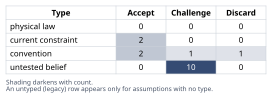
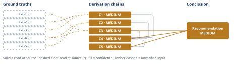

# Slack Integration vs. Reporting Rewrite: Which to Fund

*First-principles analysis · 11 October 2026*

*Read with: [How to read this analysis](HOW-TO-READ.md) · [Working file](analysis-20261011T025237Z.md) · [All files](INDEX.md)*

## Executive Summary

**Recommendation:** Fund the reporting rewrite this quarter as the primary allocation, tightly scoped to the three accounts' named complaints and gated on written acceptance criteria plus a technical spike; add a near-zero-cost Slack stopgap only if capacity allows, and formally commit the native Slack integration to next quarter (chain C4, chain C5).

**Band (from §6):** MEDIUM (chain C3, chain C4, chain C5).

**Would change it:** Reading the LOI's actual contingency and exit-clause text, which bears on whether "ship" is achievable and what the exit clause really covers (chain C2), and this team's own delivery-velocity data, which bears on whether 3.2 engineer-quarters truly suffices even when scoped (chain C3).

## 1. Problem Essence

**Core problem:** Given exactly one quarter of funded engineering capacity (3.2 engineer-quarters) that can fund only one of two candidate initiatives, which single allocation of that capacity — or combination within the same capacity envelope — maximizes the business's risk-adjusted outcome across (a) the quantified, contractually-dated revenue at stake in the reporting rewrite and (b) the unquantified, undated demand signal behind the Slack integration, while bounding the execution risk of whichever path is chosen and the precedent it sets for future roadmap decisions?

**Success criteria:**
1. The conclusion names a specific allocation of this quarter's 3.2 engineer-quarters (one option, or an explicit composite), and states what happens to the deprioritized initiative rather than leaving it silently dropped.
2. The conclusion's recommendation traces, through a derivation chain, to a comparison of the two initiatives' revenue consequences that accounts for the asymmetry between a quantified/dated figure and an unquantified/undated one — not a comparison that treats both as equivalent in kind.
3. The conclusion names the specific risk(s) most likely to invalidate the recommendation and the specific piece of information that would most change it if it arrived later (value of information) — each stated precisely enough that a reader could check, next quarter, whether that risk materialized or that information arrived.

## 2. Assumptions Table

| Assumption | Type | Treatment | Verdict | Verification |
|---|---|---|---|---|
| A-1: The 3.2 engineer-quarter capacity figure is fixed for this quarter and cannot be surged via contractors, reduced on-call load, or temporary reassignment. | current constraint | Record expiry conditions — this holds only until the next capacity-planning cycle or an explicit surge decision. | Accept — expires at next capacity-planning cycle; treated as binding for this quarter's decision only | unverified — flagged (no capacity-planning system opened by this analysis) |
| A-2: The 41 inbound Slack-integration requests represent genuine, deal-relevant demand from active prospects, not mostly repeat asks from the same accounts or idle curiosity. | untested belief | Verify via deal-stage/dedup data, or flag as unverified. | Challenge — GT-2? explicitly states requests are not de-duplicated and carry no stage data, so this cannot be accepted as stated | unverified — flagged |
| A-3: The absence of a churn-survey reason code citing the missing Slack integration is informative about prospect-side (pipeline) risk from that gap. | convention | Explicitly challenge before use — ask whether the evidence actually bears on the question. | Discard — churn surveys measure churned customers, a population distinct from the prospects generating the 41 requests; this evidence does not transfer to prospect-side risk and is excluded from the Option A vs. Option B comparison (see Abandoned Reasoning, Dead End 1) | n/a — scope/validity argument, not an empirical claim to verify |
| A-4: The signed Letter of Intent reliably converts to actual signed revenue once its contingency is met (i.e., LOIs at this company have a high historical conversion rate to binding contracts). | untested belief | Verify historical LOI-to-signed-contract conversion rate, or flag as unverified. | Challenge — no conversion-rate data given; LOIs are frequently non-binding instruments pending further procurement steps | unverified — flagged; ranked #1 value-of-information item |
| A-5: "Ship" in the LOI's contingency clause has one specific, mutually agreed definition that both engineering and the customer recognize. | untested belief | Verify via the LOI's exact text and the account team, or flag as unverified. | Challenge — this is the single highest-probability failure mode identified in the Phase 5 pre-mortem (Cluster 1) | unverified — flagged; gated in the recommendation as a pre-kickoff requirement |
| A-6: The LOI's exit clause permits non-renewal of only the new $180,000/year expansion commitment, not the account's existing base-ARR contract. | untested belief | Verify via the LOI's exact text, or flag as unverified. | Challenge — if false, Option B's true downside is materially larger than $180k, which would strengthen rather than reverse the recommendation; load-bearing for magnitude, not direction | unverified — flagged; ranked #1 value-of-information item (tied with A-4) |
| A-7: 3.2 engineer-quarters is sufficient to deliver a reporting rewrite that satisfies the LOI's ship contingency, provided the work is tightly scoped to the three accounts' named complaints rather than a comprehensive platform rebuild. | untested belief | Verify via a technical spike against this team's own velocity data, or flag as unverified. | Challenge — plausible under the Estimate bracket in chain C3 but not confirmed for this specific team and system | unverified — flagged; ranked #2 value-of-information item |
| A-8: The specific reporting complaints behind the LOI account and the other two top-10 accounts are similar enough that one scoped rewrite addresses all three. | untested belief | Verify via the actual content of the underlying support tickets, not just the "reporting limitations" label, or flag as unverified. | Challenge — not confirmed; if false, the scoped rewrite may satisfy the LOI account without materially reducing the other two accounts' renewal risk | unverified — flagged |
| A-9: Deferring the Slack integration by one quarter carries no compounding cost — no prospect walks away from an active sales cycle solely because of the wait. | untested belief | Verify via sales-pipeline tracking of deals that name the missing integration as a blocker, or flag as unverified. | Challenge — plausible for a commonly workaroundable integration class, but not confirmed for this specific sales motion; mitigated in the recommendation by a stopgap and an explicit next-quarter date | unverified — flagged |
| A-10: Capacity will exist next quarter to actually deliver the native Slack integration as committed, rather than the commitment quietly lapsing. | current constraint | Record expiry conditions — holds only if next quarter's capacity planning preserves room for it. | Accept, conditionally — named in the recommendation as a governance action item (chain C5), not treated as already secured | unverified — flagged |
| A-11: Resolving one customer's roadmap escalation via a signed, ship-contingent LOI is a sustainable prioritization input rather than a precedent other accounts will learn to replicate. | convention | Explicitly challenge before use. | Challenge — both the pre-mortem (Phase 5) and the second-order actor-lens analysis (chain C5) identify this as a real, non-zero risk; mitigated, not eliminated, by naming a governance follow-up | unverified — flagged; tracked as an ongoing monitoring item |
| A-12: A near-zero-engineering-cost Slack stopgap (an existing webhook- or Zapier-class connector) is actually available and fits within whatever capacity tight scoping of the reporting rewrite frees up. | untested belief | Verify via a short technical feasibility check before committing to the composite plan externally. | Challenge — not confirmed; if false, the plan falls back to "fund B only, commit A explicitly for next quarter" without the stopgap, which the trade-off matrix in chain C4 shows is still the second-best allocation, not a failure of the overall recommendation | unverified — flagged |
| A-13: Rushing a reporting rewrite under a hard deadline carries materially higher technical/quality risk than building a bounded, well-understood integration such as Slack. | convention | Explicitly challenge — ask whether this general engineering-management heuristic holds for this specific team and system. | Accept, with caveat — a well-supported general regularity (ambiguous scope plus a hard deadline plus unfamiliar data-model work is a classically higher-risk profile than a bounded third-party API integration); no evidence given that contradicts it for this team | unverified — flagged (general industry regularity, not measured on this team) |
| A-14: Typical scoped reporting-feature fixes at a similarly sized B2B SaaS company require roughly 1–3 engineer-quarters. | untested belief | Verify via this team's own historical velocity on comparable scoped feature work, or flag as unverified. | Challenge — this is a general-experience bracket used in the Estimate technique (chain C3), not a measured figure for this team | unverified — flagged; ranked #2 value-of-information item (same verification as A-7) |
| A-15: The relative weights assigned to revenue impact, breadth of accounts addressed, execution risk, pipeline effect, reversibility of deferral, and precedent risk in the trade-off matrix (chain C4) reflect priorities this business's leadership would actually hold. | untested belief | Verify by having the actual decision-maker(s) confirm or re-weight the criteria before the plan is finalized. | Challenge — these weights were locked by this analysis before scoring, per the trade-off procedure's discipline, but were not confirmed against this company's actual leadership preferences | unverified — flagged |
| A-16: This business's risk preference favors eliminating a certain, dated financial loss over an uncertain, undated one when the two options' expected values are close. | convention | Explicitly challenge — this is a normative risk-preference claim, not a fact. | Accept, with caveat — a standard risk-management convention (bound a known, dated liability before an unbounded, undated one when expected values are comparable); stated explicitly so a reader who holds a different risk preference can see exactly where the recommendation would change | unverified — flagged |

## 3. Ground Truths

- **GT-1?** Funded engineering capacity this quarter is 3.2 engineer-quarters, net of on-call and maintenance, and this capacity is sufficient to fund only one of the two candidate initiatives in full, not both. — unverified: internal capacity-planning figure asserted by the requester; no capacity-planning or resourcing system was opened by this analysis.
- **GT-2?** Over the trailing two quarters, 41 inbound requests for a Slack integration were logged across a 240-account active base; these are raw requests, not de-duplicated accounts, and carry no attached data on sales-cycle stage or deal size. — unverified: internal CRM/ticket count asserted by the requester; no CRM or ticketing export was opened by this analysis.
- **GT-3?** No churn-survey reason code attributes any account departure in this period to the absence of a Slack integration. — unverified: internal churn-survey data asserted by the requester; the survey instrument and its reason-code taxonomy were not inspected by this analysis. (Note: this ground truth measures a different population — churned customers — than the prospects behind GT-2; see A-3 and Abandoned Reasoning, Dead End 1.)
- **GT-4?** Three of the top-10 accounts by ARR filed support tickets in the trailing two quarters citing reporting limitations as a renewal risk. — unverified: internal support-ticket data asserted by the requester; the ticketing system was not opened by this analysis, and the ARR size of these accounts is not stated.
- **GT-5?** One of the three accounts named in GT-4 has signed a Letter of Intent committing $180,000/year in expansion ARR, contingent on the reporting rewrite shipping this quarter, with an exit clause permitting non-renewal if it does not ship this quarter. — unverified: LOI terms asserted by the requester; the LOI document itself was not read by this analysis, so its exact contingency language ("ship"), cure provisions, and the scope of "non-renewal" (expansion only vs. base ARR) are not independently confirmed.

**Provenance summary.** `?`-marked: GT-1, GT-2, GT-3, GT-4, GT-5 (5 of 5). Every ground truth in this analysis is unverified by this analysis's own reading: all five are internal company facts asserted by the requester with no source system, document, or export that this analysis could open (no CRM, ticketing system, capacity-planning tool, or the LOI contract itself). Per the Input Contract, being told to "treat as ground truth" does not discharge Phase 3 verification — it only supplies the candidate fact; the `?` suffix and resulting confidence caps below are the honest consequence of that gap, not a departure from the user's framing. No unsuffixed ground truth exists in this analysis, so no read-at-source location is named, and no chain in section 4 can be rated higher than MEDIUM under the unverified-input rule (D-07). The single verification step that would most change this is opening the LOI's own text (GT-5, bearing on A-4, A-5, A-6) and this team's own delivery-velocity data (bearing on A-7, A-14 in chain C3) — named again as the top value-of-information items in section 6.

## 4. Derivation Chains

### Conclusion C1: The Slack-integration demand signal, as currently measured, carries no quantified revenue consequence comparable to the reporting rewrite's

GT-2? (41 Slack requests, undeduplicated, no stage/deal data) + GT-3? (no churn code cites missing Slack)
→ the churned-customer reason codes recorded in GT-3 describe a different population than the prospects behind GT-2, so that absence of a reason code neither confirms nor rules out prospect-side pipeline risk from the Slack gap *[Assumes: A-3]*
→ with no win/loss or deal-stage data tagging the 41 requests, the Slack ask's revenue consequence this quarter is unquantified and could range from negligible to material *[Assumes: A-2]*
→ an unquantified, undated demand signal cannot be weighed against a quantified, dated one on the same footing this quarter

**Confidence:** MEDIUM — GT-2? and GT-3? are unverified internal counts (no CRM or ticketing export was opened by this analysis). The verification that would remove GT-2? as a cause of the downgrade is pulling actual win/loss outcomes and deal-stage tags for the 41 requests; the verification for GT-3? is confirming, from the churn-survey instrument itself, that its reason-code taxonomy indeed excludes prospect-stage losses (which would make it formally inapplicable here rather than merely unread). A-3 is a Discard-verdict convention used here only to exclude GT-3 from this comparison, not to support the conclusion, so it does not itself add downgrade risk.

### Conclusion C2: The reporting rewrite carries a quantified, contractually dated revenue consequence this quarter that the Slack integration does not

GT-4? (3 of top-10 accounts cite reporting limitations as renewal risk) + GT-5? (LOI: $180k/yr expansion, contingent on shipping this quarter, with exit clause)
→ the LOI converts a soft renewal-risk signal into a specific dollar figure tied to a specific delivery deadline this quarter *[Assumes: A-4]*
→ the other two top-10 accounts named in GT-4 raise the plausible stakes of the underlying reporting problem beyond the $180k figure alone, since the complaint is not isolated to one account
→ deferring the reporting rewrite past this quarter carries a named, dated financial consequence that deferring the Slack integration does not carry

**Confidence:** MEDIUM — GT-4? and GT-5? are unverified (the underlying support tickets and the LOI document were not read at source by this analysis). The verification that would remove GT-4? as a cause of the downgrade is reading the three accounts' actual ticket content and ARR size; the verification for GT-5? is reading the LOI's exact contingency and exit-clause text (bearing directly on A-4, A-5, A-6), which is named again in section 6 as the top value-of-information item.

### Conclusion C3: 3.2 engineer-quarters plausibly suffices for the reporting rewrite only if tightly scoped to the three accounts' named complaints

GT-1? (3.2 engineer-quarters available) + GT-4? (3 accounts' complaints, basis for required scope)
→ decomposing "reporting rewrite" into unit-factors, a scoped fix addressing the specific report types and filters named in the three accounts' complaints is a bounded chunk of data-layer, UI and QA work that typically falls in a 1–3 engineer-quarter bracket for a company this size, while a ground-up analytics-platform rebuild commonly runs well beyond a single quarter *[Assumes: A-14]*
→ scoping tightly to the named complaints rather than attempting a comprehensive rebuild places the required effort plausibly within the 3.2 engineer-quarter envelope *[Assumes: A-7]*
→ the capacity constraint does not categorically rule out satisfying the LOI this quarter, but only if the team deliberately scopes to the complained-about fixes and resists expanding into a full platform rewrite

**Confidence:** MEDIUM — GT-1? is unverified (capacity figure asserted, not read from a resourcing system), and the 1–3 engineer-quarter bracket (A-14) is a general-experience estimate, not this team's own measured velocity. The verification that would remove both as a cause of the downgrade is a one-week technical spike re-estimating the named complaints against this team's actual historical velocity — named again in section 6 as the #2 value-of-information item, and required as a pre-commitment gate in the recommendation (chain C5).

### Conclusion C4: A composite allocation of this quarter's capacity — not a pure either/or choice between the two initiatives — is the recommended use of this quarter's 3.2 engineer-quarters

C1 (MEDIUM, Slack demand unquantified) + C2 (MEDIUM, reporting rewrite quantified and dated) + C3 (MEDIUM, 3.2 EQ plausible only if scoped)
→ weighted totals across six locked, anchored trade-off criteria (quantified revenue impact, breadth of accounts addressed, execution risk within capacity, pipeline/new-logo effect, reversibility of deferral, and precedent/governance risk) score a Slack-only allocation at 60, a reporting-rewrite-only allocation at 59 unmitigated and 67 once the scoping-discipline mitigation from chain C3 is priced into the execution-risk criterion, a fund-neither baseline at 47, and a composite allocation — the scoped rewrite as primary, a near-zero-cost Slack stopgap, and a formally committed native Slack integration next quarter — at 78, the highest of the four and the only option not displaced by any single within-bounds weight change *[Assumes: A-15]*
→ the raw near-tie between the two single-option totals is resolved once each option's downside shape is priced in: the reporting rewrite's downside, if ignored, is a certain and dated loss under GT-5's exit clause, while the Slack integration's downside, if deferred, is an uncertain and undated one, and a decision-maker who prefers removing a certain, dated loss over an uncertain, undated one when expected values are this close should prefer the allocation that removes it *[Assumes: A-16]*
→ the composite allocation — fund the scoped reporting rewrite as primary, add the Slack stopgap only if it fits the freed capacity, and commit the native Slack integration to next quarter — is the recommended use of this quarter's 3.2 engineer-quarters

**Confidence:** MEDIUM — capped by C1, C2 and C3, each MEDIUM for the reasons given on their own confidence lines (no re-explanation needed here). The trade-off's own weights (A-15) and the risk-preference premise (A-16) are this analysis's own reasoned judgments rather than measured facts about this company's leadership; the verification that would remove A-15 as a cause of the downgrade is having the actual decision-maker confirm or re-weight the criteria before the plan is finalized. The composite's 11–18 point margins over every other option are wide enough that this would need to move more than one criterion's weight to flip the ranking, which is why the recommendation is reported as robust in direction even though every chain feeding it remains MEDIUM.

### Conclusion C5: The composite allocation's second-order effects are manageable if named and gated now, but one of them — roadmap precedent — is mitigated rather than eliminated

C4 (MEDIUM, composite allocation recommended)
→[2nd] committing the native Slack integration explicitly to next quarter and communicating that commitment to sales now converts a possible sales-morale and win-rate cost into a managed, dated expectation rather than a silent deprioritization *[Assumes: A-9]* *[Assumes: A-12]*
→[2nd] scoping the reporting rewrite tightly to the three accounts' named complaints and gating kickoff on written, customer-confirmed acceptance criteria converts the engineering-execution risk identified in chain C3 into a bounded, pre-committed descope plan rather than an ad hoc crunch under deadline pressure *[Assumes: A-5]*
→[3rd] resolving a customer's roadmap escalation through a signed, ship-contingent LOI, without a parallel internal governance statement on when that kind of escalation is and is not appropriate, sets a precedent that other large accounts can learn to replicate, compounding across future quarters unless named and addressed now *[Assumes: A-11]*

**Confidence:** MEDIUM — capped by C4. None of these three extensions contradicts GT-1 through GT-5, so no return to Phase 2 is triggered. The precedent effect (third hop) is a structural inference about incentives, not a measured fact about this customer base; the verification that would most directly test it is tracking, over the next 2–3 quarters, whether any other enterprise account's renewal or expansion conversation references a similar ship-contingent ask (a monitoring item named again in section 6).

**Unverified input rule (D-07) — summary across all five chains:** every chain in this section rests on at least one `GT-N?` input and is therefore capped at MEDIUM; none is rated HIGH. Each chain's own confidence line above names its unverified inputs and the verification that would remove them as a cause of the downgrade, and no chain is rated above the lowest-rated chain its head cites (C4 and C5 both correctly cap at MEDIUM, matching every chain they cite).

## 5. Abandoned Reasoning

### Dead End: Using the churn-survey absence (GT-3) to discount the Slack integration's risk

**What was tried:** Early in Phase 2, GT-3 ("no churn-survey reason code attributes any departure to the missing Slack integration") was treated as evidence that the Slack gap carries low revenue risk, which would have made Option A even easier to deprioritize.

**Why abandoned:** Churn-survey reason codes are collected from customers who already churned — a population distinct from the prospects who generated the 41 inbound requests in GT-2. A survey of churned customers cannot speak to whether prospects are being lost earlier in the funnel, before they ever become a customer who could churn. Using GT-3 this way is reasoning from evidence about the wrong population — a scope-mismatch, not a valid inference — so the assumption (A-3) was classified as a convention and discarded rather than accepted.

**What it ruled out:** This saves a future analyst from citing GT-3 as if it settled the Slack-integration's pipeline risk. GT-3 remains a true, recorded ground truth, but it is excluded from the Option A vs. Option B comparison in chains C1 and C2; the actually relevant evidence (win/loss or deal-stage data on the 41 requests) is absent and named as a value-of-information item instead.

### Dead End: Scoring this decision as a strict either/or between the Slack integration and the reporting rewrite

**What was tried:** The trade-off matrix in chain C4 was first run with only two live options — Slack integration vs. reporting rewrite — plus the fund-neither baseline, per the stated constraint that only one initiative can be funded.

**Why abandoned:** That framing produced a near-tie (60 vs. 59 points) that does not reflect the asymmetric downside shape between the two options, and it foreclosed a composite before testing one, contrary to the trade-off procedure's requirement to test a split-or-combined option before concluding that a single named option wins outright. Testing a composite — fund the scoped rewrite as primary, add a near-zero-cost Slack stopgap if it fits the freed capacity, and commit the native integration next quarter — produced a dominant option (78 points, 11–18 points ahead of every alternative) once the stopgap and the explicit next-quarter commitment were priced into the same criteria.

**What it ruled out:** This rules out presenting either "fund Slack only" or "fund the reporting rewrite only, with no stopgap or next-quarter commitment" as the final recommendation; both are strictly dominated by the composite once it is scored on the same six criteria.

### Dead End: Treating the LOI's $180,000 as the full stakes of the reporting rewrite

**What was tried:** An early framing of chain C2 anchored the entire revenue case for the reporting rewrite on the LOI's $180,000/year figure alone, since it is the only number attached to the decision.

**Why abandoned:** GT-4 names two additional top-10 accounts (ARR size unstated) that also cite reporting limitations as a renewal risk, and A-6 (the exit clause's scope — expansion only vs. the account's base ARR) is itself unverified. Anchoring on $180,000 alone understates the plausible range of what is actually at stake and overstates this analysis's precision. The $180,000 figure is retained in chain C2 as a named lower bound with its uncertainty stated explicitly, rather than as "the" stakes of the decision.

**What it ruled out:** This rules out reporting a single, falsely precise dollar figure for Option B's stakes; section 6's confidence line and value-of-information list carry the uncertainty forward instead.

## 6. Conclusion

**Recommended approach:** Fund the reporting rewrite this quarter as the primary allocation of the 3.2 engineer-quarters, tightly scoped to the specific complaints driving the three top-10 accounts' renewal risk rather than a ground-up platform rebuild, gated on (1) written, customer-confirmed acceptance criteria for what "ship" means and what the LOI's exit clause covers, and (2) a one-week technical spike that re-estimates the scoped work against this team's own velocity with a pre-agreed descope order. In parallel, ship a near-zero-engineering-cost Slack stopgap (an existing webhook- or Zapier-class connector) only if it fits within whatever capacity the scoping discipline frees up, and formally commit the native Slack integration to next quarter's roadmap, communicated to sales now with a specific date (chain C4, chain C5).

**Key insight:** A simple two-option trade-off looks like a near-tie (60 points for the Slack integration vs. 59 for the reporting rewrite) because an undated, unquantified demand signal and a dated, quantified one were being scored as if they were comparable in kind; that near-tie is an artifact of forcing a binary choice onto a problem that has a dominant third option once a cheap stopgap and an explicit next-quarter commitment are priced in, and of ignoring that one option's downside is a certain, dated financial cliff while the other's is an uncertain, undated drip (chain C4).

**Trade-offs acknowledged:** This plan accepts real engineering execution risk under deadline pressure, mitigated but not eliminated by the spike-and-descope gate (chain C3, chain C5); it accepts that the native Slack integration — and whatever sales friction it is meant to relieve — is explicitly deferred by one quarter rather than delivered now (chain C5); and it accepts a precedent that a customer's contractually dated ask can move the roadmap, mitigated but not eliminated by the governance commitment named in chain C5 (chain C5).

**Value of information — ranked by how much each could change this recommendation:**
1. The LOI's actual contingency and exit-clause text, specifically whether "ship" has an agreed definition and whether the exit clause covers only the $180,000 expansion or the account's base ARR too — this is the single item most able to change both the magnitude and, if "ship" proves unsatisfiable within capacity, the direction of the recommendation (chain C2).
2. This team's own historical delivery velocity on comparable scoped feature work, replacing the general-experience estimate bracket used in chain C3 — if it shows the scoped work plausibly exceeds 3.2 engineer-quarters, the correct action shifts from "attempt delivery" to "renegotiate the LOI's ship date before committing capacity" (chain C3).
3. Win/loss or deal-stage data tagging the 41 Slack requests, which would convert chain C1's "unquantified" demand signal into a dollar figure comparable to chain C2's — a large enough figure could flip the trade-off back toward the Slack integration or a differently balanced composite (chain C1).
4. The actual ARR size of the two non-LOI top-10 accounts citing reporting as a renewal risk, which would reveal whether Option B's true stakes are materially larger than the $180,000 headline figure (chain C2).

**Confidence:** MEDIUM — every chain this conclusion rests on (C3, C4, C5) is MEDIUM because the ground truths beneath them (GT-1 through GT-5) are internal company figures this analysis could not read at source, and the trade-off's weights and the risk-preference premise in chain C4 are this analysis's own reasoned judgments rather than measured company data (each chain's own confidence line carries its specific explanation; not re-stated here). The composite option's 11–18 point margin over every alternative (chain C4) and the pre-mortem's named disposition for each fatal failure cluster (see the adversarial pass record in the appendix) make the recommendation's *direction* robust to modest data corrections; the two verifications most likely to change it are listed above as value-of-information items 1 and 2.
