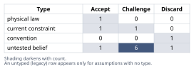
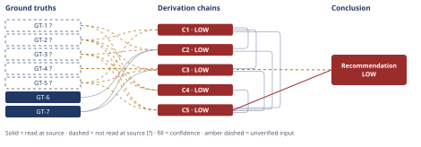

# Should We Add a Free Tier to the B2B SaaS Product

*First-principles analysis · 11 October 2026*

*Read with: [How to read this analysis](HOW-TO-READ.md) · [Working file](analysis-20261011T001929Z.md) · [All files](INDEX.md)*

## Executive Summary

**Recommendation:** Do not launch an open, public, self-serve freemium tier now; instead run a small, gated pilot of a free or extended-trial offer restricted to prospects already in the outbound/referral pipeline, with a pre-committed decision gate before any broader freemium commitment (chain C5).

**Band (from §6):** LOW

**Would change it:** Running the recommended pilot and populating the breakeven identity with Finance's actual per-account cost figure and the pilot's measured conversion rate, in place of today's illustrative cost placeholders and zero internal conversion data (chain C5).

## 1. Problem Essence

**Core problem:** Given a $10K-ACV, 240-team, 100%-outbound-plus-referral B2B SaaS business with zero self-serve/inbound infrastructure and zero internal freemium data, which specific free-tier mechanism (if any) is actually compatible with the current go-to-market motion, and does its economics clear the real cost structure Finance has confirmed — or is a cheaper, reversible test of that mechanism the correct next move instead of a full freemium commitment?

**Success criteria:**
- The analysis names which of the candidate free-tier mechanisms (top-of-funnel replacement, competitive deal-blocker removal, account expansion, referral amplification, evaluation/sandbox, brand parity) are structurally compatible with a 100%-outbound/referral motion that has no self-serve signup or marketing funnel today.
- The analysis states a breakeven condition (conversion rate required to recover free-tier cost) and compares it against a cited, external conversion benchmark rather than an assumed one.
- The analysis identifies second-order failure conditions specific to this GTM motion (not a generic freemium risk list) and ties each to the mechanism(s) that would trigger it.
- The final recommendation is not required to be exactly "add a free tier" or "don't" — it may be a staged, scoped, or hybrid action, and is checked for that before being finalized.
- A skeptic can trace every claim in the recommendation back to a named ground truth or derivation chain without being asked to simply trust the benchmark comparison or the competitive-parity argument on its face.

## 2. Assumptions Table



| Assumption | Type | Treatment | Verdict | Verification |
|------------|------|-----------|---------|--------------|
| We need a free tier because all named competitors already have one (causal inference drawn from GT-5) | convention | Explicitly challenge before use — "they do it" is not evidence it would work here or that its absence is costing us deals | Discard — bandwagon reasoning; no evidence of deal losses attributable to the gap, and competitors' free tiers may be funded by scale/VC backing or built as PLG-native motions that don't transfer | unverified — flagged; no competitor cost structure or funding data was supplied |
| A free tier is low-cost since it's unpaid | untested belief | Verify against known cost data | Discard — directly contradicted by GT-3? (Finance confirms cost scales with active users regardless of payment status) | unverified — flagged; contradicted by stakeholder-supplied GT-3? |
| External B2B freemium conversion benchmarks are a safe planning number for this product | untested belief | Verify, or flag unverified | Challenge — GT-7 shows conversion varies 3x+ between open/standard (3–12%) and PQL/gated (25–39%) populations; using either figure without first establishing which population type this offer would attract is unsafe, and GT-4? confirms zero internal data exists to make that call | unverified — flagged; no internal data (GT-4?) to select the applicable benchmark population |
| A free tier would generate inbound/top-of-funnel leads without further investment (mechanism A) | current constraint | Record expiry conditions — what would have to change for this to become viable | Challenge — not viable today per GT-2?; expires once self-serve signup UX, marketing/content, and lifecycle instrumentation are built | unverified — flagged |
| A free or low-commitment offer can serve as a competitive deal-blocker inside the existing outbound motion (mechanism B/E) | untested belief | Verify via a scoped pilot | Accept — for the purpose of testing; consistent with GT-2? and directly addresses the competitive pressure named in GT-5? | unverified — flagged; this is the hypothesis chain C5's recommended pilot exists to test |
| Outbound reps offering a free option mid-cycle would not slow deal velocity | untested belief | Verify, or flag unverified | Challenge — plausible failure mode surfaced by inversion (chain C4); no evidence either way | unverified — flagged |
| Referral-sourced prospects would still convert to a paid relationship even with a free option available | untested belief | Verify, or flag unverified | Challenge — cannibalization risk surfaced by inversion (chain C4); no evidence either way | unverified — flagged |
| Freemium unit economics must satisfy conversion rate ≥ cost ÷ ACV to be self-sustaining | physical law | Accept as a ground-truth candidate | Accept — a mathematical/accounting identity, not negotiable; promoted to GT-6 | source: algebraic derivation from the definitions of annual cost-to-serve and conversion-driven revenue |
| A visible free option would not cause buyers to anchor on $0 and push back on the $10K price | untested belief | Verify, or flag unverified | Challenge — price-anchoring/signaling risk surfaced by inversion (chain C4); no evidence either way | unverified — flagged |
| Capturing freemium's value requires self-serve productization (signup, onboarding, in-product upgrade flow) | current constraint | Record expiry conditions | Accept — expires once in-product conversion instrumentation and lifecycle marketing are built; until then, conversion depends on manual follow-up | unverified — flagged |
| Illustrative marginal free-tier cost figures ($600–$3,000/team/year) approximate Finance's real per-account cost | untested belief | Verify against Finance's actual cost model | Challenge — explicit placeholder; no dollar figure was supplied by Finance, only the direction that cost scales with active users (GT-3?) | unverified — flagged; this is the single most consequential unverified number in the analysis |
| PQL-driven conversion economics demonstrated at $1K–$5K ACV (25–39%, GT-7) transfer to a gated offer at this company's $10K ACV | untested belief | Verify via the recommended pilot | Challenge — this company's ACV is 2–10x the demonstrated range; higher ACV could mean higher-touch validation (helping conversion) or bigger approval friction (hurting it) — direction unknown | unverified — flagged; exactly what the pilot is designed to measure |

## 3. Ground Truths

- **GT-1?** Current state: $2.4M ARR from 240 paying teams, ~$10,000 ACV per team per year — unverified: figures supplied directly by the commissioning stakeholder as internal business data; no financial statement, billing export, or dashboard was provided to this analysis to open and confirm.
- **GT-2?** Acquisition today is 100% outbound sales + referrals; there is no self-serve inbound signup funnel and no marketing-driven top-of-funnel — unverified: stakeholder-reported description of the current GTM motion; no GTM audit, CRM export, or analytics dashboard was provided to open.
- **GT-3?** Finance has confirmed free-tier infrastructure and support costs scale with active users, not paying users — free users carry real variable cost per active seat regardless of payment status — unverified: attributed to "Finance" but no Finance memo, cost model, or specific dollar figure was provided to this analysis to open and read; the directional claim is taken as given per the Input Contract, but no cost magnitude accompanies it.
- **GT-4?** The company has never run a freemium pilot of any kind; zero empirical free-to-paid conversion data exists internally for this product/market — unverified: a historical/negative fact supplied by the stakeholder with no internal records system named to check.
- **GT-5?** All named competitors in this market already offer a free tier — unverified: no specific competitor list, pricing pages, or URLs were named or opened by this analysis.
- **GT-6** Breakeven identity: for a free-tier population costing *c* dollars per active account per year to serve, converting at rate *p* to an account worth *A* in annual contract value, the free tier's direct cost is recovered exactly when *p* ≥ *c* / *A* — source: algebraic derivation from the definitions of annual cost-to-serve and conversion-driven revenue (a mathematical identity, not an empirical claim, per Phase 3's "physical law / definition / direct measurement" category); read-at-source: derived in this analysis, see chain C2 hop 1.
- **GT-7** Published B2B SaaS freemium conversion benchmarks, drawn from a ChartMogul dataset analyzing ~200 B2B products (conversion defined as a free signup becoming a paying customer within six months): standard/open freemium converts at 3–5% (50th percentile, "good") to 8–12% (75th percentile, "great"); ungated freemium (no account required) converts at 7–9% to 8–12%; Product-Qualified-Lead (PQL)-driven conversion — i.e., conversion among pre-qualified, high-intent signups rather than open/unfiltered signups — runs approximately 25% overall, reaching 30–39% for products in the $1,000–$5,000 ACV range — source: https://userpilot.com/blog/saas-average-conversion-rate ; read-at-source: fetched directly by this analysis; quoted passage: "Good (50th percentile): 3-5%... Great: 8-12%... PQL-driven conversion runs around 25%, and for products in the $1k-$5k ACV range, it reaches 30-39%."

**Provenance summary:**
```text
?-marked: GT-1, GT-2, GT-3, GT-4, GT-5 (5 of 7)
Read-at-source: GT-6 — derived identity, see chain C2 hop 1
Read-at-source: GT-7 — https://userpilot.com/blog/saas-average-conversion-rate, quoted passage above (fetched this analysis)
```

Phase 3 verification step note: GT-1? through GT-5? name no external document, URL, or file path at all — they are the commissioning stakeholder's own internal figures, supplied directly rather than cited to a source this analysis could open. Act attempted: no, for GT-1? through GT-5? — there was nothing to open. Act attempted: yes, for GT-7 — this analysis searched for and fetched the cited benchmark page directly (see read-at-source above) rather than relying on the search tool's own synthesized summary. GT-6 required no external act — it is a self-verifying algebraic identity.

## 4. Derivation Chains



### Conclusion C1: Mechanism A (top-of-funnel replacement) is not currently viable for this business

GT-2? (no self-serve/inbound channel exists) + GT-5? (competitors already have a free tier)
→ the "top-of-funnel replacement" mechanism a free tier could serve requires marketing, content, or SEO to drive traffic plus a self-serve signup flow to capture it *[Assumes: A-4]*
→ none of that infrastructure exists today per GT-2?, so a free tier by itself has no route by which cold traffic would ever reach it
→ mechanism A is not currently viable for this business
→ that competitors already have a free tier, per GT-5?, does not by itself establish that mechanism A would work here if it were built *[Assumes: A-1]*

**Confidence:** LOW — the Inputs axis is short (GT-2? and GT-5? are both unverified; verification: a GTM/analytics audit would confirm GT-2?, a competitor pricing-page pull would confirm GT-5?) and the Rivals axis is also short: a live, unsettled rival exists — "a free tier could generate meaningful organic or word-of-mouth discovery without built marketing or self-serve infrastructure" — and nothing in this analysis rules it out (see the adversarial pass record). The cheapest way to settle it is to observe actual signup and referral-of-the-free-offer behavior during the gated pilot chain C5 recommends.

### Conclusion C2: An open, self-serve freemium tier's unit economics do not plausibly close at this company's current infrastructure maturity

GT-6 (breakeven identity) + GT-1? (ACV $10K) + GT-3? (cost scales with active users) + GT-7 (published open-freemium benchmark 3–12%) + C1 (mechanism A infrastructure missing)
→ using illustrative marginal free-tier cost figures of $600–$3,000 per team per year — placeholders standing in for Finance's real cost model, since GT-3? gives direction but no dollar figure — GT-6's breakeven identity implies a required conversion rate of 6%–30% to recover that cost from a $10K-ACV deal *[Assumes: A-11]*
→ the open/standard freemium benchmark stated in GT-7 (3–12%) sits at or below this required range across most of the illustrative cost bracket, clearing it only at the very low end
→ C1 establishes that this company lacks the self-serve conversion infrastructure that benchmark firms rely on to reach even that 3–12% range
→ realistic expected conversion for an open signup population here is therefore plausibly nearer the low end of the benchmark than the high end
→ an open, public, self-serve freemium tier's unit economics do not plausibly close across most of the plausible cost range at this company's current infrastructure maturity

**Confidence:** LOW — capped by C1 (LOW, below HIGH, not re-explained here); GT-1? and GT-3? are unverified (verification: Finance's actual per-account cost figure and an audited ARR/ACV figure would remove these). This chain's own downgrade cause is A-11, the illustrative cost placeholder: its failure is not fully priced, because a real cost meaningfully below the $600–$3,000 bracket could flip the conclusion toward "open freemium's economics might close after all." Running Finance's actual cost model, or using the pilot's measured cost, is the verification that would remove this cause.

### Conclusion C3: A gated free/extended-trial offer within the existing outbound motion is the freemium-adjacent mechanism best suited to this business today

GT-2? (100% outbound + referral motion) + GT-5? (competitors already have a free tier) + GT-7 (PQL-driven conversion 25–39% vs. open 3–12%) + C1 (mechanism A infrastructure missing)
→ a free offer gated to prospects already engaged in the outbound or referral pipeline, rather than opened to public self-serve signup, is consistent with GT-2?'s existing acquisition motion and resembles a Product-Qualified-Lead population rather than an open-signup population *[Assumes: A-5]*
→ the published data in GT-7 shows PQL-driven conversion (≈25%, rising to 30–39% in the $1K–$5K ACV range) runs roughly 3x higher than open/standard freemium conversion (3–12%)
→ treating a gated population as economically equivalent to open freemium therefore materially understates its plausible conversion rate *[Assumes: A-12]*
→ this gated mechanism can directly address the competitive-parity pressure named in GT-5? without requiring the self-serve conversion infrastructure that C1 found missing
→ a gated free or extended-trial offer within the existing outbound motion is the freemium-adjacent mechanism most plausibly compatible with both the competitive pressure and current GTM infrastructure, and the only mechanism examined here whose published benchmark clears C2's breakeven range rather than falling short of it

**Confidence:** LOW — capped by C1 (LOW, below HIGH, not re-explained here); GT-2? and GT-5? are unverified (verification as named on C1's confidence line). A-5 and A-12 are both priced rather than an independent cause of this rating: if either fails — the gated population behaves like open freemium, or the $1K–$5K-ACV PQL figure does not transfer to $10K ACV — this chain's conclusion (that the gated mechanism is the best-fit candidate worth piloting) still stands, because that conclusion asserts fit and testability, not a guaranteed conversion rate; only the economic verdict would change, which is exactly what chain C5's recommended pilot exists to measure. The LOW rating here therefore comes entirely from the inherited Inputs-axis cap, not from Inference.

### Conclusion C4: The second-order risks of a poorly-designed free offer concentrate on this business's only acquisition engine

GT-2? (100% outbound + referral motion) + GT-1? (ACV $10K, 240 teams, $2.4M ARR) + GT-3? (cost scales with active users)
→ introducing any free-tier-style offer changes the set of people who can access the product without a sales conversation, which is the first-order effect every freemium design shares
→ inverting that first-order effect to ask what would guarantee harm surfaces four candidate second-order conditions, examined individually below *[Assumes: A-6, A-7, A-9]*
→[2nd] sales reps offering free as an easier mid-cycle alternative plausibly slows deal velocity — actor: reps; time: immediate-to-multi-cycle
→[2nd] referred prospects defaulting to free instead of entering the paid motion plausibly reduces referral-to-paid conversion — actor: referred prospects; time: immediate
→[2nd] free-tier support load competing with paying-customer support capacity, per GT-3?'s cost-scaling fact, plausibly degrades service for paying teams — actor: support team; time: accumulates over cycles
→[2nd] visible free access plausibly undercuts the price-anchoring that supports a $10K considered purchase once it becomes known in the market — actor: buyers and procurement; time: becomes assumed over multiple sales cycles
→[3rd] because GT-1? shows the outbound/referral motion produces 100% of the business's $2.4M ARR, these four conditions concentrate their damage on the single channel this business depends on entirely, rather than spreading risk across multiple channels the way a company with an existing inbound channel would
→ any free-tier design for this business must be evaluated against these four concentrated conditions specifically, not against conversion-rate economics alone, before it is allowed anywhere near the existing outbound/referral motion

**Confidence:** LOW — three unverified inputs (verification: an audited ARR/ACV figure for GT-1?, a GTM/analytics audit for GT-2?, and Finance's actual cost model for GT-3?). This chain's own downgrade cause is that the four second-order conditions (A-6, A-7, A-9) are risk hypotheses derived by inversion rather than observed outcomes, and their failure is not fully priced in the favorable direction — if reps, referred prospects, and buyers behave better than the inverted worst case, the conditions simply do not materialize, which this chain cannot currently distinguish from "materializing but not yet observed." What would remove this cause is the control-group instrumentation specified in chain C5's recommended pilot, measuring actual sales-cycle length, referral conversion, and support cost for reps/accounts exposed to the offer versus a control group not exposed.

### Conclusion C5: The recommended option is a gated pilot, not an open freemium launch and not doing nothing

GT-2? (outbound + referral motion, basis for Fit scoring) + GT-3? (cost scales with active users, basis for Cost-exposure scoring) + GT-5? (competitors have a free tier, basis for Competitive-pressure scoring) + C1 (mechanism A infrastructure missing) + C2 (open freemium economics don't close) + C3 (gated mechanism best fit) + C4 (second-order risks concentrated on sole acquisition engine)
→ the open self-serve freemium option is knocked out before scoring, for failing the must-have of bounded cost exposure
→ this knockout rests on GT-3?'s confirmation that cost scales with active users regardless of payment, combined with C2's finding that the resulting breakeven economics are implausible without infrastructure this company lacks
→ weighted scoring of the two remaining viable options plus doing nothing, across fit-with-GTM, cost exposure, learning value, competitive-pressure, and risk-to-acquisition-engine (weights 4, 4, 3, 3, 5, locked before scoring), gives a gated pilot 83 points against 79 for a seat-expansion-plus-pilot composite and 71 for doing nothing
→ the 12-point gap over doing nothing and the 4-point gap over the composite are both driven by the gated pilot's combination of bounded cost exposure and direct learning value, which doing nothing cannot provide at any price
→ the flip test shows no single criterion's weight, moved anywhere in its 1–5 range, overtakes the gated pilot's lead over either alternative, so this is not a near-tie result
→ the recommended option is the gated pilot (mechanism B/E): a free or extended-trial offer restricted to the existing outbound/referral pipeline, with a pre-committed decision gate using GT-6's breakeven identity before any broader freemium commitment

**Confidence:** LOW — capped by the LOW-rated chains on its head (C1, C2, C3, C4, each below HIGH and not re-explained here) and by three unverified ground truths (verification as named on those chains' own confidence lines). This chain's own downgrade cause is that the trade-off's criteria weights and 1–5 anchor scores were set by this analysis alone rather than by a cross-functional group with direct visibility into real cost and pipeline data; what would remove this cause is re-running the weighting exercise with that group once the recommended pilot has produced real conversion and cost figures to anchor the scores against.

**Unverified input rule (D-07) note:** every chain above carries at least one `GT-N?` input and is rated MEDIUM or LOW accordingly; none is rated HIGH.

## 5. Abandoned Reasoning

### Dead End: Open self-serve freemium rollout (mechanism A) as the primary recommendation

**What was tried:** Early in the analysis, recommending that the business build a full open freemium funnel immediately — matching competitors' apparent playbook — was considered as the headline recommendation.

**Why abandoned:** Chain C1 established that the self-serve/inbound infrastructure mechanism A requires (marketing, content, self-serve signup UX) does not exist today, and chain C2 established that the breakeven economics plausibly do not close without it, using both an illustrative cost bracket and the real published benchmark in GT-7. Pursuing mechanism A first would mean committing to a large infrastructure investment before any evidence the conversion assumption holds for this specific business.

**What it ruled out:** Building a public self-serve signup/freemium product as the first move, before validating conversion behavior through a cheaper, gated pilot.

### Dead End: Treating external freemium conversion benchmarks as a single monolithic planning input

**What was tried:** Initially considered using "the" industry benchmark as one expected conversion figure to plug into an ROI model for this product.

**Why abandoned:** GT-7's actual published data splits sharply by population type — open/standard freemium at 3–12% versus PQL-driven (pre-qualified) conversion at 25–39% — a 3x+ spread. Chain C3 shows this company's likely free population doesn't cleanly match either benchmark population without a specific design choice (gated vs. open). Collapsing this into a single average would have hidden the single most important lever in the whole analysis: which population a given free-offer design actually attracts.

**What it ruled out:** Modeling expected ROI from a single average conversion assumption before running a pilot or deciding whether the offer is gated or open.

### Dead End: Doing nothing / maintaining status quo indefinitely

**What was tried:** Considered simply not responding to the competitive pressure named in GT-5? at all, on the grounds that freemium is risky and unproven here.

**Why abandoned:** Chain C5's trade-off scoring shows doing nothing scores 71 against the gated pilot's 83 — a 12-point gap driven by the pilot's combination of bounded cost exposure and direct learning value, neither of which doing nothing provides. Doing nothing forgoes the only concretely-evidenced, low-risk, low-cost mechanism (gated pilot, chain C3) that fits the current GTM motion and that addresses a competitive pressure every named competitor already exploits.

**What it ruled out:** Treating "no free tier at all, indefinitely" as the default safe choice without weighing it against a cheap, reversible, instrumented pilot.

## 6. Conclusion

**Recommended approach:** Do not launch an open, public, self-serve freemium tier now; instead run a small, gated, instrumented pilot of a free or extended-trial offer restricted to prospects already in the outbound or referral pipeline, with a pre-committed decision gate — using GT-6's breakeven identity populated with Finance's real cost figures — before any broader freemium commitment (chain C5).

**Key insight:** Published freemium benchmarks are not one number — open/standard freemium converts at 3–12% while pre-qualified ("PQL") populations convert around 25%, reaching 30–39% in the $1K–$5K ACV range (chain C3, citing GT-7) — and this company's own cost structure requires something in the 6%–30% range just to break even (chain C2). Because this business has no self-serve infrastructure to reliably reach even the open-freemium range (chain C1), the real choice was never "match competitors' open freemium tier" — it is "deliberately choose the PQL-like, gated population the existing outbound motion already produces" (chain C3), which is the only mechanism examined here whose published benchmark clears the breakeven bar rather than falling short of it.

**Trade-offs acknowledged:** This recommendation defers building an inbound/top-of-funnel channel that might eventually reduce dependence on outbound sales, and it accepts slower learning than an immediate full rollout would produce if that rollout happened to work — in exchange for protecting the single acquisition engine that currently produces all $2.4M of ARR from the sales-cycle interference, referral cannibalization, support-capacity erosion, and price-anchoring risks identified in chain C4 (chain C4, chain C5).

**Confidence:** LOW — C5 is itself LOW because it cites C1, C2, C3, and C4 (all LOW) and three unverified ground truths on its head; GT-4? (zero empirical conversion data) is rested on directly in the reasoning for recommending a pilot over a bigger bet. This LOW rating is the expected, calibrated shape of this conclusion rather than a defect: the entire argument is that the company does not yet have the data (GT-4?) to justify more than a bounded pilot. What would raise this: running the pilot specified in chain C5 and populating GT-6's breakeven identity with Finance's actual per-account cost figure and the pilot's measured conversion rate — at that point the recommendation would rest on chains built from measured data rather than today's placeholders and inversion-derived risk hypotheses.

