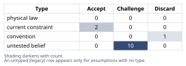
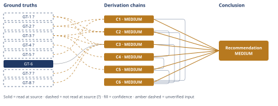

# Should the B2B SaaS Product Add a Free Tier

*First-principles analysis · 11 October 2026*

*Read with: [How to read this analysis](HOW-TO-READ.md) · [Working file](analysis-20261011T024547Z.md) · [All files](INDEX.md)*

## Executive Summary

**Recommendation:** Do not launch a full, permanent free tier, and do not reject the idea outright — run a single, capped, time-boxed, instrumented pilot instead: ICP-gated signups, nurture-track (not SDR) routing, self-serve-only support, a 6-month/minimum-volume window, and pre-set numeric scale/kill thresholds decided before launch (chain C6).

**Band (from §6):** MEDIUM (chain C6)

**Would change it:** Reading Finance's actual cost-per-active-free-user model (resolves GT-3?), and the pilot itself producing a measured conversion rate and measured cost that clear (or miss) the breakeven bar with a 1.5x margin while outbound pipeline and paid-customer support SLAs stay undisturbed (chains C3, C4).

## 1. Problem Essence

**Core problem:** Given a $2.4M-ARR, 240-paying-team B2B SaaS business built entirely on outbound sales with no self-serve infrastructure, and a free-tier cost structure that is decoupled from revenue (scales with active-user signups, which may include non-ICP users), should the company add a free tier — and if the answer is conditional rather than a flat yes/no, exactly what measured evidence would move the recommendation to "scale" or to "kill"?

**Success criteria:**
1. The Conclusion states a definite action (launch / do not launch / conditional pilot), not a balanced pros-and-cons list with no recommendation.
2. If the recommendation is conditional, the Conclusion names specific, operationally-checkable thresholds (a conversion rate measured against measured cost, an outbound-pipeline/support-SLA non-disruption bar, a dated checkpoint) that would move the recommendation to "scale" or to "kill" — not vague language like "monitor and reassess."
3. The Conclusion explicitly states whether competitor free-tier prevalence is treated as evidence for this decision, and why.
4. The Conclusion's unit-economics claim is traceable to an explicit breakeven calculation that ties the stated ~$10,000 ACV to the stated usage-scaled cost structure.
5. The Conclusion explicitly addresses both named second-order risks — support load on the existing paying-customer base, and sales-team cannibalization/confusion — rather than only in the abstract.

## 2. Assumptions Table

| Assumption | Type | Treatment | Verdict | Verification |
|---|---|---|---|---|
| Because all named competitors have a free tier, this company should have one too. | convention | Explicitly challenge before use — ask whether the convention holds in this specific context or merely carries historical inertia. | Discard — an analogy to competitors' unknown ACV, segment, and unit economics carries no evidentiary weight for this decision (chain C1) | unverified — flagged |
| A free tier would generate meaningful self-serve inbound signup volume. | untested belief | Verify, or flag as unverified. | Challenge — no inbound channel or demand-generation motion currently exists (GT-2?), so volume cannot be assumed; a load-bearing precondition surfaced by inversion | unverified — flagged |
| The product can deliver standalone activation value to a free/self-serve user without the sales-assisted onboarding the paid motion relies on. | untested belief | Verify, or flag as unverified. | Challenge — load-bearing precondition surfaced by inversion; no evidence either way given GT-2?/GT-4? | unverified — flagged |
| Free-to-paid conversion for this product/market will fall within typical freemium B2B benchmarks. | untested belief | Verify, or flag as unverified. | Challenge — no internal pilot data exists (GT-4?); the benchmark itself (GT-7?) is sourced from secondary aggregators, used only to sanity-check chain C3, not to drive the decision | unverified — flagged |
| Non-ICP signup volume (and the usage-scaled cost it drives) can be contained or filtered without major engineering investment. | untested belief | Verify, or flag as unverified. | Challenge — load-bearing precondition surfaced by inversion; directly at risk per GT-3?'s stated fact that cost is usage-scaled and may include non-ICP users | unverified — flagged |
| The existing outbound sales team and support org can absorb a parallel self-serve motion without confusion, cannibalization, or SLA degradation for paying customers. | current constraint | Record the expiry conditions — what would have to change for this constraint to lift. | Accept — expires once explicit rules of engagement, comp-plan clarification, and tiered (self-serve-only) support are built and operational (chains C4, C5); until then this is a real current limit, not a permanent one | unverified — flagged |
| Free-tier infrastructure/support cost per active free user is small relative to the $10,000 ACV (modeled on the order of tens to a few hundred dollars/year). | untested belief | Verify, or flag as unverified. | Challenge — no company-specific figure is given; used only as an explicitly bracketed low/mid/high modeling input in chain C3, not asserted as fact | unverified — flagged |
| Building minimum self-serve infrastructure (signup, usage metering, basic support deflection) for a small gated pilot is achievable without derailing the core product roadmap. | current constraint | Record the expiry conditions — what would have to change for this constraint to lift. | Accept — expires once the company explicitly allocates a bounded engineering budget/timeline to the pilot (chain C2); until that allocation is made this is an open resourcing question | unverified — flagged |
| If a free tier is launched without caps, kill criteria, or process definition, it tends to become a permanent, hard-to-kill cost center regardless of actual performance. | untested belief | Verify, or flag as unverified. | Challenge — a well-documented organizational-behavior pattern (sunk cost / "customers are using it" lock-in) surfaced via pre-mortem, but not verified for this specific company's future behavior | unverified — flagged |
| A single pilot window (e.g., 6 months) is long enough to produce a statistically/operationally meaningful read on conversion rate and cost containment, given likely-low initial signup volume for a company with no existing inbound channel. | untested belief | Verify, or flag as unverified. | Challenge — surfaced by the end-of-Phase-4 Assumption Audit on chain C6's conclusion hop; if signup volume is very low, a pure time window may be insufficient, which is why the recommended design pairs the time gate with a minimum-signup-volume gate (chain C6) | unverified — flagged |
| The weight assignments used in the trade-off analysis (relative criteria importance) reflect genuine organizational priorities rather than being reverse-engineered to favor the pilot option. | untested belief | Verify, or flag as unverified. | Challenge — surfaced by the end-of-Phase-4 Assumption Audit on chain C2's first hop; weights were locked before scoring per the trade-off procedure's discipline, and the flip test explicitly prices this sensitivity rather than leaving it unpriced | unverified — flagged |
| The company's gross margin on paid ACV is approximately 75%, a typical SaaS range, rather than a figure specific to this company. | untested belief | Verify, or flag as unverified. | Challenge — surfaced by the end-of-Phase-4 Assumption Audit on chain C3's first hop; used as an explicit modeling placeholder, not a verified company figure | unverified — flagged |
| The three stakeholder viewpoints used in the pre-mortem (engineering/support, sales, finance/exec) surface the dominant failure causes without needing additional viewpoints to be complete. | untested belief | Verify, or flag as unverified. | Challenge — surfaced by the end-of-Phase-4 Assumption Audit on chain C5's first hop; a customer-viewpoint or competitor-viewpoint pass might surface additional causes (e.g., paying customers perceiving a free tier as devaluing their contract) not captured here | unverified — flagged |

## 3. Ground Truths

**A note on provenance for this analysis.** GT-1 through GT-5 are facts the decision-maker stipulated directly as the premises of this hypothetical planning scenario (an unnamed company); no external, independently-openable source exists for them (there is no real named company or filing to read), so the Phase 3 verification step's "attempt to open the cited source" is not applicable to those five entries — each carries a Phase 3 failure record stating this. GT-7 and GT-8 were obtained by this analysis via live web search of real industry commentary; a source was opened and read by this analysis, but the figures it reports trace to secondary aggregators and vendor blogs rather than the primary datasets they cite, so they are marked `reported-by-delegate` rather than `read-at-source`. GT-6 is a derived algebraic identity, not a sourced figure — its "source" is the rearrangement itself, verified by independent recomputation in the adversarial pass's Recompute step.

- **GT-1?** Current ARR is $2.4M from 240 paying teams, at an average contract value (ACV) of ~$10,000/team/year. — unverified: stipulated by the decision-maker for this hypothetical scenario; no external source exists to open (Phase 3 failure record: no source — hypothetical scenario, not a real named company)
- **GT-2?** Go-to-market today is 100% outbound sales + referrals; there is no self-serve inbound/PLG channel — no signup flow, no in-product usage-data pipeline for lead scoring, no self-serve acquisition muscle. — unverified: stipulated by the decision-maker (Phase 3 failure record: no source — hypothetical scenario)
- **GT-3?** Finance has confirmed that free-tier costs (infrastructure + support) scale with active users, not with paying seats/revenue — the cost structure is decoupled from revenue and tied to usage/signups, which could include non-ICP users. — cited to: internal Finance function; reported-by-delegate: named source ("Finance") but this analysis did not open Finance's underlying cost model (Phase 3 failure record: no openable source — hypothetical scenario; the named source is internal and unreachable to this analysis in any case)
- **GT-4?** The company has never run a freemium pilot; no internal data exists on free-to-paid conversion rate for this product/market. — unverified: stipulated by the decision-maker (Phase 3 failure record: no source — hypothetical scenario)
- **GT-5?** All named competitors currently offer a free tier (stated as fact only; the task explicitly frames this as something to examine, not evidence to assume is meaningful). — unverified: stipulated by the decision-maker (Phase 3 failure record: no source — hypothetical scenario; competitors are unnamed)
- **GT-6** Unit-economics breakeven identity: for a cohort of free signups, breakeven requires `conv × contribution_margin_per_converted_customer ≥ c` (fully-loaded annual cost per active free user), i.e. `conv ≥ c / contribution_margin` — a direct algebraic rearrangement of "converted revenue must cover the cost of the free population," given the cost structure GT-3? describes and the ACV GT-1? states. — source: definitional (algebraic identity, not an empirical claim); read-at-source: n/a — verified by independent recomputation in the adversarial pass's Recompute step, not by reading a document
- **GT-7?** Commonly cited B2B SaaS self-serve freemium free-to-paid conversion-rate benchmarks cluster roughly in a 2-8% range at the median (ChartMogul/ProductLed/Growth-Unhinged survey of ~200 B2B software products, as summarized by Userpilot; First Page Sage's 80+-client average of 3.7%), with top-quartile self-serve performers reaching 10-15%+ and B2B-specific cohorts reportedly higher (6-10% median, 15-20% top quartile per one Userpilot citation of Lenny Rachitsky's research); one analysis (Tomasz Tunguz, as cited by a secondary blog) puts average self-serve signup-to-paid conversion as low as ~4%. Trial-based (time-limited, not freemium) conversion is materially higher (median ~18.5% per Flint's aggregation). — cited to: Userpilot, First Page Sage, Flint, and secondary citations of ChartMogul/ProductLed/Growth Unhinged and Tomasz Tunguz; reported-by-delegate: WebSearch results read directly by this analysis, 2026-10-10 — the primary underlying reports/datasets were not independently opened by this analysis, and the search output itself flags these figures as sourced from vendor blogs/secondary aggregators rather than primary datasets
- **GT-8?** No rigorous public case study quantifies infrastructure/support cost per free user directly. Vendor commentary describes the cost driver as support-team time plus infra/compute and onboarding, and warns freemium struggles specifically when support cost per free user is high relative to a small total addressable market; anecdotal founder reports describe free-user lifetime value as low as ~$20 (after ~4-month average free-tier retention), and at least one PLG company executive (Airplane's CEO, as quoted in secondary coverage) described an overly generous free tier as a strategic mistake that required aggressive re-monetization. — cited to: Monetizely, Indie Hackers, Atticus Li, Sacra (vendor/founder commentary); reported-by-delegate: WebSearch results read directly by this analysis, 2026-10-10 — no primary case study was located or opened by this analysis

**Provenance summary:** `?`-marked: GT-1, GT-2, GT-3, GT-4, GT-5, GT-7, GT-8 (7 of 8). Read-at-source: GT-6 — n/a, a derived algebraic identity verified by independent recomputation rather than by a page/table/passage reference (see the adversarial pass's Recompute step). No unsuffixed ground truth in this analysis feeds a HIGH-confidence chain (every chain in section 4 is rated MEDIUM, per the Inputs-axis ceiling each inherits from its `?`-marked head inputs), so the HIGH-chain read-at-source naming requirement is not triggered for GT-6 or any other entry.

## 4. Derivation Chains

### Conclusion C1: Competitor free-tier prevalence is not evidence for this decision

GT-5? (all named competitors have a free tier, fact only) + GT-2? (100% outbound GTM today, no self-serve infra)
→ without data on competitors' ACV, target segment, or whether their free tier is actually profitable (as opposed to legacy, vestigial, or a loss-leader), GT-5? supplies no information about causality, and this company's outbound-built, higher-touch delivery model (GT-2?) gives no reason to assume segment similarity
→ treating competitor parity as a reason to launch is therefore an analogy to an unverified comparison case, which first-principles reasoning treats as inadmissible direct evidence on its own
→ the free-tier decision must be made on this company's own unit economics and operating constraints, not on competitor parity

**Confidence:** MEDIUM — GT-5? and GT-2? are both unverified stipulated facts with no external source to open (see §3). Verification of GT-5? would mean directly inspecting competitors' published pricing/segment data; verification of GT-2? would mean auditing internal product/CRM data. Neither verification would change this chain's endpoint: the argument is that even granting both facts exactly as stated, they still supply no evidentiary weight for this decision, so resolving the `?`s would not move this conclusion — only the Inputs axis is short, and it is short in a way the conclusion is already robust to.

### Conclusion C2: A capped, instrumented pilot beats both "do nothing" and a full launch on a weighted trade-off

GT-1? (ARR $2.4M / 240 teams / ~$10k ACV, outbound revenue base) + GT-2? (no self-serve infra) + GT-3? (usage-scaled free-tier cost, non-ICP-inclusive)
→ scoring four GTM options — status quo, a full org-wide freemium launch, a gated/instrumented pilot, and a time-limited free-trial program — against six weighted criteria (unit-economics viability, outbound-motion preservation, resourcing required, time-to-signal, reversibility, market-expansion potential) *[Assumes: A-11]* yields weighted totals of 97 (status quo), 56 (full launch), 101 (gated pilot), and 93 (free-trial), with the gated pilot winning
→ the flip test shows a 2-point reduction of the Time-to-signal weight (4→2) would tie or flip the result toward status quo, but that reduction is not independently justified — it would only make sense if the org already had resolving information on conversion and cost, which GT-4? establishes it does not — so the rival (status quo) is ruled out rather than merely outscored
→ resourcing a small, capped, time-boxed, instrumented free-tier pilot is the trade-off-preferred option over doing nothing, a full freemium launch, or a trial-only program

**Confidence:** MEDIUM — GT-1?, GT-2?, and GT-3? are stipulated facts with no external source to open; verification would mean confirming the ARR/ACV figures against actual billing data, confirming the no-PLG-infra claim against an internal systems audit, and confirming Finance's cost-scaling claim by reading Finance's underlying cost model directly. The weight-assignment risk (A-11) is priced via the flip test rather than left unpriced, so Inference is not an independent shortfall here — only the Inputs axis is short.

### Conclusion C3: Unit economics are structurally plausible but unproven; cost containment and conversion, not the ACV-to-cost ratio, are the pivotal unmeasured variables

GT-1? (ACV ~$10,000) + GT-3? (usage-scaled free-tier cost incl. non-ICP) + GT-6 (breakeven identity) + GT-7? (industry conversion benchmark ~2-8%) + GT-8? (cost-driver / anecdotal free-user cost risk)
→ applying GT-6's identity with a bracketed free-tier cost of $20 / $75 / $300 per active user per year *[Assumes: A-7]* against a $7,500 first-year contribution margin per converted customer (75% gross margin × $10k ACV) *[Assumes: A-12]* yields a breakeven conversion requirement of 0.27%-4.0%
→ this range sits at or below the low-to-mid end of GT-7?'s commonly-cited 2-8% industry benchmark, but its high end (4.0%) is driven specifically by the uncontained non-ICP cost risk GT-3?/GT-8? describe, and clearing it requires ICP-filtering and self-serve-activation capability that GT-2? confirms does not yet exist
→ unit economics are structurally plausible but unproven — the pivotal unmeasured variables are free-tier cost containment and realized conversion, not the ACV-to-cost ratio itself

**Confidence:** MEDIUM — four of five head inputs are `?`-marked. GT-1?/GT-3? verification requires the same internal data access named under chain C2; GT-7?/GT-8? verification requires opening the primary reports (the ChartMogul/ProductLed survey, Tunguz's dataset, First Page Sage's underlying client data) rather than the secondary aggregator pages this analysis's web search actually read. The cost and margin modeling inputs (A-7, A-12) are explicitly bracketed low/mid/high rather than asserted as single-point facts, which prices that sensitivity directly within this chain's own first hop — the decision-resolution check in that hop (the bracket straddles the viability threshold rather than clearing it outright) is this chain's own honest statement of its limit, not an unaddressed rival.

### Conclusion C4: An un-gated launch's second- and third-order effects threaten the decision's own success criterion

C2 (gated pilot recommended on trade-off grounds) + GT-3? (usage-scaled free-tier cost)
→ extending the actor lens on an un-gated full launch: support teams built for high-touch paid service absorb high-volume low-value free tickets, degrading paid-customer SLA, while sales reps with no rules of engagement either misdirect effort toward low-probability free leads or ignore free signups entirely *[Assumes: A-6]*
→ extending the time lens: these effects are small immediately, since no inbound channel exists yet to generate volume, but compound over one to two quarters into a growing, unbudgeted cost line that becomes politically resistant to shutdown once free users are live *[Assumes: A-9]*, directly undermining the decision's own success criterion of incremental growth without damage to the existing $2.4M ARR engine
→ these second- and third-order effects specifically indict an un-gated, full-scale launch and define exactly what the gated-pilot design (chain C2) must be built to suppress

**Confidence:** MEDIUM — inherits C2's MEDIUM band and GT-3?'s unverified status. A-6 and A-9 are both named on their originating hops: A-9's organizational-stickiness claim, while plausible and consistent with GT-4?'s stated absence of any kill-criteria practice, is not independently verified for this specific company — it would only be confirmed or disconfirmed by observing how this company actually behaves once a pilot is live, which is precisely what chain C5's pre-committed kill criteria are designed to pre-empt rather than merely observe.

### Conclusion C5: Only a capped, ring-fenced, kill-criteria-bound pilot survives adversarial pre-mortem scrutiny

C4 (undermining second-order effects) + GT-4? (no internal pilot or kill-criteria practice exists)
→ running a pre-mortem on "a full, permanent free tier was launched and one year later is being quietly shut down" from engineering/support, sales, and finance/exec viewpoints *[Assumes: A-13]* surfaces three clusters of cause: uncapped non-ICP cost growth, undefined sales/support rules of engagement, and absent pre-committed kill criteria
→ all three clusters triage as fatal-or-costly rather than tolerable, and each is avoidable by sequencing — usage/signup caps, written rules of engagement, and dated numeric kill/scale thresholds set before launch rather than negotiated after seeing results
→ the only version of a free tier this analysis can support is one that is capped, ring-fenced, and pre-committed to dated kill/scale thresholds from day one, giving chain C2's trade-off-preferred option its concrete operational content

**Confidence:** MEDIUM — inherits C4's MEDIUM band and GT-4?'s unverified status. A-13 (three-viewpoint completeness) is named on its originating hop: a customer-viewpoint or competitor-viewpoint pass might surface additional causes (e.g., existing paying customers perceiving a free tier as devaluing their own contract) that this pre-mortem did not run and that would need to be added before the pilot design is considered exhaustive.

### Conclusion C6: Launch a conditional, capped pilot — not a full launch, not outright rejection

C1 (competitor-parity inert) + C2 (gated pilot wins trade-off) + C3 (unit economics plausible but unproven) + C5 (pre-mortem-derived operational safeguards required)
→ C1 and C2 together establish that neither blind imitation nor blind rejection is justified, and the decision must rest on this company's own measurable unit economics, which C3 shows are structurally plausible but currently unmeasured
→ C3 and C5 together establish that a bounded, instrumented, safeguarded pilot is the only design that both tests the unproven variables (conversion, cost containment) and avoids the specific failure modes the pre-mortem identifies as fatal *[Assumes: A-10]*
→ the correct action is a conditional launch — a capped, time-boxed, ring-fenced pilot now, scaled only if it clears a pre-set unit-economics and non-disruption bar, and killed by default if it does not

**Confidence:** MEDIUM — every contributing chain (C1, C2, C3, C5) is itself MEDIUM, each for the reasons stated on its own confidence line above; A-10 (pilot-window-length adequacy) is named on this chain's own conclusion hop and is not yet resolved — it is explicitly folded into the recommended pilot design as a minimum-signup-volume gate alongside the time gate, per the Conclusion section's trade-offs.

**Unverified input rule (D-07), applied once across this section:** every chain above carries at least one `GT-N?` input and is accordingly capped at MEDIUM; each chain's own confidence line names its `?`-marked inputs and the verification that would remove each as a cause of the downgrade, and names any cited `Cn` rated below HIGH without re-explaining that chain's own rationale.

## 5. Abandoned Reasoning

### Dead End: Competitor base-rate as positive evidence

**What was tried:** Early in the analysis, considered treating "every named competitor has a free tier" (GT-5?) as weak positive base-rate evidence — reasoning that if an entire category of companies converges on a practice, that convergence itself might reveal a market-level truth worth some weight, even without company-specific data.

**Why abandoned:** This is reasoning by analogy without grounding in a verified fact about the comparison case, which the methodology explicitly bans as direct evidence. It also ignores survivorship bias (only surviving free tiers are observed, not abandoned ones) and ignores GT-2?'s own signal that this company's outbound-built, higher-touch delivery model may differ structurally from more self-serve-native competitors. Ruled out by chain C1.

**What it ruled out:** Saves a future reviewer from re-litigating "but everyone else does it" as a standalone argument. The prevalence fact is retained in the Ground Truths list (GT-5?) and explicitly neutralized rather than silently dropped.

### Dead End: Full launch now, treating the downside as a reversible cost center

**What was tried:** Considered recommending an immediate, full, org-wide freemium launch on the reasoning that the downside is bounded — if it does not work, the tier can simply be shut down later, so the fastest path to learning is to launch broadly now rather than gate a small pilot.

**Why abandoned:** The pre-mortem (chain C5) specifically identifies that live free-tier "users," once they exist, create political and behavioral stickiness that makes shutdown far harder in practice than "just turn it off" assumes, and that without pre-committed kill criteria a a cost center with no offsetting revenue (GT-3?) tends to persist by default rather than being actively killed. The trade-off scoring (chain C2) also shows this option scoring lowest of the four (56 vs. 101 for the gated pilot) on resourcing, outbound-motion preservation, and reversibility. Ruled out by cluster 3 of the pre-mortem (chain C5) and the trade-off scores of chain C2.

**What it ruled out:** Saves a future reviewer from treating "we can always shut it down" as sufficient risk management — it is not, absent caps and pre-committed thresholds decided before launch.

### Dead End: Outright rejection on the basis of "we have no self-serve muscle"

**What was tried:** Considered recommending against any free tier at all, reasoning that the organization has never built self-serve acquisition infrastructure (GT-2?) and that building it now is a distraction from the proven outbound motion that already generates $2.4M ARR.

**Why abandoned:** The Fermi estimate (chain C3) shows the unit economics are structurally plausible given the high ACV ($10,000) relative to plausible free-tier costs ($20-$300/year) — even the bracket's harder, high-cost end (requiring ~4% conversion) sits within commonly-cited industry benchmarks (GT-7?). Rejecting the option outright on organizational-inertia grounds, without testing the one thing that is actually unmeasured (cost containment and conversion for this specific company), is the same unexamined-assumption error as blindly copying competitors — just pointed in the opposite direction. Ruled out by chain C3.

**What it ruled out:** Saves a future reviewer from treating "we've never done this before" as a sufficient reason not to test it; the organization's lack of self-serve muscle is a real current constraint (A-8) with an expiry condition, not a permanent bar.

## 6. Conclusion

**Recommended approach:** Run a single, capped, time-boxed, instrumented free-tier pilot rather than launching a full, permanent tier or rejecting the idea outright (chain C6):
- Cap total free signups/active users, gate signups with a lightweight ICP filter (e.g., company email domain, minimum team size), route free signups to a separate, unstaffed nurture track rather than the outbound SDR queue, and give free users self-serve/community support only, with no human SLA (chain C5).
- Run the pilot for a minimum of 6 months or until a pre-set minimum-signup-volume threshold is reached, whichever is later (chain C6).
- Scale only if measured free-to-paid conversion clears the pilot's own measured-cost-implied breakeven threshold with at least a 1.5x safety margin, and only if outbound pipeline volume and paid-customer support SLAs show no measurable negative deviation during the pilot (chains C3, C4).
- Kill by default, not by renewed debate, if either bar is not cleared by the pre-committed checkpoint date (chain C5).

**Key insight:** Competitor parity is not evidence for this decision (chain C1); the real decision-relevant uncertainty is not whether a $10,000-ACV business can support a free tier in principle — it structurally can, since even the bracket's harder end (a ~4% breakeven conversion requirement against a $300/user/year cost) sits within commonly-cited industry benchmarks — but whether this specific company can contain non-ICP cost and achieve real conversion without any existing self-serve capability, which is currently unmeasured (chain C3).

**Trade-offs acknowledged:**
- This recommendation defers the faster, larger market-expansion upside a full freemium launch could in principle capture, in exchange for bounded downside and a clean read on the variables that actually matter (chain C2).
- It commits real, if modest, engineering and process-design resourcing to the pilot rather than deploying that capacity entirely within the proven outbound motion — an opportunity cost accepted deliberately, not ignored (chain C2).
- The pilot's 6-month/volume-gated window itself carries risk of being too short given this company's current zero self-serve signup flow; if pilot signup volume is too low for a statistically meaningful conversion read, the correct response is to extend the volume gate, not to declare success or failure prematurely (chain C6).

**Confidence:** MEDIUM — every contributing chain (C1, C2, C3, C4, C5, C6) is rated MEDIUM, each for the reasons stated on its own confidence line in section 4; no `GT-N?` input is rested on directly here — every unverified input is routed through the named chains, whose own confidence lines carry the explanation. The dominant lever that would raise this to HIGH is resolving GT-3? at source (reading Finance's actual cost model) and then running the pilot itself to replace GT-7?/GT-8?'s secondary-sourced benchmarks with this company's own measured conversion and cost figures (chains C3, C4).
