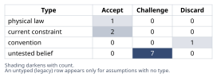
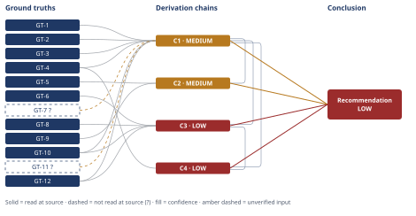

# Wind Turbine Gearbox Bearing Failure Root Cause

*First-principles analysis · 11 October 2026*

*Read with: [How to read this analysis](HOW-TO-READ.md) · [Working file](analysis-20261011T003840Z.md) · [All files](INDEX.md)*

## Executive Summary

**Recommendation:** Reject the operator's lubricant-viscosity/boundary-lubrication wear-through hypothesis (chain C1) — the subsurface origin, WECs, and butterfly microstructure are inconsistent with surface-initiated wear-through; this is a WEC-associated subsurface rolling-contact-fatigue failure (chain C1), corroborated by its timing falling inside the documented 1-20%-of-L10 WEC failure window (chain C2). Run SEM fractography, used-oil chemistry, shaft-voltage/grounding, and shaft-alignment diagnostics to discriminate among three currently co-equal upstream triggers — tribochemical/moisture, overload/misalignment, and electrical current (chain C3) — before deciding on insulated-bearing/grounding hardware or an alignment fix (chain C4); adopt a tightened clean-steel rating and anti-WEC lubricant chemistry now regardless (chain C4).

**Band (from §6):** LOW overall — the mechanism-refutation finding (C1, C2) is independently MEDIUM, but the upstream-trigger attribution and conditional hardware recommendation (C3, C4) are LOW because three live rivals remain unsettled.

**Would change it:** SEM fractography confirming the crack origin as truly subsurface (not a wear-thinned surface) and either melt/recast craters (electrical) or their absence; used-oil chemistry across the cold snap (moisture/TAN/additive depletion); shaft-voltage and grounding measurement; and a shaft-alignment/torque-history review — any of these would resolve chain C3's three-way indeterminacy and move the Confidence band.

## 1. Problem Essence

**Core problem:** Does the physical and metallurgical evidence from this HSS generator-end gearbox bearing failure support the operator's claimed mechanism (low lubricant viscosity during a cold snap → boundary lubrication → wear-through), or does the evidence point to a different damage mechanism and a different upstream trigger — and if different, what specific, defensible change to the replacement bearing/lubrication/electrical specification does the evidence support?

**Success criteria:**
- The accepted mechanism must explain all observed features simultaneously: the axial-aligned ~18 mm spall, the subsurface crack origin at ~0.4 mm, the white-etching cracks (WECs), the butterfly microstructure, and the failure timing at ~11% of L10 — not only the headline spall.
- The analysis states explicitly whether the operator's hypothesis is consistent or inconsistent with the evidence, and names the specific evidence that decides it.
- The conclusion is falsifiable — it names the observation that would overturn it.
- The analysis resolves to an actionable spec decision, or names explicitly what remains unresolved and the test that would close each gap, rather than asserting false certainty.
- The answer is not required to be a single named mechanism among (a)-(f) in the brief if the evidence supports more than one acting together — WEC literature itself treats several of these as frequent co-factors rather than mutually exclusive single causes.

## 2. Assumptions Table



| Assumption | Type | Treatment | Verdict | Verification |
|---|---|---|---|---|
| A-1: Lubricant viscosity was depressed below the design film-thickness requirement during a cold snap | untested belief | Verify via used-oil viscosity-at-temperature records bracketing the cold snap, or flag as unverified | Challenge — no CM/oil-analysis data was supplied to support the claim; it is an inference from seasonal timing, not a measurement | unverified — flagged, A-1 |
| A-2: Boundary lubrication (asperity contact from low viscosity) led to wear-through of the inner race | convention (the standard default narrative for a cold-weather bearing failure in wind operations) | Challenge directly against the observed failure morphology before accepting | Discard — contradicted by GT-2, GT-3, GT-4 (subsurface origin, WEC, and butterfly microstructure are not products of surface wear-through); see chain C1 | contradicted by GT-2/GT-3/GT-4/GT-11? |
| A-3: A step-change in HSS vibration kurtosis reliably indicates a developing mechanical spall rather than, e.g., early-stage electrical pitting | current constraint | Record the expiry condition: holds only while the CM system's feature set is tuned to impulsive/spall signatures and not also validated against electrical-damage signatures | Accept — expires if/when CM is shown not to discriminate mechanism; adequate for detection, not for mechanism attribution | vendor CM system documentation (not independently checked in this analysis) |
| A-4: The gearbox lubricant and additive package were within spec and not chemically degraded (moisture, TAN, additive depletion) before the cold snap | untested belief | Verify via used-oil analysis bracketing the cold snap | Challenge — unverified; directly relevant to the tribochemical/moisture candidate in chain C3 | unverified — flagged, A-4 |
| A-5: No abnormal shaft voltage, common-mode discharge, or grounding deficiency exists at the generator-end bearing | untested belief | Verify via shaft-voltage/grounding measurement | Challenge — unverified; directly relevant to the electrical-current candidate in chain C3 | unverified — flagged, A-5 |
| A-6: The failed bearing's steel met its specified clean-steel non-metallic-inclusion-content rating | untested belief | Verify via inclusion-rating metallurgical check against spec (e.g., ASTM E45 or E1245 or equivalent) | Challenge — unverified; bears on whether classical inclusion-driven RCF is an independent, self-sufficient contributing factor, since GT-4 names inclusions and carbides as the butterfly nucleation sites and GT-12 shows stress-driven fatigue alone can produce WEC-like white etching | unverified — flagged, A-6 |
| A-7: No other drivetrain bearing (LSS, intermediate stage, HSS non-generator end) shows fluting or frosting | untested belief | Verify by visual or borescope inspection of the remaining bearing set while the gearbox is open | Challenge — unverified; would help discriminate a turbine-wide electrical problem from a localized cause at this bearing specifically | unverified — flagged, A-7 |
| A-8: The surface-vs-subsurface damage-initiation distinction (boundary wear-through initiates at the surface; WEC and butterfly initiate subsurface) is a contact-mechanics fact, not a contested empirical claim | physical law | Accept as a ground-truth-level distinction underpinning chain C1; the load-bearing basis is contact mechanics and metallurgy fundamentals, not merely a literature preference | Accept — the distinction itself is standard tribology; the specific supporting citation (GT-11) remains unverified | GT-7?, GT-11? (reported-by-delegate) |
| A-9: Sister turbines in the fleet share a comparable converter and grounding design to this unit | untested belief | Verify via fleet electrical and drivetrain configuration records, relevant only if C3's electrical-cause candidate is confirmed dominant | Challenge — unverified; surfaced by chain C4's third-order extension (fleet-risk escalation) | unverified — flagged, A-9 |
| A-10: The O&M organization has capacity and budget to add moisture and TAN monitoring to its routine oil-sampling cadence | current constraint | Record the expiry condition: holds only until staffing or budget is reallocated to support expanded sampling; this is organizational, not physical | Accept — expires if O&M resourcing changes; surfaced by chain C4's second-order extension | not independently verified — organizational constraint, flagged A-10 |
| A-13: No shaft misalignment or sustained overload condition is present at the generator-end bearing | untested belief | Verify via shaft-alignment survey and torque/load-history review from SCADA | Challenge — unverified; surfaced by chain C3's revised weighing after GT-12 (read at primary source) showed stress-driven fatigue with WEC as a secondary crack-face-rubbing artifact is a credible, self-sufficient alternative that does not require hydrogen or electrical charging | unverified — flagged, A-13 |

## 3. Ground Truths

**Verified ground truths (provenance `read-at-source` — direct observation, supplied as given failure facts of this case, no suffix):**

- **GT-1** Inner race shows axial-aligned spalling approximately 18 mm long — source: disassembly findings as reported in the failure brief; read-at-source: the failure-facts statement itself (direct physical observation, not a literature claim)
- **GT-2** Crescent-shaped microcracks propagate from a subsurface origin approximately 0.4 mm below the raceway surface — source: disassembly findings as reported in the failure brief; read-at-source: the failure-facts statement itself
- **GT-3** Metallography through the spall shows white-etching cracks (WECs) — source: metallography findings as reported in the failure brief; read-at-source: the failure-facts statement itself
- **GT-4** Metallography shows butterfly microstructure (white-etching areas around nonmetallic inclusions or carbide features) — source: metallography findings as reported in the failure brief; read-at-source: the failure-facts statement itself
- **GT-5** Failure (removal triggered by a step increase in HSS vibration kurtosis) occurred at ~14,000 operating hours against a design L10 of ~130,000 hours, i.e. ~11% of design L10 — source: operating-hours and design-life figures as reported in the failure brief; read-at-source: the failure-facts statement itself
- **GT-6** The failed component is the cylindrical roller bearing at the HSS generator end — the rolling-element bearing electrically closest to the generator/converter in this drivetrain — source: component identification as reported in the failure brief; read-at-source: the failure-facts statement itself
- **GT-8** Electrical EDM-type bearing-current damage produces "equally spaced flutes ... running transversely to the direction of travel," developing from "shallow craters, positioned closely together" — a distributed, periodic circumferential pattern, mechanistically distinct from a single localized axial spall — source: Onyx Insight Failure Atlas, "Electrical fluting bearing failure"; read-at-source: directly fetched and quoted via WebFetch on this page, 2026-10-10
- **GT-9** Wind turbine gearbox bearings affected by white-etching cracks (WECs) fail "sometimes as early as 1-20% of expected L10 life" — source: Imperial College London study, "A study into the origins and significance of white etching cracks in bearing steels" (Spiral repository); read-at-source: directly fetched and quoted via WebFetch on this page, 2026-10-10
- **GT-10** Current literature shows "no agreement on the root causes of WECs, with numerous theories having been proposed" — source: same Imperial College London study abstract; read-at-source: directly fetched and quoted via WebFetch on this page, 2026-10-10
- **GT-12** One credible, evidence-based theory (from the same study) holds that applied contact stress initiates fatigue cracks early in operation, which propagate slowly with crack-face rubbing generating the white-etching microstructural alteration as a secondary artifact — stated directly: "WECs are simply a symptom of a specific stress history, not a cause of eventual component failure" — meaning stress-driven fatigue (e.g., from overload or misalignment) can produce WEC-like white etching without requiring hydrogen charging or electrical current as the trigger — source: same Imperial College London study abstract; read-at-source: directly fetched and quoted via WebFetch on this page, 2026-10-10

**Delegate-reported ground truths (provenance `reported-by-delegate` — `?` required; sourced via WebSearch summaries of the literature, not opened directly by this analysis):**

- **GT-7?** Butterfly microstructure is the established classical signature of subsurface non-metallic-inclusion/carbide stress concentration under rolling contact, typically oriented near 45° to the rolling direction, and occurs under otherwise-adequate (not boundary/starved) lubrication film conditions — cited to: Purdue dissertation on microstructural alterations in bearing steel under RCF, and related tribology literature; reported-by-delegate: WebSearch summary — cited source not opened directly by this analysis
- **GT-11?** Boundary-lubrication wear-through (classical insufficient-film failure from low viscosity) manifests as surface-initiated damage — micropitting, adhesive scuffing/smearing, abrasive scoring — beginning at the raceway surface and progressing inward, not as a subsurface-origin spall with WEC/butterfly microstructure at measurable depth — cited to: standard elastohydrodynamic-lubrication/boundary-lubrication contact-mechanics fundamentals, cross-checked against the WEC-literature search summaries; reported-by-delegate: WebSearch summary — not opened at a specific primary contact-mechanics source, though the underlying surface-vs-subsurface distinction follows directly from contact mechanics rather than resting on a contested empirical claim (noted explicitly because it affects how far chain C1 can be trusted despite the `?`)

**Provenance summary (required):**

```text
?-marked: GT-7, GT-11 (2 of 12)
Read-at-source: GT-1, GT-2, GT-3, GT-4, GT-5, GT-6 — the failure-facts statement supplied with this request (direct disassembly/metallography/operating-hours observations)
Read-at-source: GT-8 — Onyx Insight Failure Atlas, "Electrical fluting bearing failure" page, quoted directly via WebFetch
Read-at-source: GT-9, GT-10, GT-12 — Imperial College London Spiral repository abstract for "A study into the origins and significance of white etching cracks in bearing steels," quoted directly via WebFetch
```

## 4. Derivation Chains



### Conclusion C1: The operator's lubricant-viscosity/boundary-lubrication wear-through hypothesis is refuted; the damage mechanism is WEC-associated subsurface rolling contact fatigue

GT-1 (axial 18 mm spall) + GT-2 (subsurface origin at 0.4 mm) + GT-3 (WECs present) + GT-4 (butterfly microstructure at inclusion/carbide sites) + GT-7? (butterfly is a subsurface-inclusion RCF signature under adequate film) + GT-10 (no literature consensus on WEC root cause) + GT-11? (boundary wear-through initiates at the surface) + GT-12 (stress-driven fatigue with crack-face rubbing can produce WEC-like white etching without hydrogen or electrical charging)
→ the crack network originates below the raceway surface and propagates outward into the spall, which is the reverse of how surface-initiated boundary-lubrication wear-through develops [Assumes: A-8]
→ WEC and butterfly microstructure are documented as arising from subsurface stress concentration and crack propagation, whether via hydrogen-assisted cracking or via a purely stress-driven crack-face-rubbing pathway, and neither pathway is a surface-asperity-wear phenomenon
→ under every credible pathway the literature currently proposes for WEC formation, the morphology observed here matches subsurface-initiated rolling-contact fatigue rather than boundary-lubrication wear-through

**Confidence:** MEDIUM — GT-7? and GT-11? remain reported-by-delegate (WebSearch summaries, not opened at primary source); the verification that would remove them as a cause of the downgrade is reading the Purdue RCF-microstructure dissertation directly for GT-7, and obtaining a primary contact-mechanics source or an independent materials-lab opinion for GT-11. GT-10 and GT-12 were read directly at their primary source (Imperial College London Spiral repository abstract, fetched 2026-10-10) and no longer carry a `?`. The Inference axis is clean, and the strongest rival to this chain (a hybrid where boundary-lubrication-elevated surface traction indirectly drives subsurface inclusion fatigue) is addressed and ruled insufficient as the *sole* mechanism in §5 Dead End "Traction-elevated classical RCF as the only explanation" — so only the Inputs axis is short, which licenses MEDIUM and no lower.

### Conclusion C2: The failure's timing (~11% of L10) corroborates the WEC-associated mechanism identified in C1, correlationally rather than causally

GT-5 (failure at ~11% of L10) + GT-9 (WEC-affected bearings fail as early as 1-20% of L10) + C1 (MEDIUM)
→ this failure's timing (~11% of L10) falls within the documented WEC failure-timing range rather than being merely an early but statistically unremarkable classical-fatigue outlier
→ the timing match is convergent, corroborating evidence for the WEC-associated mechanism established in C1, not an independent proof of it, and not by itself evidence of mechanism absent C1's morphological case

**Confidence:** MEDIUM — GT-9 was read directly at its primary source (Imperial College London Spiral repository abstract, fetched 2026-10-10) and carries no `?`; this chain's rating is capped at MEDIUM solely because it cites C1 at MEDIUM, which is not re-explained here — C1's own confidence line carries that explanation.

### Conclusion C3: Among the competing upstream triggers, no single candidate can be confirmed as dominant on current evidence — tribochemical/moisture-driven hydrogen generation, classical overload/misalignment-driven stress fatigue, and electrical bearing current are all credible and not yet distinguishable

GT-6 (generator-end position, electrically closest to the converter) + GT-8 (EDM-type electrical current produces periodic circumferential flutes) + GT-10 (no literature consensus on WEC root cause) + GT-12 (stress-driven fatigue with crack-face rubbing can produce WEC-like white etching without hydrogen or electrical charging) + C1 (MEDIUM)
→ the observed damage is a single localized axial spall rather than the periodic circumferential flute pattern electrical EDM-type current characteristically produces per GT-8, so morphology alone does not favor electrical current as the sole or dominant cause [Assumes: A-5]
→ ordinary fatigue-crack propagation under elevated contact stress, from overload or misalignment, can produce WEC-like white etching as a secondary artifact without any hydrogen or electrical trigger, per the stress-driven crack-face-rubbing theory stated in GT-12, which reopens classical overload/misalignment as a fully credible, self-sufficient candidate rather than a minor accelerant [Assumes: A-13]
→ tribochemical lubricant breakdown and moisture ingress remain an equally credible hydrogen-generation pathway, since GT-10 confirms no single theory has reached consensus, and this pathway is compatible with the operator's own cold-snap observation reframed as a moisture/tribochemistry trigger rather than a viscosity/wear-through trigger [Assumes: A-1][Assumes: A-4]
→ with three mechanistically distinct, literature-credible candidates live at once and none ruled out by the evidence given, the upstream trigger is genuinely indeterminate pending the diagnostics named in the Conclusion section [Assumes: A-6]

**Confidence:** LOW — two axes are short at once even though every ground-truth input on this head is now read-at-source. Inputs: the chain is capped by citing C1 at MEDIUM. Rivals: three live, mutually exclusive-as-dominant rivals (tribochemical/moisture, overload/misalignment, electrical) survive at once and nothing in this analysis settles which one dominates; the diagnostics named in the Conclusion section (SEM fractography, used-oil chemistry, shaft-voltage/grounding measurement, shaft-alignment survey) are what would settle it. Per the calibration rule, two short axes license LOW, not MEDIUM. This LOW rating is now better evidenced than before this pass acquired primary-source confirmation (GT-8, GT-10, GT-12 are read-at-source), even though the band itself is unchanged — the Rivals axis, not the Inputs axis, is what keeps it at LOW.

### Conclusion C4: The replacement specification should adopt a tightened clean-steel rating and anti-WEC lubricant chemistry now as no-regret changes, with insulated-bearing/shaft-grounding hardware or an alignment correction added only once diagnostics identify the dominant trigger

C1 (MEDIUM) + C3 (LOW) + GT-4 (butterfly nucleates at inclusion/carbide sites)
→ because the mechanism is WEC-associated subsurface fatigue rather than wear-through, re-specifying the original bearing at a higher viscosity grade would not address the actual mechanism and is not an adequate fix on its own
→ because inclusion/carbide sites are the documented nucleation points for butterfly/WEC regardless of which of C3's three candidate triggers ultimately dominates, tightening the clean-steel/inclusion-content specification and adopting an anti-WEC lubricant additive package are supportable now, independent of how C3's unresolved rivals resolve [Assumes: A-6]
→[2nd] once a tightened clean-steel spec and anti-WEC lubricant chemistry become the new baseline, maintenance crews add moisture/TAN monitoring to routine oil sampling, and the bearing-supplier/OEM relationship absorbs a cost and lead-time change for the upgraded steel grade [Assumes: A-10]
→[3rd] if the pending diagnostics in C3 confirm electrical involvement or chronic misalignment/overload, the question escalates from a single-bearing spec change to whether sister turbines sharing this converter/grounding design or this drivetrain's alignment practice are also at risk, turning this into a fleet inspection and possible retrofit decision [Assumes: A-9]

**Confidence:** LOW — this chain is capped by C3's LOW rating per the lowest-rated-chain-on-the-head ceiling (D-07); C3's own confidence line carries the explanation and is not repeated here. The no-regret portion of the recommendation (clean steel + lubricant chemistry) is well-supported independent of which upstream trigger dominates, but the conditional portion (insulated bearing/grounding hardware, or an alignment correction) depends entirely on resolving C3's three live, unsettled rivals — until the diagnostics named there run, this chain's rating cannot rise above C3's.

## 5. Abandoned Reasoning

### Dead End: Operator's boundary-lubrication wear-through hypothesis as the primary mechanism

**What was tried:** Evaluated whether low viscosity during the cold snap, driving boundary-lubrication asperity contact, could directly account for the inner-race spall.

**Why abandoned:** Contradicts GT-2 (subsurface origin at 0.4 mm), GT-3 (WEC presence), and GT-4 (butterfly microstructure) — all three are subsurface-initiated phenomena, whereas boundary-lubrication wear-through is a surface-initiated phenomenon by the contact-mechanics basis recorded as A-8/GT-11?. See chain C1.

**What it ruled out:** Saves the operator from re-specifying the bearing solely around a higher-viscosity lubricant grade, which would not address the actual damage mechanism and would leave the real failure pathway unaddressed on the replacement unit.

### Dead End: Traction-elevated classical RCF as the only explanation

**What was tried:** Considered whether boundary lubrication, even without producing surface wear-through per se, could elevate surface traction enough to indirectly drive ordinary subsurface inclusion-initiated fatigue (butterfly formation) as the complete, exclusive explanation requiring no other contributor.

**Why abandoned as the *exclusive* explanation (though a related path is not abandoned — see note):** Treated as the sole and complete mechanism, this does not by itself account for why WEC specifically (GT-3) appears rather than ordinary butterfly-only cracking, since traction elevation from boundary lubrication is not among the stress-driven or hydrogen-driven pathways GT-10/GT-12 document as producing WEC-like white etching. **Note:** this reasoning path is not fully closed — once GT-12 was read at primary source, it showed that stress-driven fatigue from overload or misalignment (a mechanism independent of boundary lubrication but related in spirit to "elevated contact stress") is in fact a credible, self-sufficient route to WEC-like white etching. That revised, non-lubrication version of the stress-driven hypothesis is not abandoned — it is carried forward live as one of chain C3's three unresolved candidate triggers (see A-13). What remains abandoned here specifically is boundary-lubrication-elevated traction as the mechanism; stress elevation from overload/misalignment is a distinct, still-open candidate.

**What it ruled out:** Confirms that boundary-lubrication-driven traction specifically (as opposed to overload- or misalignment-driven stress) is not, on its own, a sufficient explanation for the WEC finding — narrowing chain C3's live candidates to the three it actually carries forward.

### Dead End: Hard-particle contamination / dentation-initiated fatigue

**What was tried:** Considered whether ingested hard-particle debris (e.g., from a prior gear-tooth event elsewhere in the gearbox) could have initiated the spall via dentation-initiated fatigue, a known alternative subsurface-adjacent failure pathway.

**Why abandoned:** No debris finding, dent, or particle-impact signature is reported in the given failure facts; this path is speculative with no verification path available from the evidence supplied, and is not cited on any chain's head.

**What it ruled out:** Avoids inventing an unsupported mechanism; keeps the live candidate set in chain C3 restricted to the mechanisms the actual reported morphology (WEC + butterfly, no debris/dentation finding) supports.

### Dead End: Treating the 11%-of-L10 timing alone as proof of an anomalous mechanism

**What was tried:** Considered using the early failure time (14,000 h vs. 130,000 h L10) by itself as direct evidence that something other than classical fatigue was at work.

**Why abandoned:** L10 is defined such that roughly 10% of a healthy bearing population is expected to fail at or before L10 under design assumptions; a single unit failing at 11% of L10 is not, on population statistics alone, anomalous for ordinary classical fatigue. Using the timing alone (without the morphological case in C1) overstates what this single data point proves. See chain C2, which treats the timing as corroborating only once combined with C1's independent morphological case.

**What it ruled out:** Prevents the analysis from resting its strongest evidentiary weight on a statistic that, read alone, proves less than it appears to.

## 6. Conclusion

**Recommended approach:** Reject the operator's lubricant-viscosity/boundary-lubrication wear-through hypothesis as the root cause (chain C1) — the subsurface origin, WEC, and butterfly microstructure are inconsistent with surface-initiated wear-through. Classify this as a WEC-associated subsurface rolling-contact-fatigue failure, corroborated by its failure timing falling within the documented 1-20%-of-L10 WEC failure-timing range (chain C2). Before finalizing the replacement specification, run the discriminating diagnostics below (SEM fractography, used-oil chemistry bracketing the cold snap, shaft-voltage and grounding measurement, and a shaft-alignment/torque-history review) to determine which of three credible, currently-indistinguishable upstream triggers dominates — tribochemical/moisture-driven hydrogen generation, classical overload/misalignment-driven stress fatigue, or electrical bearing current (chain C3) — since the specification decision for insulated-bearing/grounding hardware or an alignment correction depends on that answer (chain C4). Adopt the tightened clean-steel rating and anti-WEC lubricant chemistry now as no-regret changes regardless of that outcome (chain C4).

**Key insight:** The operator's instinct that the cold snap matters is not necessarily wrong — but the mechanism they attached to it is, and the evidence does not single out their mechanism's main rival either. Reading the primary WEC literature directly (rather than relying on search summaries) surfaced a third, self-sufficient candidate this analysis had initially under-weighted: ordinary overload- or misalignment-driven stress fatigue can produce WEC-like white etching as a secondary crack-face-rubbing artifact with no hydrogen or electrical trigger at all (chain C3). The decision-relevant insight is therefore not "it was the lubricant, not wear-through" alone, but that three mechanistically distinct and currently equally-credible triggers remain live, and the replacement spec must be chosen to be correct under whichever one the diagnostics confirm, not under whichever one seemed most interesting to name.

**Trade-offs acknowledged:** Running the full diagnostic set in §8-equivalent (the diagnostics named above) before finalizing the spec (chain C4) delays the replacement decision relative to simply re-specifying the original bearing at a higher viscosity grade, which is the faster but mechanism-incorrect path chain C1 rules out. Committing to insulated-bearing/shaft-grounding hardware or an alignment correction pre-emptively, without the diagnostics confirming which of C3's three candidates dominates, would be acting on one of three equally-weighted rivals as if it were the strongest — chain C4 explicitly declines to recommend either hardware change or an alignment correction unconditionally for this reason, accepting a slower, two-stage spec decision in exchange for not overcorrecting on unconfirmed evidence — no chain — flagged assumption only for the organizational cost of that delay (A-10).

**Confidence:** LOW overall, with an internal split that the headline figure does not show on its own: the mechanism-refutation finding (C1, C2) is independently MEDIUM — downgraded only by two remaining reported-by-delegate citations (GT-7?, GT-11?; verification path: read the Purdue RCF-microstructure dissertation and a primary contact-mechanics source directly) and otherwise well-supported by contact mechanics and by primary-source-confirmed literature (GT-9, GT-10, GT-12, all read directly via WebFetch). The upstream-trigger attribution and the conditional hardware/alignment recommendation (C3, C4) are LOW — C3 carries three unsettled rivals that nothing in this analysis resolves, and C4 inherits that LOW rating per the chain-head ceiling rule. The diagnostics named above are what would raise C3 and C4 to MEDIUM or HIGH; until they are run, the no-regret portion of the recommendation (clean steel, lubricant chemistry) should be acted on, and the conditional portion (insulated bearing/grounding hardware, or an alignment correction) should not be finalized.
