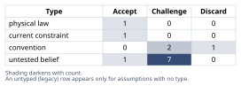
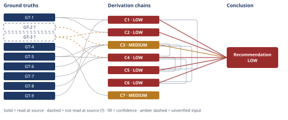

# Should a Claude Code Plugin File Be Split to Fit a Line Budget

*First-principles analysis · 11 October 2026*

*Read with: [How to read this analysis](HOW-TO-READ.md) · [Working file](analysis-20261011T004631Z.md) · [All files](INDEX.md)*

## Executive Summary

**Recommendation:** Before moving any file, get a per-technique invocation-frequency classification for the plugin's six companion-tool procedures (chain C6); then externalize only the confirmed conditional-branch or deferred-once items with an inline decision-rule stub, keep unconditional-and-early content inlined, and re-scope the regression gate to the surviving core file rather than the whole plugin (chains C3, C4, C5).

**Band (from §6):** LOW

**Would change it:** Running a model-and-task-specific instruction-adherence eval against this exact agent at varying prompt lengths, and obtaining real per-technique invocation telemetry for this plugin, would resolve the two inputs (GT-2?, GT-3?, and assumption A-6) that cap this analysis below MEDIUM (chains C2, C3, C4).

## 1. Problem Essence

**Essence Statement:** Given a line/token regression gate (~500 lines / ~5,000 tokens) that a monolithic Claude Code agent file has breached by ~75% (878 lines), should the team satisfy the gate by mechanically extracting the six inlined companion-tool procedures (plus template and rubric) into on-demand reference files — or does that move fail to serve whatever the gate actually protects, making it the wrong fix?

**Success criteria** — a correct answer must:

1. Name the mechanism(s) the budget actually protects, adjudicated against evidence rather than assumed from the candidate list, with the weaker candidates explicitly ruled down (not just ruled out).
2. State precisely whether and when extraction serves that mechanism — distinguishing content used unconditionally-every-invocation from content used conditionally-on-a-branch from content used unconditionally-but-only-once-late — rather than answering "split" or "don't split" as a single verdict for all eight artifacts (six procedures + template + rubric) bundled together.
3. Identify the Goodhart's-law risk precisely: under what condition does a mechanical split pass the gate while leaving the quantity the gate exists to protect unchanged or worse.
4. Produce one decisive recommendation covering: what to extract now, what to keep inlined, how the gate itself should be redefined or re-scoped, and whether the 500/5,000 figure needs empirical grounding.
5. Name the single piece of missing information that would most resolve the remaining uncertainty, and recommend obtaining it before code is written — without that naming becoming a substitute for taking a position with the evidence already in hand.

No success criterion requires the answer to be exclusively "split" or exclusively "don't split" — a hybrid (split some artifacts, keep others inlined, redefine the gate's scope) is an admissible and, as this analysis will show, likely-correct shape for the answer.

## 2. Assumptions Table



| Assumption | Type | Treatment | Verdict | Verification |
|------------|------|-----------|---------|--------------|
| A-1: The ~500-line/~5,000-token budget was derived from a measured instruction-adherence degradation curve specific to this model/task. | convention | Explicitly challenge before use | Challenge — no evidence is presented that the number was fitted to a measurement; the ~10-tokens/line density it implies (5,000/500) matches ordinary prose density, consistent with an authored round number rather than a derived threshold | unverified — flagged (feeds C7) |
| A-2: Every invocation of the plugin's agent exercises all six inlined companion-tool procedures plus the template and rubric in full. | untested belief | Verify, or flag unverified | Challenge — this single fact determines whether splitting helps or is theater, and no telemetry or design-intent evidence exists for this specific plugin; a structurally analogous system (this skill) resolves the equivalent question as false (mixed conditionality: GT-5/GT-6/GT-7), which is feasibility evidence, not proof for this plugin | unverified — flagged (central unresolved input; feeds C3/C4/C6) |
| A-3: A regression gate measured in raw lines/tokens of one file is a faithful proxy for the quantity that actually matters (attention-dilution risk on content loaded into every invocation). | convention | Explicitly challenge | Challenge — true only while the file's contents are coextensive with "everything loaded on every invocation"; once any content becomes conditional or externally fetched, proxy and target diverge, which is the Goodhart mechanism this analysis names (C3) | Accept as a premise about the *current*, unsplit file; Discard as a premise for scoring *any* post-split file |
| A-4: The regression gate is implemented as an automated CI check or lint rule. | current constraint | Record expiry conditions | Accept — the user frames this as "presumably"; expires/is corrected if the team clarifies the gate is a manual review step rather than automation; the recommendation is indifferent to which | unverified — flagged (immaterial to the headline recommendation) |
| A-5: Extracting content to an on-demand reference file necessarily means a runtime Read-tool round trip, rather than a build-time step that assembles a conditional system prompt before the model call begins. | untested belief | Verify, or flag unverified | Challenge — a build-time router that pre-selects content via cheap heuristics before the LLM call starts would avoid the round-trip cost entirely; this analysis assumes the simpler, more common mid-conversation Read-tool pattern (matching GT-4–GT-7) but a build-time alternative is real and would weaken C3's round-trip-cost argument while leaving its Goodhart/attention argument intact | unverified — flagged |
| A-6: Lost-in-the-middle attention degradation, measured on multi-document retrieval/QA tasks, applies in the same way to instruction-following fidelity inside a long system/agent prompt. | untested belief | Verify, or flag unverified | Challenge — plausible and widely assumed in applied prompt engineering, but GT-3? measured retrieval accuracy over long context, not adherence to buried imperative instructions in a system prompt specifically; the extrapolation is reasonable, not proven for this artifact type | unverified — flagged (caps C2 and C4) |
| A-7: The dominant cause of any actual instruction-following shortfall in the 878-line file is its raw length/attention-dilution, rather than one specific buried or contradictory instruction unrelated to length. | untested belief | Verify, or flag unverified | Challenge — without reading the actual file this cannot be distinguished from a defect a line-count-driven split would not fix at all; surfaced via the inversion procedure's P4 (failure-guaranteeing precondition) | unverified — flagged; no chain — flagged assumption only (residual caveat on the whole analysis) |
| A-8: Leaving a one-line inline decision-rule stub for an externalized technique is sufficient for the agent to recognize when to fetch the full procedure, without opening the file "just to check." | untested belief, with feasibility demonstrated in a structurally similar system | Verify for this plugin; accept the mechanism's feasibility from the analog | Accept (feasibility) — directly demonstrated as workable in GT-5's analog system, which is feasibility evidence, not proof this plugin's team will implement the stub correctly | read-at-source for feasibility (GT-5); unverified — flagged for this plugin's actual implementation |
| A-9: A human author/reviewer needs a file no longer than roughly 500 lines to hold its content in working memory, and this is the primary reason the budget exists. | convention | Explicitly challenge | Discard as a primary driver — 500 lines is unusually tight as a pure human-readability ceiling (teams routinely review far longer files); more consistent with a proxy for attention-dilution risk than for working-memory limits alone, though it may be a secondary, reinforcing benefit | unverified — flagged; not load-bearing |
| A-10: Trimming redundant prose/scaffolding alone, with no structural split, could plausibly bring the file back near the 500-line budget without removing any companion-technique content. | untested belief | Verify, or flag unverified | Challenge — no access to the actual file content means this cannot be assessed; treated as unknown, not assumed true or false | unverified — flagged (bears on Option D in the trade-off) |
| A-11: If a given piece of content must be read by the model on every single invocation regardless of where it is physically stored, relocating it from an inlined prompt to an externally-fetched file cannot reduce the total tokens processed for that content in a given invocation, and can at best leave the count unchanged while adding fixed per-call round-trip overhead. | physical law | Accept as a ground-truth-adjacent reasoning step | Accept — a conservation-style identity following from the definition of "read every time" plus the tool-calling and context-window mechanics observed directly in GT-8, anchored further by GT-2?'s cache-hierarchy description; not negotiable by any team process choice | read-at-source reasoning (derived from GT-2?/GT-8; used as an intermediate step in C3, not listed as a separate ground truth because it is derived from other listed items) |
| A-12 *(surfaced by the end-of-phase Assumption Audit, from chain C1)*: This session's observed token consumption (GT-9) is representative of the plugin's typical real invocations, not an outlier driven by this analysis's own unusually research-heavy process (two WebFetch calls, two large reference-file Reads). | untested belief | Verify, or flag unverified | Challenge — plausible for a comparably complex multi-phase agentic task but not verified for the specific plugin in question; a high-frequency, low-complexity deployment shape would behave very differently (named as a live rival on C1) | unverified — flagged (feeds C1) |
| A-13 *(surfaced by the end-of-phase Assumption Audit, from chains C3/C4/C7)*: The one directly-inspected analog system's placement choices (GT-4–GT-7: what stays inlined vs. what is externalized) reflect a deliberate design principle about conditionality and timing, rather than an arbitrary or historically-accidental authoring choice. | untested belief | Verify, or flag unverified | Challenge — the pattern observed (GT-5/GT-6/GT-7) is consistent with a deliberate conditionality/timing principle, but this analysis has not read that system's own design rationale or change history to confirm intent versus coincidence | unverified — flagged (feeds C3, C4, C7) |

## 3. Ground Truths

- **GT-1** The plugin's agent file measured 878 lines at the two-milestone mark against a recorded budget of ~500 lines / ~5,000 tokens enforced as a regression gate; the file inlines the core methodology body, six companion-tool procedures, the output template, and the validation rubric; the gate is presumed (not confirmed) to be a CI check or lint rule — source: the user's own problem statement in this conversation; read-at-source: the task message describing the plugin, the 878-line measurement, the ~500/~5,000 budget, and the file's contents, read directly with no intermediary.

- **GT-2?** Claude's prompt caching operates over a hierarchy (`tools` → `system` → `messages`); a cache write occurs only at a breakpoint; tool-use result blocks are cached as part of a conversation's message prefix once resubmitted in a later turn of that *same* conversation; the lookback mechanism checks at most 20 content blocks backward for a cache match before giving up; default cache TTL is 5 minutes (1 hour optional at roughly 2× the write price); a cache write costs roughly 1.25× the base input-token price and a cache read roughly 0.05–0.1× it — cited to: platform.claude.com/docs/en/build-with-claude/prompt-caching; reported-by-delegate: WebFetch's summarizing model returned a paraphrased synthesis of this page in this session; the raw page text was not opened directly by this analysis.

- **GT-3?** In the "Lost in the Middle: How Language Models Use Long Contexts" research (Liu et al.), model performance at using information positioned in the middle of a long input context degrades significantly compared with information at the beginning or end, observed across multiple long-context language models in a multi-document retrieval/question-answering setting — cited to: arXiv:2307.03172; reported-by-delegate: WebFetch's summarizing model returned a paraphrase of the paper's abstract in this session; the full paper and its methodology were not opened directly.

- **GT-4** This analysis's own operating skill ("First Principles Analysis," the skill governing this very task) inlines its complete core 5-phase methodology and all eight companion-technique "Procedure" sections directly in the agent body/system prompt, while explicitly instructing that the output template and the validation rubric are *not* inlined — each is opened via the Read tool at one fixed, deterministic point per run ("Open the output template once, before the first section is appended"; "Open the Self-Audit Gate's rubric once, before scoring the first criterion") — source: this conversation's own system-prompt/skill-body text, and this analysis's own direct Read-tool calls on `output-template.md` and `validation-rubric.md` earlier in this session; read-at-source: the skill body's "Output format" and "Before presenting conclusions" sections, plus the two Read-tool outputs returned in this session (each file's own header note confirms it is the full, separately-maintained reference document).

- **GT-5** Within that same operating skill, three of its eight companion techniques — trade-off, pre-mortem, inversion — carry an explicit additional instruction, at their specific point of use, to "open [the procedure] ... with Read" from a dedicated external reference file even though a compact version of each also appears inline; these three are exactly the three whose invocation is conditional/branch-dependent (trade-off fires only "when two or more viable options survive"; pre-mortem and inversion are mutually exclusive alternatives selected by whether the object under test is a plan or a claim, so at most one of the two ever executes in a given run) — source: same system-prompt text, Phase 4 ("Reason Upward") and Phase 5 ("Validate") sections, plus this analysis's own direct Read-tool call on `pre-mortem.md` earlier in this session; read-at-source: the specific "open ... with Read" clauses for trade-off, pre-mortem, and inversion, and the pre-mortem.md file content itself.

- **GT-6** Within that same operating skill, the second-order-thinking technique is applied unconditionally on every run in full-composer mode ("before handing off to Phase 5, apply the inlined second-order thinking procedure") and carries no "open ... with Read" instruction at its point of use — its full procedure stays directly inlined with no on-demand indirection — source: same system-prompt text; read-at-source: the Phase 4 ("Reason Upward") sentence prescribing the unconditional second-order pass.

- **GT-7** Within that same operating skill, the output template and the validation rubric are used in literally every run (not conditionally) yet are still externalized and fetched via exactly one Read call each, at one fixed, late point in the run's sequence, rather than being inlined from the start — source: same system-prompt text; read-at-source: the "Before presenting conclusions" section's "Open the output template once..." and "Open the Self-Audit Gate's rubric once..." paragraphs.

- **GT-8** In this very conversation, each use of the Read tool and the WebFetch tool required a separate tool-invocation turn, with the tool's result returned only after that round trip completed, before this analysis could proceed to its next step — source: this conversation's own transcript; read-at-source: the four tool calls (two Read, two WebFetch) already performed and returned earlier in this session.

- **GT-9** In this conversation, performing this first-principles analysis had consumed approximately 129,000 tokens of the session's token budget after only four tool calls and before the analysis's remaining sections, verdict blocks, and reports were written — observed from the session's own total-tokens-remaining counter falling from 15,000,000 at the session's start to 14,870,801 at that point — for a single complex, multi-phase agentic task that was still incomplete — source: this conversation's own system-reminder token-budget counters; read-at-source: the successive `<total_tokens>` values shown in this session's system reminders.

**Provenance summary:**

```text
?-marked: GT-2, GT-3 (2 of 9)
Read-at-source: GT-1 — user's task message, this conversation
Read-at-source: GT-4 — skill body "Output format" / "Before presenting conclusions" sections; output-template.md and validation-rubric.md Read-tool outputs, this session
Read-at-source: GT-5 — skill body Phase 4/Phase 5 "open ... with Read" clauses for trade-off, pre-mortem, inversion; pre-mortem.md Read-tool output, this session
Read-at-source: GT-6 — skill body Phase 4 unconditional second-order-pass sentence
Read-at-source: GT-7 — skill body "Before presenting conclusions" template/rubric Read instructions
Read-at-source: GT-8 — this conversation's own transcript, four tool-call round trips
Read-at-source: GT-9 — this conversation's own system-reminder token counters
```

## 4. Derivation Chains



### Conclusion C1: Token/cost economy and raw latency are real but secondary to the budget's primary purpose

GT-1 (878 lines vs ~500/~5,000 budget) + GT-9 (one comparable session already ≈129k tokens in, incomplete)
→ at the budget's own implied density of 10 tokens per line (5,000 ÷ 500), the file's 378-line overage brackets to roughly 3,780–5,670 extra tokens, for a total file size of roughly 8,780–13,170 tokens
→ that one-time per-invocation delta is only about 3–10% of the token volume a single comparable complex session has already spent while still incomplete *[Assumes: A-12 — this session's consumption is representative of the plugin's typical real invocations]*
→ a pure dollar-cost or latency argument is too small in magnitude to be this budget's primary driver for any invocation complex enough to resemble this one
→ a live rival survives for a different deployment shape — a high-frequency, low-complexity call pattern — where the same per-call delta, multiplied across large call volume, could still dominate aggregate spend or latency even though it is secondary for any single complex call

**Confidence:** LOW — Inference axis short: hop 2 rests on `[Assumes: A-12]`, whose failure is not priced (if this session's consumption is not representative, the magnitude comparison may not hold); closes by sampling the plugin's actual invocation-complexity distribution. Rivals axis also short: the high-frequency/low-complexity deployment reading survives and nothing in this analysis settles it; closes by obtaining real call-volume and per-call cost/latency data for this plugin's actual deployment.

---

### Conclusion C2: Attention-quality / instruction-following degradation is the candidate purpose whose magnitude actually fits a hard per-file ceiling

GT-3? (lost-in-the-middle finding) + GT-1 (878 lines, 75% over budget)
→ the lost-in-the-middle regularity shows that reliable use of information positioned away from the start or end of a long context degrades, as a documented property of current-generation models in at least the retrieval/QA setting GT-3? was measured in
→ applying it here implies that a model-definition file which has grown 75% past a small, round budget number is exactly the kind of growth this regularity would predict degrades reliable adherence to whichever instructions are not positioned at the very start or end *[Assumes: A-6 — this regularity extends from retrieval accuracy over long context to instruction-adherence inside a long system/agent prompt]*
→ of the candidate purposes under consideration, this attention/instruction-following mechanism is the only one whose documented magnitude plausibly justifies a hard ceiling on this one artifact specifically, rather than on the plugin's total footprint

**Confidence:** LOW — Inputs axis short: GT-3? is reported-by-delegate/unverified; closes by reading the paper's full methodology directly, bypassing the summarizing layer, or — more decisively — running a model-and-task-specific instruction-adherence eval against this exact agent at varying prompt lengths. Inference axis also short: hop 2's `[Assumes: A-6]` extrapolation is not priced for an unaffected endpoint — if false, this chain's "primary driver" claim weakens substantially rather than standing unaffected; the same proposed eval would close this too, since it tests instruction-adherence directly rather than relying on the retrieval-accuracy analogy.

---

### Conclusion C3: Splitting content that is actually read on every invocation does not serve the budget's purpose, and can make things worse — the Goodhart's-law mechanism

GT-5 (3 of 8 analog techniques are conditional and externalized) + GT-6 (1 analog technique is unconditional and stays inlined) + GT-8 (a tool round trip costs a turn and fixed overhead) + GT-2? (tool-fetched content is cached only within that one conversation, not reused the way a stable cross-session system prompt is)
→ in the one system this analysis could directly inspect, content needed unconditionally on every run was kept inlined while content needed only on a branch was externalized, a split pattern that tracks conditionality rather than raw size alone *[Assumes: A-13 — the analog system's placement choices reflect a deliberate conditionality/timing principle rather than coincidence]*
→ if a given plugin's companion-tool procedure is actually read on every single invocation regardless of where it is stored, moving it to an external file cannot reduce the tokens processed for it per invocation, by the conservation-style identity recorded as A-11
→ doing so instead adds a fixed tool-round-trip cost on every call plus a cache-write charge scoped to that one session rather than the standing, cross-session reuse a stable inlined system prompt gets
→ blind, uniform extraction of content whose real per-invocation conditionality is unknown can therefore satisfy a raw line-count gate on the one file while leaving the real per-invocation token and attention load unchanged or made worse — the Goodhart's-law failure this analysis was asked to evaluate

**Confidence:** MEDIUM — Inputs axis short: GT-2? is reported-by-delegate/unverified; closes by opening the raw Anthropic prompt-caching documentation directly (bypassing WebFetch's summarizing layer) or, more decisively, by measuring real cache-hit telemetry on an actual split deployment. The rival reading — "blind splitting still helps in expectation even without knowing conditionality" — is named rather than left open: it is weaker than gathering the conditionality data first (C6), because it accepts a nonzero chance of worsening the unconditional case in exchange for a guess, where C6's path captures the same potential upside with that risk removed.

---

### Conclusion C4: Splitting genuinely serves the budget's purpose for content that is conditional, or unconditional but needed only once, later

GT-5 (conditional techniques externalized) + GT-7 (template/rubric externalized despite being always-used) + GT-3? (lost-in-the-middle, temporal framing) + C3 (does not serve the purpose for unconditional-early content)
→ the analog system's choice to externalize the template and rubric despite their being used in every run shows that "needed every time" alone does not determine inline-vs-external placement
→ what matters additionally is when in the run the content first becomes relevant: content irrelevant until a specific later phase dilutes the model's attention on the currently-relevant early-phase instructions for the entire span before it is needed *[Assumes: A-6, as explained on C2]*
→ extraction therefore genuinely serves the attention-quality purpose in two cases distinguishable in advance of any token-count comparison — content that may never be needed on a given run, and content always eventually needed but only once at a known later point — and does not serve that purpose, per C3, for content needed continuously from the first turn

**Confidence:** LOW — Inputs axis short: GT-3? is reported-by-delegate/unverified, same closing path as C2. Rivals axis also short: an alternative explanation for GT-7 — for example, independent versioning or testing of the template/rubric rather than attention-quality — has not been ruled out; closing it would require reading the analog system's own design rationale or change history, which was not fetched in this analysis.

---

### Conclusion C5: The recommended action is a conditional, evidence-gated split plus a re-scoped gate — not uniform extraction, not a no-op, and not prose-trimming alone

C1 (cost/latency secondary) + C3 (Goodhart risk of blind/uniform splitting) + C4 (splitting works for conditional/deferred content specifically)
→ weighted totals across six locked criteria — conditional-token-reduction, attention-quality-on-core, cache-preservation, Goodhart-fix/gate-correctness, implementation cost, executable-without-more-info — score a conditional, evidence-gated split (keep unconditional/early content inlined with a short decision-rule stub, externalize confirmed-conditional or deferred-once content, and re-scope the gate to the surviving core file) at 95 points
→ that beats splitting all six procedures uniformly with no gate change at 57, revising the gate alone with no split at 64, and trimming prose alone with no structural change at 57 — every rival option trails by at least 31 points
→ the margin is driven chiefly by the two criteria this analysis weighted highest, attention-quality-on-core and Goodhart-fix, each worth 5 of the total 22 weight points, where the conditional-split-plus-rescoped-gate option is the only one scoring the maximum on both
→ a flip test confirms the result is not a near-tie: no single criterion's weight can be moved anywhere within the ordinary 1–5 scale and flip the winner — the smallest such move would require raising one criterion's weight to roughly 7 or 8, outside that scale
→ recommend the conditional, evidence-gated split over uniform extraction, a no-op, or prose-trimming alone
→[2nd] plugin maintainers must now apply and maintain an explicit per-technique classification — unconditional-and-early, conditional-branch, or unconditional-but-deferred-once — for every existing and future companion technique, not just once at the moment of this split
→[2nd] the CI/tooling owner must re-implement the regression gate to measure only the surviving core file or directory rather than total repository bytes, which is additional engineering work beyond the file move itself
→[3rd] absent a written, enforced authoring convention capturing that classification rule, a future contributor adding a ninth companion technique will likely default-inline it by copying whichever existing pattern they skim first, and the same line-count regression recurs within a few more milestones, merely redistributed rather than resolved

**Confidence:** LOW — capped by citing C1 and C4, both LOW; their own confidence lines carry the explanation and are not re-explained here. The trade-off arithmetic and the flip test are robust (no single-criterion reweighting within the 1–5 scale changes the winner), which is a property of the recommendation's robustness and not a reason to rate the chain above its input ceiling.

---

### Conclusion C6: Before any file is moved, the team needs a per-technique invocation-frequency classification for this specific plugin

C3 (blind splitting risks Goodhart failure when content is actually unconditional) + C4 (splitting genuinely helps when content is actually conditional/deferred)
→ C3 and C4 describe mutually exclusive, opposite-sign outcomes of the identical action — extracting a given one of the six procedures — depending entirely on one unknown fact per procedure: whether that specific procedure is read unconditionally, conditionally, or unconditionally-but-once-late in this plugin's real invocation pattern
→ no correct per-procedure extraction decision can therefore be made for this plugin's six companion-tool procedures without first establishing that fact for each one
→ the one piece of information that resolves this is a per-technique invocation-frequency classification for this plugin specifically, drawn from real telemetry or logs where available, or from a structural audit of each procedure's trigger conditions in the plugin's own methodology text where telemetry is not available
→ obtaining that classification is a prerequisite step that must happen before any file is moved, independent of and prior to whichever of the four trade-off options is ultimately chosen for each item

**Confidence:** LOW — capped by citing C4 (LOW); C3's and C4's own confidence lines carry the explanation. Inference and Rivals axes are otherwise clean: each hop is a direct logical consequence of C3's and C4's mutually exclusive structure, and no competing reading of "which fact is needed" has been raised anywhere in this analysis.

---

### Conclusion C7: The ~500-line figure may be a reasonable floor target for the unconditional core, but the gate's numerator — not the number itself — is what is clearly wrong

GT-4 (this skill's own core methodology, excluding companion-technique procedures, is itself substantial)
→ bracketing a theoretical floor for "the smallest a rigorously-specified unconditional core could be" is genuinely wide: a terse core skipping most meta-discipline could plausibly fit in roughly 150–250 lines, while a core matching this skill's own level of rigor could itself approach or exceed 500–700 lines even with zero companion techniques inlined *[Assumes: A-13, as explained on C3]*
→ [Speculative] this bracket straddles the 500-line figure on both sides, so this analysis cannot conclude whether ~500 lines is a generous or a stingy target for the plugin's own unconditional core without reading that plugin's actual core content
→ what the bracket does establish, independent of where the true floor sits, is that the right numerator for any such target is the unconditional core alone, not the whole file — a scope correction that restates C3's finding rather than adding new load-bearing content

**Confidence:** MEDIUM — `[Speculative]`: this chain supports an illustrative bracket only; the claim it supports (the exact floor value) is not load-bearing for the headline recommendation, and this chain is not cited on any other chain's head. Downgrade cause: hop 1's bracket is wide and has no tighter verification path available without reading the plugin's actual core content, which is outside this analysis's access — a stated no-path reason, not a verification promise.

## 5. Abandoned Reasoning

### Dead End: Treating WebFetch results as read-at-source ground truths

**What was tried:** Initially treated the WebFetch-returned summaries of the Anthropic prompt-caching documentation and the "Lost in the Middle" paper's abstract as read-at-source ground truths, on the reasoning that this analysis itself directed and reviewed the fetch.

**Why abandoned:** WebFetch's own tool description states it processes fetched content "using a small, fast model" and returns that model's response about the content, not the raw source text. Per the provenance test — did this analysis read the asserted figure or wording in the cited source — a paraphrased, model-generated summary with no verbatim quoted passage checked against the original is reported-by-delegate, not read-at-source, however directly this analysis directed the fetch.

**What it ruled out:** Treating any WebFetch result as automatically read-at-source simply because the analysis issued the fetch itself. That shortcut would have understated this analysis's own evidentiary gaps on exactly the two ground truths (GT-2, GT-3) carrying the most weight for the primary-driver adjudication (chains C2, C3, C4), and would have let those chains present as more confident than their actual evidentiary basis supports.

### Dead End: Promoting the token-conservation identity to a standalone ground truth

**What was tried:** Drafting the conservation-style identity — relocating content that is read on every invocation regardless of file location cannot reduce the tokens processed for it — as its own numbered ground truth (tentatively GT-10), parallel to GT-1 through GT-9.

**Why abandoned:** The Ground Truths list requires each entry to be a fact "not derived from another item on this list." This identity is explicitly a logical consequence of GT-2? and GT-8 taken together, so listing it as an independent ground truth would have double-counted the same evidentiary weight under a second ID and obscured that its own reliability rests on GT-2?'s delegate-reported status.

**What it ruled out:** A Ground Truths section that looks more numerous and more independently grounded than it actually is. The identity instead became Assumptions Table row A-11 (type: physical law), used directly as an intermediate reasoning step inside chain C3, where its dependency on GT-2?/GT-8 stays visible.

### Dead End: Separate derivation chains for token-cost and for latency

**What was tried:** Drafting Conclusion C1 (token/cost economy) and a parallel conclusion on latency as two independent derivation chains, each separately ruling down its respective candidate purpose.

**Why abandoned:** Both chains rested on the identical magnitude comparison — GT-1's overage bracket against GT-9's observed session consumption — and the identical two weaknesses (the A-12 representativeness assumption and the high-frequency/low-complexity-deployment rival). Keeping them as two chains would have been a redundant restatement of one argument under two conclusion headings rather than two genuinely independent lines of reasoning.

**What it ruled out:** Treating "cost" and "latency" as requiring separately argued magnitude cases in this analysis. They are ruled down together by one shared argument (chain C1); a future case for treating them as separately dominant would need its own, different magnitude argument, not a restatement of this one.

---

## 6. Conclusion

**Recommended approach:** Do not perform a uniform, blind extraction of all six companion-tool procedures plus the template and rubric into on-demand reference files. First, obtain a per-technique invocation-frequency classification for this plugin's six companion-tool procedures, from real telemetry if available or a structural trigger-condition audit of the methodology text if not — this is the one prerequisite that determines everything else (chain C6). Second, externalize only the items that classification confirms are genuinely conditional-branch or unconditional-but-needed-only-once-late, each left with a short inline decision-rule stub so recognizing non-applicability never itself requires a fetch, while keeping anything confirmed unconditional-and-needed-from-turn-one inlined (chain C4, chain C3). Third, re-scope the regression gate to measure only the surviving core file or directory rather than the plugin's whole line/token footprint, and write the classification rule down as an enforced authoring convention so future companion techniques are placed correctly by default (chain C5).

**Key insight:** The budget was most plausibly never protecting human working-memory or per-call dollar cost — both are real but too small in magnitude to justify a hard ceiling on one file (chain C1). Its most defensible real target is attention-dilution risk on content loaded into every invocation (chain C2), which reframes the fix from "make this one file smaller" to "make what is unconditionally loaded smaller." A mechanical, uniform split satisfies the gate's letter while leaving, or worsening, exactly what the gate exists to protect whenever the extracted content is actually needed on every call anyway (chain C3) — the reflexive engineering response is a Goodhart's-law trap unless the team first confirms, per technique, which of the six procedures is genuinely unconditional versus conditional (chain C6).

**Trade-offs acknowledged:** This recommendation defers the immediate satisfaction of a green CI check in exchange for running an audit first (chain C6), so the file stays over budget a little longer. It also accepts that even a well-executed conditional split adds a small, nonzero latency/token cost on whichever calls do trigger an externalized technique, trading a worse worst case — something unconditional wrongly externalized — for a better expected case (chain C3, chain C5). It leaves the exact ~500-line/~5,000-token figure empirically unverified against this specific model and task: chains C2 and C4 both point at the same unresolved input, the reported-by-delegate lost-in-the-middle ground truth and its unpriced extrapolation to instruction-following — no chain — flagged assumption only. It also leaves open, per assumption A-7, that the file's real instruction-following problem, if any, might not be length-driven at all, in which case no amount of restructuring would fix it — no chain — flagged assumption only.

**Confidence:** LOW — the overall rating equals the weakest contributing chains (C1, C2, C4, C5, C6, all LOW); each names its own downgrade causes and verification paths, not repeated here per D-07. The two inputs most responsible for capping this analysis below MEDIUM are GT-2? and GT-3? (both reported-by-delegate) and the untested extrapolation A-6 (retrieval accuracy over long context → instruction-following fidelity inside a system prompt). All three would be most directly resolved by one concrete action — running a model-and-task-specific instruction-adherence eval against this exact agent at varying prompt lengths — which is also this analysis's recommended way to re-derive the ~500-line/~5,000-token figure rather than continue treating it as settled.
