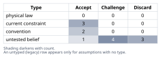
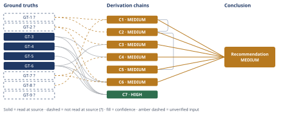

# What the Agent-File Token Budget Is Actually For

*First-principles analysis · 11 October 2026*

*Read with: [How to read this analysis](HOW-TO-READ.md) · [Working file](analysis-20261011T030858Z.md) · [All files](INDEX.md)*

## Executive Summary

**Recommendation:** Keep the methodology core, plus any companion technique that fires on
effectively every run, resident in the base file; externalize only techniques whose triggers
are genuinely conditional/mutually exclusive, read only when triggered; and replace the
single line-count gate with two measured numbers — resident-core tokens, and an automated,
tokenizer-based total-reachable-tokens count recomputed whenever a tool is added (chain C6).

**Band (from §6):** MEDIUM (chain C6).

**Would change it:** Independently confirming, beyond this session's delegated WebFetch, that
Claude Code subagent bodies have no native partial loading (chain C1, chain C2); and running a
real tokenizer against the file in place of the word-count estimate used here (chain C4).

## 1. Problem Essence

**Core problem:** Given that an automated CI line/token budget on a Claude Code agent-definition
file is being violated by ~75% because the file inlines a five-phase methodology core plus six
companion-tool procedures plus an output template plus a validation rubric, what quantity does
that budget actually bound — and does moving the companion procedures (and template/rubric) into
separately-loaded files reduce that quantity, or does it merely relocate the line count across a
file-system boundary the CI gate inspects while the tokens the executing model actually processes
per invocation stay the same or grow?

**Success criteria:**
- Names, with a verified mechanism rather than an assumed one, how content in a Claude Code
  agent/skill definition actually enters the executing model's context, and uses that mechanism —
  not intuition about file size — to test each candidate purpose of the budget (runtime footprint,
  human readability, scope-creep signal, something else).
- Distinguishes "extraction where every file is still read unconditionally every run" from
  "extraction where a file is read only when its specific trigger condition fires," and states,
  for each, whether it changes the tokens an invocation actually processes — not merely the
  tokens the CI gate counts.
- Does not treat "878 > 500, therefore shrink the file" as self-evidently correct; it tests
  whether the 878-line figure is itself evidence of unscoped bloat before accepting that framing,
  and tests whether the budget's own line-to-token ratio accurately reflects this class of
  content's real density before accepting the "75% over" figure as the right number to anchor on.
- Delivers one decisive recommendation that states what should stay resident in the base file,
  what should move to a conditionally-loaded file, and what (if anything) about the budget number
  itself should change — and the recommendation is permitted to be a composite of these, not
  forced to pick exactly one of "split," "inline and raise the budget," or "leave alone."

## 2. Assumptions Table



| Assumption | Type | Treatment | Verdict | Verification |
|---|---|---|---|---|
| A-1: The ~500-line/~5,000-token CI budget is meant to bound how many tokens are unconditionally resident in the executing agent's context on every invocation (runtime footprint), not primarily to measure human readability or conceptual scope. | convention | Explicitly challenge before use — an automated counter can only mechanically check footprint-shaped quantities. | Accept — a line/token counter cannot see whether a human found a file easy to review or whether the agent's job is unscoped; it can only see size, and stating the number in tokens as well as lines only makes sense as a model-input-cost unit, not a human-reading unit. | reasoned directly from the gate's own described mechanism (chain C1) |
| A-2: A Claude Code subagent definition file's body loads into the model's context in full, as a single unit, at invocation, with no native partial/progressive loading of the body itself. | current constraint | Record expiry — holds under the currently documented Claude Code subagent mechanism; would lapse if a future harness version added native chunked/progressive loading for subagent bodies the way Skills already have for bundled files. | Accept — matches GT-1?; expires if/when the harness changes this mechanism. | GT-1? (reported-by-delegate, WebFetch) |
| A-3: Anthropic's own documented rationale for progressive disclosure in Agent Skills is reducing token usage specifically when the deferred content is mutually exclusive or rarely used together with the rest. | untested belief | Verify before relying on it as the justification for lazy-loading. | Accept — verified this session. | GT-2? (reported-by-delegate, WebFetch) |
| A-4: The six companion-tool procedures in a plugin like the one in the scenario are, as a class, uniformly rare/optional in actual use. | untested belief | Verify or flag — no invocation telemetry is given in the facts provided. | Discard — the real variable is per-technique, not per-file; this project's own closely-observed precedent (GT-5, GT-6) shows the mix is never uniform: at least one technique fires on every run while others are strictly conditional. | GT-5, GT-6 (read-at-source, this session) |
| A-5: 878 lines of procedural detail for six-to-eight composed structured-reasoning techniques plus a template and a rubric is disproportionate / unfocused scope, rather than proportionate necessary detail. | untested belief | Verify by decomposition — measure what a comparably-scoped real system actually spends per technique before accepting "bloat" as the diagnosis. | Discard the bloat-as-primary-diagnosis framing — measured per-technique cost in a comparable real system (GT-3) runs 150-225 lines per fully specified technique kept as its own file, which would alone cost ~900-1,350 lines for six techniques before any core methodology, template, or rubric text is added. | GT-3 (read-at-source, this session) |
| A-6: The budget's implied ~10-tokens-per-line ratio (500 lines ≈ 5,000 tokens) accurately characterizes the token density of this class of dense technical/methodology markdown. | untested belief | Verify against a measured comparable file. | Challenge — a measured comparable file (GT-7?) runs closer to ~18-20 tokens/line for dense prose, roughly double the budget's implied ratio; the token overage is plausibly much larger than the line overage suggests. | GT-7? (estimate, no real tokenizer run this session) |
| A-7: Moving text out of the resident agent file into a separate file that the agent is still instructed to read unconditionally on every run removes that content's token cost from what the model actually processes that run. | untested belief | Verify against the loading mechanism before treating extraction as a fix. | Discard — false under A-2/GT-1?: a Read call inserts the referenced file's tokens into the running context at the moment it executes, plus the call's own wrapper overhead (A-11); this is relocation across the boundary the CI gate inspects, not reduction of what the model processes. | GT-1?, A-11 (reasoned, chain C2) |
| A-8: Moving a technique's text to a file the agent reads only when that technique's specific trigger condition fires reduces the typical-case (expected) token footprint relative to always inlining it. | current constraint | Record the condition under which it holds (trigger genuinely conditional/exclusive) versus when it does not (trigger fires on effectively every run). | Accept, conditionally — holds for the subset of content whose use is genuinely exclusive/rare across invocations; does not hold, and adds a pure round-trip cost, for content a run needs on (near-)every invocation. | GT-2?, GT-5, GT-6 (chain C3) |
| A-9: The 500-line budget was set before the agent's true scope was known and has simply never been revisited, so the "75% over" reading is a calibration bug rather than a real signal. | untested belief | Flag as unverified; do not treat as a load-bearing premise — no history is given in the facts provided. | Challenge — plausible but unverifiable here, and an equally consistent rival explanation exists (the budget is correctly calibrated for a single-technique agent and this file is accurately signaling it is doing the work of several); the recommendation below does not depend on resolving which is true. | unverified — flagged, no chain treats it as load-bearing |
| A-10: The CI regression gate described is a static per-file line/token check on the named agent-definition file, not an instrumented trace of total tokens consumed across a tool-calling session (including any Read calls the agent issues at runtime). | convention | Challenge explicitly — stated as the natural reading of the facts given, but note the alternative (session-trace-based gate) is physically possible, just unsupported by anything in the prompt. | Accept, as the governing reading — every concrete number in the scenario (878 lines, ~500 budget) is described as a property of "a single agent definition file," which is a static-file property. | inferred directly from the problem statement; no external source needed |
| A-11: A Read tool call's net token cost to the running context is at least the referenced file's own content, plus some nonzero per-call wrapper overhead (tool-use/tool-result framing), rather than being free or fully absorbed by caching. | current constraint | Record expiry — holds under today's standard tool-calling protocol; would soften (but the referenced content's own tokens still enter context either way) if a future caching/compression scheme eliminated the marginal wrapper cost. | Accept — definitional to how tool_use/tool_result turns work in current APIs; low-stakes, supports only a MEDIUM-confidence point. | unverified — flagged, not independently re-measured this session |
| A-12: The word-count-based token-density estimate (GT-7?) is not badly distorted by non-prose content (tables, code fences, blank lines) in the measured files. | untested belief | Flag — partially true; code-heavy and tabular lines typically carry fewer natural-language "words" per token than prose, which would bias the words/line ratio downward, not upward. | Challenge — flagged, but the likely direction of the bias reinforces rather than undermines chain C4's conclusion (the real prose-dominant ratio could be even higher than estimated). | unverified — flagged; verification path is the same real-tokenizer run named for GT-7? |
| A-13: Absent any stated mechanism in the facts given, the team has no existing process that already tracks total-reachable (base file plus everything it instructs reading) token footprint. | untested belief | Flag as unverified — unverifiable from the facts provided. | Challenge — a reasonable default given nothing in the prompt describes such a process, but genuinely unverifiable; this is why chain C5's governance finding is proposed as a plan change rather than assumed already in place. | unverified — flagged, no chain treats it as load-bearing beyond motivating a governance recommendation |

## 3. Ground Truths

- **GT-1?** A Claude Code subagent's Markdown definition file has its entire body loaded as the
  subagent's system prompt in one unit, at the moment that subagent is dispatched; only the
  `name` + `description` frontmatter fields are pre-loaded for *every* installed subagent at
  session start, and the body itself has no native partial/progressive loading. — cited to:
  Claude Code sub-agents documentation (code.claude.com/docs/en/sub-agents); reported-by-delegate:
  fetched and quoted via the WebFetch tool this session ("The frontmatter defines the subagent's
  metadata and configuration. The body becomes the system prompt..."; "move detail into each
  subagent's system prompt, which only loads when that subagent runs") — cited source not opened
  directly by this analysis; the quoted wording was not independently re-checked against the raw
  page.
- **GT-2?** Anthropic's own stated design rationale for Agent Skills' three-level progressive
  disclosure (metadata always resident; full `SKILL.md` body loaded only when the skill is
  triggered; bundled files loaded only on further on-demand navigation) is explicitly to reduce
  token usage, and is stated to apply specifically "when contexts are mutually exclusive or rarely
  used together." — cited to: Anthropic engineering blog,
  "Equipping agents for the real world with Agent Skills"; reported-by-delegate: fetched and
  quoted via WebFetch this session — cited source not opened directly by this analysis.
- **GT-3** In this project's own shipped artifacts (measured directly this session), the
  "agent surface" file (`agents/first-principles.md`, 1,392 lines) inlines the full procedural
  text of all eight companion techniques (five-whys, fishbone, inversion, pre-mortem, trade-off,
  second-order, estimate, theoretical-limit) directly in its body, while this very session's
  governing "skill surface" body also inlines all eight procedures but externalizes the 551-line
  output template and the 611-line validation rubric to separate files, fetched via the Read tool
  only at the first point of use. — source: direct `wc -l` / file-listing output in this session
  on the project's own checkout; read-at-source: `wc -l agents/first-principles.md
  references/output-template.md references/validation-rubric.md` command output, this session.
- **GT-4** Within this session's own governing skill text (which this analysis is itself
  executing under and can quote directly, without a tool call), three of the eight companion
  techniques (trade-off, pre-mortem, inversion) carry an explicit instruction to re-open their
  external canonical file via Read at the point of use rather than execute from the copy already
  inlined in the resident body, and the stated reason is execution fidelity, not token economy:
  "The procedure is opened, not recalled: a pre-mortem run from recollection reliably drops the
  past-tense framing that is the technique's whole mechanism." — source: this session's own
  system prompt text (Phase 5, "Adversarial technique" paragraph); read-at-source: quoted
  verbatim above, no tool call needed.
- **GT-5** Within the same governing text, the second-order-thinking companion procedure is
  applied unconditionally on every analysis that reaches Phase 4 — it is one of four mandatory
  Phase-4 exit conditions: "...AND (3) the inlined second-order thinking procedure pass has been
  applied, both the actor lens and the time lens have been walked and named, and no extension
  step contradicts a Ground Truth..." — source: this session's own system prompt text (Phase 4,
  "Operation" and "Exit criterion" paragraphs); read-at-source: quoted verbatim, no tool call
  needed.
- **GT-6** Within the same governing text, three of the eight companion techniques are each
  triggered only by a property of the specific conclusion a given run produces, and are mutually
  exclusive with each other at the point they fire: trade-off only "when two or more viable
  options survive the ground truths," pre-mortem only when the conclusion "is a plan or
  recommendation," inversion only when it "is a claim." — source: this session's own system
  prompt text (Phase 4 "Operation" and Phase 5 "Adversarial technique" paragraphs); read-at-source:
  quoted verbatim, no tool call needed.
- **GT-7?** Measured this session: `agents/first-principles.md` averages ~15.1 words/line
  (21,034 words / 1,392 lines); `references/output-template.md` and
  `references/validation-rubric.md` average ~13.4-13.8 words/line; the three Read-on-demand
  companion files (`trade-off.md`, `pre-mortem.md`, `inversion.md`) average ~7.1-8.2 words/line.
  Applying the commonly cited ~1.33-tokens-per-word heuristic for English BPE tokenizers (no real
  tokenizer was available in this environment — `tiktoken` could not be installed, no network
  access to `pip`), this brackets dense-prose files at roughly **18-20 tokens/line** and the
  shorter procedural files at roughly **9-11 tokens/line** — versus the budget's own implied
  ratio of ~10 tokens/line (500 lines ≈ 5,000 tokens). — unverified: this is an estimate built
  from a word-count heuristic, not a measurement from an actual tokenizer; flagged accordingly.
- **GT-8?** Current commercial transformer-LLM-serving architectures (including Claude's) bill
  per input token and incur prefill compute/latency that scales with input length — unverified:
  treated as a near-definitional fact of today's serving architecture; not independently
  re-verified against Anthropic's own pricing documentation in this session.
- **GT-9?** Published LLM-context research reports measurable degradation in instruction-following
  and retrieval reliability as irrelevant content increases within a long context window
  ("lost in the middle"-type effects), independent of whether that content is later needed. —
  unverified: not opened this session; relied on general background knowledge rather than a
  checked citation; used only as a secondary, non-load-bearing supporting point below.

**Provenance summary:**

```text
?-marked: GT-1, GT-2, GT-7, GT-8, GT-9 (5 of 9)
Read-at-source: GT-3 — `wc -l` output this session on agents/first-principles.md (1392),
  references/output-template.md (551), references/validation-rubric.md (611)
Read-at-source: GT-4 — this session's own system prompt, Phase 5 "Adversarial technique" paragraph
Read-at-source: GT-5 — this session's own system prompt, Phase 4 "Operation"/"Exit criterion"
Read-at-source: GT-6 — this session's own system prompt, Phase 4 "Operation" / Phase 5
  "Adversarial technique" paragraphs
```

## 4. Derivation Chains



The ground truths split cleanly into two groups: facts about *how* a Claude Code agent/skill
definition actually loads into a running model (GT-1?, GT-8?, GT-9?), and facts about how this
exact class of split/inline/lazy-load decision has already played out in a closely comparable,
directly-inspected real system (GT-3 through GT-6). The first group answers what the budget is
for; the second answers whether extraction serves that purpose.

### Conclusion C1: The budget's primary target is runtime context-window footprint, not readability or scope

GT-1? (subagent body loads whole, no partial loading) + GT-8? (input-token billing/latency scale with input length)
→ an automated check expressed in both lines and tokens, run by CI rather than a human reviewer, can only inspect the size of the artifact it is given, with no way to observe whether a human found it easy to review and no way to observe what the agent does with further tool calls after dispatch
→ fixing that starting size as exactly the subagent body's full text (GT-1?) and fixing that a larger starting size costs more money and more prefill time regardless of which lines are used (GT-8?) together point to per-invocation token footprint as what this gate most directly measures
→ the budget's primary target is runtime context-window footprint — dollar cost plus latency — not human readability and not conceptual scope directly, though both often grow alongside footprint and so are easy to conflate with it

**Confidence:** MEDIUM — GT-1? and GT-8? are both unverified. Independently confirming the Claude
Code subagent-loading mechanism beyond this session's WebFetch summary (e.g. a maintainer
checking the harness source or an official changelog) would remove GT-1? as a cause; independently
confirming Anthropic's published API pricing/latency documentation would remove GT-8? as a cause.

### Conclusion C2: Blind extraction (split files, but still read every one every run) relocates the line count without reducing the token cost — and adds overhead

C1 (footprint is the target) + GT-1? (whole-body load, no partial loading)
→ a Read tool call that fetches a file's content inserts that file's tokens into the running context at the moment it executes, exactly as if those tokens had been part of the original resident body, plus the call's own nonzero tool-use/tool-result wrapper overhead *[Assumes: A-11 — a Read call's net cost is at least the file's own tokens plus nonzero wrapper overhead under today's tool-calling protocol; if a future caching scheme fully absorbed the wrapper cost, the referenced content's own tokens would still enter context, so this chain's conclusion is unaffected]*
→ moving the six companion procedures (and the template/rubric) into separate files while leaving every one of them instructed to be read unconditionally on every run therefore relocates lines across the boundary the CI gate inspects without reducing, and mildly increasing, the tokens the model actually processes per invocation
→ blind, unconditional-reload extraction passes the CI gate while leaving — or slightly worsening — the real cost C1 established that gate exists to bound: it is metric gaming, not metric-serving

**Confidence:** MEDIUM — capped by C1 (MEDIUM) and by GT-1? directly. The [Assumes: A-11] premise
is priced above (its failure leaves the conclusion unaffected), so Inference is not an additional
shortfall beyond the Inputs cap. Verification: the same path as C1's GT-1? cause, plus directly
measuring an actual Read call's token overhead (comparing context-token deltas before/after a
Read call in a controlled session) would make the "mildly increasing" clause measured rather than
reasoned.

### Conclusion C3: Conditional (trigger-gated) lazy-loading genuinely reduces typical-case footprint — but only for content whose use is genuinely exclusive or rare

GT-2? (progressive disclosure reduces tokens when contexts are mutually exclusive/rare) + GT-6 (three of eight techniques are run-conditional and mutually exclusive)
→ for a technique whose trigger fires on only a fraction of runs and is mutually exclusive with a different technique firing on the same run, reading that technique's file only once its trigger condition is confirmed means its tokens enter context on exactly the runs that need them and never on the runs that don't — unlike C2's case, this is the one pattern where moving text to a separate file changes what the model actually processes, not merely where the CI gate looks
→ this is exactly the payoff condition Anthropic names for progressive disclosure (GT-2?) and exactly the condition this project's own architecture already singles out for Read-on-demand treatment in three of its eight techniques (GT-6), while leaving the technique that fires on every run (GT-5) inlined instead
→ lazy-loading genuinely reduces expected per-invocation footprint, but only for the subset of a file's content whose use is conditional and not near-universal across invocations *[Assumes: A-8 — the trigger condition is genuinely exclusive/rare rather than near-universal; a misclassified "rare" technique that actually fires on most runs would pay a pure round-trip cost instead of a footprint saving, which C6's trade-off scoring and the adversarial pass below price explicitly rather than assume away]*

**Confidence:** MEDIUM — GT-2? is unverified (verification: independently confirm the Anthropic
blog quote against the raw page). The [Assumes: A-8] premise's failure mode is priced via its
pointer to C6 and the adversarial pass, so Inference is not an independent further shortfall.

### Conclusion C4: 878 lines is not, by itself, evidence of unscoped bloat — and the stated "75% over" figure likely understates the real token overage

GT-3 (measured ~150-225 lines/technique in a comparable real system) + GT-7? (density estimate: ~18-20 tok/line for dense prose vs. the budget's implied ~10)
→ six comparably detailed companion procedures at the per-technique line cost this project's own external files actually spend would alone occupy roughly 900-1,350 lines before any core methodology, template summary, or rubric summary is added, which makes an 878-line total covering six techniques plus a methodology core lean relative to this project's own measured per-technique cost, not evidence of unscoped sprawl by that yardstick *[Assumes: A-5 — "bloat" is treated as the weaker of two live explanations per the Assumptions Table, not ruled out entirely]*
→ separately, if the 878-line file's prose is as dense as the measured real file (≈18-20 tokens/line) rather than the budget's own implied ≈10 tokens/line, its actual token count brackets to roughly 15,800-17,600 tokens (878 × [18, 20]) rather than the ≈8,780 tokens a reader would guess by scaling the line overage alone *[Assumes: A-12 — the word-count heuristic is not badly distorted by non-prose content; the likely bias direction (tables/code reduce apparent words/line) would push the real ratio higher still, reinforcing rather than undermining this bracket]*
→ the 75%-over-on-lines framing likely understates the real token overage while simultaneously overstating the case that the content itself is unscoped — the two errors point in opposite directions and must be separated before deciding what, if anything, to cut

**Confidence:** MEDIUM — GT-7? is an estimate, not a tokenizer measurement (verification: run a
real tokenizer, e.g. `tiktoken` or Anthropic's own token-counting endpoint, directly against the
real 878-line file). GT-3's "comparable per-technique cost" is drawn from one project family, not
a cross-project sample (verification: compare per-technique line cost against at least one
independent plugin, if available).

### Conclusion C5: Blind extraction's second-order effect is to make the budget violation invisible rather than fixed

C2 (naive extraction doesn't reduce footprint, adds overhead)
→[2nd] once the six procedures live in separate files that are both pointed-to from the base file and still read unconditionally, every future edit to a technique's procedure must be re-verified against every surface that points to it; this project's own agent-surface/skill-surface divergence (GT-3: one surface inlines all eight procedures while the other externalizes only the template and rubric) shows this kind of drift is a real, already-occurring maintenance cost in a mature instance of this exact architecture, not a hypothetical one — actor lens: the engineer editing a technique, and the reviewer checking whether every surface that uses it was updated, both now carry work a single-file design did not require
→[3rd] as the plugin's six tools individually evolve, the CI line-count gate — now satisfied by the base file alone — stops being a signal anyone is forced to look at for the methodology's total size or coherence, because the measured artifact (the base file) and the real artifact (the base file plus everything it unconditionally reads) have diverged; time lens: the gate reads green immediately after the split, reads green after the first follow-on edit, and only becomes visibly wrong once someone manually re-totals every reachable file — which this project's own precedent suggests nobody is currently forced to do on a schedule *[Assumes: A-13 — no existing process already tracks total-reachable tokens; unverifiable from the facts given, so this is named as a governance gap to close rather than asserted as a certainty]*
→ blind extraction's second-order effect is to convert a visible, enforced budget violation into an invisible, unenforced one — worse for long-run maintainability than leaving the violation visible, because a visible failing gate is what is forcing the C1-C4 conversation to happen at all

**Confidence:** MEDIUM — inherits C2's cap. The "stops being monitored" claim is a reasoned
prediction, not a directly observed team process; the [Assumes: A-13] premise names the
verification path (ask the team directly whether a process already totals reachable tokens).

### Trade-off: what the team should actually do about the file and the budget number

**Options named, status quo included:**
- **A** — Status quo: leave the file over budget, ignore or bypass the failing CI gate.
- **B** — Blind extraction: split the six companion-tool procedures (and template/rubric) into
  separate files, but the agent is still instructed to read all of them unconditionally every run
  (a "loader" pattern).
- **C** — Inline everything, revise the budget upward to match the file's true size.
- **D** — Composite: classify each piece of content by whether its use is genuinely conditional;
  keep near-universal content (core methodology + the technique(s) that fire on effectively every
  run, per GT-5) inlined in the resident body; externalize genuinely-conditional/rare content to
  files read only when their trigger fires (per GT-6); replace the single line-count number with
  two measured numbers — resident-core tokens (direct count) and total-reachable tokens (a
  build-time graph-walk of every Read instruction, through an actual tokenizer) — and require
  both to be recomputed whenever a companion tool is added or reclassified.

**Must-haves, applied as knockouts:**

| Must-have | A | B | C | D |
|---|---|---|---|---|
| Gate still tracks something that correlates with real per-invocation token load (C1, C2) | ✗ — removing the gate removes the policing mechanism entirely | ✗ — per C2, the measured file shrinks while the real load is flat-to-worse; the gate becomes decorative | ✓ | ✓ |
| Does not require full runtime token-tracing instrumentation across arbitrary tool-calling sessions (no evidence this is wanted or affordable per the facts given) | ✓ (trivially, nothing changes) | ✓ | ✓ | ✓ — satisfied by a static build-time graph-walk, not a runtime tracer |

**A and B are knocked out** — both fail the first must-have. C and D survive and are scored.

**Criteria and weights, locked before scoring:**

| Criterion (higher = better) | Weight | 1 means... | 5 means... |
|---|---|---|---|
| Reduces real per-invocation token footprint in the common case | 5 | no change vs. today's single file | meaningfully lower common-case tokens processed |
| Preserves/improves human review visibility of content that changes | 4 | changed content becomes less visible to reviewers | at least as visible, ideally smaller/clearer diffs |
| Avoids silent drift between duplicated copies of the same procedure | 4 | duplicate copies, no sync mechanism | single source of truth per piece of content, mechanically enforced |
| Implementation leanness (engineering cost to build and maintain) | 3 | requires new runtime instrumentation | a small build-time script plus an editing convention |
| Robustness to future growth (new techniques added later) | 3 | classification done once, rots as scope grows | classification and measured budget update automatically on growth |
| Execution reliability (risk of running a technique from stale memory instead of a fresh read) | 4 | technique text only ever inlined, never force-refreshed | fidelity-sensitive techniques always force-read fresh at point of use |

**Scoring, with ground truths behind each score:**

| Option | Footprint ×5 | Review ×4 | Drift ×4 | Leanness ×3 | Robustness ×3 | Reliability ×4 | Total |
|---|---|---|---|---|---|---|---|
| C | 1×5=5 (GT-1?, GT-6) | 5×4=20 (GT-3) | 5×4=20 (definitional: one file, one copy) | 5×3=15 (definitional: a number change) | 1×3=3 (no new mechanism) | 2×4=8 (GT-4) | **71** |
| D | 4×5=20 (GT-2?, GT-6) | 3×4=12 (GT-3; contingent on review parity being adopted) | 3×4=12 (GT-4 shows this project still duplicates 3-of-8 techniques deliberately for fidelity, so "avoid drift" and "force fresh execution" trade off against each other) | 3×3=9 (one-time classification pass + a small script; more than C, far short of runtime tracing) | 5×3=15 (explicit reclassification trigger closes this directly) | 4×4=16 (GT-4's own precedent: force fresh reads for fidelity-sensitive techniques, independent of file boundary) | **84** |

**Result:** D scores 84 vs. C's 71 — a gap of 13, driven by footprint-reduction (weight 5) and
robustness-to-growth (weight 3) favoring D, partly offset by review-visibility and drift-avoidance
favoring C.

**Flip test:** recomputed per criterion. Footprint's weight would need to fall to ~0.67 (below the
1-5 floor) to flip the result by itself — even at the minimum weight of 1 it still leaves D ahead
by 1 point. Robustness and Reliability are similarly unable to flip it alone even at their floor.
Review, Drift, and Leanness would each need to rise to roughly 10-10.5 (more than double the 1-5
ceiling) to flip it alone — even at the maximum weight of 5 each leaves D ahead by double digits.

**No single-criterion weight change within the 1-5 scale reverses the result.** This is the
strongest result the flip test can return, and chain C6 below cites it directly rather than the
raw totals, because a reader can recompute it.

### Conclusion C6: Recommend the composite (selective lazy-load + two-number, auto-recomputed budget) over inlining-and-raising the budget

GT-2? (progressive-disclosure rationale) + GT-4 (this project's own fidelity-driven externalization pattern) + GT-6 (three of eight techniques are run-conditional) + GT-7? (density estimate)
→ weighted totals: D scores 84 against C's 71, a gap of 13, and the flip test above finds no single-criterion weight change reverses it, which is a more robust result than the raw point gap alone would suggest
→ recommend D — selective lazy-load of genuinely-conditional content, with a measured two-number budget and an explicit reclassification trigger — over C (inline everything, raise the budget) and over the knocked-out options A (ignore the gate) and B (blind unconditional-reload extraction), each of which fails to keep any real relationship between what the gate measures and what the model actually processes

**Confidence:** MEDIUM — per the trade-off technique's own unverified-input rule, a trade-off
resting on `GT-N?` inputs caps its collapsed chain at MEDIUM. GT-2? and GT-7? are the unverified
inputs; GT-2?'s verification path is independently confirming the Anthropic blog quote against
the raw page (named under C3), and GT-7?'s is running a real tokenizer against the actual file
(named under C4). GT-4 and GT-6 are unsuffixed and read-at-source and are not downgrade causes.

### Conclusion C7: This project's own real architecture already treats "inline everything" and "lazy-load on trigger" as coexisting policies, split by measured usage pattern

GT-3 (agent-surface inlines all eight techniques; skill-surface externalizes only template/rubric) + GT-4 (three techniques forced to re-read externally, for fidelity) + GT-5 (one technique fires unconditionally, kept inlined) + GT-6 (three techniques are conclusion-conditional, kept Read-on-demand)
→ these four independently measured facts about one real, directly-inspected system show that "inline everything" and "lazy-load on a conditional trigger" already coexist deliberately within a single mature architecture, differentiated specifically by whether a technique's use is universal (GT-5) or conditional (GT-6), with the inline/external split for three techniques additionally driven by execution-fidelity rather than token economy (GT-4)
→ a rival reading — that the agent-surface/skill-surface difference is accidental rather than policy — is ruled out directly by GT-4's own stated reason for the redundancy (execution fidelity), which would not appear in a split that were merely accidental
→ whichever specific classification the hypothetical plugin eventually needs, "uniformly inline everything" and "uniformly split everything" are both already falsified as this project's own actual choice — the real, working precedent is selective, by measured usage pattern, not by file-boundary preference alone

**Confidence:** HIGH — every head identifier is an unsuffixed GT with a named read-at-source
location (GT-3: `wc -l` output, this session; GT-4, GT-5, GT-6: quoted directly from this
session's own governing system prompt). Every hop follows by direct description of those
measured/quoted facts, with no `[Assumes: A-N]` premise required. The one rival this chain's own
(narrower, descriptive) scope admits — that the split is accidental rather than policy — is
named and ruled out in hop 2 by GT-4's own stated reason, so the Rivals axis is also clear. This
chain establishes a purely descriptive claim about one real system's existing architecture, not
a prescriptive claim about the hypothetical plugin in the question — which is why C1-C6, which
do reach prescriptive conclusions about the hypothetical, remain MEDIUM even though this
supporting chain is HIGH.

## 5. Abandoned Reasoning

### Dead End: Raise the budget to match the inlined file's true size, with no other change

**What was tried:** Treating Option C alone (a single bigger line/token number, nothing else
added) as a sufficient response to the violation.

**Why abandoned:** Chain C6's trade-off scoring rates this option 1/5 on "robustness to future
growth" — nothing about it stops the next new companion tool from pushing the file past
whatever the new number is, so the same conversation recurs under a different ceiling. It also
scores low on footprint reduction (1/5): it does nothing for the three techniques chain C3 and
GT-6 show are genuinely conditional, so every run keeps paying for content most runs do not use.

**What it ruled out:** A "just pick a bigger number" fix that looks complete because the CI
gate goes green, while leaving the actual mechanism (GT-6's conditional techniques, GT-1?'s
whole-body load) untouched — this is the status this analysis started from, just at a higher
ceiling.

### Dead End: Build full runtime token-tracing instrumentation across the harness

**What was tried:** Considering a dynamic, instrumented CI gate that traces the actual tokens
consumed across an entire tool-calling session — including every Read call issued at runtime —
rather than a static per-file or graph-walked check.

**Why abandoned:** Nothing in the facts given indicates the team has, or needs, this level of
harness instrumentation; it fails the trade-off's second must-have (chain C6: disproportionate
engineering cost given no stated requirement for it) and was knocked out rather than scored.

**What it ruled out:** The recommendation in Conclusion C6 does not require building a runtime
tracer. A static build-time graph-walk of every Read instruction, through an actual tokenizer,
is sufficient to produce the "total-reachable" number Option D needs, at a fraction of the cost.

### Dead End: "Six tools each need real detail" as sufficient justification to leave the whole file unconditionally resident

**What was tried:** Treating A-5's discard (bloat is not the primary diagnosis — chain C4) as
itself a complete defense of leaving everything inlined with no reclassification work.

**Why abandoned:** Necessity of detail and necessity of *unconditional residency* are different
claims. Chain C3 and GT-6 show at least three of eight comparable techniques in a directly
inspected real system are genuinely conditional on the conclusion's shape — "the detail is
legitimate" does not imply "the detail must always be resident." Conflating the two is the
mirror image of the reflexive "just split it" instinct the original question warns against, and
is equally unexamined.

**What it ruled out:** A one-line "it's all needed, leave it alone" defense of the status quo
that skips the classification and governance work chain C6's recommended option D actually
requires.

---

## 6. Conclusion

**Recommended approach:** Adopt the composite option from the trade-off (chain C6): keep the
methodology core and whichever companion technique(s) fire on effectively every run (per GT-5)
resident in the base file; externalize the companion techniques whose triggers are genuinely
conditional and mutually exclusive (per GT-6, chain C3) to files read only when their specific
trigger actually fires; and replace the single ~500-line gate with two measured numbers —
resident-core tokens (a direct count of the base file) and total-reachable tokens (an automated
build-time graph-walk through every Read instruction, run through an actual tokenizer) — both
recomputed automatically whenever a companion tool is added or reclassified (chain C6).

**Key insight:** The budget is best read as a proxy for per-invocation token footprint (chain
C1), not for readability or scope, so "is 878 lines too much content" (chain C4) and "is 878
lines too much to load every single time" (chains C2, C3) are different questions that the
reflexive fix conflates. Naive extraction answers the wrong one — it satisfies the gate without
touching the real cost (chain C2) — while the token-density check shows the line-count overage
probably *understates*, not overstates, how far over the real (token) budget the file actually
is (chain C4). A comparable real system already runs exactly this split policy, by measured usage pattern rather than by file-boundary preference alone (chain C7).

**Trade-offs acknowledged:** This recommendation is not a free win. Classifying which content is
"genuinely conditional" requires a measurement pass and can be wrong if based on guessed rather
than measured invocation frequency (chain C3's priced assumption, named explicitly in the
pre-mortem's Cluster A below). This project's own precedent (chain C6, citing GT-4) deliberately
keeps some fidelity-sensitive techniques both inlined *and* externalized specifically to force a
fresh read at point of use, so drift-avoidance is not fully free even under the recommended
split. Review visibility for externalized content must be actively protected (chain C1's own
concession that readability is a real secondary concern, detailed further in the pre-mortem's
Cluster C below) rather than assumed to come for free from smaller files.

**Confidence:** MEDIUM — every contributing chain is MEDIUM, and no chain is LOW, so this
recommendation is actionable rather than merely reportable. The two recurring downgrade causes
across those chains are GT-1? (needs independent confirmation of the Claude Code subagent-body
loading mechanism beyond this session's WebFetch summary) and GT-2?/GT-7? (need, respectively,
an independently re-checked quote against the raw Anthropic page, and a real-tokenizer run
against the actual 878-line file in place of the word-count estimate used here) — each chain's
own confidence line carries the specific pointer. No chain here reaches HIGH, so the
recommendation should be acted on provisionally, with those verifications run before treating it
as settled.
