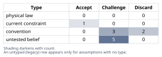
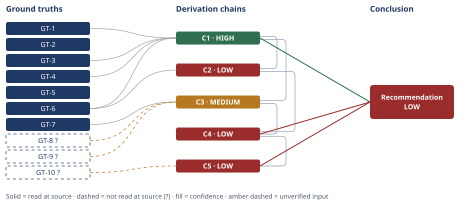

# Build vs. Buy Authentication for a 7-Person SaaS Team

*First-principles analysis · 11 October 2026*

*Read with: [How to read this analysis](HOW-TO-READ.md) · [Working file](analysis-20261011T005754Z.md) · [All files](INDEX.md)*

## Executive Summary

**Recommendation:** Adopt a managed identity provider now, but scope the integration narrowly to this release's actual must-haves — tenant-scoped sessions, login, self-service password reset, an invite flow, and a basic admin/member role model — not the full build-everything list, and not a full-scope vendor rollout either (chain C4). Buying-scoped is trade-off-robust: it beats full-scope Build by a margin no single-criterion reweighting closes, and weakly dominates full-scope Buy on every criterion scored (chain C4).

**Band (from §6):** LOW — capped by chain C4 and chain C5, both LOW; the cap traces mainly to unresolved uncertainty in the *rejected* Build alternative's own estimate, not to weakness in the recommended path itself (chain C4, chain C5).

**Would change it:** A 1–2 day prototype spike resolving whether the team has the security expertise and the chosen OSS library covers tenant-scoping out of the box (chain C2); confirming with sales/CS this week whether any live deal requires MFA/audit/SSO before ship (chain C1); and reading a specific vendor's migration-import documentation closely enough to confirm password-hash portability in each direction (chain C5).

## 1. Problem Essence

**Core problem:** Given a 7-person early-stage B2B SaaS team that must ship authenticated, per-tenant login as the gate for its next billed, urgent release, should the auth capability for *this release* be built on an open-source library or obtained from a managed identity provider (IdP) — and does either pure answer survive contact with what this release actually requires, this team's actual capacity, and this decision's irreversibility going forward?

**Success criteria:**
1. The recommendation names a concrete scope (which of sessions/reset/invite/roles/MFA/audit-log/tenant-isolation are in vs. deferred) tied explicitly to *this* release's requirements, not a generic "do auth well" answer.
2. The recommendation is costed in engineer-weeks and dollars at this company's actual scale (7 engineers, ~120 tenants, ~$40K MRR), not by analogy to how other companies of a different size solved this.
3. The recommendation states, by name, the conditions under which it would flip (e.g., a specific sales/compliance signal, a specific cost-at-scale threshold) — a skeptic can check these conditions against future facts without re-running the analysis.
4. The recommendation does not treat Build-vs-Buy as foreclosing a hybrid/phased path if the ground truths support one, and does not treat switching costs between the two paths as symmetric without checking.
5. The recommendation names the single failure mode (tenant-isolation correctness) that is catastrophic under either path, and does not let the urgency of the release timeline silently drop it.

## 2. Assumptions Table



| Assumption | Type | Treatment | Verdict | Verification |
|------------|------|-----------|---------|---------------|
| A-1: MFA and an audit log are required for *this* release because the prompt's own decomposition list names them alongside sessions/reset. | convention | Explicitly challenge before use. | Challenge — discarded as a must-have for this release; reclassified as deferred, contingent on a confirmed sales/compliance ask (checked explicitly in next steps) | Checked against GT-1/GT-3/GT-4: no enterprise customer, no stated compliance driver exists today; see chain C1 |
| A-2: "Build in-house on an OSS library" means implementing session, crypto, and token primitives from scratch. | convention | Explicitly challenge before use. | Challenge — discarded; a vetted OSS auth library already implements the crypto/session primitives, so the real build cost is integration, tenant-scoping, and reset-flow hardening, not primitive cryptography | Reframing used throughout the Estimate figures in chain C2; no external source needed, this is a definitional correction |
| A-3: Switching costs between Build and Buy are symmetric in both directions. | untested belief | Verify, or flag as unverified. | Challenge — found plausibly asymmetric (Buy→Build later is costlier than Build→Buy later), but the supporting evidence (GT-10) failed source verification, so this verdict itself carries a confidence caveat | unverified — flagged; see GT-10? and Phase 3 failure record; chain C5 |
| A-4: Compliance/enterprise needs are irrelevant to this decision given "no enterprise customers yet." | convention | Explicitly challenge before use. | Challenge — discarded; "no enterprise customers yet" is a true current-constraint fact (A-5) but does not make enterprise-readiness irrelevant to a decision with second-order consequences at the point enterprise customers do appear | Fed into criterion C4 (future enterprise-readiness) in the trade-off, weight 4; see chain C3/C4 |
| A-5: The team has only 7 engineers and the release timeline is genuinely urgent (not self-imposed and renegotiable). | current constraint | Record the expiry conditions. | Accept — expires if headcount grows substantially or if the CTO's "urgent" label is later found to be renegotiable; neither is in evidence here, so it is accepted as binding for this decision | Taken directly from user-supplied context (GT-2, GT-4); drives weights on C1/C5 in the trade-off |
| A-6: The team has sufficient in-house security expertise to implement session/password/MFA primitives correctly under deadline pressure. | untested belief | Verify, or flag as unverified. | Challenge — unverified; no information was supplied about the team's security background, and the stakes-escalation rule requires this to be pushed toward verified status before a Build conclusion could rest on it at HIGH confidence | unverified — flagged; load-bearing precondition P1 from the Inversion lens; see chain C2 |
| A-7: The chosen OSS library fully covers session, reset, and tenant-scoping needs out of the box, requiring only wiring, not invention. | untested belief | Verify, or flag as unverified. | Challenge — unverified; this depends on which specific library is chosen and was not resolved by this analysis | unverified — flagged; load-bearing precondition P2 from the Inversion lens; see chain C2 |
| A-8: The engineer-weeks required to build and harden the Build path safely fit inside the urgent release timeline without displacing the gated feature's own development. | untested belief | Verify, or flag as unverified. | Challenge — likely false for full scope (sessions+reset+MFA+audit together); the Estimate lens (chain C2) puts the central case at ~4 eng-weeks of 1-engineer-equivalent effort against an "urgent" release that also still needs the gated feature itself built | unverified — flagged; load-bearing precondition P3 from the Inversion lens; see chain C2 |
| A-9: Tenant-scoping of sessions/tokens and every downstream data query will be correctly enforced everywhere the auth check matters, not just at login. | untested belief | Verify, or flag as unverified; mandatory regardless of path chosen. | Challenge — unverified by default for any brand-new auth surface; this is the single highest-severity precondition in the whole analysis because buying authentication does not buy authorization/tenant-scoping | unverified — flagged; load-bearing precondition P4 from the Inversion lens, binding on BOTH paths; see chains C2 and C3; mandatory automated test suite named in next steps |
| A-10: Vendor per-MAU pricing will be a meaningful cost burden at this company's current scale. | convention | Explicitly challenge before use. | Discard — contradicted by GT-7/GT-8: published free tiers (25,000–50,000 MAU) comfortably exceed this company's estimated ~600 MAU (GT-9?), so license cost is a non-issue at current scale for at least the two vendors checked | Verified against GT-7 (read-at-source) and GT-8 (read-at-source, partially flagged); see chain C3 |
| A-11: Keeping the current shared-password-plus-Stripe-link gate is a viable fallback option for this release. | convention | Explicitly challenge before use. | Discard — the next billed release is explicitly gated on real per-tenant accounts (GT-4), so the status quo fails that must-have outright and is not a scoreable option, only a ruled-out one | Ruled out explicitly as a trade-off knockout; see Abandoned Reasoning and chain C1 |

## 3. Ground Truths

**Provenance convention for this analysis:** facts the user stated directly about their own company (team size, MRR, tenant count, current auth model, release timeline) are treated as directly observed — the user is the primary source for facts about their own system, and no external citation is applicable or possible for them. These carry no `?`. Facts about the external world (vendor pricing, security-engineering practice, user-count estimates, migration mechanics) are scored against the provenance test (read-at-source / reported-by-delegate / unverified) like any other claim.

- **GT-1** The product currently runs behind a single shared password plus a Stripe customer link; there is no per-tenant authentication today — no individual user accounts exist within a tenant. — source: user-supplied context (prompt); read-at-source: direct statement, "Today the product runs behind a single shared password plus a Stripe customer link — there is NO per-tenant authentication at all currently."
- **GT-2** The engineering team has 7 people total, at an early-stage B2B SaaS company. — source: user-supplied context (prompt); read-at-source: direct statement in context block.
- **GT-3** The company has ~$40K MRR and ~120 paying tenants, and no enterprise customers yet. — source: user-supplied context (prompt); read-at-source: direct statement in context block.
- **GT-4** The next billed release requires authenticated, per-tenant accounts (real multi-tenant login), the CTO has called the timeline urgent, and this is the company's next billed release. — source: user-supplied context (prompt); read-at-source: direct statement in context block.
- **GT-5** The decision as framed is binary: build in-house on an OSS library vs. adopt a managed IdP and integrate it. — source: user-supplied context (prompt); read-at-source: direct statement, "Decision is binary for this analysis."
- **GT-6** A correct self-service password-reset implementation requires, at minimum: cryptographically-secure single-use expiring tokens individually linked to the account; per-account rate-limiting and anti-enumeration controls (a consistent response message and response time for both existent and non-existent accounts); secure HTTPS delivery with referrer-policy protection; and enforced password-policy validation — substantially more than trivial wiring logic. — source: OWASP Forgot Password Cheat Sheet, read-at-source: https://cheatsheetseries.owasp.org/cheatsheets/Forgot_Password_Cheat_Sheet.html, sections "Token Generation & Storage," "Lifecycle Management," "Rate Limiting & Anti-Enumeration," and "Secure Delivery," read 2026-10-10 UTC.
- **GT-7** Clerk's published pricing (as of the vendor's pricing page, read 2026-10-10 UTC) offers a free "Hobby" tier covering up to 50,000 Monthly Retained Users with basic authentication included; MFA, passkeys, and SSO connections require the "Pro" tier starting at $25/mo ($20/mo billed annually); per-user overage pricing (e.g., $0.02/user/mo) applies only above the 50,000-user free threshold. — source: https://clerk.com/pricing, read-at-source: sections "Free Tier (Hobby Plan)" and "Plan Tiers," read 2026-10-10 UTC.
- **GT-8?** Auth0's published pricing page (read 2026-10-10 UTC) states a free tier of up to 25,000 monthly active users for both B2C and B2B use cases, with B2B "Essentials" paid plans starting at $150/month for 500 MAU. — source: https://auth0.com/pricing, read-at-source: sections "Free Tier MAU Limit" and "Paid Tier Starting Points," read 2026-10-10 UTC. Flagged `?`: the fetched summary's account of exactly how the free/paid boundary interacts with B2B-specific features (organizations/roles) below 25,000 MAU was internally inconsistent in phrasing, so the two hard numbers are reported as read but the precise feature-gating boundary is not independently confirmed.
- **GT-9?** At ~120 tenants with typically small teams per tenant in early-stage B2B SaaS, a reasonable estimate of total monthly active users is in the low hundreds (bracket ~200–1,000, central ~600). — unverified: this is an estimate built from the Estimate lens's own assumptions about typical B2B SaaS team size per tenant, not a measurement; this analysis had no access to the product's actual per-tenant user counts.
- **GT-10?** Migrating users into or out of a managed IdP is commonly asymmetric: moving self-hosted users into a vendor (Build→Buy) is typically supported by "bring your own users" import tooling, while moving a vendor's users to a self-hosted system (Buy→Build) typically forces a mass password-reset because password hashes are not portable across systems. — unverified: a Phase 3 verification attempt was made (see Phase 3 failure record below) and did not confirm this claim.

**Phase 3 failure record:** GT-10 — source attempted: https://auth0.com/docs/manage-users/user-migration — reason: citation does not support the claim; the fetched page excerpt confirmed Auth0 supports "automatic migration and bulk imports and exports" but did not state whether password hashes are portable in either direction, so the commonly-assumed asymmetry is carried as `?`-marked rather than settled.

**Provenance summary (required):**
```text
?-marked: GT-8, GT-9, GT-10 (3 of 10)
Read-at-source: GT-6 — OWASP Forgot Password Cheat Sheet, "Token Generation & Storage" / "Lifecycle Management" / "Rate Limiting & Anti-Enumeration" / "Secure Delivery" sections
Read-at-source: GT-7 — clerk.com/pricing, "Free Tier (Hobby Plan)" / "Plan Tiers" sections
GT-1 through GT-5 are user-supplied direct statements about the company's own system (no external source applicable); read-at-source location is the prompt's context block itself for each.
```

## 4. Derivation Chains



### Conclusion C1: The release's minimum viable auth surface is sessions, reset, invite, roles, and tenant isolation — MFA, audit logging, and SSO/SAML are deferrable

GT-1 (no per-tenant auth exists today) + GT-3 (120 tenants, $40K MRR, no enterprise customers yet) + GT-4 (urgent billed release gated on per-tenant auth) + GT-6 (reset flow is non-trivial, OWASP)
→ the release's minimum viable auth surface is tenant-scoped sessions, credential verification, self-service password reset, an invite flow, and a basic admin/member role model — nothing else is load-bearing for this specific release
→ MFA, audit logging, and SSO/SAML are deferrable to a later release unless a specific sales or compliance commitment says otherwise, which this analysis did not find evidence of

**Confidence:** HIGH — all three head inputs are unsuffixed and user-stated or read-at-source (GT-6 read at OWASP's own cheat sheet); the deferral hop is bounded by its own stated caveat ("unless a specific sales or compliance commitment says otherwise") rather than an unexamined gap, and the rival reading — that MFA/audit are needed now for trust/marketing reasons even absent a compliance driver — is addressed and ruled out in Abandoned Reasoning (Dead End: "Treating MFA and audit log as self-evident"), which is the GT this chain itself cites (GT-1/GT-3/GT-4) for ruling it out

### Conclusion C2: Building the must-have scope in-house centers on ~4 engineer-weeks (bracket 2.5–6) and its dominant risk is unverified security/tenant-isolation correctness, not license cost

C1 (must-have scope) + GT-6 (reset-flow complexity, read-at-source)
→ composing a vetted OSS auth library plus the custom tenant-scoping and reset-hardening work the must-have scope requires centers on roughly 19 engineer-days of one-engineer-equivalent effort (bracket 12–30 days, i.e. ~2.5–6 eng-weeks) [Assumes: A-7] [Assumes: A-6]
→ absorbed by a 7-person team under an "urgent" release label, this consumes an estimated 25–35% of total team capacity for 3–6 weeks of calendar time, directly competing with the engineering time the gated feature itself still needs [Assumes: A-8]
→ because the OSS library already supplies the crypto/session primitives, the Build path's dominant risk is not license cost but engineer-time opportunity cost plus unverified security and tenant-isolation correctness [Assumes: A-9]

**Confidence:** LOW — two axes are short at once. Inference: the chain's own conclusion (opportunity-cost is the dominant risk) depends on hop 1's A-7 (does the chosen OSS library actually cover tenant-scoping out of the box?) and A-6 (does the team have the security expertise to use it correctly under deadline?), both unresolved untested beliefs; closing them requires a 1–2 day prototype spike with the specific library under consideration plus an honest internal check of who on the team has shipped auth code before. Rivals: a live, unsettled rival reading is that a sufficiently experienced team could execute this comfortably within the stated budget — this is not ruled out anywhere in this analysis and is named here as still live; what would settle it is the same prototype spike above, timed against the 12–30 day bracket.

### Conclusion C3: Adopting a managed IdP for the must-have scope centers on ~2.2 engineer-weeks and a near-zero recurring cost at this company's current scale

C1 (must-have scope) + GT-7 (Clerk pricing, read-at-source) + GT-8? (Auth0 pricing, partially flagged) + GT-9? (estimated ~600 MAU)
→ a managed-IdP integration scoped to the must-have surface via vendor SDK centers on roughly 11 engineer-days of one-engineer-equivalent effort (bracket 6–16 days, ~1.2–3.2 eng-weeks), substantially less than the Build path's central estimate [Assumes: A-2]
→ at an estimated ~600 monthly active users, the recurring vendor fee for the must-have scope (no MFA/SSO activated yet) lands inside a typical vendor's free tier rather than becoming a material cost line against $40K MRR, true for both vendors checked since GT-7's 50,000-user and GT-8?'s 25,000-user free thresholds both comfortably exceed the estimate
→ because the vendor's core login/session/reset code is independently used and hardened at a scale this team cannot replicate, the Buy path's residual risk is concentrated in the team's own authorization/tenant-scoping layer rather than in cryptographic or session-primitive correctness [Assumes: A-9]

**Confidence:** MEDIUM — one axis is short. Inputs: GT-9? (the ~600 MAU estimate) is unverified and is what caps this chain; it would be removed as a cause of the downgrade by pulling the product's actual per-tenant active-user count from existing telemetry — a trivial internal query, not an external verification, and one of this analysis's concrete next steps. Inference and Rivals are clean: hop 1's A-2 reframing is a definitional correction already settled in the Assumptions Table, and the rival reading on cost (that Auth0's higher $150/mo entry point, GT-8?, might change the picture) is addressed in Abandoned Reasoning (Dead End: "Assuming vendor pricing is a material cost barrier") and ruled out as immaterial at this company's revenue scale regardless of which of the two checked vendors is chosen.

### Conclusion C4: A managed IdP scoped narrowly to must-haves is the trade-off-robust recommendation for this release

C2 (Build central estimate ~4 eng-wk; risk: opportunity cost, unverified security) + C3 (Buy-scoped central estimate ~2.2 eng-wk; risk: team's own authorization layer)
→ scoring Build-full-scope and Buy-full-scope — the two readings GT-5 frames as the binary decision this analysis was asked to resolve — plus a third, Buy-scoped-to-must-haves, against six weighted criteria (time-to-ship, security risk, $ cost, enterprise-readiness, team focus, lock-in exit cost) with weights locked before scoring yields weighted totals of 52, 94, and 106 respectively out of a maximum of 115
→ Buy-scoped weakly Pareto-dominates Buy-full-scope on every one of the six criteria, and no single criterion's weight can be moved within the 1–5 weighting scale to make Build-full-scope's total exceed Buy-scoped's (the required single-criterion weight on cost or lock-in would have to reach roughly 20 or 57 respectively, both outside the valid range)
→ a managed IdP, integrated narrowly to this release's must-have scope, is the recommended path, and this result is robust to exactly where the Build or Buy time/cost estimates land within their own brackets

**Confidence:** LOW — capped by the lowest-rated chain its head cites, C2 (LOW). This cap is worth reading carefully: it stems from unresolved uncertainty in the *rejected* alternative's own estimate (A-6/A-7/A-8, named on C2's confidence line) and not from weakness in the recommended path itself. What would remove C2 as the cause of this chain's cap: the same prototype-spike verification named on C2's confidence line. Independently, the Pareto-dominance and flip-test results in hop 2 are themselves robust (no rival reweighting within the valid scale changes the ranking), so this chain's own Rivals axis is clean; its band is held down by the Inputs ceiling alone.

### Conclusion C5: Keep the company's own user/tenant join table independent of the vendor's data model, regardless of which direction switching costs actually run

GT-10? (migration asymmetry, Phase 3 read failed) + C4 (scoped-Buy recommendation, LOW)
→ because password-credential portability between a self-hosted system and a managed IdP was not confirmed in either direction by this analysis's own source check, the commonly assumed asymmetry (easier to move Build→Buy later than Buy→Build) is carried as a plausible but unverified second-order risk rather than a settled fact
→ the mitigation that holds regardless of which direction the asymmetry actually runs is to keep the company's own user/tenant join table as the source of truth for tenant membership and roles, mapping vendor user IDs to it rather than relying on the vendor's internal data model
→ this mitigation is cheap to apply now and belongs in the scoped-Buy integration's technical requirements from day one, not deferred to a future migration event

**Confidence:** LOW — capped both by GT-10? directly and by C4 (LOW) on its head. GT-10? would be removed as a cause of the downgrade by reading a specific vendor's user-migration/import documentation closely enough to confirm or deny password-hash portability in each direction (the Phase 3 attempt on Auth0's migration docs did not settle this). C4's LOW rating is inherited and traces back to C2's unresolved A-6/A-7/A-8, as explained on C4's own confidence line. Inference and Rivals on this chain itself are clean: the mitigation's robustness-to-uncertainty reasoning in hop 2 holds under either direction of the asymmetry, and no rival mitigation was found that performs better under uncertainty.

## 5. Abandoned Reasoning

### Dead End: Scoring the status quo (shared-password gate) as a trade-off option

**What was tried:** Considered including "keep the shared password + Stripe link" as a scoreable option alongside Build and Buy in the trade-off analysis.

**Why abandoned:** It fails the must-have knockout M1 outright — the next billed release is explicitly gated on real per-tenant authenticated accounts (GT-4), which the shared-gate model cannot provide at all. A knockout is not scored; it is ruled out before scoring begins.

**What it ruled out:** This rules out any path that does not deliver per-tenant authentication for this release, and confirms the decision genuinely is a Build-vs-Buy (vs. hybrid) question, not a build-vs-do-nothing one. Ruled out by GT-1/GT-4; cited by chain C1 and by A-11 in the Assumptions Table.

### Dead End: Treating "MFA and audit log needed now" as self-evident

**What was tried:** The initial decomposition treated MFA and an audit log as required for this release, following the prompt's own framing, which lists them alongside sessions and password reset as part of "what per-tenant accounts require."

**Why abandoned:** Chain C1's decomposition shows they are not load-bearing for this specific release given no enterprise customers (GT-3) and no stated compliance driver (GT-4 names only "authenticated, per-tenant accounts," not MFA/audit specifically) — treating them as mandatory would have inflated the Build estimate by roughly two engineer-weeks and inflated the Buy path's required plan tier, for no release requirement that actually exists today.

**What it ruled out:** This rules out "build or buy the full feature list right now" as the correct framing for either path, and is what makes the scoped-Buy composite option (vs. full-scope Buy) scoreable at all in the trade-off. Ruled out by GT-1/GT-3/GT-4; cited by chain C1.

### Dead End: Assuming vendor pricing is a material cost barrier

**What was tried:** An early draft of the cost estimate (before fetching real vendor pricing) assumed a central figure of roughly $250/month in recurring vendor fees, used informally while drafting the Estimate lens.

**Why abandoned:** Read-at-source pricing (GT-7, GT-8) showed free tiers covering 25,000–50,000 monthly users — far above this company's estimated scale (GT-9?, ~600 MAU central) — so the invented $250/mo figure was ungrounded and materially overstated the Buy path's cost disadvantage relative to what the vendors' own published pricing actually supports.

**What it ruled out:** This rules out "$ cost" as a meaningful differentiator against Buy at this company's current scale, for either of the two vendors checked. Ruled out by GT-7/GT-8; cited by chain C3.

### Dead End: Asserting migration asymmetry as a settled fact

**What was tried:** An early draft of the second-order effects section asserted as settled fact that migrating from a managed IdP back to a self-hosted system (Buy→Build) is strictly harder than the reverse direction (Build→Buy), based on general industry pattern-matching rather than a checked source.

**Why abandoned:** A Phase 3 verification attempt (reading Auth0's own user-migration documentation) did not confirm or deny password-hash portability in either direction — see the Phase 3 failure record in section 3. The claim could not be upgraded past `?`-marked, so asserting it as a certainty in the Conclusion would have overclaimed what this analysis actually verified.

**What it ruled out:** This rules out stating the switching-cost asymmetry as a certainty; it is instead carried as a flagged, plausible-but-unverified risk with a direction-agnostic mitigation (own your own user/tenant data model). Ruled out/downgraded by the Phase 3 failure record on GT-10; cited by chain C5.

## 6. Conclusion

**Recommended approach:** Adopt a managed identity provider now, but scope the integration narrowly to this release's actual must-haves — tenant-scoped sessions, login, self-service password reset, an invite flow, and a basic admin/member role model — rather than either the full build-everything list (sessions+reset+MFA+audit log at once) or a full-scope "turn everything on" vendor adoption (chain C4).

**Key insight:** The real decision is not "build everything" vs. "buy everything" — for this specific release, at this team size and under this timeline, almost all of Build's genuine long-run value (full control, no vendor dependency) is optionality this release does not need yet, while almost all of Build's cost (engineer-weeks on the critical path, unverified security/tenant-isolation correctness) is paid immediately, against the one thing that actually is urgent: the billed feature the auth gate sits in front of. Buying, scoped narrowly, defers nothing this release actually requires and costs roughly half the engineer-time of building it, at a near-zero dollar cost at this company's current scale (chain C4, chain C3).

**Trade-offs acknowledged:** Buying creates a recurring vendor dependency and a currently-cheap-but-monitorable pricing relationship that could force an awkward renegotiation later if a specific enterprise deal needs custom terms, and it means accepting somewhat less control over auth internals than building would give (chain C3, chain C5). Scoping narrowly means MFA, audit logging, and SSO are not available at launch, which could cost a specific deal if sales or customer success discover an existing commitment requiring one of them before this release ships — this is named explicitly as a condition that flips the *scope* decision below, and should be checked this week, not assumed away (chain C1).

**Conditions under which this recommendation would flip:**
- Toward building more in-house (or at least negotiating much harder for control): if the team in fact has one or two engineers with genuine production auth/security experience *and* spare capacity beyond the gated feature (this would resolve A-6 and A-8 favorably) — this analysis found no evidence either way and flags it as unverified, not as false (chain C2).
- Toward widening *this release's* scope (not toward Build): if sales/CS confirms an active deal, renewal, or support commitment explicitly requires MFA, audit logging, or SSO before this release ships (chain C1) — check this now, this week, before finalizing scope.
- Toward reconsidering the chosen vendor specifically (not Buy itself): if a short technical spike shows the product's tenant/role/permission model does not map cleanly onto the chosen vendor's data model — a vendor-selection risk the trade-off's C3 estimate did not evaluate per-vendor (chain C3).
- Toward reconsidering cost: if actual per-tenant active-user counts (resolving GT-9?) turn out to be an order of magnitude higher than the ~600 central estimate, materially changing where the company sits relative to the vendor's free-tier threshold (chain C3).

**Confidence:** LOW — this rating is capped by C4 and C5, both LOW, which the Conclusion rests on directly (chain C4, chain C5); it is not capped by C1, which is HIGH. Read what is actually driving the LOW band before treating it as a weak recommendation: C4's cap traces to unresolved uncertainty in the *rejected* Build alternative's own estimate (A-6/A-7/A-8 — does the team have the security expertise, does the chosen OSS library cover tenant-scoping out of the box, does the eng-week estimate actually fit the timeline), not to weakness in the recommended Buy-scoped path itself; C5's cap traces to an unverified migration-direction claim (GT-10?) that backs a cheap, direction-agnostic mitigation rather than the headline recommendation. A live rival — that a more security-capable team than this analysis could verify could execute Build safely within budget — is named here and not ruled out (see C2's confidence line); what would remove both caps and this rival at once is the same concrete step: a 1–2 day prototype spike (named in next steps) that would resolve A-6/A-7/A-8 directly. Until that spike runs, this recommendation should be read as "robust on the comparison itself" (the Pareto-dominance and flip-test results in chain C4 do not depend on where Build's estimate lands within its own bracket) rather than "fully verified."

**Concrete next steps for this week:**
1. Day 1 — Ask sales/CS directly whether any current deal, renewal, or open support commitment requires MFA, audit logging, or SSO before this release ships. This resolves the one scope-flipping condition this analysis could not check itself (chain C1).
2. Day 1–2 — Run a 1–2 day technical spike integrating the chosen vendor's SDK against the product's actual tenant/role model, and pull real per-tenant active-user counts from existing telemetry at the same time. This simultaneously resolves GT-9? and the A-6/A-7/A-8 uncertainty named on both chains (chain C2, chain C3).
3. Day 2 — Design the company's own user/tenant join table as the source of truth for tenant membership and roles, independent of the vendor's internal data model, mapping vendor user IDs to it. This is the single highest-leverage action in this entire analysis: it mitigates both the tenant-isolation risk (A-9) and the migration-direction uncertainty at once, and it is cheap to do now versus retrofitted later (chain C5).
4. Day 2–5 — Build the scoped integration: session middleware, the vendor's prebuilt password-reset flow, the invite flow, and the admin/member role check inside the app's own authorization layer, not the vendor's (chain C3).
5. Before ship, non-negotiable regardless of timeline pressure — write and run an automated tenant-isolation test suite asserting that cross-tenant access is denied at every endpoint the new auth gates. This is the one item this analysis will not let urgency cut, because A-9 is the single catastrophic failure mode under either path (chain C2, chain C3).
6. Ship the scoped release (chain C4).
7. Within 30 days post-ship — revisit MFA/audit-log/SSO activation against real sales-pipeline signals; per GT-7, this is a vendor plan/config change, not a re-architecture, so deferring it now creates no technical debt (chain C1).
8. Ongoing — put a calendar reminder at the 6- and 12-month mark to re-check vendor pricing against actual MAU growth, closing this chain's residual GT-9? gap on a recurring basis rather than a one-time basis (chain C3).
