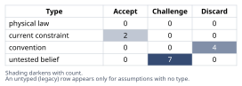
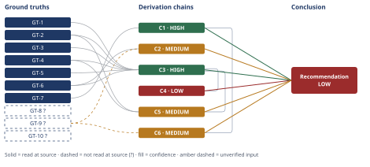

# Build or Buy Authentication for a Multi-Tenant SaaS

*First-principles analysis · 11 October 2026*

*Read with: [How to read this analysis](HOW-TO-READ.md) · [Working file](analysis-20261011T033723Z.md) · [All files](INDEX.md)*

## Executive Summary

**Recommendation:** Adopt a managed identity provider (provisionally WorkOS, with Clerk a close second) for authentication primitives — sessions, credential storage, password reset, MFA — rather than building them in-house; build the tenant-scoping/authorization layer in the app regardless, since every option requires it (chain C1). This buy-over-build result is robust and holds regardless of vendor (chain C3), and is also the faster path to ship the gated feature (chain C2).

**Band (from §6):** LOW

**Would change it:** The core buy-over-build call (chains C1, C3) is robust; the overall LOW band comes from four open, cheap-to-close items named in chains C2, C4, C5 and C6: a short timeboxed integration spike comparing WorkOS and Clerk directly, a per-path build/buy spike to validate the engineering-hours estimate, a look at whether sales conversations actually raise SSO, and a 1–2 day audit of the existing Stripe-to-tenant data mapping.

## 1. Problem Essence

**Core problem:** Given a 7-person team under release-urgency pressure, which engineering primitives of "authentication" should this company buy from a managed identity provider versus build in-house, such that the gated feature ships on schedule without creating a security or enterprise-readiness liability the team cannot see yet?

**Success criteria:**
1. The answer names which specific authentication primitives (session management, credential storage, password reset, MFA, audit log, SSO/SAML/SCIM, multi-tenancy isolation) are recommended for the buy path versus the build path, rather than assigning the whole bundle to one side.
2. The answer states whether "build vs buy" is the correct frame for this decision, with the reasoning that supports or rejects it, rather than assuming it.
3. The answer accounts for the stated team size and urgency when estimating what is achievable before the next billed release.
4. The answer states what changes about the recommendation at 500 tenants and at the first enterprise SSO/SAML requirement, not only at today's scale.
5. The answer names concrete risks of its own recommendation and what would have to be true to reverse it — not only risks of the rejected option.

## 2. Assumptions Table



| Assumption | Type | Treatment | Verdict | Verification |
|------------|------|-----------|---------|--------------|
| A-1: "Build vs buy" names a true binary — the whole authentication-and-authorization bundle is either entirely self-built or entirely outsourced to a vendor | convention | Explicitly challenge before use | Discard — contradicted by GT-7; tenant-scoped authorization is built in-house under every option, so no "buy everything" bundle exists | GT-7 (OWASP Authorization Cheat Sheet) |
| A-2: A 7-person team under release pressure has materially less capacity to build and *maintain* security-critical code (sessions, credential storage, MFA) safely than to integrate a vendor SDK | current constraint | Record expiry conditions | Accept — expires once the team dedicates a security/platform engineer or auth demands stabilize; until then it governs | Inferred from GT-6's ongoing-parameter-maintenance burden and team size stated by the requester |
| A-3: The specific vendors evaluated (Auth0, Clerk, WorkOS) implement credential storage, MFA and session management to current security standards, not merely that the *feature exists* on the pricing page | untested belief | Verify or flag | Challenge — unverified — flagged; feature presence is confirmed (GT-1 through GT-5) but no SOC2 report, pen-test result or security audit from any vendor was read by this analysis | unverified — flagged |
| A-4: "No enterprise customers yet" means SSO/SAML/SCIM capability carries no cost of ignoring it right now | convention | Explicitly challenge before use | Discard — conflates "not needed in the very first release" with "free to ignore"; GT-2/GT-4/GT-5 show the option costs near-zero to keep open today and GT-8? suggests the cost of a security gap found later is large | GT-2, GT-4, GT-5 (vendor pricing pages); GT-8? (breach-cost report, delegate-reported) |
| A-5: MFA and audit logging can be deferred to a later release at no extra total cost, only a deferred one | untested belief | Verify or flag | Challenge — unverified — flagged; deferring touches the same session/credential code paths later, under contract pressure, rather than reducing total work | unverified — flagged; would need a direct comparison of in-release vs. deferred implementation cost, not performed here |
| A-6: The CTO's stated urgency means the fastest-to-ship option is automatically correct regardless of downstream maintenance or security cost | convention | Explicitly challenge before use | Discard — urgency is a real constraint on *time-to-ship* (weighted accordingly in chain C3) but does not by itself settle maintenance burden, security surface, or enterprise-readiness, which chain C3 scores separately | Addressed structurally via the trade-off's multi-criteria weighting (chain C3), not a single "fastest wins" rule |
| A-7: Self-hosting an open-source auth library eliminates "vendor lock-in" risk entirely | convention | Explicitly challenge before use | Discard — self-hosted OSS substitutes a different dependency (the library's own maintenance and patch cadence, plus the team's accumulated customizations) for vendor lock-in; it is not the absence of dependency | Definitional — software-dependency structure, not vendor-specific |
| A-8: Managed-IdP pricing for the vendors scored stays within its currently published tiers as the company scales from ~120 to 500+ tenants | current constraint | Record expiry conditions | Accept — expires at the tier boundaries the pricing pages name (e.g., >1M MAU for WorkOS AuthKit, >100 SSO connections for WorkOS, pricing-policy changes by any vendor); re-evaluate at those boundaries | GT-1, GT-2, GT-3, GT-4, GT-5 (vendor pricing pages, read-at-source as of 2026-10-10) |
| A-9: Buying authentication from a managed IdP fully discharges the application's security obligations for tenant data | untested belief | Verify or flag | Challenge — unverified — flagged; GT-7 states an authenticated user is not automatically authorized for every resource, so a tenant-isolation bug in application code is not prevented by buying authentication | GT-7 (OWASP Authorization Cheat Sheet) |
| A-10: The Fermi decomposition used in chain C2 (session, credential storage, password reset, MFA, audit log, tenant wiring, security review, QA) is a complete and representative accounting of engineering effort for both the build and buy paths | untested belief | Verify or flag | Challenge — unverified — flagged; the decomposition was built from first-principles task identification, not validated against an actual timeboxed spike | unverified — flagged; a 1-week spike per path (named in the pre-mortem's Cluster A/E disposition) would verify it |
| A-11: The criterion weights used in the trade-off (chain C3/C4) — time-to-ship=5, security assurance=5, future-SSO-readiness=4, maintenance burden=4, cost-now=2, cost-at-scale=3, portability=2 — reflect this specific company's actual risk tolerance and priorities, not only this analysis's judgment of them | untested belief | Verify or flag | Challenge — unverified — flagged; not validated against the CTO's or team's own stated priorities; the buy-vs-build result (chain C3) is shown to survive large perturbations to these weights, but the WorkOS-vs-Clerk ranking (chain C4) is not | unverified — flagged; direct conversation with the CTO on priority ranking would close this |
| A-12: Enterprise or mid-market prospects evaluating this product will require SSO/SAML as part of procurement before signing, in a timeframe that matters to this company | untested belief | Verify or flag | Challenge — unverified — flagged; this is an industry-pattern claim applied to this company's specific prospect pool without this analysis reviewing that pool's actual requirements | unverified — flagged; review of the sales pipeline's actual win/loss notes over the next two quarters would verify it |
| A-13: Each of the ~120 existing Stripe customer records corresponds cleanly to exactly one tenant, with no many-to-many billing relationships that would complicate the migration to per-tenant accounts | untested belief | Verify or flag | Challenge — unverified — flagged; stipulated implicitly by the requester's description but not confirmed against the actual customer data model | unverified — flagged; a 1–2 day data-mapping audit (named in the pre-mortem's Cluster A disposition) would verify it |

## 3. Ground Truths

- **GT-1** WorkOS AuthKit (hosted user authentication: sessions, credential storage, MFA, password reset) is free for the first 1,000,000 monthly active users; each additional 1,000,000 MAU costs $2,500/mo — source: WorkOS pricing page (workos.com/pricing); read-at-source: the "AuthKit" pricing section, quoted figures "first 1 million monthly active users are free" and "$2,500/mo" per additional million.
- **GT-2** WorkOS SSO and Directory Sync (SCIM) are priced per connection, volume-discounted: $125/connection (1–15), $100 (16–30, 20% off), $80 (31–50, 36% off), $65 (51–100, 48% off), custom above 100 — source: WorkOS pricing page; read-at-source: the SSO and Directory Sync tier table.
- **GT-3** Clerk's multi-tenant "Organizations" primitive is free up to 100 organizations per app with up to 20 members each; the $100/mo (or $85/mo annual) B2B Authentication add-on removes the member cap and adds tiered per-organization pricing beyond 100 — source: Clerk pricing page (clerk.com/pricing); read-at-source: the "Organizations (MRO)" and "B2B Authentication add-on" sections.
- **GT-4** Clerk Enterprise SSO (SAML/OIDC/EASIE) ships 1 connection included on the Pro tier ($25/mo, or $20/mo annual); additional connections cost $75/mo each for the 2nd–15th connection, then $60/mo for the 16th–100th — source: Clerk pricing page; read-at-source: the "Enterprise SSO" pricing table.
- **GT-5** Auth0's B2B pricing includes Enterprise (SSO) Connections starting on the Free tier (1 connection, $0/mo) and the Essentials tier (from $150/mo at 500 MAU, 3 connections included); additional connections cost $100/mo each up to 30 total — SSO is not gated behind a custom-quote Enterprise sales tier — source: Auth0 pricing page (auth0.com/pricing); read-at-source: the B2B pricing comparison table's "Enterprise Connections" row across Free/Essentials/Professional tiers.
- **GT-6** OWASP's Password Storage Cheat Sheet specifies the current correctness bar for credential storage: Argon2id preferred (≥19 MiB memory, 2 iterations, parallelism 1); scrypt or bcrypt (work factor ≥10) as fallbacks; PBKDF2 (≥600,000 iterations) when FIPS-140 compliance is required; and explicitly states fast hashes such as SHA-256 are unsuitable for password storage — source: OWASP Cheat Sheet Series, Password Storage Cheat Sheet (cheatsheetseries.owasp.org); read-at-source: the algorithm-selection and parameter-recommendation sections, quoted verbatim on "fast hashing algorithms such as SHA-256 are not suitable."
- **GT-7** OWASP's Authorization Cheat Sheet defines authorization as "the process of verifying that a requested action or service is approved for a specific entity," explicitly distinct from authentication; states an authenticated user is not automatically authorized for every resource; states authorization logic must be custom-fit to the application's business context and resource/object model; and states RBAC is "poorly suited" to multi-tenant scenarios where distinct organizations or customers share protected resources, favoring attribute-based (tenant-scoped) models instead — source: OWASP Cheat Sheet Series, Authorization Cheat Sheet; read-at-source: the "Authentication vs. Authorization" and "Multi-Tenant Applications" sections.
- **GT-8?** The IBM Cost of a Data Breach Report 2025 is reported to state a global average breach cost of $4.44M (down from $4.88M in 2024) and a US average of $10.22M — cited to: IBM Cost of a Data Breach Report 2025 — reported-by-delegate: a WebSearch summary of secondary coverage (CyberScoop, Varonis, Baker Donelson); the original IBM report document was not opened by this analysis. This ground truth is not load-bearing for any chain's endpoint — it is cited only as directional context for breach severity in the Assumptions Table (A-4) and is not a head input on any Derivation Chain.
- **GT-9?** The product currently runs behind one shared password plus a Stripe customer link, with no per-tenant authentication, and the gated feature requiring per-tenant accounts is the team's next billed release — unverified: stipulated by the requester describing their own system; this analysis did not inspect the actual codebase, access-control configuration, or release schedule to confirm it independently.
- **GT-10?** The team is 7 engineers; the company has roughly $40K MRR and roughly 120 paying tenants; it has no enterprise customers today — unverified: stipulated by the requester; this analysis did not independently verify the team roster, revenue, or customer roster.

**Provenance summary:**
```text
?-marked: GT-8, GT-9, GT-10 (3 of 10)
Read-at-source: GT-1 — WorkOS pricing page, "AuthKit" section
Read-at-source: GT-2 — WorkOS pricing page, SSO/Directory Sync tier table
Read-at-source: GT-3 — Clerk pricing page, "Organizations (MRO)" section
Read-at-source: GT-4 — Clerk pricing page, "Enterprise SSO" table
Read-at-source: GT-5 — Auth0 pricing page, B2B Enterprise Connections row
Read-at-source: GT-6 — OWASP Password Storage Cheat Sheet, algorithm/parameter sections
Read-at-source: GT-7 — OWASP Authorization Cheat Sheet, AuthN-vs-AuthZ and Multi-Tenant sections
```

## 4. Derivation Chains



### Conclusion C1: "Build vs buy" is a false binary — tenant-scoped authorization is built in-house under every option

GT-7 (OWASP: authorization is distinct from authentication, app-specific, and RBAC is poorly suited to multi-tenant sharing)
→ tenant-scoped access control is implemented in the application's own authorization layer under every option considered
→ no identity provider, self-hosted or managed, owns the mapping from an authenticated user to the tenant-scoped resources that user may touch
→ the decision in front of this team is therefore narrower than build-everything versus buy-everything
→ it is which vendor, if any, supplies the authentication primitives, given that tenant-scoped authorization is built in-house regardless of that choice

**Confidence:** HIGH — GT-7 is read at source and the inference applies its own stated definitional split directly; no `?` input and no unpriced premise are on this chain. The rival reading — that adopting a managed identity provider discharges all authentication-and-authorization obligations — is ruled out directly by GT-7's own statement that an authenticated user is not automatically authorized for every resource (see also A-9, Discard).

### Conclusion C2: A managed-identity-provider integration is very likely to ship the gated feature sooner than a from-scratch build

GT-6 (OWASP: the correctness bar for credential storage) + GT-9? (today's baseline: no per-tenant auth exists yet, so both paths start from zero)
→ decomposing session management, OWASP-compliant credential storage, password reset, MFA, audit logging and tenant wiring into their constituent engineering tasks brackets a from-scratch build at roughly 7.5 to 16 engineer-weeks for one engineer *[Assumes: A-10]*
→ the same decomposition brackets a managed-identity-provider integration at roughly 3 to 7.3 engineer-weeks for one engineer *[Assumes: A-10]*
→ the build bracket's lower edge sits at or above the buy bracket's upper edge, so even a favorable build estimate and an unfavorable buy estimate do not show buying as slower
→ for a team under the CTO's stated release-urgency constraint, the managed-identity-provider path is the one substantially more likely to ship the gated feature first

**Confidence:** MEDIUM — GT-9? (today's zero-auth baseline) is stipulated by the requester and not independently inspected by this analysis; verification is a direct read of the current codebase and access-control configuration. The decomposition carries an unpriced premise, A-10 (the task list is complete and representative), tagged at the hops that depend on it; a 1-week timeboxed spike per path (named in the pre-mortem's Cluster A/E disposition) would verify it directly. Absent that spike, the bracket's near-touching edges (7.5 vs. 7.3 weeks) mean this chain's separation, while directionally consistent with chain C3, should not be read as a wide margin.

### Conclusion C3: Adopting a managed identity provider is favored over building in-house, regardless of which specific vendor is chosen

GT-1 + GT-2 + GT-3 + GT-4 + GT-5 + GT-6 (vendor feature/pricing facts and the credential-storage correctness bar — the trade-off's factual basis)
→ scoring build, Auth0, Clerk and WorkOS against time-to-ship, security assurance, future-SSO-readiness, maintenance burden, cost-now, cost-at-scale and portability, with weights set to this analysis's read of a 7-person team's priorities *[Assumes: A-11]*, produces weighted totals of WorkOS 108, Clerk 104, Auth0 96 and build 60
→ the fifty-point-plus gap separating build from every bought option survives large single-criterion weight perturbations, because build scores lowest of all four options on the three highest-weighted criteria simultaneously
→ no plausible re-weighting of this analysis's own judgment calls reverses the buy-over-build result, even though the ranking among the three vendors remains sensitive to weighting
→ recommend adopting a managed identity provider, rather than building the authentication primitives in-house, regardless of which specific vendor is ultimately chosen

**Confidence:** HIGH — all six head ground truths are read at source with no `?`. The A-11 premise on the second hop is priced on the fourth hop: if the weights are wrong, the buy-over-build endpoint still stands (per the robustness shown), only the vendor-level ranking in chain C4 is affected. The strongest rival — "build in-house on a mature OSS framework is fast and safe enough because OWASP's recipe (GT-6) makes credential storage a solved problem" — is named and ruled out in Abandoned Reasoning (Dead End: "OWASP recipe makes build safe enough"), via chains C2 and C3 jointly.

### Conclusion C4: Between WorkOS and Clerk specifically, the pick is a near-tie, provisionally favoring WorkOS

C3 (buy over build, established via trade-off)
→ WorkOS's total (108) exceeds Clerk's (104) by exactly the weighted value of the future-SSO-readiness criterion, the only criterion on which the two differ in this analysis's scoring
→ if Clerk's SCIM/Directory Sync terms match WorkOS's per-connection terms at this company's scale, that criterion ties and the two vendors' totals tie exactly
→ the vendor-level pick is therefore provisional and should not be treated with the same confidence as the buy-over-build result in chain C3

**Confidence:** LOW — even though the Inputs ceiling is HIGH, two further axes are short. First, the ranking rests on A-11 (this analysis's own weighting judgment, not validated with the client) applied at the fine-grained vendor-vs-vendor level, where — unlike the buy-vs-build result in C3 — the margin is thin and entirely attributable to one weight-4 criterion. Second, the Clerk rival is live and unsettled: this chain names the condition that would flip it but does not rule it out. Both close with the half-day two-vendor integration spike named in the pre-mortem's Cluster E disposition; until that runs, this vendor-level pick is provisional.

### Conclusion C5: Buying now creates second- and third-order consequences that a "no enterprise customers yet" framing would miss

C3 (buy over build via trade-off) + GT-2 (WorkOS SSO priced per connection from connection 1) + GT-4 (Clerk SSO priced per connection from connection 1)
→ adopting a managed identity provider now means SSO/SAML capability already exists in the product, latent and unused, the moment a prospect first asks for it
→[2nd] prospective enterprise or mid-market accounts' IT and security staff can raise SSO during procurement and receive a same-week "yes" instead of a multi-month "let us get back to you" *[Assumes: A-12]*
→[2nd] the 7-person team's engineering time is not spent building or maintaining session, password-reset or MFA code, and is available for the gated feature and later product work instead
→[3rd] once SSO connections become common, their per-connection cost (GT-2, GT-4) grows with the number of enterprise accounts rather than with total end users, so the cost line tracks the revenue segment paying for it

**Confidence:** MEDIUM — the cost-tracks-revenue-segment effect (3rd order) follows directly from GT-2/GT-4's per-connection pricing and needs no further verification. The procurement-timing effect (2nd order) rests on A-12 (unverified belief that these prospects require SSO during procurement in a timeframe that matters); if A-12 were false, the freed-capacity and cost-scaling effects would still hold, so the chain's broader claim survives, but the specific procurement-timing claim would not. Verification: review the sales pipeline's actual win/loss notes for SSO mentions over the next two quarters. No effect in this chain contradicts a ground truth, so no return to Phase 2 is triggered.

### Conclusion C6: The migration cost from today's shared-password model is common to every option and was correctly excluded from the trade-off

C1 (authorization and tenant-scoping are built in-house regardless of vendor) + GT-9? (today's shared-password-plus-Stripe-link baseline)
→ migrating today's roughly 120 tenants to per-tenant accounts requires mapping each Stripe customer record to a tenant-scoped account *[Assumes: A-13]*
→ that mapping is tenant-data-model work owned by the application, not identity-provider work, under every option this analysis scored
→ the migration's engineering cost is therefore common to build and buy alike, which is why chain C3 correctly left it out of the trade-off's differentiating criteria

**Confidence:** MEDIUM — GT-9? (today's baseline) is stipulated by the requester and not independently inspected; verification is a direct read of the current tenant/customer data model. A-13 (a clean one-to-one Stripe-customer-to-tenant mapping) is named at the hop it qualifies; if false, the migration-mapping work would grow but would remain common to every option — the chain's endpoint survives. Verification: the 1–2 day data-mapping audit named in the pre-mortem's Cluster A disposition.

## 5. Abandoned Reasoning

### Dead End: Build everything in-house, with speculative SSO/SAML added up front

**What was tried:** Considered extending the in-house build option to include a self-built SAML/OIDC federation layer now, speculatively, so that the build path would not be caught flat-footed by a future enterprise deal.

**Why abandoned:** This front-loads the largest and most error-prone component of the build path (federated identity protocol handling) for a need that does not exist today (GT-10?: no enterprise customers yet), while chains C1, C2 and C3 show the same capability is available from every managed vendor evaluated (GT-2, GT-4, GT-5) at near-zero marginal engineering cost. The intermediate claim this path would need — "building SSO speculatively is cheaper than buying it later" — could not be established; the Fermi estimate (chain C2) points the opposite way even before SSO is added to the build-path's scope.

**What it ruled out:** "Build everything, including future-proofed SSO" as a viable near-term option. This path is strictly dominated by buying SSO capability through a managed IdP, so it does not need to be re-explored if revisited later.

### Dead End: Treat "no enterprise customers yet" as license to ignore SSO/SAML/SCIM entirely

**What was tried:** Considered scoring the trade-off (chain C3) with the future-SSO-readiness criterion removed or weighted near zero, matching a literal reading of "we have no enterprise customers, so this doesn't matter now."

**Why abandoned:** Assumption A-4 was discarded on exactly this reasoning: GT-2, GT-4 and GT-5 show the cost of keeping SSO available is paid per-connection, starting near zero, while chain C5's second-order analysis shows the cost of *not* having it is concentrated at the worst possible moment — during a live enterprise procurement cycle. Dropping the criterion would have hidden this asymmetry rather than resolved it, and would contradict GT-2/GT-4/GT-5's own pricing structure, which this analysis has already read at source.

**What it ruled out:** A cost-minimization frame that picks whichever option is cheapest this month without pricing in the option value of enterprise-readiness. This saves a future analyst from re-scoring the trade-off with that criterion zeroed out.

### Dead End: Treat the comparison as a literal two-option bundle (build everything vs. buy everything)

**What was tried:** Evaluating the question exactly as posed by the CTO — a straight comparison between two complete, mutually exclusive bundles.

**Why abandoned:** Contradicted by GT-7 directly: authorization and tenant-scoping are built in the application layer under every option, so a "buy everything, zero in-house auth code" bundle does not exist for a multi-tenant SaaS product. Chain C1 formalizes this; scoring a bundle that cannot actually be purchased would have produced a comparison that looked complete but wasn't.

**What it ruled out:** Scoring a "fully bought" option with no in-house authorization work. This saves a future analyst from re-litigating whether a vendor can "handle it all."

### Dead End: "The OWASP recipe makes build safe enough" — the strongest rival to chain C3

**What was tried:** Considered discounting the build path's security-assurance and maintenance-burden scores upward, on the reasoning that OWASP's published password-storage parameters (GT-6) make credential storage a solved, copy-paste problem, so the security-risk difference between build and buy is overstated.

**Why abandoned:** The Fermi estimate (chain C2) shows the time cost of the build path is not concentrated in the hashing-algorithm choice — which is, in fact, a solved and well-documented step — but in the surrounding primitives (password-reset token handling, MFA enrollment and recovery, audit logging) and in the absence of independent security review, none of which GT-6's recipe addresses. These remain recurring maintenance costs (chain C3's maintenance-burden criterion) regardless of how good the hashing recipe is.

**What it ruled out:** The specific claim that "the hard part is solved, so build is fine," which conflates one sub-problem (password hashing) with the much larger surface the Fermi decomposition in chain C2 breaks out. This rival is the strongest one considered against chain C3's headline result and is ruled out jointly by chains C2 and C3, not merely asserted away.

## 6. Conclusion

**Recommended approach:** Adopt a managed identity provider now for the authentication primitives — sessions, credential storage, password reset, and MFA — rather than building them on an open-source library in-house; build the tenant-scoping and authorization layer in the application regardless, since that layer is required under every option (chain C1). The buy-over-build result holds regardless of which vendor is ultimately chosen and is robust to large changes in this analysis's own priority weighting (chain C3); provisionally, WorkOS is a half-step ahead of Clerk, with Auth0 third and a from-scratch build last (chain C4). The buy path is also the one more likely to ship the gated feature by the stated release (chain C2).

**Key insight:** "No enterprise customers yet" does not mean SSO/SAML/SCIM is irrelevant to this decision. Every managed vendor checked prices that capability per-connection, starting at or near the first connection, so the option to add it costs close to nothing today; the cost of not having it arrives concentrated at the first live enterprise procurement cycle, exactly when schedule pressure is highest and least forgiving (chain C5). Reasoning from the surface framing — "we don't sell to enterprise yet, so skip enterprise features" — would have discarded this option value for free; the pricing data read at source shows it is not free to discard.

**Trade-offs acknowledged:** Buying concentrates operational risk in a third party — a vendor outage becomes a company-wide login outage — which is a different dependency than "vendor lock-in," not an absence of one (chain C1, A-7 Discard). The WorkOS-over-Clerk pick is a near-tie driven by a single criterion and should be treated as provisional pending a short integration spike, not with the same confidence as the buy-over-build result itself (chain C4). The security-assurance scoring that favors buying over building rests on an unverified belief (A-3) that these vendors' security implementations match their marketing claims — buying removes the team's own implementation risk but substitutes a comparable question about the vendor's, which this analysis did not independently audit (chain C4). The migration cost of moving ~120 existing tenants off today's shared-password-plus-Stripe-link scheme is real but common to every option, so it does not change the recommendation, only its near-term workload (chain C6).

**Confidence:** LOW — this reflects the overall package, not the core recommendation's robustness. The buy-over-build decision itself rests on chain C3, rated HIGH, and chain C1, also HIGH, and chain C2's time-to-ship support, MEDIUM. The ceiling is pulled to LOW entirely by chain C4 (the specific WorkOS-vs-Clerk pick), which this Conclusion names as a trade-off above, plus the unresolved verifications named in chains C2, C5 and C6 (A-10, A-12, A-13, and GT-9?'s unverified baseline). None of these four chains threatens the buy-over-build result; they bound the confidence of the vendor-level pick and of several second-order and migration details around it. Closing them requires: the two-vendor integration spike (resolves C4), the per-path timeboxed spike (resolves C2's A-10), a look at the sales pipeline's SSO mentions (resolves C5's A-12), and the 1–2 day Stripe-to-tenant data-mapping audit (resolves C6's A-13 and GT-9?'s baseline) — all four are named as concrete next steps in the pre-mortem's cluster dispositions below.
