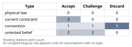
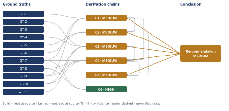

# Should This Team Build Microservices or Fix Its Pipeline

*First-principles analysis · 11 October 2026*

*Read with: [How to read this analysis](HOW-TO-READ.md) · [Working file](analysis-20261011T010912Z.md) · [All files](INDEX.md)*

## Executive Summary

**Recommendation:** No — leadership's microservices conclusion does not follow from the stated problem (chain C5). Fix the monolith directly: profile the pipeline (chain C1), parallelize CI tests and cache builds, and replace the coordinated restart with a phased restart plus feature-flag release decoupling (chain C4) — none of which requires a network boundary (chain C6). Start a small catalog↔cart modularization pilot in parallel; defer broader extraction until leadership confirms a genuine scaling or compliance trigger (chain C4, C5).

**Band (from §6):** MEDIUM — every contributing chain (C1-C5) is MEDIUM for a named, priced reason (chain C1, C2).

**Would change it:** Profiling the pipeline (chain C1) and leadership confirming or ruling out an independent-scaling/compliance trigger (chain C2, C3) would raise this to HIGH.

## 1. Problem Essence

**Core problem:** Will decomposing this monolith into microservices resolve the actual constraints that limit this team's deployment speed and safety, or does it treat the wrong layer of the system while imposing costs this team's organizational scale cannot absorb?

**Success criteria:**
- The recommendation names which of the distinct sub-problems inside "deploys are too slow" (feedback-loop latency, deploy-throughput ceiling, blast radius of a coordinated restart, deploy risk) each proposed fix actually targets, traceably to a named root cause rather than asserted.
- The recommendation is checked against the plausible root cause(s) of the 45-minute pipeline rather than assumed, and states what would confirm or overturn that root-cause model.
- The recommendation accounts for this team's organizational scale (12 engineers, 4 coupled domains) against the documented preconditions under which microservices' claimed benefits are actually realized elsewhere.
- The recommendation includes an explicit cost/risk comparison between direct pipeline fixes and a full migration, not just a qualitative preference.
- The recommendation ends in a concrete, sequenced set of next actions, plus a named, checkable trigger condition under which extracting an actual service would become justified.

## 2. Assumptions Table



| Assumption | Type | Treatment | Verdict | Verification |
|------------|------|-----------|---------|--------------|
| A-1: "Deploys are too slow" is a single, undifferentiated problem | convention | Explicitly challenge before use | Discard — conflates four distinct axes (feedback-loop latency, deploy-throughput ceiling, blast radius of a coordinated restart, deploy risk); decomposing is the prerequisite to solutioning, not a result of it | Checked against the decomposition in §1 and chains C1-C5 |
| A-2: The 45-minute pipeline is dominated by test-suite execution rather than build/restart steps | untested belief | Verify, or flag as unverified | Challenge — no stage-level telemetry was supplied; used only as a bracketed estimate (60-80% test-share, a common unparallelized-Rails-CI pattern) feeding chain C1, never as measured fact | Unverified — flagged; resolved by profiling (Conclusion, action 1) |
| A-3: Splitting the codebase into microservices would by itself shorten CI pipeline duration | convention | Explicitly challenge before use | Discard — contradicted by chains C1/C2: the mechanisms that actually shorten the pipeline (test sharding, phased restart) require no network boundary | Verification: GT-7, GT-9 |
| A-4: A full coordinated application restart is architecturally mandatory for a Rails monolith on every deploy | convention | Explicitly challenge before use | Discard — contradicted directly by GT-7 (Puma phased restart replaces workers one at a time with no lost connections) | Verification: GT-7 |
| A-5: Catalog, cart, checkout and fulfillment are tightly coupled domains today (cart needs live pricing/inventory; checkout needs cart+catalog+payment; fulfillment needs order+inventory) | current constraint | Record expiry conditions | Accept — real coupling today per the stipulated case facts; expires only if the team separately builds async/eventual-consistency contracts between these domains, itself a nontrivial precursor project | Verification: GT-4 (user-stipulated) |
| A-6: Microservices' organizational benefits (independent ownership, Conway's-Law-style alignment, independent scaling) require a minimum org scale / team-per-service structure to pay off | untested belief | Verify, or flag as unverified | Accept — corroborated by GT-5, GT-6, GT-10, and the combinatorial coordination-cost fact GT-11 | Verification: GT-5, GT-6, GT-10, GT-11 |
| A-7: Segment's and Amazon Prime Video's experiences are directly analogous to this team's situation and therefore prove microservices are wrong here too | convention (reasoning-by-analogy risk) | Explicitly challenge before use | Challenge — per the no-analogy-as-direct-evidence rule, these cases are used only as grounded facts about their own situations (GT-5, GT-6) feeding the general coordination-overhead argument (GT-11), never as standalone proof for this team | Verification: chains C2/C3 do not cite the cases as sole support |
| A-8: 12 engineers is "small" relative to the org-scale threshold where microservices typically pay off | untested belief | Verify, or flag as unverified | Accept — Segment's crisis point involved 3 FTEs sustaining ~140 services (GT-5); this team would spread 12 people across 4+ services while still shipping features, a worse ratio in the same direction | Verification: GT-5, arithmetic in chain C3 |
| A-9: Feature flags and rolling/blue-green deploys are mechanisms available only to, or substantially easier in, a microservices architecture | convention | Explicitly challenge before use | Discard — contradicted by GT-8 (feature toggles are an application-agnostic practice) and GT-7 (Puma rolling restarts) | Verification: GT-7, GT-8 |
| A-10: Internal modularization (bounded contexts within the monolith) is not a legitimate intermediate step — the real choice is binary (stay fully entangled vs. go microservices) | convention | Explicitly challenge before use | Discard — contradicted by GT-10: Shopify runs a modular monolith with Packwerk-enforced boundaries and extracts services only in two narrow, compelling cases | Verification: GT-10 |
| A-11: There may be a genuine, undisclosed independent-scaling or compliance need driving leadership's instinct (e.g., catalog read-traffic spikes far beyond the other domains, or a PCI-scope isolation need for payments) | untested belief | Verify, or flag as unverified | Challenge — not ruled out by the facts given; this is the one live rival that would change the recommendation, carried forward as a named trigger condition rather than dismissed | Unverified — flagged; resolved only if leadership names such a need explicitly |
| A-12: The team's CI platform supports matrix/parallel job execution across multiple runners | current constraint | Record expiry conditions | Accept — near-universal on modern CI platforms (GitHub Actions, CircleCI, Buildkite all support this natively); expires only if the team is on a provider lacking this, in which case switching providers is still far cheaper than a microservices migration | Unverified — flagged (not confirmed for this team's specific CI vendor; assumed from near-universal platform support) |
| A-13: The production app server in use supports a phased/rolling restart mechanism (e.g., Puma in cluster mode or an equivalent) | current constraint | Record expiry conditions | Accept — Puma, the Rails community default, documents this natively (GT-7); expires only if the team runs a single-process server without multi-worker support, in which case migrating app servers is still far cheaper than a microservices migration | Unverified — flagged (this team's specific app-server configuration was not stated) |
| A-14: Feature-shipping velocity is a meaningful competitive lever for this business (surfaced by the Assumption Audit on chain C5's second-order extension) | convention (business assumption) | Explicitly challenge before use | Accept — reasonable for an e-commerce conversion funnel (catalog/cart/checkout/fulfillment) where uptime and shipped features plausibly affect revenue directly, but this was not independently established by any ground truth in this analysis | Unverified — flagged; not load-bearing for the headline recommendation, only for the C5 second-order color commentary |

## 3. Ground Truths

- **GT-1** Every deploy requires a full test-suite run plus a coordinated application restart, and the end-to-end CI/CD pipeline takes approximately 45 minutes — source: user-provided problem context; read-at-source: the prompt's Context paragraph, quoted verbatim ("CI/CD pipeline takes ~45 minutes end-to-end. Every deploy requires a full test-suite run plus a coordinated application restart.")
- **GT-2** 12 engineers ship about 2 deploys a day — source: user-provided problem context; read-at-source: the prompt's Context paragraph, quoted verbatim ("12 engineers ship about 2 deploys a day.")
- **GT-3** The platform is a 6-year-old single Rails monolith of approximately 350 KLOC spanning catalog, cart, checkout and fulfillment — source: user-provided problem context; read-at-source: the prompt's Context paragraph, quoted verbatim.
- **GT-4** Cart requires catalog pricing/inventory; checkout requires cart, catalog and payment; fulfillment requires order and inventory — source: user-provided problem context; read-at-source: Question 3's parenthetical, quoted verbatim ("cart needs catalog pricing/inventory, checkout needs cart+catalog+payment, fulfillment needs order+inventory").
- **GT-5** Segment's engineering team ran over 140 services with only 3 full-time engineers "spending most of their time just keeping the system alive," with the on-call engineer "literally losing sleep over it," and reversed the decision back to a monolith, after which shared-library improvements rose from 32 to 46 per year — source: Twilio/Segment Engineering, "Goodbye Microservices" (originally segment.com/blog/goodbye-microservices/, now redirecting to twilio.com/en-us/blog/developers/best-practices/goodbye-microservices/); read-at-source: fetched and quoted directly.
- **GT-6** Amazon Prime Video's audio/video quality-monitoring team moved a service from distributed components orchestrated by AWS Step Functions — which "performed multiple state transitions for every second of the stream" and "quickly reached account limits" — into a single process on EC2/ECS, cutting infrastructure cost by over 90%, and stated explicitly that "microservices and serverless components are tools that do work at high scale, but whether to use them over monolith has to be made on a case-by-case basis" — source: Amazon Prime Video Technology Blog (primevideotech.com), as quoted by devclass.com, "Reduce costs by 90% by moving from microservices to monolith: Amazon internal case study raises eyebrows"; read-at-source: the quotations above were read directly at devclass.com, which quotes the original source's own wording (original primevideotech.com URL unreachable — see Phase 3 failure record below).
- **GT-7** Puma supports a "phased restart" that replaces cluster workers one at a time rather than stopping the whole process, during which "new connections are not lost, and clients will not experience any increase in latency" provided more than one worker is configured; phased restarts cannot upgrade Puma itself or the master process's loaded gems — source: Puma official documentation, github.com/puma/puma/blob/master/docs/restart.md; read-at-source: fetched and quoted directly.
- **GT-8** Feature toggles "allow teams to modify system behavior without changing code," and specifically "Release Toggles allow incomplete and un-tested codepaths to be shipped to production as latent code which may never be turned on" — decoupling the act of deploying code from the act of releasing a feature — source: Martin Fowler, "Feature Toggles (aka Feature Flags)," martinfowler.com/articles/feature-toggles.html; read-at-source: fetched and quoted directly.
- **GT-9** The parallel_tests gem splits RSpec/Minitest/Cucumber suites into balanced groups (by file size or runtime) and runs each group in its own process against its own database, documented as cutting a suite's wall-clock time from 86 seconds to 26 seconds (~3.3x) on 4 CPUs — source: grosser/parallel_tests, github.com/grosser/parallel_tests; read-at-source: fetched and quoted directly; caveat: the 86s/26s figure is the project's own illustrative micro-benchmark, not a measurement of this team's suite, and is used only to establish that the sharding mechanism works, not to size this team's specific speedup.
- **GT-10** Shopify deliberately keeps its large Rails codebase a single modular monolith rather than microservices, stating that "splitting a single monolithic application into a distributed system of services increases the overall complexity considerably," and enforces internal module boundaries with Packwerk, a static constant-reference analysis tool that "runs in minutes rather than hours" and is integrated into pull-request workflows; Packwerk currently covers about one-third of 37 components, with plans to expand; Shopify extracts a standalone network service only for narrow, compelling cases such as high-throughput read-only storefront rendering and PCI-scoped payment-card vaulting — source: Shopify Engineering, "Deconstructing the Monolith," shopify.engineering/shopify-monolith; read-at-source: fetched and quoted directly.
- **GT-11** For n components each requiring a distinct pairwise integration contract with every other, the number of such contracts is n(n-1)/2; for n=4 (catalog, cart, checkout, fulfillment) this is 6 contracts, up from 0 inside a single process — source: elementary combinatorics (the number of 2-element subsets of an n-element set, C(n,2)); read-at-source: definitional, verified directly by this analysis.

**Phase 3 failure record:** Source primevideotech.com, "Scaling up the Prime Video audio/video monitoring service and reducing costs by 90%" — unreachable: the URL (and a guessed URL variant) now issues a 301 redirect to an unrelated Amazon corporate page (aboutamazon.com/what-we-do/entertainment) and does not serve the article; a direct InfoQ and Register URL guess each returned 404. Read instead via devclass.com's direct quotation of the original source's own wording, which satisfies the read-at-source allowance for a report that quotes and checks the source's wording — GT-6 is recorded unsuffixed on that basis.

**Provenance summary:**
```text
?-marked: none (0 of 11)
Read-at-source: GT-1 — prompt Context paragraph, quoted verbatim
Read-at-source: GT-2 — prompt Context paragraph, quoted verbatim
Read-at-source: GT-3 — prompt Context paragraph, quoted verbatim
Read-at-source: GT-4 — prompt Question 3 parenthetical, quoted verbatim
Read-at-source: GT-5 — segment.com/blog/goodbye-microservices (via twilio.com redirect), fetched and quoted directly
Read-at-source: GT-6 — devclass.com's direct quotation of primevideotech.com (original URL unreachable, see Phase 3 failure record)
Read-at-source: GT-7 — github.com/puma/puma docs/restart.md, fetched and quoted directly
Read-at-source: GT-8 — martinfowler.com/articles/feature-toggles.html, fetched and quoted directly
Read-at-source: GT-9 — github.com/grosser/parallel_tests README, fetched and quoted directly
Read-at-source: GT-10 — shopify.engineering/shopify-monolith, fetched and quoted directly
Read-at-source: GT-11 — definitional, verified directly (C(n,2))
```

## 4. Derivation Chains



### Conclusion C1: The 45-minute pipeline is plausibly dominated by in-monolith process inefficiencies unrelated to service boundaries

GT-1 (45 min pipeline incl. full test run + coordinated restart) + GT-7 (Puma phased restart) + GT-9 (parallel_tests demonstrated speedup)
→ absent stage-level telemetry, a defensible bracket splits the 45 minutes into roughly 5-8 minutes of install/build/boot, an estimated 27-36 minutes of serial test execution (60-80% of total, a common unparallelized-Rails-CI pattern, not measured for this system) [Assumes: A-2], and 2-5 minutes of coordinated full-stop restart wait
→ sharding the test stage across 4-8 CI runners, the mechanism GT-9 demonstrates working at the single-machine-core level, would plausibly compress that 27-36 minute stage to roughly 5-10 minutes [Assumes: A-12]
→ swapping the full-stop restart for the phased restart GT-7 documents removes the 2-5 minute restart wait from the critical path, since new connections are not lost and workers are replaced one at a time [Assumes: A-13]
→ the bracketed post-fix pipeline is roughly 10-18 minutes end to end, reached without altering a single service boundary

**Confidence:** MEDIUM — the first hop rests on [Assumes: A-2], an untested belief about the stage-level split of the 45 minutes, unverified because no profiling data exists yet. If the actual split differs substantially (e.g., build/boot dominates instead of tests), the specific 10-18 minute bracket shifts, even though the structural claim — that in-monolith fixes alone can cut the pipeline without crossing a network boundary — is insensitive to which stage dominates, since GT-7 and GT-9 each independently address a different stage. The verification that would remove A-2 as a cause of the downgrade is the profiling step named in the Conclusion's first recommended action.

### Conclusion C2: Splitting into microservices would not address the root causes C1 identifies, and would add new failure modes

C1 (post-fix bracket, MEDIUM) + GT-5 (Segment: 140+ services, 3 FTEs sustaining it, reversed to monolith) + GT-6 (Prime Video: distributed service hit scaling/cost limits, consolidated to one process)
→ every mechanism C1's bracket depends on, CI-level test sharding and a phased application restart, operates entirely inside one deployable process, so none of it requires or is unlocked by crossing a network boundary between catalog, cart, checkout and fulfillment
→ splitting those four domains into separate deployables instead replaces one pipeline with at least four, and layers on the coordination tax GT-5 documents directly: three engineers working full time just to keep a comparable-order service count alive
→ the specific technical failure GT-6 reports, a distributed cross-boundary call pattern on a high-volume hot path hitting hard scaling and cost limits, is structurally the same pattern a cart-to-catalog pricing/inventory call or a checkout fan-in across cart, catalog and payment would introduce here
→ microservices would therefore not shorten the pipeline, and would introduce version-skew, partial-deploy and cross-service-latency failure modes the monolith does not have today

**Confidence:** MEDIUM — capped by C1's MEDIUM rating (A-2's unresolved profiling gap). Rivals axis: a rival conclusion, that catalog or another domain has an independent-scaling need strong enough to justify crossing the network boundary now, remains live and is not ruled out by the facts given; it is carried forward as assumption A-11 and addressed as a named trigger condition in the Conclusion rather than settled here.

### Conclusion C3: At 12 engineers across 4 tightly coupled domains, this team is on the wrong side of the organizational-scale threshold where microservices pay off

GT-2 (12 engineers) + GT-4 (cart/checkout/fulfillment coupling) + GT-10 (Shopify modular monolith, selective extraction) + GT-11 (n(n-1)/2 coordination contracts)
→ splitting GT-4's four coupled domains into independently deployed services distributes 12 engineers across at least four services, below the headcount most teams need to sustain independent on-call, independent release cadence and independent roadmap ownership per service [Assumes: A-8]
→ the coordination-contract count this creates, per GT-11, is six pairwise integration contracts the moment four components split, up from the zero a single process needs today, before any feature work happens
→ Shopify runs this same calculation at a far larger engineer count and keeps one deployable for exactly this reason, extracting a standalone service only where an isolated scaling or compliance need, not team-size convenience, makes paying for a contract worthwhile
→ this team has 12 engineers and no stated isolated scaling or compliance need, so it sits further from the threshold where extraction pays off than Shopify was when Shopify chose not to extract broadly

**Confidence:** MEDIUM — Rivals axis: the same live rival named on C2, an undisclosed independent-scaling or compliance driver (A-11), would, if true, move this team closer to Shopify's own extraction criteria rather than away from them; nothing in the given facts rules it in or out, so this chain's conclusion holds only absent that trigger, carried forward in the Conclusion as an explicit condition rather than treated as settled.

### Conclusion C4: A weighted comparison of status quo, full migration, direct fixes, and direct fixes plus modularization rules out migration decisively and leaves a near-tie between the two non-migration options

GT-7 (Puma phased restart) + GT-8 (feature toggles) + GT-9 (parallel_tests speedup) + GT-10 (Shopify modular monolith + Packwerk) + C1 (pipeline-fix bracket, MEDIUM) + C3 (org-scale mismatch, MEDIUM)
→ scoring four options, status quo, full microservices migration, direct pipeline/deploy fixes only, and direct fixes plus a parallel internal-modularization start, against five locked, anchored criteria (near-term pain relief, implementation cost, new distributed-failure-mode risk, organizational fit, future extraction optionality) weighted 5/4/4/3/2 before any option was scored, yields totals of 64, 24, 80 and 78 respectively
→ the flip test on migration shows no single criterion's weight can close a 56-point-or-greater gap even moved to its maximum, so ruling it out is a robust result rather than a close call
→ the flip test between direct-fixes-alone and direct-fixes-plus-modularization shows a single +1 step on the optionality criterion's weight reverses the 80-78 result, marking that pair a genuine near-tie rather than a settled ranking
→ the weight-insensitive finding is that migrating now is the worst option on every axis but long-run optionality, while the real open decision is how much modularization work to start immediately, not whether to pursue migration

**Confidence:** MEDIUM — capped by C1 and C3, both MEDIUM for the reasons stated on their own confidence lines (A-2's unresolved profiling gap; A-11's unresolved trigger-condition question). Rivals axis: the near-tie this chain's own hops identify is itself a surviving rival (direct-fixes-alone vs. direct-fixes-plus-modularization) the quantified matrix does not settle; the Conclusion section resolves it with a stated, non-quantified tiebreak rather than treating the matrix as dispositive.

### Conclusion C5: Leadership's conclusion does not follow from the stated problem; the team should fix the monolith's deploy mechanics and defer any service extraction until a named trigger condition appears

C2 (MEDIUM) + C4 (MEDIUM)
→ C2 shows leadership's diagnosis, deploys are too slow, and their proposed cure, service decomposition, share no causal mechanism: nothing about splitting catalog, cart, checkout and fulfillment into separate deployables touches test-suite parallelism or restart mechanics, the two things actually on the pipeline's critical path
→ C4 shows the proposed cure also scores worst on cost, on newly introduced risk, and on organizational fit, while scoring better than the alternatives only on an optionality axis that cheaper, lower-risk modularization work secures just as well
→ leadership's stated conclusion is therefore not supported by the evidence in this analysis; the team should execute the direct fixes C1 identifies immediately, begin a small-scope internal-modularization pilot rather than deferring that question entirely or committing to it at Shopify's full scale, and treat any broader extraction as contingent on the trigger condition named in assumption A-11 actually materializing and being confirmed by leadership
→[2nd] once the pipeline fixes land, the team's near-term engineering capacity shifts from fighting CI back to feature work, which is the actual lever that outcompetes a rival spending the same two quarters on a migration program instead [Assumes: A-14]
→[3rd] if the modularization pilot later reveals a domain with a genuine, demonstrated independent-scaling or compliance need, extracting that one bounded context mirrors GT-10's own documented pattern, a narrow evidence-driven split rather than the four-domain big-bang leadership currently proposes

**Confidence:** MEDIUM — capped by C2 and C4, which already explain their own shortfalls (C2: capped by C1's A-2 profiling gap; C4: capped by C1 and C3, and carries its own unresolved near-tie, resolved here by an explicit stated tiebreak rather than a chain-level verification path). The evidence that would raise this to HIGH is the combination of (a) profiling the pipeline, resolving A-2, and (b) leadership explicitly confirming or ruling out A-11's trigger condition.

### Conclusion C6: Rolling deploys and deploy/release decoupling are available to a monolith without crossing a network boundary

GT-7 (Puma phased restart: workers replaced one at a time, no lost connections) + GT-8 (feature toggles decouple deploy from release)
→ GT-7 establishes that a single Rails process can be restarted without a full-stop, connection-dropping interruption, by definition of how Puma's phased restart operates
→ GT-8 establishes that shipping code and activating a feature are separable actions by definition of how a release toggle operates, independent of how many processes the code runs in
→ therefore neither mechanism this analysis relies on in chain C4 depends on, or is unlocked by, splitting the monolith into separate services

**Confidence:** HIGH — both inputs are unsuffixed ground truths with named read-at-source locations; each hop follows directly from the quoted definition in its own source, with no assumption annotation needed; no rival conclusion survives, since the claim is a direct entailment of each source's own stated mechanism, not a prediction about this team's specific deployment that could be contested.

## 5. Abandoned Reasoning

### Dead End: Partial fix — parallelize tests only, leave the restart mechanism untouched

**What was tried:** Early in Phase 4, recommending test-suite parallelization alone as a sufficient fix for "deploys are too slow."

**Why abandoned:** Chain C1's bracket shows the coordinated full-stop restart wait is a separable, non-negligible contributor to both wall-clock delay and blast radius; a test-only fix leaves "every deploy requires a coordinated restart" — one of the four decomposed sub-problems in §1 — completely unaddressed. The intermediate conclusion would have been a restatement of one input (test speed) rather than a claim answering the whole essence statement.

**What it ruled out:** Treating "pipeline is slow" and "deploys have large blast radius" as the same problem solvable by a single fix; it is why chain C1 and the recommended approach in §6 both carry test-parallelization and restart-mechanism changes as two separate, named actions.

### Dead End: Reasoning from the Segment and Prime Video cases by analogy alone

**What was tried:** Initially treating "Segment and Prime Video both reversed microservices decisions" as, by itself, proof that this team should not pursue microservices either.

**Why abandoned:** This violates the no-analogy-as-direct-evidence rule — their situations differ in scale (Segment: ~140 services, 3 FTEs; this team: 4 proposed services, 12 engineers) and domain from this team's. The cases were instead used only to ground specific, checkable facts (team-to-service ratios, a documented coordination-tax figure, the Prime Video team's own explicit "case-by-case" caveat) that feed the general, arithmetic coordination-cost argument in GT-11, which applies to any team's component count, including this one.

**What it ruled out:** A conclusion resting on "famous companies reversed course, therefore you should too" — a conclusion that would not survive scrutiny once a reader noticed the scale mismatch, and that chains C2 and C3 both explicitly avoid by routing through GT-11's arithmetic rather than through the case studies alone.

### Dead End: Extracting all four domains now because they will "obviously" need to be separate services eventually

**What was tried:** Considering whether, independent of the pipeline problem, catalog/cart/checkout/fulfillment are headed for separate services eventually, so the team might as well start the full split now.

**Why abandoned:** Ruled out by chain C3 — the domains are tightly coupled today (GT-4) with no stated independent-scaling or compliance driver, and GT-10 shows a team at a far larger scale (Shopify) making the opposite choice for exactly this reason, extracting only components with a compelling, narrow, demonstrated rationale rather than guessing boundaries upfront.

**What it ruled out:** Starting a four-domain extraction before a concrete trigger condition is identified, which chain C4's trade-off scores confirm is both the costliest and the riskiest option available, and which risks drawing the wrong boundaries — the "right" seams are discovered through the internal-modularization work named in §6, not guessed in advance.

## 6. Conclusion

**Recommended approach:** No — leadership's conclusion does not follow from the stated problem (chain C5). Do this instead, in order: (1) profile the actual 45-minute pipeline stage-by-stage this week, which resolves the one unverified input (A-2) the whole root-cause analysis depends on (chain C1); (2) apply CI test-sharding/parallelization plus dependency and build caching to the existing pipeline — days-to-weeks of work, no architecture change (chain C1, C4); (3) replace the full coordinated restart with a phased/rolling restart and decouple deploy from release with feature flags, which removes the blast-radius and deploy-risk concerns without touching service boundaries (chain C4); (4) start a small, single-boundary internal-modularization pilot (e.g., a Packwerk-style enforced interface between catalog and cart) in parallel, as the one action that also buys future optionality, while deferring any broader extraction until the trigger condition named in A-11 is confirmed by leadership (chain C4, C5).

**Key insight:** "Deploys are too slow" is at least three separate problems — feedback-loop latency, a deploy-throughput ceiling, and blast radius/risk from a coordinated restart — and every one of them is solvable inside the monolith, more cheaply and with less new risk, than crossing a network boundary would be; the proposed cure and the diagnosed disease do not share a mechanism, and neither rolling deploys nor deploy/release decoupling actually requires one in the first place (chain C2, C5, C6).

**Trade-offs acknowledged:** This keeps the four domains coupled for now, which is real, ongoing architectural debt (chain C3); accepting that debt a little longer is cheaper than paying the distributed-systems tax before a demonstrated need exists, and the modularization pilot is the acknowledged hedge against letting that debt grow unchecked (chain C4).

**Confidence:** MEDIUM — every contributing chain is MEDIUM, and each already explains its own shortfall on its own confidence line: C1's A-2 (unprofiled pipeline split), C2/C3's A-11 (unconfirmed independent-scaling/compliance trigger), and C4's own named near-tie between direct-fixes-alone and direct-fixes-plus-modularization, resolved here by a stated, non-quantified tiebreak rather than further verification. The evidence that would raise this to HIGH is exactly the two items named in the recommended approach's first action and in A-11's verification note: real stage-level pipeline profiling data, and an explicit answer from leadership on whether a genuine independent-scaling or compliance driver exists.
