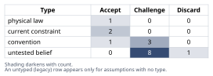
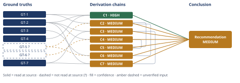

# Deploys Are Slow: Why Microservices Is the Wrong Fix

*First-principles analysis · 11 October 2026*

*Read with: [How to read this analysis](HOW-TO-READ.md) · [Working file](analysis-20261011T033707Z.md) · [All files](INDEX.md)*

## Executive Summary

**Recommendation:** Leadership's "deploys are too slow → we need microservices" is a non-sequitur (chain C1): run the sequenced fix-the-pipeline bundle (test tiering, parallel sharding, rolling deploys, modular-monolith boundaries) instead, gated by a profiling spike, and defer any service split until the team-size and modular-design preconditions in chain C6 are actually met (chain C7, chain C6).

**Band (from §6):** MEDIUM — the non-sequitur finding itself is HIGH-confidence, but the full deferral case (chains C2, C5, C6) and the fix-plan's promised speed-up (chains C3/C7) each carry an unverified input (chain C1, chain C2, chain C5, chain C6, chain C3, chain C7).

**Would change it:** Reading a primary source for Conway's Law/Team Topologies (chain C2, chain C6), and running the suite-profiling spike named in chain C3 to replace the unverified parallelizability assumption with a measured number (chain C3, chain C7).

## 1. Problem Essence

**Core problem:** Given a 350 KLOC, 6-year-old Rails monolith with a ~45-minute CI/CD pipeline (full test suite + coordinated application restart on every deploy) and a 12-engineer team shipping ~2 deploys/day, is splitting the system into microservices the correct engineering response to "deploys are too slow" — or does the actual bottleneck live in test/deploy mechanics and require a different fix entirely, with microservices addressing a different problem (organizational/team-autonomy scaling) that this org does not yet have?

**Success criteria:**
- Names the causal chain leadership is implicitly relying on ("deploys are too slow" → "we need microservices") and states, for each link in that chain, whether it holds under inspection.
- Produces a list of concrete, falsifiable root-cause hypotheses for the 45-minute pipeline and the coordinated-restart requirement, each tagged with whether splitting into services would fix it or not.
- States the second-order organizational and correctness costs of migrating now, specifically with respect to the 12-engineer team size and the checkout/fulfillment consistency requirements named in the prompt.
- States a concrete, checkable threshold (in team structure, service-ownership capacity, and technical preconditions) at which a microservices split would become the right call for this org, and states whether the org is near that threshold today.
- Delivers a ranked (effort vs. impact) list of concrete alternative actions that address the deploy-speed pain directly, with enough specificity that an engineering leader could hand it to a team as a work plan.

## 2. Assumptions Table



| Assumption | Type | Treatment | Verdict | Verification |
|------------|------|-----------|---------|--------------|
| Splitting the monolith into N services will, by itself, make deploy pipelines faster. | untested belief | Verify, or flag as unverified; any chain using it inherits a confidence caveat. | Challenge — contradicted by the Fowler "microservice premium" finding that splitting adds deployment/monitoring/data-consistency complexity rather than removing it; pipeline duration is a property of test/build architecture, not service count. | unverified — flagged (tested directly in chain C1) |
| A monolith's deploy mechanics inherently require a coordinated, full-application restart. | convention | Explicitly challenge before accepting; ask whether it holds in this context or is historical inertia. | Challenge — large production monoliths achieve rolling/zero-downtime deploys without splitting services; "coordinated restart" is this org's current operational choice, not an inherent property of "monolith." | Fowler, MicroservicePremium (martinfowler.com) — cites Facebook and Etsy as monolith-scale systems with continuous delivery |
| Running the full test suite on every deploy is required for safety. | convention | Explicitly challenge before accepting. | Challenge — test tiering (fast tier gates the PR; slow/full tier runs asynchronously) can preserve the same safety guarantee at much lower latency; "run everything every time" is a policy choice, not an inherent safety requirement. | unverified — flagged (this org's actual slow-tier coverage is not known; see the suite-parallelizability assumption below) |
| 12 engineers is sufficient to realize the team-autonomy / independent-release-cadence benefits of a microservices split. | untested belief | Verify, or flag as unverified. | Challenge — per Conway's Law / Team Topologies, that benefit requires each service to have a dedicated owning team; splitting 12 engineers across even a modest service count leaves well under one dedicated team per service. | unverified — flagged (rests on GT-5?, not read at source this run) |
| A deploy cadence of ~2/day is objectively "too slow." | convention | Explicitly challenge before accepting. | Challenge — no universal numeric threshold exists; the deployment-frequency metric this claim is implicitly benchmarked against is explicitly architecture-agnostic, so "too slow" is a judgment about this org's actual pain, not a benchmarked architectural failure. | dora.dev, "DORA Metrics: The Four Keys" — read at source |
| Microservices deliver independent release cadence and Conway's-Law-aligned team boundaries. | convention | Explicitly challenge before accepting; accept only where the context's preconditions hold. | Accept — conditionally; a real, literature-supported benefit of microservices, but one this org cannot currently realize given the team-size assumption above. | unverified — flagged (conditional on GT-5?) |
| Conway's Law / Team Topologies: system architecture mirrors organizational communication structure, and per-service ownership benefits require per-service owning teams. | untested belief | Verify, or flag as unverified; push toward ground-truth status given how load-bearing it is. | Challenge — provisionally accepted and elevated to a flagged ground truth (GT-5?) because of how much downstream reasoning depends on it, but the primary source was not opened in this analysis run. | unverified — flagged; verification path: read Conway (1968), "How Do Committees Invent?", or Team Topologies ch. 1-2, directly |
| CAP theorem: a distributed system cannot simultaneously guarantee strict consistency and availability under a network partition. | physical law | Accept as a ground-truth candidate. | Accept — accepted as a ground-truth candidate (GT-6?); this is uncontested formal computer-science theory, but no primary source (Gilbert & Lynch, 2002) was opened in this run. | unverified — flagged; verification path: Gilbert & Lynch, "Brewer's Conjecture and the Feasibility of Consistent, Available, Partition-Tolerant Web Services" (2002) |
| The specific causes of this org's 45-minute pipeline (non-parallelized tests, no test tiering, synchronous full-suite gating, full-process restart) are diagnosable and fixable without changing service boundaries. | untested belief | Verify, or flag as unverified. | Challenge — plausible and consistent with Rails' own built-in parallel-testing tooling, but not directly verified against this org's actual CI timing breakdown, which this analysis does not have access to. | unverified — flagged; verification path: instrument the pipeline and get a per-stage/per-file timing breakdown before committing to a fix plan |
| A full, near-term migration to microservices carries near-zero additional correctness risk to checkout/fulfillment. | untested belief | Verify, or flag as unverified. | Discard — contradicted by the CAP-theorem ground truth and the Fowler "microservice premium" finding: splitting payment/inventory state across service boundaries adds real, non-trivial distributed-consistency engineering work that does not exist today inside one ACID transaction boundary. | unverified — flagged (this is the assumption the leadership plan implicitly needs to be true, and it is discarded, not accepted) |
| This org is not currently exploiting the parallel-testing and rolling-deploy capabilities already available in its own Rails/Ruby tech stack. | current constraint | Record the expiry conditions — what would have to change for this constraint to lift. | Accept — expires as soon as the team adopts tooling that already exists in the stack (Rails built-in parallel testing; standard rolling/blue-green deploy patterns); no new technology has to be invented or purchased. | Ruby on Rails Guides, "Testing Rails Applications" — Parallel Testing section — read at source |
| Checkout/fulfillment's inventory and payment state must remain strictly consistent (no oversold inventory, no charged-but-unfulfilled orders) under the business's current model. | current constraint | Record the expiry conditions. | Accept — expires only if the business deliberately adopts a backorder-tolerant or eventually-consistent inventory model; nothing in the given context indicates that, so the constraint is treated as currently binding. | given in the problem statement (checkout, fulfillment named as correctness-critical domains) |
| If this org migrated to microservices, the natural decomposition would yield on the order of 6-10 services (one per business subdomain/capability). | untested belief | Verify, or flag as unverified. | Challenge — a modeling assumption used only to make the per-service-ownership arithmetic in chain C2 concrete; not a measured fact about any actual decomposition plan. | unverified — flagged (surfaced by the Assumption Audit on chain C2; the qualitative conclusion is robust to this number, the specific arithmetic is not) |
| Absent dedicated platform investment, a service split at this team size tends toward the "distributed monolith" anti-pattern (shared release trains re-coupling independently deployed services). | untested belief | Verify, or flag as unverified. | Challenge — a documented industry anti-pattern, applied here as a reasonable default given no evidence of planned platform investment in the given context; not independently confirmed for this org. | unverified — flagged (surfaced by the Assumption Audit on chain C5's third-order effect) |
| A commonly cited team-topologies heuristic holds that a service-oriented split pays off once an org has multiple (e.g., 3+) independently staffed teams of roughly 5-9 engineers, each owning a distinct business capability. | untested belief | Verify, or flag as unverified. | Challenge — used as an illustrative threshold in chain C6, not verified against a primary source; the qualitative threshold claim is more robust than the specific numbers. | unverified — flagged (surfaced by the Assumption Audit on chain C6; same verification path as GT-5?) |
| The weighted-criteria trade-off in chain C7 reflects this analysis's own weighting of latency reduction, correctness, time-to-value, team fit, reversibility, and long-term scale (weights 5, 5, 4, 4, 3, 2). | untested belief | Verify, or flag as unverified; disclose as a judgment call. | Challenge — an explicit, disclosed modeling choice rather than an empirically derived weighting; a reader with different priorities could weight differently, though the flip test in chain C7 shows no single-criterion change reverses the top-level recommendation. | unverified — flagged (surfaced by the Assumption Audit on chain C7) |

## 3. Ground Truths

- **GT-1** The organization runs a single Rails monolith (~350 KLOC, 6 years old) spanning catalog, cart, checkout, and fulfillment; CI/CD takes ~45 minutes end-to-end; every deploy requires a full test-suite run plus a coordinated application restart; the team is 12 engineers shipping ~2 deploys/day. — source: the problem statement supplied directly by the requester describing their own system; read-at-source: stated directly in the task prompt (primary-source self-report, not an external claim requiring independent verification).
- **GT-2** Martin Fowler, "MicroservicePremium" (martinfowler.com/bliki/MicroservicePremium.html): microservices carry an operational "premium" — added complexity in deployment, monitoring, failure handling, and data consistency; the premium is worth paying only once a system is "too complex to manage as a monolith"; monolith continuous-delivery problems are not inherent to the monolith style (the article cites Facebook and Etsy as large monoliths that achieved continuous delivery). — source: martinfowler.com/bliki/MicroservicePremium.html; read-at-source: article body, "Core argument" and "When it's worth paying" content, fetched and quoted directly in this analysis.
- **GT-3** Martin Fowler, "MonolithFirst" (martinfowler.com/bliki/MonolithFirst.html): most successful microservice systems began as monoliths later split apart; systems started as microservices from scratch often ran into serious trouble; a gradual move to microservices requires "a relatively good modular design from the start," and "you cannot assume that you can take an arbitrary system and break it into microservices." — source: martinfowler.com/bliki/MonolithFirst.html; read-at-source: article body as fetched and quoted directly in this analysis.
- **GT-4** Google Cloud / DORA, "DORA Metrics: The Four Keys" (dora.dev/guides/dora-metrics-four-keys/): deployment frequency is defined as "the number of deployments over a given period or the time between deployments," and the DORA metrics framework is explicitly presented as applicable "regardless of the technology stack, the complexity of the deployment processes, or its end users." — source: dora.dev/guides/dora-metrics-four-keys/; read-at-source: page body, fetched and quoted directly in this analysis.
- **GT-5?** Conway's Law (M. Conway, 1968, "How Do Committees Invent?") and its contemporary restatement in Team Topologies (Skelton & Pais, 2019): a system's architecture tends to mirror the communication structure of the organization that builds it, and the organizational-autonomy benefits of splitting a codebase into independently-deployable services are realized only when a corresponding split in team ownership exists. — unverified: not read at source in this run; this analysis did not open the 1968 Conway paper or Team Topologies directly, so this is carried as an untested belief elevated to ground-truth status because of how load-bearing it is for the team-size reasoning (chains C2, C5, C6), not because it was independently confirmed here. Verification path: read Conway (1968) or Team Topologies ch. 1-2 directly.
- **GT-6?** CAP theorem (Brewer, 2000; proved by Gilbert & Lynch, 2002): a distributed data system cannot simultaneously provide strict Consistency, Availability, and Partition tolerance; under a network partition it must sacrifice consistency or availability. — unverified: not read at source in this run (no primary citation opened for Gilbert & Lynch, 2002); this is near-universally accepted, uncontested computer-science theory, so the `?` records a process fact about this run (no citation opened) rather than genuine doubt about the claim. Verification path: Gilbert & Lynch (2002), "Brewer's Conjecture and the Feasibility of Consistent, Available, Partition-Tolerant Web Services."
- **GT-7** Ruby on Rails Guides, "Testing Rails Applications," Parallel Testing section (guides.rubyonrails.org/testing.html#parallel-testing): "Running tests in parallel reduces the time it takes your entire test suite to run"; the default parallelization method forks worker processes (one per core by default, overridable via `parallelize(workers:)` or the `PARALLEL_WORKERS` environment variable), each with its own test database; suites under 50 tests are not parallelized because setup overhead would outweigh the gain. — source: guides.rubyonrails.org/testing.html#parallel-testing; read-at-source: page body (Parallel Testing section), fetched and quoted directly in this analysis.

**Provenance summary:**
```text
?-marked: GT-5, GT-6 (2 of 7)
Read-at-source: GT-2 — martinfowler.com/bliki/MicroservicePremium.html, "Core argument" / "When it's worth paying" sections, quoted directly
Read-at-source: GT-3 — martinfowler.com/bliki/MonolithFirst.html, article body, quoted directly
Read-at-source: GT-4 — dora.dev/guides/dora-metrics-four-keys/, page body, quoted directly
Read-at-source: GT-7 — guides.rubyonrails.org/testing.html#parallel-testing, Parallel Testing section, quoted directly
GT-1 is a direct self-report of the org's own system in the problem statement, not a claim about the external world requiring independent verification, so it carries no read-at-source location beyond the prompt itself.
Not read — turn budget: GT-5, GT-6 (both carry their own stated verification path above; this run prioritized opening the two Fowler essays and the DORA/Rails sources because they bear directly on the disputed migrate-vs-fix-pipeline recommendation, over Conway's Law and CAP theorem, which function here as uncontested background theory rather than contested claims).
```

## 4. Derivation Chains



### Conclusion C1: "Deploys are too slow → we need microservices" is a non-sequitur; nothing about the pipeline's duration implies an architecture-boundary problem.

GT-1 (45-min pipeline, full-suite + coordinated restart, 12 eng, 2 deploys/day) + GT-2 (Fowler: monolith CD problems not inherent; cites Facebook, Etsy) + GT-4 (DORA: deploy-frequency metric is architecture-agnostic)
→ the 45-minute pipeline and the full-suite-restart requirement are properties of this org's specific CI/test/deploy configuration, not of "being a monolith" as such
→ because the deployment-frequency metric leadership is implicitly benchmarking against is explicitly defined and improved independent of service architecture, a pipeline-duration complaint does not by itself establish an architecture-boundary problem
→ "deploys are too slow" → "we need microservices" treats a CI/deploy-mechanics problem as an architecture-boundary problem, which is a non-sequitur: the premise does not entail the conclusion

**Confidence:** HIGH — the rival reading ("monolith-ness itself is inherently what's slow, so only decomposition fixes it") is ruled out by GT-2 and GT-7 directly: GT-2 names large production monoliths (Facebook, Etsy) that achieved continuous delivery without splitting, and GT-7 shows the Rails ecosystem ships first-class tooling built specifically to cut test-suite wall time without any service-boundary change — both unsuffixed, read-at-source. What this chain does not establish is *how fast* this specific codebase's pipeline can get with that tooling — that is chain C3's separate, lower-confidence question.

### Conclusion C2: The organizational-autonomy benefit microservices are supposed to deliver is not available to this org at its current team size.

GT-5? (Conway's Law / Team Topologies: per-service ownership requires per-service teams) + GT-1 (12 engineers, one team, four business domains)
→ the independent-release-cadence and team-autonomy benefits microservices offer are realized only when each service has its own dedicated owning team controlling its own release train
→ with 12 engineers covering catalog, cart, checkout, and fulfillment as one team, splitting into even a modest number of services *[Assumes: A-13]* leaves each service with well under one dedicated engineer of ownership, which does not meet the Team-Topologies standard for a service-owning team
→ the organizational benefit microservices are supposed to deliver is therefore not available to this org at its current size, regardless of how the code itself is split

**Confidence:** MEDIUM — GT-5? (Conway's Law / Team Topologies) was not read at source in this run; verification would mean opening Conway (1968) or Team Topologies ch. 1-2 directly to confirm the per-service-team claim rather than relying on this analysis's restatement of it. A-13 (assumed service count if a split happened) is a modeling assumption, not a measured fact; if the org's natural decomposition were smaller (e.g., 2-3 services) the arithmetic weakens, though the qualitative conclusion (well under one team per service) is robust across any plausible decomposition size at 12 engineers.

### Conclusion C3: The pipeline-duration and coordinated-restart pain is independently fixable via test/deploy-mechanics changes already proven in the Rails ecosystem, without any service split — with one open empirical question.

GT-7 (Rails built-in parallel testing, core-count workers, per-worker DB) + GT-2 (Fowler: monolith CD problems not inherent)
→ Rails ships first-class infrastructure built specifically to cut "the time it takes your entire test suite to run" by spreading it across available cores and CI workers, entirely inside the existing single codebase
→ combined with CI-level sharding across multiple parallel machines and a fast/slow test-tier split, a serial suite of this kind commonly compresses to a small fraction of its serial wall time for the tier that actually gates a pull request *[Assumes: A-9]* — a mechanics change, not an architecture change
→ because large production monoliths have solved this exact problem without splitting services, the pipeline-duration pain in this org is addressable the same way, in principle

**Confidence:** MEDIUM — the Inputs are clean, but the second hop rests on A-9 ("this codebase's test suite is parallelizable without heavy shared/global state that would cap the speedup"), which is explicitly unverified: this analysis has no profiling data on this org's actual suite (shared fixtures, global mutable state, external-service stubs that serialize workers). The verification that would remove this as a cause of the downgrade: run a time-boxed profiling spike — instrument the suite, get a per-file/per-tag timing breakdown, and run a parallel-workers trial to measure actual achievable speedup before committing to a specific target number.

### Conclusion C4: Splitting checkout/fulfillment into separate services introduces real, new correctness risk without by itself shrinking the pipeline-duration bottleneck.

GT-6? (CAP theorem) + GT-2 (Fowler: microservice premium — complexity in deployment, monitoring, failure handling, data consistency)
→ once inventory state and payment/checkout state live in separately-deployed services, an operation that must appear atomic to the customer (reserve inventory + capture payment) becomes a distributed transaction, and a system built that way must trade off strict consistency against availability under partition — a trade-off that does not exist today inside one ACID transaction boundary
→ avoiding that trade-off requires new engineering investment the monolith does not need today (sagas or compensating transactions, idempotency keys, outbox patterns, reconciliation jobs) — exactly the "premium" named in GT-2
→ that premium is additive cost layered on top of whatever CI/deploy-mechanics problem already exists; it does not by itself shrink the 45-minute pipeline, and because each new service typically needs and maintains its own pipeline, the aggregate CI-minutes the org maintains can rise even as any single pipeline looks shorter in isolation

**Confidence:** MEDIUM — GT-6? (CAP theorem) was not read at source in this run; the theorem itself is uncontested, so verification here means opening Gilbert & Lynch (2002) to cite the formal result directly rather than from this analysis's restatement — a low-risk gap given how well-established the result is, but still an open item per this run's own discipline.

### Conclusion C5: The second-order organizational tax of splitting now outweighs the available benefit at this team size.

C2 (MEDIUM) + C4 (MEDIUM)
→ the organizational benefit microservices would deliver is unavailable at 12 engineers while the operational/correctness tax of splitting the highest-stakes domains is real and immediate
→[2nd] the actors most affected are the same 12 engineers: they now also carry N pipelines, N on-call rotations, and cross-service contract maintenance, so individual cognitive load and context-switching rises even though no sub-team gains a genuinely independent release train
→[3rd] over several quarters, without enough engineers to dedicate one owning team per service *[Assumes: A-14]*, services tend to re-couple at the release level — shared deploy windows, synchronized version bumps — the documented "distributed monolith" anti-pattern, which keeps the coordination cost of microservices while losing the single-codebase simplicity of a monolith

**Confidence:** MEDIUM — capped by its two cited chains, both MEDIUM (C2's cap traces to GT-5? unread; C4's cap traces to GT-6? unread). A-14 (no dedicated platform investment to prevent re-coupling) is a named, unpriced assumption: if the org made a large, sustained platform-tooling investment specifically to prevent the distributed-monolith anti-pattern, this third-order effect would weaken — no evidence of such planned investment appears in the given context, so the effect is kept live rather than discounted. A live rival — "a disciplined team could avoid the distributed-monolith anti-pattern with strong platform tooling" — is named here and not settled by this analysis; it is the reason this chain is MEDIUM rather than treating the anti-pattern as certain.

### Conclusion C6: This org is not currently near the threshold at which a microservices split would pay for itself.

GT-5? (Conway's Law / Team Topologies) + C2 (MEDIUM) + GT-3 (Fowler MonolithFirst: good modular design as precondition)
→ the organizational precondition for benefit is enough independently-staffed teams that each can own a service end-to-end *[Assumes: A-15]*
→ the technical precondition, per GT-3, is that the monolith already has well-defined internal module boundaries ("a relatively good modular design") so a split follows existing seams rather than guessing at new ones
→ this org — 12 engineers, one team, four tightly-adjacent domains sharing inventory/payment state, with no evidenced internal module boundaries yet — currently meets neither precondition; it would need to roughly double-to-triple engineering headcount organized into genuinely autonomous teams, and complete a modular-monolith refactor, before a split would plausibly pay for itself

**Confidence:** MEDIUM — GT-5? is unread at source (same verification path as C2). A-15 (the specific "3+ teams of 5-9" heuristic) is a commonly-cited rule of thumb this analysis did not verify numerically against a primary source; the qualitative threshold claim (this org needs materially more autonomous teams and better internal boundaries than it has today) is more robust than the specific numbers, and the numbers should be read as illustrative rather than precise.

### Conclusion C7: The ranked, concrete alternative path is a sequenced bundle of test-mechanics and deploy-mechanics fixes, not a service split.

GT-7 (Rails built-in parallel testing) + GT-2 (Fowler: microservice premium) + C3 (MEDIUM: test-mechanics fix viability)
→ *[Assumes: A-16]* a weighted-criteria comparison across latency reduction, correctness preservation, time-to-value, team-size fit, reversibility, and long-term scalability (weights 5, 5, 4, 4, 3, 2) scores the bundled fix — test tiering/selection + parallel sharding + rolling/zero-downtime deploys + modular-monolith boundary enforcement — at a weighted total of 109, ahead of any single measure alone (test tiering alone: 105; parallel sharding alone: 104), and far ahead of doing nothing (71) or extracting a single service via strangler-fig (67); a full microservices split is excluded from scoring entirely because it fails a must-have (preserving checkout/fulfillment correctness without a major rewrite matched to current staffing) at this org's current team size
→ the margin between the full bundle (109) and test-tiering-alone (105) is driven entirely by the lowest-weighted criterion (long-term scalability, weight 2); every other criterion ties between the two, so the practical recommendation is to sequence the bundle starting with its cheapest, fastest-landing pieces rather than treat it as one large program
→ recommend the sequenced path: test tiering/selection first, then parallel test sharding, then rolling/zero-downtime deploys, then modular-monolith boundary enforcement, deferring any service extraction until the chain-C6 threshold is met

**Confidence:** MEDIUM — capped by C3 (MEDIUM), whose own cap traces to the unverified suite-parallelizability assumption (A-9); the verification that would remove this as a cause of the downgrade is the same profiling spike named in C3. A-16 (the specific criteria weights used in the trade-off) is a judgment call this analysis made explicitly and names in the open — a reader with different priorities (e.g., weighting long-term scalability higher) could shift the ranking among the bundle's components, though the flip test run on this scoring shows no single-criterion weight change reverses the top-level choice to fix the pipeline rather than split services.

**Unverified input rule (D-07) note:** C2, C4, C5, C6, and C7 each carry at least one `GT-N?` input or cite a chain capped by one; each confidence line above names the specific unverified input and the verification that would remove it as a cause of the downgrade, per the rule stated in `output-template.md` §4.

## 5. Abandoned Reasoning

### Dead End: Blast-radius reduction as the real justification for splitting

**What was tried:** Explored whether the implicit, unstated-but-legitimate reason for microservices is reducing incident blast radius — a bad deploy only takes down one service instead of the whole platform.

**Why abandoned:** The same blast-radius reduction is achievable via feature flags, canary/rolling deploys, and clean internal module boundaries inside a modular monolith (chain C7's bundle), without paying the cross-service data-consistency tax named in chain C4. The benefit does not require the cost that would justify treating it as a reason to split now.

**What it ruled out:** Saves the reader from treating "blast radius" as a benefit unique to microservices; it is a deploy-mechanics property (chain C7), not an architecture-boundary property.

### Dead End: Raw codebase size (350 KLOC) as an inherent ceiling on CI speed

**What was tried:** Explored the hypothesis that 350 KLOC is simply "too big" for a fast pipeline, so decomposition is the only lever available.

**Why abandoned:** Contradicted by GT-7 (parallelization scales with available cores/CI workers, not fundamentally gated by LOC) and GT-2 (Fowler cites Facebook- and Etsy-scale monoliths with working continuous delivery). LOC correlates with slow CI mainly when tests are not parallelized or tiered — exactly the fixable variable chain C3 identifies — not because of codebase size as such.

**What it ruled out:** Saves re-litigating "it's just too big, split it" as a default response to any large-LOC pipeline complaint; size alone does not establish the need for decomposition.

### Dead End: Microservices chosen for narrative/hiring-market reasons rather than engineering reasons

**What was tried:** Considered whether leadership's actual motivation is organizational signaling (a "modernization" story for hiring, investors, or the board) rather than the stated deploy-speed problem.

**Why abandoned:** Speculative with no verification path available from the given context — nothing in the problem statement supports or refutes this motivation, and it is not cited on any chain's head.

**What it ruled out:** Nothing formally; kept here only as a named, deliberately unpursued line, surfaced independently in the Phase 5 adversarial pass's "leadership view" cluster as an accepted risk rather than a load-bearing chain.

## 6. Conclusion

**Recommended approach:** Reject the microservices-as-first-move plan. Run the sequenced "fix-the-pipeline" bundle instead — test tiering/selection, then parallel test sharding, then rolling/zero-downtime deploys, then modular-monolith boundary enforcement — gated by a short profiling spike before any target number is promised, and revisit a deliberate, bounded service extraction only once the organizational and technical preconditions in chain C6 are actually met (chain C7, chain C6).

**Key insight:** The causal chain leadership is relying on has a missing middle step. "Deploys are slow" is a fact about this org's CI/deploy mechanics; "we need microservices" is a claim about architecture boundaries; nothing connects the two once you check what the deployment-frequency metric leadership is implicitly benchmarking against is actually agnostic to, and what the Rails ecosystem's own tooling is already built to fix (chain C1).

**Trade-offs acknowledged:** The recommended path defers the leadership-visible "strategic initiative" narrative in favor of less dramatic test-infrastructure and deploy-mechanics work; it requires near-term investment in profiling and fixing test-suite hygiene with a payoff that is real but harder to announce than "we adopted microservices" (chain C7). It also keeps checkout/fulfillment correctness simpler now at the cost of needing a second, more deliberate re-architecture effort later if the org actually crosses the team-size and modular-design threshold in chain C6 — this is a deferral, not a permanent rejection, of service decomposition (chain C6, chain C7).

**Confidence:** MEDIUM — the recommendation's core logical move (chain C1: the inference is a non-sequitur) is HIGH-confidence, but the full case for *deferring* microservices rather than merely *not rushing into them yet* rests on chains C2, C5, and C6, each capped MEDIUM by GT-5? (Conway's Law / Team Topologies, not read at source this run), and the specific "fix-the-pipeline" plan's promised speed-up rests on chain C3/C7, capped MEDIUM by the unverified suite-parallelizability assumption (A-9). Two concrete actions would most raise this band: (1) open a primary source for GT-5? (Conway 1968 or Team Topologies ch. 1-2) to confirm the per-service-ownership claim directly, and (2) run the profiling spike named in chain C3 to replace A-9's assumption with a measured number for this specific codebase.
