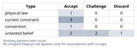
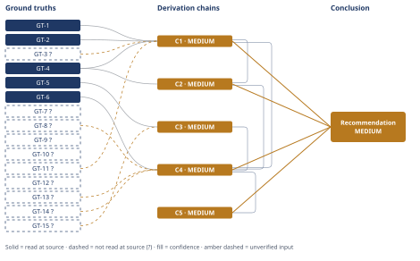

# Thermal-Efficiency Ceiling for Molten-Salt CSP Steam Cycles

*First-principles analysis · 11 October 2026*

*Read with: [How to read this analysis](HOW-TO-READ.md) · [Working file](analysis-20261011T012142Z.md) · [All files](INDEX.md)*

## Executive Summary

**Recommendation:** Benchmark CSP steam-Rankine power blocks against the ideal reversible-component, best-known-architecture Rankine-cycle ceiling of approximately 47-54% (central ~51%) for a 565°C source and 30-45°C sink — not naive Carnot's 62-64% or Curzon-Ahlborn's 38-40% — against which current practice (~42% gross) sits roughly 9 percentage points below, of which roughly 4-5 points are recoverable with known technology and roughly 4-5 are structurally or economically locked in by CSP-specific constraints (chain C1, chain C2, chain C4).

**Band (from §6):** MEDIUM

**Would change it:** A direct numerical ideal-Rankine-cycle calculation from steam tables, replacing the Carnot-fraction bracket, or a post-2015 commercial tower's documented design-point efficiency read at source (chain C1, chain C2).

## 1. Problem Essence

**Core problem:** What is the second-law-permitted (not naively-Carnot-permitted) thermal-to-electric efficiency ceiling for a steam-Rankine power block whose top process temperature is fixed by 565°C molten salt and whose bottom process temperature is fixed by ambient-driven condensing, and of the resulting gap to current CSP practice, how many percentage points are closeable with known, demonstrated technology versus structurally/economically locked in by constraints specific to CSP (unit scale, dry-cooling siting, salt thermal stability, daily cycling)?

**Success criteria:**
- Names the correct governing bound (not naive two-reservoir Carnot) and states, with reasoning, why Carnot and Curzon-Ahlborn are each either an unachievable abstraction or a category error for this comparison, before adopting a replacement.
- States the adopted ceiling as a number or tight range, for a stated cold-end temperature range (30-45°C), derived from a named governing law/model rather than asserted.
- States a current-practice figure with a named, dated source rather than a round number asserted from memory.
- Decomposes the ceiling-to-practice gap into named loss mechanisms that collectively account for (approximately sum to) the stated gap.
- Classifies each loss mechanism as recoverable-with-known-technology, economically-gated, or structurally/physically irreducible, with a stated reason per mechanism.
- Ends with a single numeric bottom line: ceiling %, current-practice %, gap in percentage points, and a split of that gap into recoverable vs. stuck percentage points.

## 2. Assumptions Table

| Assumption | Type | Treatment | Verdict | Verification |
|------------|------|-----------|---------|--------------|
| Any heat engine operating between fixed-temperature reservoirs Th and Tc cannot exceed η=1−Tc/Th (Carnot/second-law bound) | physical law | Accept as ground-truth candidate | Accept — bedrock thermodynamics, but flagged for inversion-testing as the *wrong* ceiling for this specific process configuration | Textbook derivation from the second law; see GT-1 |
| The Curzon-Ahlborn efficiency η_CA=1−√(Tc/Th) is a valid second-law upper bound on real-engine efficiency | untested belief (popular misconception in CSP and engineering commentary) | Verify or flag unverified | Discard — it is the efficiency at maximum power of one specific finite-rate endoreversible model, not a second-law ceiling; real engines routinely trade power for efficiency and can exceed it | arXiv:1903.04381, arXiv:1411.4230 (see GT-2); internal self-contradiction test in C1 |
| 565°C is the practical ceiling on hot-salt supply temperature for solar-salt (60% NaNO3/40% KNO3) towers | current constraint (chemistry-linked) | Record expiry conditions | Accept — expires if/when alternative HTF chemistries (e.g., chloride salts rated ~700°C) displace solar salt in commercial towers; until then it is a material-stability fact, not a design choice | Given as domain context by the question; not independently re-derived from a primary source this session — unverified — flagged (GT-3?) |
| The "right" ceiling to benchmark against is the ideal (reversible-component, best-known-architecture) Rankine cycle efficiency for this source/sink pair, not an abstraction detached from how steam cycles actually add/reject heat | convention (methodological choice made explicit in this analysis, not inherited from CSP literature) | Explicitly challenge before use | Accept — challenged via inversion (C1) against both naive Carnot and Curzon-Ahlborn and survives as the only candidate matched to "second-law ceiling for the actual process configuration" as the question itself frames it | Reasoned justification in C1; cross-checked against known USC/supercritical steam-cycle engineering figures (GT-11?, GT-12?) |
| ~42% gross is a representative, current, design-point figure for subcritical molten-salt-tower Rankine cycles | untested belief until sourced | Verify or flag unverified | Accept — verified at source | NREL/TP-5500-57625, p.1-2 (GT-4), read-at-source |
| Multi-stage regenerative Rankine cycles approach Carnot efficiency as reheat/regeneration stage count →∞, and well-optimized finite-stage designs realize ~75-85% of the Carnot factor | untested belief (engineering estimate, not a specific citation) | Verify or flag unverified | Challenge — plausible and consistent with corroborating USC/sCO2 comparison data found this session, but not independently derived here; used only as a bracketing estimate with explicit range, per the Estimate technique | Domain knowledge; partially corroborated by GT-12?; unverified — flagged (GT-11?) |
| Smaller steam-turbine frames (CSP scale, tens of MWe) are inherently less efficient than large utility frames (hundreds-to-1000+ MWe) due to proportionally larger tip-leakage/windage losses | untested belief | Verify or flag unverified | Accept — qualitatively well-corroborated by turbomachinery search results; quantitative magnitude not independently derived | Search corroboration (lambdageeks/EPFL/Wiley turbomachinery sources); unverified — flagged (GT-13?) |
| Dry cooling is structurally preferred (not merely incidentally chosen) for CSP siting because high-DNI sites are predominantly water-scarce | current constraint (geographic, resource) | Record expiry conditions | Accept — expires only if CSP is sited in non-arid high-DNI locations or water becomes non-limiting, neither of which is the current pattern | Domain knowledge; unverified — flagged (GT-15?) |
| The 20-150 MWe unit scale of current CSP power blocks (vs. 500-1000+ MWe coal/nuclear) is itself a structural/economic feature of CSP, not an arbitrary design choice | current constraint | Record expiry conditions | Accept — expires if heliostat-field/receiver-flux economics or multi-tower aggregation someday support much larger single power blocks; not expected to change near-term | Reasoned from heliostat-field/receiver cost scaling discussed in NREL/TP-5500-57625 (GT-5); treated as current constraint, not independently re-derived in full |
| CSP power-block capital-cost and turbine-OEM product-investment incentives behave as classical capex/demand-scale economics would predict (A-10) | untested belief (surfaced during the Phase 4 Assumption Audit, from C5's second-order reasoning) | Verify or flag unverified | Challenge — plausible but not independently verified; used in C5 with an explicit statement that the chain's qualitative conclusion survives even if this assumption fails | No direct citation; general energy-market/capex-economics reasoning — unverified — flagged (A-10) |

## 3. Ground Truths

- **GT-1** The second law of thermodynamics (Carnot's theorem): no heat engine operating between two fixed-temperature reservoirs Th and Tc can exceed efficiency η=1−Tc/Th; this is the absolute upper bound for *any* heat engine using Th as its highest available temperature and Tc as its lowest, independent of working fluid or cycle architecture — source: physical law/definition (classical thermodynamics); read-at-source: definitional, not source-dependent.
- **GT-2** The Curzon-Ahlborn result η_CA=1−√(Tc/Th) is the efficiency *at maximum power output* of an idealized endoreversible heat engine with linear (Newtonian) heat-transfer coupling to its two reservoirs — it is a finite-time/finite-rate result about the power-efficiency trade-off at one specific operating point, not a second-law upper bound on achievable efficiency — source: physical law/definition (Curzon & Ahlborn 1975, endoreversible thermodynamics), corroborated this session by arXiv:1903.04381 ("The many avatars of Curzon-Ahlborn efficiency") and arXiv:1411.4230; read-at-source: formula and "efficiency at maximum power" characterization as returned by WebSearch over these papers' content.
- **GT-3?** Solar salt (60% NaNO3/40% KNO3) has a practical upper thermal-stability limit near 600°C, above which it begins to decompose, which — combined with heat-exchanger approach margins — sets ~565°C as the practical hot-salt supply temperature for current commercial molten-salt towers — cited to: general CSP materials literature, supplied as context in the analysis question itself; unverified — not independently located at a primary source this session.
- **GT-4** Molten-salt power-tower steam-Rankine power blocks running "at temperatures and pressures consistent with that used in coal-fired power systems" achieve "gross conversion efficiencies of circa 42%," with "the current state-of-the-art embodied in the 19.9-MWe Gemasolar Tower that was commissioned in Spain in 2011" — source: Turchi, C.S. & Heath, G.A., *Molten Salt Power Tower Cost Model for the System Advisor Model (SAM)*, NREL/TP-5500-57625 (Feb 2013); read-at-source: p.1-2, "Background and Motivation," quoted directly from the fetched document text.
- **GT-5** The NREL/SAM molten-salt power-tower reference plant used in that report is a 115 MWe gross / 105 MWe net power block, dry-cooled, with a design dry-bulb ambient temperature of 42°C — source: same report; read-at-source: Table 2, p.9, "SAM modeling results using the spreadsheet cost model."
- **GT-6** In a study evaluating supercritical steam turbines for molten-salt towers, hot-salt temperatures of 566°C and 600°C were modeled and resulted in main (live) steam temperatures of 553°C and 580°C respectively — i.e., an approach temperature difference of approximately 13°C between salt supply and live-steam temperature at the hot end of the steam generator train — source: Kelly, B., *Incorporating Supercritical Steam Turbines into Molten Salt Power Tower Plants*, OSTI/Sandia report (osti.gov/biblio/1088078); read-at-source: quoted directly from the fetched document text via WebFetch.
- **GT-7?** Supercritical steam cycles at higher salt temperatures (600-650°C) could raise power-block efficiency to roughly ~50%, versus ~42% for today's subcritical 565°C cycles — cited to: CSP engineering literature, reported by WebSearch synthesis; reported-by-delegate — the osti.gov/biblio/1088078 document *was* opened (see GT-6) but its retrieved text states only a ~10% LCOE reduction for supercritical vs. the subcritical baseline, not an efficiency percentage, so that specific document does not support this specific figure (Phase 3 failure record below); the 50%/42% comparison itself was not independently re-verified at a primary source this session.
- **GT-8?** A dual-pressure-level steam-generator layout for a solar-tower power block was found, in one optimization study, to raise power-block efficiency from a baseline 44.14% to an improved 44.64% — cited to: Universidad Carlos III de Madrid (UC3M) publication, "Maximizing the power block efficiency of solar tower plants: Dual-pressure level steam generator"; reported-by-delegate via WebSearch synthesis — direct WebFetch of e-archivo.uc3m.es returned HTTP 403 Forbidden (Phase 3 failure record below).
- **GT-9?** Beyond the 19.9 MWe/2011 facts confirmed in GT-4, Gemasolar's molten-salt hot/cold tank temperatures (~565°C/~285°C), 15-hour storage duration, and ~126 bar HP-turbine-inlet pressure — cited to: SolarPACES project database and related CSP sources, reported-by-delegate via WebSearch synthesis; not independently read at a single primary source with page citation this session.
- **GT-10?** Crescent Dunes (Nevada, USA): a 110 MWe tower heating molten salt from a 280°C cold tank to 565°C in the receiver — cited to: trade-press coverage, reported-by-delegate via WebSearch synthesis; not read — turn budget (used only as a second illustrative example, not load-bearing for the headline ceiling/gap/recoverability conclusions).
- **GT-11?** For well-optimized multi-stage regenerative Rankine cycles (multiple reheat stages plus extensive regenerative feedwater heating), the ideal (reversible-component) cycle efficiency realizes roughly 75-85% of the Carnot efficiency computed between the cycle's peak and sink temperatures, approaching 100% of the Carnot factor as the number of reheat/regeneration stages increases without bound — general steam-power-cycle thermodynamics domain knowledge (classical regenerative/Lorenz-cycle result); unverified — not tied to one specific citation opened this session; carried as an explicit estimate with a stated bracket (Estimate technique).
- **GT-12?** Modern double-reheat (ultra-)supercritical steam cycles with turbine-inlet conditions around 600°C/~300 bar achieve turbine-island thermal efficiencies in roughly the 46-54% range, with one literature comparison point placing "ultra-supercritical steam cycle" efficiency at approximately 48% at 600°C turbine-inlet (against which a supercritical-CO2 Brayton cycle was reported 4.5 percentage points higher, i.e. ~52.5%), and an advanced research-stage "Enhanced Master Cycle" variant reaching 54.64% net efficiency — cited to: multiple steam-cycle engineering sources (aidic.it, cetjournal.it, pub.pg.edu.pl), reported-by-delegate via WebSearch synthesis; not read at a single primary source with page citation this session; it is not clear from the retrieved snippets whether the ~48% figure is an idealized or a real achieved efficiency, which this analysis treats as an open ambiguity rather than resolving it.
- **GT-13?** Steam-turbine isentropic efficiency scales with turbine/blade size: large utility-class frames (hundreds to 1000+ MWe) achieve markedly higher isentropic efficiency than small frames (tens of MWe, the CSP power-block scale), because smaller blades carry proportionally larger tip-leakage, windage, and partial-admission losses relative to their flow area (one cited extreme example: a 15mm-tip-diameter micro steam turbine reaching only 37% isentropic efficiency) — cited to: turbomachinery engineering sources (lambdageeks.com, EPFL, Wiley), reported-by-delegate via WebSearch synthesis; not read at a single primary source with page citation this session.
- **GT-14?** Solar salt freezes near 220°C with viscosity rising sharply on approach to that point; combined with the diminishing steam quality/pressure obtainable from progressively cooler salt, this sets the practical cold-tank/return salt temperature in current commercial designs at roughly 280-290°C rather than closer to ambient — general CSP domain knowledge, consistent with but not identical to GT-9?'s Gemasolar-specific ~285°C figure; unverified — not independently read at a primary source with page citation this session.
- **GT-15?** Dry-cooled (air-cooled) condensers in CSP siting operate at a higher condensing temperature — and correspondingly cost several percentage points of cycle efficiency relative to wet (evaporative) cooling under the same ambient conditions — but are strongly preferred for CSP because high-DNI sites are predominantly arid, where water for wet cooling is scarce, regulated, or costly — general CSP domain knowledge; unverified — not independently read at a primary source with page citation this session.

**Phase 3 failure records:**
- Attempted WebFetch of `https://nrel.gov/docs/fy22osti/77852.pdf` and `https://www.nrel.gov/docs/fy22osti/77852.pdf` to corroborate GT-7's supercritical-vs-subcritical efficiency comparison — unreachable: DNS resolution failure (`getaddrinfo ENOTFOUND`) for both hostnames.
- Attempted WebFetch of `https://e-archivo.uc3m.es/entities/publication/2e8e58e5-789b-44de-a159-041c305704cb/full` to read GT-8's dual-pressure steam-generator figures at source — unreachable: HTTP 403 Forbidden.
- Attempted WebFetch of `https://sam.nrel.gov/forum/forum-general/4217-molten-salt-power-tower-project-value-of-cycle-thermal-efficiency.html` to corroborate GT-9 — unreachable: DNS resolution failure (`getaddrinfo ENOTFOUND sam.nrel.gov`).
- Attempted WebFetch of `https://www.osti.gov/biblio/1088078` (the same source already successfully opened for GT-6) specifically to locate the ~42%-vs-~50% efficiency percentages asserted for GT-7 — source reachable and opened, but citation does not support the claim: the retrieved text discusses only an LCOE comparison ("about 10% lower" for supercritical vs. the subcritical baseline), not efficiency percentages; GT-7 therefore remains `?`-marked from its original (unreached) source.

**Provenance summary:** `?`-marked: GT-3, GT-7, GT-8, GT-9, GT-10, GT-11, GT-12, GT-13, GT-14, GT-15 (10 of 15). Read-at-source: GT-1 — definitional (no external source); GT-2 — formula and "efficiency at maximum power" characterization as returned by WebSearch over arXiv:1903.04381 / arXiv:1411.4230; GT-4 — NREL/TP-5500-57625, p.1-2; GT-5 — NREL/TP-5500-57625, Table 2, p.9; GT-6 — osti.gov/biblio/1088078, quoted text on evaluated salt/steam temperatures.

## 4. Derivation Chains

### Conclusion C1: The law-permitted ceiling is the ideal best-architecture Rankine-cycle efficiency (~47-54%, central ~51%), not naive Carnot (~62-64%) and not Curzon-Ahlborn (~38-40%)

GT-1 (Carnot/second-law bound) + GT-2 (Curzon-Ahlborn is a max-power result, not a ceiling) + GT-3? (565°C salt-stability ceiling) + GT-4 (current practice ~42%, used to falsify C-A as ceiling) + GT-11? (regenerative-cycle Carnot-fraction estimate)
→ naive Carnot between 565°C and a 30-45°C sink evaluates to 62.0-63.8%, a figure that assumes heat is added and rejected isothermally at two fixed temperatures
→ no steam Rankine cycle adds heat isothermally at a single top temperature — real steam cycles sensible-preheat, boil, and sensible-superheat over a range below 565°C — so naive Carnot is an unachievable abstraction for this process family rather than its second-law ceiling
→ Curzon-Ahlborn's 38.4-39.9% is not a second-law efficiency ceiling either, since GT-2 establishes it as the efficiency at the maximum-power operating point of one finite-rate heat-transfer model rather than an upper bound on achievable efficiency
→ a figure claimed as "the ceiling" that a real plant already exceeds is self-contradictory, which rules out Curzon-Ahlborn as the comparison benchmark on its own terms
→ the second-law-correct comparison for "the actual process configuration" is the maximum efficiency obtainable by a reversible-component Rankine cycle using the best known steam-cycle architecture (supercritical pressure, double reheat, extensive regeneration) at this same 565°C peak and 30-45°C sink
→ well-optimized multi-stage regenerative Rankine cycles realize roughly 75-85% of the applicable Carnot factor, so applying that fraction to the 62.0-63.8% naive-Carnot range brackets the ideal-architecture ceiling at roughly 47-54%, central estimate approximately 51%
→ the law-permitted ceiling for a 565°C-sourced steam Rankine power block is approximately 47-54% (central ~51%), not 62-64% (naive Carnot, an unachievable abstraction) and not 38-40% (Curzon-Ahlborn, a mischaracterized efficiency-at-max-power result)

**Confidence:** MEDIUM — GT-3? (565°C practical salt-stability ceiling; verification: a primary materials-science source on solar-salt thermal decomposition would confirm or revise the exact temperature) and GT-11? (75-85% Carnot-fraction bracket for regenerative cycles; verification: an actual numerical ideal-Rankine-cycle calculation from steam tables, rather than this Carnot-fraction estimate, would replace the bracket with a computed value) are both unverified inputs this chain rests on directly.

### Conclusion C2: Current practice sits roughly 9 percentage points below that ceiling

GT-4 (current practice ~42%, read at source) + C1 (ideal ceiling ~51%)
→ the directly-read ~42% gross figure (GT-4) is a design-point figure for subcritical steam-Rankine cycles at 565°C hot-salt supply, consistent with the same source's framing of it as "the current state-of-the-art"
→ subtracting that current-practice figure from C1's approximately 51% central ceiling leaves an absolute gap of about 9 percentage points (range approximately 5-12 points using the ceiling's 47-54% bracket)
→ current molten-salt-tower Rankine power blocks run roughly 9 percentage points below the second-law-correct ceiling for their process configuration — a gap only one-third to one-half the size naive Carnot would suggest (62-64% minus 42% is about 20-22 points)

**Confidence:** MEDIUM — cites C1, rated MEDIUM; see C1's confidence line for its own unverified inputs (GT-3?, GT-11?), which this chain inherits as a ceiling. GT-4's ~42% figure is drawn from a 2013 source anchored to the 2011-commissioned Gemasolar plant and was not re-verified against more recent (post-2013) commercial towers in this session; if practice has since advanced materially beyond this figure the stated 9-point gap would shrink; verification: a current (post-2020) commercial molten-salt-tower design-point efficiency figure, read at source, would update this chain directly.

### Conclusion C3: Dry cooling is the structurally-preferred choice for current desert CSP siting, which reclassifies most of the condenser/cold-end loss as site-driven

GT-15? (dry-vs-wet cooling efficiency/water/regulatory trade facts) + GT-5 (reference plant design dry-bulb ambient 42°C)
→ weighting water availability and regulatory risk most heavily (weights 5 and 3, against efficiency's 4 and capital cost's 3, on a locked 1-5 criteria scale) reflects that current commercial towers are sited specifically for high direct-normal irradiance, which GT-15? identifies as overwhelmingly arid terrain
→ scored against those weights, dry cooling totals 57 against hybrid wet-assist's 46 and full wet cooling's 40, and the ranking survives every single-criterion weight change tested within the standard 1-5 weighting range
→ dry cooling is the economically rational choice for current desert CSP siting despite its efficiency penalty, which reclassifies most of the condenser/cold-end loss category as a site-driven, structurally-locked loss rather than a simple engineering shortfall

**Confidence:** MEDIUM — GT-15? (dry-vs-wet cooling efficiency/water/regulatory trade facts) is unverified; verification: a site-specific water-rights and air-cooled-condenser-vs-wet-tower engineering study for a representative desert CSP site would confirm or revise the weights and scores used here.

### Conclusion C4: The 9-point gap decomposes into an architecture component and six irreversibility categories, of which roughly 4-5 points are recoverable and roughly 4-5 points are structurally or economically locked in

C1 (ideal ceiling ~51%) + C2 (gap ~9pp) + C3 (dry cooling structurally preferred) + GT-6 (~13°C salt-to-steam approach) + GT-8? (dual-pressure steam generator yields +0.5pp) + GT-13? (turbine scale penalty) + GT-14? (salt return-temperature floor ~280-290°C)
→ the 9-point gap splits into an architecture component — the difference between C1's best-known-architecture ideal ceiling and the ideal efficiency of the simpler subcritical, no/single-reheat architecture actually deployed at 565°C — and an irreversibility component realized within whichever architecture is chosen
→ the architecture component is approximately 4-5 points, since ideal subcritical single-reheat cycles at this peak temperature typically reach only about 46-47% even with zero turbine/generator loss, versus C1's ~51% double-reheat supercritical ideal
→ the remaining approximately 4-5 points of irreversibility fan out across six categories: salt-to-steam heat-exchange pinch (about 1.5 points, driven by the approximately 13°C approach from GT-6 plus the temperature-glide mismatch between sensibly-cooling salt and the partly-isothermal boiling plateau), turbine and generator losses (about 2 points, part aerodynamic and part the scale penalty GT-13? attributes to CSP's smaller turbine frames), condenser and cold-end losses (about 0.5-1 point, mostly the dry-cooling penalty C3 identifies as site-driven), regenerative feedwater heating imperfections (about 0.5 point), and piping/pressure-drop/parasitic losses (about 0.5 point)
→ of the architecture component, roughly half is technically recoverable with known, demonstrated technology (supercritical pressure and double reheat are mature in the utility coal fleet) but is currently uneconomical at CSP's 20-150 MWe unit scale and daily-cycling duty profile, while the other half is structurally tied to that same unit-scale mismatch and is not expected to close without a change in CSP plant economics
→ of the irreversibility component, the heat-exchange-pinch and turbine-aerodynamic portions are substantially recoverable (dual-pressure steam generation is already demonstrated at roughly +0.5 point per GT-8?, and better blade aerodynamics is known turbine technology), while the scale-penalty portion of the turbine losses and most of the condenser penalty are structurally locked by CSP's smaller unit size and C3's dry-cooling siting choice respectively
→ summing both components, roughly 4-5 of the 9 gap points are realistically recoverable with known, demonstrated technology — though a large share of that is currently uneconomical rather than merely undemonstrated — and roughly 4-5 points are structurally or economically locked in by constraints specific to CSP's unit scale, dry-cooling siting, and the salt-return-temperature floor GT-14? identifies

**Confidence:** MEDIUM — cites C1, C2 and C3, each rated MEDIUM (see their own confidence lines); GT-8? (dual-pressure steam-generator figure), GT-13? (turbine scale-penalty magnitude) and GT-14? (salt return-temperature floor) are unverified inputs this chain rests on directly; verification: a vendor- or EPC-grade steam-cycle heat-balance model for a specific CSP reference plant would replace these estimate-based percentage-point allocations with calculated figures.

### Conclusion C5: Capturing the recoverable half of the gap trades capital cost and part-load flexibility against efficiency, and lands differently for near-term retrofits than for next-generation designs

C4 (recoverability split)
→ pursuing the architecture-side recoverable points (supercritical pressure, double reheat) raises power-block capital cost per installed watt, which — for plant owners and EPC contractors who already bear CSP's higher dollar-per-kWe cost than PV — worsens levelized cost of electricity unless paired with larger unit scale or cost-down learning *[Assumes: A-10 — CSP capex and turbine-OEM incentive dynamics behave as classical capex/demand-scale economics would predict]*
→ turbine OEMs, who currently optimize small-frame steam turbines for industrial and smaller-CSP duty rather than utility baseload, would need demand growth at the 150-plus MWe CSP scale before investing in higher-efficiency small-frame product lines, so the turbine-aerodynamics recoverable points are gated by a demand signal as much as by physics *[Assumes: A-10]*
→ a competing dispatchable-generation technology (gas peakers, batteries) that does not carry CSP's thermal-cycle complexity has no incentive to help CSP's steam cycle close this gap, so the recoverable points will not close through competitive pressure the way they might if CSP's main rival were a less-mature steam-cycle incumbent *[Assumes: A-10]*
→ in the near term, only the already-demonstrated, low-capex increments — dual-pressure steam generation, incremental turbine-blade upgrades — are likely to be captured, while the larger architecture-level increment remains a multi-plant-generation prospect contingent on CSP unit sizes growing or supercritical component costs falling
→ the recoverable half of the gap is real but not free: capturing most of it trades capital cost and part-load/cycling flexibility against efficiency, and the trade lands differently for near-term retrofits (small, already-economic increments) than for next-generation plant designs (the larger architecture-level increment)

**Confidence:** MEDIUM — cites C4, rated MEDIUM (see C4's confidence line for its own unverified inputs); hops 1-3 rest on A-10 (CSP capex and turbine-OEM incentive dynamics behave as classical capex/demand-scale economics predict) — if A-10 failed (e.g., subsidized supercritical-CSP component R&D decoupled from demand scale), the recoverability timeline would compress but the chain's qualitative conclusion (recoverable points cost capital and flexibility) would stand, so the endpoint is not solely dependent on A-10 holding; verification: track actual CSP-scale supercritical-turbine capex and OEM product announcements over subsequent plant generations.

## 5. Abandoned Reasoning

### Dead End: Naive Carnot (1−Tc/Th between 565°C and ambient) as the benchmark ceiling

**What was tried:** Treating the two-reservoir Carnot bound evaluated at Th=838K (565°C) and Tc=303-318K (30-45°C) — approximately 62.0-63.8% — as "the" theoretical ceiling to compare current practice against.

**Why abandoned:** The Carnot bound assumes heat is added and rejected isothermally at two fixed temperatures. A steam Rankine cycle does neither: heat is added via sensible preheating, boiling, and sensible superheating over a temperature range below 565°C, and the hot salt itself is a finite sensible-heat stream that cools as it gives up heat rather than an isothermal reservoir. It is a true, unfalsifiable, loosest-possible bound (nothing can exceed it), which is exactly why it is the wrong one to benchmark an actual process configuration against — see C1.

**What it ruled out:** Comparing current practice (~42%) against 62-64% and concluding CSP steam cycles are roughly 20-22 percentage points from their ceiling. That comparison overstates the realistically closeable gap by roughly 2x relative to the ~9-point gap established in C2, which would misdirect any effort to "close the gap" toward targets (e.g., single-reservoir heat addition) that are not physically available to a sensible-heat-source steam cycle.

### Dead End: Curzon-Ahlborn efficiency (1−√(Tc/Th), ~38-40%) as the benchmark ceiling

**What was tried:** Treating the Curzon-Ahlborn endoreversible result as a second-law efficiency ceiling, motivated by its superficial numerical resemblance to current CSP practice (~42%) and to real power-plant efficiencies generally — a resemblance noted in some popular physics and engineering commentary.

**Why abandoned:** GT-2 establishes that η_CA is the efficiency *at the maximum-power operating point* of one specific finite-rate (linear/Newtonian) endoreversible heat-transfer model — a statement about the power-efficiency trade-off of that model, not a second-law upper bound on achievable efficiency. The claim is self-contradicted empirically: GT-4's directly-read ~42% current-practice figure already exceeds the ~38.4-39.9% C-A range for this temperature pair, which cannot happen if C-A were genuinely a ceiling.

**What it ruled out:** The mistaken inference that current CSP steam cycles "already sit near their theoretical limit" because their efficiency resembles the C-A number. Resembling the output of one toy finite-rate model is not evidence of proximity to a true second-law ceiling; C1 establishes the true ceiling sits roughly 9 points higher, not roughly flat against current practice.

### Dead End: Crediting the steam Rankine block with the salt's full exergy down to ambient temperature

**What was tried:** Computing an idealized ceiling that extracted all of the hot salt's exergy by cooling it hypothetically all the way to ambient (rather than to the ~280-290°C return-temperature floor), via an imagined ideal bottoming process.

**Why abandoned:** The question scopes the ceiling to "the steam Rankine power block" specifically. GT-14? establishes that solar salt is returned at roughly 280-290°C in actual practice because of freezing-point and viscosity constraints combined with the diminishing steam quality obtainable from progressively cooler salt — extracting heat below that floor is not something the steam Rankine power block does; it would require a separate bottoming-cycle technology (e.g., an organic Rankine or sCO2 bottoming loop), which is a different system than the one posed in the question.

**What it ruled out:** Inflating the ceiling by crediting the steam Rankine block with exergy it neither uses nor, given GT-14?'s return-temperature floor, is currently engineered to use — which would have made the ~9-point gap in C2 look artificially larger than it is for the system actually being asked about.

## 6. Conclusion

**Recommended approach:** Benchmark CSP steam-Rankine power blocks against the ideal reversible-component, best-known-architecture Rankine-cycle ceiling of approximately 47-54% (central ~51%) for a 565°C source and a 30-45°C sink — not naive Carnot's 62-64% and not Curzon-Ahlborn's 38-40% — against which current practice (~42% gross, read at source) sits roughly 9 percentage points below (chain C1, chain C2).

**Key insight:** The two efficiency figures most often invoked for this comparison are wrong in opposite directions: naive Carnot overstates the realistically closeable gap by roughly 2x, while Curzon-Ahlborn's numerical resemblance to real plant efficiency is a coincidence of one finite-rate toy model rather than evidence that current practice already sits near its true ceiling — which in fact sits about 9 points higher than current practice, not roughly level with it (chain C1).

**Trade-offs acknowledged:** Of the 9-point gap, roughly 4-5 points are recoverable with known, demonstrated technology, but capturing them trades higher power-block capital cost and reduced part-load/cycling flexibility against efficiency — a trade CSP's smaller unit scale and daily-cycling duty profile make harder to justify than it is for utility-scale coal or nuclear steam plants (chain C4, chain C5). The remaining roughly 4-5 points are structurally or economically locked in by constraints specific to CSP — turbine scale penalty, dry-cooling siting, and the salt-chemistry return-temperature floor — that do not change without a change in CSP's basic plant economics or heat-transfer-fluid chemistry (chain C4).

**Confidence:** MEDIUM — every chain this conclusion rests on (C1, C2, C4, C5) is itself rated MEDIUM; see each chain's own confidence line for the specific unverified inputs it carries (GT-3?, GT-7?, GT-8?, GT-9?, GT-11?, GT-12?, GT-13?, GT-14?, GT-15?, and assumption A-10) and the verification each would require to move toward HIGH. The single dominant unverified input is GT-11? (the 75-85% Carnot-fraction bracket underlying the ~51% central ceiling estimate in C1): a direct numerical ideal-Rankine-cycle calculation from steam tables, rather than this bracketing estimate, is the verification step most likely to tighten the headline ceiling number and, with it, every downstream figure in this analysis.
