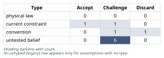
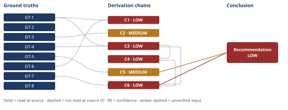

# Redis Cache vs. Postgres Upgrade: A Capacity Decision

*First-principles analysis · 11 October 2026*

*Read with: [How to read this analysis](HOW-TO-READ.md) · [Working file](analysis-20261011T182500Z.md) · [All files](INDEX.md)*

## Executive Summary

**Recommendation:** The claim holds only conditionally, not as stated. Adopt a hybrid rather than pure option (a) or (b): ship the Redis cache now, but keep the Postgres upgrade's procurement active and gate its cancellation on a calendared checkpoint before the lead-time deadline (chain C6).

**Band (from §6):** LOW

**Would change it:** Verifying which Postgres resource dimension actually binds, what share of it the listings endpoint represents, p95's DB-time share, achievable hit rate, and QPS growth rate would let the checkpoint resolve the upgrade decision on evidence rather than on QPS-and-cost alone (chain C6).

## 1. Problem Essence

**Core problem:** Does offloading the listings endpoint's reads through a Redis read-through cache relax the *specific* Postgres resource constraint that is actually driving the scheduled vertical-scale upgrade, by enough margin and for long enough (≥2 quarters, against ongoing QPS growth), to justify deferring that upgrade rather than executing it now — given that the upgrade is far harder to reverse once deferred than the cache is to adjust once shipped?

**Success criteria** (checkable against section 6 without further clarification):
1. Section 6 states explicitly whether the binding-constraint attribution (the question of which Postgres resource dimension the scheduled upgrade actually relieves, and what share of it the listings endpoint represents) has been verified, and does not recommend unconditional, un-gated deferral while that attribution remains unverified.
2. Section 6 names the specific evidence still required before the claim can be fully trusted, with each item traceable to a derivation chain in section 4.
3. Section 6's recommendation explicitly weighs the stated reversibility asymmetry (cache adjustable post-launch; upgrade has procurement lead time) rather than treating options (a) and (b) as equally reversible bets.
4. Section 6 tests whether a combination of (a) and (b) outperforms either named option alone, and states the result of that test rather than defaulting to a binary choice.

## 2. Assumptions Table

| Assumption | Type | Treatment | Verdict | Verification |
|---|---|---|---|---|
| A-1: Reducing DB load on the listings-read path will relax the actual resource constraint behind the scheduled Postgres vertical-scale upgrade. | untested belief | Verify via per-resource (CPU / memory / disk IOPS / connections / replication) attribution for the current instance, or flag unverified and price the downgrade. | Challenge — this is the crux of the whole claim; the document cites no attribution data; load-bearing for chains C1, C3, C6 | unverified — flagged |
| A-2: p95 latency on the listings endpoint is dominated by Postgres query time rather than application processing, serialization, network hops, or downstream-service calls. | untested belief | Verify via an APM/tracing latency breakdown of the endpoint's p95. | Challenge — plausible but not demonstrated; no latency breakdown cited | unverified — flagged |
| A-3: Achievable cache hit rate is materially high given the real listings-read key-access distribution and the freshness/TTL tolerance of listing data. | untested belief | Verify via key-cardinality / access-skew analysis, or a shadow-cache measurement before full rollout. | Challenge — no key-distribution or hit-rate model is cited | unverified — flagged |
| A-4: QPS growth over the next two quarters stays within the load margin the cache buys, so the deferral window is genuinely ≥2 quarters. | untested belief | Verify via trailing QPS growth-rate trend (MoM/QoQ) projected forward and compared against the margin a resolved A-1/A-3 would imply. | Challenge — no growth-rate figure is given; "two quarters" is asserted, not computed | unverified — flagged |
| A-5: The write/invalidation rate on listings data (price, inventory, availability changes) is low enough to sustain a useful cache TTL without excessive staleness or invalidation-driven churn. | untested belief | Verify via measured write rate on listing records relative to read rate. | Challenge — not addressed anywhere in the circulated evidence | unverified — flagged |
| A-6: The scheduled vertical-scale upgrade was itself motivated primarily by this endpoint's read QPS, not by other load sources (writes, other services' queries on the same instance, connection exhaustion, replication lag). | untested belief | Verify against the original capacity-planning rationale/ticket that scheduled the upgrade. | Challenge — the document does not state why the upgrade was originally scheduled; load-bearing for chains C1, C3, C6 | unverified — flagged |
| A-7: Two engineer-weeks is sufficient to ship a production-safe cache, including invalidation logic, monitoring/alerting, stampede protection, and an on-call runbook. | convention | Explicitly challenge — caching projects commonly exceed an initial build estimate once production-hardening scope is included (see GT-5). | Challenge — likely understates true scope | unverified — flagged |
| A-8: An explicit, calendared, owned decision checkpoint exists (or will be created) to re-trigger upgrade procurement before its lead-time deadline if post-cache data does not confirm A-1 through A-4. | current constraint (presently: absent — a missing control) | Record the condition that lifts it: the moment the team calendars an owned review date tied to the procurement deadline, this constraint (the checkpoint's absence) no longer holds. | Challenge — as circulated, the document proposes no such checkpoint; this is the single highest-leverage fix available, and it is what distinguishes the hybrid recommendation from option (a) as literally stated | unverified — flagged; recommended for creation, see section 6 |
| A-9: The decision is binary — either (a) ship the cache and defer the upgrade, or (b) upgrade now and treat caching as independent later work — with no viable middle ground. | convention | Explicitly challenge before accepting the binary framing (per the Essence-phase requirement to test whether a combination dominates). | Discard — a hybrid (ship the cache now; keep upgrade procurement active behind a checkpoint) dominates both named options in the weighted trade-off (chain C6) | challenged and discarded in the Phase 4 trade-off analysis |
| A-10: The scheduled upgrade's procurement lead time is real and significant — i.e., this is not a fully managed cloud-Postgres instance where vertical resize is a near-instant, low-risk operation. | current constraint | Record the condition that would lift it: if the database is in fact on a managed service with fast, low-risk vertical resize, the reversibility asymmetry this analysis leans on weakens substantially and the recommendation should be revisited. | Accept — provisionally, as directly stated in the user-supplied scenario context; flagged for confirmation against the team's actual infrastructure before being treated as settled | context-given (stated directly in the prompt); not independently verified against the team's actual deployment model |

## 3. Ground Truths

**Scope disclosure (read before the list):** This analysis is a judgment problem over a hypothetical, internally circulated architecture-review document — there is no external, openable citation (URL, paper, spec document) in play for most of what follows, so the Phase 3 verification step's "open the cited source" instruction has no object to act on for GT-1 through GT-5 below; this is disclosed rather than silently treated as a passed read. GT-1 through GT-5 are **definitional/structural** facts about how caching and Postgres capacity planning work — the same "definition" tier the irreducibility test (Phase 3) treats as bottoming out a reduction alongside physical law and direct measurement — and are labeled accordingly rather than suffixed `?`, since they are not in doubt the way an unverified empirical figure is. GT-6 through GT-8 are **context-given**: read directly from the user-supplied scenario text in this conversation, which is the only "source" available and which this analysis did read directly (quoted below). No `?`-marked ground truth appears in this analysis; where a chain's conclusion is uncertain, the uncertainty is carried by `[Assumes: A-N]` references to the Assumptions Table (section 2), not by ground-truth suffixes. Act attempted (Phase 3 verification step): no — no external document exists in this scenario to open; this is named here once rather than repeated on each entry.

- **GT-1** A read-through cache reduces database load only for the specific cacheable read queries it covers; it has no direct effect on load generated by writes, non-covered reads, or traffic from other endpoints/services sharing the same database instance. — source: definitional (cache / read-through pattern; standard distributed-systems engineering principle, not an empirical figure requiring external citation).
- **GT-2** Achievable cache load-offload is bounded by hit rate: load from the covered query set falls by approximately (hit_rate × covered_load), where hit_rate is governed by the skew of key-access frequency relative to cache capacity/TTL and by the invalidation (write) rate relative to the read rate. — source: definitional (cache mechanics).
- **GT-3** A cache changes end-to-end p95 latency only to the extent that the latency component it replaces (DB query time, on the cache-hit path) is a material share of that p95; if p95 is dominated by other components (application processing, serialization, network hops, downstream service calls), cache hits leave p95 largely unchanged even at a high hit rate. — source: definitional (latency-decomposition reasoning applied to request-serving paths).
- **GT-4** Postgres vertical-scale (instance-size) upgrades are commonly undertaken to relieve one or more independent resource dimensions — CPU (query execution/planning), memory (buffer cache / working memory), disk IOPS/throughput, maximum connections, or replication capacity — and a single endpoint's read-QPS figure does not by itself indicate which dimension is binding or what share of it that endpoint represents. — source: definitional (standard relational-database capacity-planning model).
- **GT-5** A cache sitting in front of a datastore introduces failure modes that do not exist without it: stale-read windows between invalidation events, invalidation races, and "thundering herd"/cache-stampede load spikes on mass expiry, redeploy, or cold restart. — source: definitional (cache architecture).
- **GT-6** Per the circulated architecture-review document, the only evidence cited for this recommendation is (i) peak read-QPS on the listings endpoint and (ii) the cost of the next-tier Postgres instance. — source: user-supplied context; read-at-source: "Evidence cited in the document: peak read-QPS on the listings endpoint, and the next-tier Postgres instance cost."
- **GT-7** Per the stated context, the decision is reversible at the cache-rollout boundary (observable and correctable post-launch), but the scheduled Postgres upgrade has procurement lead time, making a late reversal of a deferral decision expensive. — source: user-supplied context; read-at-source: "Reversibility: the decision is reversible at the cache-rollout boundary... BUT the scheduled Postgres upgrade has procurement lead time, so reversing out of 'we deferred the upgrade' late is expensive."
- **GT-8** Per the stated context, the proposed cache effort is estimated at two engineer-weeks, and the decision as framed is between (a) ship the cache and cancel/defer the upgrade for this and next quarter, or (b) execute the upgrade now and treat caching as independent later work. — source: user-supplied context; read-at-source: "Decision this feeds: whether to (a) approve a two-engineer-week effort to ship the Redis cache and cancel/defer the vertical-scale upgrade work... or (b) execute the scheduled Postgres upgrade now and treat caching as an independent, later optimization."

**Provenance summary (required):** `?`-marked: none (0 of 8). Read-at-source (context-given): GT-6 — "Evidence cited in the document..." clause of the CONTEXT block; GT-7 — the "Reversibility:" clause of the CONTEXT block; GT-8 — the "Decision this feeds:" clause of the CONTEXT block. Read-at-source (definitional, per the scope disclosure above, verified by definition rather than located in an external document): GT-1 through GT-5 — each is the cache/Postgres structural principle named in its own entry above.

## 4. Derivation Chains

### Conclusion C1: The claim's "reduce database load enough" sub-claim is not established by the cited evidence

GT-1 (cache reduces only covered-read load) + GT-6 (cited evidence: QPS, instance cost only)
→ the circulated document's evidence does not identify which Postgres resource dimension is actually binding on the instance [Assumes: A-6]
→ the circulated document's evidence also does not state what share of that binding dimension the listings-read endpoint represents [Assumes: A-1]
→ without that attribution, the achievable DB-load reduction from caching this endpoint cannot be sized from the evidence given
→ the sub-claim "reduce database load enough" is therefore unverified rather than supported

**Confidence:** LOW — Inference axis short: hops 1–2 rest on [Assumes: A-6] and [Assumes: A-1], both unverified and load-bearing, and the chain has not priced what happens if either is false — that is exactly the thing the chain concludes cannot yet be priced. Rivals axis short: a live rival ("modest read-offload could still relieve the true binding resource even without knowing its exact share") is not ruled out — see the Rival analysis in the adversarial pass record. Verification: instrument per-resource (CPU/IO/memory/connections) attribution for the listings endpoint before trusting this sub-claim; see A-1 and A-6's verification cells.

### Conclusion C2: The claim's p95-latency sub-claim is directionally plausible but its magnitude is unverified

GT-3 (cache moves p95 only if DB time dominates)
→ the document does not include a latency breakdown showing what share of current p95 is DB query time versus serialization, network, or downstream calls [Assumes: A-2]
→ if DB time is only a minority share of p95, even a high cache hit rate caps the achievable p95 improvement well below a headline "cut p95 latency" result
→ the latency sub-claim is directionally plausible given GT-3 but its magnitude is unverified

**Confidence:** MEDIUM — Inputs axis clean (GT-3 is a definitional fact); Inference axis short: hop 1 rests on [Assumes: A-2], unverified, but bounded — the verification is a routine APM trace, one axis short and closeable; Rivals axis clean on direction (nothing disputes that caching a hot read path can only help or leave p95 unchanged on the cache-hit path itself, never hurt it). Verification: an APM/tracing breakdown of p95 latency into DB-time vs non-DB-time for the listings endpoint.

### Conclusion C3: Whether caching relaxes the constraint actually forcing the scheduled upgrade is unverified — the claim's crux

GT-4 (upgrades address multi-dimensional constraints) + GT-1 (cache reduces only covered-read load)
→ Postgres vertical-scale upgrades are commonly driven by CPU, memory, disk IOPS, connection limits, or replication capacity, any of which may be independent of listings-read volume [Assumes: A-6]
→ a read-through cache in front of one endpoint has no effect on resource dimensions it does not touch, such as write IOPS, connection exhaustion from other services, or replication lag
→ if the scheduled upgrade is driven primarily by a dimension the cache does not touch, deploying the cache will not relax the constraint actually forcing the upgrade, regardless of hit rate [Assumes: A-1]
→ whether the upgrade is safely deferrable therefore turns on an unverified premise the circulated evidence does not establish

**Confidence:** LOW — Inference axis short on two load-bearing unverified premises, [Assumes: A-6] and [Assumes: A-1]; Rivals axis short: the rival "QPS is usually a reasonable proxy for overall DB pressure" is disputed by GT-4 but not eliminated for this specific instance — see Abandoned Reasoning AR-1, which rules out treating the cited evidence as *sufficient*, without ruling out that the cache *might still happen* to help the true binding resource. This is the single most decision-relevant unresolved link in the whole claim. Verification: resource-dimension attribution (current and projected post-cache) for the instance, specifically what fraction traces to the listings-read endpoint, plus the original rationale for scheduling the upgrade (A-6's verification).

### Conclusion C4: The "at least two quarters" horizon is asserted, not derived, independent of how C3 resolves

C3 (LOW — crux unresolved)
→ even granting a favorable resolution of C3 (the cache does relax the true binding constraint today), the margin it buys shrinks as read QPS continues to grow [Assumes: A-4]
→ the circulated document gives no QPS growth-rate figure, so the claimed two-quarter deferral window is asserted rather than computed from (margin bought by cache) divided by (growth rate)
→ "defer for at least two quarters" is not currently derivable from the evidence given, independent of how C3 resolves

**Confidence:** LOW — Inputs ceiling is LOW because the head cites C3, itself LOW; Inference axis also short on [Assumes: A-4], unverified. Verification: QPS growth-rate trend (trailing MoM/QoQ growth) projected forward, combined with a resolved C3, to compute an actual margin-exhaustion date rather than asserting "two quarters."

### Conclusion C5: The document's cost-benefit case for option (a) likely understates the cache's true cost

GT-5 (cache introduces new failure modes)
→ shipping a read-through cache adds operational surface area not present today — invalidation races, stale-read windows, and stampede risk on expiry, deploy, or restart [Assumes: A-7]
→ the two-engineer-week estimate in the document covers an initial build but is not shown to include stampede protection, monitoring/alerting, or an on-call runbook for these new failure modes
→ the true cost of shipping the cache is likely understated in the document, which weakens the stated cost-benefit case for cancelling the upgrade specifically to avoid the two-engineer-week investment

**Confidence:** MEDIUM — Inputs clean; Inference short: hop 1 rests on [Assumes: A-7], a generalization from common engineering experience rather than a measured estimate from this specific team; Rivals axis short but bounded: a live rival ("this team already has reusable caching infrastructure, so two weeks is accurate") is not ruled out — see Abandoned Reasoning AR-3. Verification: a scoped engineering estimate that explicitly line-items invalidation, monitoring, stampede protection, and rollout/rollback.

### Conclusion C6: The robust decision is a hybrid, not either named option as literally proposed

GT-7 (asymmetric reversibility) + C3 (LOW) + C4 (LOW)
→ because the upgrade has procurement lead time while the cache's effect is only observable after rollout, committing now to full cancellation of the upgrade forecloses the ability to course-correct if C3 or C4 resolve unfavorably [Assumes: A-10]
→ that foreclosure risk fails a must-have test: a committed decision must not close off the upgrade path before the crux assumption A-1 is verified
→ option "ship cache and cancel the upgrade outright," as literally proposed, is therefore knocked out of the trade-off before scoring begins [Assumes: A-9]
→ call the option "execute the scheduled upgrade now and treat caching as independent later work" simply upgrade-now
→ call the option "ship the cache now, keep upgrade procurement active, and gate cancellation on a calendared pre-deadline checkpoint" simply hybrid
→ scoring upgrade-now and hybrid against five weighted criteria — cost efficiency, incident risk, speed to capture caching's benefit, preserved optionality, and evidentiary rigor — gives hybrid a weighted total of 96
→ the same scoring gives upgrade-now a weighted total of 65, a 31-point margin in hybrid's favor
→ a flip-test shows no single criterion's weight, moved within the 1-5 scale, reverses this ranking, so hybrid's preference over upgrade-now is robust to reasonable disagreement about priorities
→ hybrid also operationalizes the checkpoint mechanism identified as missing in Phase 2, converting the assumed-but-unwired reversibility GT-7 describes into an actual, owned, dated control [Assumes: A-8]
→[2nd] other teams whose queries share the same Postgres instance receive no relief from this cache, so cancelling the upgrade on listings-only data risks organizational friction if their load is material [Assumes: A-6]
→[2nd] once a deferral is reported as a budget win, headcount and budget for the upgrade can be reallocated, making procurement organizationally harder to restart even though it remains technically possible
→[3rd] this organizational-erosion effect is itself a reason to make the checkpoint a hard calendar commitment agreed before any budget reallocation, rather than an informal intention

**Confidence:** LOW — Inputs ceiling is LOW because the head cites C3 and C4, both LOW. This is a calibrated LOW, not a weak one: C6's recommendation is built to be robust *despite*, not *because of*, the unresolved status of C3/C4 — the hybrid's entire rationale (hop 6) is that it performs well across both possible resolutions of the crux, and the flip-test (hop 8) shows this preference is insensitive to reasonable reweighting, a separate and stronger finding than whether C3/C4 themselves resolve favorably. Verification: the same verification named on C3 and C4 (resource attribution, p95 breakdown, hit-rate data, growth rate); resolving these lets the checkpoint (A-8) actually fire its decision rather than changing the soundness of adopting the checkpoint mechanism itself.

## 5. Abandoned Reasoning

### Dead End: AR-1 — Accepting the cited evidence (peak QPS + instance cost) as sufficient to judge whether caching relieves the upgrade driver

**What was tried:** Treating the document's two cited data points as adequate grounds to conclude the cache would relax the constraint behind the scheduled upgrade — i.e., taking "high read QPS on this endpoint" as itself evidence that the endpoint is the binding load source.

**Why abandoned:** GT-4 establishes that vertical-scale upgrades commonly key off CPU, memory, disk IOPS, connection limits, or replication capacity — a multi-dimensional resource space that a single endpoint's QPS figure does not characterize. The inferential gap between "this endpoint is busy" and "this endpoint's business is what is forcing the upgrade" is never closed by the cited evidence.

**What it ruled out:** Treating the circulated evidence as adequate to validate the crux assumption A-1. This is also the rival reading for chain C3 (the headline-adjacent "QPS is a reasonable capacity proxy" position), ruled out here by GT-4.

### Dead End: AR-2 — Evaluating option (a), as literally stated, as a standalone candidate in the trade-off

**What was tried:** Scoring "ship the cache; cancel/defer the upgrade outright for this and next quarter" as one of the options competing in the weighted trade-off on equal footing with the others.

**Why abandoned:** It fails the must-have established from GT-7's reversibility asymmetry: a committed decision must not foreclose the upgrade path before the crux (A-1) is verified. Knocked out at the must-have step of the trade-off procedure, before scoring (chain C6, hops 1–3).

**What it ruled out:** Unconditional, un-gated deferral. This is the rival reading for the headline conclusion (chain C6 / section 6): "just approve option (a) as proposed." Ruled out by GT-7 combined with the must-have test, not by a probability judgment.

### Dead End: AR-3 — Treating the "two engineer-weeks" figure as a fixed, reliable cost input

**What was tried:** Using the document's two-engineer-week estimate as the complete cost of shipping the cache when weighing option costs in the trade-off.

**Why abandoned:** GT-5 establishes that a cache introduces new structural failure modes (invalidation races, stampede risk) whose mitigation (monitoring, stampede protection, runbooks) is not shown to be included in the two-week figure. Folding this in produced assumption A-7 and chain C5 instead of accepting the bare estimate.

**What it ruled out:** Using the two-week figure as the full, final cost of option (a)/hybrid for budget-comparison purposes. This does not fully rule out the narrower possibility that this specific team has reusable cache infrastructure that makes two weeks accurate — that possibility remains a live, un-ruled-out rival on chain C5, not one this dead end settles.

## 6. Conclusion

**Recommended approach:** The claim holds only conditionally rather than as stated, and the recommended decision is a hybrid rather than pure option (a) or pure option (b): ship the Redis read-through cache now, capturing its real and largely independent benefits, while keeping the scheduled Postgres upgrade's procurement process active and gating its cancellation on a calendared, owned checkpoint set before the lead-time deadline, informed by resource-dimension attribution, a p95 latency breakdown, measured cache hit rate, and QPS growth data (chains C5, C6).

**Key insight:** The claim's weak point is not whether caching helps at all but whether the load a cache can relieve (covered reads on one endpoint) is the same dimension actually forcing the scheduled upgrade, which the cited evidence — peak QPS and instance cost — never establishes, since Postgres scale-up decisions are commonly driven by CPU, memory, IOPS, connections, or replication rather than by one endpoint's read count (chains C1, C3).

**Trade-offs acknowledged:** This recommendation accepts a modest coordination cost — the upgrade's procurement process stays open rather than being closed out this quarter, and the team should expect the cache's production-hardening scope to exceed the quoted two engineer-weeks — in exchange for eliminating the larger risk of an irreversible-in-practice deferral should the unverified binding-constraint assumption prove false (chains C5, C6).

**Confidence:** LOW — Inputs ceiling is LOW because the Conclusion rests on C6, itself LOW (via its own head citing C3 and C4, both LOW); C5 (MEDIUM) does not raise this, since the band matches the weakest contributing chain. This is a calibrated LOW reflecting that the claim's crux (A-1, the binding-constraint attribution) remains unverified, not a weak recommendation: the hybrid in chain C6 is specifically designed to be the right call across both possible resolutions of that crux, and the flip-test in chain C6 (hop 8) shows that preference is robust to reasonable reweighting. What would raise this band: verifying A-1 (resource-dimension attribution), A-2 (p95 DB-time share), A-3 (cache hit-rate feasibility), and A-4 (QPS growth rate), at which point the checkpoint named in chain C6 can resolve the upgrade decision on evidence rather than on QPS-and-cost alone.

