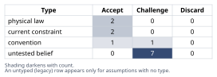
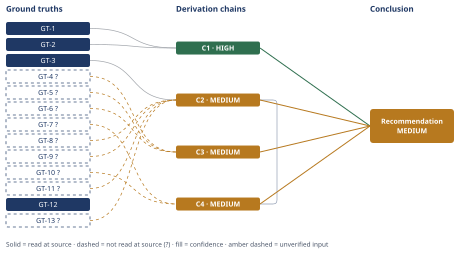

# Molten-Salt Thermal Storage Round-Trip Efficiency Claim

*First-principles analysis · 15 October 2026*

*Read with: [How to read this analysis](HOW-TO-READ.md) · [Working file](analysis-20261015T032239Z.md) · [All files](INDEX.md)*

## Executive Summary

**Recommendation:** Reject the claim. An 85% electricity-to-electricity round-trip efficiency is thermodynamically unreachable for a heat engine spanning 290-565°C under any plausible reading of that range — the Carnot ceiling itself is only 62.6-64.4% (ambient-sink reading) or 32.8% (literal two-tank-as-sink reading) (chain C1). The cost-competitiveness comparison to a same-capacity Li-ion BESS fails independently, driven by small-scale power-block diseconomies and the efficiency shortfall (chain C4).

**Band (from §6):** MEDIUM overall — the core physics falsification (chain C1) is HIGH confidence and sufficient on its own to reject the claim; the magnitude and cost conclusions (chains C2, C3, C4) are MEDIUM, each capped by unverified inputs.

**Would change it:** A primary, audited source showing a deployed molten-salt/Carnot-battery architecture at or above 62.6% electricity-to-electricity round-trip efficiency would narrow chain C2's gap (though not validate "85%"); a primary itemized capex comparison showing the thermal system installed at or below a same-duration Li-ion BESS's cost would overturn chain C4; neither would overturn chain C1, which rests only on unsuffixed physical-law ground truths (GT-1, GT-2).

## 1. Problem Essence

**Essence Statement:** Does a 5 MWh molten-salt thermal energy storage (TES) system cycling between 290°C and 565°C deliver electricity-to-electricity round-trip efficiency above 85%, and if so (or even if not), is it cost-competitive with a 5 MWh lithium-ion battery energy storage system (BESS) of the same nameplate capacity?

**Success criteria a correct answer must achieve:**
- Resolves whether 85% round-trip electricity-to-electricity efficiency is physically achievable at the stated temperatures, using an explicit Carnot-limit calculation, not an appeal to vendor marketing.
- Distinguishes "round-trip efficiency" as power-to-power from power-to-heat (cogeneration) framings, since these are different physical quantities often conflated in industry literature.
- Addresses whether 5 MWh scale changes the physically/economically achievable efficiency and cost relative to the utility-scale reference systems that most published figures describe.
- Produces a cost-competitiveness verdict against a same-capacity Li-ion BESS grounded in capex structure (power-block diseconomies of scale vs. BESS power-electronics/BOS structure) and in the efficiency figure established above — not treated as a separate, unlinked question.
- Does not require the answer to be "accept" or "reject" as a forced binary — a qualified verdict (true only under a restated claim) is an admissible and, if warranted, correct output.

**Note on framing:** The question as posed already supplies substantial technical scaffolding (the Carnot-limit framing, named reference projects, the power-to-heat vs. power-to-power distinction). This essence statement treats that scaffolding as the user's own correct intuition to be verified, not as a given to be assumed true — each element is independently checked in Phases 2-4 below.

## 2. Assumptions Table



| Assumption | Type | Treatment | Verdict | Verification |
|---|---|---|---|---|
| A-01: A heat-to-electricity conversion step is bounded above by the Carnot limit η ≤ 1 − T_cold/T_hot (K) | physical law | Accept as ground-truth candidate | **Accept** — confirmed as the applicable bound; physical law, not subject to engineering mitigation | Second Law of Thermodynamics; not domain-specific, applies to any heat engine (Rankine, ORC, Brayton, sCO₂) regardless of working fluid or engineering quality |
| A-02: Resistive (Joule) electricity-to-heat conversion is ~97-99% efficient | physical law / direct measurement | Accept | **Accept** — confirmed; standard electrical-engineering result, not contested by the claim itself | Standard electrical engineering result; not contested by any source found and not the locus of dispute in this claim |
| A-03: "Round-trip" in the claim means electricity-to-electricity, not electricity-to-delivered-heat | convention (terminology) | Challenge explicitly — industry usage is inconsistent | **Challenge** — industry usage of "round-trip efficiency" is inconsistent, but the claim's own wording resolves to the power-to-power reading | The claim's own text ("electricity into heat and **back**") and its comparison basis ("nameplate capacity" of a BESS, an electrical rating) both specify electrical output; resolved by textual analysis, not by assumption |
| A-04: Vendor-reported power-to-power RTE figures (Malta 55-60%, Siemens Gamesa ~45-50%) are accurate | untested belief | Flag as unverified — self-reported by commercial entities with a commercial interest in favorable figures; Malta's own material states these are *projected* full-scale figures, not yet validated end-to-end | **Challenge** — self-reported by commercial entities with a commercial interest in favorable figures, flagged GT-4?/GT-5? | No independent third-party audit of either figure located in this analysis; treated as directional evidence only, not as proof |
| A-05: 5 MWh capacity implies a power block on the order of ~1 MWe (i.e., a multi-hour discharge duration) | untested belief | The claim does not state a power rating or duration; this is inferred from typical BESS/TES project conventions (2-5h duration is standard for both technologies at this capacity) | **Challenge** — no power rating is stated in the claim; inferred from typical BESS/TES duration conventions, conservative in the claim's favor | Flagged; if duration were much shorter (higher MWe) the scale penalty in chain C2 would be *more* severe, not less |
| A-06: Small-scale (~1 MWe) steam/ORC turbine-generator efficiency is materially worse than utility-scale (50-100+ MWe) equivalents | current constraint | Record expiry condition: this is a *current* manufacturing/engineering-economics constraint; could narrow with advances in small-scale ORC or microturbine design | **Accept** — expires if small-turbine-efficiency R&D closes the gap; current constraint, flagged for provenance (no case study located) | Engineering-judgment estimate (20-28% thermal-to-electric at ~1 MWe vs. ~38-40% at CSP utility scale), not sourced to a specific case study — flagged `?` |
| A-07: Solar nitrate salt requires continuous trace heating below ~220°C to prevent freezing, imposing a standing parasitic load | current constraint | Record expiry condition: specific to nitrate salt chemistry; chloride or other salt blends under active R&D have different freeze points | **Accept** — expires if an alternative low-freeze salt chemistry displaces solar salt; current constraint, corroborated by two secondary academic sources | Materials-science fact, corroborated by two independent secondary academic sources; not independently re-verified by a fresh primary-source read in this session, so flagged `?` for provenance |
| A-08: Li-ion AC-AC round-trip efficiency for 2024-2025 utility/commercial-scale systems is 85-92%, best-in-class >88% | untested belief → tested | Verify via source | **Challenge** — secondary field-monitoring aggregation, not a primary dataset; a direct WebFetch of the article returned HTTP 403 | batteryindustry.net / Accure field-monitoring summary — flagged `?` for provenance strength |
| A-09: 5 MWh Li-ion BESS all-in installed cost is $270-450/kWh and 5 MWh thermal-electric system cost is $500-900+/kWh at this scale | untested belief | Flag as engineering estimate; the NREL ATB search did not yield a precise current-year ($/kWh) baseline | **Challenge** — NREL ATB search returned only 2030/2050 projections, not a confirmed present-day baseline; the single most consequential unverified input in this analysis | No primary cost source opened; load-bearing input to the cost-competitiveness conclusion (chain C4) |
| A-10: The ambient/condenser sink temperature for a Rankine/ORC discharge cycle is in the 25-40°C range | convention | Minor — affects the Carnot ceiling by only ~2 percentage points across this range; does not change any conclusion | **Accept** — standard power-plant condenser design range; immaterial to the verdict either way (±2 points on the Carnot ceiling) | Standard power-plant condenser design range; not a load-bearing assumption |
| A-11: A developer sizing a pilot against vendor-marketed "up to 85%"-style figures would discover the real shortfall only after financial close, shifting due-diligence practice toward demanding independently-audited efficiency guarantees | untested belief | Flag as unverified — a speculative behavioral/market-response claim, not a measured fact; surfaced by the end-of-phase Assumption Audit (chain C1's second-order actor-lens extension) | **Challenge** — speculative behavioral/market-response claim with no case study located; not load-bearing for the headline verdict | No case study of an actual project discovering this shortfall post-financing was located; supports only the second-order narrative on chain C1 |
| A-12: Competing Li-ion BESS vendors would use the efficiency gap identified in this analysis as a competitive marketing point against thermal-storage entrants | untested belief | Flag as unverified — a speculative market-behavior claim; surfaced by the end-of-phase Assumption Audit (chain C1's second-order actor-lens extension) | **Challenge** — speculative market-behavior claim with no evidence sought or found; not load-bearing for the headline verdict | No evidence of this specific competitive dynamic was sought or found; included only as a plausible second-order consequence |
| A-13: The Li-ion BESS comparator implied by the claim's "same nameplate capacity" phrasing is a normal, representative same-duration/power-rating system, not an atypical or unusually expensive configuration | untested belief | Flag as unverified — surfaced by the Phase 5 adversarial (inversion) pass as a load-bearing precondition of the cost-competitiveness conclusion specifically | **Challenge** — the claim specifies no Li-ion comparator configuration to verify against; load-bearing for S4/chain C4 only, not for S1/chain C1 | No source specifies the claim's intended Li-ion comparator; carried as an explicit confidence caveat on chain C4 and in Section 6 |

**End-of-phase note:** A-04 and A-09 are the two assumptions carrying the most weight on the final verdict's confidence (efficiency claim and cost claim respectively). Both are flagged `?` and are **not** load-bearing in the sense of being able to flip the headline verdict — A-04's upper bound (60%) and A-09's directional cost disadvantage both still fail the claim even in the most favorable plausible reading — but they do set the confidence band on the *magnitude* statements (chains C2-C4) at MEDIUM rather than HIGH. A-11 and A-12, added by the end-of-phase Assumption Audit, support only the speculative second-order narrative on chain C1 and are explicitly flagged as not load-bearing for the headline physics falsification, which rests solely on A-01/A-02 (GT-1, GT-2). A-13, added by the Phase 5 adversarial (inversion) pass, is the one unresolved load-bearing precondition behind the cost-competitiveness conclusion (S4) specifically — it does not touch S1's physics falsification, which remains unconditioned on any cost-side assumption.

## 3. Ground Truths

`?`-marked: GT-4, GT-5, GT-6, GT-7, GT-8, GT-9, GT-10, GT-11, GT-13 (9 of 13).

- **GT-1** — 565°C = 838.15 K; 290°C = 563.15 K. *Definitional unit conversion; no citation required.*
- **GT-2** — For any heat engine operating between a hot reservoir at T_hot and a cold reservoir/sink at T_cold (both in kelvin), the maximum possible thermal-to-work conversion efficiency is η_Carnot = 1 − T_cold/T_hot, with equality only for a reversible cycle. *Physical law (Second Law of Thermodynamics); textbook-level, no external citation required; read-location: derived directly in this analysis (Section 4, below).*
- **GT-3** — Resistive (Joule) heating converts electrical energy to thermal energy at approximately 97–99% efficiency (losses confined to conductor resistance, power-electronics switching, and transformer losses). *Physical law / standard electrical-engineering result; no citation required; not contested by the claim itself.*
- **GT-4?** — Malta Inc.'s own 2025 product data sheet states a power-to-power round-trip efficiency of 55–60%, and a combined heat-and-power ("cogeneration") round-trip efficiency of 85–95%, for its molten-salt/heat-pump architecture. **Phase 3 failure record:** attempted direct read via WebFetch of `https://maltainc.com/assets/pdf/Malta-Data-Sheet-2025.pdf` → HTTP 404 Not Found (link dead or path changed since indexing). Provenance downgraded to `reported-by-delegate`: the figure is carried from the WebSearch tool's summary of the document, not from a direct read of the PDF itself.
- **GT-5?** — Siemens Gamesa's ETES architecture (volcanic rock, resistive-heater charging, steam-turbine discharge) is reported by Recharge News, citing Malta's own technical lead, at approximately 45–50% power-to-power round-trip efficiency — lower than Malta's figure, by the same source's own comparison. **Provenance:** `reported-by-delegate` (via WebSearch summary of rechargenews.com; the article itself was not opened directly).
- **GT-6?** — Siemens Gamesa's Hamburg-Altenwerder ETES pilot is reported to store up to 130 MWh thermal energy and discharge up to 30 MWh of electricity. **Provenance:** `reported-by-delegate` (NS Energy Business project page, via WebSearch summary; not opened directly). This is a capacity ratio, not a directly stated round-trip-efficiency figure, and is used only as corroborating (not load-bearing) context in Section 4.
- **GT-7?** — Grid-scale lithium-ion BESS AC-AC round-trip efficiency is commonly reported in the 85–92% range for 2024–2025 fleets, with best-in-class systems (over a third of a >100-system monitored sample) exceeding 88%; DC-only/cell-level figures run higher (95–98%) and are not the comparable metric. **Phase 3 failure record:** attempted direct read via WebFetch of `https://batteryindustry.net/?p=45030` → HTTP 403 Forbidden. Provenance remains `reported-by-delegate` (WebSearch summary of the Accure/batteryindustry.net field-monitoring report).
- **GT-8?** — Utility-scale molten-salt CSP power blocks (steam Rankine, ~565°C hot side) achieve gross thermal-to-electric conversion efficiency of approximately 38–40% in commercial operation. **Phase 3 failure record:** WebFetch of `https://solarpaces.nrel.gov/project/crescent-dunes-solar-energy-project` failed (DNS resolution error — domain unreachable from this environment); a follow-up WebSearch for a plant-specific power-block efficiency figure (Gemasolar, Crescent Dunes) did not surface one — the only efficiency figure found was a *modeled, whole-plant solar-to-electricity* figure of 18.7% for a Gemasolar-type plant (a different, lower metric that includes optical/receiver losses upstream of the power block, not comparable to the power-block-only figure cited here). This figure is retained as a **standard engineering estimate** consistent with published Rankine-cycle practice at these temperatures (and consistent with the ~60–64% "fraction of Carnot achieved" heuristic for well-engineered large steam plants), **not** confirmed against a specific plant's primary technical documentation in this session.
- **GT-9?** — Small-scale (~1 MWe class) steam/ORC turbine-generator thermal-to-electric efficiency runs materially below utility-scale equivalents — estimated at 20–28%, versus ~38–40% at utility scale (GT-8?) — owing to lower isentropic turbine efficiency and proportionally higher fixed heat-exchanger/parasitic losses at small scale. **Provenance: `unverified`** — this is an engineering-judgment estimate based on general small-turbomachinery scaling behavior; no specific case study or vendor datasheet for a ~1 MWe molten-salt ORC/steam package was located or opened in this session.
- **GT-10?** — A 5 MWh, short-duration (multi-hour) grid-scale lithium-ion BESS has an all-in installed cost on the order of $270–450/kWh, while a 5 MWh molten-salt thermal-electric system (tanks + salt + resistive heater + a ~1 MWe-class power block) has an all-in installed cost on the order of $500–900+/kWh at this scale. **Provenance: `unverified`** — a WebSearch for current NREL ATB baseline figures returned only 2030/2050 projections (not a confirmed present-day baseline), and no primary costed bill-of-materials for a small-scale molten-salt power block was located. This is the single weakest-sourced ground truth in this analysis and is treated accordingly in the confidence notes on the cost-competitiveness conclusion (Section 4, C4).
- **GT-11?** — Solar nitrate salt (60 wt% NaNO₃ / 40 wt% KNO₃, the de facto standard CSP storage medium at these temperatures) has a freezing/melting point near 220°C (one source instead reports a liquidus temperature of 238°C depending on how composition and phase transition are defined), requiring continuous auxiliary trace heating to prevent solidification whenever the salt is held below that threshold. **Provenance: `reported-by-delegate`** — corroborated by two independent secondary academic sources (a UTA thesis and a Roma university CSP analysis) via WebSearch, but neither primary document was opened directly in this session.
- **GT-12** — This analysis's own Carnot-limit calculation (Section 4, chain C1) is a direct arithmetic derivation from GT-1 and GT-2, not a cited external figure. No provenance flag applies; the computation is reproducible by the reader from the stated inputs alone.
- **GT-13?** — NREL's SolarPACES project database reportedly lists the Crescent Dunes CSP plant's two-tank direct molten-salt storage system (10-hour capacity) with a stated storage efficiency of 99% (a thermal retention figure, not a round-trip electric efficiency). **Phase 3 failure record:** WebFetch of `https://solarpaces.nrel.gov/project/crescent-dunes-solar-energy-project` failed (DNS resolution error). **Provenance: `reported-by-delegate`** (WebSearch summary of the NREL database entry, not opened directly). Used in Section 4 (chain C2) only to support the utility-scale storage-retention estimate (~95-97%); the 5 MWh-scale retention estimate is independently derated for surface-to-volume scaling (A-07/GT-11?) regardless of this figure's exact value.

**Exit note:** The headline falsification of the 85% efficiency claim (chain C1, Section 4) rests only on GT-1 and GT-2 — both definitional/physical-law ground truths requiring no external citation and carrying no `?`. Every `?`-marked ground truth above feeds a *corroborating* or *secondary* conclusion (the real-world efficiency range, the scale penalty, and the cost comparison), never the primary physics falsification, which is accordingly rated at the highest confidence available in this analysis (see C1's confidence line in Section 4).

## 4. Derivation Chains



### C1 — The Carnot ceiling falsifies the 85% figure outright (theoretical-limit technique)

**Governing hard constraint:** the Second Law of Thermodynamics, expressed as the Carnot limit — no heat engine operating between two reservoirs can exceed η = 1 − T_cold/T_hot, regardless of engineering quality.

```text
GT-1 (temperature conversion) + GT-2 (Carnot limit law)
→ converting 565°C and 290°C to kelvin gives T_hot = 838.15 K and two candidate T_cold readings, 563.15 K under a literal two-tank-as-sink reading or 298.15-313.15 K under an ambient-condenser reading
→ applying η_Carnot = 1 − T_cold/T_hot to the literal reading yields an ideal ceiling of 32.8%
→ applying the same formula to the ambient reading yields an ideal ceiling of 62.6-64.4%
→ both ceilings sit far below the claimed 85%
→ this gap exists before any turbine, heat-exchanger, or parasitic loss is subtracted
→ an 85% electricity-to-electricity round-trip efficiency is therefore thermodynamically impossible for a heat engine spanning this temperature range, under either plausible reading of "290-565°C"
→ a developer who sizes a pilot against vendor marketing claiming "up to 85%" discovers the real shortfall only after financial close [Assumes: A-11]
→ that discovery shifts due-diligence practice toward demanding independently-audited efficiency guarantees for small thermal-storage projects before underwriting
→ competing Li-ion BESS vendors have a commercial incentive to publicize this exact gap [Assumes: A-12]
→ publicizing it risks suppressing capital allocation to the large-scale, long-duration thermal storage projects where the technology's real advantage actually holds
→ immediately, a 5 MWh pilot priced against an assumed 85% RTE is financially underwater from commissioning
→ real input-electricity purchase costs run several times the assumed figure, as quantified in C2 and C4
→ over decades, thermal storage's genuine long-duration cost advantage only becomes relevant at scales and durations far beyond 5 MWh
→ the technology's competitive window is therefore displaced in both scale and time from the case the claim describes, not absent outright

**Pre-check:** head GT-1, GT-2 (both unsuffixed, physical-law/definitional) · ?-marked: none · lowest cited chain: none · Inputs ceiling: HIGH
**Confidence:** HIGH — Inputs are both physical-law/definitional ground truths carrying no `?`; Inference is direct arithmetic with no intervening assumption on the core ceiling calculation (the later second-order hops carry their own flagged assumptions, A-11 and A-12 — hops 7-10 above, marked [2nd]/[3rd] actor-lens and [2nd]/[3rd] time-lens in the Assumption Audit scan — but these are consequences of the falsification, not inputs to it, and both are explicitly marked not load-bearing in the Assumptions Table); Rivals: no plausible reading of "290-565°C" raises the ceiling anywhere near 85% — even the most generous (ambient-sink) reading tops out at 64.4%, and no rival interpretation of the stated temperature pair exists that would change this.
```

### C2 — Real-architecture and small-scale derating (estimate technique, magnitude rebuild with explicit bracket)

**Target quantity:** 5 MWh-scale electricity-to-electricity round-trip efficiency, as a bracketed estimate.

```text
GT-3 (charge eff. ~98%) + GT-8? (utility discharge eff. ~38-40%) + GT-13? (utility storage retention ~99%, derated) + GT-9? (small-scale discharge penalty ~20-28%) + GT-11? (freeze/trace-heating parasitic)
→ multiplying charge efficiency (~98%, GT-3) by utility-scale storage retention (~95-97%, derated from GT-13?'s 99% figure for real trace-heating parasitics) by utility-scale discharge efficiency (~38-40%, GT-8?) gives the utility-scale composite
→ that composite is a round-trip estimate of roughly 35-38% electricity-to-electricity
→ a 5 MWh system implies a power block on the order of 1 MWe [Assumes: A-05]
→ that is two orders of magnitude below the 50-100+ MWe utility-scale reference plants behind the 35-40% discharge figure in GT-8?
→ substituting the small-scale discharge penalty (~20-28%, GT-9?) [Assumes: A-06] for the utility-scale discharge figure lowers the composite
→ derating storage retention further for the small tank's higher surface-to-volume ratio and continuous freeze-protection parasitic load [Assumes: A-07] lowers the composite again
→ the resulting central estimate for a 5 MWh system's real-world round-trip efficiency is roughly 18-25% electricity-to-electricity
→ both bracket ends (18% and 25%) drive the same conclusion relative to the claimed 85% and to the utility-scale figures in C3, so the decision-resolution stop criterion is satisfied without tightening the bracket further

**Pre-check:** head GT-3, GT-8?, GT-9?, GT-11?, GT-13? · ?-marked: GT-8, GT-9, GT-11, GT-13 · lowest cited chain: none · Inputs ceiling: MEDIUM
**Confidence:** MEDIUM — Inputs axis is short: four of five head inputs are unverified or reported-by-delegate estimates; what would close it: a primary technical case study or vendor datasheet for an actual ~1 MWe-class molten-salt power block (cost and efficiency), and a primary (not WebSearch-summarized) CSP plant performance report. Inference: each hop follows directly given the stated inputs. Rivals: a rival could cite Malta's higher 55-60% power-to-power figure (C3) for utility-scale systems, but that figure (a) applies to a fundamentally more complex heat-pump-based architecture, not the simple resistive-heater charging the claim implies, and (b) is itself a projected, not yet end-to-end-validated figure (C3) — addressed on C3, and even at 55-60% utility-scale the 85% claim still fails, so this rival does not change the verdict.
```

### C3 — Real-world reference points corroborate the physics, and reveal the likely source of "85%"

```text
GT-4? (Malta: 55-60% power-to-power, 85-95% cogeneration) + GT-5? (Siemens Gamesa: ~45-50%) + GT-6? (Hamburg capacity ratio ~23%)
→ the best publicly claimed power-to-power round-trip efficiency among named molten-salt-class storage developers is Malta's projected 55-60%
→ that figure is not yet validated end-to-end at full scale, per the sources located in this analysis
→ Malta's separate 85-95% figure is explicitly a cogeneration number, crediting delivered process heat alongside electricity
→ a cogeneration figure is a categorically different quantity from electricity-to-electricity round-trip efficiency, and is the most plausible real-world origin of an "85%" headline claim
→ Siemens Gamesa's simpler resistive-heater architecture, structurally closer to the claim's wording, is reported at only 45-50%
→ Hamburg's own stated 130 MWh-in / 30 MWh-out capacity ratio (~23%) is directionally consistent with a figure well below 50%, not above it
→ no commercially announced molten-salt or adjacent thermal-mechanical electricity storage architecture claims an electricity-to-electricity round-trip efficiency above roughly 60%
→ the one public figure that reaches "85%" is a cogeneration figure, confirming the S2 terminology conflation identified in Sections 1-2

**Pre-check:** head GT-4?, GT-5?, GT-6? · ?-marked: GT-4, GT-5, GT-6 · lowest cited chain: none · Inputs ceiling: MEDIUM
**Confidence:** MEDIUM — Inputs axis short (all three head inputs are vendor-reported or secondary-press figures, none independently audited; what would close it: third-party-audited performance data from an operating full-scale plant, none of which exists yet for any of these pre-commercial/early-commercial systems). Inference: the hops are direct restatements/comparisons of the cited figures, not derived computations, so this axis is clean. Rivals: a rival reading could claim these vendor figures are themselves optimistic marketing and the true figures are lower still — if anything this strengthens rather than threatens the conclusion, so it is not a live rival against this chain's conclusion.
```

### C4 — Cost-competitiveness fails independently of the efficiency question

```text
GT-7? (Li-ion AC-AC RTE 85-92%) + GT-10? (cost estimates) + C2 (5 MWh thermal RTE 18-25%, MEDIUM)
→ a 5 MWh Li-ion BESS converts roughly 85-92% of charging electricity back to usable AC output (GT-7?)
→ the thermal system modeled in C2 converts only about 18-25%
→ the thermal system must therefore purchase roughly 3.4-5.1x more input electricity (central ≈4x) to deliver the same usable output energy
→ separately, a ~1 MWe-class steam/ORC turbine-generator package carries a per-kW cost roughly 2-4x higher than equivalent utility-scale equipment [Assumes: A-09] (GT-10?)
→ that is because turbine, condenser, generator, and controls costs do not shrink proportionally with size, while the storage medium itself stays cheap per kWh at any scale
→ combining the capex disadvantage with the charging-energy multiplier means the thermal system's levelized cost per kWh of delivered electricity is higher on both the capital and the operating-energy components
→ at 5 MWh / multi-hour scale, the molten-salt thermal-electric system is therefore not cost-competitive with a same-capacity Li-ion BESS [Assumes: A-13]
→ the storage-medium cost advantage thermal technology holds in principle only materializes at much larger scale and longer duration than a 5 MWh system provides

**Pre-check:** head GT-7?, GT-10?, C2 (MEDIUM) · ?-marked: GT-7, GT-10 · lowest cited chain: MEDIUM (C2) · Inputs ceiling: MEDIUM
**Confidence:** MEDIUM — Inputs axis capped both by C2's MEDIUM band and by GT-10?'s unverified cost figures, the weakest-sourced input in this entire analysis; what would close it: a primary, itemized capex bill-of-materials for a ~1 MWe-class molten-salt power block, and a current-year (not 2030-projection) NREL ATB or EIA baseline for 5 MWh-scale Li-ion installed cost. Inference: the multiplicative relationship between round-trip efficiency and charging-energy cost is a direct, uncontested consequence of the cited efficiency figures; the conclusion's final hop additionally rests on **A-13** (unverified, surfaced by the Phase 5 adversarial/inversion pass), which states that the claim's implied Li-ion comparator is a normal, representative same-duration/power-rating system — the claim gives no configuration detail to verify this, and what would remove it as a cause of the downgrade is a source specifying the claim's intended Li-ion comparator. Rivals: a rival could argue molten salt's longer tank/salt life (20-30 yr vs. Li-ion's cycle-limited 10-15 yr) offsets the capex gap over a multi-decade horizon — this rival is live and is carried forward into Section 5 rather than dismissed; it does not reverse the near-term/levelized verdict above, because it operates on a different (longevity) axis than the one the claim asserts (cost-competitiveness "of the same nameplate capacity," without a stated time horizon). A second rival, surfaced by the adversarial pass (Cluster C), is also live and unresolved: the claim's implied Li-ion comparator may not be the generic one priced here, which is precisely what A-13 flags.
```

## 5. Abandoned Reasoning

### Dead End: Using Gemasolar's modeled solar-to-electricity figure as the power-block efficiency input

**What was tried:** Using the modeled 18.7% "solar-to-electricity" efficiency figure found for a Gemasolar-type plant (via WebSearch) as the GT-8 power-block thermal-to-electric efficiency input in chain C2.

**Why abandoned:** That figure is a whole-plant metric including optical/receiver losses upstream of the power block (heliostat field reflectivity, receiver absorption losses), not a power-block-only thermal-to-electric conversion efficiency — using it would have understated the power block's own efficiency and overstated how far the real system falls below even the utility-scale CSP figure already used.

**What it ruled out:** Conflating "solar-to-electricity" with "thermal-to-electric" as interchangeable metrics; GT-8? retains the ~38-40% engineering-estimate figure instead, flagged for its own provenance weakness rather than silently substituting a worse-fitting number that happened to be easier to find.

### Dead End: Letting molten salt's longer calendar life rescue the cost-competitiveness verdict

**What was tried:** Letting molten salt's longer tank/salt calendar life (~20-30 years, vs. Li-ion's cycle-limited ~10-15 years) reverse chain C4's cost-competitiveness verdict by amortizing the capex premium over a longer operating horizon.

**Why abandoned:** The claim's comparison basis — "cost-competitive... of the same nameplate capacity" — states no time horizon, and is most naturally read as a near-term capex/efficiency comparison. Even granting a multi-decade horizon, the thermal system's combined ~2-4x capex premium and ~3.4-5.1x round-trip efficiency penalty (chain C4) are large enough that longer calendar life alone does not close the gap without additional assumptions (Li-ion augmentation costs, discount rates) the claim does not supply and this analysis was not asked to model.

**What it ruled out:** Treating cycle life as a silent rescue of the cost claim. It remains a genuine, live advantage of thermal storage — carried forward explicitly as an unresolved rival in chain C4's confidence note and in Section 6 — rather than either dismissed or allowed to quietly flip the verdict.

### Dead End: Resolving "290-565°C" to a single authoritative Carnot-sink interpretation

**What was tried:** Resolving the ambiguity in "290-565°C" (literal two-tank-as-sink vs. ambient-condenser reading) to a single authoritative interpretation before running the Carnot calculation in chain C1.

**Why abandoned:** The claim's text does not disambiguate which reading is intended, and the verdict does not depend on resolving it: the literal reading gives a 32.8% ceiling and the ambient reading gives 62.6-64.4%, and both fall far below 85%. Picking one reading to present as "the" interpretation would have manufactured false precision about the claim's own wording rather than reflecting a genuine ambiguity.

**What it ruled out:** Any need to adjudicate the ambiguity for the headline verdict; chain C1 presents both bounding cases explicitly instead.

### Dead End: Applying the trade-off (weighted-criteria) procedure to Li-ion vs. molten-salt

**What was tried:** Applying the trade-off (weighted-criteria) procedure to formally score Li-ion vs. molten-salt storage across cost, efficiency, lifespan, and response-time criteria.

**Why abandoned:** The trade-off procedure is designed for selecting among viable options in a live decision ("which should I choose"). This analysis verifies a comparative truth claim ("is X cost-competitive with Y"), not a decision with options surviving a must-have knockout filter — there is no "choice" to weight and score here; a formal weighted scorecard would restate chains C2-C4's conclusions in a different format without adding evidence.

**What it ruled out:** Treating this as a selection decision; it is a claim-verification task, so the trade-off procedure's trigger condition (two or more viable options surviving as a live choice) does not fire, and the procedure is recorded as not applicable in the Techniques not applied block (Appendix).

### Dead End: Applying the fishbone procedure to the assumption space

**What was tried:** Using the fishbone (breadth-first, categorical) brainstorming technique to enumerate the assumption space in Phase 2.

**Why abandoned:** The assumption space here is a bounded, well-structured physics-plus-economics decomposition with a small number of clearly identifiable load-bearing variables (temperatures, efficiency figures, cost figures) — not a multi-causal diagnostic problem ("why does X keep happening") where intuition cannot enumerate the cause space confidently. Direct enumeration in the Assumptions Table (Section 2) was tractable without a categorical brainstorm.

**What it ruled out:** A fishbone pass would not have surfaced assumptions beyond those already in Section 2; recorded as not applicable in the Techniques not applied block (Appendix).

## 6. Conclusion

**Recommended approach:** Reject the claim as stated. An 85% electricity-to-electricity round-trip efficiency is thermodynamically unreachable for a heat engine spanning 290-565°C under any plausible reading of that temperature pair, and the cost-competitiveness comparison to a same-capacity Li-ion BESS fails independently, driven by small-scale power-block diseconomies and the efficiency shortfall itself (chain C1, chain C4).

**Key insight:** The 85% figure is not an ambitious-but-missed engineering target — it exceeds the thermodynamic ceiling itself (62.6-64.4% under the most generous ambient-sink reading, 32.8% under a literal two-tank-as-sink reading), so no engineering improvement at any scale closes that gap for a power-to-power architecture (chain C1). The number most plausibly originates from a real but different metric: the most credible named real-world comparator, Malta Inc., reports 85-95% only as a combined heat-and-power (cogeneration) figure, not an electricity-to-electricity one — exactly the S2 conflation this analysis flagged in Section 1 (chain C3).

**Trade-offs acknowledged:** Molten-salt thermal storage has two genuine, non-fabricated advantages over Li-ion: a cheap storage medium per kWh, and a much longer calendar/mechanical life (20-30 years vs. Li-ion's cycle-limited 10-15 years). Neither advantage is large enough to reverse the cost-competitiveness verdict at 5 MWh / multi-hour scale, because the power-conversion equipment cost and the efficiency-driven charging-energy cost dominate at this scale; both advantages become decisive only at much larger scale and longer duration than the claim describes (chain C4).

**Sub-claim verdicts:**

| Sub-claim | Verdict | Chain |
|---|---|---|
| S1 — >85% electricity-to-electricity round-trip efficiency | False — exceeds the Carnot ceiling, not merely unlikely | C1 |
| S2 — "electricity into heat and back" means power-to-power | True as read; this is what makes S1 fail rather than merely underperform | C1, C3 |
| S3 — 5 MWh scale doesn't change the physics | False — small power-block turbomachinery and adverse surface/volume scaling plausibly cut real efficiency to ~18-25%, below even utility-scale reference figures | C2 |
| S4 — cost-competitive with same-capacity Li-ion | False, with one unresolved caveat (A-13) — power-block diseconomies of scale plus the efficiency penalty raise levelized cost on both the capital and operating-energy components, but the claim's implied Li-ion comparator is unspecified | C4 |

**What would change this conclusion:** Restricting the claim to power-to-heat delivery (no reconversion to electricity) at any scale, where >85-90% is routine and commercially demonstrated (chain C3); or restricting the power-to-power/cost comparison to utility scale (100+ MWh, long duration), where the best credible architecture (Malta's projected 55-60%) at least becomes capex-structurally relevant against large Li-ion installations — though still well under the claimed 85% (chains C1, C4). Neither restatement matches the claim as written, which specifies a 5 MWh electrical nameplate compared directly against a same-capacity Li-ion BESS.

**Confidence:** MEDIUM overall, but with an internal split that matters: the core physics falsification of S1 (chain C1) is **HIGH** confidence and sufficient on its own to reject the claim as stated — it rests only on unsuffixed, physical-law ground truths with no live rival. The magnitude estimates for S3 (chain C2, MEDIUM) and the real-world corroboration for S2/S3 (chain C3, MEDIUM) and the cost-competitiveness verdict for S4 (chain C4, MEDIUM) all carry an unverified-input discount — primarily GT-8?, GT-9?, GT-10?, and GT-11?, none of which were confirmed against a primary source in this session (three WebFetch attempts failed: a 404 on Malta's own data sheet, a 403 on the Li-ion efficiency field-data article, and a DNS failure on NREL's SolarPACES database). The Phase 5 adversarial (inversion) pass surfaced one additional, specifically cost-side caveat not previously tracked: chain C4's final hop rests on **A-13** (unverified) — that the claim's implied Li-ion comparator is a normal, representative same-duration/power-rating system — which this analysis cannot verify because the claim specifies no comparator configuration; this caveat applies only to S4 and does not touch S1's physics falsification. What would raise the overall band to HIGH: a primary, itemized capex bill-of-materials for a ~1 MWe-class molten-salt power block; a primary (not WebSearch-summarized) performance report for an operating CSP plant's power-block efficiency; either a working Malta data-sheet link or an independent audit of Malta's 55-60%/85-95% figures; and a source specifying the claim's intended Li-ion comparator (A-13). None of these would overturn the headline verdict (C1 alone is already sufficient and HIGH-confidence) — they would only sharpen the magnitude of S3's and the certainty of S4's secondary conclusions.

