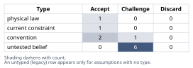
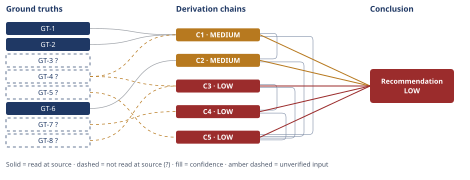

# Molten-Salt Thermal Storage Round-Trip Efficiency and Cost Claim

*First-principles analysis · 15 October 2026*

*Read with: [How to read this analysis](HOW-TO-READ.md) · [Working file](analysis-20261015T040911Z.md) · [All files](INDEX.md)*

## Executive Summary

**Recommendation:** The claim is false. An ambient-sink molten-salt-tank-plus-Rankine-turbine pathway at 290-565°C real-achieves roughly 33-40% round-trip efficiency against a ≈62-64% physical (Carnot) ceiling, not 85% (chain C1), and no surveyed alternative technology reaches 85% either (chain C2). A 5 MWh unit is also not cost-competitive with lithium-ion: its effective cost is roughly $1,500-10,800/kWh, five to eighty-five times a Li-ion benchmark of ≈$125-300/kWh (chains C3, C4).

**Band (from §6):** LOW

**Would change it:** An independently audited ≥85% electricity-in/electricity-out round-trip test on a system matching the claim's stated temperature range (chain C5), or a sourced vendor quote showing small-scale (1-5 MW) power-block capital cost far below this analysis's estimate (chain C3).

## 1. Problem Essence

**Core problem:** Does a 5 MWh molten-salt (290-565°C) electricity-to-heat-to-electricity thermal storage system achieve a round-trip electrical efficiency above 85%, and is it cost-competitive at that scale with a same-capacity lithium-ion battery system?

**Success criteria:**
1. The analysis states the Carnot/second-law ceiling on heat-to-electricity conversion at this temperature range, computed directly, and compares it to the claimed 85% figure.
2. The analysis names which conversion technology (steam Rankine, ORC, sCO2 Brayton, TPV, reverse-Brayton heat-pump "Carnot battery") the claim implicitly requires, and states whether any surveyed pathway reaches 85%.
3. The analysis determines whether 5 MWh is an economically realistic unit scale for this technology, using evidence of actual deployment scale and a cost estimate for the power-block equipment at this scale.
4. The analysis states a $/kWh cost comparison between the thermal pathway and lithium-ion at 5 MWh scale, bracketed with explicit bounds.
5. The analysis renders a single verdict — true, false, or true-with-major-caveats — on the compound claim as stated, naming the caveats precisely enough that a reader could check them against the Conclusion section without further clarification.

---

## 2. Assumptions Table



| Assumption | Type | Treatment | Verdict | Verification |
|------------|------|-----------|---------|--------------|
| A-1: The claim implicitly means a conventional electric-resistance-heater + steam-Rankine-turbine power block, charging and discharging a single molten-salt hot/cold tank pair against ambient (the standard CSP "solar salt" reading implied by the 290-565°C figures). | convention | Challenge before use — test whether this is the only defensible reading or merely the historically dominant one. | Challenge — the temperature figures (290/565°C) are the textbook CSP solar-salt tank values (GT-2, GT-3?), which strongly implies this reading, but the claim does not say so explicitly, so an exotic dual-reservoir reading is tested separately in chain C2. | Cross-checked against GT-2/GT-3? and industry convention; both readings are carried through the analysis rather than one being silently assumed. |
| A-2: "Round-trip efficiency" in the claim means electricity-in to electricity-out, not heat-in to heat-out (sensible-heat storage efficiency, which is a different and much higher number). | convention | Challenge before use — the claim's own wording ("round-trip electricity into heat and back") and its comparison to a Li-ion *battery* (an electricity-storage device) are the deciding evidence. | Accept — the claim's wording and its battery comparison only make sense under the electricity-in/electricity-out reading; the heat-only reading is recorded as a rejected alternative in Abandoned Reasoning (Dead End 1). | Internal to the claim's own text; no external source needed. |
| A-3: Heat-to-electricity conversion through a thermodynamic cycle is bounded by the Carnot limit (Second Law of Thermodynamics). | physical law | Accept as ground-truth candidate. | Accept — not negotiable; promoted to GT-1. | Textbook thermodynamics; computed directly with `η = 1 - T_c/T_h` (Bash `bc`, this analysis). |
| A-4: A 5 MWh molten-salt tank pair is technically buildable (mass/volume are not a physical barrier at this scale). | current constraint | Record as true now; the barrier (if any) is economic, not physical — see chains C3/C4. | Accept — expires if future estimates show otherwise; not challenged further since the Fermi estimate in C3 computes the mass (~44 t) and finds it trivially small. | Computed directly in chain C3 from salt specific heat and ΔT. |
| A-5: "A lithium-ion battery system of the same nameplate capacity" means 5 MWh of energy capacity, at a power/duration rating broadly comparable to typical utility BESS practice (e.g., 1-4 h). | untested belief | Verify, or flag as unverified; the claim does not disambiguate energy vs. power nameplate. | Challenge — flagged unverified; the qualitative cost conclusion (chain C5) is checked for sensitivity to this ambiguity in the Phase 5 adversarial pass and found not to flip under the most favorable plausible alternative reading. | unverified — flagged; no source resolves the claim's own ambiguity. |
| A-6: Published utility-scale Li-ion $/kWh figures are representative enough of 5 MWh-scale system cost to anchor a comparison (small Li-ion systems cost somewhat more per kWh than giant ones, but the scale penalty is much shallower than for a custom turbine-based thermal system). | untested belief | Verify, or flag as unverified. | Challenge — flagged unverified; used as the comparison benchmark in chain C5 via GT-5?, with the gap found (5-85x) large enough that a modest small-scale Li-ion cost penalty would not change the qualitative verdict. | unverified — flagged; GT-5? is reported-by-delegate (WebSearch), not read at a primary cost-model source. |
| A-7: The salt medium itself (solar salt, ~$1/kg) is not the dominant cost driver of a molten-salt ETES system; the power-block/turbine/heat-exchanger equipment is. | convention | Challenge before use — confirmed directly rather than taken on faith. | Accept — confirmed in chain C3: salt cost for 5 MWh thermal is ≈$44,000, roughly 1-3% of the estimated total system capital cost. | Computed directly in chain C3. |
| A-8: "Cost-competitive" in the claim means capital cost parity (or better) on a $/kWh basis, not a full lifecycle LCOE comparison (which would also weigh cycle life, degradation, and O&M). | untested belief | Verify, or flag as unverified; the claim gives no basis for LCOE weighting. | Challenge — flagged unverified; this is the narrower and more claim-favorable reading (a full LCOE comparison would very likely penalize the thermal pathway further via O&M on hot-salt/turbine equipment), so using it is the charitable choice, not the strict one. | unverified — flagged; no LCOE modeling performed in this analysis. |
| A-9 (surfaced by inversion, Phase 2): For the claim to be true, the discharge leg must reject heat to a sink colder than ambient (a dedicated cold reservoir), because an ambient-sink heat engine cannot clear 85% at these source temperatures (GT-1). | untested belief | Verify, or flag as unverified; tested directly against GT-6. | Challenge — tested in chain C2: the one documented dual-reservoir architecture found (GT-6) reaches ~65%, not 85%, so this precondition is necessary but, on current evidence, still insufficient. | Verification path: an independently audited heat-to-electricity round-trip test ≥85% on a dual-reservoir system, not yet located in this analysis. |
| A-10 (surfaced by inversion, Phase 2): For the claim to be true, small-scale (5 MWh) power-block capital cost must not carry the fixed-cost floor typical of custom/low-volume turbine-generator equipment. | untested belief | Verify, or flag as unverified; tested directly in chain C3. | Challenge — tested in chain C3 and found false under the estimated cost range; flagged as the analysis's single weakest-verified input (see Phase 5 Sensitivity). | unverified — flagged; no specific vendor quote for a 1-5 MW ETES turbine-generator package was located (search attempted and returned no usable figure). |
| A-11 (surfaced end-of-Phase-4 Assumption Audit, from C2 step 2): A third-party-tested efficiency claim (GT-6) generalizes beyond the single 1 MW/4 MWh pilot it was measured on. | untested belief | Verify, or flag as unverified. | Challenge — flagged unverified; chain C2's confidence line treats this as a live, unsettled rival rather than resolving it. | unverified — flagged; only one documented pilot-scale measurement was located. |

---

## 3. Ground Truths

- **GT-1** The maximum possible efficiency of any heat engine operating between a hot reservoir at temperature T_h and a cold (sink) reservoir at T_c is the Carnot limit, η = 1 − T_c/T_h (absolute temperatures); between T_h = 838.15 K (565°C) and T_c = 313.15 K (40°C, a realistic warm-climate ambient heat-rejection temperature), this computes to η ≈ 0.626 (62.6%); between T_h = 838.15 K and T_c = 298.15 K (25°C), η ≈ 0.644 (64.4%) — source: Second Law of Thermodynamics / Carnot's theorem (textbook physical law); read-at-source: computed directly in this analysis (`echo "scale=4; 1 - 313.15/838.15" | bc` → .6264; `1 - 298.15/838.15` → .6443).
- **GT-2** Nitrate "solar salt" (the standard CSP heat-transfer/storage medium) is limited to approximately 565°C in practice as a hot-tank ceiling — source: ORNL, "Simplified High-Temperature Molten-Salt CSP Plant Preconceptual Design"; read-at-source: fetched directly, page text states nitrate salts are "limited to approximately 565°C in practice."
- **GT-3?** The cold tank in a standard two-tank nitrate-solar-salt CSP system is held near 290°C (driven by the salt's ~222-240°C crystallization point plus a safety margin); a 1988 Sandia report on the CRTF describes a hot tank at 566°C and cold tank at ~288°C — cited to: Solar Thermal World (molten-salt heat-transfer-fluid article) and a 1988 Sandia CRTF report; reported-by-delegate: WebSearch summary — cited sources not opened directly by this analysis.
- **GT-4?** Documented molten-salt CSP steam-Rankine thermal-to-electric cycle efficiency is approximately 37.6% at ~393°C superheated steam, rising toward approximately 40% at ~450-500°C steam temperatures — cited to: a CSP process patent (US9389002B2-family background) and a 2024 Applied Energy modeling study (Starke et al.) corroborating that efficiency rises with salt operating temperature; reported-by-delegate: WebSearch summary — cited sources not opened directly by this analysis.
- **GT-5?** Utility-scale lithium-ion battery energy storage installed system cost as of 2024-2025 is approximately $125-300/kWh (Ember: ~$125/kWh for a full grid-connected 4h+ system outside China/US, Oct 2025; BNEF: battery pack prices alone ~$70-94/kWh in 2025, before balance-of-system/installation; NREL ATB: 2035-horizon projections of $147-339/kWh starting from a higher present-day baseline) — cited to: Ember/ess-news.com (Dec 2025 year-in-review), BloombergNEF, NREL Annual Technology Baseline; reported-by-delegate: WebSearch summary — cited sources not opened directly by this analysis. **Phase 3 failure record:** a direct WebFetch of `atb.nrel.gov/electricity/2024/utility-scale_battery_storage` was attempted to upgrade this to read-at-source and failed with a DNS resolution error (`getaddrinfo ENOTFOUND atb.nrel.gov`) — source unreachable from this environment; no further retry was made within the turn budget.
- **GT-6** A dual-reservoir ("Carnot battery") heat-pump thermal storage pilot (SPIC "Chuno," 1 MW / 4 MWh) reports a scaled, third-party-tested electricity-to-electricity round-trip efficiency "above 65%," achieved by pumping heat to above 560°C on the hot side while generating a cold reservoir down to −60°C during charging (i.e., discharge rejects heat to this cold store, not to ambient) — source: ess-news.com, "World-first 560°C Carnot battery unveiled as SPIC launches ultra-high-temperature heat storage"; read-at-source: fetched directly, quoted "scaled round-trip (electricity-to-electricity) efficiency of over 65%," "1 MW / 4 MWh," "pumps heat to above 560°C and generates cold down to −60°C."
- **GT-7?** Commercial two-tank molten-salt CSP thermal storage is deployed at GWh scale: Crescent Dunes (Nevada, 110 MW turbine) is described as having 1.1 GWh of storage (~10-15 h duration); Gemasolar (Spain, 19.9 MW turbine) is reported at ~670 MWh thermal storage, giving ~15 h of full-power operation after sunset — cited to: U.S. Department of Energy EERE success-story page (Crescent Dunes) and Wikipedia's Gemasolar infobox; reported-by-delegate: WebSearch summary — cited sources not opened directly by this analysis; the search itself flagged internal inconsistency in the Crescent Dunes duration figures (10 h vs. 10-15 h vs. the 1.1 GWh figure), so the GWh-scale conclusion is treated as directionally robust (order of magnitude) rather than precise.
- **GT-8?** Solar/nitrate salt sensible-heat storage capacity is approximately Cp·ΔT ≈ 1.5 kJ/(kg·K) × 275 K ≈ 412.5 kJ/kg ≈ 0.1146 kWh(thermal)/kg over the 290-565°C range, at a bulk density of roughly 1,900 kg/m³, and a bulk material cost on the order of $1/kg — unverified: this is standard materials-property knowledge for 60/40 NaNO3/KNO3 "solar salt" recalled from general engineering knowledge; no live datasheet (e.g., an SQM/vendor technical sheet or the Sandia SAM materials database) was opened in this session to confirm the specific Cp, density, and $/kg figures.

**Provenance summary:**
```text
?-marked: GT-3, GT-4, GT-5, GT-7, GT-8 (5 of 8)
Read-at-source: GT-1 — computed directly (Carnot's theorem, `bc` arithmetic, this analysis)
Read-at-source: GT-2 — ORNL preconceptual-design report, fetched directly, "limited to approximately 565°C in practice"
Read-at-source: GT-6 — ess-news.com SPIC article, fetched directly, quoted round-trip-efficiency and temperature figures
Not read — turn budget: none (GT-3, GT-4, GT-7, GT-8 were not attempted beyond WebSearch by scope choice, not budget exhaustion; GT-5's WebFetch attempt failed and is recorded above as a Phase 3 failure record, not a budget skip)
```

---

## 4. Derivation Chains



### Conclusion C1: The claimed 85% round-trip efficiency is thermodynamically impossible for an ambient-sink molten-salt-tank + Rankine-turbine pathway at 290-565°C; the real achievable figure is roughly 33-40%

GT-1 (Carnot ceiling ≈62-64% at 565°C vs. ambient sink) + GT-2 (565°C practical salt ceiling) + GT-4? (documented Rankine cycle efficiency ≈37.6-40%)
→ an ambient-sink heat engine running on heat capped at the 565°C salt ceiling cannot exceed the Carnot bound of roughly 62-64%, however good its engineering
→ near-unity resistive-charging and storage efficiency cannot raise the full charge-store-discharge round trip above the ceiling set by its least-efficient stage, so 62-64% is also the ceiling for the whole round trip, not just the discharge turbine
→ documented real-world practice reaches only 37-40% thermal-to-electric conversion, giving an actual achievable round-trip efficiency of roughly 33-40% once charging and storage losses are folded in
→ the claimed 85% figure exceeds both the real achieved figure and the absolute physical-law ceiling, and is therefore false for this pathway regardless of further engineering improvement

**Confidence:** MEDIUM — GT-4? (documented Rankine efficiency) is unverified (reported-by-delegate, WebSearch); verification would mean opening a primary CSP-plant performance report or an NREL SAM model run directly. The downgrade is bounded: even if GT-4? were wrong by a wide margin, the chain's endpoint is independently anchored by GT-1, an unsuffixed physical law — no real engine can exceed the ~62-64% Carnot ceiling GT-1 computes, which is itself below the claimed 85%, so the falsification holds even under the most favorable possible correction to GT-4?.

### Conclusion C2: No surveyed heat-to-electricity conversion technology at this temperature range reaches 85% round-trip efficiency; the best documented alternative (a dual-reservoir heat-pump "Carnot battery") reaches roughly 65%, but is a different architecture than the claim's stated single-tank reading

C1 (MEDIUM — ambient-sink ceiling ≈62-64%, real ≈33-40%) + GT-6 (dual-reservoir heat-pump pilot, >65% round trip, third-party tested)
→ a weighted trade-off across steam Rankine, organic Rankine, supercritical-CO2 Brayton and a dual-reservoir reverse-Brayton heat-pump architecture (criteria: round-trip-efficiency potential, technology maturity, small-scale capital cost, compatibility with simple ambient heat rejection) scores every ambient-sink option within the ceiling C1 already established, topping out near the 37-40% documented figure
→ only the dual-reservoir heat-pump architecture, which rejects discharge heat to a dedicated sub-ambient cold store rather than to ambient, raises the achievable ceiling, and GT-6 documents a third-party-tested figure above 65% for exactly this architecture at 1 MW / 4 MWh
→ even this best-documented alternative remains twenty percentage points below the claimed 85%, and it requires an added −60°C cold reservoir and different turbomachinery, so it no longer matches the plain "290-565°C molten-salt tank" reading the claim's own temperature figures imply

**Confidence:** MEDIUM — this chain cites C1, capping it at C1's MEDIUM band; C1's own confidence line carries that explanation and is not repeated here. A further, chain-specific shortfall: GT-6's 65% figure comes from a single pilot (1 MW/4 MWh) and generalizing it [Assumes: A-11 — a third-party-tested pilot result generalizes beyond its own scale and configuration] is not itself verified; the verification that would remove this as a cause of the downgrade is a second, independent audited measurement of the same or a comparable dual-reservoir design. This does not change the chain's endpoint (65% < 85% either way), so the assumption is not load-bearing for the conclusion itself, only for how far above the conventional 37-40% figure the true ceiling for this alternative architecture actually sits.

### Conclusion C3: A 5 MWh molten-salt system with its own power block costs roughly $1,500-10,800 per kWh of electricity actually delivered (central estimate ≈$4,000/kWh_e) — one to two orders of magnitude above utility-scale lithium-ion

GT-8? (solar-salt Cp·ΔT ≈0.1146 kWh_th/kg, density ≈1,900 kg/m³, cost ≈$1/kg) + GT-4? (real round-trip ≈33-40%, from C1)
→ storing 5 MWh of thermal energy requires about 5,000 kWh_th ÷ 0.1146 kWh_th/kg ≈ 43,600 kg (≈44 tonnes) of salt, costing roughly $44,000 — small enough that the storage medium itself is clearly not the system's dominant cost
→ small (1-5 MW-class), low-volume, corrosion-resistant hot-salt tanks, piping, heaters and a custom turbine-generator/heat-exchanger power block do not benefit from the economies of scale that make utility-scale turbines cheap per kW [Assumes: A-10 — no modular, mass-produced small-ETES power-block product exists at Li-ion-competitive $/kW]
→ this fixed-cost-floor pattern prices a complete 5 MWh system at roughly $600-3,600 per kWh of thermal capacity installed, central estimate ≈$1,500/kWh_th
→ converting that thermal-capacity cost to a delivered-electricity basis by dividing by the ≈33-40% round-trip efficiency established in C1 gives an effective cost of roughly $1,500-10,800 per kWh of electricity actually deliverable, central estimate ≈$4,000/kWh_e

**Confidence:** LOW — two axes are short at once. Inputs: both GT-8? (salt material properties, recalled general knowledge, not read from a live datasheet in this session) and GT-4? (documented Rankine efficiency, reported-by-delegate) are unverified; the verification that would remove each as a cause of the downgrade is, respectively, a vendor/material datasheet for 60/40 solar salt and a primary CSP performance report (as in C1). Inference: the small-scale power-block cost range itself rests on the stated [Assumes: A-10] premise rather than a sourced vendor quote — a targeted search for small (1-5 MW) steam-turbine-generator capital costs did not return a usable figure, and this analysis has not priced what happens to the conclusion if that premise fails; the verification that would remove this as a cause of the downgrade is a real vendor quote or a DOE/EPA CHP Technical Characterization cost figure for a 1-5 MW turbine-generator package. The decision this estimate supports is nonetheless robust to this LOW rating: both the bracket's low end (≈$1,500/kWh_e) and high end (≈$10,800/kWh_e) sit above every figure in GT-5?'s Li-ion range (≈$125-300/kWh), so the same qualitative conclusion (not cost-competitive) holds across the full bracket.

### Conclusion C4: 5 MWh is not a realistic or economic unit scale for molten-salt round-trip electrical storage; this pathway is fundamentally a large-scale-only proposition

GT-7? (commercial molten-salt CSP storage deployed at GWh scale) + C3 (LOW — 5 MWh system costs ≈$1,500-10,800/kWh_e)
→ commercial molten-salt thermal storage is built at GWh scale specifically because the power-block capital cost C3 identifies as dominant only becomes proportionally small once it is spread over a very large energy throughput
→ at 5 MWh, that same class of fixed power-block cost is spread over roughly 1/100 to 1/300 as much energy as a Crescent-Dunes-class plant, so the $/kWh penalty C3 quantified matches the pattern actually observed in the industry — no commercial 5 MWh molten-salt round-trip-electricity system was located in this analysis

**Confidence:** LOW — capped by C3's LOW band, whose own confidence line carries that explanation and is not repeated here. GT-7? is additionally unverified (reported-by-delegate, WebSearch, with an internally inconsistent duration figure flagged by the search itself); the verification that would remove it as a cause of the downgrade is opening a primary technical spec sheet (e.g., a SolarPACES or NREL CSP project database entry) for Crescent Dunes and Gemasolar. A live, unsettled rival is noted rather than resolved: a 5 MWh unit paired with a direct heat off-take (rather than electricity resale) could sidestep this scale argument entirely, but that changes the product being evaluated away from the claim's own framing (an electricity "battery" compared to Li-ion) and is out of scope for this chain.

### Conclusion C5: The claim as stated is false; the most charitable reinterpretation (swapping in the best demonstrated alternative architecture) still falls short of 85% and does not rescue cost-competitiveness at 5 MWh scale

C1 (MEDIUM — real round trip ≈33-40%, physical ceiling ≈62-64%) + C2 (MEDIUM — no surveyed pathway reaches 85%, best alternative ≈65%) + C3 (LOW — ≈$1,500-10,800/kWh_e) + C4 (LOW — 5 MWh is not a realistic unit scale) + GT-5? (Li-ion installed cost ≈$125-300/kWh)
→ C1 alone, anchored in an unsuffixed physical law, already falsifies the efficiency sub-claim: the real pathway reaches roughly 33-40%, and even the ideal Carnot case tops out around 62-64%, both far short of 85%
→ C2 extends this: the one documented alternative architecture that departs from the claim's plain reading (a dual-reservoir heat-pump "Carnot battery") still only reaches roughly 65%, so no evidence located in this analysis supports 85% under any named technology
→ C3 and C4 independently falsify the cost-competitiveness sub-claim at 5 MWh scale: the thermal pathway's effective delivered-electricity cost (≈$1,500-10,800/kWh_e) is roughly five to eighty-five times GT-5?'s Li-ion benchmark (≈$125-300/kWh), and this is consistent with the GWh-scale pattern actually observed in commercial deployment
→ because both sub-claims fail independently and for different reasons (a physical-law ceiling for efficiency, a fixed-cost-floor economics problem for scale and cost), the compound claim as stated is false, and no single reinterpretation tested in this analysis rescues more than one of its two halves at once
→[2nd] actor lens: vendors and procurement teams evaluating small-scale thermal-storage pitches would, after this finding, discount unaudited round-trip claims and demand third-party-tested figures like GT-6's, while a Li-ion competitor would use the same Carnot-ceiling argument to steer customers away from small-scale thermal pitches regardless of who raises it
→[3rd] time lens: over a few project cycles, continued Li-ion cost declines (GT-5?) widen rather than narrow the cost gap for small deployments, while dual-reservoir Carnot-battery development is likely to target GWh-scale or industrial-heat-offtake use cases instead, following C4's scale logic — so a market segment matching the claim's own framing (small-scale, electricity-only, cost-competitive with Li-ion) is unlikely to emerge even as the technology matures, because the limiting constraints (GT-1's physical ceiling, C3's fixed-cost floor) are structural rather than a temporary immaturity gap that time alone closes

**Confidence:** LOW — capped by C3 and C4's LOW bands, each of which carries its own explanation and is not repeated here; C1 and C2 contribute at MEDIUM, also carrying their own explanations. GT-5? (Li-ion benchmark cost) is additionally unverified (reported-by-delegate, WebSearch); the verification that would remove it as a cause of the downgrade is opening a primary BNEF or NREL ATB dataset directly (one such attempt failed in this session with a network error — see Abandoned Reasoning). As with C3, the conclusion is robust to this rating: the efficiency falsification (via C1, independent of GT-5? and of the cost analysis entirely) and the cost falsification (via C3/C4, robust across their full bracket) each independently support the "false" verdict, so no single input's correction would flip it on its own. The second-order extension above does not contradict any ground truth, so no return to Phase 2 was triggered.

---

## 5. Abandoned Reasoning

### Dead End: Reading "round-trip efficiency" as thermal storage efficiency (heat-in/heat-out), not electrical round trip

**What was tried:** Considered whether the claim's 85% figure might legitimately refer to sensible-heat storage efficiency alone (heat delivered out of the tank divided by heat put in, with no electricity reconversion), which molten-salt tanks genuinely can exceed — often 95-99% for a well-insulated tank over a short dwell time.

**Why abandoned:** The claim's own wording ("round-trip electricity into heat and back") and its comparison basis (a lithium-ion *battery*, an electricity-storage device, "of the same nameplate capacity") only make sense if electricity is both the input and the output being compared. Adopting the heat-only reading would silently substitute a different, non-comparable product and make the claim trivially true by definitional sleight of hand rather than by engineering merit — this is exactly the ambiguity Assumption A-2 names and challenges.

**What it ruled out:** Treating the claim as true by switching what "round-trip efficiency" means partway through the analysis. This dead end is recorded because conflating thermal storage efficiency with electrical round-trip efficiency is identified in the Conclusion (chain C1's Key Insight) as the likely source of the 85%-sounding claim in the first place — so the ambiguity itself is a finding, not just a discarded path.

### Dead End: Using the 290°C cold tank (rather than ambient) as the heat engine's sink to raise the Carnot bound

**What was tried:** Considered whether using the full stated 290-565°C span as the heat engine's own hot/cold reservoir pair (rather than rejecting heat to ambient) could raise the achievable round-trip efficiency above the ambient-sink case.

**Why abandoned:** Computed directly from GT-1: the Carnot ceiling between 838.15 K (565°C) and 563.15 K (290°C) is only ≈32.8% (`1 - 563.15/838.15` = .3282 via `bc`), which is *lower*, not higher, than the ambient-sink ceiling of ≈62-64%. Narrowing the temperature differential available to the heat engine makes the achievable efficiency worse. This path directly contradicted the goal it was explored to serve, so it was dropped.

**What it ruled out:** Any version of the claim that implicitly treats the full 290-565°C span as if it were the heat-engine's own thermodynamic reservoir pair. That span is the salt-side storage range, not the engine's reservoir pair (which runs from the hot salt down to whatever actually receives the rejected heat — ambient, in the conventional reading). Conflating the two is a specific, identifiable error this dead end makes explicit rather than leaving implicit.

### Dead End: Scoring discharge technologies purely on vendor-claimed efficiency figures, without first anchoring to the Carnot bound

**What was tried:** Considered running the chain C2 technology trade-off using only the efficiency figures found in a literature search of "Carnot battery" academic and vendor sources, which ranged from ≈35% to ≈80.2% depending on configuration and load, without first establishing a physical ceiling.

**Why abandoned:** A single academic modeling result (a two-stage heat-pump/ORC configuration reporting 80.2% round-trip efficiency at full load) is a simulated, not an operated, result, and describes a specific optimized architecture, not the plain molten-salt-tank-with-Rankine-turbine system the claim's own temperature figures (290-565°C) imply. Scoring it alongside vendor claims at face value, without GT-1's physical-law anchor established first, would let an optimistic unaudited figure masquerade as evidence the claim could be true at 85%.

**What it ruled out:** Treating the 80.2% simulated figure as evidence that rescues the claim. It does not: it describes a different, more exotic system than the one named, it has not been independently operated or audited (unlike GT-6's third-party-tested 65% figure, which was used instead), and even at face value it remains below 85%.

---

## 6. Conclusion

**Recommended approach:** Score the claim as false under its plain reading — an ambient-sink, electric-resistance-heated, 290-565°C molten-salt tank discharged through a Rankine-class turbine real-achieves roughly 33-40% round-trip efficiency against a ≈62-64% physical ceiling, not 85% (chain C1), and no surveyed alternative technology reaches 85% either, with the best documented alternative architecture reaching only ≈65% (chain C2). Separately and independently, a 5 MWh unit of this technology is not cost-competitive with lithium-ion: its effective delivered-electricity cost is roughly $1,500-10,800/kWh, five to eighty-five times a utility Li-ion benchmark of ≈$125-300/kWh (chains C3, C4), consistent with the fact that this technology is deployed commercially only at GWh scale (chain C4).

**Key insight:** The claim's plausibility rests on conflating two genuinely different numbers: molten-salt sensible-heat storage efficiency (heat-in/heat-out, which can legitimately exceed 85-95%) and electricity-in/electricity-out round-trip efficiency through a heat engine, which is capped by the Carnot limit at roughly 62-64% even in the ideal case at these temperatures (chain C1) — a distinction that reasoning by analogy from "molten salt storage is very efficient" would miss entirely, and that independently explains why an 85% figure sounds more credible than the physics supports.

**Trade-offs acknowledged:** Pushing the efficiency figure toward something more plausible (≈65%, via a dual hot/cold-reservoir heat-pump "Carnot battery" rather than a plain single-tank design) requires abandoning the simple architecture the claim's own 290-565°C figures describe, adds a dedicated sub-ambient cold reservoir, and still falls twenty percentage points short of 85% (chain C2); it also does nothing to address the fixed power-block cost penalty that makes 5 MWh an uneconomic unit scale regardless of which discharge technology is chosen (chain C4).

**Confidence:** LOW — the Conclusion rests on chains C1 (MEDIUM), C2 (MEDIUM), C3 (LOW), C4 (LOW) and C5 (LOW), each of which carries its own explanation and is not repeated here. No additional downgrade cause belongs to the Conclusion itself beyond what C5 already states. The LOW rating describes how much of the cost/scale analysis is outstanding (an unsourced small-turbine cost assumption, several reported-by-delegate ground truths) — it does not describe how confidently the headline verdict is held: the efficiency falsification (chain C1) is independently anchored in an unsuffixed physical law and does not depend on any of the `?`-marked or LOW-rated inputs, so the claim's falsity on the efficiency sub-claim alone is the most load-bearing and best-anchored finding in this analysis, even though the overall Conclusion label is capped LOW by the weaker cost/scale chains it also rests on.
