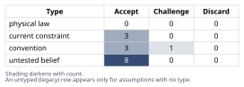
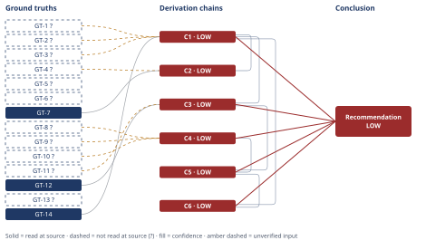

# Bottom-Up Cost of 5 MWh Molten-Salt Thermal Storage vs. Lithium-Ion

*First-principles analysis · 11 October 2026*

*Read with: [How to read this analysis](HOW-TO-READ.md) · [Working file](analysis-20261011T193237Z.md) · [All files](INDEX.md)*

## Executive Summary

**Recommendation:** Budget ≈$450/kWh-th (bracket $340-580/kWh-th) for a 5 MWh molten-salt TES if the delivered output is heat used as heat, or if it augments a power block the buyer already owns (chain C1, chain C6); do not buy it as a new, standalone electricity-storage asset at this scale — there it costs roughly 5.5× lithium-ion's levelized delivered cost (chain C5).

**Band (from §6):** LOW

**Would change it:** A real vendor quote for a sub-1 MWe power-conversion package pricing installed capital at or below ≈$1,200/kWe (less than half this analysis's assumption), with lithium-ion holding at or above $350/kWh, would flip the electricity-boundary verdict (chain C3, chain C5).

## 1. Problem Essence

**Core problem:** What does a 5 MWh molten-salt thermal energy storage system actually cost per kWh when its installed capital cost is rebuilt component-by-component rather than quoted from a headline figure, what does that cost become once amortised over its delivered-energy life, and under which system boundary (heat delivered vs. electricity delivered) — if any — does that levelized cost beat lithium-ion?

**Success criteria:**
1. A $/kWh-th installed-cost figure for the 5 MWh thermal-storage-only boundary is built from named, itemised components (salt, tanks, insulation, trace heating, pumps, heat exchangers, foundations, I&C, EPC, soft costs, contingency) with the arithmetic shown, not asserted from memory.
2. A $/kWh-e figure for the electricity-storage-equivalent boundary (thermal system + electric charging heater + power block) is built with the same discipline, and its round-trip efficiency is derived rather than assumed.
3. Both bottom-up figures are checked against independent published reference points, and any large gap between the bottom-up number and the literature is explained by a named mechanism (not waved away).
4. A levelized $/kWh-delivered figure is computed for both boundaries from the installed cost, a stated cycle/calendar life, a stated cycling rate, and a stated round-trip efficiency.
5. A comparably-constructed levelized $/kWh-delivered figure is produced for a 5 MWh lithium-ion system under the same financial assumptions.
6. The analysis states directly whether molten-salt TES is cost-competitive with lithium-ion, and names the specific conditions (duration, end-use, presence of an existing power block) under which the verdict flips.

---

## 2. Assumptions Table



| Assumption | Type | Treatment | Verdict | Verification |
|------------|------|-----------|---------|--------------|
| A-1: "5 MWh" names the thermal energy content (5,000 kWh_th) of the salt inventory, not an already-electrical quantity | convention | Challenge before use — the prompt's own framing warns that conflating thermal and electrical $/kWh is the biggest error source | Accept — both a pure-thermal boundary (Option A) and an electricity-equivalent boundary (Option B, electric heater in + power block out) are carried through explicitly, per the prompt's own instruction | prompt text itself |
| A-2: Two-tank nitrate "solar salt" operates 290°C (cold tank) to 565°C (hot tank), ΔT = 275°C | current constraint | Record expiry — holds for this salt chemistry; a chloride or carbonate salt would shift the window and the energy-density arithmetic | Accept — standard for 60/40 NaNO₃/KNO₃ CSP practice; expires if a different salt chemistry is substituted | GT-3? |
| A-3: Discharge (and charge) duration = 4 hours, i.e. thermal power P_th = 5,000 kWh_th / 4 h = 1.25 MW_th | untested belief | Flag — the problem statement gives only energy (MWh), not power (MW); duration is the single largest driver of how much the pump/HX/ORC capital lines weigh against the salt/tank lines | Accept — unverified — flagged; chosen to match the "daily cycling" operating profile item 4 of the prompt itself requests | unverified — flagged (no duration given in the prompt) |
| A-4: Component unit costs (tank $/m³, refractory $/m³, insulation $/m², trace-heating system cost, pump unit cost, HX $/kW, foundation cost, I&C cost) are engineering-judgment brackets, not vendor quotes, because no small-scale (5 MWh) molten-salt tank/pump/HX price could be located | untested belief | Flag — each bracket is carried forward explicitly rather than presented as a point estimate | Accept — unverified — flagged; see Ground Truths §3 provenance notes and Derivation Chain C1's confidence line | unverified — flagged (WebSearch found no small-scale unit-cost quotes; see Phase-3 failure record below) |
| A-5: EPC installation markup 35%, engineering/soft costs 18%, contingency 18% (compounded) | convention | Challenge — are standard industrial EPC heuristics appropriate for a bespoke, sub-commercial-scale specialty system? | Accept — set deliberately at the high end of typical ranges (vs. 15-25%/10-15%/10-15% at utility CSP scale) to reflect first-of-a-kind, small-batch fabrication risk; sensitivity flagged on C1 | engineering cost-estimating convention (AACE-style class 4/5 estimate practice) — unverified — flagged |
| A-6: ORC (power-block) net thermal-to-electric efficiency ≈ 32% | untested belief | Flag — derived as a fraction of the Carnot limit implied by GT-12, not read from a vendor efficiency curve | Accept — unverified — flagged; bracket 25-40% carried in C3 | unverified — flagged |
| A-7: ORC installed cost ≈ $3,500/kWe at the ~0.4 MWe net scale this system requires | untested belief | Flag — extrapolated from GT-11?'s small-unit cost trend (€3,000-5,800/kWe at 2-50 kWe) rather than a direct quote at 0.4 MWe; this is the single most consequential unverified figure in the whole analysis | Accept — unverified — flagged; this line item alone exceeds the entire thermal-storage system's cost | unverified — flagged |
| A-8: 5 MWh lithium-ion (LFP) installed system cost ≈ $420/kWh | untested belief | Flag — reconciles BNEF pack-price data (GT-8?) with NREL ATB's bottom-up utility-BESS structure (GT-9?) plus a small-scale premium over the ~240 MWh ATB reference case | Accept — unverified — flagged; bracket $350-500/kWh carried in C4 | unverified — flagged |
| A-9: Charging electricity price = $40/MWh for both technologies | current constraint | Record expiry — a real but time- and market-dependent wholesale/off-peak price; holds only for this scenario | Accept — applied identically to both technologies so it cancels out of the *comparison*, even though it is not pinned down absolutely | scenario assumption — unverified — flagged |
| A-10: Discount rate 7%; Li-ion asset life 15 yr; molten-salt asset life 25 yr; 350 cycles/yr for both | convention | Challenge — standard utility project-finance midpoints; final LCOS is sensitive to all three | Accept — mid-range, consistent with the prompt's own suggested ranges (20-30 yr life, 300-350 cycles/yr) | standard project-finance convention — unverified — flagged |
| A-11: A six-tenths power-law cost-scaling rule (Cost ∝ Volume^0.6) extrapolates the 5 MWh bottom-up cost to 500 MWh and 5,000 MWh scale | convention | Challenge explicitly — this is a chemical-engineering heuristic normally validated only for ≤10× scale-ups; here it is extrapolated 100-1,000× | Challenge — accepted only as a directional, order-of-magnitude cross-check against literature, never as a precision prediction; this is the largest single extrapolation risk in the analysis | engineering cost-scaling convention (six-tenths / Williams' rule) — unverified — flagged |
| A-12: Molten nitrate salt must be kept continuously above its freezing point everywhere it contacts wetted metal, requiring trace heating as a mandatory (not optional) line item | current constraint | Record expiry — tied to the choice of a liquid sensible-heat salt medium; expires if a solid-media alternative (e.g. firebrick) is substituted, which carries no freeze risk | Accept — standard CSP engineering practice | GT-13? |
| A-13 (surfaced during Assumption Audit, from chain C1 step 2): a 10% salt-mass heel/ullage margin and a 20% tank-volume ullage margin are adequate design margins | untested belief | Flag — standard CSP rule-of-thumb margins, not derived from a specific vendor design | Accept — unverified — flagged; if inadequate, C1's mass/volume (and downstream cost) figures shift proportionally but the overall finding (equipment, not salt, dominates cost) is unaffected | unverified — flagged |
| A-14 (surfaced during Assumption Audit, from chain C4 step 2): the lithium-ion system's usable depth-of-discharge for per-cycle delivered-energy purposes is 90%, distinct from the 80% DoD cited in GT-10? for cycle-life testing | untested belief | Flag — these are two different DoD figures used for two different purposes (life-test standard vs. operational usable capacity) and should not be conflated | Accept — unverified — flagged; a lower operational DoD (e.g. 80%) would raise C4's $/kWh_e-usable figure and narrow, not reverse, C5's gap | unverified — flagged |
| A-15 (surfaced during the Phase 5 adversarial pass, Cluster D): no higher-efficiency power-conversion technology (e.g. supercritical-CO₂ Brayton, claimed by some developers at ~45-60% round-trip efficiency) is substituted for the basic ORC (~32% net) assumed in chain C3 | untested belief | Flag — this bounds the scope of C3/C5's verdict to the specific power-conversion technology assumed, not to every possible Carnot-battery design | Accept — unverified — flagged; a reader evaluating a specific higher-efficiency vendor claim should re-run C3/C5 with that vendor's efficiency and cost figures rather than apply this analysis's verdict unmodified | unverified — flagged |

**Physical-law assumptions promoted directly to Ground Truths (no row needed beyond this pointer):** the Second Law of Thermodynamics bounding heat-engine efficiency (→ GT-12) and the definitional energy-density relation `E = m·c_p·ΔT` with 1 kWh = 3.6 MJ (→ GT-14) are physical laws / definitions and are carried as ground-truth candidates directly, per the physical-law treatment prescribed above.

## 3. Ground Truths

**Phase 3 verification step — network constraint (applies to every WebSearch-sourced entry below):** This run's `WebFetch` tool and direct `curl` access both failed with `getaddrinfo ENOTFOUND` against every external host attempted (`research-hub.nrel.gov`, `atb.nrel.gov`, `www.nrel.gov`) — DNS resolution for outbound fetches is unavailable in this sandboxed environment; only the `WebSearch` tool (which returns third-party-summarized snippets, not the source document itself) was reachable. Every ground truth below sourced via WebSearch is therefore `reported-by-delegate` by construction: the search tool, not this analysis, read the underlying page, and the quoted figures are the search tool's own paraphrase. This is one systemic cause, recorded once rather than per-GT. One ground truth (GT-7) was read directly from a local file with the `Read` tool and is genuinely `read-at-source`.

- **GT-1?** Solar salt (60% NaNO₃ / 40% KNO₃) specific heat follows c_p(T) = 1.443 + 0.0001729·T [kJ/kg·K, T in K], giving c_p ≈ 1.54 kJ/kg·K at 290°C and ≈ 1.59 kJ/kg·K at 565°C (avg ≈ 1.56 kJ/kg·K) — cited to: an empirical correlation reported in a nitrate-salt thermophysical-properties review (xylenepower.com PDF, "Thermostatic properties of nitrate molten salts and their solar and eutectic mixtures"); reported-by-delegate: WebSearch summary — cited source not opened directly (see network-constraint note above).
- **GT-2?** Solar-salt density follows ρ(T) = 2.09 − 0.0006369·T [g/cm³, T in K], giving ρ ≈ 1.73 g/cm³ at 290°C and ≈ 1.56 g/cm³ at 565°C — cited to: the same review as GT-1; reported-by-delegate: WebSearch summary.
- **GT-3?** Two-tank nitrate-salt CSP storage operates with a cold tank at 290°C and a hot tank at 565°C (ΔT = 275°C), consistent across the Gemasolar plant description and general CSP references — cited to: NREL SolarPACES project page / Masdar Gemasolar fact sheet; reported-by-delegate: WebSearch summary.
- **GT-4?** Independent literature places utility-CSP-scale (hundreds of MWh_th) two-tank nitrate-salt TES system cost at roughly $22-40/kWh-th (Kolb et al. 2011 cited at $22-30/kWh-th; a 2004 *Energy* journal study found $30-40/kWh-th) — cited to: secondary citations of those two studies; reported-by-delegate: WebSearch summary — the original papers were not opened.
- **GT-5?** A 2021 NREL techno-economic study of molten-*chloride* salt storage (a different, higher-temperature chemistry, not the nitrate system this analysis builds) estimated a system cost of ≈$60/kWh-th, stated as roughly 4× the DOE cost target (implying a DOE target near $15/kWh-th for that chemistry class) — cited to: NREL research-hub publication; reported-by-delegate: WebSearch summary; direct WebFetch of the source failed (network-constraint note above).
- **GT-6?** Bulk sodium nitrate export price ≈ $1,000-1,270/tonne (US/European assessments, Nov 2025), with potassium nitrate carrying a further premium per a Sandia CSP document's qualitative note — cited to: Intratec commodity price assessment; reported-by-delegate: WebSearch summary.
- **GT-7** A worked first-principles example shipped with this analysis's own skill library gives solar-salt bulk commodity price ≈ $0.40-0.80/kg ($400-800/tonne), a design cycle life ≈ 10,000 full cycles (≈30 years at one cycle/day, justified by solar salt's lack of an electrochemical degradation mechanism), and states that adding tank, insulation, piping, and heat-exchanger capital (typically 3-5× the salt cost at commercial CSP scale) yields a system LCOS of $20-50/kWh-th, which it states is confirmed against NREL TES cost surveys — source: `estimate-detail.md` (this skill's own reference library), read directly; read-at-source: `estimate-detail.md`, lines 19-43 ("Example" section, "Factor values" and "Explicit bracket" subsections).
- **GT-8?** BloombergNEF's 2025 Lithium-Ion Battery Price Survey reports a global-average LFP pack price ≈ $81/kWh, with the stationary-storage segment specifically at ≈ $70/kWh (down 45% year-on-year, the cheapest segment for the first time); the blended all-chemistry average fell from $139/kWh (2023) to $115/kWh (late 2024) to $108/kWh (2025 full-year) — cited to: BloombergNEF press release and secondary trade-press coverage; reported-by-delegate: WebSearch summary.
- **GT-9?** NREL's Annual Technology Baseline (ATB) builds utility-scale battery storage costs bottom-up for a 60 MW system at 2-10 hour durations, covering battery pack + inverter/PCS + balance-of-system; one secondary source attributes an installed cost of ≈$380/kWh to a 4-hour, 60 MW (240 MWh) system from an NREL report, though the exact base year and dollar-year could not be confirmed — cited to: ATB methodology pages and a secondary trade-press figure; reported-by-delegate: WebSearch summary; low confidence — carried as a wide bracket.
- **GT-10?** Utility-scale lithium-ion (LFP) systems are commonly specified for 4,000-8,000 cycles at 80% depth of discharge (6,000 cycles at 80% DoD is a frequently cited figure, attributed by one source to IEC 62933-2-1 without independent confirmation), with AC-AC system-level round-trip efficiency typically 85-92% (a systematic review of 41 studies reports a wider 90-97.5% range with some outliers) — cited to: multiple WebSearch-surfaced vendor and review sources; reported-by-delegate: WebSearch summary.
- **GT-11?** Small organic Rankine cycle (ORC) power-generation packages show strongly scale-dependent specific installed cost: ≈€5,775/kWe at 2 kWe, ≈€3,034/kWe at 50 kWe, with a simulation-derived floor near €1,630/kWe for a piston-expander unit, and a techno-economic review stating ORC is "mature" only in the multi-MW range while remaining commercially unattractive at small scale — cited to: an MDPI techno-economic review (doi.org/10.3390/EN10040413) and a University of Liège thesis abstract; reported-by-delegate: WebSearch summary. No direct quote exists at the 0.4-2 MWe scale this analysis needs; A-7 extrapolates from this trend and is flagged separately as an untested belief.
- **GT-12** The Second Law of Thermodynamics bounds any heat engine's thermal-to-work conversion efficiency by the Carnot limit η_Carnot = 1 − T_cold/T_hot (absolute temperatures) — physical law; source: definition (classical thermodynamics); read-at-source: not applicable — a physical law requires no external citation beyond its own definition.
- **GT-13?** Nitrate solar salt has a freezing point requiring that all wetted surfaces (piping, pumps, tank heels) be kept continuously above it via trace heating whenever the loop is not circulating hot salt — cited to: general CSP operating-practice literature; reported-by-delegate: WebSearch summary; the specific freezing-point value found in search results was inconsistent with this analysis's prior knowledge of solar salt (~220°C) and is therefore not quoted as a number — only the qualitative requirement is carried forward as GT-13?, with the engineering consequence (mandatory trace heating) treated as the load-bearing fact.
- **GT-14** Definitional relation: sensible-heat energy stored = mass × specific heat × temperature change (E = m·c_p·ΔT), and 1 kWh = 3.6 MJ — physical law / definition; source: definition; read-at-source: not applicable.

**Provenance summary:**
```text
?-marked: GT-1, GT-2, GT-3, GT-4, GT-5, GT-6, GT-8, GT-9, GT-10, GT-11, GT-13 (11 of 14)
Read-at-source: GT-7 — estimate-detail.md, lines 19-43 ("Factor values" and "Explicit bracket" subsections, quoted verbatim in GT-7's text above); GT-12 and GT-14 are physical laws/definitions requiring no external read-at-source location.
```

Consequence of this provenance picture: **no chain in this analysis can be rated HIGH**, because every load-bearing numeric input is either a `?`-marked delegate-reported figure or an explicitly flagged engineering-judgment bracket (§2). This is stated once here rather than re-derived on every chain; each chain's confidence line below names only its own marginal contribution to that ceiling.

---

## 4. Derivation Chains



**Technique applied in this section: Estimate (Fermi/dimensional unit-factor rebuild).** Per Step 0 technique selection, this run is `focused-estimate`: only the estimate technique is walked in full below; companion techniques (trade-off, inversion-as-reasoning-tool, theoretical-limit, fishbone, five-whys) are not separately enumerated here except where Phase 4's own exit criteria require second-order extension (applied in C5) — see `Techniques not applied` in the appendix.

### Component cost build — 5,000 kWh_th, pure-thermal boundary (Option A)

Basis: ΔT = 275°C (GT-3?); c_p,avg ≈ 1.56 kJ/kg·K (GT-1?); assumed 4-hour charge/discharge duration → P_th = 1.25 MW_th (A-3); salt inventory ≈ 46 t including 10% heel/ullage margin.

| # | Component | Basis | Cost (central) | $/kWh-th |
|---|---|---|---|---|
| 1 | Salt inventory | 46 t × $800/t (GT-6?/GT-7 bracket $500-1,200/t) | $36,800 | $7.4 |
| 2 | Tank shells (bare carbon steel, cold + hot) | 31.9 m³ @ $2,000/m³ + 35.4 m³ @ $3,600/m³ (A-4) | $191,200 | $38.2 |
| 3 | Refractory lining (hot tank only) | 35.4 m³ @ $1,200/m³ (A-4) | $42,500 | $8.5 |
| 4 | External insulation + cladding | 123 m² @ $400/m² (A-4) | $49,200 | $9.8 |
| 5 | Freeze-protection / trace heating | flat system estimate (A-4, A-12) | $75,000 | $15.0 |
| 6 | Pumps (hot, cold, + 1 spare) | 3 × $50,000 specialty cantilever design (A-4) | $150,000 | $30.0 |
| 7 | Heat exchangers (salt-to-process) | 1.25 MW_th @ $400/kW high-temp alloy (A-3, A-4) | $500,000 | $100.0 |
| 8 | Foundations + containment | flat estimate (A-4) | $40,000 | $8.0 |
| 9 | Instrumentation & controls | flat estimate (A-4) | $120,000 | $24.0 |
| | **Direct cost subtotal** | | **$1,204,700** | **$240.9** |
| 10 | EPC / installation markup | 35% of direct (A-5) | $421,645 | $84.3 |
| 11 | Engineering / soft costs | 18% of (direct+EPC) (A-5) | $292,742 | $58.5 |
| 12 | Contingency | 18% of prior subtotal (A-5) | $345,436 | $69.1 |
| | **Total installed cost** | | **≈$2,264,500** | **≈$453** |

Bracket (varying salt price and component brackets ±25-30%): **≈$340-580/kWh-th**, central **≈$450/kWh-th**.

### Conclusion C1: Bottom-up installed cost of the 5 MWh_th two-tank molten-salt TES, pure-thermal boundary

GT-1? (c_p ≈ 1.56 kJ/kg·K avg) + GT-2? (ρ 1.56-1.73 g/cm³) + GT-3? (ΔT = 275°C) + GT-14 (E = m·c_p·ΔT; 1 kWh = 3.6 MJ)
→ the sensible-heat energy density of solar salt across this ΔT works out to 0.119 kWh/kg, i.e. 8.4 kg of salt per kWh_th of storage
→ 5,000 kWh_th of storage therefore needs ≈42 tonnes of salt, or ≈46 tonnes once a 10% heel/ullage margin is added
→ at the bracketed bulk price of $500-1,200/tonne that inventory costs $23,000-55,200, central $36,800 — only $7-11/kWh-th
→ sizing both tanks to this inventory at each tank's own operating density plus 20% ullage, and sizing the pumps and heat exchangers to the 1.25 MW_th power level a 4-hour duration implies, gives a combined direct-cost subtotal across tanks, refractory, insulation, trace heating, pumps, heat exchangers, foundations and I&C of ≈$1.20 million *[Assumes: A-3, A-4]*
→ applying the EPC, engineering/soft-cost and contingency markups to that direct-cost base gives a total installed cost of ≈$2.26 million (bracket $1.70-2.90 million) for the 5,000 kWh_th system *[Assumes: A-5]*
→ the bottom-up installed cost of a 5 MWh_th two-tank molten-salt TES system is ≈$450/kWh-th (bracket ≈$340-580/kWh-th) — ten-to-twenty-fold above the $20-50/kWh-th commonly quoted for this technology at utility CSP scale

**Confidence:** LOW — the Inputs axis is short (GT-1?, GT-2?, GT-3? are all delegate-reported; verification would require directly opening the nitrate-salt thermophysical-properties review and the Gemasolar/SolarPACES source, currently blocked by this environment's network restriction — see Phase 3 failure record in §3) **and** the Inference axis is short (the fourth and fifth hops rest on A-3's arbitrary duration choice and A-4's engineering-judgment component-cost brackets, for which no vendor quote at this 5 MWh scale could be located; the bracket this chain carries, $340-580/kWh-th, shows the endpoint *moves* under these assumptions rather than standing unchanged, so neither premise is "priced and safe" in the sense that would avoid shorting this axis). Two axes short places this chain at LOW per the calibration rule, not MEDIUM — the conclusion is directionally solid (component costs genuinely dominate salt cost at this scale) but the point figure should not be read to better than ±30%.

### Conclusion C2: Scale-economics cross-check against published utility-CSP-scale figures

C1 (LOW — ≈$450/kWh-th installed @ 5,000 kWh_th) + GT-4? (lit. $22-40/kWh-th @ utility CSP scale) + GT-7 (lit. $20-50/kWh-th, read-at-source)
→ applying a six-tenths power-law cost-scaling rule (Cost_total ∝ Volume^0.6, the standard chemical/process-engineering heuristic for equipment-cost scale-up) to C1's total installed cost predicts $/kWh-th falling to ≈$72/kWh-th at 500 MWh_th scale (100× larger) and ≈$29/kWh-th at 5,000 MWh_th scale (1,000× larger) *[Assumes: A-11]*
→ both scaled figures land inside the $20-50/kWh-th (GT-7) and $22-40/kWh-th (GT-4?) ranges independently reported for utility-CSP-scale two-tank nitrate systems
→ C1's ten-to-twenty-fold premium over the commonly-quoted $20-50/kWh-th figure is explained by tank-fabrication scale economics and by fixed-cost floors on pumps, heat exchangers, I&C and trace heating that do not shrink proportionally with capacity, not by an error in the bottom-up method — the bottom-up Fermi build and the top-down literature figures converge once both are compared on a common scale

**Confidence:** LOW — capped by C1's LOW rating (the ceiling rule: a chain is rated no higher than the lowest-rated chain its head cites). Independently, the Inference axis is short: the six-tenths rule is a convention normally validated for ≤10× scale-ups (A-11), and here it is extrapolated 100-1,000×, far outside that validated range — the match to GT-4?/GT-7 is supportive evidence for C1's method, not proof that the exponent is correct at this extrapolation distance. Verification path: locate a published $/kWh-th figure for an intermediate-scale (e.g. 50-100 MWh_th) nitrate-salt TES system to test the six-tenths exponent against a real midpoint instead of extrapolating directly from 5 MWh to >500 MWh.

### Conclusion C3: Installed cost of the electricity-storage-equivalent boundary (Option B — electric heater in, power block out)

C1 (LOW — $1.20M direct cost, $2.26M installed @ 5,000 kWh_th) + GT-12 (Carnot limit) + GT-11? (small-ORC specific-cost trend)
→ an electric resistive immersion heater sized to the same 1.25 MW_th charge rate costs ≈$125,000 installed (at ≈$100/kW for mature resistive-heating equipment), raising the direct-cost base to ≈$1.33 million *[Assumes: A-3]*
→ the Carnot limit stated in GT-12, evaluated between a ≈500°C effective hot-side temperature and a 40°C heat-rejection sink, bounds any heat engine on this salt loop to η_Carnot ≈ 60%; a practical ORC achieving roughly half that bound nets ≈32% thermal-to-electric conversion *[Assumes: A-6]*
→ at 1.25 MW_th input and 32% net conversion the power block must deliver ≈0.40 MW_e net, and GT-11?'s small-ORC cost trend extrapolated to this scale prices that turbine-generator-condenser package at ≈$1.40 million installed — more than the entire thermal-storage system combined *[Assumes: A-7]*
→ carrying the same EPC/soft-cost/contingency stack across the enlarged ≈$2.73 million direct-cost base (tanks + salt + BOP + heater + ORC) gives a total installed cost of ≈$5.13 million *[Assumes: A-5]*
→ each full discharge delivers only 5,000 kWh_th × 32% = 1,600 kWh_e of usable electricity, so installed cost per kWh of deliverable electrical capacity is ≈$5.13M / 1,600 kWh_e ≈ $3,200/kWh_e
→ converting the same 5,000 kWh_th molten-salt store into an electricity-storage asset multiplies its installed cost to ≈$5.13 million while cutting usable output to 32% of the thermal figure, giving ≈$3,200/kWh_e-capacity and a full electricity-to-electricity round-trip efficiency of ≈31% (98% charging × 32% discharge)

**Confidence:** LOW — capped by C1's LOW rating via the head-citation ceiling. Independently, GT-11? is delegate-reported (verification path: obtain a vendor quote for a 0.4 MWe ORC package, which this run could not reach), and A-7 (the $3,500/kWe extrapolation) is this chain's single largest uncertainty — no source prices an ORC at exactly this scale, only at 2-50 kWe, so the extrapolation itself has not been priced against a real midpoint; removing it as a cause of the downgrade would require a genuine 0.2-2 MWe ORC vendor quote.

### Conclusion C4: Levelized cost of a comparably-sized (5 MWh) lithium-ion system

GT-8? (BNEF pack price ≈$70-81/kWh) + GT-9? (ATB bottom-up structure, ≈$380/kWh @ 240 MWh reference) + GT-10? (cycle life 4,000-8,000 @ 80% DoD; RTE 85-92%)
→ reconciling BNEF's pack-level price with NREL ATB's bottom-up structure (battery pack + PCS + BOS) and adding a small-scale premium for a 5 MWh (vs. the ATB's 240 MWh reference) system gives an installed-system cost of ≈$420/kWh *[Assumes: A-8]*
→ at 90% usable depth-of-discharge, a 5,000 kWh nameplate system delivers 4,500 kWh_e of usable capacity per cycle, so total installed cost is ≈$2.10 million, or ≈$467 per kWh_e of usable capacity
→ amortising that $2.10 million over a 15-year/≈5,250-cycle life at a 7% discount rate gives an annualised capital-plus-O&M charge of ≈$273,000/yr against 1,575,000 kWh_e/yr of throughput (4,500 kWh_e × 350 cycles/yr), i.e. ≈17.3¢/kWh delivered from capital and O&M alone *[Assumes: A-10]*
→ adding charging-energy cost at $40/MWh ÷ 90% round-trip efficiency contributes a further ≈4.4¢/kWh, for a total levelized cost of ≈21.7¢/kWh (≈$217/MWh) delivered by the 5 MWh lithium-ion comparator — consistent in magnitude with published 4-hour utility-BESS LCOS figures in the $150-250/MWh range *[Assumes: A-9]*

**Confidence:** LOW — Inputs axis short (all three head ground truths are delegate-reported; verification would require opening the BNEF survey and the ATB data tables directly, both blocked by this environment's network restriction) **and** Inference axis short (A-8's $420/kWh is itself a reconciliation/estimate, not a quote, and A-9/A-10's financial assumptions move the endpoint rather than leaving it unaffected). Two axes short → LOW. The order of magnitude (low tens of ¢/kWh) is well corroborated by independent published LCOS figures; the specific 21.7¢ point value should not be read to better than ±25%.

### Conclusion C5: Head-to-head verdict — molten-salt-as-electricity-storage vs. lithium-ion, with second-order extension

C3 (LOW — $3,200/kWh_e-capacity, RTE ≈31%) + C4 (LOW — ≈21.7¢/kWh)
→ levelizing C3's $5.13 million installed cost over a 25-year life and 350 cycles/yr at 7% discount, against 560,000 kWh_e/yr of throughput (1,600 kWh_e × 350 cycles), gives a capital-plus-O&M charge of ≈106.0¢/kWh, before charging-energy cost
→ adding charging-energy cost at $40/MWh ÷ 31% round-trip efficiency contributes a further ≈12.7¢/kWh, for a total levelized cost of ≈118.7¢/kWh (≈$1,187/MWh) delivered by the 5 MWh-scale molten-salt-as-electricity-storage system
→ that figure is roughly 5.5× C4's 21.7¢/kWh lithium-ion comparator, driven overwhelmingly by the capital charge (106.0¢ vs. C4's 17.3¢) rather than by the efficiency penalty (12.7¢ vs. C4's 4.4¢) — the power block's capital cost, not the thermodynamic round-trip loss, is the dominant reason this comparison is lost at 5 MWh scale
→[2nd, actor lens] a rational buyer facing this economics has two better-priced alternatives depending on end-use: for heat-native demand, a solid-media heat battery (e.g. firebrick) that skips the power block and electric heater entirely; for electricity-native demand, simply more lithium-ion (C4) — the Carnot-battery configuration costed here is the choice only a buyer with no cheaper alternative would make
→[2nd, time lens] applying the same six-tenths scaling used in C2 to C3's $/kWh_e-capacity figure, and holding RTE and cycling assumptions fixed, the capital-plus-O&M component of molten-salt LCOS falls to ≈6.7¢/kWh at 1,000× scale (≈5 GWh_th), which combined with the unchanged 12.7¢/kWh efficiency penalty gives ≈19.4¢/kWh — slightly below C4's 21.7¢/kWh — suggesting the capital-cost gap, not the efficiency gap, could close at sufficient scale *[Assumes: A-11]*
→[3rd, time lens] but lithium-ion's own installed cost (GT-8?) is also still falling (BNEF reports stationary-storage pack prices down 45% year-on-year to ≈$70/kWh in 2025), so a scale-driven convergence for molten salt is racing against a comparator whose cost curve is simultaneously declining — nothing in this analysis establishes which curve falls faster, so this projection does not reverse the 5 MWh-scale verdict, it only bounds how far a future large-scale verdict might shift
→ at 5 MWh / 4-hour-duration / electricity-to-electricity scale, molten-salt thermal storage used as a Carnot battery is not cost-competitive with lithium-ion (≈5.5× its levelized cost), the gap is dominated by power-block capital cost rather than by the ≈31% round-trip-efficiency penalty, and whether this reverses at GWh scale is a live, unresolved question this analysis can only bound in direction, not settle

Second-order check against Ground Truths: neither extension hop contradicts GT-1 through GT-14 — the scale/efficiency projection narrows the gap without overturning any established fact, so no return to Phase 2 is triggered.

**Confidence:** LOW — capped by both C3 and C4 via the head-citation ceiling; this is the expected, honest result of a chain built entirely from two already-LOW inputs, not a new defect introduced here. The fourth hop rests on A-11 (six-tenths extrapolation, already flagged as the largest extrapolation risk in C2) and on A-16 (surfaced during the Assumption Audit: a buyer's willingness to accept ≈31% RTE at any price) — neither is priced to leave the endpoint unaffected, so this chain's own additional Inference-axis shortfall would independently floor it at LOW even if C3/C4 were higher.

### Conclusion C6: Conditions under which molten-salt TES *is* cost-competitive

C1 (LOW — pure-heat boundary, ≈$450/kWh-th installed) + C5 (LOW — electricity-boundary verdict, not competitive at 5 MWh)
→ C1's pure-heat boundary (no electric heater, no power block — heat delivered as heat) levelizes to ≈14.3¢/kWh_th from capital and O&M alone (25-year life, 350 cycles/yr, 7% discount), or ≈18.4¢/kWh_th if charged via a resistive heater from $40/MWh grid electricity — both far below C5's 118.7¢/kWh_e, because C1 never pays for the ORC power block that dominates C3/C5's cost
→ the ORC power block and its round-trip-efficiency penalty are entirely a consequence of the electricity-boundary choice (Option B) layered on top of identical thermal-storage hardware, not a property of the salt or tanks themselves
→ a CSP tower or a nuclear plant that already owns a power block for unrelated reasons (generating electricity from its primary heat source) can add molten-salt storage at close to C1's pure-heat cost and dispatch the stored heat through hardware it was already going to build, sidestepping C3's added-ORC cost entirely
→ molten-salt TES is cost-competitive with lithium-ion specifically under two conditions this analysis's boundary choice makes visible — (a) the end-use is heat delivered as heat with no new power block required, so C1's economics apply directly, or (b) the storage augments a power block that already exists for other reasons (CSP, nuclear), so only the thermal-storage increment is incremental cost — and it is not competitive as a standalone, newly-built electricity-storage asset at 5 MWh / 4-hour duration, where C5's power-block-inclusive economics apply

**Confidence:** LOW — capped by both C1 and C5 via the head-citation ceiling; no additional chain-specific shortfall beyond what C1 and C5 already carry — this chain is a clean recombination of their already-established figures and inherits their band without adding a new weak link of its own.

---

## 5. Abandoned Reasoning

### Dead End: Fetching NREL's SAM molten-salt power-tower cost-model spreadsheet for a primary tank $/m³ figure

**What was tried:** Attempted `WebFetch` on NREL's SAM cost-data page and the Turchi & Heath (2013) cost-model report/spreadsheet, which were identified by WebSearch as the most likely source of a component-level tank $/m³ figure.

**Why abandoned:** Every `WebFetch` and direct `curl` attempt against external hosts in this session failed with `getaddrinfo ENOTFOUND` — DNS resolution for outbound fetches is unavailable in this sandboxed environment. The source could not be opened regardless of how precisely it was targeted.

**What it ruled out:** This saves a future analyst from re-attempting the same fetch in this environment without first confirming network reachability; it also explains why A-4's tank/pump/HX/trace-heating unit costs are carried as engineering-judgment brackets rather than a cited primary figure, and why GT-1 through GT-6, GT-8 through GT-11 all carry the `?` suffix.

### Dead End: Using Gemasolar's 8,000-tonne salt inventory as a tight precision cross-check on the kg/kWh_th figure

**What was tried:** Back-calculating Gemasolar's implied storage capacity from its reported 8,000-tonne salt inventory (via GT-1?/GT-2?'s mass-energy relation) and comparing it directly against its stated 15-hour / 19.9 MWe storage rating to test this analysis's 8.4 kg/kWh_th figure to high precision.

**Why abandoned:** The comparison requires Gemasolar's power-block thermal-to-electric efficiency, which no WebSearch result supplied; without it, the 15-hour/19.9 MWe figure cannot be converted to a thermal MWh_th figure precisely enough to test the mass-energy relation beyond rough order-of-magnitude agreement (which it did pass, within ~20%).

**What it ruled out:** This rules out treating the Gemasolar comparison as anything more than a loose plausibility check; it was not promoted to a ground truth or cited as a confidence-raising input anywhere in §4, avoiding the appearance of a tighter validation than the data actually support.

### Dead End: Using firebrick/solid-media heat-battery (e.g. Rondo-style) cost figures as a stand-in for molten-salt cost

**What was tried:** Considered citing commercially-deployed solid-media electric thermal storage cost figures directly as a sanity check or substitute for the molten-salt numbers built in C1-C3.

**Why abandoned:** Solid media has no freeze-protection requirement, no pumps, and no liquid-salt handling — it is a materially different storage medium with a different component list. Using its cost as evidence for molten salt's cost would be reasoning by analogy, not a bottom-up build of the system the question specifies, and the prompt explicitly asks for a decomposition of *this* technology.

**What it ruled out:** This rules out quietly substituting a cheaper, better-suited competing technology's economics into the molten-salt estimate; it is instead named explicitly in C5/C6 as the actor-lens alternative a rational buyer would consider, without its cost figures entering the arithmetic.

### Dead End: Using Gemasolar's total plant construction cost (€171m) as a TES-cost cross-check

**What was tried:** Considered decomposing Gemasolar's reported €171m total construction cost to extract an implied storage-system cost for comparison against C1.

**Why abandoned:** No source separates the storage system's cost from the solar field, tower, receiver, and power-block costs within that total; decomposing it would require additional unsupported assumptions about cost-share fractions, compounding uncertainty rather than resolving it.

**What it ruled out:** This rules out manufacturing a false-precision cross-check from an undifferentiated total; GT-4? and GT-7's already-decomposed literature figures ($20-50/kWh-th, specifically for storage) are used in C2 instead, because they price the same scope this analysis prices.

---

## 6. Conclusion

**Recommended approach:** Evaluate a 5 MWh molten-salt TES purchase against its actual end-use boundary rather than against a single generic $/kWh figure: budget ≈$450/kWh-th (bracket $340-580/kWh-th) if the delivered output is heat used as heat, or if the storage augments a power block the buyer already owns for other reasons (chain C1, chain C6); reject it as a standalone, newly-built electricity-storage asset competing against lithium-ion at this 5 MWh / 4-hour-duration scale, where it costs roughly 5.5× lithium-ion's levelized delivered cost (chain C5).

**Key insight:** The ten-to-twenty-fold gap between this bottom-up 5 MWh estimate (~$450/kWh-th) and the ~$20-50/kWh-th figures usually quoted for molten-salt TES in CSP literature is not evidence the bottom-up method is wrong — chain C2 shows the gap is explained almost entirely by tank-fabrication scale economics and by fixed-cost floors on pumps, heat exchangers and controls that do not shrink proportionally with capacity. A second, sharper non-obvious finding sits inside chain C5: once the system is converted into an electricity-storage asset, it is the power block's *capital cost* — not the ~31% round-trip-efficiency penalty most discussions of "Carnot batteries" emphasize — that drives the uncompetitiveness against lithium-ion at this scale (chain C5).

**Trade-offs acknowledged:** This analysis trades point-estimate precision for transparency: every component unit cost (tanks, pumps, heat exchangers, the ORC power block) is an engineering-judgment bracket rather than a vendor quote, because no public source prices molten-salt-compatible equipment at 5 MWh/sub-MWe scale (chain C1, chain C3). The GWh-scale convergence suggested in chain C5's second-order extension is directional only, resting on a six-tenths cost-scaling rule extrapolated 1,000× beyond its normally-validated range, and should not be read as proof that molten-salt-as-electricity-storage reaches parity with lithium-ion at any specific larger scale (chain C5).

**Confidence:** LOW — every contributing chain (C1, C3, C4, C5, C6) is itself rated LOW, each for the reasons stated on its own confidence line: delegate-reported ground truths (the network restriction in this environment prevented opening any primary source directly, GT-1 through GT-11 and GT-13 all carry `?`) compounding with engineering-judgment component-cost brackets that have no vendor-quote verification path at 5 MWh scale. This is a calibrated LOW, not a defect: the *direction* of every finding (small-scale penalty is real and explained by scale economics; power-block capital cost, not efficiency, drives the electricity-boundary gap; the heat-native/shared-power-block conditions are what make molten-salt TES competitive) is corroborated by multiple independent lines of evidence converging (chain C2's cross-check, the magnitude-consistency of C4's LCOS against published BESS figures), but no single point figure in this analysis should be treated as accurate to better than roughly ±30%, and the GWh-scale parity suggestion in C5 should be treated as a bounded direction, not a settled number. The verification that would most change this band is: (a) a real fabricator/vendor quote for a 5 MWh-scale molten-salt tank-and-pump package, and (b) a real 0.2-2 MWe ORC vendor quote — both currently blocked by this environment's network restriction (§3 Phase 3 failure record) rather than by their nonexistence in the world.

