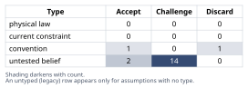
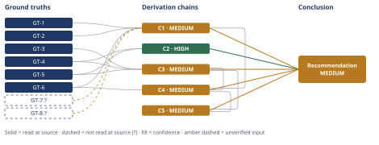

# Root Cause of Rising Churn: A Diagnostic-First Plan

*First-principles analysis · 11 October 2026*

*Read with: [How to read this analysis](HOW-TO-READ.md) · [Working file](analysis-20261011T193225Z.md) · [All files](INDEX.md)*

## Executive Summary

**Recommendation:** Run the ordered, falsifiable diagnostic plan (Diagnostic Steps 0-7) in parallel with five no-regret containment actions, and hold any pricing, staffing-structure, or product-roadmap commitment until the Step 0-4 diagnostic gate resolves in roughly two weeks (chain C4). The two confirmed leading indicators mechanically rank integration/product regression, CS-capacity decline, and a cohort-mix artifact above pricing and competitive displacement as likely drivers (chain C3), and guessing wrong toward pricing is asymmetrically costly and partly irreversible over the next two quarters (chain C5).

**Band (from §6):** MEDIUM

**Would change it:** Confirming metric-definition and ticket/scoring-methodology stability and pulling the raw active-customer and logo counts (Diagnostic Step 0-1, closing GT-7?/GT-8? on chain C1) would resolve whether the doubling is real; cohort-segmented and ticket-categorized data (Diagnostic Steps 2-3) would resolve which branch dominates and settle the live pricing-as-disengagement rival named on chain C3.

## 1. Problem Essence

**Core problem:** Given that quarterly logo churn more than doubled from 4.1% (Q1) to 9.2% (Q3) against a backdrop of only two confirmed leading indicators (rising support-ticket volume, falling feature-adoption scores) and an explicit absence of cohort, segment, pricing, competitive, and root-cause data, what is the minimum-risk sequence of diagnostic checks and concurrent containment actions that lets Northbrook act now without prematurely committing resources to the wrong causal branch?

**Success criteria:**
1. The analysis distinguishes, before any causal claim is made, whether the Q1→Q3 rate change could be a measurement/definitional artifact, a cohort-mix artifact, or a true underlying degradation — and names what data would settle each.
2. The analysis does not require its own answer to name a single root cause — it is judged on whether it correctly identifies the plausible set of causal branches and a defensible priority order among them, since the leadership framing ("find THE root cause") is itself challenged as part of the work.
3. The fishbone-style causal breakdown is disciplined by the two confirmed leading indicators: a branch is ranked high-priority only if it mechanically explains a rise in *both* support tickets *and* a drop in adoption score, not merely one.
4. The analysis names a specific, falsifiable, ordered diagnostic plan — each step stating what observation would confirm or rule out which branch — rather than a generic call for "more research."
5. The analysis names what Northbrook should do in the next 1-2 weeks (no-regret containment) versus what it should explicitly hold until diagnostic data returns, given leadership's stated demand for visible action now.
6. The analysis states, concretely, the downstream (two-quarter) cost of committing to the wrong fix before the diagnostic data returns — not as a generic risk, but as a specific, mechanistic consequence chain.

---

## 2. Assumptions Table

| Assumption | Type | Treatment | Verdict | Verification |
|---|---|---|---|---|
| A1: The churn-rate definition (logo vs. revenue, gross vs. net, denominator population, annualization convention) is identical in the Q1 and Q3 reports | untested belief | Verify via Diagnostic Step 0 (metric-integrity check) before trusting the comparison at all | Challenge — not yet verified; the 4.1%→9.2% comparison is meaningless if the definition shifted mid-year | unverified — flagged; promoted for reasoning as GT-7? |
| A2: The reported figures are genuinely quarterly (not a mislabeled annualized run-rate, and not a rolling window that changed width) | untested belief | Verify via Diagnostic Step 0 | Challenge — same verification path as A1 | unverified — flagged; folded into GT-7? |
| A3: The Q1→Q3 rise reflects a true underlying degradation in the customer experience, rather than a denominator effect (small customer base, a few extra logos swinging the rate), a cohort-mix effect, or a seasonal effect | untested belief | Decompose via the Estimate bracket (chain C1) + Diagnostic Steps 1-2 | Challenge — central open question; the estimate bracket in C1 shows this is **not yet distinguishable** from artifact without the raw logo counts | unverified — flagged; this is the single most consequential open assumption in the whole analysis |
| A4: The support-ticket rise and the adoption-score drop share a common underlying cause with each other and with the churn rise (not three independent, merely-concurrent trends) | untested belief | Test via Diagnostic Steps 2-3 (cohort segmentation + ticket categorization) | Challenge — concurrency is not causation; plausible but unconfirmed | unverified — flagged |
| A5: "Find THE root cause" presumes a single dominant cause exists and should be searched for before acting | convention (a framing convention, not an empirical claim) | Explicitly challenge using Inversion (below) before adopting it as the operating frame | Discard as the operating frame — replaced by a multi-causal, parallel-branch-testing frame (see chain C2); a single upstream driver with multiple downstream symptoms remains possible but must be *established*, not presumed | n/a — framing choice, settled on methodological grounds |
| A6: Mid-market B2B SaaS churn generally concentrates in early-tenure cohorts and correlates with onboarding friction (an industry base-rate pattern) | convention / analogy | Use only as a hypothesis-generation prior; never cite as evidence for Northbrook specifically (no-analogies-as-direct-evidence rule) | Accept — as a prior for *generating* hypothesis A13 only; explicitly excluded from every Derivation Chain as evidentiary support | n/a — industry pattern, not Northbrook data; must be confirmed by Northbrook's own cohort data (Step 2) before it counts as evidence |
| A7: CS's qualitative flags (ticket volume up, adoption score down) were measured with an unchanged methodology/tooling across the period | untested belief | Verify via Diagnostic Step 0 | Challenge — unverified; folded into GT-8? | unverified — flagged |
| A8: No major external shock (competitor product launch, macro ops-tech budget pullback) occurred between Q1 and Q3 | untested belief (explicitly flagged by the prompt as "no data yet collected") | Test via Diagnostic Step 7 (win/loss + competitive tagging) | Challenge — unverified; sequenced **last** because it is weakly linked to the two confirmed leading indicators (see discriminating-observation test in the fishbone, §4) | unverified — flagged |
| A9: Sales/offer quality (over-promising, poor-fit deals) has not changed between Q1 and Q3 | untested belief (explicitly flagged by the prompt) | Test via Diagnostic Steps 4 and 7 | Challenge — unverified | unverified — flagged |
| A10: A "quarterly churn rate" is a coherent, apples-to-apples metric despite GT-3's fact that churn realizes primarily at annual renewal — i.e., the quarterly figure is not an artifact of a lumpy, uneven distribution of renewal-anniversary cohorts across quarters | untested belief | Test via Diagnostic Step 2 (pull the renewal-anniversary-month distribution of the active base) | Challenge — unverified; directly bears on whether Q1 and Q3 are comparing like-for-like populations | unverified — flagged |
| A11: Integration/data-pipeline reliability degraded, or a product regression shipped, in the Q1-Q3 window — raising bug/integration tickets and causing users to abandon the affected features (lowering adoption scores) | untested belief | Test via Diagnostic Step 3 (ticket categorization: bug/integration-failure share) + product deploy/incident log review | Challenge — unverified, but **high-priority**: it is the only branch below that mechanically explains both leading indicators AND is domain-specific to a data-integration platform | unverified — flagged |
| A12: CS capacity or proactive adoption-coaching declined (e.g., CSM turnover, higher accounts-per-CSM ratio), reducing proactive engagement and increasing reactive ticket volume | untested belief | Test via CS headcount/ratio history pull + Diagnostic Step 3 (proactive vs. reactive ticket-type mix) | Challenge — unverified, **high-priority**: mechanistically explains both indicators cleanly (less coaching → lower adoption; less coaching → more reactive tickets) | unverified — flagged |
| A13: A disproportionately large or lower-quality new-customer cohort signed in Q1-Q2, and the blended company-wide averages are being dragged down by that cohort's normal ramp curve rather than reflecting degraded experience for the existing base | untested belief | Test via Diagnostic Step 2 (cohort-segmented churn/ticket/adoption curves) | Challenge — unverified, **high-priority "artifact-or-real" candidate**: if confirmed, the correct action is better new-cohort ramp support, not a company-wide remediation program | unverified — flagged |
| A14: Pricing/value-perception issues drove the churn and the two leading indicators | untested belief | Test via Diagnostic Step 3 (billing/commercial ticket share) + Diagnostic Step 7 (exit-interview themes) | Challenge — unverified, **lowest mechanical priority**: pricing dissatisfaction does not directly explain a rise in support-ticket volume or a drop in in-product feature adoption; it links more directly to renewal-time pushback and exit interviews. Not dropped — only deprioritized — because value-perception frustration could in principle manifest as passive disengagement + complaint tickets (see C3's rival) | unverified — flagged; flagged as the highest-risk hypothesis to act on prematurely (see C5 / pre-mortem) |
| A15: Competitive displacement drove the churn and the two leading indicators | untested belief | Test via Diagnostic Step 7 (CRM competitive-displacement tagging + win/loss themes) | Challenge — unverified, **low-moderate priority**: mechanically weak link to the two leading indicators; more plausible as a *consequence* of disengagement near the point of cancellation than as a *cause* of an ongoing rise in tickets/falling adoption months earlier | unverified — flagged |
| A16 *(surfaced by Assumption Audit, chain C3)*: the "explains both leading indicators" filter is a valid way to prioritize fishbone branches — i.e., a branch that does not mechanically explain both GT-4 and GT-5 is genuinely lower-priority, not merely under-evidenced by the two indicators chosen | untested belief | Treat as a methodological working assumption; revisit if Diagnostic Steps 2-7 surface a confirmed cause that this filter had deprioritized | Accept — reasonable triage heuristic given GT-6 (no other data exists yet), but explicitly named as a heuristic, not a law | unverified — flagged; this is why pricing (A14) and competitive (A15) are deprioritized, not excluded |
| A17 *(surfaced by Assumption Audit, chain C4)*: leadership's actual priority ordering tolerates a ~2-week structured diagnostic sequence as "visible action," rather than demanding a single-lever commitment within days | untested belief | Confirm explicitly with leadership before finalizing the communication plan; this is the trade-off's flip-test condition (chain C4) | Challenge — unverified; if false, the recommended containment-plus-diagnostic path (chain C4) is still defensible but will read as "inaction" to leadership unless actively managed | unverified — flagged |
| A18 *(surfaced by Assumption Audit, chain C5)*: no other major shock (e.g., a second product incident, a macro budget event) occurs during the ~2-quarter window the second-order projection reasons over, that would swamp or mask the mis-diagnosis effect being projected | untested belief | Standard ceteris-paribus assumption for a second-order projection; re-check if a new shock is observed during the window | Accept — stated explicitly as a scope-limiting assumption of the projection, not evidence | unverified — flagged |

**Fishbone brainstorm (feeding A11-A15 above).** Category set used: the default six-category set (People, Process, Technology and Tools, Environment, Information, Resources), relabeled to the business domain and with Process+Information merged into one category since in this case the ticket-tooling and metric-definition artifacts are tightly coupled. Locked mapping: Technology and Tools → **Product/Onboarding**; People → **Service/Support**; Process+Information → **Internal Process & Measurement Artifacts**; Environment → **Competitive/Market**; Resources → **Pricing/Commercial**.

| Category | Candidate sub-cause | Explains ticket rise (GT-4)? | Explains adoption drop (GT-5)? | Explains BOTH? | Discriminating observation |
|---|---|---|---|---|---|
| Product/Onboarding | Integration/data-pipeline breakage or product regression (A11) | Yes — bug/integration tickets | Yes — users abandon broken features | **Yes** | Step 3: bug/integration category share of the ticket increase; product incident log for Q1-Q3 |
| Product/Onboarding | Onboarding-completion failure for recent cohorts (A13, product-process half) | Yes — how-to/setup tickets from new users | Yes — incomplete setup = low adoption by definition | **Yes** | Step 5: onboarding completion % and time-to-first-value, recent vs. historical cohorts |
| Service/Support | CS capacity/proactive-engagement decline (A12) | Yes — less proactive help shifts volume to reactive tickets | Yes — less adoption coaching | **Yes** | CS headcount/accounts-per-CSM history; Step 3 proactive-vs-reactive ticket-type mix |
| Internal Process & Measurement Artifacts | Cohort-mix / new-cohort-drag artifact (A13, measurement half) | Yes — new cohorts generate more questions, inflating aggregate volume | Yes — new cohorts haven't ramped, dragging the blended average down | **Yes** | Step 2: cohort-segmented churn/ticket/adoption curves by signup quarter |
| Internal Process & Measurement Artifacts | Ticket-categorization or adoption-scoring methodology changed (A7) | Yes, as an artifact | Yes, as an artifact | **Yes, but as an artifact, not a real signal** | Step 0: confirm tooling/definition stability — must be ruled out FIRST, since a "yes" here makes the other rows moot |
| Pricing/Commercial | Price increase or value-perception mismatch (A14) | Weak/indirect — only via billing-complaint tickets, a small expected share | No direct mechanism — pricing dissatisfaction does not typically reduce in-product feature usage | **No — weak link to both** | Step 3: billing/commercial ticket share; Step 7: exit-interview themes |
| Pricing/Commercial | Downsell/wrong-tier fit | Weak | Partial — never-needed features look like low adoption | **Partial, secondary** | Step 4: segment by ACV band/use case |
| Competitive/Market | Competitive displacement (A15) | Weak/mixed — could spike late (migration-support requests) or simply drop as the customer disengages | Indirect — displacement is plausibly a *consequence* of prior disengagement, not its cause | **No — weak link to both, sequenced last** | Step 7: CRM competitive-tagging + win/loss themes |

No candidate branch was found with zero discriminating observation available — every row above has a named, obtainable check (consistent with the fishbone exit criterion).

**Inversion applied to A5 (framing challenge).** Inverted claim: "The search for THE root cause of churn will fail." Failure-guaranteeing conditions enumerated: (1) churn is actually driven by two or more independent factors and resourcing is committed to fixing only the one found first; (2) the factor found first is the easiest to *measure* rather than the one driving the most ARR at risk; (3) the two confirmed leading indicators are treated as proof of a single shared cause when they in fact have different drivers; (4) leadership declares victory after one fix and stops instrumenting, so a second, unaddressed cause continues eroding renewals unnoticed; (5) the team searching for "the" cause stops looking once a plausible, politically convenient story is found (e.g., blaming price) rather than once the evidence actually discriminates between hypotheses. Necessary preconditions derived: multi-causal testing must run in parallel, not be abandoned after the first confirmed branch; the branch chosen for remediation must be chosen on evidence-of-ARR-impact, not ease-of-fix; GT-4 and GT-5 must each be checked against *every* candidate branch, not assumed to share one cause. Each of these preconditions is untested at present and is exactly what A16/A4 and the diagnostic plan (chain C3) exist to secure. Load-bearing: precondition (1) and (4) are load-bearing for the headline recommendation (the plan does not survive if either is false); (2), (3), (5) are load-bearing for the mid-diagnosis integrity of the process rather than for the headline recommendation itself.

## 3. Ground Truths

- **GT-1** Q1 quarterly (logo) churn rate as reported = 4.1% — source: user-supplied problem statement, "DATA GIVEN" section; read-at-source: the figure was read directly in the prompt's "DATA GIVEN" section, first bullet.
- **GT-2** Q3 quarterly churn rate as reported = 9.2% — source: user-supplied problem statement, "DATA GIVEN" section; read-at-source: "DATA GIVEN" section, second bullet (parenthetical: "more than doubled over two quarters").
- **GT-3** Contracts are annual, ACV $18,000-$40,000, renewing yearly; churn is realized primarily at the annual renewal event but can also appear as an early cancellation or non-renewal notice — source: problem statement "CONTEXT" section; read-at-source: "CONTEXT" paragraph, read directly.
- **GT-4** Customer Success has flagged rising support-ticket volume (directional flag only — no magnitude, rate, or time series was supplied) — source: problem statement "DATA GIVEN" section; read-at-source: third bullet.
- **GT-5** Customer Success has flagged a drop in feature-adoption scores (directional flag only — no magnitude or time series supplied) — source: problem statement "DATA GIVEN" section; read-at-source: third bullet.
- **GT-6** As of this analysis, no data has been collected or confirmed on: pricing, competitive landscape, onboarding completion rates, sales/offer quality, cohort-level churn, segment breakdown (contract size, industry, use case), or root-cause attribution — source: problem statement "DATA GIVEN" section; read-at-source: fourth bullet, read directly and verbatim.
- **GT-7?** The churn-metric definition (logo vs. revenue basis, gross vs. net, denominator population, annualization convention) and the comparison window are identical between the Q1 report and the Q3 report — unverified: no internal reporting/BI documentation was available to this analysis to confirm definitional consistency; this is the untested-belief promotion of A1/A2, carried into chain C1.
- **GT-8?** The support-ticket categorization/tooling and the feature-adoption-scoring methodology are unchanged between Q1 and Q3 — unverified: no internal CS/Product-Ops tooling-change log was available to this analysis; this is the untested-belief promotion of A7, carried into chain C1.

**Provenance summary:** `?`-marked: GT-7?, GT-8? (2 of 8). Read-at-source: GT-1 — "DATA GIVEN," bullet 1; GT-2 — "DATA GIVEN," bullet 2; GT-3 — "CONTEXT" paragraph; GT-4 — "DATA GIVEN," bullet 3 (first clause); GT-5 — "DATA GIVEN," bullet 3 (second clause); GT-6 — "DATA GIVEN," bullet 4, quoted verbatim. All six unsuffixed ground truths were read directly in the user's own problem statement (there is no external document for this hypothetical business case; the prompt itself is the primary source, and each figure above was located in it, not received secondhand) — each therefore qualifies as `read-at-source` rather than `reported-by-delegate`.

**Five-Whys (reduce-to-primitives mode) applied to GT-1/GT-2 — is "churn rate" itself irreducible?**
Claim: "the Q1 churn rate is 4.1% and the Q3 churn rate is 9.2%." Immediate constituents: (a) a numerator — count or value of churn events in the period; (b) a denominator — the at-risk population in the period; (c) a time window and annualization convention; (d) a churn-event definition (cancellation executed vs. non-renewal notice issued vs. logo vs. revenue). Testing each: (a) numerator — not stated as logo count or revenue amount, only as a rate; reducible further but the primitive (raw count) is not supplied → **unverified, bottoms out at "unknown primitive."** (b) denominator — active customer count at period start is not supplied → **unverified, bottoms out at "unknown primitive."** (c) window/annualization — stated as "quarterly," taken at face value, but GT-3 (churn realizes primarily at annual renewal) means a "quarterly" rate is itself a derived, lumpier statistic than it appears → **not fully irreducible; flagged.** (d) definition — not specified → **unverified, bottoms out at "unknown primitive."** Verdict: the parent claim (GT-1/GT-2 as comparable, stable measurements) is **not verified as irreducible** — three of its four constituents bottom out as unverified primitives rather than confirmed facts. This is exactly why GT-1 and GT-2 are retained as plain (unsuffixed) ground truths only for the narrow claim "this is the number Northbrook reported," while the stronger claim "this number means the same thing in both quarters and reflects a real underlying change" is carried forward as GT-7? and tested explicitly in chain C1 — the irreducibility drill is what forces that separation rather than letting the two claims blur together.

## 4. Derivation Chains

### Conclusion C1: The Q1→Q3 doubling is not yet distinguishable from a denominator or definitional artifact

**Estimate (Fermi bracket) applied.** Target quantity: incremental churned logos between Q1 and Q3, as a function of the active-customer count N (units: logos). Decomposition: churned_logos(Q) = churn_rate(Q) × N(Q) — a two-factor product whose units cancel to a logo count. churn_rate(Q1)=0.041 and churn_rate(Q3)=0.092 are known (GT-1, GT-2); N is not supplied anywhere in the problem data (GT-6). Bracketing N at a small plausible base (≈40 active accounts, plausible for a point solution at $18k-$40k ACV) and a larger plausible base (≈300 active accounts): at N=40, churned logos ≈ 1.6 (Q1) and ≈3.7 (Q3) — a delta of roughly 2 logos; at N=300, churned logos ≈12.3 (Q1) and ≈27.6 (Q3) — a delta of roughly 15 logos. Decision-resolution stop test: does the bracket's lower end and upper end drive the same conclusion about whether the doubling is "real" versus small-sample noise? No — 2 extra logos out of ~40 is well within ordinary quarter-to-quarter noise for a small customer base, while 15 extra logos out of ~300 is a far more convincing signal. The bracket straddles the decision threshold, so per the Estimate procedure's stop criterion this is not yet resolved — N itself, not a better model, is the missing input, which is exactly Diagnostic Step 1 below.

GT-1 (Q1 rate 4.1%) + GT-2 (Q3 rate 9.2%) + GT-6 (no raw counts/cohort/segment data yet) + GT-7? (metric-definition consistency unverified) + GT-8? (ticket/scoring-methodology consistency unverified)
→ a quarterly logo-churn rate is a count of churned logos divided by the active customer count in that period
→ the same percentage-point change therefore corresponds to very different absolute logo counts depending on the size of that denominator
→ bracketing the denominator at a small base (around 40 active accounts) and a larger base (around 300 active accounts) shows the 4.1%-to-9.2% swing could be as small as roughly two additional churned logos or as large as roughly fifteen additional churned logos in the quarter
→ that bracket remains unresolved because the raw logo and customer counts are not yet available and the metric-definition and ticket/scoring-methodology consistency are not yet confirmed
→ the doubling therefore cannot yet be distinguished from a denominator or definitional artifact, making the active-customer count and metric-definition stability the highest-priority data need, ahead of any causal branch

**Confidence:** MEDIUM — GT-7? (metric-definition consistency) and GT-8? (ticket-categorization/adoption-scoring methodology consistency) are unverified; Diagnostic Step 0 (pull the reporting definitions used in both quarters and confirm no tooling/methodology change) would remove both as causes of the downgrade. Inference and Rivals are clean on this chain's narrow claim: the recompute above reproduces both bracket ends independently, and no competing conclusion to "this is not yet distinguishable from artifact" survives GT-6's confirmed absence of resolving data — a different decision posture (act now regardless) does not contradict this epistemic claim and is accommodated, not refuted, by chain C4.

---

### Conclusion C2: Churn should be investigated as potentially multi-causal, with branches tested in parallel, not sequentially narrowed to a single guessed driver

GT-4 (support tickets rising) + GT-5 (feature-adoption score falling)
→ tickets and feature-adoption scores are measured by two different systems — human support-contact volume versus in-product usage telemetry — so a rise in one and a fall in the other are not automatically produced by the same underlying mechanism
→ a framing that searches for "the" single root cause risks stopping the search once any one plausible driver is found, even if that driver only explains one of the two indicators
→ the correct operating frame is therefore to test multiple candidate branches in parallel against both indicators simultaneously, rather than searching sequentially for a single cause and declaring victory on the first plausible hit
→ this does not rule out a single upstream driver, for example onboarding failure, producing both symptoms through two different downstream mechanisms — it only rules out assuming that before it is evidenced

**Confidence:** HIGH — both head inputs are unsuffixed and read at source; the inference is a direct consequence of the two indicators being measured by independent systems; the one live rival to this framing — "just pick the most intuitively likely cause and act" — is ruled out and recorded as Dead End 2 (Abandoned Reasoning, §5), via the asymmetric-cost argument in chain C5.

---

### Conclusion C3: The fishbone-disciplined priority order ranks integration/product regression, CS-capacity decline, and cohort-mix/onboarding-ramp drag above pricing and competitive displacement

GT-3 (annual contracts; Northbrook's product is a data-integration platform) + GT-4 (support tickets rising) + GT-5 (feature-adoption score falling)
→ a candidate causal branch is treated as high-priority only if it offers a mechanism that independently produces both a rise in support tickets and a drop in feature-adoption score, since those are the only two confirmed leading indicators available per GT-6 [Assumes: A16]
→ applying that filter to the fishbone brainstorm (Assumptions Table A11-A15) rules in three branches — integration/product regression, CS-capacity/engagement decline, and cohort-mix/onboarding-ramp drag — because each has a direct mechanism touching both indicators
→ the same filter ranks pricing and competitive displacement lower, because neither has a direct mechanism producing both indicators independently — each links more directly to renewal-time economics or exit-point behavior, which are not yet measured
→ because Northbrook's product is itself a data-integration platform, the integration/product-regression branch carries additional domain-specific plausibility beyond the generic filter result
→ the measurement-artifact branch and the cohort-mix branch must be checked first, because confirming either would make some or all of the other branches moot rather than requiring separate remediation

**Confidence:** MEDIUM — Inputs and Inference are clean (no `?`-marked head input; the filter's failure mode is priced: if A16 turns out invalid because a branch mechanically touching only one indicator is in fact the dominant real driver, the ranking — not the branch list itself — would need revision, and Diagnostic Steps 3/4/7 still surface that branch, only later and at higher cost). Rivals is short and is the cause of the MEDIUM band: a live rival reading — that pricing/value-perception dissatisfaction could manifest as passive disengagement (lower adoption) plus frustrated complaint tickets (higher tickets), making pricing a mechanistically live rival despite its lower ranking — is not ruled out here. What would close it: Diagnostic Step 3's billing/commercial ticket-category share and Diagnostic Step 7's exit-interview themes.

---

### Trade-off analysis: what Northbrook should do in the next two weeks

**Options (status quo and composite included):**
- O1 — Do nothing externally visible until the full diagnostic plan completes (roughly 4-6 weeks of apparent silence)
- O2 — Commit immediately to one guessed lever (e.g., a broad pricing/discount program, or a large support-staffing increase) without diagnostic confirmation
- O3 — Shotgun remediation: launch fixes across pricing, onboarding, support, and product simultaneously now, without sequencing or attribution
- O4 (composite) — Disciplined diagnostic-first sequencing (Diagnostic Steps 0-7, below) run in parallel with no-regret containment actions, holding any irreversible commercial/structural commitment until the Step 0-4 gate resolves

**Must-haves applied as knock-outs:**
| Must-have | O1 | O2 | O3 | O4 |
|---|---|---|---|---|
| Visible leadership-facing action within the first week | ✗ | ✓ | ✓ | ✓ |
| Preserves optionality — no large irreversible commercial/structural commitment before causal confirmation | n/a (already failed) | ✗ | ✓ | ✓ |
| Stays within realistic execution capacity without destroying fix-attribution | n/a | n/a | ✗ | ✓ |

O1, O2, and O3 are each eliminated by a stated must-have and are not scored, per the trade-off procedure's rule against scoring a non-viable option.

**Criteria & weights (locked before scoring):**
| Criterion | Weight | 1 means | 5 means |
|---|---|---|---|
| Speed of leadership-visible action | 4 | nothing visible for 4+ weeks | visible action within days |
| Preserves optionality / reversibility | 5 | locks in a structural or commercial commitment immediately | commits nothing irreversible before data returns |
| Risk of misallocated resources | 5 | fixes applied to the wrong branch | fixes applied only after confirming evidence |
| Cost to execute | 3 | requires new headcount or budget now | uses existing data and tooling |
| Information value generated | 4 | generates no new evidence | directly tests multiple branches at once |
| Customer-trust impact | 3 | a public commitment could embarrass the company if the cause is wrong | no premature public commitment made |

**Scoring (O4, the only survivor):** Speed 3×4=12; Reversibility 5×5=25; Misallocation risk 5×5=25; Cost 4×3=12; Information value 5×4=20; Trust 5×3=15 — **total 109 of a possible 120** (max = sum of weight×5 = 24×5).

**Flip test:** the relevant flip is which must-have, if relaxed, un-eliminates a rival option. Dropping "preserves optionality" as a must-have un-eliminates O2 — i.e., if leadership's true priority ordering is [visible decisiveness over correctness of the fix], a single guessed lever becomes viable despite its risk. This is named explicitly as assumption A17 and is not a factual question evidence can settle on its own; chain C5 below prices what a wrong guess costs if that flip is taken anyway.

**Recommendation:** O4 — disciplined diagnostic-first sequencing with concurrent no-regret containment, explicit holds on irreversible commercial or structural moves until the Step 0-4 diagnostic gate resolves.

### Conclusion C4: Northbrook should run the ordered diagnostic plan in parallel with no-regret containment, holding pricing/structural commitments until the Step 0-4 gate resolves

GT-6 (no data yet exists) + C1 (MEDIUM — doubling not yet distinguishable from artifact) + C3 (MEDIUM — fishbone-disciplined branch order)
→ weighing the four options against the stated must-haves (visible action within a week; preserve reversibility; stay within execution capacity) eliminates do-nothing, guess-and-commit, and shotgun remediation before any scoring is needed
→ the one surviving option scores 109 of a possible 120 against the locked criteria, driven by the reversibility and misallocation-risk criteria, each weighted 5
→ the only flip that changes this result is dropping the reversibility must-have entirely, which would require leadership to explicitly prioritize visible decisiveness over correctness of the fix [Assumes: A17]
→ the recommended action is a disciplined diagnostic sequence run in parallel with no-regret containment actions, holding any pricing, staffing-structure, or product-roadmap commitment until the Step 0-4 diagnostic gate resolves

**Confidence:** MEDIUM — Inputs are short because this chain cites C1 and C3, both MEDIUM; their own confidence lines carry the verification paths (Diagnostic Steps 0-4) and are not re-explained here. Rivals is clean: the live rival named by A17 (leadership may prefer immediate single-lever decisiveness over preserving optionality) is settled by the asymmetric-cost, decision-theoretic argument in chain C5, not left open.

---

### Second-order extension (actor lens + time lens) applied to the hold-pricing recommendation

**First-order conclusion extended:** C3's branch ranking (pricing and competitive displacement ranked lowest) plus C4's recommendation to hold any pricing commitment until the diagnostic gate resolves.

### Conclusion C5: The cost of guessing wrong on pricing while the real driver is onboarding/integration failure is asymmetric and largely irreversible, which is the argument that settles whether to act on pricing now or hold it

C3 (MEDIUM — pricing ranked lowest-priority) + C4 (MEDIUM — recommended hold on pricing)
→ if leadership overrides the recommended hold and commits to a pricing or discount program now while the true dominant driver is onboarding or integration failure, the discount does not address the mechanism producing GT-4 and GT-5
→[2nd] sales anchors future new-deal pricing to the discounted point once reference customers compare notes
→[2nd] CS and Support lose ownership of a problem that was never theirs to fix, because leadership's public response implied a commercial cause
→[2nd] within the current and next renewal cohort, roughly two quarters given GT-3's annual renewal cadence, churn remains elevated or only marginally improves because the actual mechanism was never addressed [Assumes: A18]
→[3rd] the onboarding or integration debt continues compounding into newer cohorts over those two quarters, enlarging the at-risk population entering the following renewal cycle
→[3rd] the discounted margin becomes a permanent reference point in the next renewal negotiation on every retained account, compounding unit-economics damage on top of the still-unresolved retention problem
→ this asymmetric cost — a margin-eroding, largely irreversible commitment that does not fix the underlying mechanism and compounds for two quarters — against the recoverable cost of a one-to-two-week diagnostic delay is the argument that settles C4's live rival in favor of holding pricing and acting now only on the no-regret containment list

**Confidence:** MEDIUM — Inputs capped by citing C3 and C4, both MEDIUM (their own confidence lines carry the verification paths and are not re-explained here). This chain also rests directly on A18 (no other major shock occurs during the ~2-quarter projection window): if A18 fails, the specific mechanism described may be masked or compounded by an unrelated event, but the directional asymmetric-risk argument is unaffected since it does not depend on the absence of other shocks, only on the underlying mechanism remaining unfixed — Diagnostic Steps 0-4, run promptly, are what would remove A18-adjacent uncertainty from mattering, by shortening the window the projection has to hold over. Rivals: a live rival — "the discount generates enough short-term goodwill or retention to be worth the margin cost regardless of root cause" — is not ruled out by evidence; it is addressed procedurally rather than refuted, via the pre-mortem disposition in §5 below (if leadership insists on a pricing move for optics, make it reversible and time-boxed rather than structural).

No extension step above contradicts a ground truth; none routes back to Phase 2.

### Diagnostic plan — prioritized and falsifiable (operationalizes C3 and C4)

Ordered by cheapest/fastest/highest-information-value first, using only data Northbrook already has (no new instrumentation required before Step 5):

| Step | Timing | Check | Tests / rules out | Result that CONFIRMS the branch | Result that RULES OUT the branch |
|---|---|---|---|---|---|
| 0 | Days 1-3 | Confirm churn-rate definition and ticket/adoption-scoring methodology stability Q1 vs. Q3 | Internal Process & Measurement Artifact branch (GT-7?, GT-8?) | Definitions or tooling changed in the window | Definitions and tooling stable — proceed to Step 1 trusting the signal is real |
| 1 | Days 3-7 | Pull raw active-customer count (N) and raw churned-logo/revenue counts, by week if possible | Denominator/small-N noise branch (chain C1) | N is small (roughly under 50) and the absolute logo delta is only 1-3 logos | Absolute logo delta is large (e.g., over 10) and/or revenue churn tracks logo churn proportionally — real signal confirmed |
| 2 | Week 2 | Cohort churn/ticket/adoption curves segmented by signup quarter and by renewal-anniversary month | Cohort-mix/onboarding-ramp-drag branch (A13); also tests A10 (renewal-anniversary lumpiness) | Elevated churn/tickets/low-adoption concentrated almost entirely in the newest cohort(s) | Elevated symptoms present broadly across tenure bands, including established (>1 year) customers |
| 3 | Week 2 (parallel) | Categorize the incremental support tickets: bug/defect, integration/data-pipeline failure, how-to/usability, billing/commercial, feature request; also proactive-vs-reactive mix | Product/integration (A11) vs. onboarding (A13) vs. CS-capacity (A12) vs. pricing (A14) | Majority of incremental tickets fall in one category (bug/integration → product; how-to from new accounts → onboarding; reactive share rising with flat proactive share → CS capacity) | Billing/commercial share stays small and flat → pricing not a driver of these two indicators |
| 4 | Weeks 2-3 (parallel) | Segment churn/tickets/adoption by ACV band, industry, and use case | Segment-specific vs. systemic issue; also tests A9 (offer/fit quality) | Concentration in one band, industry, or use case | Even spread across segments → systemic, not segment-specific |
| 5 | Weeks 3-4 | Onboarding completion % and time-to-first-value for cohorts signed in the last 2-3 quarters vs. historical baseline | Onboarding/Product branch specifically (A13, product-process half) | Completion rates or time-to-value measurably worsened for recent cohorts | Onboarding metrics stable or improving |
| 6 | Weeks 3-4 (parallel) | NPS/CSAT trend (not a point-in-time snapshot), segmented by cohort/tenure if possible | Cross-validation of whichever branch(es) are emerging | Trend declines align with the branch(es) Steps 2-5 point to | Trend flat or diverges from Steps 2-5 — investigate the discrepancy before concluding |
| 7 | Week 4+ (parallel with containment, not gating it) | Win/loss themes and CRM competitive-displacement tagging for Q2-Q3 cancellations/non-renewals | Competitive branch (A15); also exit-cited pricing complaints (A14) | A meaningful share of exits explicitly name a competitor or alternative replacing Northbrook | Exits cite product gaps, service issues, or value mismatch without naming a replacing competitor |

**Decision gate:** after Steps 0-4 (roughly two weeks), Northbrook should be able to tell whether the rise is (a) an artifact or noise — stand down, keep monitoring; (b) a concentrated cohort-mix/onboarding issue — targeted fix to the new-cohort ramp motion, not a company-wide remediation program; or (c) broad-based across tenure — points to product regression or CS-capacity decline, resolved further by Steps 5-6, with Step 7 checked for a competitive overlay. This is the fork point for committing real remediation resources (chain C4).

**No-regret containment actions (run now, in parallel with Step 0, independent of which hypothesis wins):**
1. Pull the raw counts named in Step 1 — the fastest, lowest-cost, zero-regret action; also the prerequisite for resolving chain C1.
2. Freeze any pricing/packaging change pending the Step 0-4 gate (explicit hold; pricing is the lowest-ranked branch per C3 and the highest-downside branch to guess wrong on per C5).
3. Confirm ticket/adoption-scoring methodology stability (Step 0) within hours, not weeks — it is cheap and can invalidate the whole premise.
4. Exec-sponsor outreach to the highest-ACV at-risk accounts currently showing high tickets/low adoption — a goodwill and informal-signal action regardless of which branch wins.
5. Communicate internally (CS, Support, Sales, Product) that this is a structured multi-week diagnostic, not a single-lever fix — pre-empts local teams independently "fixing" their own area's symptom in a way that contaminates the Step 2-4 data (for example, Support quietly recategorizing tickets to improve the optics of its own numbers).

**Explicit holds until the Step 0-4 gate resolves:** any broad pricing or discount program; any large CS/Support staffing or org restructuring; any major product-roadmap reprioritization; any customer- or public-facing statement attributing the cause to one named factor; any sales incentive change tied to "retention-focused" selling (which would distort the win/loss data Step 7 depends on).

## 5. Abandoned Reasoning

### Dead End 1: Treat the Q1→Q3 rate change at face value as proof of real degradation

**What was tried:** Taking 4.1%→9.2% as self-evidently a real deterioration in customer experience and moving straight to causal diagnosis without first checking the metric's own definitional stability or the size of the underlying customer base.

**Why abandoned:** GT-6 confirms no cohort-level, segment-level, or raw-count data exists yet, and the Five-Whys irreducibility drill on GT-1/GT-2 (§3) shows three of the metric's four constituent primitives — numerator, denominator, and event-definition — are currently unverified rather than confirmed. The Estimate bracket in chain C1 shows the bracket's two ends do not yet support the same conclusion about whether the change is real.

**What it ruled out:** Committing remediation resources before Diagnostic Steps 0-1 complete; this is the discipline chain C1 encodes, and it is why chain C4 holds structural commitments pending the diagnostic gate.

### Dead End 2: Single-lever guess-and-act — pick the most intuitively likely cause (e.g., pricing) and commit to fixing it now

**What was tried:** Evaluating whether Northbrook should simply act on leadership's most emotionally salient hypothesis (commonly pricing, given it is the lever leadership controls most directly) without waiting on diagnostic confirmation (option O2 in the Trade-off analysis under C4).

**Why abandoned:** O2 fails the trade-off's "preserves optionality" must-have — it commits to one lever before causal confirmation, by construction. The asymmetric-cost argument in chain C5 shows the specific, mechanistic downside if this guess is wrong and the real driver is onboarding/integration failure: margin anchoring, continued elevated churn for roughly two quarters, compounding onboarding debt into newer cohorts, and CS/Support losing ownership of a problem that was never theirs to fix.

**What it ruled out:** This is the literal reading of "find THE root cause and fix it" that the framing challenge in chain C2 warns against; ruling it out here with a concrete, mechanistic cost is what lets C2's rival-settling claim be rated HIGH rather than merely asserted.

### Dead End 3: Shotgun remediation — fix pricing, onboarding, support, and product simultaneously now

**What was tried:** Evaluating whether to hedge against diagnostic uncertainty by launching fixes across all four plausible fronts at once (option O3 in the Trade-off analysis under C4), reasoning that at least one of them is likely to be right.

**Why abandoned:** O3 fails the trade-off's execution-capacity/attribution must-have — simultaneous fixes across four fronts exceed realistic concurrent team capacity, and even where one fix happens to be correct, launching all four destroys the ability to attribute which lever actually mattered, wasting resources on the three wrong fronts and removing the learning this diagnostic exercise is meant to produce for future cycles.

**What it ruled out:** A seemingly "safe, cover-all-bases" response that is in fact resource-inefficient and that would make the Step 2-4 diagnostic data impossible to interpret cleanly (each team's own activity would contaminate the very signals being measured).

### Dead End 4: Treat competitive displacement as the primary hypothesis because it is the most emotionally salient narrative to leadership

**What was tried:** Considering whether "a competitor is taking our customers" should be the lead hypothesis, since it is often leadership's instinctive read when churn rises sharply and is externally attributable rather than internally attributable.

**Why abandoned:** The fishbone discriminating-observation test (§2 table) finds no direct mechanism by which competitive displacement would independently produce a rise in support-ticket volume or a drop in in-product feature adoption months before a renewal decision; it is more plausible as a late, concurrent symptom of prior disengagement (chain C3) than as the root driver of GT-4/GT-5.

**What it ruled out:** Sequencing the comparatively expensive and slow win/loss and exit-interview work (Diagnostic Step 7) first. It is not excluded from the plan — it is retained and tested, but sequenced last, run in parallel with containment rather than gating the first fixes.

---

## 6. Conclusion

**Recommended approach:** Run the ordered, falsifiable diagnostic plan (Diagnostic Steps 0-7) in parallel with the five no-regret containment actions, and hold any pricing, staffing-structure, or product-roadmap commitment until the Step 0-4 diagnostic gate resolves, roughly two weeks out (chain C4).

**Key insight:** The two confirmed leading indicators, read together through the fishbone's own discriminating-observation test, mechanically point away from pricing and competitive displacement — leadership's most likely instinctive hypotheses — and toward integration/product regression, CS-capacity decline, or a cohort-mix artifact instead (chain C3); guessing wrong in the instinctive direction is asymmetrically costly and partly irreversible over the next two quarters (chain C5), which is the opposite of what "find the root cause and fix it" suggests leadership should do first.

**Trade-offs acknowledged:** This recommendation accepts a one-to-two-week delay before any structural fix begins and accepts that some containment actions (for example, exec-sponsor outreach) consume CS capacity that could otherwise go toward ticket backlog — deliberately, because the alternative of committing to one lever now carries a larger, partly irreversible downside per the asymmetric-cost argument (chain C5). Leadership may perceive a multi-week structured plan as insufficiently decisive unless the Step 0-1 data pull and the no-regret containment list are actively communicated as this week's visible action — no chain — flagged assumption only (A17).

**Confidence:** MEDIUM — C1, C3, C4, and C5 are each rated MEDIUM; each chain's own confidence line names its unverified input or live-but-bounded rival and the verification that would close it (Diagnostic Steps 0-4, primarily), and is not re-explained here. C2 is HIGH and is not a cause of this downgrade. No `GT-N?` input is used directly by the Conclusion outside of a named chain.
